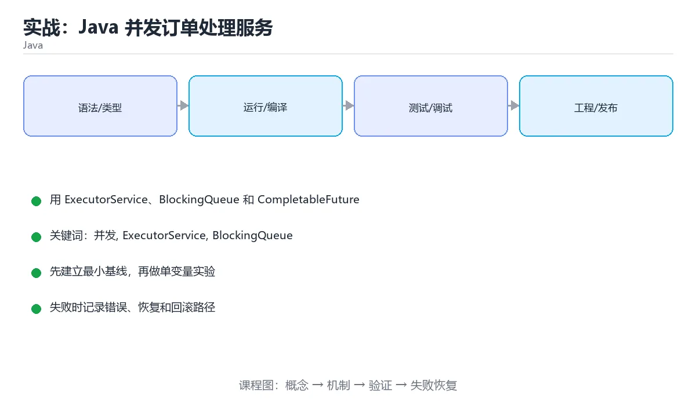

# 实战：Java 并发订单处理服务




> 内容更新时间：2026-10-06 · 学习阶段：高级 · 预计用时：60 分钟

## 本节知识框架

想象你开了一家快递公司，每天要处理几千个订单。每个订单都要查一下支付状态（调用外部接口），查完了才能发货。如果一个个排队查，一天都处理不完。

解决方案：雇一支配送团队（线程池），大家同时查支付状态。但要解决几个问题：
- 团队人数有限，来太多任务怎么办？（有界队列 + 拒绝策略）
- 某个查询特别慢怎么办？（超时取消，不让它拖住其他人）
- 查询失败了怎么办？（重试，但间隔要越来越长，避免打垮下游）

本课主线：用 ExecutorService、BlockingQueue 和 CompletableFuture 处理订单，覆盖限流、超时和重试。

1. **并发**——多个任务在重叠时间窗口内推进，关注共享状态、同步与调度。
2. **ExecutorService**——线程池接口，提交任务、批量执行并获取 Future。
3. **超时**——给每个任务设一个截止时间，超了就取消。
4. **指数退避**——重试间隔按 2 的幂增长并加随机抖动，避免下游故障时被重试打垮。
5. **线程池**——复用固定数量线程处理任务，避免频繁创建销毁。

先修内容：《实战：Java 库存管理 REST 服务》。后续衔接：《现代 Java：Record、Sealed 与模式匹配》。

### 复习清单

- [ ] 能不看正文说出并发、ExecutorService、超时各自的含义与一个易错点。
- [ ] 能运行或推演本课示例，记录输入、输出和失败现象。
- [ ] 能完成一次自测，并把错题对照错误表定位原因。

## 核心概念定义

| 术语 | 一句话说明 |
| --- | --- |
| `并发` | 多个任务在重叠时间窗口内推进，关注共享状态、同步与调度。坑：并发下数据错乱，要用不可变对象或加锁。 |
| `ExecutorService` | 线程池接口：提交任务、批量执行并获取 Future；需按业务设置队列与拒绝策略。坑：单线程通过不代表并发下成立。 |
| `超时` | 给外部调用设截止时间，防止慢请求拖住整个系统。坑：超时后要能取消任务并释放资源。 |
| `指数退避` | 重试间隔按 2 的幂增长并加随机抖动，避免下游故障时被重试打垮。坑：只在当前前提下成立。 |
| `线程池` | 复用固定数量线程处理任务，避免频繁创建销毁，并需要定义队列和拒绝策略。坑：无界队列会导致内存暴涨。 |
| `BlockingQueue` | 带阻塞语义的任务缓冲区，用容量把突发流量整形。坑：容量写成 0 或换成无界实现，限流当场失效。 |
| `CompletableFuture` | 把异步结果串成链，orTimeout 管截止、exceptionally 管兜底。坑：链上异常会被包成 CompletionException，按原类型判断会漏。 |
| `幂等` | 同一请求执行一次和执行多次，落库结果相同，靠唯一键或去重表保证。坑：只验证单次调用幂等，重试叠加时仍会重复扣款。 |

## 原理与运行机制

### 项目背景

订单系统需要批量处理支付回调：每个订单调用外部支付查询，失败要重试，整体任务有超时，单个订单失败不能阻塞其他订单。

### 技术栈

- Java 21
- ExecutorService + BlockingQueue
- CompletableFuture
- JUnit 5

### 架构与数据流

1. **提交订单任务** → 把每个订单封装成一个 Callable 任务
2. **线程池执行** → 固定 8 个线程，有界队列限制内存
3. **超时控制** → 每个支付查询最多等 2 秒
4. **失败重试** → 指数退避，最多重试 3 次
5. **汇总结果** → 收集成功、失败和重试次数

### 功能范围

这份交付物只做下面五件事，对账、退款、风控都留给后续迭代，避免并发边界还没稳就叠新功能：

- [ ] 接收一批订单号并发查询支付状态，同时在跑的任务数与排队数由线程池和队列容量共同决定。
- [ ] 单笔查询超过 2 秒判为超时，超时与失败分开计数，不混成同一个「错误数」。
- [ ] 对可重试的失败做最多 3 次指数退避重试，重试始终复用同一个订单号作为幂等键。
- [ ] 队列打满时快速拒绝并回写明确原因，绝不允许任务无限堆积。
- [ ] 进程退出前停止接收新任务，并给已提交任务一段收尾时间。

### 关键代码

```java
ExecutorService pool = Executors.newFixedThreadPool(8);
CompletableFuture<Result> future = CompletableFuture
    .supplyAsync(() -> queryPayment(orderId), pool)
    .orTimeout(2, TimeUnit.SECONDS)
    .exceptionally(error -> Result.failed(orderId, error));
Result result = future.join();
```

### 有界队列为什么决定内存上限

线程池的处理方式可以类比医院急诊：医生数量短期加不上去，病人只能先在走廊排队，队列就是这条走廊。走廊长度可控时，超出容量的病人会被明确劝退（拒绝策略）；走廊无限长时，病人一直堆积，最后撑爆的是整栋楼——堆内存。`Executors.newFixedThreadPool(8)` 默认用的正是容量近乎无限的 `LinkedBlockingQueue`，提交速度一旦长期高于处理速度，老年代会以可见的斜率上涨直到 OOM，这就是「无界队列的主要风险是内存持续增长」的由来。

生产代码更稳妥的写法是直接构造 `ThreadPoolExecutor`，把最大队列长度显式写出来，并选定拒绝策略：`CallerRunsPolicy` 让提交方自己跑一次，天然形成背压；`AbortPolicy` 快速抛 `RejectedExecutionException`，适合把订单号转写进补偿表稍后重放。

### 超时沿 CompletableFuture 链的传播

`orTimeout(2, TimeUnit.SECONDS)` 不会中断已经在跑的 `queryPayment`，它只是在第 2 秒让这个 future 以 `TimeoutException` 异常完成，随后 `exceptionally` 被触发，得到一个 `Result.failed(...)`。要注意异常在链上会被包装：`future.join()` 抛的是 `CompletionException`，真正的超时原因在 `getCause()` 里，所以 `error instanceof TimeoutException` 这种直接判断经常匹配不到，需要先剥一层。把异常在链的末端统一转成业务结果对象，后面的批量汇总才不会被一个慢订单打断整批统计。

### 优雅关闭的两步顺序

关闭线程池的节奏是「先关门，再等客人吃完」：

1. `pool.shutdown()`：停止接收新任务，队列里已有的任务继续跑完。
2. `pool.awaitTermination(30, TimeUnit.SECONDS)`：给已提交任务一段收尾窗口，返回 `false` 表示还有任务没结束。
3. 只有窗口到期仍未结束、且业务允许丢弃时，才调用 `shutdownNow()`，并检查它返回的待执行任务列表，把这些订单号重新入队或落补偿表。

跳过前两步直接 `shutdownNow()`，未启动的任务会被静默丢弃；连 `shutdown()` 都不调用，非守护线程会让 JVM 一直退不出去，这正是「忘记关闭线程池」那条易错点的现场表现。

### 退避为什么是重试的前提

假设下游故障 10 秒，客户端用固定 100 毫秒间隔重试 3 次，故障期间的调用量会瞬间翻成正常流量的数倍，下游被自己的重试流量踩住，恢复时间被进一步拉长。指数退避把间隔改成 200ms、400ms、800ms 这一量级，再加随机抖动（jitter），把同一瞬间涌来的重试打散到不同时间点。配套还需要两件事：给单次请求设重试次数上限，给整条调用链设一个「重试预算」（例如最多额外消耗 10% 流量），超预算就快速失败并降级，避免故障从下游倒灌进自己的线程池。

### 项目专属规格

用 ExecutorService、BlockingQueue 和 CompletableFuture 处理订单，覆盖限流、超时和重试。项目目标是把「并发、ExecutorService、BlockingQueue、CompletableFuture、超时」落实为可运行、可测试、可回滚的交付物。

**验收场景**：
1. 正常路径：最小输入得到预期输出，并留下日志与指标。
2. 边界路径：空值、极值和依赖失败各跑一次，确认边界行为与正文一致。
3. 失败路径：依赖超时或不可用时能快速失败、重试或降级。
4. 幂等路径：同一请求执行两次不会产生重复副作用。
5. 回滚路径：并发处理的失败能按预案恢复，并记录影响范围。

### 项目交付物

```text
src/main/java/
src/main/resources/
src/test/java/
pom.xml
README.md
```

**质量门禁**：
- [ ] 格式化和静态检查通过，不遗留明显警告。
- [ ] 单元测试覆盖并发的核心规则，集成测试覆盖外部边界。
- [ ] 错误响应不泄露堆栈和密钥。
- [ ] README 写清启动、测试、配置和回滚步骤。

### 验证命令与预期输出

| 阶段 | 命令 | 预期输出 |
| --- | --- | --- |
| 编译 | `./mvnw -q -DskipTests package` | 生成 JAR 且编译无错误 |
| 运行测试 | `./mvnw test` | JUnit 测试全部通过 |
| 启动服务 | `java -jar target/app.jar` | 端口监听成功并输出启动日志 |

## 典型应用场景

### 实施步骤

1. **定义任务和结果模型**：先写清依赖配置、数据和最终产物。
2. **创建固定线程池与有界队列**：用最小请求证明这一步的结果正确。
3. **封装带超时的支付查询**：每个订单调用外部支付查询，失败要重试。
4. **实现有限次数的指数退避重试**：重试间隔按 2 的幂增长并加随机抖动。
5. **汇总结果并关闭线程池**：收集成功、失败和重试次数。
6. **用并发测试验证取消和异常路径**：制造一次输入错误或依赖失败。

### 测试与验收

- 慢任务超时后不会阻塞其他订单
- 队列满时返回明确拒绝而不是 OOM
- 线程池关闭后不再接受新任务

### 场景演练：支付网关抖动 30 秒

现象是 P99 延迟从 300ms 抬到 5s，队列长度先涨后稳，拒绝计数开始不为零。排查顺序固定三步：

1. 先分清「超时」还是「被拒绝」——超时说明下游变慢，被拒绝说明自己这边的队列已满，两者的处理方向相反。
2. 再看拒绝来自队列满还是来自显式限流，前者要调容量与线程数，后者要调速率。
3. 最后核对重试次数是否同步上涨；如果重试量远大于失败量，说明退避没生效或者重试没有上限。

动作可以是：把超时从 2 秒收紧到 1 秒以尽快归还线程，把重试上限从 3 降到 1，对被拒绝的订单号写入补偿表，等下游恢复后按同一个幂等键重放。

### 什么时候不该引入这套结构

订单量很小、下游是本地内存服务时，线程池加队列只多了一次排队和一份调试负担，直接同步调用反而更清楚。值得引入并发的信号是三个同时成立：调用外部系统、单次耗时不可控、一批任务之间互不依赖。缺任意一条，先别加线程池。

**选择与边界**：
- 使用 `并发` 时，共享可变状态必须加锁或用不可变对象。
- 使用 `ExecutorService` 时，必须设置有界队列和拒绝策略。
- 使用 `指数退避` 时，重试间隔要加随机抖动避免同步重试。

## 代码/协议/SQL 示例

### 最小可验证示例

```java
import java.util.concurrent.*;

public class OrderProcessor {
    public static void main(String[] args) throws Exception {
        ExecutorService pool = Executors.newFixedThreadPool(4);

        // 模拟批量订单处理
        CompletableFuture<String>[] futures = new CompletableFuture[3];
        for (int i = 0; i < 3; i++) {
            final int orderId = i;
            futures[i] = CompletableFuture
                .supplyAsync(() -> "订单" + orderId + "处理完成", pool)
                .orTimeout(2, TimeUnit.SECONDS)
                .exceptionally(e -> "订单" + orderId + "失败: " + e.getMessage());
        }

        // 等待所有结果
        CompletableFuture.allOf(futures).join();
        for (var f : futures) {
            System.out.println(f.get());
        }
        pool.shutdown();
    }
}
```

```text
订单0处理完成
订单1处理完成
订单2处理完成
```

运行方式：保存为 `.java` 后用 `javac` 编译、`java` 运行；注意类名与文件名一致。

### 完整示例：有界队列 + 退避重试 + 优雅关闭

下面这版把本课四个约束收在同一段代码里：队列有界、查询有超时、失败有退避重试、退出有关闭流程。`PaymentGateway` 用最简桩类占位，换成真实 HTTP 调用时结构不用改。

```java
import java.util.List;
import java.util.concurrent.*;

public class OrderPipeline {
    record Result(String orderId, String state, int attempts) {}

    static class PaymentGateway {
        static class TemporarilyUnavailable extends RuntimeException {}

        static String query(String orderId) {
            return "PAID";            // 桩实现：真实调用在这里抛 TemporarilyUnavailable
        }
    }

    static final ThreadPoolExecutor POOL = new ThreadPoolExecutor(
            8, 8, 0L, TimeUnit.MILLISECONDS,
            new ArrayBlockingQueue<>(64),                  // 最多 64 单排队，超出即触发拒绝策略
            new ThreadPoolExecutor.CallerRunsPolicy());    // 提交方自己跑一次，形成背压

    static CompletableFuture<Result> handle(String orderId) {
        return CompletableFuture
                .supplyAsync(() -> queryWithRetry(orderId, 3), POOL)
                .orTimeout(2, TimeUnit.SECONDS)            // 第 2 秒以 TimeoutException 完成
                .handle((state, error) -> error == null
                        ? new Result(orderId, state, 1)
                        : new Result(orderId, classify(error), 3));
    }

    static String classify(Throwable error) {
        Throwable root = error instanceof CompletionException && error.getCause() != null
                ? error.getCause()                         // 链上的真实原因被包了一层
                : error;
        if (root instanceof TimeoutException) return "TIMEOUT";
        if (root instanceof RejectedExecutionException) return "THROTTLED";
        return "FAILED";
    }

    static String queryWithRetry(String orderId, int maxRetry) {
        long backoff = 200L;
        for (int attempt = 1; attempt <= maxRetry; attempt++) {
            try {
                return PaymentGateway.query(orderId);       // 幂等键就是 orderId，重试不换单号
            } catch (PaymentGateway.TemporarilyUnavailable e) {
                if (attempt == maxRetry) return "FAILED";
                sleep(backoff + ThreadLocalRandom.current().nextLong(100)); // 抖动打散重试时刻
                backoff *= 2;                               // 200 → 400 → 800 ms
            }
        }
        return "FAILED";
    }

    static void sleep(long millis) {
        try {
            Thread.sleep(millis);
        } catch (InterruptedException ie) {
            Thread.currentThread().interrupt();             // 还原中断标志，关闭流程才切得断
        }
    }

    public static void main(String[] args) throws InterruptedException {
        List<String> ids = List.of("A-1001", "A-1002", "A-1003", "A-1004");
        List<Result> results = ids.stream()
                .map(id -> handle(id).join())
                .toList();
        results.forEach(r -> System.out.println(r.orderId() + " " + r.state()));
        shutdownGracefully();
    }

    static void shutdownGracefully() throws InterruptedException {
        POOL.shutdown();                                    // 第 1 步：不再接收新任务
        if (!POOL.awaitTermination(30, TimeUnit.SECONDS)) { // 第 2 步：给已提交任务收尾窗口
            POOL.shutdownNow();                             // 第 3 步：超窗才强停，返回的未启动任务要另行落表
        }
    }
}
```

```text
A-1001 PAID
A-1002 PAID
A-1003 PAID
A-1004 PAID
```

### 练习：改线程数找拐点

把 `POOL` 的 8 依次改成 1、4、16，各跑一次同一批 200 个订单，记下「总耗时、队列峰值、拒绝次数」三个数字。如果 16 档的总耗时不降反升，先别继续加线程——瓶颈多半已经移到下游连接数或数据库上，此时加并发只会把队列推得更长。

## 时间/空间复杂度或性能分析

**性能关注点**：JVM 预热与 GC 影响测量——记录吞吐、P99 延迟与堆占用，先跑预热再采样。

**本课特有开销**：并发度提高后要观察是否出现拐点——延迟上升而吞吐不增，说明瓶颈已转移。

**测量方法**：固定输入跑一遍记录基线，再把并发度提高一个数量级复测；两次结果的差值才是结论依据。

### 排队长度与容量怎么选

用利特尔法则 L = λ × W 估一下：订单到达率 λ 为每秒 40 单、单笔处理时间 W 为 200 毫秒时，稳态下在队任务数 L 约等于 8，队列给 64 就有足够余量吸收抖动。若下游变慢使 W 升到 2 秒，L 立刻变成 80，队列先打满、随后开始拒绝。这条换算关系解释了为什么「内存暴涨」和「快速拒绝」是同一件事的两种写法：队列有界就表现为拒绝计数上升，队列无界就表现为堆占用一路涨到 OOM。

### 必须记录的三个数字

1. 队列峰值长度与打满次数：决定容量参数是否定得过低或过高。
2. 超时率与重试率：重试量明显高于失败量，通常说明退避间隔太短或者缺总次数上限。
3. 单个任务的线程持有时间：并发数提高而吞吐不涨时，去看锁竞争、连接池上限和下游配额，而不是继续加线程。

线程数从 n 提到 2n 时，排队等待大致按倍数下降，但下游连接与锁竞争的开销同时上升，因此吞吐曲线一定有拐点；拐点之后每次读数都要写明版本与输入规模，否则换环境就不成立。

## 常见误区与易错点

| 容易写错的做法 | 实际现象 | 原因与正确做法 |
| --- | --- | --- |
| 共享可变状态不加同步 | 并发下数据错乱 | 用不可变对象，或加锁与原子类型保护 |
| 线程池使用无界队列 | 任务堆积导致内存暴涨 | 设置有界队列与拒绝策略 |
| 忽略事务边界与幂等 | 重试产生重复订单 | 用唯一键与幂等设计，并明确事务范围 |
| 忘记关闭线程池 | 进程无法退出 | 用 try/finally 调用 shutdown |
| 重试不加退避 | 下游故障时被重试打垮 | 用指数退避加随机抖动 |
| 用 `Executors.newFixedThreadPool` 顶住突发流量 | 默认近乎无界的队列先涨满老年代，故障表现为 OOM 而不是拒绝 | 显式构造 `ThreadPoolExecutor`，写出队列容量与拒绝策略 |
| `future.get()` 不传超时 | 一个慢查询把调用线程一起拖住，整批订单停摆 | 用 `get(timeout, unit)` 或 `orTimeout`，并显式处理 `TimeoutException` |
| 关闭时直接 `shutdownNow` | 队列里还没启动的任务被丢弃，订单静默消失 | 先 `shutdown` 停止接收，再 `awaitTermination` 等收尾，超窗才强停 |
| 每次重试用新生成的请求号 | 下游无法去重，重复订单照样落库 | 幂等键固定为订单号，只调退避间隔，不换业务标识 |

**现场排错示范**：

**症状**：共享可变状态不加同步，并发下数据错乱。
**根因**：多线程同时修改同一个变量没有加锁。
**修复**：用不可变对象，或加锁与原子类型保护。
**自检**：在本课示例里复现该现象，改成加锁后重跑；如果症状消失说明定位正确。

**现场排错示范二**：

**症状**：发版时进程卡在关闭阶段，线程快照里成排的 `pool-1-thread-*` 还停在队列的 `take()` 上，订单处理量统计却已经不再增长。
**根因**：只提交了任务，从未调用 `shutdown()`，线程池里的非守护线程让 JVM 无法退出。
**修复**：把 `shutdown()` 与 `awaitTermination()` 放进 `try/finally` 或应用的停止钩子，超时后才升级为 `shutdownNow()` 并处理它返回的待执行任务。
**自检**：提交 10 个任务后立即走关闭流程，确认这 10 个都执行完成、进程在窗口时间内退出；再把任务数改成 100 复跑，观察是否有任务凭空消失。

## 与其他知识点的关系

- **先修**：`实战：Java 库存管理 REST 服务`。本课默认 Spring Boot 和事务已经掌握。
- **相关或后续**：`现代 Java：Record、Sealed 与模式匹配`。本课术语会在这些课程里继续使用。

**容易混淆的相邻概念**：
- `并发` vs `并行`：并发是任务在重叠时间窗口内推进，并行是任务真正同时执行。
- `ExecutorService` vs `CompletableFuture`：前者管理线程池，后者组合异步结果。
- `超时` vs `重试`：超时是单次调用的截止时间，重试是失败后的再次尝试。

**边界上的三个近邻机制**：
- 线程池加队列是在自己进程里给流量整形，令牌桶是按固定速率放行，熔断是发现下游坏了就暂时不打。三者作用点不同，可以叠加，但不能互相替代：只做熔断而不设队列上限，内存照样会被涌进来的请求吃掉。
- 幂等键的命名要和《实战：Java 库存管理 REST 服务》共用同一套规则，否则同一笔订单在两课示例里会算成两笔，重试去重直接失效。
- Java 21 的虚拟线程让「一个任务一个线程」变便宜，但超时、退避和背压这些约束不会因为线程变轻就消失，队列或信号量仍要有一个明确的容量载体。

## 自测题与参考答案

> 先独立作答，再对照参考答案；答案都能在本课正文、术语表或错误表里找到依据。

### 自测 1（概念复述）

不看正文，写出 `并发` 的操作性定义，并说明它与 `ExecutorService` 的区别。

**参考答案**：多个任务在重叠时间窗口内推进，关注共享状态、同步与调度。ExecutorService 的定位是：线程池接口，提交任务、批量执行并获取 Future；两者的差别要从适用对象与失败模式上说明。

### 自测 2（排错）

本课错误表记录了「共享可变状态不加同步」这类做法。请写出它会出现的现象、根因，以及修复顺序。

**参考答案**：现象是并发下数据错乱；正确做法是用不可变对象，或加锁与原子类型保护。修复时先复现现象并保留证据，再改动一处假设重跑，确认现象消失。

### 自测 3（动手验证）

运行本课的示例，改动其中一个输入后重新运行，记录输出与错误信息。

**参考答案**：正常输入下示例应当复现正文给出的结果；改动输入后，如果结果改变或报错，先核对它是否满足并发的适用范围，再检查错误表里是否有同类现象。

### 自测 4（代码阅读）

阅读本课的 Java 示例，说明它体现了并发的哪一条性质，并指出改动哪个输入会让这条性质不再成立。

**参考答案**：并发的定义是多个任务在重叠时间窗口内推进，示例正是在实现这条定义。改动与并发有关的一个输入后，如果结果不再符合正文描述，就说明该性质只在当前前提成立。

### 自测 5（迁移）

把实战：Java 并发订单处理服务的方法迁移到自己的项目：围绕并发写出一个与错误表同类的风险点，并说明触发条件和检验方式。

**参考答案**：例如「忽略事务边界与幂等」，它会导致重试产生重复订单；检验方式是按用唯一键与幂等设计改一处再复现，确认现象消失且没有引入新的失败分支。

## 术语速查

| 术语 | 一句话说明 |
| --- | --- |
| `并发` | 多个任务在重叠时间窗口内推进，关注共享状态、同步与调度。 |
| `ExecutorService` | 线程池接口：提交任务、批量执行并获取 Future；需按业务设置队列与拒绝策略。 |
| `超时` | 给外部调用设截止时间，防止慢请求拖住整个系统。 |
| `指数退避` | 重试间隔按 2 的幂增长并加随机抖动，避免下游故障时被重试打垮。 |
| `线程池` | 复用固定数量线程处理任务，避免频繁创建销毁，并需要定义队列和拒绝策略。 |
| `CompletableFuture` | 组合多个异步任务的结果，支持链式调用和异常处理。 |
| `BlockingQueue` | 带阻塞语义的任务缓冲区，容量决定内存上限与拒绝时机。 |
| `拒绝策略` | 队列打满时的处理方案：调用方自跑、快速抛错或直接丢弃，丢弃必须留痕。 |
| `背压` | 下游处理不过来时把压力回传给上游，让提交方变慢而不是让队列无限增长。 |
| `幂等键` | 让同一请求重复执行只产生一次副作用的业务标识，重试时不能更换。 |
| `优雅关闭` | 先停止接收新任务，再给已提交任务一段收尾时间的停机流程。 |
| `抖动` | 在退避间隔上叠加随机量，把同一瞬间的重试请求摊到不同时间点。 |

## 考点精讲

`实战：Java 并发订单处理服务` 的题库有 6 道题，下面逐题给出题干、正确项与判断依据：先自己作答，再核对正确项，最后回到正文对应小节复核。

### 考点 1：第 1 题

- **题目**：无界队列的主要风险是什么？
- **正确项**：内存持续增长
- **判断依据**：本题正确项是「内存持续增长」。术语 并发（实战：Java 并发订单处理服务）：多个任务在重叠时间窗口内推进，关注共享状态、同步与调度，本题取「内存持续增长」这条。易错点是共享可变状态不加同步，会造成并发下数据错乱，改法是用不可变对象，或加锁与原子类型保护。

### 考点 2：第 2 题

- **题目**：围绕“实战：Java 并发订单处理服务”中的 并发、ExecutorService、BlockingQueue，下列哪两项是本课强调的实践判断？
- **正确项**：验证 ExecutorService 时要固定版本并覆盖边界输入，结论才可复现；学习 并发 时要同时说明输入、输出和失败路径，不能只看正常流程
- **判断依据**：按《实战：Java 并发订单处理服务》的正文口径，本题要同时选中「验证 ExecutorService 时要固定版本并覆盖边界输入，结论才可复现」、「学习 并发 时要同时说明输入、输出和失败路径，不能只看正常流程」，漏掉任一项都算没答全。术语 并发（实战：Java 并发订单处理服务）：多个任务在重叠时间窗口内推进，关注共享状态、同步与调度。易错点是线程池使用无界队列，会造成任务堆积导致内存暴涨，改法是设置有界队列与拒绝策略。

### 考点 3：第 3 题

- **题目**：调用下游失败后的重试策略里，为什么必须配合退避？
- **正确项**：避免故障时放大流量
- **判断依据**：本题正确项是「避免故障时放大流量」。术语 并发（实战：Java 并发订单处理服务）：多个任务在重叠时间窗口内推进，关注共享状态、同步与调度，本题取「避免故障时放大流量」这条。易错点是忽略事务边界与幂等，会造成重试产生重复订单，改法是用唯一键与幂等设计，并明确事务范围。

### 考点 4：第 4 题

- **题目**：线程池关闭前应该做什么？
- **正确项**：停止接收新任务并等待已提交任务
- **判断依据**：本题正确项是「停止接收新任务并等待已提交任务」。术语 线程池（实战：Java 并发订单处理服务）：复用固定数量线程处理任务，避免频繁创建销毁，并需要定义队列和拒绝策略，本题取「停止接收新任务并等待已提交任务」这条。易错点是忘记关闭线程池，会造成进程无法退出，改法是用 try/finally 调用 shutdown。

### 考点 5：第 5 题

- **题目**：下面代码在支付查询超过 2 秒时会发生什么？
- **正确项**：future 以超时异常完成并进入 exceptionally 分支
- **判断依据**：本题正确项是「future 以超时异常完成并进入 exceptionally 分支」。术语 超时（实战：Java 并发订单处理服务）：本课涉及：并发、ExecutorService、BlockingQueue、CompletableFuture、超时，本题取「future 以超时异常完成并进入 exceptionally 分支」这条。易错点是重试不加退避，会造成下游故障时被重试打垮，改法是用指数退避加随机抖动。

### 考点 6：第 6 题

- **题目**：下面几项都与 `并发` 有关，请按 `实战：Java 并发订单处理服务` 的正文顺序排列；该课主线是用 ExecutorService、BlockingQueue 和 CompletableFuture 处理订单，覆盖限流、超时和重试。
- **正确项**：项目背景 → 技术栈 → 架构与数据流 → 功能范围
- **判断依据**：按《实战：Java 并发订单处理服务》正文的先后，本题顺序是「项目背景」 → 「技术栈」 → 「架构与数据流」 → 「功能范围」。术语 并发（实战：Java 并发订单处理服务）：多个任务在重叠时间窗口内推进，关注共享状态、同步与调度。易错点是共享可变状态不加同步会造成并发下数据错乱，改法是用不可变对象，或加锁与原子类型保护。本课实战：Java 并发订单处理服务要解决的是用 ExecutorService、BlockingQueue 和 CompletableFuture 处理订单，覆盖限流、超时和重试。

## 内容元数据

- 内容版本：v2.0
- 最后更新：2026-10-06
- 学习阶段：高级
- 适用环境：Java 21+ / Maven 或 Gradle；本课聚焦并发。
- 内容来源：内置结构化课程与工程实践整理
- 相关主题：并发、ExecutorService、BlockingQueue、CompletableFuture、超时
- 质量版本：P0 测验标准 + P1 覆盖扩展 + P2 体验补全

## 参考资料与复核

- 最后复核：2026-10-04
- 下次复核：2027-02-24
- 复核范围：版本兼容、API 行为、安全建议与工程实践
- 来源性质：官方文档、标准或权威教材；本课核对关键词：并发、ExecutorService、BlockingQueue、CompletableFuture、超时。

| 参考资料 | 本课用途 |
| --- | --- |
| [Spring Boot 文档](https://docs.spring.io/spring-boot/docs/current/reference/html/) | REST 服务与自动配置 |
| [Java 并发教程](https://docs.oracle.com/javase/tutorial/essential/concurrency/) | 线程、同步与并发工具 |
| [Java SE API](https://docs.oracle.com/en/java/javase/21/docs/api/) | 标准库 API |
