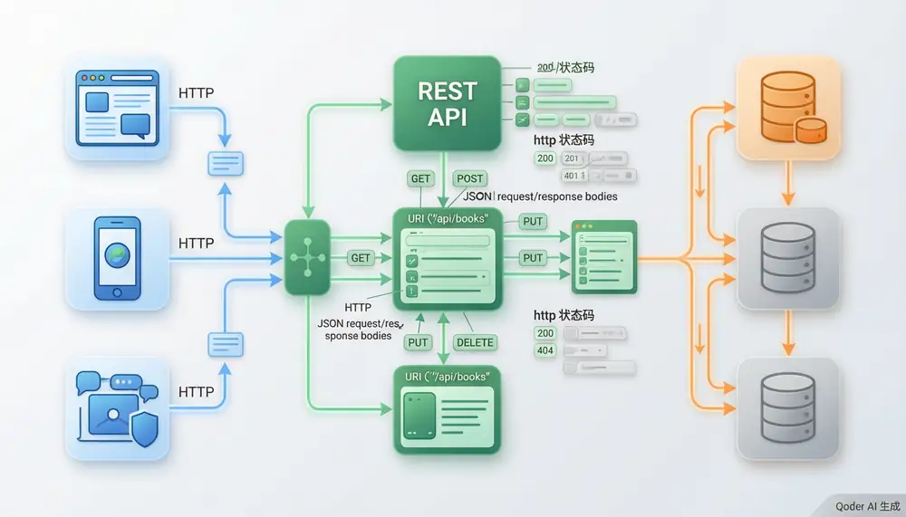

# RESTful API 设计与实现

> 内容更新时间：2026-10-20 · 学习阶段：进阶 · 预计用时：50 分钟

> 学习阶段：进阶 · 预计用时：50 分钟 · 配图：RESTful API 架构



## 本节知识框架

想象你去一家自助餐厅。餐厅有一套标准的点餐流程：你看菜单选菜（GET 获取资源）、提交订单（POST 创建资源）、修改菜品口味（PUT 更新资源）、取消订单（DELETE 删除资源）。每种操作都有明确的规则，服务员不会记住你上次点了什么（无状态），而且取消订单这个动作不管你喊几次，结果都一样——订单被取消（幂等性）。

RESTful API 就是软件世界的"标准点餐流程"。它让不同的系统——不管是手机 App、网页还是第三方服务——都能用统一的"语言"来交流。

**本课知识地图**

```text
REST 核心原则 → HTTP 方法映射 → 状态码规范 → HATEOAS → Spring Boot 实战 → 分页与过滤 → 全局异常处理
```

**学完本课你将能够**：

1. 解释 REST 架构风格的核心原则和约束条件。
2. 正确使用 HTTP 方法（GET、POST、PUT、DELETE）设计 CRUD 接口。
3. 理解幂等性和无状态通信的含义及其在实际开发中的意义。
4. 使用 Spring Boot 的 `@RestController`、`ResponseEntity` 等注解实现完整的 RESTful API。
5. 实现分页、过滤和全局异常处理等生产级功能。

**先修知识**：你需要了解 Java 基础语法和面向对象（来自《Java 基础》），Servlet 的基本概念（来自《Servlet 与 JSP 基础》），以及 Spring IoC 和依赖注入（来自《Spring Framework 核心》）。如果这些还不熟，建议先回顾一下。

**复习清单**

- [ ] 复习 REST 六大原则和 HTTP 方法对照表，能脱口说出每个方法对应的 CRUD 操作
- [ ] 手写一遍 Spring Boot CRUD 控制器代码，不看参考
- [ ] 区分 200、201、204、400、404、500 状态码的使用场景
- [ ] 理解幂等性的含义，能判断 GET/PUT/DELETE 幂等而 POST 不幂等

---

## 核心概念定义

我们先用一张"生活对照表"来认识本课的核心术语。

| 术语 | 一句话定义 | 生活类比 |
| --- | --- | --- |
| REST | Representational State Transfer，一种基于 HTTP 协议的软件架构风格，规定了一套无状态的资源交互方式。 | 餐厅的标准点餐流程——所有餐厅都用同样的方式接单、上菜、结账，顾客去哪家餐厅都知道怎么点。 |
| 资源（Resource） | 网络上一个可标识的数据实体，用 URI（统一资源标识符）来定位。 | 餐厅里的每道菜——"宫保鸡丁"就是一道资源，有唯一的编号。 |
| 表述性状态转移 | 客户端和服务器之间传递的是资源的"表述"（如 JSON），通过操作这些表述来转移资源的状态。 | 你看的是菜单上的照片和描述（表述），而不是厨房里的真菜。通过下单，让厨房把真菜的状态从"未做"变成"已做"。 |
| HTTP 方法 | 对资源执行的操作。GET 获取、POST 创建、PUT 全量更新、DELETE 删除。 | GET 是"看菜单"，POST 是"下新单"，PUT 是"改订单"，DELETE 是"取消订单"。 |
| 幂等性 | 同一个操作执行一次和执行多次，效果完全一样。 | 按电梯的"关门"按钮——不管你按一次还是十次，门都会关上，效果一样。 |
| 无状态 | 服务器不保存客户端的会话状态，每个请求都包含处理所需的全部信息。 | 餐厅服务员不记老顾客的习惯——每次点单都从头确认，避免出错。 |
| @RestController | Spring 注解，标记一个类为 REST 控制器，所有方法默认返回数据而非视图。 | 给一个窗口贴上"对外服务"的牌子，告诉所有人这里可以办理业务。 |
| @RequestBody | Spring 注解，将 HTTP 请求体中的 JSON 自动转换为 Java 对象。 | 服务员把你手写的中文订单自动翻译成厨房能看懂的标准工单。 |
| @ResponseBody | Spring 注解，将方法返回的 Java 对象自动转换为 JSON 写入响应体。 | 厨师把做好的菜装盘摆好，服务员直接端给客人，不需要额外的包装步骤。 |
| ResponseEntity | Spring 提供的类，可以完整控制 HTTP 响应——包括状态码、响应头和响应体。 | 一个完整的快递包裹：里面装着商品（响应体），外面贴着快递单（状态码），还有备注标签（响应头）。 |
| DTO（数据传输对象） | 专门用来在 API 层传递数据的对象，与数据库实体分离，起到"翻译"和"过滤"的作用。 | 餐厅的外卖菜单——只展示顾客需要知道的菜名和价格，不会把厨房的配方和进货渠道也写上去。 |

---

## 原理与运行机制

### REST 到底在解决什么问题？

在 REST 出现之前，不同的系统之间通信各有各的方式——有的用自定义协议，有的用 XML-RPC，有的用 SOAP。这就像每条街上的餐厅都有自己的点餐规则：有的要写暗号，有的要先填三张表格，有的要和服务员对暗语。顾客每换一家餐厅就得重新学一套规则，非常麻烦。

2000 年，Roy Fielding 在他的博士论文中提出了 REST 架构风格。REST 的核心思想很简单：**把所有数据都当作"资源"，每个资源都有唯一的地址（URI），所有人用同一套标准动作（HTTP 方法）来操作这些资源。**

就像全世界的餐厅都统一用了"看菜单 → 写订单 → 等上菜 → 结账走人"的流程，顾客不管去哪家餐厅都知道怎么操作。

### REST 的六大原则

1. **资源导向**：一切皆资源，每个资源有唯一的 URI。比如 `/api/books/1` 代表编号为 1 的书。
2. **统一接口**：所有资源都用标准的 HTTP 方法来操作，不需要发明新的动词。
3. **无状态**：每个请求都自给自足，服务器不记住上一次请求的内容。就像每次去银行柜台办事，你都得重新出示身份证。
4. **客户端-服务器分离**：前端和后端各自独立演进，只要接口不变，两边可以分别升级。
5. **可缓存**：响应数据可以标注为"可缓存"或"不可缓存"，减少不必要的网络请求。
6. **分层系统**：可以在中间加入负载均衡、缓存、网关等层，客户端不需要知道背后有几层。

### HTTP 方法与 CRUD 的对应关系

这是 RESTful API 最核心的设计规则——用 HTTP 方法来表达你想对资源做什么操作：

| HTTP 方法 | CRUD 操作 | 含义 | 是否幂等 | 示例 |
| --- | --- | --- | --- | --- |
| GET | Read（读取） | 获取资源 | 是 | `GET /api/books` 获取所有书籍 |
| POST | Create（创建） | 创建新资源 | 否 | `POST /api/books` 创建一本新书 |
| PUT | Update（更新） | 全量更新资源 | 是 | `PUT /api/books/1` 更新编号 1 的书 |
| DELETE | Delete（删除） | 删除资源 | 是 | `DELETE /api/books/1` 删除编号 1 的书 |

**幂等性怎么理解？**

想象电梯的"关门"按钮：
- **幂等的操作**（GET、PUT、DELETE）：按一次关门，按十次也关门——结果一样。GET 十次 `/api/books/1` 拿到的数据一样；DELETE 同一个资源十次，结果都是"已删除"。
- **非幂等的操作**（POST）：每按一次就多出一个人——每次 POST 都会创建一条新记录。

### HTTP 状态码规范

服务器处理完请求后，会用状态码告诉客户端结果如何。就像你去餐厅点菜，服务员会用不同的回应告诉你情况：

| 状态码范围 | 含义 | 常见示例 | 使用场景 |
| --- | --- | --- | --- |
| 2xx 成功 | 请求被成功处理 | 200 OK、201 Created、204 No Content | "好的，您的菜来了" / "新菜已下单" / "已取消，不需要上菜" |
| 3xx 重定向 | 需要进一步操作 | 301 永久重定向、304 未修改 | "这道菜换了新名字，请去新窗口点" |
| 4xx 客户端错误 | 请求有问题 | 400 Bad Request、401 未授权、404 未找到 | "您说的菜名我听不懂" / "请先办会员卡" / "我们没有这道菜" |
| 5xx 服务器错误 | 服务器出了问题 | 500 内部错误、503 服务不可用 | "厨房着火了，请稍后再来" |

**关键规则**：
- 创建资源成功 → 返回 **201 Created**（不是 200）
- 删除资源成功 → 返回 **204 No Content**（没有内容需要返回）
- 资源不存在 → 返回 **404 Not Found**
- 参数校验失败 → 返回 **400 Bad Request**

### HATEOAS（超媒体驱动）

HATEOAS 是 REST 的最高境界，全称是 Hypermedia As The Engine Of Application State。听起来很复杂，其实道理很简单：

**API 的响应中应该包含"下一步可以做什么"的链接，就像餐厅菜单上每道菜旁边都写着"可以加辣"、"可以配米饭"。**

```json
{
  "id": 1,
  "title": "Spring Boot 实战",
  "links": [
    { "rel": "self", "href": "/api/books/1" },
    { "rel": "reviews", "href": "/api/books/1/reviews" },
    { "rel": "delete", "href": "/api/books/1", "method": "DELETE" }
  ]
}
```

客户端不需要硬编码知道"删除要调 DELETE /api/books/1"，而是从响应中的链接动态发现可用的操作。这就像你不需要提前背下餐厅的所有规则——看菜单就知道能做什么。

---

## 典型应用场景

- **前后端分离架构**：前端（React/Vue）通过 REST API 与后端通信，各自独立开发和部署。就像餐厅的前厅（顾客区）和后厨可以分别装修，只要传菜口不变就行。
- **移动端 API**：iOS 和 Android App 通过同一套 REST API 获取数据，一套后端服务多个客户端。
- **微服务间通信**：不同的微服务通过 REST API 互相调用，每个服务独立部署和扩展。
- **第三方开放平台**：微信、支付宝、GitHub 等平台通过 REST API 让第三方开发者接入。就像连锁餐厅开放加盟——你按照标准流程就能开店。
- **物联网（IoT）**：设备通过 REST API 上报数据和接收指令。

---

## 代码/协议/SQL 示例

### 从零搭建 Spring Boot REST API

下面我们用 Spring Boot 实现一个完整的"书籍管理"REST API。就像开一家图书馆，我们需要：登记新书、查看书目、修改信息、注销旧书。

**第一步：项目依赖**

```xml
<!-- pom.xml 核心依赖 -->
<dependencies>
    <dependency>
        <groupId>org.springframework.boot</groupId>
        <artifactId>spring-boot-starter-web</artifactId>
    </dependency>
    <dependency>
        <groupId>org.springframework.boot</groupId>
        <artifactId>spring-boot-starter-validation</artifactId>
    </dependency>
</dependencies>
```

**第二步：实体类（Book）**

```java
public class Book {
    private Long id;
    private String title;
    private String author;
    private Integer year;

    public Book() {}

    public Book(Long id, String title, String author, Integer year) {
        this.id = id;
        this.title = title;
        this.author = author;
        this.year = year;
    }

    // getter 和 setter 省略，实际开发中请使用 Lombok 或手动生成
    public Long getId() { return id; }
    public void setId(Long id) { this.id = id; }
    public String getTitle() { return title; }
    public void setTitle(String title) { this.title = title; }
    public String getAuthor() { return author; }
    public void setAuthor(String author) { this.author = author; }
    public Integer getYear() { return year; }
    public void setYear(Integer year) { this.year = year; }
}
```

**第三步：DTO（数据传输对象）**

```java
import jakarta.validation.constraints.Max;
import jakarta.validation.constraints.Min;
import jakarta.validation.constraints.NotBlank;

public class BookDTO {
    @NotBlank(message = "书名不能为空")
    private String title;

    @NotBlank(message = "作者不能为空")
    private String author;

    @Min(value = 1000, message = "年份不合理")
    @Max(value = 2099, message = "年份不合理")
    private Integer year;

    public String getTitle() { return title; }
    public void setTitle(String title) { this.title = title; }
    public String getAuthor() { return author; }
    public void setAuthor(String author) { this.author = author; }
    public Integer getYear() { return year; }
    public void setYear(Integer year) { this.year = year; }
}
```

> 为什么要用 DTO 而不是直接暴露实体？就像餐厅不会把厨房的进货渠道、库存数量全展示给顾客——DTO 只暴露 API 需要传递的字段，同时通过验证注解保证数据质量。

**第四步：Service 层（业务逻辑）**

```java
import org.springframework.stereotype.Service;
import java.util.*;
import java.util.concurrent.atomic.AtomicLong;
import java.util.stream.Collectors;

@Service
public class BookService {

    private final List<Book> books = new ArrayList<>();
    private final AtomicLong idGenerator = new AtomicLong(1);

    // 查询所有书籍
    public List<Book> findAll() {
        return new ArrayList<>(books);
    }

    // 按 ID 查询单本书
    public Optional<Book> findById(Long id) {
        return books.stream()
                .filter(b -> b.getId().equals(id))
                .findFirst();
    }

    // 创建新书籍
    public Book create(BookDTO dto) {
        Book book = new Book();
        book.setId(idGenerator.getAndIncrement());
        book.setTitle(dto.getTitle());
        book.setAuthor(dto.getAuthor());
        book.setYear(dto.getYear());
        books.add(book);
        return book;
    }

    // 全量更新书籍
    public Optional<Book> update(Long id, BookDTO dto) {
        return findById(id).map(book -> {
            book.setTitle(dto.getTitle());
            book.setAuthor(dto.getAuthor());
            book.setYear(dto.getYear());
            return book;
        });
    }

    // 删除书籍
    public boolean delete(Long id) {
        return books.removeIf(b -> b.getId().equals(id));
    }

    // 按作者过滤
    public List<Book> filterByAuthor(String author) {
        return books.stream()
                .filter(b -> b.getAuthor().contains(author))
                .collect(Collectors.toList());
    }

    // 分页查询
    public Map<String, Object> findPaginated(int page, int size) {
        int start = page * size;
        int end = Math.min(start + size, books.size());
        List<Book> pageContent = (start >= books.size())
                ? Collections.emptyList()
                : books.subList(start, end);

        Map<String, Object> result = new LinkedHashMap<>();
        result.put("content", pageContent);
        result.put("page", page);
        result.put("size", size);
        result.put("totalElements", books.size());
        result.put("totalPages", (int) Math.ceil((double) books.size() / size));
        return result;
    }
}
```

**第五步：Controller 层（REST 接口）**

```java
import jakarta.validation.Valid;
import org.springframework.http.ResponseEntity;
import org.springframework.web.bind.annotation.*;
import java.util.*;

@RestController
@RequestMapping("/api/books")
public class BookController {

    private final BookService bookService;

    // 构造器注入——推荐的依赖注入方式
    public BookController(BookService bookService) {
        this.bookService = bookService;
    }

    // GET /api/books —— 获取所有书籍
    @GetMapping
    public List<Book> getAll() {
        return bookService.findAll();
    }

    // GET /api/books?page=0&size=10 —— 分页获取
    @GetMapping("/page")
    public Map<String, Object> getPage(
            @RequestParam(defaultValue = "0") int page,
            @RequestParam(defaultValue = "10") int size) {
        return bookService.findPaginated(page, size);
    }

    // GET /api/books?author=xxx —— 按作者过滤
    @GetMapping(params = "author")
    public List<Book> getByAuthor(@RequestParam String author) {
        return bookService.filterByAuthor(author);
    }

    // GET /api/books/{id} —— 按 ID 获取单本书
    @GetMapping("/{id}")
    public ResponseEntity<Book> getById(@PathVariable Long id) {
        return bookService.findById(id)
                .map(ResponseEntity::ok)              // 找到了 → 200 OK
                .orElse(ResponseEntity.notFound()     // 没找到 → 404
                        .build());
    }

    // POST /api/books —— 创建新书籍
    @PostMapping
    public ResponseEntity<Book> create(@Valid @RequestBody BookDTO dto) {
        Book created = bookService.create(dto);
        return ResponseEntity
                .status(201)        // 201 Created
                .body(created);
    }

    // PUT /api/books/{id} —— 更新书籍
    @PutMapping("/{id}")
    public ResponseEntity<Book> update(
            @PathVariable Long id,
            @Valid @RequestBody BookDTO dto) {
        return bookService.update(id, dto)
                .map(ResponseEntity::ok)              // 更新成功 → 200 OK
                .orElse(ResponseEntity.notFound()     // 不存在 → 404
                        .build());
    }

    // DELETE /api/books/{id} —— 删除书籍
    @DeleteMapping("/{id}")
    public ResponseEntity<Void> delete(@PathVariable Long id) {
        if (bookService.delete(id)) {
            return ResponseEntity.noContent().build(); // 删除成功 → 204
        }
        return ResponseEntity.notFound().build();      // 不存在 → 404
    }
}
```

**第六步：全局异常处理**

```java
import org.springframework.http.HttpStatus;
import org.springframework.http.ResponseEntity;
import org.springframework.web.bind.MethodArgumentNotValidException;
import org.springframework.web.bind.annotation.ExceptionHandler;
import org.springframework.web.bind.annotation.RestControllerAdvice;
import java.time.LocalDateTime;
import java.util.*;

@RestControllerAdvice
public class GlobalExceptionHandler {

    // 处理参数校验失败
    @ExceptionHandler(MethodArgumentNotValidException.class)
    public ResponseEntity<Map<String, Object>> handleValidation(
            MethodArgumentNotValidException ex) {
        Map<String, Object> body = new LinkedHashMap<>();
        body.put("timestamp", LocalDateTime.now());
        body.put("status", 400);
        body.put("error", "参数校验失败");

        // 收集所有字段的错误信息
        List<String> messages = new ArrayList<>();
        ex.getBindingResult().getFieldErrors()
                .forEach(e -> messages.add(e.getField() + ": " + e.getDefaultMessage()));
        body.put("messages", messages);

        return ResponseEntity.badRequest().body(body);
    }

    // 处理所有未捕获的异常
    @ExceptionHandler(Exception.class)
    public ResponseEntity<Map<String, Object>> handleGeneral(Exception ex) {
        Map<String, Object> body = new LinkedHashMap<>();
        body.put("timestamp", LocalDateTime.now());
        body.put("status", 500);
        body.put("error", "服务器内部错误");
        body.put("message", ex.getMessage());

        return ResponseEntity
                .status(HttpStatus.INTERNAL_SERVER_ERROR)
                .body(body);
    }
}
```

**调用示例**

```text
# 创建一本书
POST /api/books
Content-Type: application/json

{
  "title": "Spring Boot 实战",
  "author": "张三",
  "year": 2025
}

# 响应：201 Created
{
  "id": 1,
  "title": "Spring Boot 实战",
  "author": "张三",
  "year": 2025
}

# 获取所有书籍
GET /api/books
# 响应：200 OK
[{"id": 1, "title": "Spring Boot 实战", "author": "张三", "year": 2025}]

# 分页获取
GET /api/books/page?page=0&size=5
# 响应：200 OK
{
  "content": [...],
  "page": 0,
  "size": 5,
  "totalElements": 23,
  "totalPages": 5
}

# 按作者过滤
GET /api/books?author=张
# 响应：200 OK
[{"id": 1, "title": "Spring Boot 实战", "author": "张三", "year": 2025}]

# 更新书籍
PUT /api/books/1
Content-Type: application/json

{
  "title": "Spring Boot 实战（第 2 版）",
  "author": "张三",
  "year": 2026
}
# 响应：200 OK

# 删除书籍
DELETE /api/books/1
# 响应：204 No Content

# 参数校验失败
POST /api/books
Content-Type: application/json

{
  "title": "",
  "author": "张三",
  "year": 3000
}
# 响应：400 Bad Request
{
  "timestamp": "2026-10-20T10:30:00",
  "status": 400,
  "error": "参数校验失败",
  "messages": [
    "title: 书名不能为空",
    "year: 年份不合理"
  ]
}
```

---

## 时间/空间复杂度或性能分析

- **时间复杂度**：
  - 基于内存存储（如本例的 ArrayList）：GET 单条 O(n)、POST O(1)、PUT O(n)、DELETE O(n)。
  - 如果换成数据库存储：所有 CRUD 操作在索引良好的情况下为 O(log n) 到 O(1)。
  - 过滤操作 O(n)，需要遍历所有数据。
  - 分页操作 O(1)（使用 subList 截取），但前提是数据已在内存中。
- **空间复杂度**：
  - 每个 Book 对象约 200 字节，1 万条数据约 2MB，内存占用很小。
  - JSON 序列化/反序列化有额外开销，Jackson 处理 1 万条数据约 1ms。
- **网络层面**：REST API 的性能瓶颈通常不在 CPU，而在网络延迟和数据库 I/O。
- **优化方向**：
  - 引入数据库替代内存存储（JPA、MyBatis）
  - 使用 Redis 缓存热点数据
  - 添加分页避免一次返回过多数据
  - 使用 Gzip 压缩响应体
  - 添加 ETag 支持条件请求，减少不必要的响应传输

---

## 常见误区与易错点

| 错误 | 现象 | 正确做法 |
| --- | --- | --- |
| 用 GET 请求修改数据 | 违反 REST 语义，缓存和 CDN 可能误缓存 | 修改操作使用 POST/PUT/DELETE，GET 只用于读取 |
| 所有操作都返回 200 | 客户端无法区分创建、成功和错误 | 创建返回 201，删除返回 204，错误返回对应状态码 |
| URI 中使用动词 | `/api/getBooks`、`/api/deleteBook/1` | URI 只表示资源名词：`/api/books`、`/api/books/1` |
| 直接暴露数据库实体 | 敏感字段（密码、内部 ID）泄露给前端 | 使用 DTO 过滤，只暴露必要的字段 |
| 忽略异常处理 | 服务器直接返回 500 和堆栈信息 | 使用 `@RestControllerAdvice` 全局异常处理，返回结构化错误 |
| 不使用版本管理 | API 升级后破坏已有客户端 | 在 URL 中添加版本号：`/api/v1/books`、`/api/v2/books` |
| 在 Controller 中写业务逻辑 | Controller 臃肿，难以测试和维护 | Controller 只做参数接收和响应封装，业务逻辑放在 Service 层 |
| 忘记使用 `@Valid` 校验 | 非法数据进入 Service 层导致更深层错误 | 在 `@RequestBody` 前加 `@Valid`，配合 DTO 中的校验注解 |

---

## 与其他知识点的关系

- **先修**：《Java 基础》、《Servlet 与 JSP 基础》、《Spring Framework 核心》
- **后续**：《Spring Boot 入门》、《数据访问：JPA 与 MyBatis》、《微服务架构》
- **相关**：《HTTP 基础》、《JSON 数据格式》、《API 网关》、《认证与授权》

```text
Servlet/JSP → Spring 核心 → RESTful API → Spring Boot → 微服务
                  ↓                ↓
              HTTP 基础        JSON / API 网关
```

---

## 自测题与参考答案

**Q1**：在 RESTful API 中，如果要删除一本 ID 为 5 的书，正确的 HTTP 请求方式是什么？为什么 DELETE 操作被认为是幂等的？

<details>
<summary>点击查看答案</summary>

正确的请求是 `DELETE /api/books/5`。DELETE 是幂等的，因为删除同一本书一次和删除多次的效果完全一样——书被删除了，再次删除不会有任何额外影响（第二次可能返回 404，但资源的状态不变）。这就像按电梯的"关门"按钮，按一次门关上，按十次门还是关着的。
</details>

**Q2**：Spring Boot 中，`@RestController` 和 `@Controller` 有什么区别？

<details>
<summary>点击查看答案</summary>

`@RestController` = `@Controller` + `@ResponseBody`。使用 `@Controller` 时，方法返回值会被当作视图名称（如 JSP 页面路径）；使用 `@RestController` 时，方法返回值会被自动转换为 JSON/XML 数据直接写入响应体。RESTful API 需要返回数据而非页面，所以使用 `@RestController`。
</details>

**Q3**：为什么 RESTful API 推荐使用 DTO 而不是直接返回数据库实体？

<details>
<summary>点击查看答案</summary>

三个原因：（1）安全性——数据库实体可能包含密码、盐值等敏感字段，DTO 可以选择性地只暴露需要的字段；（2）灵活性——API 的数据结构可以和数据库结构不同，比如需要组合字段或计算字段；（3）解耦——数据库表结构变化时，只要 DTO 不变，前端代码就不需要修改。就像餐厅只给顾客看精选菜单，不会把厨房的进货单和配方也递过去。
</details>

---

## 考点精讲

### 考点 1

在 RESTful API 中，以下哪组 HTTP 方法都具有幂等性？

A. GET、POST、PUT
B. POST、PUT、DELETE
C. GET、PUT、DELETE
D. GET、POST、DELETE

**正确答案：C**

**详细解释：** 幂等性是指同一个操作执行一次和执行多次效果完全一样。GET（获取资源，多次获取结果相同）、PUT（全量更新，多次更新同一数据效果相同）、DELETE（删除资源，多次删除同一资源效果相同）都是幂等的。POST 不是幂等的——每次 POST 请求通常会创建一条新记录，执行多次会产生多个资源。

---

### 考点 2

在 RESTful API 中，创建资源成功后应该返回哪个 HTTP 状态码？

A. 201 Created  
B. 200 OK  
C. 204 No Content  
D. 301 Moved Permanently  

**正确答案：A**

**详细解释：** REST 规范对状态码有明确要求：创建资源成功返回 “201 Created”（不是 200），表示新资源已被创建；删除资源成功返回 “204 No Content”，表示操作成功但没有内容需要返回；资源不存在返回 “404 Not Found”；参数校验失败返回 “400 Bad Request”。“200 OK” 用于一般的成功请求（如 GET 和 PUT 成功）。

---

### 考点 3

关于 RESTful API 中使用 DTO（数据传输对象）而非直接返回数据库实体的原因，以下哪个说法是不正确的？

A. DTO 可以过滤敏感字段（如密码），提高安全性
B. DTO 使 API 数据结构可以与数据库结构独立变化，实现解耦
C. DTO 可以让数据库查询速度更快
D. DTO 可以选择性地只暴露前端需要的字段

**正确答案：C**

**详细解释：** 使用 DTO 的主要目的是安全性（过滤敏感字段）、灵活性（API 结构可与数据库不同）和解耦（数据库变化不影响前端）。但 DTO 并不会提升数据库查询速度——查询性能取决于索引、SQL 语句和数据库引擎。DTO 是在数据从数据库查出之后、返回给客户端之前的一层数据转换，它可能还会带来少量的序列化/反序列化开销。

---

### 考点 4

HATEOAS（Hypermedia As The Engine Of Application State）的核心思想是什么？

A. API 响应中应尽可能带上详细的错误堆栈信息，方便前端直接定位服务端出错位置
B. API 的响应中应该包含“下一步可以做什么”的链接  
C. 所有 API 都必须统一使用 XML 格式返回数据，禁止返回 JSON 以免客户端解析出错
D. 客户端必须预先硬编码所有可用的 API 地址，在本地维护一份接口清单再逐个调用  

**正确答案：B**

**详细解释：** HATEOAS 是 REST 的最高成熟度级别，核心思想是 API 响应中应包含可操作的超媒体链接（如 “self”、“delete”、“reviews” 等），客户端不需要硬编码知道下一步该调用什么接口，而是从响应中的链接动态发现可用操作。这就像餐厅菜单上每道菜旁边都写着“可以加辣”“可以配米饭”——看菜单就知道能做什么。

---

### 考点 5

在 Spring Boot 中实现 RESTful API 时，“ResponseEntity” 相比直接返回对象有什么优势？

A. “ResponseEntity” 可以自动将对象保存到数据库
B. “ResponseEntity” 可以完整控制 HTTP 响应  
C. “ResponseEntity” 只能返回 200 状态码
D. “ResponseEntity” 会自动压缩响应体以减少网络传输

**正确答案：B**

**详细解释：** “ResponseEntity<T>” 是 Spring 提供的类，可以完整控制 HTTP 响应的三个要素：状态码（如 “201 Created”、“404 Not Found”）、响应头（如 “Location”、“Content-Type”）和响应体（返回的数据对象）。直接返回对象只能控制响应体，状态码默认为 200。“ResponseEntity” 就像完整的快递包裹：里面装着商品（响应体），外面贴着快递单（状态码），还有备注标签（响应头）。

---

## 术语速查

| 术语 | 一句话说明 |
| --- | --- |
| REST | 表述性状态转移，一种基于 HTTP 的无状态架构风格 |
| URI | 统一资源标识符，资源的唯一"地址" |
| HTTP 方法 | GET（读）、POST（增）、PUT（改）、DELETE（删） |
| 幂等性 | 操作执行一次和多次效果相同 |
| 无状态 | 每个请求独立，服务器不保存客户端状态 |
| @RestController | Spring 注解，标记 REST 控制器 |
| @RequestBody | 将请求体 JSON 转为 Java 对象 |
| @ResponseBody | 将 Java 对象转为 JSON 写入响应体 |
| ResponseEntity | 完整控制 HTTP 响应的类（状态码 + 头 + 体） |
| DTO | 数据传输对象，隔离 API 层与数据库层 |
| HATEOAS | 响应中包含可操作链接，驱动客户端状态转移 |
| JSON | REST API 最常用的数据交换格式 |
| Spring Boot | 简化 Spring 配置的框架，REST API 开发首选 |
| @RestControllerAdvice | 全局异常处理注解 |
| 分页 | 将大量数据分成小块返回，减少单次传输量 |

---

## 参考资料与复核
- 下次复核：2026-12-09

| 参考资料 | 说明 |
| --- | --- |
| [Spring Boot 官方文档](https://docs.spring.io/spring-boot/docs/current/reference/html/) | Spring Boot 完整参考手册 |
| [Spring MVC REST 指南](https://docs.spring.io/spring-framework/docs/current/reference/html/web.html#mvc-ann-restsupport) | Spring 框架 REST 支持官方文档 |
| [Roy Fielding REST 论文原文](https://www.ics.uci.edu/~fielding/pubs/dissertation/rest_arch_style.htm) | REST 架构风格的学术源头 |
| [Microsoft REST API 设计指南](https://learn.microsoft.com/en-us/azure/architecture/best-practices/api-design) | 业界 REST API 设计最佳实践 |

复核日期：2026-10-20
- 最后复核：2026-10-04

---

## 内容元数据

- 内容更新时间：2026-10-06

- 课程 ID：java_restful_api
- 分类：Java Web 开发
- 难度：进阶
- 预计用时：50 分钟
- 先修课程：Java 基础、Servlet 与 JSP 基础、Spring Framework 核心
- 后续课程：Spring Boot 入门、数据访问：JPA 与 MyBatis
- 内容版本：v2.0
