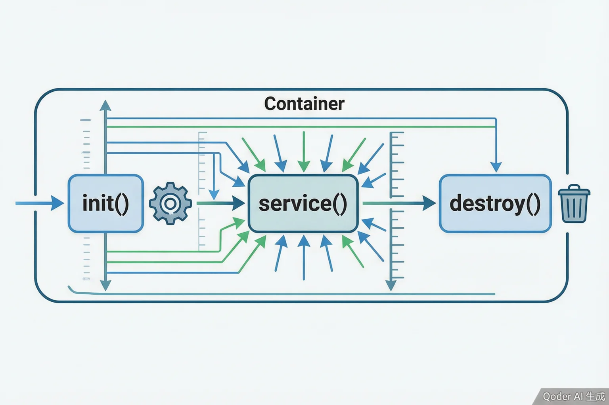

# Servlet 与 JSP 基础

> 内容更新时间：2026-10-20 · 学习阶段：入门 · 预计用时：50 分钟

> 学习阶段：入门 · 预计用时：50 分钟 · 配图：Servlet 生命周期



## 本节知识框架

想象你开了一家餐厅。顾客（HTTP 请求）来了，服务员（Servlet 容器）接待他们，把点单交给厨师（Servlet）处理，厨师做好菜后交给服务员端给顾客（HTTP 响应）。这就是 Web 应用的基本工作方式。

**本课知识地图**

```text
HTTP 协议基础 → Servlet 是什么 → 生命周期 → 请求与响应 → JSP 原理 → 实战示例
```

**学完本课你将能够**：

1. 解释 Servlet 是什么，以及它在 Web 应用中的作用。
2. 描述 Servlet 的生命周期：初始化、服务、销毁。
3. 理解 JSP 本质上是 Servlet 的简化写法。
4. 编写一个简单的 Servlet 处理 GET 和 POST 请求。

**先修知识**：你需要了解 Java 基础语法（来自《Java 基础》），以及 HTTP 协议的基本概念（来自《HTTP 基础》）。如果这些还不熟，建议先回顾一下。

---

## 核心概念定义

我们先用一张"生活对照表"来认识本课的核心术语。

| 术语 | 一句话定义 | 生活类比 |
| --- | --- | --- |
| Servlet | Java 编写的服务端程序，用来处理 HTTP 请求并返回响应。 | 就像餐厅的厨师，接收订单（请求），做菜（处理），然后上菜（响应）。 |
| Servlet 容器 | 管理 Servlet 生命周期的运行环境，如 Tomcat、Jetty。 | 就像餐厅的厨房，提供厨师工作所需的所有设施和规则。 |
| 生命周期 | Servlet 从创建到销毁的完整过程：init() → service() → destroy()。 | 就像员工的职业生涯：入职培训 → 日常工作 → 离职。 |
| JSP | Java Server Pages，一种简化 Servlet 编写的技术，本质会被编译成 Servlet。 | 就像填写表格模板，比手写整份文件更方便。 |
| 请求（Request） | 客户端发送给服务器的数据，包含 URL、参数、头部等。 | 就像顾客的点单，写着要什么菜、有什么特殊要求。 |
| 响应（Response） | 服务器返回给客户端的数据，包含状态码、头部、内容。 | 就像服务员端上来的菜，以及账单（状态码）。 |

---

## 原理与运行机制

### Servlet 是什么？

在 Web 应用的早期，服务器只能处理静态文件（HTML、图片）。但用户需要动态内容——比如根据用户名显示"你好，张三"。这就需要一种机制，让服务器能够运行程序，根据请求生成不同的内容。

Servlet 就是 Java 提供的这种机制。它是一个 Java 类，实现了特定的接口（`javax.servlet.Servlet`），能够：
- 接收 HTTP 请求
- 处理业务逻辑
- 生成 HTTP 响应

### Servlet 生命周期

Servlet 的生命周期由容器管理，分为三个阶段：

**1. 初始化（init）**

当第一个请求到达时，容器创建 Servlet 实例并调用 `init()` 方法。这个方法只执行一次，用来做一次性设置，比如加载配置、建立数据库连接。

```java
public class HelloServlet extends HttpServlet {
    @Override
    public void init() throws ServletException {
        // 初始化代码，只执行一次
        System.out.println("Servlet 初始化");
    }
}
```

**2. 服务（service）**

每个请求都会调用 `service()` 方法。根据请求方法（GET、POST 等），`service()` 会调用对应的 `doGet()` 或 `doPost()` 方法。

```java
@Override
protected void doGet(HttpServletRequest req, HttpServletResponse resp) 
        throws ServletException, IOException {
    // 处理 GET 请求
    resp.setContentType("text/html;charset=UTF-8");
    resp.getWriter().println("<h1>你好，世界！</h1>");
}

@Override
protected void doPost(HttpServletRequest req, HttpServletResponse resp) 
        throws ServletException, IOException {
    // 处理 POST 请求
    String name = req.getParameter("name");
    resp.getWriter().println("<h1>你好，" + name + "！</h1>");
}
```

**3. 销毁（destroy）**

当应用停止或容器决定卸载 Servlet 时，调用 `destroy()` 方法。用来释放资源，比如关闭数据库连接。

```java
@Override
public void destroy() {
    // 清理代码，只执行一次
    System.out.println("Servlet 销毁");
}
```

### 请求与响应对象

**HttpServletRequest** 封装了客户端发送的所有信息：

```java
// 获取请求参数
String username = req.getParameter("username");

// 获取请求头
String userAgent = req.getHeader("User-Agent");

// 获取请求方法
String method = req.getMethod(); // "GET" 或 "POST"

// 获取请求 URI
String uri = req.getRequestURI(); // "/hello"
```

**HttpServletResponse** 用来构建返回给客户端的内容：

```java
// 设置响应类型
resp.setContentType("text/html;charset=UTF-8");

// 设置状态码
resp.setStatus(HttpServletResponse.SC_OK); // 200

// 写入响应内容
PrintWriter out = resp.getWriter();
out.println("<!DOCTYPE html>");
out.println("<html><body>");
out.println("<h1>你好，" + username + "！</h1>");
out.println("</body></html>");

// 重定向
resp.sendRedirect("/login");

// 转发
req.getRequestDispatcher("/WEB-INF/views/result.jsp").forward(req, resp);
```

### JSP 是什么？

写 Servlet 有个问题：HTML 和 Java 代码混在一起，很难维护。JSP（Java Server Pages）就是为了解决这个问题。

JSP 文件看起来像 HTML，但可以嵌入 Java 代码：

```jsp
<%@ page contentType="text/html;charset=UTF-8" language="java" %>
<html>
<body>
    <h1>你好，<%= request.getParameter("name") %>！</h1>
    <p>当前时间：<%= new java.util.Date() %></p>
</body>
</html>
```

**JSP 的本质**：JSP 文件第一次被访问时，会被容器编译成 Servlet 类。上面的 JSP 大致等价于：

```java
public class hello_jsp extends HttpServlet {
    @Override
    protected void service(HttpServletRequest request, HttpServletResponse response) 
            throws ServletException, IOException {
        response.setContentType("text/html;charset=UTF-8");
        PrintWriter out = response.getWriter();
        out.println("<html>");
        out.println("<body>");
        out.println("<h1>你好，" + request.getParameter("name") + "！</h1>");
        out.println("<p>当前时间：" + new java.util.Date() + "</p>");
        out.println("</body>");
        out.println("</html>");
    }
}
```

所以 JSP 就是 Servlet 的简化写法，让开发者可以更多地写 HTML，少写 Java 代码。

---

## 典型应用场景

- **简单的 Web 应用**：如果只是一个小型项目，不需要复杂的框架，直接用 Servlet + JSP 就够了。
- **学习 Web 原理**：理解 Servlet 是学习 Spring MVC 等框架的基础。所有高级框架底层都是 Servlet。
- **遗留系统维护**：很多老项目还在使用 Servlet + JSP，维护这些项目需要掌握这个技术。
- **轻量级 API**：如果只是提供简单的 RESTful API，不需要 Spring 那么重的框架，可以用 Servlet 快速实现。

---

## 代码示例

### 最小 Servlet 示例

**HelloServlet.java**

```java
import javax.servlet.ServletException;
import javax.servlet.annotation.WebServlet;
import javax.servlet.http.HttpServlet;
import javax.servlet.http.HttpServletRequest;
import javax.servlet.http.HttpServletResponse;
import java.io.IOException;

@WebServlet("/hello")
public class HelloServlet extends HttpServlet {
    
    @Override
    protected void doGet(HttpServletRequest req, HttpServletResponse resp) 
            throws ServletException, IOException {
        // 设置响应类型
        resp.setContentType("text/html;charset=UTF-8");
        
        // 获取请求参数
        String name = req.getParameter("name");
        if (name == null) {
            name = "世界";
        }
        
        // 生成响应
        resp.getWriter().println("<!DOCTYPE html>");
        resp.getWriter().println("<html>");
        resp.getWriter().println("<head><meta charset='UTF-8'><title>Hello</title></head>");
        resp.getWriter().println("<body>");
        resp.getWriter().println("<h1>你好，" + name + "！</h1>");
        resp.getWriter().println("<p>这是你的第一个 Servlet。</p>");
        resp.getWriter().println("</body>");
        resp.getWriter().println("</html>");
    }
}
```

**运行步骤**：

1. 创建 Maven 项目，添加依赖：

```xml
<dependencies>
    <dependency>
        <groupId>javax.servlet</groupId>
        <artifactId>javax.servlet-api</artifactId>
        <version>4.0.1</version>
        <scope>provided</scope>
    </dependency>
</dependencies>
```

2. 编译并打包成 WAR 文件：

```bash
mvn clean package
```

3. 将 WAR 文件放到 Tomcat 的 `webapps` 目录下，启动 Tomcat。

4. 访问 `http://localhost:8080/your-app/hello?name=张三`

### 表单处理示例

**form.html**

```html
<!DOCTYPE html>
<html>
<head>
    <meta charset="UTF-8">
    <title>登录表单</title>
</head>
<body>
    <h1>用户登录</h1>
    <form action="login" method="post">
        <label>用户名：<input type="text" name="username"></label><br>
        <label>密码：<input type="password" name="password"></label><br>
        <input type="submit" value="登录">
    </form>
</body>
</html>
```

**LoginServlet.java**

```java
@WebServlet("/login")
public class LoginServlet extends HttpServlet {
    
    @Override
    protected void doPost(HttpServletRequest req, HttpServletResponse resp) 
            throws ServletException, IOException {
        // 获取表单数据
        String username = req.getParameter("username");
        String password = req.getParameter("password");
        
        // 简单的验证（实际项目应该查数据库）
        if ("admin".equals(username) && "123456".equals(password)) {
            // 登录成功，转发到欢迎页面
            req.setAttribute("username", username);
            req.getRequestDispatcher("/WEB-INF/views/welcome.jsp")
               .forward(req, resp);
        } else {
            // 登录失败，重定向回登录页
            resp.sendRedirect("/form.html");
        }
    }
}
```

**welcome.jsp**

```jsp
<%@ page contentType="text/html;charset=UTF-8" language="java" %>
<html>
<body>
    <h1>欢迎，${username}！</h1>
    <p>登录成功。</p>
</body>
</html>
```

---

## 复杂度或性能分析

- **内存占用**：Servlet 是单例的，整个应用只有一个实例，所以内存占用很小。
- **并发处理**：容器为每个请求创建一个线程，调用同一个 Servlet 实例的 `service()` 方法。所以要注意线程安全，不要在 Servlet 中使用实例变量存储请求相关的数据。
- **性能瓶颈**：Servlet 本身性能很好，瓶颈通常在数据库查询、网络调用等 I/O 操作。

---

## 常见误区与易错点

| 错误 | 现象 | 修法 |
| --- | --- | --- |
| 在 Servlet 中使用实例变量存储用户数据 | 多个用户的数据互相覆盖 | 使用局部变量或请求属性（`req.setAttribute()`） |
| 忘记设置响应编码 | 中文显示乱码 | 在获取 `Writer` 之前调用 `resp.setContentType("text/html;charset=UTF-8")` |
| JSP 中写大量 Java 代码 | 难以维护，逻辑混乱 | 使用 JSTL 和 EL 表达式，或改用 Servlet + JSP 的 MVC 模式 |
| 在 `doGet()` 中处理 POST 请求 | 返回 405 错误 | POST 请求要在 `doPost()` 中处理，或重写 `service()` 方法 |
| 硬编码 HTML 在 Servlet 中 | 代码难以阅读和维护 | 使用 JSP 或模板引擎，Servlet 只负责控制流程 |

---

## 与其他知识点的关系

- **先修**：《Java 基础》、《HTTP 基础》
- **后续**：《Spring MVC 与 Web 开发》、《Spring Boot 入门》
- **相关**：《RESTful API 设计与实现》、《数据访问：JDBC、JPA 与 MyBatis》

---

## 自测题与参考答案

**Q1**：Servlet 的 `init()` 方法在什么时候被调用？

<details>
<summary>点击查看答案</summary>

当 Servlet 第一次被请求时，容器创建 Servlet 实例并调用 `init()` 方法。整个生命周期中只调用一次。
</details>

**Q2**：如何在 Servlet 中获取表单提交的参数？

<details>
<summary>点击查看答案</summary>

使用 `req.getParameter("参数名")`。例如：`String username = req.getParameter("username");`
</details>

**Q3**：JSP 的本质是什么？

<details>
<summary>点击查看答案</summary>

JSP 本质上是 Servlet。JSP 文件第一次被访问时会被编译成 Servlet 类，之后的执行和 Servlet 完全一样。
</details>

---

## 考点精讲

### 考点 1：第 1 题

- **题目**：Servlet 生命周期中，哪个方法只执行一次？
- **正确项**：init() 方法
- **判断依据**：这道题落在术语「生命周期」上：Servlet 从创建到销毁的过程。复习时把「生命周期」的定义、三个阶段和一个反例一起说清楚，再回到「核心概念定义」核对原文。

### 考点 2：第 2 题

- **题目**：JSP 本质上是？
- **正确项**：Servlet 的简化写法
- **判断依据**：这道题落在术语「JSP」上：一种让开发者更多写 HTML、少写 Java 的技术。复习时把「JSP」的定义、编译过程和一个反例一起说清楚，再回到「核心概念定义」核对原文。

---

## 术语速查

| 术语 | 含义 |
| --- | --- |
| Servlet | Java 编写的服务端程序，处理 HTTP 请求并返回响应 |
| Servlet 容器 | 管理 Servlet 生命周期的运行环境，如 Tomcat |
| 生命周期 | Servlet 从创建到销毁的过程：init → service → destroy |
| JSP | Java Server Pages，本质是 Servlet 的简化写法 |
| Request | 客户端发送给服务器的数据 |
| Response | 服务器返回给客户端的数据 |

---

## 参考资料与复核

- [Oracle Servlet 规范](https://javaee.github.io/servlet-spec/)
- [Apache Tomcat 官方文档](https://tomcat.apache.org/tomcat-9.0-doc/)
- 复核日期：2026-10-20

---

## 内容元数据

- 课程 ID：java_servlet_jsp
- 分类：Java Web 开发
- 难度：入门
- 预计用时：50 分钟
- 先修课程：Java 基础、HTTP 基础
- 后续课程：Spring MVC 与 Web 开发
