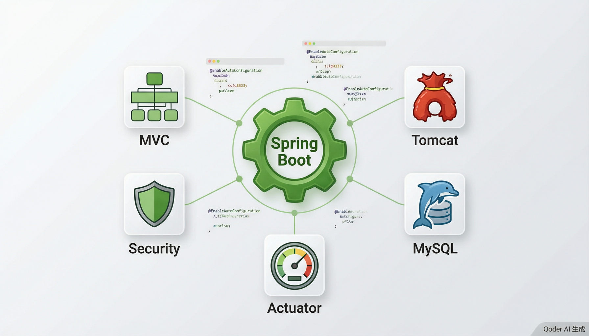

# Spring Boot 入门

> 内容更新时间：2026-10-20 · 学习阶段：入门 · 预计用时：50 分钟



## 本节知识框架

想象你要开一家奶茶店。传统方式下，你需要自己装修店面、买设备、接水电、办营业执照……每一项都要亲力亲为，耗时耗力。而 Spring Boot 就像是一个"奶茶店加盟体系"——总部帮你把装修、设备、水电、证照全部配好了，你只需要选一个店面位置（写业务代码），然后开门营业就行。

Spring Boot 的核心理念是"约定优于配置"（Convention over Configuration）。它帮你把 Spring 框架中大量的 XML 配置都省掉了，用合理的默认值代替手动配置。你不需要告诉 Spring "请帮我启动一个 Web 服务器"，Spring Boot 会自动检测到你的项目是 Web 项目，然后帮你内嵌一个 Tomcat 服务器。

**本课知识地图**

```text
Spring Boot 是什么 → 自动配置原理 → Starter 机制 → 创建第一个应用 → 自定义配置 → 自定义 Starter
```

**学完本课你将能够**：

1. 理解 Spring Boot 是什么，它解决了什么问题。
2. 掌握自动配置（Auto-Configuration）的工作原理。
3. 了解 `@SpringBootApplication` 注解的组合含义。
4. 使用 Spring Initializr 快速创建一个 Spring Boot 项目。
5. 学会自定义配置属性和创建简单的自定义 Starter。

**先修知识**：你需要了解 Java 基础语法和面向对象（来自《Java 基础》），以及 Spring 的 IoC 和 DI 基本概念（来自《Spring Framework 核心》）。

**复习清单**

- [ ] 回顾 Spring IoC 容器的基本概念
- [ ] 了解 Java 注解（Annotation）的基本用法
- [ ] 熟悉 Maven 或 Gradle 依赖管理的基础知识

---

## 核心概念定义

| 术语 | 一句话定义 | 生活类比 |
| --- | --- | --- |
| Spring Boot | 基于 Spring 框架的快速开发脚手架，通过自动配置和嵌入式服务器让项目"开箱即用"。 | 奶茶店加盟体系——总部帮你配好一切，你只管开店。 |
| 自动配置（Auto-Configuration） | Spring Boot 根据 classpath 中的依赖自动推断并配置 Bean，无需手动写 XML 或 Java 配置。 | 加盟总部根据你选的店面类型，自动决定要配哪些设备和原料。 |
| @SpringBootApplication | 组合注解，等同于 `@Configuration` + `@EnableAutoConfiguration` + `@ComponentScan` 三个注解的合体。 | 一张"全能会员卡"——同时包含开店、配设备、招员工三项功能。 |
| Starter | 一组预定义的依赖集合，引入一个 Starter 就自动获得某类功能所需的全部库。 | 工具箱套装——买一个"水电工具箱"，里面扳手、钳子、管子全都有。 |
| 约定优于配置 | 框架提供合理的默认行为，开发者只需在需要偏离默认时才显式配置。 | 酒店默认早上 7 点送早餐，你不需要特别交代；只有想改时间才需要通知前台。 |
| 嵌入式服务器 | Spring Boot 内嵌 Tomcat/Jetty/Undertow 等 Web 服务器，打包成可执行 JAR 直接运行。 | 把厨房直接建在餐厅里面，不需要另外租一个厨房场地。 |
| Actuator | Spring Boot 提供的生产级监控模块，自动暴露健康检查、指标、环境信息等端点。 | 汽车仪表盘——实时显示油量、水温、发动机状态，让你随时了解车辆运行情况。 |
| application.properties/yml | Spring Boot 的外部化配置文件，用于覆盖默认配置（如端口号、数据库连接等）。 | 店面的个性化装饰——加盟体系给了默认装修，你可以按自己喜好微调。 |

---

## 原理与运行机制

### 自动配置是怎么工作的？

当你启动一个 Spring Boot 应用时，框架会经历以下过程：

1. **扫描 classpath**：Spring Boot 检查你的项目中引入了哪些库。
2. **加载自动配置类**：根据 classpath 中的库，激活对应的自动配置。
3. **条件判断**：每个自动配置类都有一组条件注解，只有条件满足时才会生效。
4. **创建 Bean**：条件满足后，自动创建并注册相应的 Bean 到 Spring 容器中。

这个过程的核心是 `@EnableAutoConfiguration` 注解。它告诉 Spring Boot："请根据我引入的依赖，自动帮我配置好一切。"

```text
启动流程：
main() → @SpringBootApplication → @EnableAutoConfiguration
         → 读取 META-INF/spring/org.springframework.boot.autoconfigure.AutoConfiguration.imports
         → 逐个检查条件注解 → 满足条件的自动配置类生效 → Bean 注册到容器
```

### 条件注解详解

Spring Boot 使用一系列条件注解来控制自动配置是否生效：

| 条件注解 | 含义 | 举例 |
| --- | --- | --- |
| `@ConditionalOnClass` | classpath 中存在某个类时才生效 | 引入了 Web 依赖才配置 Web 服务器 |
| `@ConditionalOnMissingBean` | 容器中没有某个 Bean 时才创建 | 用户没有自定义数据源时才创建默认数据源 |
| `@ConditionalOnProperty` | 配置文件中某个属性满足条件时才生效 | `server.port=8080` 时才启用某功能 |
| `@ConditionalOnBean` | 容器中已经存在某个 Bean 时才生效 | 存在 DataSource 时才配置 JdbcTemplate |

**生活类比**：条件注解就像餐厅的"自动配菜系统"。如果客人点了牛排（classpath 有 Web 依赖），系统自动配上黑椒汁（Web 配置）；如果客人自带了酱料（用户自定义了 Bean），系统就不再重复提供（`@ConditionalOnMissingBean`）。

### @SpringBootApplication 的三层结构

`@SpringBootApplication` 是一个组合注解，拆开来看：

```java
@SpringBootConfiguration  // 等同于 @Configuration，标记当前类为配置类
@EnableAutoConfiguration  // 开启自动配置
@ComponentScan            // 扫描当前包及子包下的 @Component、@Service 等注解
public @interface SpringBootApplication {
    // ...
}
```

这意味着：你只需要在主类上写一个注解，Spring Boot 就同时完成了"加载配置类"、"开启自动配置"和"组件扫描"三件事。

### Starter 的工作原理

Starter 本质上是一个 Maven/Gradle 的 POM 文件，里面声明了一组相关依赖。例如 `spring-boot-starter-web` 会自动引入：

- Spring MVC（Web 开发框架）
- Tomcat（嵌入式 Web 服务器）
- Jackson（JSON 序列化）
- Hibernate Validator（参数校验）

```text
你引入：spring-boot-starter-web
        ↓
自动获得：Spring MVC + Tomcat + Jackson + Validator + ...
        ↓
结果：直接写 Controller 就能跑，不需要手动配任何依赖
```

---

## 典型应用场景

- **快速创建 RESTful API**：引入 `spring-boot-starter-web`，写一个 `@RestController` 就能提供 HTTP 接口。
- **微服务开发**：结合 Spring Cloud，Spring Boot 是构建微服务的标准选择。
- **命令行应用**：使用 `spring-boot-starter`（不含 Web），配合 `CommandLineRunner` 实现命令行工具。
- **定时任务**：引入 `@EnableScheduling`，用 `@Scheduled` 注解定义定时执行的任务。
- **数据库访问**：引入 `spring-boot-starter-data-jpa`，自动配置数据源和 ORM。
- **安全认证**：引入 `spring-boot-starter-security`，自动配置 Spring Security。
- **生产监控**：引入 `spring-boot-starter-actuator`，暴露健康检查和运行指标端点。

---

## 代码/协议/SQL 示例

### 示例 1：创建第一个 Spring Boot 应用

**pom.xml**（Maven 依赖）

```xml
<?xml version="1.0" encoding="UTF-8"?>
<project xmlns="http://maven.apache.org/POM/4.0.0"
         xmlns:xsi="http://www.w3.org/2001/XMLSchema-instance"
         xsi:schemaLocation="http://maven.apache.org/POM/4.0.0
         https://maven.apache.org/xsd/maven-4.0.0.xsd">
    <modelVersion>4.0.0</modelVersion>

    <parent>
        <groupId>org.springframework.boot</groupId>
        <artifactId>spring-boot-starter-parent</artifactId>
        <version>3.3.0</version>
    </parent>

    <groupId>com.example</groupId>
    <artifactId>demo</artifactId>
    <version>0.0.1-SNAPSHOT</version>

    <dependencies>
        <dependency>
            <groupId>org.springframework.boot</groupId>
            <artifactId>spring-boot-starter-web</artifactId>
        </dependency>
    </dependencies>
</project>
```

**DemoApplication.java**（主启动类）

```java
package com.example.demo;

import org.springframework.boot.SpringApplication;
import org.springframework.boot.autoconfigure.SpringBootApplication;

@SpringBootApplication  // 一个注解搞定：配置 + 自动配置 + 组件扫描
public class DemoApplication {

    public static void main(String[] args) {
        SpringApplication.run(DemoApplication.class, args);
        System.out.println("应用启动成功！");
    }
}
```

**HelloController.java**（第一个接口）

```java
package com.example.demo;

import org.springframework.web.bind.annotation.GetMapping;
import org.springframework.web.bind.annotation.RestController;

@RestController
public class HelloController {

    @GetMapping("/hello")
    public String hello() {
        return "Hello, Spring Boot!";
    }
}
```

运行 `mvn spring-boot:run`，访问 `http://localhost:8080/hello`，就能看到返回的 "Hello, Spring Boot!"。

### 示例 2：自定义配置属性

**application.yml**

```yaml
server:
  port: 9090                    # 修改默认端口（默认 8080）

spring:
  datasource:
    url: jdbc:mysql://localhost:3306/mydb
    username: root
    password: 123456
    driver-class-name: com.mysql.cj.jdbc.Driver

# 自定义属性
app:
  name: 我的Spring Boot应用
  version: 1.0.0
  welcome-message: 欢迎使用本系统
```

**AppProperties.java**（读取自定义配置）

```java
package com.example.demo;

import org.springframework.boot.context.properties.ConfigurationProperties;
import org.springframework.stereotype.Component;

@Component
@ConfigurationProperties(prefix = "app")
public class AppProperties {

    private String name;
    private String version;
    private String welcomeMessage;

    // Getter 和 Setter
    public String getName() { return name; }
    public void setName(String name) { this.name = name; }
    public String getVersion() { return version; }
    public void setVersion(String version) { this.version = version; }
    public String getWelcomeMessage() { return welcomeMessage; }
    public void setWelcomeMessage(String welcomeMessage) { this.welcomeMessage = welcomeMessage; }
}
```

**WelcomeController.java**

```java
package com.example.demo;

import org.springframework.web.bind.annotation.GetMapping;
import org.springframework.web.bind.annotation.RestController;

@RestController
public class WelcomeController {

    private final AppProperties appProperties;

    public WelcomeController(AppProperties appProperties) {
        this.appProperties = appProperties;
    }

    @GetMapping("/welcome")
    public String welcome() {
        return appProperties.getWelcomeMessage()
               + " | 应用：" + appProperties.getName()
               + " v" + appProperties.getVersion();
    }
}
```

### 示例 3：创建一个自定义 Starter

假设你想为公司内部封装一个通用组件——统一日志格式化器。

**第一步：创建自动配置类**

```java
package com.example.logstarter;

import org.springframework.boot.autoconfigure.condition.ConditionalOnMissingBean;
import org.springframework.context.annotation.Bean;
import org.springframework.context.annotation.Configuration;

@Configuration
public class LogFormatterAutoConfiguration {

    @Bean
    @ConditionalOnMissingBean  // 用户没自定义时才使用默认实现
    public LogFormatter defaultLogFormatter() {
        return new LogFormatter("[DEFAULT]");
    }
}
```

**第二步：创建 LogFormatter 类**

```java
package com.example.logstarter;

public class LogFormatter {

    private final String prefix;

    public LogFormatter(String prefix) {
        this.prefix = prefix;
    }

    public String format(String message) {
        return prefix + " " + java.time.LocalDateTime.now() + " - " + message;
    }
}
```

**第三步：注册自动配置**

在 `src/main/resources/META-INF/spring/` 目录下创建文件：
`org.springframework.boot.autoconfigure.AutoConfiguration.imports`

```text
com.example.logstarter.LogFormatterAutoConfiguration
```

**第四步：创建 Starter 的 pom.xml**

```xml
<project>
    <groupId>com.example</groupId>
    <artifactId>log-spring-boot-starter</artifactId>
    <version>1.0.0</version>

    <dependencies>
        <dependency>
            <groupId>org.springframework.boot</groupId>
            <artifactId>spring-boot-autoconfigure</artifactId>
        </dependency>
    </dependencies>
</project>
```

**第五步：在其他项目中使用**

```xml
<!-- 只需引入一个 Starter -->
<dependency>
    <groupId>com.example</groupId>
    <artifactId>log-spring-boot-starter</artifactId>
    <version>1.0.0</version>
</dependency>
```

```java
@RestController
public class TestController {

    private final LogFormatter logFormatter;

    public TestController(LogFormatter logFormatter) {
        this.logFormatter = logFormatter;
    }

    @GetMapping("/test")
    public String test() {
        String log = logFormatter.format("接口被调用");
        System.out.println(log);
        return "OK";
    }
}
```

---

## 时间/空间复杂度或性能分析

| 维度 | 分析 | 说明 |
| --- | --- | --- |
| 启动时间 | 首次启动约 2-5 秒 | Spring Boot 需要扫描 classpath、加载自动配置、创建 Bean。引入的 Starter 越多，启动越慢。 |
| 内存占用 | 基础应用约 150-300 MB | 容器本身 + 内嵌 Tomcat + 所有 Bean 实例。可通过 `spring.main.lazy-initialization=true` 启用懒加载降低初始内存。 |
| 打包体积 | 基础 Web 应用 JAR 约 15-30 MB | 因为内嵌了 Tomcat 和所有依赖。可通过 `spring-boot-maven-plugin` 优化。 |
| 运行时性能 | 与原生 Spring 应用基本一致 | 自动配置只在启动时执行一次，运行时没有额外开销。条件注解的判断也只在启动阶段进行。 |
| 条件评估开销 | 启动时评估约 50-200 个条件 | 每个自动配置类可能有多个 `@Conditional` 注解，但评估速度极快（微秒级），对启动时间影响可忽略。 |

**优化建议**：

- 只引入需要的 Starter，避免"大而全"
- 生产环境使用 `spring-boot-starter-actuator` 监控启动时间和内存
- 考虑使用 GraalVM Native Image 将启动时间降低到毫秒级

---

## 常见误区与易错点

| 错误 | 现象 | 正确做法 |
| --- | --- | --- |
| 主类不在根包下 | `@ComponentScan` 扫不到子包外的 Bean | 主类应放在最外层包（如 `com.example`），所有组件放在其子包中 |
| 手动配置了已自动配置的 Bean | 出现 Bean 冲突或覆盖不生效 | 利用 `@ConditionalOnMissingBean` 机制，自定义 Bean 会自动覆盖默认配置 |
| 在 application.yml 中缩进错误 | 配置不生效或启动报错 | YAML 对缩进敏感，使用 2 个空格缩进，不要用 Tab |
| 忘记引入对应的 Starter | 功能不可用，报 ClassNotFoundException | 检查需要的 Starter 是否已添加到 pom.xml |
| 混淆 @Configuration 和 @SpringBootApplication | 配置类不生效 | `@SpringBootApplication` 只需在主类上使用，其他配置类用 `@Configuration` |
| 多个数据源未指定 @Primary | Spring 不知道该用哪个数据源 | 给主数据源添加 `@Primary` 注解 |
| 修改配置后未重启应用 | 改动不生效 | Spring Boot 配置在启动时加载，修改后必须重启（或使用 DevTools 热重载） |
| 自动配置顺序问题 | Bean 依赖还未创建就注入 | 使用 `@AutoConfigureAfter` 或 `@AutoConfigureBefore` 控制顺序 |

---

## 与其他知识点的关系

- **先修**：《Java 基础》、《Spring Framework 核心》
- **后续**：《Spring MVC 与 Web 开发》、《Spring Boot 数据访问》、《Spring Cloud 微服务》
- **相关**：《Maven/Gradle 构建工具》、《RESTful API 设计》、《Docker 容器化部署》

---

## 自测题与参考答案

**Q1**：`@SpringBootApplication` 注解组合了哪三个注解？各自的作用是什么？

<details>
<summary>点击查看答案</summary>

`@SpringBootApplication` 组合了三个注解：
1. `@SpringBootConfiguration`（等同于 `@Configuration`）：标记当前类为配置类，可以定义 Bean。
2. `@EnableAutoConfiguration`：开启自动配置，Spring Boot 根据 classpath 中的依赖自动配置 Bean。
3. `@ComponentScan`：组件扫描，自动扫描当前包及子包下带有 `@Component`、`@Service`、`@Repository`、`@Controller` 等注解的类并注册为 Bean。
</details>

**Q2**：Spring Boot 自动配置的条件注解 `@ConditionalOnClass` 和 `@ConditionalOnMissingBean` 分别在什么情况下生效？

<details>
<summary>点击查看答案</summary>

`@ConditionalOnClass`：当 classpath 中存在指定的类时，自动配置才会生效。例如，只有引入了 `spring-web` 依赖（classpath 中有 `DispatcherServlet` 类），Web 相关的自动配置才会激活。

`@ConditionalOnMissingBean`：当 Spring 容器中不存在指定类型的 Bean 时，自动配置才会创建默认的 Bean。这允许用户通过自定义 Bean 来覆盖默认配置——如果用户已经自己定义了一个 DataSource，Spring Boot 就不会再创建默认的 DataSource。
</details>

**Q3**：创建一个自定义 Spring Boot Starter 需要哪些关键步骤？

<details>
<summary>点击查看答案</summary>

创建自定义 Starter 的关键步骤：
1. 创建一个自动配置类（`@Configuration`），使用条件注解控制何时生效。
2. 在 `META-INF/spring/org.springframework.boot.autoconfigure.AutoConfiguration.imports` 文件中注册自动配置类的全限定名。
3. 创建 Starter 模块的 `pom.xml`，依赖 `spring-boot-autoconfigure`。
4. 将 Starter 发布到 Maven 仓库（本地或远程），其他项目通过 `<dependency>` 引入即可自动获得配置功能。
</details>

---

## 考点精讲

### 考点 1

\u201C@SpringBootApplication\u201D 是一个组合注解，它等同于以下哪三个注解的合体？

A. \u201C@Configuration\u201D + \u201C@EnableScheduling\u201D + \u201C@ComponentScan\u201D  
B. \u201C@Configuration\u201D + \u201C@EnableAutoConfiguration\u201D + \u201C@Import\u201D  
C. \u201C@Bean\u201D + \u201C@EnableAutoConfiguration\u201D + \u201C@ComponentScan\u201D  
D. \u201C@Configuration\u201D + \u201C@EnableAutoConfiguration\u201D + \u201C@ComponentScan\u201D  

**正确答案：D**

**详细解释：** \u201C@SpringBootApplication\u201D 组合了三个核心注解：\u201C@SpringBootConfiguration\u201D（等同于 \u201C@Configuration\u201D，标记当前类为配置类）、\u201C@EnableAutoConfiguration\u201D（开启自动配置，根据 classpath 依赖自动注册 Bean）、\u201C@ComponentScan\u201D（组件扫描，自动扫描当前包及子包下的注解类）。只需在主类上写这一个注解，就能同时完成三项配置工作。

---

### 考点 2

Spring Boot 自动配置中，\u201C@ConditionalOnMissingBean\u201D 注解的含义是什么？

A. 当 classpath 中存在某个类时才创建 Bean
B. 当配置文件中某个属性满足条件时才生效
C. 当 Spring 容器中不存在指定类型的 Bean 时才创建默认 Bean
D. 当 Spring 容器中已经存在指定类型的 Bean 时才创建新 Bean

**正确答案：C**

**详细解释：** \u201C@ConditionalOnMissingBean\u201D 表示\u201C当容器中没有某个 Bean 时才创建\u201D。这是 Spring Boot 自动配置覆盖机制的核心：如果用户已经自定义了某个 Bean（如自定义 \u201CDataSource\u201D），自动配置就不会再创建默认的同类 Bean，避免冲突。这体现了\u201C约定优于配置\u201D的理念——默认行为开箱即用，用户随时可以覆盖。

---

### 考点 3

关于 Spring Boot Starter 机制，以下哪个说法是正确的？

A. Starter 是一种运行时容器，用于托管 Spring Bean
B. \u201Cspring-boot-starter-web\u201D 只包含 Spring MVC 一个依赖
C. Starter 本质上是一组预定义的依赖集合，引入一个 Starter 就自动获得某类功能所需的全部库
D. 每个 Spring Boot 项目必须且只能引入一个 Starter

**正确答案：C**

**详细解释：** Starter 本质上是一个 Maven/Gradle 的 POM 文件，里面声明了一组相关依赖。例如 \u201Cspring-boot-starter-web\u201D 会自动引入 Spring MVC、Tomcat、Jackson、Hibernate Validator 等 Web 开发所需的全部库。Starter 可以嵌套组合，项目可以引入多个 Starter，开发者只需按需选择即可。

---

### 考点 4

Spring Boot 的核心理念\u201C约定优于配置\u201D（Convention over Configuration）的含义是什么？

A. 所有配置都必须按照固定格式编写，不允许自定义  
B. 框架会自动生成代码，开发者不需要写任何配置文件  
C. 开发者必须先完成所有配置，框架才能启动  
D. 框架提供合理的默认行为，开发者只需在需要偏离默认时才显式配置  

**正确答案：D**

**详细解释：** \u201C约定优于配置\u201D是指框架提供合理的默认值和默认行为，开发者在默认行为满足需求时无需做任何配置。例如 Spring Boot 默认启动端口是 8080，只有需要修改端口时才在 \u201Capplication.properties\u201D 中配置 \u201Cserver.port\u201D。这大大减少了配置量，但并非不允许自定义——需要偏离默认时随时可以显式配置。

---

### 考点 5

在 Spring Boot 自动配置的条件注解中，\u201C@ConditionalOnClass\u201D 的作用是什么？

A. 当 Spring 容器中存在某个 Bean 时才生效
B. 当配置文件中某个属性值满足条件时才生效
C. 当 classpath 中存在指定的类时才激活对应的自动配置
D. 当应用运行在特定的操作系统上时才生效

**正确答案：C**

**详细解释：** \u201C@ConditionalOnClass\u201D 检查 classpath 中是否存在某个类。只有当指定的类存在时，对应的自动配置类才会生效。例如，只有引入了 \u201Cspring-web\u201D 依赖（classpath 中有 \u201CDispatcherServlet\u201D 类），Web 相关的自动配置才会被激活。这就是为什么引入 \u201Cspring-boot-starter-web\u201D 后 Tomcat 会自动启动——因为 classpath 中有 Web 相关的类，条件满足。

---

## 术语速查

| 术语 | 一句话说明 |
| --- | --- |
| Spring Boot | 基于 Spring 的快速开发框架，提供自动配置和开箱即用体验 |
| Auto-Configuration | 自动配置，根据 classpath 依赖自动推断并注册 Bean |
| @SpringBootApplication | 组合注解：@Configuration + @EnableAutoConfiguration + @ComponentScan |
| Starter | 预定义的依赖集合，简化 Maven/Gradle 配置 |
| 约定优于配置 | 框架提供合理默认值，减少手动配置 |
| 嵌入式服务器 | 内嵌的 Tomcat/Jetty/Undertow，无需外部部署 |
| Actuator | 生产级监控模块，暴露健康检查和运行指标 |
| application.properties | 外部化配置文件（Properties 格式） |
| application.yml | 外部化配置文件（YAML 格式，支持层级结构） |
| @ConditionalOnClass | 条件注解：classpath 存在某类时生效 |
| @ConditionalOnMissingBean | 条件注解：容器中不存在某 Bean 时生效 |
| @ConfigurationProperties | 将配置文件中的属性绑定到 Java 对象 |
| Spring Initializr | 在线项目生成器（start.spring.io） |
| DevTools | 开发工具，支持热重载和自动重启 |

---

## 参考资料与复核
- 下次复核：2026-11-24

| 资料 | 说明 |
| --- | --- |
| [Spring Boot 官方文档](https://docs.spring.io/spring-boot/docs/current/reference/htmlsingle/) | 最权威的参考，涵盖自动配置、Starter、Actuator 等全部内容 |
| [Spring Initializr](https://start.spring.io/) | 在线生成 Spring Boot 项目，支持 Maven/Gradle 和多种 Starter 选择 |
| [Spring Boot 自动配置源码](https://github.com/spring-projects/spring-boot/tree/main/spring-boot-project/spring-boot-autoconfigure) | 查看所有内置自动配置类的实现 |
| [Baeldung Spring Boot Tutorial](https://www.baeldung.com/spring-boot) | 优质的第三方教程，包含大量实战示例 |
| [Spring Boot Actuator 文档](https://docs.spring.io/spring-boot/docs/current/reference/html/actuator.html) | Actuator 端点配置和使用详解 |

复核日期：2026-10-20
- 最后复核：2026-10-04

---

## 内容元数据

- 内容更新时间：2026-10-06

- 课程 ID：java_spring_boot_intro
- 分类：Java Web 开发
- 难度：入门
- 预计用时：50 分钟
- 先修课程：Java 基础、Spring Framework 核心
- 后续课程：Spring MVC 与 Web 开发、Spring Boot 数据访问、Spring Cloud 微服务
- 内容版本：v2.0
