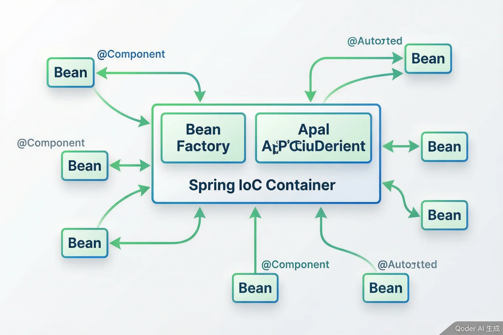

# Spring Framework 核心

> 内容更新时间：2026-10-20 · 学习阶段：高级 · 预计用时：40 分钟

> 学习阶段：高级 · 预计用时：40 分钟 · 配图：Spring IoC 容器



## 本节知识框架

想象你开了一家餐厅。传统方式下，厨师（你的代码）需要自己去菜市场买菜（创建依赖对象）、自己准备调料（管理对象生命周期）。这很麻烦，而且一旦菜市场换了，厨师就得重新找路。

Spring 的 IoC（控制反转）就像是给餐厅配了一个采购经理。厨师只需要说"我需要白菜"，采购经理就会把白菜送过来。厨师不需要关心白菜从哪来、怎么买。这就是"控制反转"——把创建对象的控制权从代码转移到了容器。

**本课知识地图**

```text
IoC 是什么 → 依赖注入 → Bean 生命周期 → AOP 原理 → 实战应用
```

**学完本课你将能够**：

1. 解释 IoC（控制反转）和 DI（依赖注入）的含义。
2. 使用注解（`@Component`、`@Autowired`）配置 Spring Bean。
3. 理解 Bean 的作用域和生命周期。
4. 使用 AOP（面向切面编程）实现日志、事务等横切关注点。

**先修知识**：你需要了解 Java 基础语法和面向对象（来自《Java 基础》），以及 Servlet 的基本概念（来自《Servlet 与 JSP 基础》）。

---

**复习清单**

- [ ] 能不看正文说出「Spring」在本课中的作用与失效条件
- [ ] 能解释「IoC」出错时的现象，并给出排查顺序
- [ ] 能用本课示例复现一次「DI」，说明输入、输出与判定标准

## 核心概念定义

| 术语 | 一句话定义 | 生活类比 |
| --- | --- | --- |
| IoC（控制反转） | 把对象的创建和管理权从代码转移到容器。 | 从"自己买菜"变成"采购经理送菜"。 |
| DI（依赖注入） | IoC 的具体实现方式，容器自动把依赖对象注入到需要它们的组件中。 | 厨师说"我需要白菜"，采购经理就把白菜放到厨师手里。 |
| Bean | Spring 容器中管理的对象，通过配置创建和初始化。 | 餐厅里的食材、厨具、服务员——所有被管理的资源。 |
| BeanFactory | Spring 最基础的容器，负责创建和管理 Bean。 | 餐厅的仓库，存储和管理所有食材。 |
| ApplicationContext | BeanFactory 的高级版本，提供国际化、事件传播等额外功能。 | 餐厅的中央厨房，除了仓库功能还有更多管理能力。 |
| AOP（面向切面编程） | 把日志、事务等横切关注点从业务代码中分离出来，统一处理。 | 餐厅的监控系统——不需要每个厨师自己记录操作，统一由监控摄像头完成。 |
| 切面（Aspect） | 横切关注点的模块化，比如日志切面、事务切面。 | 监控摄像头系统——专门负责记录所有操作。 |
| 通知（Advice） | 切面在特定连接点执行的动作，比如"方法执行前记录日志"。 | 摄像头在厨师开始做菜时自动录像。 |
| 连接点（Joinpoint） | 程序执行过程中的某个点，比如方法调用、异常抛出。 | 厨师开始做菜、做完菜、遇到问题的时刻。 |
| 切点（Pointcut） | 定义哪些连接点需要被拦截的表达式。 | 规定"只监控热菜制作，不监控凉菜"。 |

---

## 原理与运行机制

### IoC 容器是怎么工作的？

**传统方式**：

```java
public class Chef {
    private Vegetable vegetable = new Cabbage(); // 厨师自己创建蔬菜
    
    public void cook() {
        System.out.println("做菜：" + vegetable.getName());
    }
}
```

问题：如果蔬菜供应商换了，需要修改 Chef 类的代码。

**Spring IoC 方式**：

```java
@Component
public class Chef {
    @Autowired
    private Vegetable vegetable; // 容器自动注入
    
    public void cook() {
        System.out.println("做菜：" + vegetable.getName());
    }
}

@Component
public class Cabbage implements Vegetable {
    public String getName() { return "白菜"; }
}
```

Spring 容器启动时：
1. 扫描所有带 `@Component` 注解的类
2. 创建它们的实例（Bean）
3. 把 `@Autowired` 标记的依赖自动注入

### 依赖注入的三种方式

**1. 构造器注入（推荐）**

```java
@Component
public class Chef {
    private final Vegetable vegetable;
    
    @Autowired
    public Chef(Vegetable vegetable) {
        this.vegetable = vegetable;
    }
}
```

优点：依赖不可变，对象创建后状态完整。

**2. Setter 注入**

```java
@Component
public class Chef {
    private Vegetable vegetable;
    
    @Autowired
    public void setVegetable(Vegetable vegetable) {
        this.vegetable = vegetable;
    }
}
```

优点：依赖可选，可以后续修改。

**3. 字段注入（不推荐）**

```java
@Component
public class Chef {
    @Autowired
    private Vegetable vegetable;
}
```

缺点：无法标记为 final，难以测试。

### Bean 生命周期

Spring Bean 的完整生命周期：

1. **实例化**：容器创建 Bean 实例
2. **属性赋值**：注入依赖
3. **初始化**：调用 `@PostConstruct` 方法
4. **使用**：Bean 可以被使用
5. **销毁**：容器关闭时调用 `@PreDestroy` 方法

```java
@Component
public class MyBean {
    
    public MyBean() {
        System.out.println("1. 实例化");
    }
    
    @Autowired
    public void setDependency(Dependency dep) {
        System.out.println("2. 属性赋值");
    }
    
    @PostConstruct
    public void init() {
        System.out.println("3. 初始化");
    }
    
    @PreDestroy
    public void destroy() {
        System.out.println("5. 销毁");
    }
}
```

### Bean 作用域

| 作用域 | 说明 | 使用场景 |
| --- | --- | --- |
| singleton | 容器中只有一个实例（默认） | 无状态服务，如 Service、DAO |
| prototype | 每次获取都创建新实例 | 有状态对象，如购物车 |
| request | 每个 HTTP 请求一个实例 | Web 应用，存储请求数据 |
| session | 每个 HTTP 会话一个实例 | Web 应用，存储用户登录信息 |

```java
@Component
@Scope("prototype")
public class ShoppingCart {
    private List<Item> items = new ArrayList<>();
    // 每个用户都有独立的购物车
}
```

### AOP 是怎么工作的？

AOP 的核心思想：把横切关注点（日志、事务、权限）从业务代码中分离出来。

**没有 AOP**：

```java
public class OrderService {
    private Logger logger = LoggerFactory.getLogger(OrderService.class);
    
    public void createOrder(Order order) {
        logger.info("开始创建订单"); // 业务代码中混入日志代码
        try {
            // 业务逻辑
            orderDao.save(order);
            logger.info("订单创建成功");
        } catch (Exception e) {
            logger.error("订单创建失败", e);
            throw e;
        }
    }
}
```

问题：每个方法都要写日志代码，重复且分散。

**使用 AOP**：

```java
// 业务代码只关心业务
@Service
public class OrderService {
    public void createOrder(Order order) {
        orderDao.save(order);
    }
}

// 日志逻辑独立出来
@Aspect
@Component
public class LogAspect {
    
    @Around("execution(* com.example.service.*.*(..))")
    public Object log(ProceedingJoinPoint joinPoint) throws Throwable {
        String methodName = joinPoint.getSignature().getName();
        Logger logger = LoggerFactory.getLogger(joinPoint.getTarget().getClass());
        
        logger.info("开始执行：" + methodName);
        try {
            Object result = joinPoint.proceed(); // 执行原方法
            logger.info("执行成功：" + methodName);
            return result;
        } catch (Exception e) {
            logger.error("执行失败：" + methodName, e);
            throw e;
        }
    }
}
```

AOP 的原理：Spring 在运行时动态生成代理类，拦截方法调用，在前后执行切面逻辑。

---

## 典型应用场景

- **Web 应用**：Spring MVC 是 Spring 的 Web 框架，底层就是 IoC 和 AOP。
- **微服务**：Spring Boot 基于 Spring，快速构建微服务。
- **事务管理**：使用 `@Transactional` 注解，AOP 自动处理事务。
- **权限控制**：使用 AOP 在方法执行前检查用户权限。
- **缓存**：使用 `@Cacheable` 注解，AOP 自动处理缓存逻辑。
- **异步处理**：使用 `@Async` 注解，AOP 自动把方法放到异步线程执行。

---

## 代码/协议/SQL 示例

### 最小 Spring 应用

**pom.xml**

```xml
<dependencies>
    <dependency>
        <groupId>org.springframework</groupId>
        <artifactId>spring-context</artifactId>
        <version>5.3.20</version>
    </dependency>
</dependencies>
```

**AppConfig.java**

```java
@Configuration
@ComponentScan("com.example")
public class AppConfig {
    // 配置类，告诉 Spring 扫描哪个包
}
```

**Main.java**

```java
public class Main {
    public static void main(String[] args) {
        // 创建 Spring 容器
        ApplicationContext context = new AnnotationConfigApplicationContext(AppConfig.class);
        
        // 从容器获取 Bean
        Chef chef = context.getBean(Chef.class);
        chef.cook();
    }
}
```

### 完整的 IoC 示例

**Vegetable.java**

```java
public interface Vegetable {
    String getName();
}
```

**Cabbage.java**

```java
@Component
public class Cabbage implements Vegetable {
    public String getName() { return "白菜"; }
}
```

**Chef.java**

```java
@Component
public class Chef {
    private final Vegetable vegetable;
    
    @Autowired
    public Chef(Vegetable vegetable) {
        this.vegetable = vegetable;
    }
    
    public void cook() {
        System.out.println("做菜：" + vegetable.getName());
    }
}
```

### AOP 日志示例

**LogAspect.java**

```java
@Aspect
@Component
public class LogAspect {
    
    private static final Logger logger = LoggerFactory.getLogger(LogAspect.class);
    
    // 定义切点：匹配 service 包下所有类的所有方法
    @Pointcut("execution(* com.example.service.*.*(..))")
    public void serviceLayer() {}
    
    // 前置通知
    @Before("serviceLayer()")
    public void logBefore(JoinPoint joinPoint) {
        logger.info("开始执行：{}", joinPoint.getSignature().getName());
    }
    
    // 后置通知
    @AfterReturning(pointcut = "serviceLayer()", returning = "result")
    public void logAfter(JoinPoint joinPoint, Object result) {
        logger.info("执行成功：{}，返回值：{}", joinPoint.getSignature().getName(), result);
    }
    
    // 异常通知
    @AfterThrowing(pointcut = "serviceLayer()", throwing = "ex")
    public void logException(JoinPoint joinPoint, Exception ex) {
        logger.error("执行失败：{}，异常：{}", joinPoint.getSignature().getName(), ex.getMessage());
    }
}
```

```text
IoC 是什么 → 依赖注入 → Bean 生命周期 → AOP 原理 → 实战应用
```

---

## 时间/空间复杂度或性能分析

- **内存占用**：Spring 容器本身占用不大，但会缓存所有 Bean 的元数据。
- **启动时间**：大型项目可能需要几秒到几十秒启动，因为要扫描、创建所有 Bean。
- **运行时性能**：AOP 使用动态代理，会有轻微性能损耗（通常可以忽略）。
- **学习曲线**：Spring 概念较多，需要时间理解 IoC、AOP、Bean 生命周期等。

---

## 常见误区与易错点

| 错误 | 现象 | 修法 |
| --- | --- | --- |
| 循环依赖 | 启动报错：BeanCurrentlyInCreationException | 重构代码，使用 `@Lazy` 或改为构造器注入 |
| 在 singleton Bean 中注入 prototype Bean | prototype Bean 只被创建一次 | 使用 `@Lookup` 或 `ObjectFactory` |
| AOP 切面不生效 | 方法没有被拦截 | 检查切点表达式，确保类被 Spring 管理 |
| 忘记添加 `@Component` | Bean 没有被创建 | 给类添加 `@Component` 或 `@Service` 等注解 |
| 在静态方法中使用 `@Autowired` | 注入失败，为 null | 改为实例方法，或使用静态配置类 |

---

## 与其他知识点的关系

- **先修**：《Java 基础》、《Servlet 与 JSP 基础》
- **后续**：《Spring MVC 与 Web 开发》、《Spring Boot 入门》
- **相关**：《AOP 原理》、《设计模式》

---

## 自测题与参考答案

**Q1**：IoC 的全称是什么？它的核心思想是什么？

<details>
<summary>点击查看答案</summary>

IoC 全称 Inversion of Control（控制反转）。核心思想是把对象的创建和管理权从代码转移到容器，由容器负责注入依赖。
</details>

**Q2**：Spring 中推荐的依赖注入方式是什么？

<details>
<summary>点击查看答案</summary>

构造器注入。因为依赖不可变，对象创建后状态完整，易于测试。
</details>

**Q3**：AOP 的切面（Aspect）和通知（Advice）有什么区别？

<details>
<summary>点击查看答案</summary>

切面是横切关注点的模块化（如日志切面），通知是切面在特定连接点执行的动作（如"方法执行前记录日志"）。一个切面可以包含多个通知。
</details>

---

## 考点精讲

### 考点 1

Spring IoC 容器中，Bean 的默认作用域（Scope）是什么？

A. “prototype”（每次获取都创建新实例）  
B. “session”（每个 HTTP 会话一个实例）  
C. “request”（每个 HTTP 请求一个实例）  
D. “singleton”（容器中只有一个实例）  

**正确答案：D**

**详细解释：** Spring 中 Bean 的默认作用域是 “singleton”，即整个 IoC 容器中只有一个该类型的 Bean 实例，所有注入该 Bean 的地方都共享同一个实例。这适用于无状态的 Service、DAO 等组件。“prototype” 每次获取都会创建新实例，适用于有状态对象（如购物车）。“request” 和 “session” 是 Web 环境下的作用域，分别对应每个 HTTP 请求和每个 HTTP 会话一个实例。

---

### 考点 2

在 Spring 的依赖注入方式中，官方推荐使用的是以下哪种？

A. 字段注入（直接在字段上加 “@Autowired”）
B. Setter 注入（在 setter 方法上加 “@Autowired”）
C. 构造器注入（在构造器上加 “@Autowired”）
D. 静态方法注入（在静态方法上加 “@Autowired”）

**正确答案：C**

**详细解释：** Spring 官方推荐使用构造器注入，原因有三：（1）依赖不可变——可以标记为 “final”，保证对象创建后依赖不会被修改；（2）状态完整——对象创建时所有必需依赖都已注入，不会出现空指针；（3）易于测试——可以在单元测试中直接通过构造器传入 mock 对象。字段注入虽然写法简洁，但无法标记 “final”，且难以测试。静态方法不支持 “@Autowired” 注入。

---

### 考点 3

在 AOP（面向切面编程）的核心概念中，用于定义“哪些连接点需要被拦截”的表达式称为？

A. 通知（Advice）
B. 切面（Aspect）
C. 切点（Pointcut）
D. 连接点（Joinpoint）

**正确答案：C**

**详细解释：** 切点（Pointcut）是定义哪些连接点需要被拦截的表达式，如 “execution(* com.example.service.*.*(..))” 表示拦截 service 包下所有类的所有方法。连接点（Joinpoint）是程序执行过程中的某个点（如方法调用），是客观存在的。通知（Advice）是切面在连接点执行的动作（如“方法执行前记录日志”）。切面（Aspect）是横切关注点的模块化，一个切面可以包含多个切点和通知。

---

### 考点 4

Spring Bean 的完整生命周期中，以下哪个顺序是正确的？

A. 初始化 → 实例化 → 属性赋值 → 使用 → 销毁  
B. 实例化 → 初始化 → 属性赋值 → 使用 → 销毁  
C. 属性赋值 → 实例化 → 初始化 → 使用 → 销毁  
D. 实例化 → 属性赋值 → 初始化 → 使用 → 销毁  

**正确答案：D**

**详细解释：** Spring Bean 的生命周期按以下顺序进行：（1）“实例化”——容器通过反射创建 Bean 实例；（2）“属性赋值”——通过 “@Autowired” 等方式注入依赖；（3）“初始化”——调用 “@PostConstruct” 标注的方法完成自定义初始化；（4）“使用”——Bean 可以被其他组件调用；（5）“销毁”——容器关闭时调用 “@PreDestroy” 标注的方法释放资源。必须先创建实例，才能注入属性，然后才能执行初始化逻辑。

---

### 考点 5

关于 Spring 的 IoC（控制反转），以下哪个说法最准确地描述了其核心思想？

A. IoC 是指把 Java 程序的执行流程从操作系统转移到 JVM 中运行  
B. IoC 是指把数据库连接池的管理权从应用转移到操作系统  
C. IoC 是指把所有 Java 类都变成接口，由容器自动生成实现类  
D. IoC 是指把对象的创建和管理权从代码转移到 Spring 容器，由容器负责注入依赖  

**正确答案：D**

**详细解释：** IoC（Inversion of Control，控制反转）的核心思想是把对象的创建和管理权从程序代码转移到 Spring 容器中。传统方式下，程序员在代码中用 “new” 关键字创建依赖对象；使用 IoC 后，容器负责创建对象并自动注入依赖（DI，Dependency Injection）。这就像餐厅的厨师从“自己去菜市场买菜”变成“采购经理把菜送过来”——控制权从厨师（代码）反转到了采购经理（容器）。

---

## 术语速查

| 术语 | 一句话说明 |
| --- | --- |
| IoC | 控制反转，把对象创建和管理权交给容器 |
| DI | 依赖注入，IoC 的具体实现方式 |
| Bean | Spring 容器中管理的对象 |
| ApplicationContext | Spring 的高级容器 |
| AOP | 面向切面编程，分离横切关注点 |
| Aspect | 切面，横切关注点的模块化 |
| Advice | 通知，切面在连接点执行的动作 |
| Pointcut | 切点，定义拦截哪些连接点 |

---

## 参考资料与复核
- 下次复核：2026-12-14

- [Spring Framework 官方文档](https://docs.spring.io/spring-framework/docs/current/reference/html/)
- [Spring IoC 容器](https://docs.spring.io/spring-framework/docs/current/reference/html/core.html#beans)
- 复核日期：2026-10-20
- 最后复核：2026-10-04

---

## 内容元数据

- 内容更新时间：2026-10-06

- 内容版本：v2.0

- 课程 ID：java_spring_core
- 分类：Java Web 开发
- 难度：进阶
- 预计用时：40 分钟
- 先修课程：Java 基础、Servlet 与 JSP 基础
- 后续课程：Spring MVC 与 Web 开发、Spring Boot 入门
