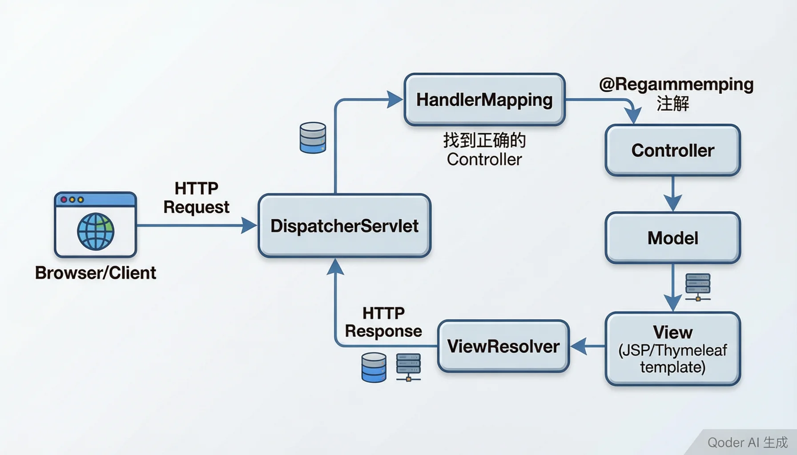

# Spring MVC 详解

> 内容更新时间：2026-10-20 · 学习阶段：进阶 · 预计用时：55 分钟

> 学习阶段：进阶 · 预计用时：55 分钟 · 配图：Spring MVC 架构



## 本节知识框架

想象你经营一家大型餐厅。顾客（浏览器）打来电话或走进来（发送 HTTP 请求），前台接待员（DispatcherServlet）是所有请求的唯一入口——他不亲自做菜，而是负责"调度"：先看顾客想吃什么（解析请求 URL），再找到对应的厨师（Controller），把菜单交给厨师处理。厨师做好菜后（业务逻辑处理完毕），把菜品和摆盘方式（模型数据和视图名称）交给接待员，接待员再找服务员（ViewResolver）按照摆盘要求把菜端给顾客（渲染页面并返回 HTTP 响应）。

这就是 Spring MVC 的核心工作方式——**前端控制器模式**。整个餐厅不需要每个厨师自己去门口接待顾客，所有接待工作由前台统一完成，厨师只需要专心做菜。

**本课知识地图**

```text
DispatcherServlet 流程 → Controller 注解 → 请求映射 → 参数绑定 → 数据返回 → REST 风格 → 完整 CRUD 实战
```

**学完本课你将能够**：

1. 描述 Spring MVC 的请求处理全流程，解释 DispatcherServlet 的核心调度作用。
2. 使用 `@Controller`、`@RequestMapping`、`@GetMapping`、`@PostMapping` 等注解编写请求处理逻辑。
3. 使用 `@RequestParam`、`@PathVariable`、`@RequestBody` 绑定不同类型的请求参数。
4. 编写一个完整的 CRUD（增删改查）控制器，处理表单提交和 REST 接口。

**先修知识**：你需要了解 Java 基础语法和面向对象（来自《Java 基础》），Servlet 的基本概念（来自《Servlet 与 JSP 基础》），以及 Spring IoC 和 Bean 管理（来自《Spring Framework 核心》）。

**复习清单**

- [ ] 默写 DispatcherServlet 的完整请求处理流程（至少 6 步）
- [ ] 区分 `@RequestParam`、`@PathVariable`、`@RequestBody` 的使用场景并各写一个示例
- [ ] 独立完成一个包含增删改查的 Controller 代码

---

## 核心概念定义

| 术语 | 一句话定义 | 生活类比 |
| --- | --- | --- |
| DispatcherServlet | Spring MVC 的前端控制器，所有 HTTP 请求的唯一入口，负责调度整个请求流程。 | 餐厅的前台接待员——不亲自做菜，但所有顾客请求都经过他分配。 |
| Controller | 处理具体请求的组件类，包含业务逻辑并返回模型和视图。 | 餐厅的厨师——接到菜单后做菜，做好后告诉接待员菜名和摆盘方式。 |
| Model | 存放要展示给客户端的数据，是 Controller 和 View 之间的数据桥梁。 | 菜品本身——厨师做好的菜，最终要端给顾客看和吃。 |
| View | 负责把 Model 中的数据渲染成用户可见的页面（HTML、JSON 等）。 | 摆盘和上菜方式——决定菜品以什么形式呈现给顾客。 |
| ViewResolver | 视图解析器，根据逻辑视图名称找到具体的 View 实现。 | 餐厅的菜单图录——根据菜名找到对应的摆盘图片和上菜流程。 |
| @RequestMapping | 标注在类或方法上，定义请求 URL 到处理方法的映射关系。 | 厨师负责的菜品范围——"我负责所有川菜"。 |
| @RequestParam | 从 URL 查询参数或表单数据中绑定值到方法参数。 | 顾客电话里说的具体要求——"加辣""不要香菜"。 |
| @PathVariable | 从 URL 路径中提取变量值，常用于 REST 风格 URL。 | 外卖单上的编号——从"订单#1234"中提取出 1234。 |
| ModelAndView | 同时封装 Model 数据和逻辑视图名称的对象，一个返回值搞定数据和视图。 | 厨师递出的传菜票——上面既写了菜名（视图），又写了配料清单（数据）。 |
| 前端控制器模式 | 所有请求先经过一个统一的控制器进行分发，再交给具体的处理器。 | 公司的前台——所有来访者先经过前台登记，再被引导到对应部门。 |

---

## 原理与运行机制

### DispatcherServlet 请求处理全流程

当一个 HTTP 请求到达 Spring MVC 应用时，会经历以下步骤：

1. **请求到达 DispatcherServlet**：所有请求先被 DispatcherServlet 截获（在 `web.xml` 或 Java 配置中把它注册为前端控制器）。
2. **查询 HandlerMapping**：DispatcherServlet 调用所有注册的 HandlerMapping，找到哪个 Controller 的哪个方法应该处理这个请求。
3. **调用 HandlerAdapter**：HandlerAdapter 负责调用具体的 Controller 方法，同时完成参数绑定（把请求参数转成方法需要的类型）。
4. **Controller 执行业务逻辑**：方法处理完成后，返回 ModelAndView（包含模型数据和视图名称）或使用 `@ResponseBody` 直接返回数据。
5. **ViewResolver 解析视图**：如果返回的是视图名称，ViewResolver 根据名称找到具体的 View 实现（JSP、Thymeleaf 模板等）。
6. **View 渲染并返回响应**：View 把 Model 中的数据填充到模板，生成最终的 HTML（或 JSON），通过 HTTP 响应返回给客户端。

用伪代码表示：

```java
// DispatcherServlet 的核心逻辑（简化版）
protected void doDispatch(HttpServletRequest request, HttpServletResponse response) {
    // 1. 找到对应的处理器
    HandlerExecutionChain mappedHandler = handlerMapping.getHandler(request);
    
    // 2. 调用处理器
    HandlerAdapter handlerAdapter = getHandlerAdapter(mappedHandler.getHandler());
    ModelAndView mv = handlerAdapter.handle(request, response, mappedHandler.getHandler());
    
    // 3. 解析视图并渲染
    View view = viewResolver.resolveViewName(mv.getViewName(), request.getLocale());
    view.render(mv.getModel(), request, response);
}
```

### 从原始 Servlet 到 Spring MVC

在《Servlet 与 JSP 基础》中，你需要为每种请求手写一个 Servlet 类。而 Spring MVC 只需要**一个** DispatcherServlet 就能处理所有请求——它通过注解把请求路由到不同的方法。

```text
传统 Servlet 方式：
  /login    → LoginServlet
  /register → RegisterServlet
  /order    → OrderServlet
  每个 URL 对应一个 Servlet 类

Spring MVC 方式：
  所有请求 → DispatcherServlet（唯一）
               → /login    → UserController.login()
               → /register → UserController.register()
               → /order    → OrderController.createOrder()
  一个 Servlet 分发到多个 Controller 方法
```

### 请求映射注解详解

Spring MVC 提供了多种请求映射注解：

```java
@Controller
@RequestMapping("/users")      // 类级别：所有方法共享的前缀
public class UserController {

    @GetMapping                // 处理 GET /users
    public String list() { ... }

    @GetMapping("/{id}")       // 处理 GET /users/42
    public String detail(@PathVariable Long id) { ... }

    @PostMapping               // 处理 POST /users
    public String create(@RequestParam String name) { ... }

    @PutMapping("/{id}")       // 处理 PUT /users/42
    public String update(@PathVariable Long id, @RequestBody UserDTO dto) { ... }

    @DeleteMapping("/{id}")    // 处理 DELETE /users/42
    public String delete(@PathVariable Long id) { ... }
}
```

`@GetMapping` 是 `@RequestMapping(method = RequestMethod.GET)` 的简写。同理还有 `@PostMapping`、`@PutMapping`、`@DeleteMapping`、`@PatchMapping`。

### 参数绑定的三种方式

**1. @RequestParam —— 绑定查询参数或表单数据**

```java
// GET /search?keyword=spring&page=1
@GetMapping("/search")
public String search(@RequestParam("keyword") String keyword,
                     @RequestParam(value = "page", defaultValue = "1") int page) {
    // keyword = "spring", page = 1
    return "搜索结果：" + keyword + "，第" + page + "页";
}
```

**2. @PathVariable —— 从 URL 路径中提取值**

```java
// GET /users/42/orders/7
@GetMapping("/users/{userId}/orders/{orderId}")
public String getOrder(@PathVariable Long userId, @PathVariable Long orderId) {
    // userId = 42, orderId = 7
    return "用户" + userId + "的订单" + orderId;
}
```

**3. @RequestBody —— 绑定请求体（常用于 JSON）**

```java
@PostMapping("/users")
public ResponseEntity<User> createUser(@RequestBody CreateUserRequest request) {
    // request 从 JSON 请求体自动反序列化
    User user = userService.save(request.toUser());
    return ResponseEntity.ok(user);
}
```

### 返回值类型

Controller 方法可以返回多种类型：

| 返回值类型 | 说明 | 使用场景 |
| --- | --- | --- |
| `String` | 逻辑视图名称 | 返回页面（配合模板引擎） |
| `ModelAndView` | 同时包含模型数据和视图名称 | 需要同时传递数据和指定视图 |
| `@ResponseBody` 注解 | 返回值直接写入 HTTP 响应体 | REST API，返回 JSON/XML |
| `ResponseEntity<T>` | 完整的 HTTP 响应（含状态码、头信息） | 需要控制 HTTP 状态码的 REST API |
| `void` | 直接操作 response 对象 | 文件下载等场景 |
| `RedirectView` / `"redirect:..."` | 重定向到另一个 URL | 表单提交后防止重复提交 |

---

## 典型应用场景

- **Web 页面应用**：使用 `@Controller` + Thymeleaf/JSP 模板引擎，渲染 HTML 页面返回给浏览器。
- **RESTful API**：使用 `@RestController`（等同于 `@Controller` + `@ResponseBody`），返回 JSON 数据供前端 SPA 或移动端调用。
- **文件上传/下载**：使用 `MultipartFile` 参数接收上传文件，使用 `ResponseEntity<Resource>` 返回下载文件。
- **表单处理**：使用 `@ModelAttribute` 把表单数据自动绑定到 Java 对象，配合数据校验注解（`@Valid`、`@NotNull`）实现表单验证。
- **拦截器与过滤器**：使用 `HandlerInterceptor` 实现登录验证、日志记录等横切关注点，类似 AOP 但专门用于 Web 层。
- **异常处理**：使用 `@ExceptionHandler` 或 `@ControllerAdvice` 统一处理控制器中抛出的异常，返回友好的错误页面或 JSON。

---

## 代码/协议/SQL 示例

### 最小 Spring MVC 应用配置

**pom.xml（核心依赖）**

```xml
<dependencies>
    <dependency>
        <groupId>org.springframework</groupId>
        <artifactId>spring-webmvc</artifactId>
        <version>5.3.20</version>
    </dependency>
    <dependency>
        <groupId>javax.servlet</groupId>
        <artifactId>javax.servlet-api</artifactId>
        <version>4.0.1</version>
        <scope>provided</scope>
    </dependency>
</dependencies>
```

**WebConfig.java（Java 配置替代 web.xml）**

```java
@Configuration
@EnableWebMvc
@ComponentScan("com.example.web")
public class WebConfig implements WebMvcConfigurer {
    // 启用 Spring MVC，扫描 Controller 所在的包
}
```

**WebInitializer.java（替代 web.xml 注册 DispatcherServlet）**

```java
public class WebInitializer extends AbstractAnnotationConfigDispatcherServletInitializer {
    @Override
    protected Class<?>[] getRootConfigClasses() { return null; }

    @Override
    protected Class<?>[] getServletConfigClasses() {
        return new Class[]{WebConfig.class};
    }

    @Override
    protected String[] getServletMappings() {
        return new String[]{"/"};  // 拦截所有请求
    }
}
```

### 处理 GET 请求——用户列表

```java
@Controller
@RequestMapping("/users")
public class UserController {

    @Autowired
    private UserService userService;

    // GET /users —— 展示用户列表页面
    @GetMapping
    public String listUsers(Model model) {
        List<User> users = userService.findAll();
        model.addAttribute("users", users);  // 把数据放入 Model
        return "user/list";  // 返回逻辑视图名，ViewResolver 会找到 user/list.html
    }
}
```

### 处理 POST 请求——表单提交创建用户

```java
// GET /users/new —— 展示注册表单
@GetMapping("/new")
public String showForm(Model model) {
    model.addAttribute("user", new User());  // 空对象供表单绑定
    return "user/form";
}

// POST /users —— 处理表单提交
@PostMapping
public String createUser(@Valid @ModelAttribute("user") User user,
                         BindingResult result) {
    if (result.hasErrors()) {
        return "user/form";  // 校验失败，回到表单页面
    }
    userService.save(user);
    return "redirect:/users";  // 重定向到列表页，防止刷新重复提交
}
```

对应的 Thymeleaf 表单模板（`user/form.html`）：

```html
<form th:action="@{/users}" th:object="${user}" method="post">
    <label>姓名：<input type="text" th:field="*{name}" /></label>
    <span th:if="${#fields.hasErrors('name')}" th:errors="*{name}"></span>

    <label>邮箱：<input type="email" th:field="*{email}" /></label>
    <span th:if="${#fields.hasErrors('email')}" th:errors="*{email}"></span>

    <button type="submit">提交</button>
</form>
```

### REST 风格接口——JSON API

```java
@RestController
@RequestMapping("/api/users")
public class UserApiController {

    @Autowired
    private UserService userService;

    // GET /api/users —— 获取所有用户
    @GetMapping
    public List<User> listAll() {
        return userService.findAll();
    }

    // GET /api/users/42 —— 根据 ID 获取用户
    @GetMapping("/{id}")
    public ResponseEntity<User> getById(@PathVariable Long id) {
        User user = userService.findById(id);
        if (user == null) {
            return ResponseEntity.notFound().build();
        }
        return ResponseEntity.ok(user);
    }

    // POST /api/users —— 创建用户（接收 JSON）
    @PostMapping
    public ResponseEntity<User> create(@RequestBody @Valid CreateUserRequest request) {
        User user = userService.save(request.toUser());
        return ResponseEntity.status(HttpStatus.CREATED).body(user);
    }

    // PUT /api/users/42 —— 更新用户
    @PutMapping("/{id}")
    public ResponseEntity<User> update(@PathVariable Long id,
                                       @RequestBody @Valid UpdateUserRequest request) {
        User user = userService.findById(id);
        if (user == null) {
            return ResponseEntity.notFound().build();
        }
        request.applyTo(user);
        return ResponseEntity.ok(userService.save(user));
    }

    // DELETE /api/users/42 —— 删除用户
    @DeleteMapping("/{id}")
    public ResponseEntity<Void> delete(@PathVariable Long id) {
        userService.deleteById(id);
        return ResponseEntity.noContent().build();
    }
}
```

### 完整 CRUD Controller（页面版 + REST 版合一）

下面是一个完整的用户管理模块，同时提供页面接口和 REST API：

```java
@Controller
@RequestMapping("/users")
public class UserCrudController {

    @Autowired
    private UserService userService;

    // ========== 查询（Read） ==========

    // 页面版：GET /users → 渲染用户列表 HTML
    @GetMapping
    public String list(Model model) {
        model.addAttribute("users", userService.findAll());
        return "user/list";
    }

    // API 版：GET /users/{id} → 返回 JSON
    @GetMapping(value = "/{id}", produces = "application/json")
    @ResponseBody
    public User getUser(@PathVariable Long id) {
        return userService.findById(id);
    }

    // ========== 新增（Create） ==========

    // 展示新增表单
    @GetMapping("/new")
    public String showCreateForm(Model model) {
        model.addAttribute("user", new User());
        return "user/form";
    }

    // 处理新增提交
    @PostMapping
    public String create(@Valid @ModelAttribute User user, BindingResult result) {
        if (result.hasErrors()) {
            return "user/form";
        }
        userService.save(user);
        return "redirect:/users";
    }

    // ========== 修改（Update） ==========

    // 展示编辑表单
    @GetMapping("/{id}/edit")
    public String showEditForm(@PathVariable Long id, Model model) {
        User user = userService.findById(id);
        model.addAttribute("user", user);
        return "user/form";
    }

    // 处理编辑提交
    @PostMapping("/{id}")
    public String update(@PathVariable Long id,
                         @Valid @ModelAttribute User user,
                         BindingResult result) {
        if (result.hasErrors()) {
            return "user/form";
        }
        user.setId(id);
        userService.save(user);
        return "redirect:/users";
    }

    // ========== 删除（Delete） ==========

    @PostMapping("/{id}/delete")
    public String delete(@PathVariable Long id) {
        userService.deleteById(id);
        return "redirect:/users";
    }
}
```

### 全局异常处理

```java
@ControllerAdvice
public class GlobalExceptionHandler {

    // 处理所有 Controller 中的 UserNotFoundException
    @ExceptionHandler(UserNotFoundException.class)
    public ResponseEntity<ErrorResponse> handleNotFound(UserNotFoundException ex) {
        ErrorResponse error = new ErrorResponse(404, ex.getMessage());
        return ResponseEntity.status(HttpStatus.NOT_FOUND).body(error);
    }

    // 处理参数校验异常
    @ExceptionHandler(MethodArgumentNotValidException.class)
    public ResponseEntity<ErrorResponse> handleValidation(MethodArgumentNotValidException ex) {
        String message = ex.getBindingResult().getFieldErrors().stream()
            .map(e -> e.getField() + ": " + e.getDefaultMessage())
            .collect(Collectors.joining(", "));
        ErrorResponse error = new ErrorResponse(400, message);
        return ResponseEntity.badRequest().body(error);
    }
}
```

---

## 时间/空间复杂度或性能分析

- **请求处理延迟**：DispatcherServlet 的调度开销极小（微秒级），主要耗时在 Controller 业务逻辑和数据库访问。
- **HandlerMapping 查找**：`RequestMappingHandlerMapping` 使用 `HashMap` 缓存 URL 到方法的映射，查找时间复杂度 O(1)。
- **内存占用**：Spring MVC 容器会缓存所有 Controller 的方法元数据（参数类型、注解信息），大型项目可能有数千个映射，但内存占用通常在几 MB 以内。
- **参数绑定性能**：`@RequestBody` 使用 Jackson 进行 JSON 反序列化，对于大请求体（>1MB）可能成为瓶颈，建议限制请求体大小。
- **视图渲染性能**：Thymeleaf 模板引擎首次渲染需要编译模板（较慢），后续使用缓存（较快）。JSP 由 Servlet 容器编译，性能类似。
- **并发能力**：每个请求在独立线程中处理（传统模式），或使用 Spring WebFlux 的响应式模式（基于 Netty，单线程处理大量并发连接）。

---

## 常见误区与易错点

| 错误 | 现象 | 正确做法 |
| --- | --- | --- |
| `@Controller` 和 `@RestController` 混用 | `@Controller` 返回的字符串被当作视图名而非 JSON | REST API 用 `@RestController`，页面用 `@Controller` |
| `@RequestParam` 忘记设 `required = false` | 参数缺失时直接报 400 错误 | 可选参数加 `required = false` 或给 `defaultValue` |
| POST 表单提交后刷新页面 | 浏览器提示"是否重新提交表单"，导致重复创建 | 提交成功后使用 `redirect:` 重定向，遵循 PRG 模式 |
| `@PathVariable` 和方法参数名不一致 | 参数绑定失败，值为 null | 确保 `@PathVariable("id")` 与参数名匹配，或开启 `-parameters` 编译选项 |
| 忘记在类上加 `@Controller` | Spring 不识别该类为控制器，请求 404 | 给 Controller 类添加 `@Controller` 或 `@RestController` 注解 |
| `@RequestBody` 接收表单数据 | 报 415 或反序列化失败 | `@RequestBody` 只能接收 `application/json`，表单用 `@ModelAttribute` |
| Model 属性名和前端变量名对不上 | 页面取不到数据，显示空白 | 确保 `model.addAttribute("key", value)` 的 key 和模板中引用一致 |
| 多个 Controller 方法匹配同一个 URL | 启动报错或请求被错误的方法处理 | 检查 `@RequestMapping` 的 URL 和方法，确保不重复 |

---

## 与其他知识点的关系

- **先修**：《Java 基础》、《Servlet 与 JSP 基础》、《Spring Framework 核心》
- **后续**：《Spring Boot 入门》、《Spring Security 安全框架》、《前后端分离架构》
- **相关**：《HTTP 协议基础》、《RESTful API 设计》、《Thymeleaf 模板引擎》、《MVC 设计模式》

---

## 自测题与参考答案

**Q1**：在 Spring MVC 中，DispatcherServlet 的主要职责是什么？请简述一个 HTTP 请求从到达到返回响应的完整流程。

<details>
<summary>点击查看答案</summary>

DispatcherServlet 是 Spring MVC 的前端控制器，所有请求的统一入口。完整流程：(1) 请求到达 DispatcherServlet；(2) DispatcherServlet 通过 HandlerMapping 找到对应的 Controller 方法；(3) HandlerAdapter 调用 Controller 方法并完成参数绑定；(4) Controller 执行业务逻辑，返回 ModelAndView 或数据；(5) ViewResolver 解析视图名称，找到具体的 View；(6) View 渲染 Model 数据，生成最终响应返回给客户端。
</details>

**Q2**：`@RequestParam` 和 `@PathVariable` 有什么区别？分别适用于什么场景？

<details>
<summary>点击查看答案</summary>

`@RequestParam` 从 URL 查询参数（`?key=value`）或表单数据中获取值，适用于搜索、分页、表单提交等场景。`@PathVariable` 从 URL 路径中提取变量值（如 `/users/{id}` 中的 id），适用于 REST 风格 URL，表示资源的唯一标识。简单记忆：`@RequestParam` 取问号后面的值，`@PathVariable` 取路径中的值。
</details>

**Q3**：为什么表单提交后推荐使用 `redirect:` 重定向而不是直接返回视图名称？

<details>
<summary>点击查看答案</summary>

这是 PRG（Post/Redirect/Get）模式。如果 POST 成功后直接返回视图，用户刷新页面时浏览器会重新发送 POST 请求，导致重复提交（比如重复创建订单）。使用 `redirect:` 重定向后，浏览器发送新的 GET 请求，刷新页面只会重新加载结果页，不会重复提交。
</details>

---

## 考点精讲

### 考点 1

在 Spring MVC 的请求处理流程中，负责根据请求 URL 查找对应 Controller 方法的组件是？

A. “ViewResolver”（视图解析器）
B. “HandlerAdapter”（处理器适配器）
C. “HandlerMapping”（处理器映射器）
D. “DispatcherServlet” 直接查找

**正确答案：C**

**详细解释：** “HandlerMapping” 负责根据请求 URL 查找对应的 Controller 方法，返回一个 “HandlerExecutionChain”。“DispatcherServlet” 是前端控制器，负责统一接收所有请求并协调各组件工作，但它本身不直接做 URL 匹配。“HandlerAdapter” 负责调用找到的 Controller 方法并完成参数绑定。“ViewResolver” 负责根据逻辑视图名找到具体的 View 实现。

---

### 考点 2

“@RequestParam” 和 “@PathVariable” 注解的区别是什么？

A. “@RequestParam” 从 URL 路径中提取值，“@PathVariable” 从查询参数中获取值  
B. “@RequestParam” 只能用于 GET 请求，“@PathVariable” 只能用于 POST 请求  
C. 两者功能完全相同，只是名称不同  
D. “@RequestParam” 从查询参数或表单数据中获取值  

**正确答案：D**

**详细解释：** “@RequestParam” 用于绑定 URL 查询参数（如 “?keyword=spring&page=1”）或表单数据到方法参数；“@PathVariable” 用于从 URL 路径中提取变量值（如 “/users/{id}” 中的 “id”）。简单记忆：“@RequestParam” 取问号后面的值，“@PathVariable” 取路径中的值。两者都可以用于各种 HTTP 方法。

---

### 考点 3

以下关于 “@Controller” 和 “@RestController” 的说法，哪个是正确的？

A. “@RestController” 只能返回 JSON 格式的数据
B. “@Controller” 返回的字符串会被直接写入 HTTP 响应体
C. “@RestController” 等同于 “@Controller” 加上 “@ResponseBody”
D. 两者没有任何区别，可以随意互换使用

**正确答案：C**

**详细解释：** “@RestController” = “@Controller” + “@ResponseBody”。使用 “@Controller” 时，方法返回的字符串默认被当作逻辑视图名称（由 “ViewResolver” 解析为具体页面）；使用 “@RestController” 时，方法返回值会被自动序列化为 JSON/XML 直接写入 HTTP 响应体。REST API 应使用 “@RestController”，页面渲染应使用 “@Controller”。

---

### 考点 4

在 Spring MVC 中，表单提交成功后为什么推荐使用 “redirect:” 重定向而不是直接返回视图名称？

A. 重定向可以让浏览器发送新的 GET 请求，防止用户刷新页面时重复提交表单  
B. 重定向可以提高服务器处理速度  
C. 视图名称不支持包含中文字符，必须用重定向  
D. 重定向可以让页面加载更多的 JavaScript 资源  

**正确答案：A**

**详细解释：** 这称为 PRG（Post/Redirect/Get）模式。如果 POST 成功后直接返回视图名称，用户刷新页面时浏览器会重新发送 POST 请求，导致重复提交（如重复创建订单、重复扣款）。使用 “redirect:” 重定向后，浏览器发送新的 GET 请求到目标 URL，刷新页面只会重新加载结果页，不会重复提交表单。

---

### 考点 5

在 Spring MVC 中，“@RequestBody” 注解适用于以下哪种场景？

A. 从 URL 查询参数中获取字符串值  
B. 从 URL 路径中提取变量值
C. 将 HTTP 请求体中的 JSON 数据自动反序列化为 Java 对象
D. 将方法返回值序列化为 XML 格式

**正确答案：C**

**详细解释：** “@RequestBody” 用于将 HTTP 请求体中的 JSON（或 XML）数据自动反序列化为 Java 对象，通常配合 “@PostMapping” 或 “@PutMapping” 使用。它只能接收 “application/json” 类型的数据，不能用于表单数据（表单应使用 “@ModelAttribute”）。“@RequestParam” 用于查询参数，“@PathVariable” 用于路径变量，“@ResponseBody” 用于返回值序列化。

---

## 术语速查

| 术语 | 一句话说明 |
| --- | --- |
| DispatcherServlet | 前端控制器，所有请求的统一入口 |
| HandlerMapping | 根据 URL 查找对应的 Controller 方法 |
| HandlerAdapter | 调用 Controller 方法并绑定参数 |
| ViewResolver | 根据逻辑视图名找到具体的 View |
| @Controller | 标注类为 Spring MVC 控制器 |
| @RestController | 等同于 @Controller + @ResponseBody |
| @RequestMapping | 定义 URL 到方法的映射关系 |
| @RequestParam | 绑定查询参数或表单数据 |
| @PathVariable | 绑定 URL 路径中的变量 |
| @RequestBody | 绑定请求体（JSON）到对象 |
| @ModelAttribute | 绑定表单数据到对象 |
| ModelAndView | 封装模型数据和视图名称的返回对象 |
| PRG 模式 | Post/Redirect/Get，防止表单重复提交 |

---

## 参考资料与复核
- 下次复核：2026-11-29

| 资料 | 说明 |
| --- | --- |
| [Spring MVC 官方文档](https://docs.spring.io/spring-framework/docs/current/reference/html/web.html) | Spring Web MVC 完整参考 |
| [Spring Framework @RequestMapping 指南](https://docs.spring.io/spring-framework/docs/current/reference/html/web.html#mvc-ann-requestmapping) | 请求映射注解详解 |
| [Thymeleaf + Spring 集成文档](https://www.thymeleaf.org/doc/tutorials/3.0/thymeleafspring.html) | 模板引擎与 Spring MVC 集成 |
| 复核日期：2026-10-20 | |
- 最后复核：2026-10-04

---

## 内容元数据

- 内容更新时间：2026-10-06

- 课程 ID：java_spring_mvc
- 分类：Java Web 开发
- 难度：进阶
- 预计用时：55 分钟
- 先修课程：Java 基础、Servlet 与 JSP 基础、Spring Framework 核心
- 后续课程：Spring Boot 入门、Spring Security 安全框架
- 内容版本：v2.0
