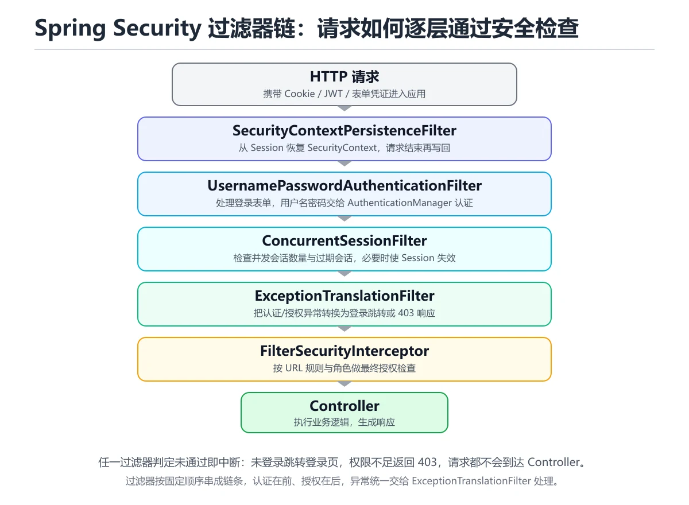

# Spring Security 认证授权

> 内容更新时间：2026-10-20 · 学习阶段：进阶 · 预计用时：50 分钟



## 本节知识框架

想象你住在一个高档小区。进大门时，保安会查你的门禁卡（认证——你是谁）；进了大门后，不同楼栋需要不同权限的电梯卡才能到达对应楼层（授权——你能去哪）。有些区域比如楼顶花园，只有特定住户才能进入；而地下车库，所有住户都可以使用。

Spring Security 就是这样一个"小区安保系统"。它帮你处理两件事：第一，确认来访者的身份（认证 Authentication）；第二，根据身份决定他能做什么（授权 Authorization）。没有它，你的应用就像没有门禁的小区——任何人都能随意进出每栋楼。

**本课知识地图**

```text
认证与授权概念 → Security 过滤器链 → 认证流程 → JWT 机制 → 实战配置 → 角色权限控制
```

**学完本课你将能够**：

1. 区分认证（Authentication）和授权（Authorization）的含义与区别。
2. 理解 Spring Security 过滤器链的工作原理。
3. 使用 Spring Security 实现基于用户名密码的认证。
4. 使用 JWT 实现无状态令牌认证。
5. 使用 `@PreAuthorize` 和 `@Secured` 实现方法级权限控制。

**先修知识**：你需要了解 Spring 核心概念（来自《Spring Framework 核心》），Servlet 过滤器的基本概念（来自《Servlet 与 JSP 基础》），以及 HTTP 协议基础（来自《HTTP 协议基础》）。

**复习清单**

- [ ] 重新阅读核心概念定义表，用自己的话说出认证和授权的区别
- [ ] 画出过滤器链处理请求的完整流程
- [ ] 手写一遍 SecurityFilterChain 配置代码
- [ ] 完成 JWT 认证流程的默写

---

## 核心概念定义

| 术语 | 一句话定义 | 生活类比 |
| --- | --- | --- |
| 认证（Authentication） | 验证"你是谁"的过程，通常通过用户名密码、令牌等方式确认身份。 | 进小区时保安查你的门禁卡——确认你是这个小区的住户。 |
| 授权（Authorization） | 验证"你能做什么"的过程，根据已确认的身份决定允许访问哪些资源。 | 进楼栋时电梯卡只能到你住的楼层——确认你能去哪些地方。 |
| SecurityContext | 存储当前请求的安全上下文，包含已认证用户的详细信息。 | 保安亭里的住户登记簿——记录当前进入小区的人是谁。 |
| UserDetails | Spring Security 中表示用户详细信息的接口，包含用户名、密码、权限等。 | 住户档案卡——上面写着姓名、房号、可进入的区域。 |
| UserDetailsService | 加载用户信息的接口，从数据库或其他地方查找用户。 | 物业前台——根据门禁卡号查出对应的住户信息。 |
| 过滤器链（Filter Chain） | 一系列按顺序执行的过滤器，每个过滤器负责一种安全检查。 | 小区的多道关卡：大门查门禁卡 → 楼栋查电梯卡 → 花园查特殊权限。 |
| @PreAuthorize | 方法执行前进行权限检查的注解，支持 SpEL 表达式。 | 进房间前保安先检查你的卡是否有这个房间的权限。 |
| @Secured | 方法级权限控制注解，指定允许访问的角色列表。 | 门上贴的告示——"仅限 VIP 进入"。 |
| JWT（JSON Web Token） | 一种无状态的令牌格式，将用户信息编码在令牌本身中，服务端不需要存储会话。 | 一张加密的门禁卡，卡里直接写着你是谁、能去哪，保安不用查电脑就能验证。 |
| OAuth2 | 一种授权框架，允许第三方应用在用户授权下访问资源，不需要暴露密码。 | 你授权微信代替你查看快递信息——快递公司有你的数据，但通过微信这个中间人来操作。 |
| CSRF（跨站请求伪造） | 一种攻击方式，诱导用户在已登录的状态下发送恶意请求。 | 有人冒充物业通知你"请确认转账"，你以为是真的就操作了。 |
| 密码加密（BCrypt） | 单向哈希加密算法，用于安全存储密码，即使数据库泄露也无法还原明文。 | 把密码放进一台"碎纸机"，变成一堆无法还原的碎纸片，但每次对比时可以用同样的方式验证。 |

---

## 原理与运行机制

### 认证流程是怎么工作的？

用一个生活中的例子来理解：你去银行取钱。

1. 你出示身份证（提交用户名密码）
2. 柜员核对身份证信息（UserDetailsService 查询用户）
3. 柜员确认你是本人（密码匹配成功）
4. 你被允许办理业务（认证成功，进入授权阶段）

Spring Security 的认证流程与此类似：

```text
用户请求 → UsernamePasswordAuthenticationFilter 拦截
         → AuthenticationManager 处理认证
         → UserDetailsService 加载用户信息
         → DaoAuthenticationProvider 验证密码
         → 认证成功 → SecurityContext 保存认证信息
         → 认证失败 → 返回错误
```

**代码层面**：

```java
// 1. 用户提交登录信息
public class LoginRequest {
    private String username;
    private String password;
    // getter/setter 省略
}

// 2. Spring Security 内部流程
Authentication authentication = new UsernamePasswordAuthenticationToken(
    loginRequest.getUsername(), 
    loginRequest.getPassword()
);

// 3. AuthenticationManager 调用 Provider 进行认证
Authentication result = authenticationManager.authenticate(authentication);

// 4. 认证成功后放入 SecurityContext
SecurityContextHolder.getContext().setAuthentication(result);
```

### 授权是怎么工作的？

认证解决"你是谁"，授权解决"你能做什么"。

Spring Security 的授权检查发生在两个层面：

**URL 级别**：在过滤器链中拦截请求，检查 URL 是否需要特定角色。

```java
// 配置 URL 级别的权限
http.authorizeHttpRequests(auth -> auth
    .requestMatchers("/admin/**").hasRole("ADMIN")
    .requestMatchers("/user/**").hasAnyRole("USER", "ADMIN")
    .requestMatchers("/public/**").permitAll()
    .anyRequest().authenticated()
);
```

**方法级别**：通过注解在方法执行前检查权限。

```java
@PreAuthorize("hasRole('ADMIN')")
public List<User> getAllUsers() {
    return userRepository.findAll();
}

@PreAuthorize("#userId == authentication.principal.id or hasRole('ADMIN')")
public User getUserById(Long userId) {
    return userRepository.findById(userId).orElseThrow();
}
```

### 过滤器链是怎么运作的？

过滤器链就像小区的多道安检门，每个请求必须依次通过所有过滤器：

```text
请求进入
  ↓
SecurityContextPersistenceFilter  → 恢复之前的安全上下文
  ↓
UsernamePasswordAuthenticationFilter → 处理用户名密码登录
  ↓
ConcurrentSessionFilter           → 检查并发会话
  ↓
ExceptionTranslationFilter        → 处理安全异常
  ↓
FilterSecurityInterceptor         → 最终的授权检查
  ↓
请求到达 Controller
```

每个过滤器各司其职。如果某个过滤器发现问题（比如没有登录），请求会直接被拦截，不会到达后面的过滤器和业务代码。

### JWT 令牌认证机制

传统的 Session 认证就像酒店用房卡：前台（服务器）给你一张房卡（Session ID），但房卡本身不包含信息，每次刷卡都要去前台查电脑确认。

JWT 就像一张加密的身份证：卡里直接写着你是谁、有效期到什么时候，保安（服务器）不用查电脑，只需要验证签名就能确认身份。

**JWT 的结构**：

```text
eyJhbGciOiJIUzI1NiJ9.                    ← 头部（Header）：算法信息
eyJzdWIiOiJ6aGFuZ3NhbiIsInJvbGUiOiJVU0VSIn0. ← 载荷（Payload）：用户数据
SflKxwRJSMeKKF2QT4fwpMeJf36POk6yJV_adQsQ5cw ← 签名（Signature）：防篡改
```

**JWT 认证流程**：

```text
登录：用户名密码 → 服务器验证 → 生成 JWT → 返回给客户端
请求：携带 JWT → 服务器验证签名 → 解析用户信息 → 处理请求
```

---

## 典型应用场景

- **Web 应用登录**：最常见的场景，用户通过用户名密码登录，Spring Security 处理认证和会话管理。
- **RESTful API 认证**：前后端分离项目中，使用 JWT 实现无状态认证，每次请求携带令牌。
- **微服务网关鉴权**：在 API 网关统一验证 JWT，下游服务不需要重复认证。
- **第三方登录**：使用 OAuth2 集成微信、GitHub 等第三方登录。
- **后台管理系统**：基于角色的权限控制（RBAC），不同角色看到不同菜单和功能。
- **移动端 API**：移动端使用 JWT 或 OAuth2 令牌认证，支持自动续期。

---

## 代码/协议/SQL 示例

### 最小安全配置

**pom.xml 依赖**

```xml
<dependencies>
    <dependency>
        <groupId>org.springframework.boot</groupId>
        <artifactId>spring-boot-starter-security</artifactId>
    </dependency>
    <dependency>
        <groupId>org.springframework.boot</groupId>
        <artifactId>spring-boot-starter-web</artifactId>
    </dependency>
</dependencies>
```

**SecurityConfig.java — 基础配置**

```java
@Configuration
@EnableWebSecurity
public class SecurityConfig {

    @Bean
    public SecurityFilterChain filterChain(HttpSecurity http) throws Exception {
        http
            // 禁用 CSRF（REST API 使用 JWT，不需要 CSRF 保护）
            .csrf(csrf -> csrf.disable())
            // 配置请求授权规则
            .authorizeHttpRequests(auth -> auth
                .requestMatchers("/api/login", "/api/register").permitAll()
                .requestMatchers("/api/admin/**").hasRole("ADMIN")
                .anyRequest().authenticated()
            )
            // 使用无状态会话（JWT 不需要 Session）
            .sessionManagement(session -> 
                session.sessionCreationPolicy(SessionCreationPolicy.STATELESS)
            );

        return http.build();
    }

    @Bean
    public PasswordEncoder passwordEncoder() {
        return new BCryptPasswordEncoder();
    }
}
```

### 完整的 JWT 认证实现

**JwtUtil.java — 令牌工具类**

```java
@Component
public class JwtUtil {

    @Value("${jwt.secret}")
    private String secret;

    @Value("${jwt.expiration}")
    private long expiration; // 毫秒

    // 生成 JWT
    public String generateToken(String username, List<String> roles) {
        return Jwts.builder()
            .setSubject(username)
            .claim("roles", roles)
            .setIssuedAt(new Date())
            .setExpiration(new Date(System.currentTimeMillis() + expiration))
            .signWith(SignatureAlgorithm.HS256, secret)
            .compact();
    }

    // 从 JWT 中提取用户名
    public String extractUsername(String token) {
        return parseClaims(token).getSubject();
    }

    // 验证 JWT 是否有效
    public boolean validateToken(String token) {
        try {
            parseClaims(token);
            return true;
        } catch (JwtException | IllegalArgumentException e) {
            return false;
        }
    }

    private Claims parseClaims(String token) {
        return Jwts.parser()
            .setSigningKey(secret)
            .parseClaimsJws(token)
            .getBody();
    }
}
```

**JwtAuthenticationFilter.java — JWT 过滤器**

```java
@Component
public class JwtAuthenticationFilter extends OncePerRequestFilter {

    @Autowired
    private JwtUtil jwtUtil;

    @Autowired
    private UserDetailsService userDetailsService;

    @Override
    protected void doFilterInternal(HttpServletRequest request,
                                    HttpServletResponse response,
                                    FilterChain filterChain)
            throws ServletException, IOException {

        // 1. 从请求头获取 JWT
        String authHeader = request.getHeader("Authorization");
        String token = null;
        String username = null;

        if (authHeader != null && authHeader.startsWith("Bearer ")) {
            token = authHeader.substring(7);
            username = jwtUtil.extractUsername(token);
        }

        // 2. 如果获取到用户名，且尚未认证
        if (username != null && SecurityContextHolder.getContext().getAuthentication() == null) {

            // 3. 验证 JWT 有效性
            if (jwtUtil.validateToken(token)) {

                // 4. 加载用户详情
                UserDetails userDetails = userDetailsService.loadUserByUsername(username);

                // 5. 创建认证对象，放入 SecurityContext
                UsernamePasswordAuthenticationToken authentication =
                    new UsernamePasswordAuthenticationToken(
                        userDetails, null, userDetails.getAuthorities()
                    );
                SecurityContextHolder.getContext().setAuthentication(authentication);
            }
        }

        // 6. 继续过滤器链
        filterChain.doFilter(request, response);
    }
}
```

### 基于角色的权限控制

**UserDetailsServiceImpl.java — 用户查询服务**

```java
@Service
public class UserDetailsServiceImpl implements UserDetailsService {

    @Autowired
    private UserRepository userRepository;

    @Override
    public UserDetails loadUserByUsername(String username) throws UsernameNotFoundException {
        User user = userRepository.findByUsername(username)
            .orElseThrow(() -> new UsernameNotFoundException("用户不存在：" + username));

        // 将数据库中的角色转换为 Spring Security 的权限
        List<SimpleGrantedAuthority> authorities = user.getRoles().stream()
            .map(role -> new SimpleGrantedAuthority("ROLE_" + role.getName()))
            .collect(Collectors.toList());

        return new org.springframework.security.core.userdetails.User(
            user.getUsername(),
            user.getPassword(),
            authorities
        );
    }
}
```

**AuthController.java — 登录接口**

```java
@RestController
@RequestMapping("/api")
public class AuthController {

    @Autowired
    private AuthenticationManager authenticationManager;

    @Autowired
    private JwtUtil jwtUtil;

    @Autowired
    private UserDetailsService userDetailsService;

    @PostMapping("/login")
    public Map<String, String> login(@RequestBody LoginRequest request) {
        // 1. 使用 AuthenticationManager 进行认证
        Authentication authentication = authenticationManager.authenticate(
            new UsernamePasswordAuthenticationToken(
                request.getUsername(), request.getPassword()
            )
        );

        // 2. 认证成功后生成 JWT
        UserDetails userDetails = (UserDetails) authentication.getPrincipal();
        List<String> roles = userDetails.getAuthorities().stream()
            .map(GrantedAuthority::getAuthority)
            .collect(Collectors.toList());

        String token = jwtUtil.generateToken(userDetails.getUsername(), roles);

        // 3. 返回令牌
        Map<String, String> result = new HashMap<>();
        result.put("token", token);
        result.put("type", "Bearer");
        return result;
    }
}
```

**UserController.java — 权限控制示例**

```java
@RestController
@RequestMapping("/api/users")
public class UserController {

    // 普通用户可以查看自己的信息
    @GetMapping("/{id}")
    @PreAuthorize("#id == authentication.principal.username or hasRole('ADMIN')")
    public User getUser(@PathVariable String id) {
        return userService.findById(id);
    }

    // 只有管理员可以查看所有用户
    @GetMapping
    @PreAuthorize("hasRole('ADMIN')")
    public List<User> getAllUsers() {
        return userService.findAll();
    }

    // 只有管理员可以删除用户
    @DeleteMapping("/{id}")
    @Secured("ROLE_ADMIN")
    public void deleteUser(@PathVariable String id) {
        userService.deleteById(id);
    }
}
```

### 速查卡

```text
Spring Security 配置速查
┌─────────────────────────────────────────────────┐
│ 1. 添加依赖：spring-boot-starter-security       │
│ 2. 创建 SecurityFilterChain Bean                │
│ 3. 实现 UserDetailsService 查询用户             │
│ 4. 配置 PasswordEncoder（BCrypt）               │
│ 5. 配置 URL 权限规则                            │
│ 6. 选择认证方式：Session / JWT / OAuth2          │
│ 7. 添加方法级注解：@PreAuthorize / @Secured      │
└─────────────────────────────────────────────────┘
```

---

## 时间/空间复杂度或性能分析

- **过滤器链开销**：每个请求都要经过完整的过滤器链，通常增加 1-5ms 延迟。过滤器数量越多，延迟越大。
- **JWT vs Session**：JWT 无需服务端存储会话状态，适合分布式部署，但令牌体积较大（通常 500B-2KB），增加网络传输开销。
- **BCrypt 性能**：BCrypt 故意设计为慢速算法（单次约 100ms），防止暴力破解。登录接口因此成为性能瓶颈，建议加限流。
- **数据库查询**：每次请求都需要查询用户信息（JWT 方案中可以通过缓存优化），高并发场景下建议使用 Redis 缓存用户权限。
- **内存占用**：SecurityContext 使用 ThreadLocal 存储，每个请求线程占用少量内存，不会造成内存泄漏。

---

## 常见误区与易错点

| 错误 | 现象 | 修法 |
| --- | --- | --- |
| 忘记禁用 CSRF | POST 请求返回 403 Forbidden | 使用 JWT 时在配置中 `csrf.disable()`，或使用 Session 时保留 CSRF Token |
| 密码明文存储 | 安全隐患，数据库泄露后密码暴露 | 使用 `BCryptPasswordEncoder` 加密存储 |
| JWT 密钥太简单 | 被暴力破解，令牌被伪造 | 使用至少 256 位的随机密钥，不要用 "secret" 这种弱密钥 |
| @PreAuthorize 不生效 | 方法权限检查没有执行 | 确保配置类添加了 `@EnableMethodSecurity` 或 `@EnableGlobalMethodSecurity` |
| 角色名缺少 ROLE_ 前缀 | `hasRole('ADMIN')` 始终返回 false | Spring Security 自动添加 `ROLE_` 前缀，数据库中存储 `ADMIN` 即可 |
| SecurityContext 跨线程丢失 | 异步方法中获取不到用户信息 | 使用 `@Async` 时配置 `SecurityContextTaskExecutor`，或手动传递上下文 |
| JWT 无法主动失效 | 令牌在过期前一直有效，无法强制下线 | 引入 Redis 黑名单机制，或将过期时间设短并配合刷新令牌 |
| 过滤器顺序错误 | JWT 过滤器在认证过滤器之后执行，导致认证失败 | 使用 `addFilterBefore` 确保 JWT 过滤器在 `UsernamePasswordAuthenticationFilter` 之前 |

---

## 与其他知识点的关系

- **先修**：《Spring Framework 核心》（IoC、AOP 基础）、《Servlet 与 JSP 基础》（过滤器概念）、《HTTP 协议基础》（请求头、状态码）
- **后续**：《Spring Boot 入门》（自动配置整合 Security）、《微服务架构》（网关统一鉴权）
- **相关**：《OAuth2 授权流程》、《JWT 原理》、《网络安全基础》（CSRF、XSS 防护）、《Redis 缓存》（令牌黑名单）

---

## 自测题与参考答案

**Q1**：认证（Authentication）和授权（Authorization）的区别是什么？

<details>
<summary>点击查看答案</summary>

认证是验证"你是谁"的过程（如输入用户名密码登录），授权是验证"你能做什么"的过程（如判断登录用户是否有管理员权限）。认证在前，授权在后；认证是授权的前提。类比：认证是进小区时查门禁卡，授权是进楼栋时查电梯卡权限。
</details>

**Q2**：Spring Security 中，为什么 JWT 方案通常要禁用 CSRF 保护？

<details>
<summary>点击查看答案</summary>

CSRF 攻击利用的是浏览器自动携带 Cookie 的特性。JWT 通常存储在 localStorage 中，通过请求头手动携带，不会被浏览器自动发送，因此不存在 CSRF 风险。而且 JWT 是无状态的，不使用 Session Cookie，禁用 CSRF 可以避免不必要的 Token 校验开销。
</details>

**Q3**：`@PreAuthorize("hasRole('ADMIN')")` 和 `@Secured("ROLE_ADMIN")` 有什么区别？

<details>
<summary>点击查看答案</summary>

两者都能实现方法级权限控制，但 `@PreAuthorize` 更强大：它支持 SpEL 表达式，可以写复杂的条件（如 `#id == authentication.principal.id`），而 `@Secured` 只能指定角色列表。`@PreAuthorize` 是 Spring Security 推荐的注解，`@Secured` 是 JSR-250 标准的注解，功能较简单。
</details>

---

## 考点精讲

### 考点 1

在 Spring Security 中，认证（Authentication）和授权（Authorization）的区别是什么？

A. 认证验证"你是谁"，授权验证"你能做什么"  
B. 认证和授权是同一个概念，没有区别  
C. 认证验证"你能做什么"，授权验证"你是谁"  
D. 认证只用于 Web 应用，授权只用于移动端应用  

**正确答案：A**

**详细解释：** 认证（Authentication）是验证用户身份的过程，如通过用户名密码登录确认"你是谁"；授权（Authorization）是在认证通过后，根据用户身份决定其能访问哪些资源，即"你能做什么"。认证在前，授权在后，认证是授权的前提。类比：进小区时保安查门禁卡是认证，进楼栋时电梯卡限制楼层是授权。

---

### 考点 2

JWT（JSON Web Token）由三部分组成，以下哪个选项正确描述了这三部分？

A. 用户名、密码、角色  
B. 公钥、私钥、对称密钥  
C. 令牌 ID、过期时间、服务器地址，三段之间用 Base64 编码后以冒号拼接  
D. 头部（Header）、载荷（Payload）、签名（Signature）  

**正确答案：D**

**详细解释：** JWT 由三部分组成，用点号分隔："Header"（头部，包含算法信息如 HS256）、"Payload"（载荷，包含用户数据如用户名和角色）、"Signature"（签名，用于防篡改验证）。JWT 的特点是无状态——服务端不需要存储会话信息，令牌本身包含了所有必要的用户信息，只需验证签名即可确认身份。

---

### 考点 3

Spring Security 推荐使用 BCrypt 算法存储密码，以下关于 BCrypt 的说法哪个是正确的？

A. BCrypt 是一种对称加密算法，可以用密钥还原明文  
B. BCrypt 每次加密相同密码产生的哈希值相同，便于比对  
C. BCrypt 加密速度极快，适合高并发的登录场景  
D. BCrypt 是一种单向哈希算法，故意设计为慢速执行以防范暴力破解  

**正确答案：D**

**详细解释：** BCrypt 是一种单向哈希加密算法（加盐哈希），专门用于安全存储密码。"单向"意味着无法从哈希值还原明文密码。BCrypt 故意设计为慢速算法（单次约 100ms），这使得暴力破解变得极其耗时。每次加密相同密码会产生不同的哈希值（因为随机盐值），但验证时 BCrypt 可以从哈希中提取盐值进行比对。

---

### 考点 4

在使用 JWT 认证的 Spring Security 配置中，为什么通常需要禁用 CSRF 保护？

A. 因为 JWT 令牌太长了，无法放入 CSRF Token 中  
B. 因为 Spring Security 不支持 JWT 和 CSRF 同时使用，两者的过滤器链会互相覆盖导致应用启动报错  
C. 因为 JWT 通常存储在 localStorage 中通过请求头手动携带，不会被浏览器自动发送，不存在 CSRF 风险  
D. 因为禁用 CSRF 可以提高 JWT 的加密强度  

**正确答案：C**

**详细解释：** CSRF（跨站请求伪造）攻击利用的是浏览器自动携带 Cookie 的特性。JWT 通常存储在 localStorage 中，通过 "Authorization: Bearer xxx" 请求头手动携带，不会被浏览器自动发送到跨站请求中，因此不存在 CSRF 风险。而且 JWT 方案通常使用无状态会话（"SessionCreationPolicy.STATELESS"），不使用 Session Cookie，禁用 CSRF 可以避免不必要的校验开销。

---

### 考点 5

"@PreAuthorize" 和 "@Secured" 都用于方法级权限控制，它们的主要区别是什么？

A. "@PreAuthorize" 只能用于 Controller 层，"@Secured" 可以用于任何层  
B. 两者功能完全相同，只是命名风格不同  
C. "@Secured" 是 Spring 独有的注解，"@PreAuthorize" 是 JSR-250 标准注解  
D. "@PreAuthorize" 支持 SpEL 表达式编写复杂条件，"@Secured" 只能指定角色列表  

**正确答案：D**

**详细解释：** "@PreAuthorize" 是 Spring Security 推荐的方法级权限注解，支持 SpEL 表达式，可以编写复杂的条件逻辑（如 "#id == authentication.principal.id or hasRole('ADMIN')"）。"@Secured" 是 JSR-250 标准注解，功能较简单，只能指定允许访问的角色列表（如 "@Secured("ROLE_ADMIN")"）。使用 "@PreAuthorize" 需要确保配置类添加了 "@EnableMethodSecurity"。

---

### 考点 6

题目：在「Spring Security 认证授权」的术语表里，下列术语与解释的配对哪些是正确的？（多选）
A. 「Authorization」：方法执行前的权限检查注解  
B. 「@Secured」：方法级角色控制注解  
C. 「@PreAuthorize」：授权，决定用户能访问哪些资源  
D. 「JWT」：JSON Web Token，无状态认证令牌  
正确答案：BD

**解析**：本题正确项是「@Secured」：方法级角色控制注解，以及「JWT」：JSON Web Token，无状态认证令牌，这两组配对与术语表一致。另外两组把术语和解释张冠李戴：「Authorization」被安上了方法执行前的权限检查注解的解释，「@PreAuthorize」反而拿到了授权，决定用户能访问哪些资源的定义，所以两组都不能选。复习时回到「Spring Security 认证授权」的术语速查表逐条核对，配对题考的是定义里描述的对象和边界，而不是术语的字面长相。

---

## 术语速查

| 术语 | 一句话说明 |
| --- | --- |
| Authentication | 认证，验证用户身份的过程 |
| Authorization | 授权，决定用户能访问哪些资源 |
| SecurityContext | 安全上下文，存储当前认证信息 |
| UserDetails | 用户详情接口，封装用户数据 |
| UserDetailsService | 用户查询服务接口 |
| Filter Chain | 过滤器链，按顺序执行的安全检查 |
| JWT | JSON Web Token，无状态认证令牌 |
| OAuth2 | 第三方授权框架 |
| CSRF | 跨站请求伪造，一种安全攻击方式 |
| BCrypt | 密码单向哈希加密算法 |
| @PreAuthorize | 方法执行前的权限检查注解 |
| @Secured | 方法级角色控制注解 |

---

## 参考资料与复核
- 下次复核：2026-12-04

| 资料 | 说明 |
| --- | --- |
| [Spring Security 官方文档](https://docs.spring.io/spring-security/reference/) | Spring Security 完整参考手册，涵盖认证、授权、OAuth2 等所有模块 |
| [Spring Security Architecture](https://spring.io/guides/topicals/spring-security-architecture) | 官方架构指南，详细讲解过滤器链和认证流程 |
| [JWT Introduction](https://jwt.io/introduction) | JWT 官方介绍，包含结构解析和各语言实现 |
| [Baeldung Spring Security 系列](https://www.baeldung.com/spring-security) | 高质量教程，覆盖从入门到高级的 Security 配置 |

- 复核日期：2026-10-20
- 最后复核：2026-10-04

---

## 内容元数据

- 内容更新时间：2026-10-06

- 课程 ID：java_spring_security
- 分类：Java Web 开发
- 难度：进阶
- 预计用时：50 分钟
- 先修课程：Spring Framework 核心、Servlet 与 JSP 基础、HTTP 协议基础
- 后续课程：Spring Boot 入门、微服务架构
- 内容版本：v2.0
