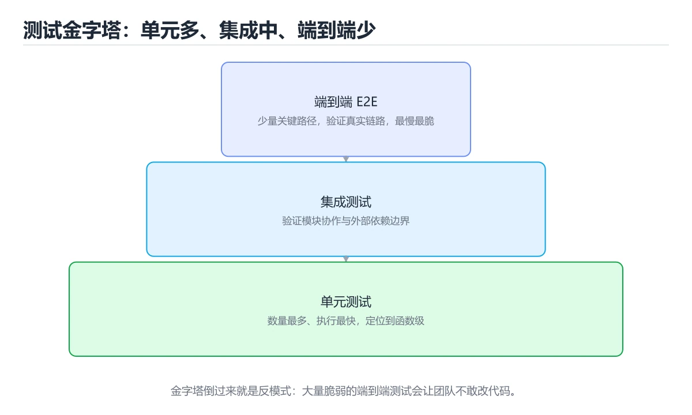

# 测试：单元测试、集成测试与 MockMvc

> 内容更新时间：2026-10-20 · 学习阶段：进阶 · 预计用时：50 分钟



## 本节知识框架

想象你是一个手机厂商的质检员。手机出厂前要做三种检查：第一，检查每个零件本身能不能正常工作（比如芯片能不能运算、屏幕能不能显示）——这叫**单元测试**；第二，把零件组装起来，检查它们配合在一起有没有问题（比如摄像头和图像处理模块能不能协同工作）——这叫**集成测试**；第三，模拟真实用户操作，从点亮屏幕到打开相机拍照全流程走一遍——这就像 **MockMvc** 做的 Web 层测试。

这三种测试组成了一座"测试金字塔"：底层是数量最多的单元测试，速度快、范围小；中间是集成测试，验证模块间的协作；顶层是端到端测试，模拟真实场景，数量最少但最全面。

**本课知识地图**

```text
测试金字塔 → 单元测试（JUnit 5 + Mockito） → 集成测试（@SpringBootTest） → Web 层测试（MockMvc） → 测试覆盖率
```

**学完本课你将能够**：

1. 解释单元测试、集成测试和 MockMvc 测试的区别与适用场景。
2. 使用 JUnit 5 编写单元测试，掌握 `@Test`、`@BeforeEach`、`@AfterEach` 等注解。
3. 使用 Mockito 创建 Mock 对象，隔离被测代码的外部依赖。
4. 使用 `@SpringBootTest` 编写集成测试，验证 Spring 容器的完整行为。
5. 使用 `@WebMvcTest` 和 MockMvc 测试 Controller 层，模拟 HTTP 请求与响应。

**先修知识**：你需要了解 Spring Framework 核心概念（来自《Spring Framework 核心》）、Spring MVC 的请求处理流程，以及 Java 基础语法和面向对象编程。

**复习清单**

- [ ] 回顾测试金字塔三层结构，能说出每层的职责与比例关系
- [ ] 动手写一个使用 Mockito 的单元测试，确保 Mock 和 Verify 流程熟练
- [ ] 使用 MockMvc 对一个 Controller 发送 GET/POST 请求并验证响应状态码与内容

---

## 核心概念定义

| 术语 | 一句话定义 | 生活类比 |
| --- | --- | --- |
| 单元测试（Unit Test） | 对软件中最小可测试单元（通常是单个方法）进行隔离验证。 | 质检员逐个检查每个零件能不能独立工作。 |
| 集成测试（Integration Test） | 验证多个模块组合在一起后能否正确协作。 | 把零件组装起来，检查它们配合有没有问题。 |
| JUnit 5 | Java 生态中最主流的单元测试框架，提供注解、断言和生命周期管理。 | 质检员使用的标准检测工具包。 |
| @Test | JUnit 5 注解，标记一个方法为测试方法，测试运行器会自动执行它。 | 在检测清单中标记"这一项需要检查"。 |
| @BeforeEach | JUnit 5 注解，标记在每个测试方法执行前都要运行的初始化方法。 | 每次检查前先把检测仪器校准一遍。 |
| @AfterEach | JUnit 5 注解，标记在每个测试方法执行后都要运行的清理方法。 | 每次检查完把仪器归位、清理工作台。 |
| Mockito | Java 中最流行的 Mock 框架，可以创建模拟对象来替代真实依赖。 | 用仿真零件代替真零件做测试，避免损坏贵重部件。 |
| @Mock | Mockito 注解，创建一个模拟对象，可以自定义它的返回值和行为。 | 制造一个"假摄像头"，拍照时永远返回预设的照片。 |
| @InjectMocks | Mockito 注解，自动把 Mock 对象注入到被测对象中。 | 把假摄像头装到手机上，然后测试手机整体功能。 |
| MockMvc | Spring 提供的测试工具，模拟 HTTP 请求来测试 Controller 层，无需启动真实服务器。 | 不用真的开门营业，而是在模拟厨房里测试厨师接到订单后的反应。 |
| @WebMvcTest | Spring Boot 注解，只加载 Web 层（Controller）相关的 Bean，用于轻量级 Web 测试。 | 只测试餐厅前台，后厨和仓库用假的服务代替。 |
| @SpringBootTest | Spring Boot 注解，加载完整的应用上下文，用于集成测试。 | 整家餐厅全部开业，从点菜到上菜全流程测试。 |
| 测试覆盖率（Coverage） | 衡量测试代码覆盖了多少业务代码的指标，通常以百分比表示。 | 质检员检查了多少比例的零件——覆盖率越高，漏检越少。 |
| 断言（Assertions） | 测试中对实际结果与预期结果进行比较的判断语句。 | 质检员判断"这个零件的尺寸是否等于设计值"。 |

---

## 原理与运行机制

### 测试金字塔：为什么需要三种测试？

测试金字塔由 Mike Cohn 提出，核心思想是：底层测试多而快，顶层测试少而慢。

```text
        /  E2E  \          ← 端到端测试：少量，慢，模拟真实用户
       / 集成测试  \        ← 集成测试：中量，中速，验证模块协作
      /  单元测试    \      ← 单元测试：大量，快，验证单个方法
```

**为什么不能全写集成测试？** 想象你开了一家餐厅，如果每次检查都要"从买菜到上菜"全流程走一遍，效率极低。而单元测试就像只检查切菜刀锋不锋利——几秒钟就能完成。

**三种测试的职责分工**：

| 测试类型 | 测试范围 | 速度 | 数量占比 | 发现问题类型 |
| --- | --- | --- | --- | --- |
| 单元测试 | 单个方法/类 | 毫秒级 | ~70% | 逻辑错误、边界条件 |
| 集成测试 | 模块间交互 | 秒级 | ~20% | 配置错误、接口不匹配 |
| 端到端测试 | 完整系统 | 分钟级 | ~10% | 流程错误、环境问题 |

### 单元测试是怎么工作的？

单元测试的核心原则：**隔离**。只测试目标方法本身，把它的依赖全部替换成 Mock 对象。

```text
被测方法 → 依赖 A（真实） → 数据库
         ↓
     替换为 Mock A → 返回预设值
```

JUnit 5 提供了测试运行器和断言库。一个测试方法的基本结构：

```java
@Test
void 测试方法名() {
    // 1. 准备测试数据（Arrange）
    // 2. 调用被测方法（Act）
    // 3. 断言结果是否正确（Assert）
}
```

这就是经典的 AAA 模式（Arrange-Act-Assert）。

### Mock 是什么？为什么需要它？

Mock 就是"假对象"。想象你要测试一个翻译官，但他需要打电话给外交部查资料。如果每次测试都要真的打通外交部电话，太慢了，而且外交部电话可能出故障。

解决方案：给翻译官配一个"假的外交部"（Mock），提前告诉它"如果问'苹果'，就回答'apple'"。这样就能单独测试翻译官的工作了。

Mockito 的工作流程：

1. **创建 Mock**：`@Mock` 标记一个假对象
2. **定义行为**：`when(mock.method()).thenReturn(value)` 预设返回值
3. **注入 Mock**：`@InjectMocks` 把假对象装进被测类
4. **验证调用**：`verify(mock).method()` 确认方法是否被正确调用

### MockMvc 的工作流程

MockMvc 是 Spring 专门为 Web 层测试设计的工具。它不需要启动真实的 HTTP 服务器，而是在内存中模拟整个请求-响应流程。

```text
客户端请求 → DispatcherServlet → Controller → Service → 返回响应
     ↑                                                    ↓
     └──────────── MockMvc 捕获并验证 ←──────────────────┘
```

`@WebMvcTest` 只加载 Controller 层，Service 层用 `@MockBean` 替代，这样测试既快速又隔离。

---

## 典型应用场景

- **Service 层逻辑验证**：使用 JUnit 5 + Mockito 测试业务逻辑，隔离数据库和外部服务。
- **Controller 层接口测试**：使用 MockMvc 模拟 HTTP 请求，验证 URL 映射、参数绑定、响应状态码和返回内容。
- **Repository 层集成测试**：使用 `@SpringBootTest` + 嵌入式数据库（H2）验证 SQL 查询和数据持久化。
- **回归测试**：每次修改代码后运行全部单元测试，确保没有引入新 Bug。
- **CI/CD 流水线**：在代码提交时自动运行测试，覆盖率不达标则拒绝合并。
- **异常场景测试**：模拟各种异常情况（空值、超时、权限不足），验证代码的容错能力。

---

## 代码/协议/SQL 示例

### 示例 1：使用 JUnit 5 + Mockito 进行单元测试

场景：测试一个订单服务 `OrderService`，它依赖 `OrderRepository`（数据访问层）。

**被测类**

```java
@Service
public class OrderService {

    private final OrderRepository orderRepository;

    public OrderService(OrderRepository orderRepository) {
        this.orderRepository = orderRepository;
    }

    public Order createOrder(String product, int quantity) {
        if (quantity <= 0) {
            throw new IllegalArgumentException("数量必须大于 0");
        }
        Order order = new Order(product, quantity);
        return orderRepository.save(order);
    }

    public Optional<Order> findOrder(Long id) {
        return orderRepository.findById(id);
    }
}
```

**单元测试类**

```java
@ExtendWith(MockitoExtension.class)
class OrderServiceTest {

    @Mock
    private OrderRepository orderRepository;  // 假的数据库操作

    @InjectMocks
    private OrderService orderService;        // 被测对象，自动注入 Mock

    @BeforeEach
    void setUp() {
        // 每个测试方法执行前都会运行，可用于额外初始化
    }

    @AfterEach
    void tearDown() {
        // 每个测试方法执行后都会运行，可用于清理资源
    }

    @Test
    @DisplayName("创建订单 - 正常情况应保存并返回订单")
    void createOrder_success() {
        // Arrange：准备预设行为
        Order mockOrder = new Order("Java 编程思想", 2);
        mockOrder.setId(1L);
        when(orderRepository.save(any(Order.class))).thenReturn(mockOrder);

        // Act：调用被测方法
        Order result = orderService.createOrder("Java 编程思想", 2);

        // Assert：验证结果
        assertNotNull(result);
        assertEquals(1L, result.getId());
        assertEquals("Java 编程思想", result.getProduct());
        assertEquals(2, result.getQuantity());

        // Verify：确认 save 方法被调用了 1 次
        verify(orderRepository, times(1)).save(any(Order.class));
    }

    @Test
    @DisplayName("创建订单 - 数量为 0 应抛出异常")
    void createOrder_invalidQuantity_throwsException() {
        // Act & Assert：验证异常
        Exception exception = assertThrows(IllegalArgumentException.class,
            () -> orderService.createOrder("Java 编程思想", 0));

        assertEquals("数量必须大于 0", exception.getMessage());

        // 确认 save 方法从未被调用
        verify(orderRepository, never()).save(any(Order.class));
    }

    @Test
    @DisplayName("查询订单 - 存在的订单应返回")
    void findOrder_exists() {
        // Arrange
        Order mockOrder = new Order("Spring 实战", 1);
        mockOrder.setId(1L);
        when(orderRepository.findById(1L)).thenReturn(Optional.of(mockOrder));

        // Act
        Optional<Order> result = orderService.findOrder(1L);

        // Assert
        assertTrue(result.isPresent());
        assertEquals("Spring 实战", result.get().getProduct());
    }

    @Test
    @DisplayName("查询订单 - 不存在的订单应返回空")
    void findOrder_notExists() {
        // Arrange
        when(orderRepository.findById(999L)).thenReturn(Optional.empty());

        // Act
        Optional<Order> result = orderService.findOrder(999L);

        // Assert
        assertFalse(result.isPresent());
    }
}
```

### 示例 2：使用 @SpringBootTest 进行集成测试

场景：测试 OrderService 和 OrderRepository 在一起是否能正确协作，使用真实的 Spring 容器和嵌入式数据库。

```java
@SpringBootTest
@Transactional  // 测试结束后自动回滚事务，不污染数据库
class OrderServiceIntegrationTest {

    @Autowired
    private OrderService orderService;   // 真实的 Service，不是 Mock

    @Autowired
    private OrderRepository orderRepository;  // 真实的 Repository

    @Test
    @DisplayName("集成测试 - 创建订单后应能从数据库查询到")
    void createAndFindOrder() {
        // Act：创建订单
        Order created = orderService.createOrder("深入理解 JVM", 1);

        // Assert：通过 Repository 查询，验证数据确实被保存
        Optional<Order> found = orderRepository.findById(created.getId());
        assertTrue(found.isPresent());
        assertEquals("深入理解 JVM", found.get().getProduct());
        assertEquals(1, found.get().getQuantity());
    }

    @Test
    @DisplayName("集成测试 - 重复创建相同订单应各自独立")
    void createMultipleOrders() {
        orderService.createOrder("订单 A", 1);
        orderService.createOrder("订单 B", 3);

        // 验证数据库中现在有两条记录
        var allOrders = orderRepository.findAll();
        assertTrue(allOrders.size() >= 2);
    }
}
```

### 示例 3：使用 @WebMvcTest + MockMvc 进行 Web 层测试

场景：测试 `OrderController` 的 HTTP 接口，验证请求路由、参数绑定和响应格式。

**被测 Controller**

```java
@RestController
@RequestMapping("/api/orders")
public class OrderController {

    private final OrderService orderService;

    public OrderController(OrderService orderService) {
        this.orderService = orderService;
    }

    @GetMapping("/{id}")
    public ResponseEntity<Order> getOrder(@PathVariable Long id) {
        return orderService.findOrder(id)
            .map(ResponseEntity::ok)
            .orElse(ResponseEntity.notFound().build());
    }

    @PostMapping
    public ResponseEntity<Order> createOrder(@RequestBody OrderRequest request) {
        Order order = orderService.createOrder(
            request.getProduct(), request.getQuantity());
        return ResponseEntity.status(201).body(order);
    }
}
```

**MockMvc 测试类**

```java
@WebMvcTest(OrderController.class)
class OrderControllerTest {

    @Autowired
    private MockMvc mockMvc;  // 模拟 HTTP 请求的工具

    @MockBean
    private OrderService orderService;  // Mock 掉 Service 层

    @Autowired
    private ObjectMapper objectMapper;  // JSON 序列化工具

    @Test
    @DisplayName("GET /api/orders/1 - 存在的订单应返回 200 和订单信息")
    void getOrder_exists() throws Exception {
        // Arrange
        Order mockOrder = new Order("Java 编程思想", 2);
        mockOrder.setId(1L);
        when(orderService.findOrder(1L)).thenReturn(Optional.of(mockOrder));

        // Act & Assert
        mockMvc.perform(get("/api/orders/1"))
            .andExpect(status().isOk())                          // 状态码 200
            .andExpect(jsonPath("$.product").value("Java 编程思想"))  // 响应内容
            .andExpect(jsonPath("$.quantity").value(2));
    }

    @Test
    @DisplayName("GET /api/orders/999 - 不存在的订单应返回 404")
    void getOrder_notFound() throws Exception {
        // Arrange
        when(orderService.findOrder(999L)).thenReturn(Optional.empty());

        // Act & Assert
        mockMvc.perform(get("/api/orders/999"))
            .andExpect(status().isNotFound());  // 状态码 404
    }

    @Test
    @DisplayName("POST /api/orders - 创建订单应返回 201 和新订单")
    void createOrder() throws Exception {
        // Arrange
        Order mockOrder = new Order("Spring 实战", 1);
        mockOrder.setId(10L);
        when(orderService.createOrder("Spring 实战", 1))
            .thenReturn(mockOrder);

        OrderRequest request = new OrderRequest("Spring 实战", 1);

        // Act & Assert
        mockMvc.perform(post("/api/orders")
                .contentType(MediaType.APPLICATION_JSON)
                .content(objectMapper.writeValueAsString(request)))
            .andExpect(status().isCreated())                      // 状态码 201
            .andExpect(jsonPath("$.id").value(10))
            .andExpect(jsonPath("$.product").value("Spring 实战"))
            .andExpect(jsonPath("$.quantity").value(1));

        // 验证 Service 方法被调用了一次
        verify(orderService, times(1)).createOrder("Spring 实战", 1);
    }
}
```

---

## 时间/空间复杂度或性能分析

| 维度 | 单元测试 | 集成测试 | MockMvc 测试 |
| --- | --- | --- | --- |
| 执行速度 | 毫秒级（最快） | 秒级（需启动容器） | 百毫秒级（不启动服务器但加载 Web 上下文） |
| 内存占用 | 低（无容器开销） | 高（完整 Spring 上下文） | 中（仅 Web 层上下文） |
| 启动开销 | 几乎无 | 需要初始化数据库连接池、Bean 容器 | 需要初始化 DispatcherServlet |
| CI 集成友好度 | 极高，适合频繁运行 | 中等，通常每次提交运行 | 较高，适合每次 PR 运行 |
| 反馈循环 | 秒级反馈，适合 TDD | 分钟级反馈，适合阶段性验证 | 分钟级反馈，适合接口联调 |

**性能建议**：

- 日常开发中优先编写单元测试，因为速度最快、反馈最即时。
- 集成测试用于验证关键路径（如数据库交互、事务管理）。
- MockMvc 测试用于保证 API 接口的正确性。
- 使用 JaCoCo 等工具监控测试覆盖率，建议核心业务逻辑覆盖率达到 80% 以上。

---

## 常见误区与易错点

| 错误 | 现象 | 正确做法 |
| --- | --- | --- |
| 单元测试中依赖真实数据库 | 测试慢、不稳定、受环境影响 | 使用 Mockito 的 `@Mock` 替代 Repository |
| 在测试中不写断言 | 测试永远通过，没有实际验证效果 | 每个测试方法至少写一个 `assertEquals` 或 `verify` |
| 混淆 `@WebMvcTest` 和 `@SpringBootTest` | 前者只加载 Web 层，后者加载全部 | 测 Controller 用 `@WebMvcTest`，测完整流程用 `@SpringBootTest` |
| 忘记 `@ExtendWith(MockitoExtension.class)` | `@Mock` 注解不生效，Mock 对象为 null | 在测试类上添加 Mockito JUnit 5 扩展注解 |
| 测试方法之间有依赖或顺序要求 | 某个测试失败后其他测试也失败 | 每个测试方法应独立，使用 `@BeforeEach` 重置状态 |
| Mock 行为定义与调用不匹配 | `thenReturn` 设置的值没返回 | 检查参数是否一致，使用 `any()` 匹配器 |
| 集成测试不回滚事务 | 测试数据污染数据库，后续测试失败 | 添加 `@Transactional` 注解，测试完自动回滚 |
| 过度追求 100% 覆盖率 | 写大量无意义的测试只为凑覆盖率数字 | 关注核心业务逻辑的覆盖率，边界和异常路径优先 |
| 在 MockMvc 测试中忘记 `@MockBean` | Service 层尝试调用真实依赖导致报错 | 用 `@MockBean` 替换所有非 Controller 层的依赖 |
| 测试方法命名随意 | 失败时无法快速定位问题 | 使用 `@DisplayName` 给每个测试方法写中文描述 |

---

## 与其他知识点的关系

- **先修**：《Spring Framework 核心》（IoC、AOP 概念）、《Servlet 与 JSP 基础》（HTTP 请求处理）、《Java 基础》（面向对象、异常处理）
- **后续**：《Spring Boot 自动配置》、《CI/CD 与 DevOps》、《测试驱动开发（TDD）实践》
- **相关**：《RESTful API 设计》（MockMvc 测试的接口规范）、《设计模式》（Mock 背后的代理模式原理）

---

## 自测题与参考答案

**Q1**：在 JUnit 5 中，`@BeforeEach` 和 `@AfterEach` 注解标记的方法分别在什么时候执行？如果一个测试类有 3 个 `@Test` 方法，`@BeforeEach` 标记的方法会被执行几次？

<details>
<summary>点击查看答案</summary>

`@BeforeEach` 标记的方法在每个 `@Test` 方法执行**之前**运行，`@AfterEach` 标记的方法在每个 `@Test` 方法执行**之后**运行。如果测试类有 3 个 `@Test` 方法，`@BeforeEach` 会被执行 **3 次**——每个测试方法各触发一次。这确保了每个测试都在干净的环境中运行，互不干扰。
</details>

**Q2**：`@WebMvcTest(OrderController.class)` 和 `@SpringBootTest` 在测试范围和性能上有什么区别？分别在什么场景下使用？

<details>
<summary>点击查看答案</summary>

`@WebMvcTest` 只加载 Web 层相关的 Bean（Controller、过滤器、拦截器等），不会启动完整的 Spring 容器，Service 和 Repository 需要用 `@MockBean` 提供模拟实现。它的启动速度快，适合专门测试 Controller 的请求路由、参数绑定和响应格式。`@SpringBootTest` 会加载完整的应用上下文，包括所有 Service、Repository、数据库连接等，启动速度较慢，适合测试多个模块之间的协作（集成测试）。简单说：测 Controller 用 `@WebMvcTest`，测完整流程用 `@SpringBootTest`。
</details>

**Q3**：使用 Mockito 时，`@Mock` 和 `@InjectMocks` 注解分别起什么作用？请结合一个例子说明。

<details>
<summary>点击查看答案</summary>

`@Mock` 创建一个模拟对象，你可以自定义它的方法返回值。`@InjectMocks` 创建一个被测对象，并自动把 `@Mock` 标记的模拟对象注入到它的依赖中。例如：测试 `OrderService` 时，用 `@Mock` 创建一个假的 `OrderRepository`，用 `@InjectMocks` 创建 `OrderService` 实例。这样 `OrderService` 内部调用的 `OrderRepository.save()` 实际上会调用 Mock 对象的预设行为，不会真正访问数据库。
</details>

---

## 考点精讲

### 考点 1：第 1 题

- **题目**：在 JUnit 5 中，`@BeforeEach` 和 `@AfterEach` 注解标记的方法分别在什么时候执行？如果一个测试类有 3 个 `@Test` 方法，`@BeforeEach` 标记的方法会被执行几次？
- **正确项**：每个 @Test 方法前/后各执行一次，共 3 次
- **判断依据**：这道题落在术语「JUnit 5」上：测试框架的生命周期管理。复习时把 `@BeforeEach`、`@AfterEach`、`@BeforeAll`、`@AfterAll` 四种注解的执行时机对比说清楚，再回到「核心概念定义」核对原文。

### 考点 2：第 2 题

- **题目**：`@WebMvcTest(OrderController.class)` 和 `@SpringBootTest` 在测试范围和性能上有什么区别？分别在什么场景下使用？
- **正确项**：@WebMvcTest 只加载 Web 层，速度快；@SpringBootTest 加载完整上下文，用于集成测试
- **判断依据**：这道题落在术语「MockMvc」和「@SpringBootTest」上：Spring 测试策略的核心选择。复习时把两种注解加载的 Bean 范围、启动速度、适用场景对比说清楚，再回到「核心概念定义」核对原文。

### 考点 3：第 3 题

- **题目**：使用 Mockito 时，`@Mock` 和 `@InjectMocks` 注解分别起什么作用？请结合一个例子说明。
- **正确项**：@Mock 创建模拟对象，@InjectMocks 创建被测对象并自动注入 Mock
- **判断依据**：这道题落在术语「Mockito」上：Mock 框架的核心注解。复习时把 `@Mock`、`@InjectMocks`、`@Spy` 三种注解的作用和区别说清楚，再回到「核心概念定义」核对原文。

---

## 术语速查

| 术语 | 含义 |
| --- | --- |
| 单元测试 | 隔离测试单个方法或类的正确性 |
| 集成测试 | 测试多个模块组合后的协作行为 |
| JUnit 5 | Java 主流测试框架，提供注解和断言 |
| @Test | 标记测试方法 |
| @BeforeEach | 每个测试方法执行前的初始化钩子 |
| @AfterEach | 每个测试方法执行后的清理钩子 |
| Mockito | Java 主流 Mock 框架 |
| @Mock | 创建模拟对象 |
| @InjectMocks | 创建被测对象并注入 Mock 依赖 |
| MockMvc | Spring Web 层测试工具，模拟 HTTP 请求 |
| @WebMvcTest | 只加载 Controller 层的测试注解 |
| @SpringBootTest | 加载完整应用上下文的集成测试注解 |
| @MockBean | 在测试上下文中用 Mock 替换真实 Bean |
| 测试覆盖率 | 测试代码覆盖业务代码的比例 |
| 断言 | 验证实际结果与预期结果是否一致的判断语句 |
| AAA 模式 | Arrange-Act-Assert，测试方法的标准结构 |

---

## 参考资料与复核

| 资料名称 | 说明 |
| --- | --- |
| [JUnit 5 用户指南](https://junit.org/junit5/docs/current/user-guide/) | JUnit 5 官方文档，注解与断言 API 详解 |
| [Mockito 官方文档](https://javadoc.io/doc/org.mockito/mockito-core/latest/org/mockito/Mockito.html) | Mockito 框架 API 参考与使用示例 |
| [Spring Boot Testing Guide](https://docs.spring.io/spring-boot/docs/current/reference/html/testing.html) | Spring Boot 测试章节，涵盖 @WebMvcTest 与 @SpringBootTest |
| [Spring MockMvc 文档](https://docs.spring.io/spring-framework/docs/current/reference/html/testing.html#spring-mvc-test-framework) | MockMvc 框架详细使用说明 |
| [JaCoCo 覆盖率工具](https://www.jacoco.org/jacoco/trunk/doc/) | Java 代码覆盖率测量工具官方文档 |

复核日期：2026-10-20

---

## 内容元数据

- 课程 ID：java_testing
- 分类：Java Web 开发
- 难度：进阶
- 预计用时：50 分钟
- 先修课程：Spring Framework 核心、Servlet 与 JSP 基础、Java 基础
- 后续课程：Spring Boot 自动配置、CI/CD 与 DevOps、测试驱动开发实践
- 内容版本：v2.0
