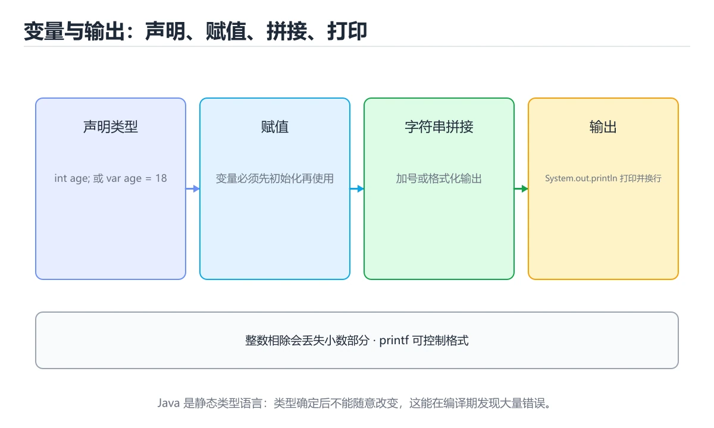
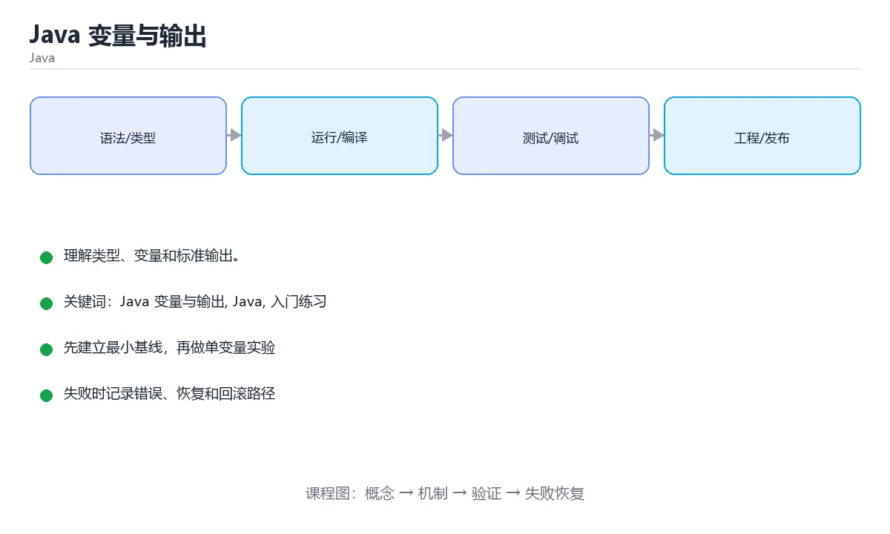

# Java 变量与输出

> 内容更新时间：2026-10-06 · 学习阶段：入门 · 预计用时：30 分钟





## 本节知识框架

上一课你写出了一个能打印文字的 Java 程序。但一个只能打印固定文字的程序用处不大——你肯定想让程序「记住」一些东西，比如用户的名字、年龄、成绩。这就需要用到**变量**。

可以把变量想象成一个贴了标签的盒子：标签是变量名，盒子里装的是数据，而「类型」告诉你这个盒子只能装什么东西。Java 是静态类型语言，意味着你必须在盒子上写清楚它能装什么——整数盒子装不了小数，文字盒子装不了数字。

**学完这一课，你会**：
- 理解 Java 的基本类型和引用类型，知道 `int`、`double`、`boolean`、`char` 各装什么
- 学会声明变量并赋初值，用 `System.out.println` 和 `printf` 把结果展示出来
- 遇到「整数除法丢小数」这种经典坑时，能立刻说出原因和修法

**先修**：《Java 第一个类》。**后续**：《Java 条件判断》。

### 复习清单

- [ ] 能不看正文写出 `int age = 20;` `double price = 9.9;` `String name = "Ada";` 的声明。
- [ ] 能解释为什么 `5 / 2` 的结果是 `2` 而不是 `2.5`。
- [ ] 能用 `printf` 格式化输出一个包含姓名和年龄的句子。

## 核心概念定义

| 术语 | 一句话说明 |
| --- | --- |
| `基本类型` | int、double、boolean、char 等直接存值的类型，共八种。 |
| `变量声明与初始化` | 先声明类型和名字，再赋初值，局部变量使用前必须赋值。 |
| `String` | 不可变的字符串类型，属于引用类型，用 + 可以拼接。 |
| `类型转换` | 小范围到大范围自动提升，反向需要显式强制转换。 |
| `格式化输出` | printf 或 String.format 用 %d、%s 控制输出格式。 |
| `JVM` | Java 源码编译成平台无关的字节码，JVM 负责加载、验证、解释和即时编译。 |

## 原理与运行机制

### 变量就是贴了标签的盒子

Java 有八种基本类型，最常用的四种是：

| 类型 | 装什么 | 例子 |
| --- | --- | --- |
| `int` | 整数 | `int age = 25;` |
| `double` | 小数 | `double price = 9.9;` |
| `boolean` | 真假 | `boolean passed = true;` |
| `char` | 单个字符 | `char grade = 'A';` |

声明变量的语法是 `类型 名字 = 值;`。就像在盒子上写「这里装整数」，然后放进去一个数字。Java 是强类型语言，一旦声明了类型就不能变——你不能把整数盒子突然拿来装小数。

### 引用类型：String 不是基本类型

`String` 是 Java 里最常用的类型之一，但它不是基本类型，而是引用类型。声明 `String name = "Ada";` 时，变量 `name` 存的是一个「引用」——可以理解为一张写着地址的纸条，真正的字符串对象住在内存的另一个地方。

String 有一个重要特性：**不可变**。一旦创建，内容就不能修改。当你用 `+` 拼接字符串时，Java 其实创建了一个全新的字符串对象。少量拼接没问题，但如果在循环里拼接成千上万次，应该用 `StringBuilder`。

### 类型转换：自动提升与强制转换

Java 允许小范围类型自动转成大范围类型，比如 `int` 可以自动变成 `double`。但反过来不行——把 `double` 赋给 `int` 必须显式强制转换：

```java
int a = 10;
double b = a;       // 自动提升，没问题
double c = 3.14;
int d = (int) c;    // 强制转换，小数部分被截掉，d = 3
```

### 整数除法的陷阱

这是新手最常踩的坑之一：

```java
int a = 5;
int b = 2;
System.out.println(a / b);  // 输出 2，不是 2.5！
```

两个 `int` 相除，结果还是 `int`，小数部分直接被丢弃。想要小数结果，至少让一个操作数变成 `double`：

```java
System.out.println((double) a / b);  // 输出 2.5
```

### 格式化输出

`System.out.println` 适合简单输出。如果需要精确控制格式，用 `printf`：

```java
String name = "Ada";
int year = 1815;
System.out.printf("%s born in %d%n", name, year);
// 输出：Ada born in 1815
```

常用占位符：`%d` 整数、`%f` 浮点数、`%s` 字符串、`%n` 换行。

## 典型应用场景

### 场景一：声明不同类型的变量

```java
public class Main {
    public static void main(String[] args) {
        String name = "Ada";
        int age = 36;
        double height = 1.75;
        boolean isStudent = false;
        char initial = 'A';

        System.out.println("姓名：" + name);
        System.out.println("年龄：" + age);
        System.out.println("身高：" + height + " 米");
        System.out.println("是学生吗：" + isStudent);
        System.out.println("首字母：" + initial);
    }
}
```

### 场景二：整数除法的修复

```java
public class Main {
    public static void main(String[] args) {
        int total = 5;
        int count = 2;

        // 错误：两个 int 相除丢小数
        System.out.println("错误结果：" + (total / count));  // 2

        // 正确：至少一个操作数转成 double
        System.out.println("正确结果：" + ((double) total / count));  // 2.5
    }
}
```

### 场景三：用 printf 格式化输出

```java
public class Main {
    public static void main(String[] args) {
        String item = "咖啡";
        int quantity = 3;
        double price = 28.5;

        System.out.printf("商品：%s，数量：%d，单价：%.2f 元%n", item, quantity, price);
        System.out.printf("总价：%.2f 元%n", quantity * price);
    }
}
```

## 代码/协议/SQL 示例

### 最小可验证示例

```java
public class Main {
    public static void main(String[] args) {
        String name = "Ada";
        int year = 1815;
        System.out.printf("%s born in %d%n", name, year);
    }
}
```

预期输出：

```text
Ada born in 1815
```

运行方式：保存为 `Main.java`，用 `javac Main.java` 编译，`java Main` 运行。

### 变量声明的多种方式

```java
// 声明同时赋值（推荐）
int age = 25;

// 先声明后赋值
int score;
score = 100;

// 一行声明多个同类型变量（不推荐，可读性差）
int a = 1, b = 2, c = 3;
```

### 字符串拼接注意事项

```java
int x = 10;
int y = 20;
System.out.println("结果是：" + x + y);    // 结果是：1020（字符串拼接）
System.out.println("结果是：" + (x + y));  // 结果是：30（先算加法）
```

`+` 遇到 String 就变成拼接运算符。如果希望先做算术运算，要用括号括起来。

## 时间/空间复杂度或性能分析

对于入门阶段的变量和输出操作，性能不是首要关注点。但了解一些基本概念有助于养成好习惯：

- **字符串拼接开销**：少量 `+` 拼接会被编译器优化成 `StringBuilder`，性能没问题。但在循环中拼接大量字符串时，应该手动创建 `StringBuilder` 对象。
- **基本类型 vs 包装类**：`int` 占 4 字节，`Integer` 对象占 16 字节以上。大量数据场景下基本类型更省内存。
- **printf 开销**：`printf` 比 `println` 稍慢，因为它要解析格式字符串。日志输出等高频场景优先用 `println` 或 `StringBuilder`。

测量方法：固定输入跑一遍记录基线，再提高规模复测，两次结果的差值才是结论依据。

## 常见误区与易错点

| 容易写错的做法 | 实际现象 | 原因与正确做法 |
| --- | --- | --- |
| 整数除法丢小数 | 结果与预期不符。 | 需要小数时先转成浮点或高精度类型。 |
| 用等号比较包装类型 | 超出缓存范围后结果不一致。 | 用 equals 比较，或先拆箱再比较。 |
| 字符串拼接与运算顺序混淆 | 得到拼接结果而不是计算结果。 | 用括号明确运算顺序。 |

### 误区一：`int price = 9.9;`

`int` 只能存整数，赋小数值编译直接报错。要存小数用 `double`：`double price = 9.9;`

### 误区二：变量声明了不赋值就用

Java 的局部变量不会自动初始化。`int count; System.out.println(count);` 会编译报错「variable count might not have been initialized」。声明时就要赋初值。

### 误区三：`Integer` 缓存的坑

```java
Integer a = 127;
Integer b = 127;
System.out.println(a == b);  // true（缓存范围内）

Integer c = 128;
Integer d = 128;
System.out.println(c == d);  // false（超出缓存范围）
```

比较包装类的内容要用 `equals`，不要用 `==`。

## 与其他知识点的关系

- **先修**：《Java 第一个类》。本课默认你已经知道 `class`、`main` 方法和 `System.out.println` 的用法。
- **后续**：《Java 条件判断》会用到本课的变量声明和 boolean 类型。
- **术语衔接**：本课定义的 `基本类型`、`变量声明与初始化`、`String`、`类型转换`、`格式化输出` 会在后续课程反复出现。

### 概念地图

```text
基本类型（int, double, boolean, char...）
  └─ 变量声明与初始化（类型 名字 = 值）
       └─ String（不可变的引用类型）
            └─ 类型转换（自动提升 / 强制转换）
                 └─ 格式化输出（printf, %d, %s）
```

## 自测题与参考答案

### 自测 1

**问**：`基本类型` 和 `String` 有什么本质区别？

**答**：基本类型（int、double 等）直接存值，String 是引用类型，变量存的是指向对象的引用。基本类型用 `==` 比较值，String 应该用 `equals` 比较内容。

### 自测 2

**问**：`5 / 2` 为什么输出 `2`？怎么得到 `2.5`？

**答**：两个 int 相除结果还是 int，小数部分被丢弃。把至少一个操作数转成 double：`(double) 5 / 2` 或 `5.0 / 2`。

### 自测 3

**问**：`String name = "Ada";` 声明的是什么类型的变量？

**答**：声明引用变量 name。String 是引用类型，变量存的是指向堆中字符串对象的引用。

### 自测 4

**问**：局部变量 `int count;` 不赋值直接用会怎样？

**答**：编译报错。Java 的局部变量使用前必须赋值，编译器不会给它默认值。

### 自测 5

**问**：`"结果是：" + 3 + 4` 和 `"结果是：" + (3 + 4)` 分别输出什么？

**答**：前者输出 `结果是：34`（从左到右拼接），后者输出 `结果是：7`（括号内先算加法）。

## 考点精讲

`Java 变量与输出` 的题库有 5 道题，下面逐题给出题干、正确项与判断依据：先自己作答，再核对正确项，最后回到正文对应小节复核。

### 考点 1：第 1 题

- **题目**：围绕“Java 变量与输出”中的 Java 变量与输出、Java、入门练习，下列哪两项是本课强调的实践判断？
- **正确项**：学习 Java 变量与输出 时要同时说明输入、输出和失败路径，不能只看正常流程；验证 Java 时要固定版本并覆盖边界输入，结论才可复现
- **判断依据**：按《Java 变量与输出》的正文口径，本题要同时选中「学习 Java 变量与输出 时要同时说明输入、输出和失败路径，不能只看正常流程」、「验证 Java 时要固定版本并覆盖边界输入，结论才可复现」，漏掉任一项都算没答全。术语 基本类型（Java 变量与输出）：int、double、boolean、char 等直接存值的类型，共八种。易错点是整数除法丢小数，会造成结果与预期不符，改法是需要小数时先转成浮点或高精度类型。

### 考点 2：第 2 题

- **题目**：按“Java 变量与输出”中 Java 变量与输出、Java、入门练习 的实践顺序，把四个步骤排成从准备到复盘的合理顺序。
- **正确项**：先明确 Java 变量与输出 的输入、输出与约束 → 写出最小示例并核对 Java 的基线结果 → 只改一个变量，记录边界与失败路径的变化 → 固定版本与证据，把“Java 变量与输出”的结论写成可复现记录
- **判断依据**：按《Java 变量与输出》正文的先后，本题顺序是「先明确 Java 变量与输出 的输入、输出与约束」 → 「写出最小示例并核对 Java 的基线结果」 → 「只改一个变量，记录边界与失败路径的变化」 → 「固定版本与证据，把“Java 变量与输出”的结论写成可复现记录」。术语 基本类型（Java 变量与输出）：int、double、boolean、char 等直接存值的类型，共八种。易错点是整数除法丢小数会造成结果与预期不符，改法是需要小数时先转成浮点或高精度类型。

### 考点 3：第 3 题

- **题目**：关于变量声明 String name = "Ada"; 下列说法正确的是？
- **正确项**：声明引用变量 name
- **判断依据**：本题正确项是「声明引用变量 name」。术语 String（Java 变量与输出）：不可变的字符串类型，属于引用类型，用 + 可以拼接，本题取「声明引用变量 name」这条。易错点是字符串拼接与运算顺序混淆，会造成得到拼接结果而不是计算结果，改法是用括号明确运算顺序。

### 考点 4：第 4 题

- **题目**：下面代码想计算 5 除以 2 的小数结果，但输出为 2。问题在哪里？
- **正确项**：两个操作数都是 int，应按 double 计算
- **判断依据**：本题正确项是「两个操作数都是 int，应按 double 计算」。术语 基本类型（Java 变量与输出）：int、double、boolean、char 等直接存值的类型，共八种，本题取「两个操作数都是 int，应按 double 计算」这条。易错点是整数除法丢小数，会造成结果与预期不符，改法是需要小数时先转成浮点或高精度类型。

### 考点 5：第 5 题

- **题目**：填空：补齐下面这段术语说明中的空缺。课程 `理解类型、变量和标准输出。`，这段说明是：`____`：先声明类型和名字，再赋初值，局部变量使用前必须赋值。空缺处应填哪个术语？
- **正确项**：变量声明与初始化
- **判断依据**：正确项：「变量声明与初始化」。涉及术语 变量声明与初始化：先声明类型和名字，再赋初值，局部变量使用前必须赋值。易错点：整数除法丢小数会造成结果与预期不符。正确做法：需要小数时先转成浮点或高精度类型。判断时先确认输入和适用范围，对照 `Java 变量与输出`、`Java`、`入门练习` 复现一次，最后把错误表现与正确做法逐项对照。

## 术语速查

| 术语 | 一句话说明 |
| --- | --- |
| `基本类型` | int、double、boolean、char 等直接存值的类型，共八种。 |
| `变量声明与初始化` | 先声明类型和名字，再赋初值，局部变量使用前必须赋值。 |
| `String` | 不可变的字符串类型，属于引用类型，用 + 可以拼接。 |
| `类型转换` | 小范围到大范围自动提升，反向需要显式强制转换。 |
| `格式化输出` | printf 或 String.format 用 %d、%s 控制输出格式。 |
| `JVM` | Java 源码编译成平台无关的字节码，JVM 负责加载、验证、解释和即时编译。 |

## 参考资料与复核

- 最后复核：2026-10-04
- [Oracle Java Tutorials - Variables](https://docs.oracle.com/javase/tutorial/java/data/variables.html)
- 下次复核：2027-02-24
- 复核范围：版本兼容、API 行为、安全建议与工程实践

| 参考资料 | 本课用途 |
| --- | --- |
| [dev.java 学习](https://dev.java/learn/) | 现代 Java 官方教程 |
| [Java SE API](https://docs.oracle.com/en/java/javase/21/docs/api/) | 标准库 API 查阅 |
| [Java 语言规范](https://docs.oracle.com/javase/specs/jls/se21/html/index.html) | 类型系统与变量规则 |

## 内容元数据

- 内容版本：v2.0
- 最后更新：2026-10-06
- 学习阶段：入门
- 适用环境：Java 21+ / Maven 或 Gradle；本课聚焦 Java 变量与输出。
- 内容来源：内置结构化课程与工程实践整理
- 相关主题：Java 变量与输出、Java、入门练习
