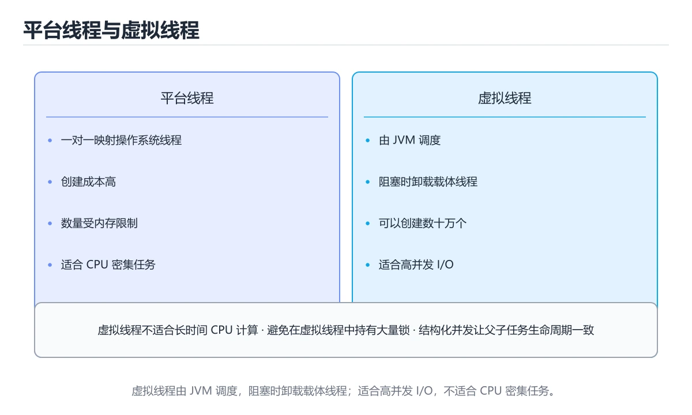
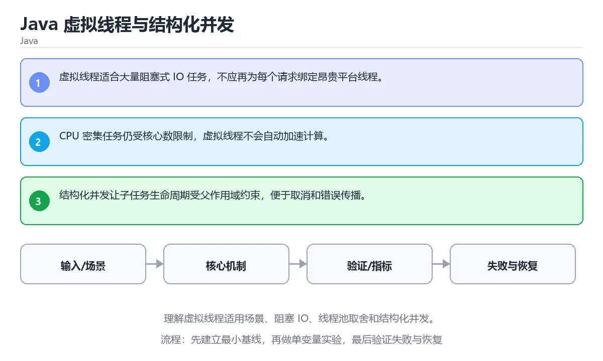

# Java 虚拟线程与结构化并发





> 内容更新时间：2026-10-06 · 学习阶段：高级 · 预计用时：35 分钟

## 本节知识框架

想象你开了一家快递公司。以前每位快递员（平台线程）都是全职员工——工资高、占工位，同时最多雇几百人。客户打电话来下单，如果快递员正在送别的件，客户就得等着。现在有了虚拟线程——相当于每位客户都配了一位"影子助手"，助手极轻量，可以同时存在几万个，客户打电话等着的时候助手自动去干别的，完全不需要客户操心。

本课会依次聊到四件事：

1. **虚拟线程是什么**——JVM 管理的轻量线程，大量阻塞任务可由少量平台线程承载。
2. **阻塞 IO 的痛点**——传统模型里，线程在等 IO 时什么都干不了，白白占着资源。
3. **线程池的取舍**——复用固定数量线程处理任务，但虚拟线程时代不再需要为每个请求绑定昂贵平台线程。
4. **结构化并发**——让子任务的生命周期受父作用域约束，便于取消和错误传播。

先修内容：《现代 Java：Record、Sealed 与模式匹配》。后续衔接《JVM 垃圾回收与性能调优》。

### 复习清单

- [ ] 能不看正文说出虚拟线程、结构化并发各自的含义与一个易错点。
- [ ] 能运行或推演本课的 Java 示例，记录输入、输出和失败现象。
- [ ] 能完成一次自测，并把错题对照错误表定位原因。

## 核心概念定义

先记住下面四个词，后面所有讨论都围绕它们展开。每个词都用一句话讲清"它是什么"，再补一句"容易踩什么坑"。

| 术语 | 一句话说明 |
| --- | --- |
| `虚拟线程` | JVM 管理的轻量线程，大量阻塞任务可由少量平台线程承载。坑：长时间持 synchronized 会钉住载体线程。 |
| `结构化并发` | 结构化并发让子任务生命周期受父作用域约束，便于取消和错误传播。坑：版本要固定，API 仍在预览中。 |
| `阻塞IO` | 调用线程在 I/O 完成前一直等待，简单直观但会占用线程资源。坑：虚拟线程里跑 CPU 密集任务不会变快。 |
| `线程池` | 复用固定数量线程处理任务，避免频繁创建销毁，需要定义队列和拒绝策略。坑：虚拟线程不需要传统线程池。 |

## 原理与运行机制

### 平台线程 vs 虚拟线程：全职员工 vs 影子助手

平台线程（platform thread）直接对应操作系统的线程。创建一个平台线程大约需要 1MB 栈空间，几千个就已经很吃力了。

虚拟线程（virtual thread）是 JVM 自己调度的"轻量线程"。一个虚拟线程只占几百字节，你可以同时开几万个。当虚拟线程遇到阻塞操作（比如读数据库、调 HTTP 接口），JVM 会自动把它从载体线程（carrier thread）上"摘下来"，让载体线程去干别的活。等 IO 完成了，虚拟线程再被"挂回去"继续执行。

```java
// 平台线程：最多几千个
for (int i = 0; i < 5000; i++) {
    new Thread(() -> {
        Thread.sleep(60_000);  // 每个线程占 1MB，5000 个 = 5GB
    }).start();
}

// 虚拟线程：轻松几万个
try (var executor = Executors.newVirtualThreadPerTaskExecutor()) {
    for (int i = 0; i < 100_000; i++) {
        executor.submit(() -> {
            Thread.sleep(1);  // 每个虚拟线程只占几百字节
            return "ok";
        });
    }
}
```

### 阻塞 IO：为什么虚拟线程特别合适

传统模型里，一个请求对应一个线程。当线程在等数据库返回时，它就"卡住了"——什么也干不了，但占着 1MB 栈空间。为了服务更多请求，你只能加更多线程，直到系统扛不住。

虚拟线程改变了这个等式：等 IO 的时候，虚拟线程自动让出载体线程。你不需要写回调、不需要学 reactive 编程，只需要像以前一样写同步代码——JVM 帮你在底层做"让出"和"恢复"。

```java
// 虚拟线程 + 阻塞 IO = 简单且高效
try (var executor = Executors.newVirtualThreadPerTaskExecutor()) {
    var future = executor.submit(() -> {
        // 这里调 HTTP 接口时，载体线程不会被占住
        return "virtual-thread-ok";
    });
    System.out.println(future.get());
}
```

```text
virtual-thread-ok
```

### CPU 密集任务：虚拟线程不会自动加速

虚拟线程的强项是处理大量阻塞 IO，不是加速计算。如果你的任务是做数学运算、图像处理这种 CPU 密集工作，虚拟线程不会比平台线程更快——因为 CPU 核心数是硬限制。

```java
// 虚拟线程不会加速 CPU 密集任务
try (var executor = Executors.newVirtualThreadPerTaskExecutor()) {
    executor.submit(() -> {
        long sum = 0;
        for (long i = 0; i < 1_000_000_000L; i++) sum += i;
        return sum;  // 和平台线程一样慢
    });
}
```

### 结构化并发：让子任务"听话"

当你有多个并发子任务时，最头疼的问题是：一个失败了，其他的怎么办？父任务怎么知道所有子任务都结束了？

结构化并发（Structured Concurrency）让子任务的生命周期受父作用域约束——父作用域结束时，所有子任务必须完成（成功、失败或被取消）。就像一位项目经理，下班前必须确认所有组员都交了报告。

```java
// 结构化并发（预览特性，Java 21+）
// 伪代码示意，实际 API 可能随版本变化
try (var scope = new StructuredTaskScope<String>()) {
    Subtask<String> user = scope.fork(() -> fetchUser());
    Subtask<String> order = scope.fork(() -> fetchOrder());
    scope.join();
    // 到这里，user 和 order 都已完成
    return user.get() + order.get();
}
```

注意：结构化并发在 Java 21 仍是预览特性，使用时需要 `--enable-preview`。

## 典型应用场景

学完原理，我们来看几个真实场景，帮你把概念落地：

| 场景 | 你会遇到什么 | 怎么做 |
| --- | --- | --- |
| 高并发 Web 服务 | 每个请求等数据库、调下游 | 用虚拟线程代替平台线程 |
| 批量调外部 API | 同时调 100 个接口 | 虚拟线程 + StructuredTaskScope |
| CPU 密集计算 | 图像处理、加密 | 用平台线程池，不用虚拟线程 |
| 定时任务 | 周期性执行 | `ScheduledExecutorService` |
| 需要取消传播 | 子任务失败要取消其他 | 结构化并发 |

**选择与边界**：
- 使用 `虚拟线程` 时，记住它适合 IO 等待，避免长时间 `synchronized`，否则会钉住载体线程。
- 使用 `结构化并发` 时，记住要固定版本并覆盖边界输入，结论才可复现。
- CPU 密集任务仍然用传统线程池，虚拟线程不会让计算变快。

## 代码/协议/SQL 示例

### 完整最小示例

把下面的代码保存为 `VirtualThreadDemo.java`，用 Java 21+ 编译运行：

```java
import java.util.concurrent.Executors;

public class VirtualThreadDemo {
    public static void main(String[] args) throws Exception {
        // 1. 虚拟线程执行器：每个任务自动分配一个虚拟线程
        try (var executor = Executors.newVirtualThreadPerTaskExecutor()) {
            // 2. 提交任务并获取结果
            var future = executor.submit(() -> "virtual-thread-ok");
            System.out.println(future.get());
        }

        // 3. 批量并发：同时发起多个阻塞任务
        try (var executor = Executors.newVirtualThreadPerTaskExecutor()) {
            var futures = new java.util.ArrayList<java.util.concurrent.Future<String>>();
            for (int i = 0; i < 100; i++) {
                futures.add(executor.submit(() -> {
                    Thread.sleep(10);  // 模拟 IO 等待
                    return "done";
                }));
            }
            long doneCount = futures.stream()
                .map(f -> { try { return f.get(); } catch (Exception e) { return "err"; } })
                .filter("done"::equals)
                .count();
            System.out.println("完成: " + doneCount);
        }
    }
}
```

```text
virtual-thread-ok
完成: 100
```

运行方式：保存为 `.java` 后用 `javac --release 21` 编译、`java` 运行。

## 时间/空间复杂度或性能分析

虚拟线程的性能优势主要体现在"能同时处理多少阻塞任务"，而不是"每个任务更快"。

| 指标 | 平台线程 | 虚拟线程 |
| --- | --- | --- |
| 创建开销 | ~1MB 栈 + 系统调用 | ~几百字节 + JVM 内部操作 |
| 上下文切换 | 操作系统级，微秒级 | JVM 级，纳秒级 |
| 可同时数量 | 几千 | 几十万到百万 |
| CPU 密集任务 | 适合 | 不会更快 |
| 阻塞 IO | 浪费线程资源 | 自动让出载体线程 |

**测量方法**：固定输入跑一遍记录基线，再把并发度提高一个数量级复测；两次结果的差值才是结论依据。重点观察延迟拐点——当载体线程被占满时，延迟会突然飙升。

## 常见误区与易错点

下面是新手最容易踩的坑，每个都给了"症状→根因→修复"三步对照：

| 容易写错的做法 | 实际现象 | 原因与正确做法 |
| --- | --- | --- |
| 在虚拟线程里长时间持锁 | 载体线程被占用，扩展性消失 | 缩小临界区，必要时改用可重入锁 |
| 把虚拟线程当线程池复用 | 语义不符，收益有限 | 每个任务创建虚拟线程，用结构化并发组织 |
| 忽略阻塞式本地调用 | 载体线程仍被占满 | 识别真正的阻塞点，改用异步 API 或独立线程池 |
| 用虚拟线程跑 CPU 密集任务 | 不会加速，反而增加调度开销 | CPU 密集任务用平台线程池 |
| 在虚拟线程里用 ThreadLocal 存大量数据 | 内存暴涨 | 虚拟线程数量极大，ThreadLocal 开销被放大 |

**现场排错示范**：

**症状**：用了虚拟线程，但并发上去后延迟飙升，吞吐量不涨。
**根因**：虚拟线程里有长时间 `synchronized` 块，钉住了载体线程。
**修复**：缩小临界区，必要时改用 `ReentrantLock`（虚拟线程在 `ReentrantLock` 上阻塞时会自动让出载体线程）。

## 与其他知识点的关系

- **先修**：`现代 Java：Record、Sealed 与模式匹配`。本课默认 Record 和 Sealed 已经掌握。
- **相关或后续**：`JVM 垃圾回收与性能调优`。本课术语会在这些课程里继续使用。
- 同一分类的《多线程与并发》也涉及线程池；两课衔接时先确认术语定义是否一致。

**容易混淆的相邻概念**：
- `虚拟线程` vs `平台线程`：虚拟线程由 JVM 管理、极轻量；平台线程对应操作系统线程、创建代价大。
- `结构化并发` vs `CompletableFuture`：结构化并发约束子任务生命周期，CompletableFuture 侧重异步结果组合。
- `阻塞IO` vs `非阻塞IO`：阻塞 IO 简单直观但占线程；非阻塞 IO 不占线程但编程复杂。

## 自测题与参考答案

> 先独立作答，再对照参考答案；答案都能在本课正文、术语表或错误表里找到依据。

### 自测 1（概念复述）

不看正文，写出 `虚拟线程` 的操作性定义，并说明它与 `结构化并发` 的区别。

**参考答案**：虚拟线程是 JVM 管理的轻量线程，大量阻塞任务可由少量平台线程承载。结构化并发是让子任务生命周期受父作用域约束的编程模型。前者解决"线程不够用"的问题，后者解决"并发任务怎么协调"的问题。

### 自测 2（排错）

本课错误表记录了「在虚拟线程里长时间持锁」这类做法。请写出它会出现的现象、根因，以及修复顺序。

**参考答案**：现象是载体线程被占用，扩展性消失；正确做法是缩小临界区，必要时改用可重入锁。修复时先复现现象并保留证据，再改动一处假设重跑，确认现象消失。

### 自测 3（动手验证）

运行本课的 Java 示例，把 `"virtual-thread-ok"` 换成空字符串后重新运行，记录输出。

**参考答案**：输出变成空行。这说明 submit 正常返回了空字符串，虚拟线程本身没有出错——问题出在业务逻辑层面，而不是并发层面。

### 自测 4（代码阅读）

阅读本课的 Java 示例，说明它体现了虚拟线程的哪一条性质，并指出改动哪个输入会让这条性质不再成立。

**参考答案**：示例体现了"虚拟线程适合大量阻塞式 IO 任务"。如果把 `Thread.sleep(10)` 改成 CPU 密集计算，虚拟线程不会带来任何优势，反而增加调度开销。

### 自测 5（迁移）

把虚拟线程的方法迁移到自己的项目：围绕虚拟线程写出一个与错误表同类的风险点，并说明触发条件和检验方式。

**参考答案**：例如「忽略阻塞式本地调用」，它会导致载体线程仍被占满；检验方式是识别真正的阻塞点，改用异步 API 或独立线程池，然后压测观察延迟拐点是否改善。

## 术语速查

| 术语 | 一句话说明 |
| --- | --- |
| `虚拟线程` | JVM 管理的轻量线程，大量阻塞任务可由少量平台线程承载。 |
| `结构化并发` | 让子任务生命周期受父作用域约束，便于取消和错误传播。 |
| `阻塞IO` | 调用线程在 I/O 完成前一直等待，简单直观但会占用线程资源。 |
| `线程池` | 复用固定数量线程处理任务，避免频繁创建销毁。 |
| `载体线程` | 虚拟线程实际运行其上的平台线程，也叫 carrier thread。 |
| `newVirtualThreadPerTaskExecutor` | Java 21+ 创建虚拟线程执行器的工厂方法。 |

## 考点精讲

`Java 虚拟线程与结构化并发` 的题库有 5 道题，下面逐题给出题干、正确项与判断依据：先自己作答，再核对正确项，最后回到正文对应小节复核。

### 考点 1：第 1 题

- - **题目**：围绕“Java 虚拟线程与结构化并发”中的 虚拟线程、结构化并发、阻塞IO，下列哪两项是本课强调的实践判断？
- **正确项**：验证 结构化并发 时要固定版本并覆盖边界输入，结论才可复现；学习 虚拟线程 时要同时说明输入、输出和失败路径，不能只看正常流程
- **判断依据**：这道题落在术语 `虚拟线程` 上。并发编程的正确性取决于输入、调度和失败路径的综合验证，不能只看正常流程。回到正文「选择与边界」一节复习。

### 考点 2：第 2 题

- **题目**：阅读 `Java 虚拟线程与结构化并发` 的 `虚拟线程` 示例。它服务于理解虚拟线程适用场景、阻塞 IO、线程池取舍和结构化并发。代码中实际包含下列哪一项？
- **正确项**：调用了 `submit()`
- **判断依据**：这道题落在术语 `虚拟线程` 上。本课示例中用 `executor.submit(() -> "virtual-thread-ok")` 提交任务到虚拟线程执行器。回到正文代码示例部分核对。

### 考点 3：第 3 题

- **题目**：在 `Java 虚拟线程与结构化并发` 里，与 `虚拟线程` 有关的说法中，哪一项最符合理解虚拟线程适用场景、阻塞 IO、线程池取舍和结构化并发。？
- **正确项**：结构化并发让子任务生命周期受父作用域约束，便于取消和错误传播。
- **判断依据**：这道题落在术语 `虚拟线程` 上。结构化并发是虚拟线程的配套编程模型，约束子任务的生命周期。回到正文「结构化并发」一节复习。

### 考点 4：第 4 题

- **题目**：`Java 虚拟线程与结构化并发` 的主线是：理解虚拟线程适用场景、阻塞 IO、线程池取舍和结构化并发。下面哪一项与这条主线一致？
- **正确项**：理解虚拟线程适用场景、阻塞 IO、线程池取舍和结构化并发。
- **判断依据**：这道题落在术语 `虚拟线程` 上。本课主线就是理解虚拟线程的适用场景（IO 阻塞）、线程池的取舍（虚拟线程时代不再需要传统池化）和结构化并发。回到正文「本节知识框架」一节复习。

### 考点 5：第 5 题

- **题目**：填空：补齐下面这段术语说明中的空缺。课程 `理解虚拟线程适用场景、阻塞 IO、线程池取舍和结构化并发。`，这段说明是：`____`让子任务生命周期受父作用域约束，便于取消和错误传播。空缺处应填哪个术语？
- **正确项**：结构化并发
- **判断依据**：这道题落在术语 `虚拟线程` 上。结构化并发的定义就是让子任务生命周期受父作用域约束，便于取消和错误传播。回到正文「核心概念定义」核对原文。

## 内容元数据

- 内容版本：v2.0
- 最后更新：2026-10-06
- 学习阶段：高级
- 适用环境：Java 21+ / Maven 或 Gradle；本课聚焦虚拟线程与结构化并发。
- 内容来源：内置结构化课程与工程实践整理
- 相关主题：虚拟线程、结构化并发、阻塞IO、线程池
- 质量版本：P0 测验标准 + P1 覆盖扩展 + P2 体验补全

## 参考资料与复核

- 最后复核：2026-10-04
- 下次复核：2027-02-24
- 复核范围：版本兼容、API 行为、安全建议与工程实践
- 来源性质：官方文档、标准或权威教材；本课核对关键词：虚拟线程、结构化并发、阻塞IO、线程池。

| 参考资料 | 本课用途 |
| --- | --- |
| [JEP 444: Virtual Threads](https://openjdk.org/jeps/444) | 虚拟线程官方规范 |
| [Java 并发教程](https://docs.oracle.com/javase/tutorial/essential/concurrency/) | 线程、同步与并发工具 |
| [JEP 453: Structured Concurrency](https://openjdk.org/jeps/453) | 结构化并发官方规范 |
| [Java SE API 文档](https://docs.oracle.com/en/java/javase/21/docs/api/) | 标准库 API 查阅 |
