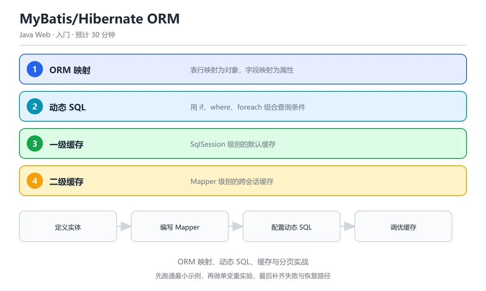

# MyBatis/Hibernate ORM

> 内容更新时间：2026-10-06 · 学习阶段：入门 · 预计用时：50 分钟

> 学习阶段：入门 · 预计用时：50 分钟 · 配图：ORM 映射流程




## 本节知识框架

想象你是一个翻译官。外国人（Java 对象）说英语，数据库说 SQL 方言——两人完全听不懂对方。ORM 框架就是这位翻译官，它帮你把 Java 对象自动"翻译"成 SQL 语句，再把数据库返回的结果"翻译"回 Java 对象。你只需要关心业务逻辑，不用再手写大量重复的 JDBC 模板代码。

**本课知识地图**

```text
ORM 是什么 → MyBatis 动态 SQL → Hibernate 自动映射 → 缓存机制 → 分页实战
```

**学完本课你将能够**：

1. 解释 ORM 的含义，对比 MyBatis 与 Hibernate 的设计哲学差异。
2. 使用 MyBatis 的 XML 映射和注解方式完成 CRUD 操作。
3. 编写 MyBatis 动态 SQL（`<if>`、`<where>`、`<foreach>`）。
4. 理解一级缓存与二级缓存的作用域和失效条件。
5. 使用 Hibernate 注解完成实体映射和 HQL 查询。

**先修知识**：你需要了解 Spring Boot 的基本使用（来自《Spring Boot 入门》），以及 JDBC 的基础概念。

---

**复习清单**

- [ ] 能不看正文说出「ORM」在本课中的作用与失效条件
- [ ] 能解释「一级缓存」出错时的现象，并给出排查顺序
- [ ] 能用本课示例复现一次「动态 SQL」，说明输入、输出与判定标准

## 核心概念定义

| 术语 | 一句话定义 | 生活类比 |
| --- | --- | --- |
| ORM（对象关系映射） | 把 Java 对象和数据库表之间建立自动对应关系的技術。 | 翻译官——让说英语的人和说中文的人无障碍交流。 |
| MyBatis | 半自动 ORM 框架，SQL 由开发者手写，框架负责参数绑定和结果映射。 | 半自动洗衣机——你决定水温和洗涤模式，机器帮你执行。 |
| Hibernate | 全自动 ORM 框架，根据对象操作自动生成 SQL 语句。 | 全自动洗衣机——放入衣服按下按钮，机器全自动完成。 |
| Mapper 接口 | MyBatis 中定义数据库操作的 Java 接口，与 XML 或注解中的 SQL 绑定。 | 餐厅的菜单——每道菜（方法）对应一个做法（SQL）。 |
| 动态 SQL | MyBatis 提供的标签，根据条件拼接不同的 SQL 片段。 | 自助火锅——根据你选的底料和菜品，动态组合最终的锅底。 |
| 一级缓存 | SqlSession 级别的缓存，同一个会话中相同查询只访问数据库一次。 | 你的书桌——正在用的东西放在桌上，拿取最快。 |
| 二级缓存 | SqlSessionFactory 级别的缓存，跨会话共享查询结果。 | 教室的公共书架——所有学生都可以借阅。 |
| HQL（Hibernate 查询语言） | 面向对象的查询语言，操作的是 Java 类和属性而非表名和列名。 | 用中文说"帮我找张三的电话"，而不是写 SQL 去查表。 |
| 延迟加载（Lazy Loading） | 访问关联对象时才真正执行查询，而不是在加载主对象时就全部查出。 | 快递柜——只有你去取件时才打开柜子拿出包裹。 |
| 即时加载（Eager Loading） | 查询主对象时立即把关联对象也一起查出来。 | 外卖直接送到手上——不用自己去取。 |

---

## 原理与运行机制

### ORM 到底在做什么？

传统 JDBC 方式下，每次数据库操作都要重复五步：创建连接、准备语句、设置参数、执行查询、手动映射结果。这就像每次寄快递都要自己填单、称重、贴标签、搬上车——太累了。

ORM 框架帮你完成了中间的繁琐步骤：

```text
Java 对象 → ORM 框架 → SQL 语句 → 数据库
数据库结果集 → ORM 框架 → Java 对象
```

### MyBatis 的工作流程

MyBatis 是"半自动"的——SQL 由你来写，但参数绑定和结果映射交给框架。

```text
1. 读取 mybatis-config.xml 配置 → 创建 SqlSessionFactory
2. 从工厂获取 SqlSession（相当于数据库连接）
3. 通过 Mapper 接口找到对应的 SQL 语句
4. 执行 SQL，自动绑定参数
5. 将结果集映射为 Java 对象
6. 返回结果
```

**类比**：MyBatis 像 GPS 导航——你告诉它目的地（SQL 和参数），它帮你规划路线（参数绑定、结果映射），但方向盘（SQL 本身）在你手里。

### Hibernate 的工作流程

Hibernate 是"全自动"的——你只需要操作对象，SQL 由框架自动生成。

```text
1. 读取 hibernate.cfg.xml → 创建 SessionFactory
2. 打开 Session（相当于数据库连接）
3. 调用 session.save(user) 或 session.get(User.class, id)
4. Hibernate 根据实体注解自动生成 SQL
5. 执行 SQL 并将结果映射为 Java 对象
6. 返回结果
```

**类比**：Hibernate 像自动驾驶——你只需说"去机场"，它自动规划路线、控制方向盘和油门。

### 缓存机制

MyBatis 有两级缓存：

```text
一级缓存（SqlSession 级别）
├── 默认开启，同一个 SqlSession 中相同查询只执行一次
├── 执行增删改操作或手动清空时失效
└── 作用域：单个 SqlSession

二级缓存（SqlSessionFactory 级别）
├── 需要手动配置，跨 SqlSession 共享
├── 实体类需实现 Serializable 接口
└── 作用域：整个应用
```

---

## 典型应用场景

| 场景 | 推荐框架 | 原因 |
| --- | --- | --- |
| 复杂报表查询、多表关联统计 | MyBatis | SQL 完全可控，可以写复杂的多表 JOIN 和优化查询 |
| 简单的单表 CRUD 操作 | Hibernate | 自动生成 SQL，开发效率高 |
| 需要频繁修改 SQL 的项目 | MyBatis | SQL 写在 XML 中，修改不需要改 Java 代码 |
| 领域模型复杂的 enterprise 应用 | Hibernate | 对象关系映射完善，支持继承映射、缓存等高级特性 |
| 遗留数据库、不规则表结构 | MyBatis | 可以灵活写 SQL 适配不规则的表结构 |
| 快速原型开发 | Hibernate | 注解驱动，少量配置即可运行 |

**实际项目中的选择**：国内项目（如电商、金融）多用 MyBatis 或 MyBatis-Plus，因为需要精细控制 SQL 性能；国外项目和 JPA 生态更倾向 Hibernate。两者也可以混合使用。

---

## 代码/协议/SQL 示例

### 示例 1：MyBatis 基础配置

```xml
<!-- mybatis-config.xml -->
<?xml version="1.0" encoding="UTF-8"?>
<!DOCTYPE configuration PUBLIC "-//mybatis.org//DTD Config 3.0//EN"
  "http://mybatis.org/dtd/mybatis-3-config.dtd">
<configuration>
    <environments default="development">
        <environment id="development">
            <transactionManager type="JDBC"/>
            <dataSource type="POOLED">
                <property name="driver" value="com.mysql.cj.jdbc.Driver"/>
                <property name="url" value="jdbc:mysql://localhost:3306/shop?useSSL=false&amp;serverTimezone=UTC"/>
                <property name="username" value="root"/>
                <property name="password" value="123456"/>
            </dataSource>
        </environment>
    </environments>
    <mappers>
        <mapper resource="mapper/UserMapper.xml"/>
    </mappers>
</configuration>
```

### 示例 2：MyBatis Mapper XML 与 CRUD

```xml
<!-- mapper/UserMapper.xml -->
<?xml version="1.0" encoding="UTF-8"?>
<!DOCTYPE mapper PUBLIC "-//mybatis.org//DTD Mapper 3.0//EN"
  "http://mybatis.org/dtd/mybatis-3-mapper.dtd">
<mapper namespace="com.example.mapper.UserMapper">

    <!-- 结果映射：把数据库列名映射到 Java 属性 -->
    <resultMap id="UserResult" type="com.example.entity.User">
        <id property="id" column="id"/>
        <result property="username" column="user_name"/>
        <result property="email" column="email"/>
        <result property="createdAt" column="created_at"/>
    </resultMap>

    <!-- 查询单个用户 -->
    <select id="findById" resultMap="UserResult" parameterType="int">
        SELECT id, user_name, email, created_at
        FROM users
        WHERE id = #{id}
    </select>

    <!-- 查询全部用户 -->
    <select id="findAll" resultMap="UserResult">
        SELECT id, user_name, email, created_at FROM users
    </select>

    <!-- 插入用户 -->
    <insert id="insert" parameterType="com.example.entity.User"
            useGeneratedKeys="true" keyProperty="id">
        INSERT INTO users (user_name, email, created_at)
        VALUES (#{username}, #{email}, NOW())
    </insert>

    <!-- 更新用户 -->
    <update id="update" parameterType="com.example.entity.User">
        UPDATE users SET user_name = #{username}, email = #{email}
        WHERE id = #{id}
    </update>

    <!-- 删除用户 -->
    <delete id="deleteById" parameterType="int">
        DELETE FROM users WHERE id = #{id}
    </delete>
</mapper>
```

### 示例 3：MyBatis 动态 SQL

```xml
<!-- 动态条件查询：根据传入参数灵活拼接 SQL -->
<select id="searchUsers" resultMap="UserResult">
    SELECT id, user_name, email, created_at FROM users
    <where>
        <if test="username != null and username != ''">
            AND user_name LIKE CONCAT('%', #{username}, '%')
        </if>
        <if test="email != null and email != ''">
            AND email LIKE CONCAT('%', #{email}, '%')
        </if>
        <if test="minAge != null">
            AND age &gt;= #{minAge}
        </if>
    </where>
    ORDER BY created_at DESC
</select>

<!-- 批量插入：使用 foreach 遍历集合 -->
<insert id="batchInsert" parameterType="java.util.List">
    INSERT INTO users (user_name, email, created_at) VALUES
    <foreach collection="list" item="user" separator=",">
        (#{user.username}, #{user.email}, NOW())
    </foreach>
</insert>
```

### 示例 4：MyBatis Mapper 接口

```java
package com.example.mapper;

import com.example.entity.User;
import org.apache.ibatis.annotations.Param;
import java.util.List;

public interface UserMapper {
    User findById(int id);
    List<User> findAll();
    int insert(User user);
    int update(User user);
    int deleteById(int id);

    // 动态查询
    List<User> searchUsers(@Param("username") String username,
                           @Param("email") String email,
                           @Param("minAge") Integer minAge);

    // 批量插入
    int batchInsert(@Param("list") List<User> users);
}
```

### 示例 5：Hibernate 实体映射

```java
package com.example.entity;

import javax.persistence.*;
import java.time.LocalDateTime;

@Entity
@Table(name = "users")
public class User {

    @Id
    @GeneratedValue(strategy = GenerationType.IDENTITY)
    private Integer id;

    @Column(name = "user_name", nullable = false, length = 50)
    private String username;

    @Column(name = "email", unique = true, length = 100)
    private String email;

    @Column(name = "created_at")
    private LocalDateTime createdAt;

    // 一对多关联：一个用户有多个订单
    @OneToMany(mappedBy = "user", cascade = CascadeType.ALL, fetch = FetchType.LAZY)
    private List<Order> orders;

    // 构造器、getter、setter 省略
}
```

### 示例 6：Hibernate HQL 查询

```java
// 使用 HQL 查询（面向对象的查询方式）
String hql = "FROM User u WHERE u.username LIKE :name ORDER BY u.createdAt DESC";
List<User> users = session.createQuery(hql, User.class)
    .setParameter("name", "%张%")
    .setFirstResult(0)      // 分页：起始位置
    .setMaxResults(10)      // 分页：每页条数
    .getResultList();

// 使用 Criteria API（类型安全的查询方式）
CriteriaBuilder cb = session.getCriteriaBuilder();
CriteriaQuery<User> cq = cb.createQuery(User.class);
Root<User> root = cq.from(User.class);
cq.select(root).where(cb.like(root.get("username"), "%张%"));
cq.orderBy(cb.desc(root.get("createdAt")));
List<User> result = session.createQuery(cq).getResultList();
```

### 示例 7：Spring Boot 集成 MyBatis

```java
package com.example.service;

import com.example.entity.User;
import com.example.mapper.UserMapper;
import org.springframework.stereotype.Service;
import org.springframework.transaction.annotation.Transactional;
import java.util.List;

@Service
public class UserService {

    private final UserMapper userMapper;

    // 构造器注入
    public UserService(UserMapper userMapper) {
        this.userMapper = userMapper;
    }

    public User getUserById(int id) {
        return userMapper.findById(id);
    }

    @Transactional
    public User createUser(User user) {
        userMapper.insert(user);
        return user; // insert 后 id 已自动回填
    }

    public List<User> searchUsers(String username, String email, Integer minAge) {
        return userMapper.searchUsers(username, email, minAge);
    }
}
```

```text
# application.yml 中的 MyBatis 配置
mybatis:
  mapper-locations: classpath:mapper/*.xml
  type-aliases-package: com.example.entity
  configuration:
    map-underscore-to-camel-case: true   # 自动把下划线列名映射为驼峰属性名
    log-impl: org.apache.ibatis.logging.stdout.StdOutImpl  # 打印 SQL 日志
```

---

## 时间/空间复杂度或性能分析

### 缓存命中率与性能

| 操作 | 无缓存 | 一级缓存命中 | 二级缓存命中 |
| --- | --- | --- | --- |
| 查询耗时 | ~5ms（含网络 IO） | ~0.01ms（内存读取） | ~0.02ms（内存读取） |
| 数据库压力 | 每次查询都访问 DB | 只有首次访问 DB | 只有首次访问 DB |

**关键结论**：
- 一级缓存默认开启，但作用域仅限单个 SqlSession，会话关闭即失效。
- 二级缓存可以跨会话共享，但如果数据频繁更新，缓存失效频繁，反而增加维护开销。
- 生产环境中，通常使用 Redis 等外部缓存替代 MyBatis 二级缓存。

### N+1 问题

```text
场景：查询 10 个用户及其订单
即时加载（Eager）：1 次 JOIN 查询 → 1 次 SQL
延迟加载（Lazy）：1 次查用户 + 10 次查订单 → 11 次 SQL（N+1 问题！）
```

**解决方案**：
- MyBatis：使用 `<collection>` 标签配合嵌套查询或嵌套结果
- Hibernate：使用 `JOIN FETCH` 或 `@BatchSize` 注解
- 通用方案：使用 IN 查询代替循环单条查询

### SQL 注入防护

```text
MyBatis 中：
  #{param}  → 使用 PreparedStatement，自动转义（安全）
  ${param}  → 使用字符串拼接，有 SQL 注入风险（危险）

原则：永远使用 #{} 而非 ${}，除非是动态表名或列名
```

---

## 常见误区与易错点

**误区 1：认为 ORM 可以完全替代 SQL**

ORM 只是帮你"翻译"，但不能替你"思考"。复杂的统计查询、窗口函数、数据库特有特性（如 MySQL 的 `ON DUPLICATE KEY UPDATE`）仍然需要手写 SQL。过度依赖 ORM 自动生成可能导致低效的查询计划。

**误区 2：混淆 `#{}` 和 `${}` 的使用场景**

```java
// 正确：使用 #{} 防止 SQL 注入
SELECT * FROM users WHERE id = #{id}

// 错误：使用 ${} 有注入风险
SELECT * FROM users WHERE id = ${id}

// 唯一合理用 ${} 的场景：动态表名或列名（需确保输入来源可信）
SELECT * FROM ${tableName} ORDER BY ${columnName}
```

**误区 3：一级缓存导致的数据不一致**

在同一个 SqlSession 中，第一次查询后数据被其他事务修改，第二次查询仍会返回缓存中的旧数据。解决方法：在增删改操作后手动调用 `sqlSession.clearCache()`，或使用 `localCacheScope=STATEMENT` 配置。

**误区 4：Hibernate 的 `equals()` 和 `hashCode()` 陷阱**

使用 Hibernate 时，实体类的 `equals()` 和 `hashCode()` 不要基于代理字段（如自动生成的 id），因为对象在持久化前 id 为 null，持久化后才有值，会导致在 Set/Map 中找不到已存在的对象。推荐基于业务键（如 email）实现。

**误区 5：延迟加载在序列化时报错**

当使用 Jackson 序列化 Hibernate 延迟加载的实体时，如果 Session 已关闭，会抛出 `LazyInitializationException`。解决方案：使用 `@JsonIgnore` 忽略延迟加载字段，或在 Service 层用 `JOIN FETCH` 提前加载。

---

## 与其他知识点的关系

```text
Spring Boot 入门
  └── 自动配置 DataSource → MyBatis/Hibernate 的底层数据源

Spring Framework 核心
  └── @Transactional 事务管理 → ORM 框架的事务集成

Spring MVC 详解
  └── Controller 调用 Service → Service 调用 Mapper/Repository

RESTful API 设计与实现
  └── Controller 返回 DTO → 从 ORM 实体转换为 DTO 返回给前端

JDBC 基础（Java 基础课程）
  └── PreparedStatement → MyBatis #{} 的底层实现
  └── ResultSet 手动映射 → ORM 自动映射的前身
```

**核心关系**：MyBatis/Hibernate 位于"数据访问层"，向上为 Service 层提供数据操作接口，向下通过 JDBC 与数据库交互。Spring 的 IoC 负责创建和管理 Mapper/Repository 的生命周期，`@Transactional` 负责事务边界。

---

## 自测题与参考答案

**题目 1**：MyBatis 中 `#{}` 和 `${}` 的区别是什么？

**参考答案**：`#{}` 使用 PreparedStatement 的参数占位符，会自动进行类型转换和 SQL 注入防护，是安全的参数传递方式。`${}` 使用字符串直接拼接，不做任何转义，存在 SQL 注入风险，仅用于动态表名或列名等无法使用占位符的场景。

**题目 2**：什么是一级缓存？它什么时候会失效？

**参考答案**：一级缓存是 MyBatis 的 SqlSession 级别缓存，默认开启。同一个 SqlSession 中执行相同的查询时，第二次会直接从缓存中获取结果而不访问数据库。失效条件包括：（1）执行了增删改操作；（2）手动调用 `clearCache()` 方法；（3）SqlSession 关闭；（4）配置 `localCacheScope=STATEMENT` 时每次查询后自动清空。

**题目 3**：MyBatis 和 Hibernate 的核心区别是什么？

**参考答案**：MyBatis 是半自动 ORM，SQL 由开发者手写，框架负责参数绑定和结果映射，适合需要精细控制 SQL 的场景。Hibernate 是全自动 ORM，根据对象操作自动生成 SQL，适合对象模型复杂、CRUD 为主的场景。MyBatis 更灵活但工作量大，Hibernate 更省力但调试复杂 SQL 困难。

---

## 考点精讲

### 考点 1

ORM 的核心思想是什么？

A. 手动写 SQL 并把结果集逐行拼装成对象，只把表名和类名做对应  

B. 加密数据

C. 将数据库表映射为程序中的对象，用面向对象方式操作数据

D. 压缩数据库

**正确答案：C**

**详细解释**：ORM（Object-Relational Mapping）把表行映射为对象，字段映射为属性，开发者用对象操作代替 SQL。 换句话说，ORM 把 CRUD 从拼接字符串转为调用对象方法，MyBatis 属于半自动 ORM，SQL 仍由开发者掌控。 本题正确项是「将数据库表映射为程序中的对象，用面向对象方式操作数据」。

---

### 考点 2

MyBatis 中 #{} 和 ${} 的区别是什么？

A. 完全相同

B. #{} 是预编译参数（防 SQL 注入），${} 是字符串替换（有注入风险）

C. ${} 更安全

D. #{} 只能用于数字，占位符绑定只提供 setInt 这类数值方法  

**正确答案：B**

**详细解释**：#{} 用 PreparedStatement 占位符，安全防注入；${} 直接拼接字符串，用于动态表名/列名，需确保输入安全。 记住一条硬规则：凡是用户输入拼进 SQL 的位置一律用 #{}，只有表名、列名等无法预编译的结构才考虑 ${} 并做白名单校验。 本题正确项是「#{} 是预编译参数（防 SQL 注入），${} 是字符串替换（有注入风险）」。

---

### 考点 3

MyBatis 一级缓存和二级缓存的区别是什么？

A. 一级缓存更大

B. 一级缓存是 SqlSession 级别，二级缓存是 Mapper 级别（跨 SqlSession）

C. 二级缓存默认开启，作用范围与一级缓存相同，只在当前 SqlSession 内可复用，换会话后失效  

D. 一级缓存不存在

**正确答案：B**

**详细解释**：一级缓存默认开启，作用域为 SqlSession；二级缓存需手动配置，作用域为 Mapper 的 namespace，跨 SqlSession 共享。 还要注意二级缓存需要实体可序列化，并且在多表关联查询时容易读到脏数据，生产环境通常只对稳定字典表开启。 本题正确项是「一级缓存是 SqlSession 级别，二级缓存是 Mapper 级别（跨 SqlSession）」。

---

### 考点 4

MyBatis 动态 SQL 中 <if test="name != null"> 的作用是什么？

A. 定义变量

B. 当 name 不为 null 时才包含该 SQL 片段

C. 循环生成 SQL，按集合长度重复拼接同一段条件  

D. 定义结果映射

**正确答案：B**

**详细解释**：<if> 标签根据 OGNL 表达式条件决定是否包含内部 SQL 片段，实现灵活的动态查询条件。 实际项目里常把 <if>、<where>、<foreach> 组合使用，<where> 会自动去掉多余的 AND，避免拼接出语法错误的 SQL。 本题正确项是「当 name 不为 null 时才包含该 SQL 片段」。

---

### 考点 5

Hibernate 中懒加载（Lazy Loading）的含义是什么？

A. 延迟应用启动，把 Session 的创建推迟到首次访问时  

B. 关联对象在首次访问时才从数据库加载，而非查询时立即加载

C. 慢速查询

D. 缓存所有数据

**正确答案：B**

**详细解释**：懒加载延迟加载关联数据，只有代码真正访问关联属性时才发 SQL，减少不必要的数据库查询。 使用时要注意：懒加载必须在 Session 打开期间访问关联对象，否则会抛出 LazyInitializationException，可以提前用 fetch join 取回数据。 本题正确项是「关联对象在首次访问时才从数据库加载，而非查询时立即加载」。

---

### 考点 6

题目：填空：本课术语表里有一条解释被挖掉了术语名称，请补全。解释：对象关系映射，自动转换 Java 对象与数据库记录。空缺处应填哪个术语？
正确答案：「ORM」

**解析**：正确项：「ORM」。本课术语表对它的解释是：对象关系映射，自动转换 Java 对象与数据库记录。题干只挖掉了术语名称，填「ORM」或「orm」都算正确。容易和它混淆的是「MyBatis」：两者在「MyBatis/Hibernate ORM」里分别对应不同的使用场景，答题时先看定义里描述的对象和边界，再决定填哪一个。

---

## 术语速查

| 术语 | 一句话说明 |
| --- | --- |
| ORM | 对象关系映射，自动转换 Java 对象与数据库记录 |
| MyBatis | 半自动 ORM，SQL 手写，框架做参数绑定和结果映射 |
| Hibernate | 全自动 ORM，根据对象操作自动生成 SQL |
| Mapper | MyBatis 的数据访问接口，绑定 SQL 语句 |
| 动态 SQL | MyBatis 标签，按条件灵活拼接 SQL |
| 一级缓存 | SqlSession 级别缓存，默认开启 |
| 二级缓存 | 应用级别缓存，需手动配置 |
| HQL | Hibernate 查询语言，面向对象而非面向表 |
| Lazy Loading | 延迟加载，访问时才查询 |
| N+1 问题 | 查主对象 1 次 + 查关联对象 N 次的性能问题 |
| `#{}` | MyBatis 安全参数占位符，防 SQL 注入 |
| `${}` | MyBatis 字符串拼接，有注入风险 |

---

## 参考资料与复核

- [MyBatis 官方文档](https://mybatis.org/mybatis-3/zh_CN/index.html)
- [Hibernate 官方文档](https://hibernate.org/orm/documentation/)
- [MyBatis-Spring-Boot-Starter](https://mybatis.org/spring-boot-starter/mybatis-spring-boot-autoconfigure/)
- [Spring Data JPA 参考](https://docs.spring.io/spring-data/jpa/docs/current/reference/html/)
- 复核日期：2026-10-19

---

- 最后复核：2026-10-04
- 下次复核：2027-10-10

## 内容元数据

- 内容版本：v2.0
- 最后更新：2026-10-06
- 学习阶段：入门
- 适用环境：通用开发环境；本课聚焦 MyBatis。
- 内容来源：内置结构化课程与工程实践整理
- 相关主题：javaweb mybatis
- 质量版本：P0 测验标准 + P1 覆盖扩展 + P2 体验补全