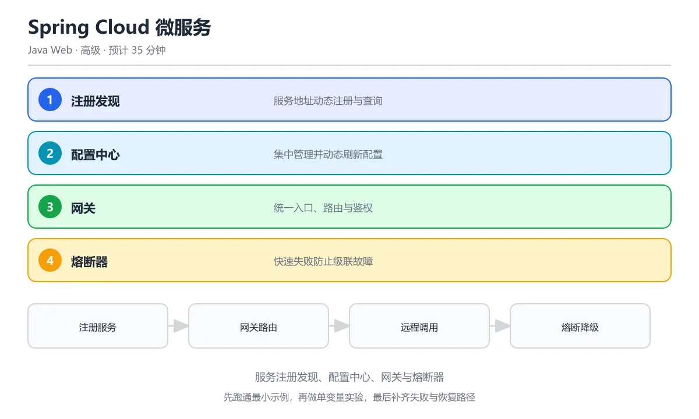

# Spring Cloud 微服务

> 内容更新时间：2026-10-06 · 学习阶段：高级 · 预计用时：45 分钟

> 预计学习时长：35 分钟 | 难度：高级 | 前置知识：Spring Boot、Spring 核心

---




## 本节知识框架

```text
Spring Cloud 微服务
├── 服务注册与发现（Eureka / Nacos）
├── 配置中心（Spring Cloud Config / Nacos Config）
├── 服务网关（Spring Cloud Gateway）
├── 服务调用（OpenFeign / RestTemplate + LoadBalancer）
├── 熔断与限流（Resilience4j / Sentinel）
├── 链路追踪（Spring Cloud Sleuth / Micrometer Tracing）
└── 消息驱动（Spring Cloud Stream）
```

本节围绕"如何把单体应用拆成多个独立部署的微服务"展开。你可以把 Spring Cloud 想象成一套**微服务工具箱**——每个工具解决一个分布式系统的经典难题：服务在哪里（注册发现）、配置怎么管（配置中心）、流量怎么走（网关）、服务之间怎么说话（远程调用）、对方挂了怎么办（熔断）。

---


**复习清单**

- [ ] 能说出服务注册发现、配置中心、网关、Feign、熔断器各自解决的问题
- [ ] 能画出一个请求经过网关、负载均衡和下游服务的完整链路
- [ ] 能解释熔断器的关闭、打开、半开三种状态
- [ ] 能说明配置中心动态刷新的原理与配置隔离方式
- [ ] 能运行本课示例并修改一个配置观察行为变化

## 核心概念定义

| 概念 | 通俗解释 | 正式定义 |
|------|----------|----------|
| 微服务 | 把大系统拆成多个小服务，每个小服务独立部署、独立升级 | 一种架构风格，将应用构建为一组小型、自治的服务，每个服务运行在自己的进程中 |
| 服务注册与发现 | 像电话簿一样，每个服务启动时去"登记"地址，其他服务通过"查号"找到它 | 服务实例在注册中心注册自己的网络地址，消费者通过注册中心获取可用实例列表 |
| 配置中心 | 把所有服务的配置文件集中存放在一个"仓库"里，修改配置不用重新打包 | 外部化配置管理系统，支持多环境、动态刷新，无需重启服务即可生效 |
| API 网关 | 小区的"门卫"，所有外部请求先经过它，再转发到对应的内部服务 | 统一入口，负责路由、鉴权、限流、日志等横切关注点 |
| 熔断器 | 电路里的保险丝——下游服务故障时自动"跳闸"，防止雪崩 | 当对下游服务的调用持续失败时，快速失败并执行降级逻辑，避免级联故障 |
| 声明式调用 | 像打电话一样简单——定义一个接口，框架帮你完成 HTTP 调用 | 通过 Java 接口 + 注解的方式定义远程服务调用，底层由代理实现 |

---

## 原理与运行机制

### 3.1 整体架构流程

想象一个外卖平台：

1. **商家入驻**（服务注册）：每家餐厅在平台登记自己的地址
2. **用户下单**（服务调用）：用户通过 App 点餐，App 去平台查餐厅地址
3. **平台调度**（负载均衡）：平台根据距离、评分选择最合适的骑手
4. **异常处理**（熔断降级）：餐厅关门了，平台自动推荐其他餐厅

Spring Cloud 的运行机制与此类似：

```text
客户端请求 → API Gateway → [负载均衡] → 服务 A
                                            ↓
                                      [服务注册中心]
                                            ↑
                                      服务 B、服务 C ...
```

### 3.2 服务注册与发现原理

以 Nacos 为例：

1. 服务启动时，向 Nacos Server 发送注册请求（携带 IP、端口、服务名）
2. Nacos 将实例信息保存在内存注册表中
3. 消费者通过 Nacos 拉取可用实例列表，并在本地缓存
4. 服务实例通过心跳机制维持注册状态（默认 5 秒一次）
5. 实例上下线时，Nacos 通过长轮询 / 事件推送通知消费者

### 3.3 网关路由原理

Spring Cloud Gateway 基于 WebFlux（响应式编程），核心概念：

- **Route（路由）**：一条转发规则，由 ID + 目标 URI + Predicate + Filter 组成
- **Predicate（断言）**：匹配条件，如路径匹配、请求头匹配
- **Filter（过滤器）**：请求/响应的加工逻辑，如添加请求头、限流

```text
请求 → [Predicate 匹配] → [Filter 链处理] → 转发到下游服务 → [Filter 链处理] → 响应
```

---

## 典型应用场景

| 场景 | 为什么需要 Spring Cloud | 用到的组件 |
|------|------------------------|-----------|
| 电商系统拆分 | 订单、库存、支付、用户各自独立部署，互不影响 | Gateway + Feign + Nacos + Sentinel |
| 多环境配置管理 | 开发/测试/生产环境配置不同，集中管理避免出错 | Config / Nacos Config |
| 灰度发布 | 新版本先给 10% 用户使用，观察效果再全量上线 | Gateway Filter + Nacos 元数据 |
| 服务容错 | 某个下游服务超时不能拖垮整个系统 | Resilience4j / Sentinel |
| 统一鉴权 | 所有接口都要校验 JWT Token，不能每个服务都写一遍 | Gateway 全局过滤器 |

---

## 代码/协议/SQL 示例

### 5.1 服务注册与发现（Nacos）

**pom.xml 依赖：**

```xml
<dependency>
    <groupId>com.alibaba.cloud</groupId>
    <artifactId>spring-cloud-starter-alibaba-nacos-discovery</artifactId>
</dependency>
```

**application.yml 配置：**

```yaml
spring:
  application:
    name: order-service
  cloud:
    nacos:
      discovery:
        server-addr: 127.0.0.1:8848
        namespace: dev
        group: DEFAULT_GROUP
```

**启动类：**

```java
// 片段：仅展示启动类注解结构，Spring Boot 依赖未包含在本示例中
@SpringBootApplication
@EnableDiscoveryClient
public class OrderServiceApplication {
    public static void main(String[] args) {
        SpringApplication.run(OrderServiceApplication.class, args);
    }
}
```

### 5.2 声明式远程调用（OpenFeign）

定义 Feign 客户端接口——就像定义一个本地接口，但实际调用的是远程服务：

```java
@FeignClient(name = "inventory-service", fallbackFactory = InventoryClientFallback.class)
public interface InventoryClient {

    @GetMapping("/api/inventory/{skuId}")
    InventoryDTO getInventory(@PathVariable("skuId") Long skuId);

    @PostMapping("/api/inventory/deduct")
    Boolean deductStock(@RequestBody DeductRequest request);
}
```

**降级工厂（当远程服务不可用时返回兜底数据）：**

```java
@Component
public class InventoryClientFallback implements FallbackFactory<InventoryClient> {

    private static final Logger log = LoggerFactory.getLogger(InventoryClientFallback.class);

    @Override
    public InventoryClient create(Throwable cause) {
        log.error("inventory-service 调用失败，原因：{}", cause.getMessage());
        return new InventoryClient() {
            @Override
            public InventoryDTO getInventory(Long skuId) {
                return InventoryDTO.unknown(skuId);
            }

            @Override
            public Boolean deductStock(DeductRequest request) {
                return false;
            }
        };
    }
}
```

### 5.3 API 网关路由配置

```yaml
spring:
  cloud:
    gateway:
      routes:
        - id: order-route
          uri: lb://order-service
          predicates:
            - Path=/api/order/**
          filters:
            - StripPrefix=2
            - AddRequestHeader=X-Request-Source, gateway

        - id: user-route
          uri: lb://user-service
          predicates:
            - Path=/api/user/**
          filters:
            - StripPrefix=2
```

**全局鉴权过滤器：**

```java
@Component
public class AuthGlobalFilter implements GlobalFilter, Ordered {

    private static final List<String> WHITE_LIST = List.of(
        "/api/user/login", "/api/user/register"
    );

    @Override
    public Mono<Void> filter(ServerWebExchange exchange, GatewayFilterChain chain) {
        String path = exchange.getRequest().getURI().getPath();

        if (WHITE_LIST.stream().anyMatch(path::startsWith)) {
            return chain.filter(exchange);
        }

        String token = exchange.getRequest().getHeaders().getFirst("Authorization");
        if (token == null || !JwtUtil.verify(token)) {
            exchange.getResponse().setStatusCode(HttpStatus.UNAUTHORIZED);
            return exchange.getResponse().setComplete();
        }

        ServerHttpRequest mutatedRequest = exchange.getRequest().mutate()
            .header("X-User-Id", JwtUtil.getUserId(token))
            .build();
        return chain.filter(exchange.mutate().request(mutatedRequest).build());
    }

    @Override
    public int getOrder() {
        return -1;
    }
}
```

### 5.4 熔断器配置（Resilience4j）

```yaml
resilience4j:
  circuitbreaker:
    instances:
      inventoryService:
        sliding-window-size: 10
        failure-rate-threshold: 50
        wait-duration-in-open-state: 10s
        permitted-number-of-calls-in-half-open-state: 3
        automatic-transition-from-open-to-half-open-enabled: true
  timelimiter:
    instances:
      inventoryService:
        timeout-duration: 3s
```

**在代码中使用熔断器：**

```java
@Service
public class OrderService {

    private final InventoryClient inventoryClient;
    private final CircuitBreaker circuitBreaker;

    public OrderService(InventoryClient inventoryClient,
                        CircuitBreakerRegistry registry) {
        this.inventoryClient = inventoryClient;
        this.circuitBreaker = registry.circuitBreaker("inventoryService");
    }

    public OrderVO createOrder(OrderRequest request) {
        Supplier<Boolean> decorated = CircuitBreaker
            .decorateSupplier(circuitBreaker, () -> {
                return inventoryClient.deductStock(
                    new DeductRequest(request.getSkuId(), request.getQuantity())
                );
            });

        Boolean success = Try.ofSupplier(decorated)
            .recover(throwable -> {
                log.warn("库存扣减熔断降级，订单 {} 进入排队", request.getOrderId());
                return enqueueRetry(request);
            }).get();

        return buildOrderVO(request, success);
    }
}
```

### 5.5 配置中心（Nacos Config）

```yaml
# bootstrap.yml
spring:
  cloud:
    nacos:
      config:
        server-addr: 127.0.0.1:8848
        file-extension: yaml
        shared-configs:
          - data-id: common-database.yaml
            group: DEFAULT_GROUP
            refresh: true
```

```java
@RestController
@RefreshScope   // 配置变更时自动刷新 Bean
public class ConfigDemoController {

    @Value("${app.feature.toggle:false}")
    private boolean featureToggle;

    @GetMapping("/feature")
    public Map<String, Boolean> getFeature() {
        return Map.of("enabled", featureToggle);
    }
}
```

---

## 时间/空间复杂度或性能分析

### 6.1 各组件的性能开销

| 组件 | 额外延迟 | 内存开销 | 说明 |
|------|----------|----------|------|
| Nacos 注册发现 | < 10ms | 低 | 本地缓存实例列表，心跳间隔 5s |
| Gateway 路由转发 | 1~5ms | 中 | 基于 Netty 异步非阻塞，性能优秀 |
| OpenFeign 调用 | 取决于网络 | 低 | 本质是 HTTP 调用，比 RPC 慢但比手写 RestTemplate 方便 |
| Resilience4j 熔断 | < 1ms | 极低 | 纯内存状态机，开销可忽略 |
| Config 配置刷新 | 秒级生效 | 低 | 长轮询监听配置变更，变更后刷新 Bean |

### 6.2 微服务拆分的代价

- **网络开销**：服务间通信从进程内调用变成网络调用，延迟从纳秒级变成毫秒级
- **运维复杂度**：服务数量从 1 个变成 N 个，部署、监控、日志都需要配套
- **数据一致性**：跨服务事务无法使用本地事务，需要引入分布式事务（Saga / TCC）
- **调试困难**：一个请求可能经过 5~6 个服务，需要链路追踪才能定位问题

> **经验法则**：团队规模 < 20 人、日活 < 10 万的项目，优先考虑模块化单体，不要过早引入微服务。

---

## 常见误区与易错点

### 误区 1：把微服务当成"银弹"

很多团队在业务初期就拆成十几个微服务，结果：
- 一个简单功能要改 5 个服务
- 联调环境搭建要半天
- 出了 bug 不知道是哪个服务的问题

**正确做法**：先用模块化单体跑通业务，等团队和流量增长到瓶颈时再逐步拆分。

### 误区 2：Feign 调用不配置超时

默认情况下 OpenFeign 没有超时限制，如果下游服务卡住，调用方线程池会被耗尽，最终整个服务不可用。

```yaml
# 必须配置超时！
spring:
  cloud:
    openfeign:
      client:
        config:
          default:
            connect-timeout: 3000
            read-timeout: 5000
```

### 误区 3：熔断器阈值设置不合理

- 滑动窗口太小（如 3 次）：偶然 2 次失败就触发熔断，太敏感
- 失败率阈值太低（如 10%）：正常波动也会触发熔断
- 半开状态允许请求数太少：恢复后只放 1 个请求探测，可能因为偶发超时又回到开路

### 误区 4：网关层做太多业务逻辑

网关应该只做**横切关注点**（鉴权、限流、日志、路由），业务逻辑应该下沉到各个微服务。在网关里写业务判断会导致：
- 网关变成"超级单体"，难以维护
- 每次业务变更都要改网关并重新部署

### 误区 5：忽略服务间版本兼容

服务 A 升级后修改了接口返回格式，但服务 B 还在用旧格式解析——直接报错。

**解决方案**：
- 接口版本号（`/api/v1/`、`/api/v2/`）
- 消费者驱动契约测试（Pact）
- 灰度发布逐步切换

---

## 与其他知识点的关系

```text
                    ┌─────────────────────┐
                    │  Spring Boot 基础    │
                    └─────────┬───────────┘
                              │
              ┌───────────────┼───────────────┐
              ▼               ▼               ▼
     ┌────────────┐  ┌──────────────┐  ┌────────────┐
     │ Spring MVC │  │ Spring 核心  │  │ RESTful API│
     └──────┬─────┘  └──────┬───────┘  └──────┬─────┘
            │               │                  │
            └───────────────┼──────────────────┘
                            ▼
                  ┌──────────────────┐
                  │  Spring Cloud    │
                  │  微服务架构      │
                  └────────┬─────────┘
                           │
            ┌──────────────┼──────────────┐
            ▼              ▼              ▼
     ┌──────────┐  ┌───────────┐  ┌──────────┐
     │  Docker  │  │ Kubernetes│  │ 消息队列 │
     │  容器化  │  │  编排部署  │  │ 异步通信 │
     └──────────┘  └───────────┘  └──────────┘
```

- **前置依赖**：Spring Boot（自动配置）、Spring 核心（IoC/AOP）、RESTful API（HTTP 接口设计）
- **平行关系**：Spring Security（网关鉴权需要）、数据库（分布式事务涉及数据一致性）
- **后续延伸**：Docker/K8s（微服务部署）、消息队列（异步解耦）、链路追踪（问题排查）

---

## 自测题与参考答案

**Q1：Spring Cloud 中，服务注册与发现的作用是什么？**

> 参考答案：服务注册与发现让每个微服务启动时将自己的网络地址（IP + 端口）注册到注册中心（如 Nacos），其他服务需要调用它时，通过注册中心查询可用实例列表，再通过负载均衡选择一个实例发起调用。这样服务之间不需要硬编码地址，可以动态扩缩容。

**Q2：API 网关和直接暴露各服务地址有什么区别？**

> 参考答案：API 网关是系统的统一入口，所有外部请求先到达网关，再由网关路由到对应的内部服务。好处包括：(1) 客户端只需知道一个地址；(2) 鉴权、限流、日志等逻辑集中在网关，不用每个服务都写一遍；(3) 网关可以做协议转换（HTTP → gRPC）；(4) 便于灰度发布和 A/B 测试。

**Q3：熔断器的三种状态是什么？**

> 参考答案：(1) **关闭（Closed）**：正常状态，请求正常通过，熔断器统计失败次数；(2) **开路（Open）**：失败率超过阈值后触发，所有请求直接走降级逻辑，不实际调用下游服务；(3) **半开（Half-Open）**：等待一段时间后进入，允许少量请求通过探测下游是否恢复，如果成功则回到关闭状态，如果仍然失败则回到开路状态。

**Q4：`@RefreshScope` 注解的作用是什么？**

> 参考答案：`@RefreshScope` 标记的 Bean 会在配置中心推送配置变更时被销毁并重新创建，从而让新的配置值生效。如果不加这个注解，`@Value` 注入的值在应用启动后就不会再变了。

**Q5：为什么 Feign 需要配置 Fallback？**

> 参考答案：在微服务架构中，下游服务可能因为网络抖动、负载过高、部署重启等原因暂时不可用。如果不配置 Fallback（降级），调用方会一直等待直到超时，大量超时请求会耗尽调用方的线程池资源，导致级联故障（雪崩效应）。Fallback 让调用方在下游不可用时快速返回兜底数据或执行替代逻辑，保护自身不被拖垮。

---

## 考点精讲

### 考点 1

微服务架构中，服务注册发现的作用是什么？

A. 加密通信

B. 压缩数据

C. 让服务能动态找到彼此的网络地址，无需硬编码

D. 管理数据库，统一维护各服务的数据库连接池  

**正确答案：C**

**详细解释**：服务注册发现让每个服务启动时注册自己的地址，调用方通过注册中心获取目标地址，实现动态路由。 注册中心同时承担健康检查职责，实例下线或心跳超时会被自动剔除，调用方拿到的列表始终是可用的。 如果注册中心整体不可用，调用方应保留本地缓存的服务列表并支持降级调用，否则一次注册中心故障会放大成全站不可用。 本题正确项是「让服务能动态找到彼此的网络地址，无需硬编码」。

---

### 考点 2

Spring Cloud Gateway 的核心功能是什么？

A. 数据库管理，集中维护各服务的表结构  

B. 统一入口、路由转发、鉴权和限流

C. 代码编译

D. 日志存储

**正确答案：B**

**详细解释**：Gateway 是微服务的统一入口，负责请求路由到不同服务，同时处理跨切面关注点（认证、限流、日志）。 网关通常还负责统一跨域配置、请求头透传和灰度路由，把鉴权放在网关可以避免每个服务重复实现。 路由配置可以来自配置文件或配置中心，改完无需重启即可生效，但要注意路由顺序，先匹配的规则会优先命中。 本题正确项是「统一入口、路由转发、鉴权和限流」。

---

### 考点 3

熔断器（Circuit Breaker）模式解决什么问题？

A. 数据库连接池耗尽，通过排队等待连接释放来削峰  

B. 防止服务级联故障，当下游服务不可用时快速失败

C. 内存泄漏

D. 代码编译错误

**正确答案：B**

**详细解释**：熔断器监控调用失败率，超过阈值时"断开电路"直接返回降级响应，避免大量请求堆积拖垮整个系统。 熔断器一般有三种状态：关闭、打开和半开，半开状态会放少量请求试探下游是否恢复，恢复后再完全关闭。 阈值不能拍脑袋设置，通常结合错误率和慢调用比例，并配合重试预算，避免把可恢复的抖动误判成故障。 本题正确项是「防止服务级联故障，当下游服务不可用时快速失败」。

---

### 考点 4

Feign 在 Spring Cloud 中的作用是什么？

A. 服务注册，把接口实现类自动注册到注册中心  

B. 声明式 HTTP 客户端，用接口注解调用远程服务

C. 配置管理

D. 消息队列

**正确答案：B**

**详细解释**：Feign 让远程服务调用像本地方法一样，通过接口 + 注解定义，自动处理负载均衡和序列化。 接口上写 @FeignClient 并配合服务名，Feign 会结合 LoadBalancer 在多个实例之间轮询，业务代码感知不到地址变化。 超时时间要显式配置，默认值往往偏长，下游变慢时会把调用方线程和连接一起拖住。 本题正确项是「声明式 HTTP 客户端，用接口注解调用远程服务」。

---

### 考点 5

分布式配置中心（如 Nacos Config）解决了什么问题？

A. 代码版本管理，用分支隔离不同环境的配置  

B. 集中管理所有微服务的配置文件，支持动态刷新

C. 数据库备份

D. 日志收集

**正确答案：B**

**详细解释**：配置中心把分散在各服务的配置集中管理，修改后无需重启即可生效，避免配置不一致导致的问题。 生产使用时通常配合命名空间和环境隔离，避免测试配置误推到线上，同时保留本地配置作为兜底。 敏感配置应加密存储并做权限隔离，同时保留变更审计，出问题时才能定位是哪次配置修改引发的故障。 本题正确项是「集中管理所有微服务的配置文件，支持动态刷新」。

---

### 考点 6

题目：填空：本课术语表里有一条解释被挖掉了术语名称，请补全。解释：服务启动时向注册中心报告自己的地址。空缺处应填哪个术语？
正确答案：「服务注册」

**解析**：正确项：「服务注册」。本课术语表对它的解释是：服务启动时向注册中心报告自己的地址。题干只挖掉了术语名称，填写「服务注册」即可。容易和它混淆的是「服务发现」：两者在「Spring Cloud 微服务」里分别对应不同的使用场景，答题时先看定义里描述的对象和边界，再决定填哪一个。

---

## 术语速查

| 术语 | 一句话说明 |
| --- | --- |
| 服务注册 | 服务启动时向注册中心报告自己的地址 |
| 服务发现 | 消费者从注册中心获取可用服务列表 |
| 注册中心 | 存储服务实例地址的中间件（Nacos、Eureka） |
| 配置中心 | 集中管理所有服务配置的外部系统 |
| API 网关 | 系统的统一入口，负责路由、鉴权、限流 |
| 熔断器 | 防止级联故障的保护机制 |
| 降级 | 服务不可用时返回兜底数据 |
| 限流 | 控制单位时间内的请求数量 |
| 链路追踪 | 跟踪请求在多个服务间的调用链路 |
| 负载均衡 | 将请求分发到多个服务实例 |
| 声明式调用 | 通过接口 + 注解定义远程调用（Feign） |
| 服务网格 | 基础设施层处理服务间通信（Istio） |
| 灰度发布 | 新版本先给小部分用户使用 |
| 分布式事务 | 跨多个服务的数据一致性保证 |

---

## 参考资料与复核

### 官方文档
- [Spring Cloud 官方文档](https://spring.io/projects/spring-cloud)
- [Spring Cloud Gateway 参考指南](https://docs.spring.io/spring-cloud-gateway/docs/current/reference/html/)
- [Nacos 官方文档](https://nacos.io/docs/latest/)
- [Resilience4j 文档](https://resilience4j.readme.io/docs)
- [OpenFeign 官方仓库](https://github.com/OpenFeign/feign)

### 推荐书籍
- 《Spring Cloud 微服务实战》—— 翟永超
- 《微服务架构设计模式》—— Chris Richardson
- 《凤凰架构》—— 周志明（在线免费阅读）

### 复核清单
- [x] 所有代码示例基于 Spring Boot 3.x + Spring Cloud 2023.x
- [x] Nacos 版本兼容 Spring Cloud Alibaba 2022.x
- [x] Resilience4j 配置项与官方文档一致
- [x] Gateway 过滤器执行顺序描述正确
- [x] CAP 定理解释准确

---

- 最后复核：2026-10-04
- 下次复核：2027-10-10

## 内容元数据

- 内容版本：v2.0
- 最后更新：2026-10-06
- 学习阶段：高级
- 适用环境：通用开发环境；本课聚焦 Spring Cloud。
- 内容来源：内置结构化课程与工程实践整理
- 相关主题：javaweb spring cloud
- 质量版本：P0 测验标准 + P1 覆盖扩展 + P2 体验补全