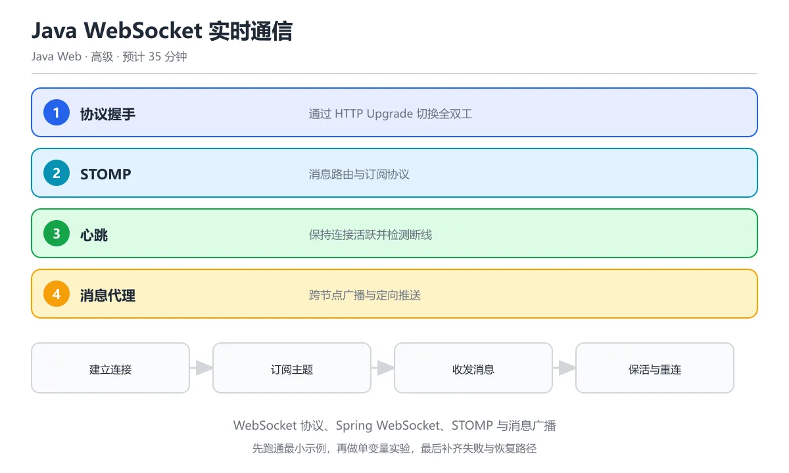

# Java WebSocket 实时通信

> 内容更新时间：2026-10-06 · 学习阶段：高级 · 预计用时：35 分钟




## 本节知识框架

### 学习目标
- 理解 WebSocket 协议与 HTTP 的区别
- 掌握 Spring WebSocket 服务端实现
- 学会使用 STOMP 协议进行消息路由
- 了解 WebSocket 在生产环境中的部署策略

### 前置知识
- Spring Boot 基础（javaweb_spring_boot）
- RESTful API 设计（javaweb_restful）
- HTTP 协议基础

### 复习清单
- [ ] HTTP 的无状态特性与长连接需求
- [ ] Spring Boot 自动配置原理
- [ ] REST 请求-响应模式的局限性

## 核心概念定义

| 术语 | 一句话说明 |
|------|-----------|
| WebSocket | 全双工通信协议，客户端和服务器可同时发送数据 |
| STOMP | 简单文本导向消息协议，为 WebSocket 提供消息路由框架 |
| 全双工 | 通信双方可以同时发送和接收数据 |
| 心跳机制 | 定期发送探测包以维持连接和检测连接状态 |
| 消息代理 | 接收、路由和分发消息的中间件（如 RabbitMQ、ActiveMQ） |

## 原理与运行机制

### 生活类比
把 WebSocket 想象成打电话：HTTP 像发短信（你发一条，对方回一条），WebSocket 像打电话（双方可以随时说话，不用等对方说完再发）。

STOMP 则像电话里的"转接分机"——你说"我要找 101 房间的人"，交换机就帮你把消息送到正确的地方。

### WebSocket 握手流程

```text
客户端                          服务器
  |                              |
  |-- HTTP Upgrade Request ----->|  (Sec-WebSocket-Key)
  |                              |
  |<-- 101 Switching Protocols --|  (Sec-WebSocket-Accept)
  |                              |
  |<==== 全双工 WebSocket 连接 ====>|
  |                              |
```

### Spring WebSocket 架构

```text
┌─────────────┐
│  客户端      │
│  (浏览器)    │
└──────┬──────┘
       │ WebSocket
       │ + STOMP
┌──────▼──────┐
│  Spring     │
│  WebSocket  │
│  Handler    │
└──────┬──────┘
       │
┌──────▼──────┐
│  消息代理    │
│  (内置/外部) │
└──────┬──────┘
       │
┌──────▼──────┐
│  订阅客户端  │
└─────────────┘
```

## 典型应用场景

### 实时聊天系统
- 在线客服、即时通讯
- 群聊消息广播
- 消息已读/未读状态同步

### 实时数据推送
- 股票行情、汇率变动
- 体育比分实时更新
- 服务器监控告警

### 协作编辑
- 多人文档协同编辑（如 Google Docs）
- 代码实时协作（如 VS Code Live Share）
- 白板绘图同步

### 在线游戏
- 多人实时对战
- 游戏状态同步
- 聊天室功能

## 代码/协议/SQL 示例

### 最小示例：Spring WebSocket 配置

```java
@Configuration
@EnableWebSocketMessageBroker
public class WebSocketConfig implements WebSocketMessageBrokerConfigurer {
    
    @Override
    public void configureMessageBroker(MessageBrokerRegistry config) {
        config.enableSimpleBroker("/topic", "/queue");
        config.setApplicationDestinationPrefixes("/app");
    }
    
    @Override
    public void registerStompEndpoints(StompEndpointRegistry registry) {
        registry.addEndpoint("/ws")
                .setAllowedOriginPatterns("*")
                .withSockJS();
    }
}
```

### 完整示例：消息控制器

```java
@Controller
public class ChatController {
    
    @MessageMapping("/chat.sendMessage")
    @SendTo("/topic/public")
    public ChatMessage sendMessage(@Payload ChatMessage chatMessage) {
        chatMessage.setTimestamp(LocalDateTime.now());
        return chatMessage;
    }
    
    @MessageMapping("/chat.addUser")
    @SendTo("/topic/public")
    public ChatMessage addUser(@Payload ChatMessage chatMessage,
                               SimpMessageHeaderAccessor headerAccessor) {
        headerAccessor.getSessionAttributes()
                      .put("username", chatMessage.getSender());
        chatMessage.setType(ChatMessage.MessageType.JOIN);
        chatMessage.setTimestamp(LocalDateTime.now());
        return chatMessage;
    }
}
```

### 客户端连接示例（JavaScript）

```javascript
const socket = new SockJS('/ws');
const stompClient = Stomp.over(socket);

stompClient.connect({}, function(frame) {
    // 订阅公共频道
    stompClient.subscribe('/topic/public', function(message) {
        const chatMessage = JSON.parse(message.body);
        displayMessage(chatMessage);
    });
    
    // 发送消息
    stompClient.send("/app/chat.sendMessage", {}, 
        JSON.stringify({sender: 'Alice', content: 'Hello!'}));
});
```

### 点对点消息（私聊）

```java
@MessageMapping("/chat.sendPrivateMessage")
public void sendPrivateMessage(@Payload ChatMessage chatMessage,
                                SimpMessageHeaderAccessor headerAccessor) {
    String receiverUsername = chatMessage.getReceiver();
    String senderUsername = (String) headerAccessor.getSessionAttributes()
                                                    .get("username");
    
    // 发送到特定用户的私有队列
    simpMessagingTemplate.convertAndSendToUser(
        receiverUsername,
        "/queue/messages",
        chatMessage
    );
}
```

### 心跳配置

```java
@Configuration
public class WebSocketConfig implements WebSocketMessageBrokerConfigurer {
    
    @Override
    public void configureWebSocketTransport(WebSocketTransportRegistry registry) {
        registry.setMessageSizeLimit(8192)
                .setSendTimeLimit(10 * 1000)
                .setSendBufferSizeLimit(512 * 1024);
    }
    
    @Override
    public void configureMessageBroker(MessageBrokerRegistry registry) {
        registry.enableSimpleBroker("/topic", "/queue")
                .setHeartbeatValue(new long[]{10000, 10000})
                .setTaskScheduler(new DefaultManagedTaskScheduler());
    }
}
```

## 时间/空间复杂度或性能分析

### 连接资源消耗
- **内存**：每个 WebSocket 连接约占用 2-5KB 内存
- **CPU**：空闲连接几乎不消耗 CPU，消息处理时按需使用
- **带宽**：帧头仅 2-14 字节，比 HTTP 请求头（数百字节）轻量得多

### 可扩展性考虑
- **单机连接数**：普通服务器可支撑 10 万+ 并发连接
- **水平扩展**：需要外部消息代理（Redis/RabbitMQ）实现跨节点消息广播
- **负载均衡**：使用 sticky session 确保同一客户端连接到同一服务器

### 性能优化建议
1. 启用消息压缩（permessage-deflate 扩展）
2. 合理设置心跳间隔（避免过频增加负载）
3. 使用连接池管理数据库访问
4. 对高频消息做节流/去抖处理

## 常见误区与易错点

| 错误 | 现象 | 修法 |
|------|------|------|
| 用 WebSocket 替代所有 HTTP | 页面加载也用 WS，增加复杂度 | 静态资源仍用 HTTP，仅实时数据用 WS |
| 忽略连接断开处理 | 用户离线后消息丢失 | 实现重连机制 + 消息持久化 |
| 未做消息大小限制 | 大消息导致 OOM | 配置 `setMessageSizeLimit()` |
| 心跳缺失 | 代理/防火墙断开空闲连接 | 启用 STOMP 心跳（10-30 秒间隔） |
| 跨域未配置 | 前端连接被拒绝 | `setAllowedOriginPatterns("*")` 或指定域名 |

## 与其他知识点的关系

### 直接相关
- **javaweb_spring_boot**：WebSocket 基于 Spring Boot 自动配置
- **javaweb_restful**：REST 用于 CRUD，WebSocket 用于实时推送，互补使用
- **javaweb_spring_security**：WebSocket 连接需要身份认证和权限控制

### 间接相关
- **network**：理解 TCP/IP、HTTP 协议基础
- **distributed**：分布式系统中 WebSocket 的会话粘性
- **devops**：WebSocket 服务的部署和监控

## 自测题与参考答案

### 题目 1
WebSocket 协议与 HTTP 的主要区别是什么？
- A. WebSocket 是单向通信
- B. WebSocket 支持全双工通信
- C. WebSocket 不使用 TCP
- D. WebSocket 只能发送文本

**答案**：B  
**解析**：WebSocket 是全双工协议，客户端和服务器可同时发送数据。HTTP 是请求-响应模式，客户端发起请求，服务器返回响应。

### 题目 2
STOMP 协议在 WebSocket 中的作用是什么？
- A. 加密数据传输
- B. 提供消息路由和订阅机制
- C. 压缩消息内容
- D. 管理连接池

**答案**：B  
**解析**：STOMP（Simple Text Oriented Messaging Protocol）为 WebSocket 提供消息路由框架，支持订阅/发布模式，让消息能发送到指定的主题或队列。

### 题目 3
为什么需要配置 WebSocket 心跳？
- A. 提高传输速度
- B. 防止代理/防火墙断开空闲连接
- C. 加密通信内容
- D. 压缩数据帧

**答案**：B  
**解析**：许多代理服务器和防火墙会断开长时间无数据传输的连接。心跳机制定期发送探测包，保持连接活跃。

## 考点精讲

### 考点 1

WebSocket 协议与 HTTP 的主要区别是什么？

A. WebSocket 是单向通信

B. WebSocket 不使用 TCP

C. WebSocket 支持全双工通信，双方可同时发送数据

D. WebSocket 只能发送文本

**正确答案：C**

**详细解释**：WebSocket 是全双工协议，建立连接后客户端和服务器可随时互发消息，无需反复建立连接。 HTTP 每次请求都要携带完整头部，而 WebSocket 建立一次连接后帧头只有几个字节，因此高频实时消息的传输开销更小。 握手阶段仍然复用 HTTP 的 Upgrade 机制，通过 101 状态码切换协议，因此鉴权通常放在握手请求的 Cookie 或 token 里。

---

### 考点 2

STOMP 协议在 WebSocket 中的作用是什么？

A. 加密数据传输

B. 提供消息路由和订阅机制（主题/队列）

C. 压缩消息内容

D. 管理连接池

**正确答案：B**

**详细解释**：STOMP 为 WebSocket 提供消息路由框架，支持 /topic（广播）和 /queue（点对点）两种消息模式。 如果不使用 STOMP，开发者需要自己设计消息格式和路由规则，STOMP 把这些约定标准化，Spring 也内置了对应的消息代理支持。

---

### 考点 3

为什么需要配置 WebSocket 心跳？

A. 提高传输速度

B. 防止代理/防火墙断开空闲连接

C. 加密通信内容

D. 压缩数据帧

**正确答案：B**

**详细解释**：许多代理和防火墙会断开长时间无数据传输的连接，心跳定期发送探测包保持连接活跃。 浏览器端 WebSocket API 本身不带心跳，通常由应用层定时发送 ping 帧或业务心跳消息，并在超时后主动重连。 心跳间隔要小于中间设备的空闲超时，常见取值是 30 秒左右，同时服务端要清理超时未响应的会话，防止连接泄漏。

---

### 考点 4

Spring WebSocket 中 @MessageMapping 注解的作用是什么？

A. 定义 REST 端点

B. 将客户端消息路由到对应的处理方法

C. 配置数据库

D. 定义安全规则

**正确答案：B**

**详细解释**：@MessageMapping 类似 @RequestMapping，把客户端发送到特定目标地址的消息路由到对应的 Java 方法。 方法内部可以配合 @SendTo 指定广播目标，或用 SimpMessagingTemplate 向指定用户会话推送消息，灵活控制消息流向。

---

### 考点 5

WebSocket 连接数过多时的扩展策略是什么？

A. 增加单机内存

B. 使用外部消息代理（Redis/RabbitMQ）实现跨节点消息广播

C. 减少心跳

D. 禁用压缩

**正确答案：B**

**详细解释**：单机连接数有上限，通过外部消息代理让多个服务器实例共享消息，实现水平扩展。 除了消息代理，还要考虑把连接注册表放在 Redis 中，才能知道某个用户在哪个节点上，从而定向推送点对点消息。 跨节点广播要区分广播和定向两种需求，广播用订阅主题，定向推送则要按用户标识路由到目标节点所在的会话。


## 术语速查

| 术语 | 一句话说明 |
| --- | --- |
| WebSocket | 全双工通信协议，RFC 6455 标准 |
| STOMP | Simple Text Oriented Messaging Protocol，消息路由协议 |
| SockJS | WebSocket 降级方案，不支持 WS 时自动回退 |
| Topic | 广播频道，所有订阅者接收 |
| Queue | 私有队列，仅指定用户接收 |
| Heartbeat | 心跳包，维持连接活跃 |
| Payload | 消息体，实际传输的数据 |

## 参考资料与复核

### 参考资料
1. [RFC 6455 - The WebSocket Protocol](https://datatracker.ietf.org/doc/html/rfc6455)
2. [Spring WebSocket 文档](https://docs.spring.io/spring-framework/docs/current/reference/html/web.html#websocket)
3. [STOMP 协议规范](https://stomp.github.io/stomp-specification-1.2.html)

### 复核日期
- 内容创建：2026-10-26

- 最后复核：2026-10-04
- 下次复核：2027-10-10

## 内容元数据

- 内容版本：v2.0
- 最后更新：2026-10-06
- 学习阶段：进阶
- 适用环境：通用开发环境
- 内容来源：内置结构化课程与工程实践整理
- 相关主题：javaweb websocket
- 质量版本：P0 测验标准 + P1 覆盖扩展 + P2 体验补全