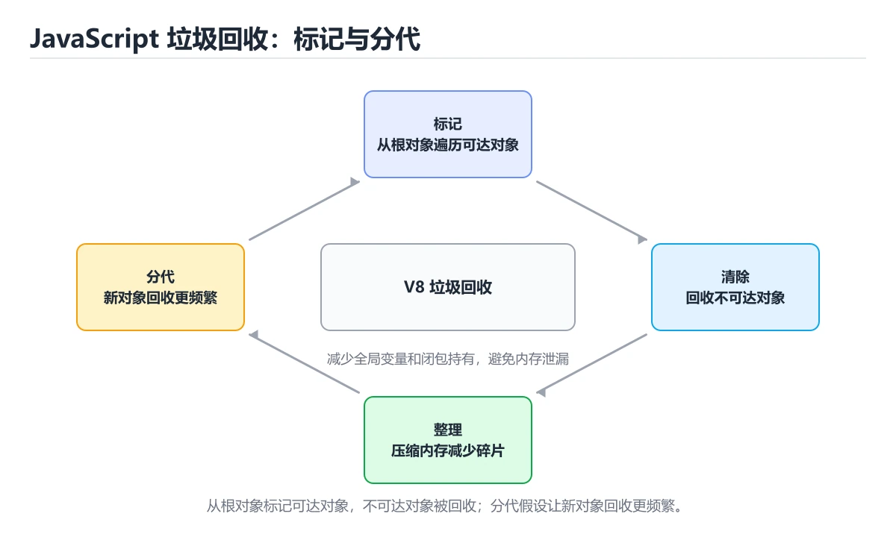
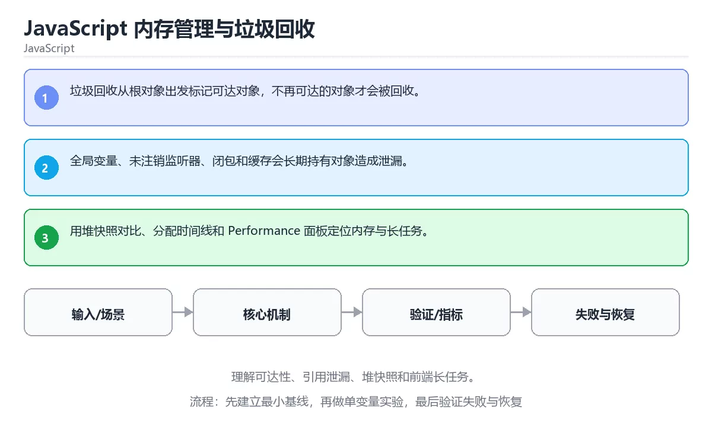

# JavaScript 内存管理与垃圾回收

> 内容更新时间：2026-10-06 · 学习阶段：高级 · 预计用时：30 分钟





## 本节知识框架

**课程定位**：所属分类 `javascript`（JavaScript），课程主题 `JavaScript 内存管理与垃圾回收`，学习阶段 高级，建议用时 45 分钟。

本课主线：理解可达性、引用泄漏、堆快照和前端长任务。

**学完本课应当能够**
- 说清 `内存` 与 `GC` 的含义与区别，并各举一个正例和一个反例。
- 用本课示例验证 `堆快照` 的行为，记录输入、输出与失败条件。
- 遇到「定时器与监听不清理」这类问题时，能说出触发条件与修复顺序。

### 复习清单

- [ ] 能用自己的话说明「JavaScript 内存管理与垃圾回收」里的 内存，再举一个它不成立的场景。
- [ ] 能跑通 内存 的最小示例，记录一组正常输出和一组失败输出。
- [ ] 能完成一次自测，并把错题对照错误表定位原因。

## 核心概念定义

| 术语 | 操作性定义 | 常见边界与风险 |
| --- | --- | --- |
| 内存 | 程序运行时保存指令、数据与对象的高速可寻址存储。 | 易错：对象无法回收，内存持续增长；正确做法是组件销毁时移除监听与定时器。 |
| GC | 垃圾回收，运行时自动回收不再可达的对象并管理内存。 | 易错：以为把引用置空对象就立刻回收；GC 只看可达性，未注销监听器、全局变量或闭包还握着它就仍可达。 |
| 堆快照 | 按“JavaScript 内存管理与垃圾回收”中 内存、GC、堆快照 的实践顺序，把四个步骤排成从准备到复盘的合理顺序。 | 易错：只拍一次快照就下结论；本课要求做快照前后对比并配合分配时间线，否则真实泄漏会被正常占用掩盖。 |
| 泄漏 | 资源、内存或敏感信息未被正确释放或被未授权方获取。 | 易错：真实泄漏被隐藏；正确做法是用内存快照对比定位泄漏对象。 |

## 原理与运行机制

### 机制总览

**教材衔接：核心知识**

### 1. 垃圾回收从根对象出发标记可达对象，不再可达的对象才会被回收。

- 关键做法：基线只保留 GC 必需的部分，其余条件一次加一个。
- 验证标准：GC 的异常路径有明确错误信息与恢复动作。

### 2. 全局变量、未注销监听器、闭包和缓存会长期持有对象造成泄漏。

把这条结论放回「JavaScript 内存管理与垃圾回收」的完整流程里展开：

- 正文依据：能用自己的话解释：全局变量、未注销监听器、闭包和缓存会长期持有对象造成泄漏。
- 落地检查：把「2. 全局变量、未注销监听器、闭包和缓存会长期持有对象造成泄漏。」改写成一条可执行的核对项，逐条验证输入、超时与失败路径。

### 3. 用堆快照对比、分配时间线和 Performance 面板定位内存与长任务。

把这条结论放回「JavaScript 内存管理与垃圾回收」的完整流程里展开：

- 正文依据：能用自己的话解释：用堆快照对比、分配时间线和 Performance 面板定位内存与长任务。
- 落地检查：把「3. 用堆快照对比、分配时间线和 Performance 面板定位内存与长任务。」改写成一条可执行的核对项，逐条验证输入、超时与失败路径。

**教材衔接：关键流程**

**教材衔接：实践路径**

**教材衔接：版本与时效**

- WeakSet 依赖的新 API 必须有降级路径，否则老环境直接报错。
- 升级前先用 WeakSet 建立基线：记录版本、命令和输出，升级后只比较这些可观察量。

## 典型应用场景

**教材衔接：深度拓展与实战**

这一节把「JavaScript 内存管理与垃圾回收」的判断依据、示例和反例整理成复习步骤。

### 工程检查表

- [ ] 能否用自己的话说明JavaScript 内存管理与垃圾回收解决什么问题，以及它不负责什么？
- [ ] 能否说明 内存 的正常输出，以及失败时留下的错误信息？
- [ ] 能否解释本课关键词在真实项目中的边界与取舍？
- [ ] 能否说明 GC 在新场景下需要补充什么前提？

### 最小验证场景

- 准备：保留 `text` 示例的原始输入，先记录 `JavaScript 内存管理与垃圾回收` 的基线输出和完整运行命令。
- 观察：先核对 调用了 `WeakSet()`，再改变一个与 `内存` 相关的条件。
- 判定：新结果与 `JavaScript 内存管理与垃圾回收` 的基线不同不等于错误；只有当差异破坏了 `内存` 的定义或错误表中的约束，才判定为失败。

### 选择与边界

- 使用 `内存` 时，程序运行时保存指令、数据与对象的高速可寻址存储；易错：对象无法回收，内存持续增长；正确做法是组件销毁时移除监听与定时器。
- 使用 `GC` 时，垃圾回收，运行时自动回收不再可达的对象并管理内存；越界、悬垂引用与释放顺序会破坏结论，必须在边界输入下复验。
- 使用 `堆快照` 时，按“JavaScript 内存管理与垃圾回收”中 内存、GC、堆快照 的实践顺序，把四个步骤排成从准备到复盘的合理顺序；越界、悬垂引用与释放顺序会破坏结论，必须在边界输入下复验。
- 使用 `泄漏` 时，资源、内存或敏感信息未被正确释放或被未授权方获取；易错：真实泄漏被隐藏；正确做法是用内存快照对比定位泄漏对象。

## 代码/协议/SQL 示例

### 最小可验证示例

**教材衔接：最小可运行示例**

先用 WeakSet 跑通最小示例，然后只改一个与 内存 相关的取值：

```javascript
const tracked = new WeakSet();
let node = { id: 1 };
tracked.add(node);
console.log("tracked:", tracked.has(node));
node = null;
console.log("after release:", tracked.has(node));
```

**教材衔接：预期输出**

```text
tracked: true
after release: false
```

### 完整示例：把「标记-清除」跑一遍

可达性是 GC 的判定核心，也正是本课排错题的落点。下面这段不依赖真实回收时机，用一个引用图模拟标记阶段：从根出发能走到的对象保留，走不到的才谈得上被清除。

```javascript
function sweep(roots, refs) {
  const seen = new Set();
  const stack = [...roots];
  while (stack.length) {
    const id = stack.pop();
    if (seen.has(id)) continue;
    seen.add(id);
    for (const next of refs[id] || []) stack.push(next);
  }
  const collectable = Object.keys(refs).filter((id) => !seen.has(id));
  return { retained: [...seen].sort(), collectable: collectable.sort() };
}

const refs = { A: ["B"], B: ["C"], C: [], D: ["E"], E: [] };
console.log(sweep(["A"], refs));
```

```text
{ retained: [ 'A', 'B', 'C' ], collectable: [ 'D', 'E' ] }
```

`D→E` 这串没挂在根上，所以整体判为可清除。动手练一练：把调用改成 `sweep(["A", "D"], refs)`，`collectable` 立刻变空数组——根多一个，能救回来的就是整条链。这也说明只要还剩一根引用连到根，对象就不会被回收：缓存拿对象当键时，换成 WeakMap 才不会把键钉死。

## 时间/空间复杂度或性能分析

**性能关注点（JavaScript 内存管理与垃圾回收）**：事件循环与 DOM 操作是瓶颈来源：记录脚本执行时间、长任务与主线程阻塞时长。

**本课特有开销（JavaScript 内存管理与垃圾回收 · 内存）**：缓存命中率比缓存实现本身更关键，先记录命中率与失效策略再谈优化。

**测量方法**：以 `JavaScript 内存管理与垃圾回收` 的 `内存` 场景为对象，固定输入跑一遍记录基线，再把规模或并发度提高一个数量级复测；两次结果的差值与波动范围才是结论依据。

## 常见误区与易错点

| 容易写错的做法 | 实际现象 | 原因与正确做法 |
| --- | --- | --- |
| 定时器与监听不清理 | 对象无法回收，内存持续增长。 | 组件销毁时移除监听与定时器。 |
| 闭包长期持有大对象 | 内存无法释放。 | 缩小闭包捕获范围，只保留必要数据。 |
| 靠手动触发回收掩盖问题 | 真实泄漏被隐藏。 | 用内存快照对比定位泄漏对象。 |

### 现场 1：定时器与监听不清理

**症状**：对象无法回收，内存持续增长。

**根因与修复**：组件销毁时移除监听与定时器。

**自检**：在本课示例里复现「定时器与监听不清理」，改成组件销毁时移除监听与定时器后重跑；如果症状消失且失败路径按预期变化，说明定位正确。

### 现场 2：闭包长期持有大对象

**症状**：内存无法释放。

**根因与修复**：缩小闭包捕获范围，只保留必要数据。

**自检**：在本课示例里复现「闭包长期持有大对象」，改成缩小闭包捕获范围，只保留必要数据后重跑；如果症状消失且失败路径按预期变化，说明定位正确。

### 现场 3：靠手动触发回收掩盖问题

**症状**：真实泄漏被隐藏。

**根因与修复**：用内存快照对比定位泄漏对象。

**自检**：在本课示例里复现「靠手动触发回收掩盖问题」，改成用内存快照对比定位泄漏对象后重跑；如果症状消失且失败路径按预期变化，说明定位正确。

## 与其他知识点的关系

**教材衔接：复习与迁移**

内存这条线几乎处处和别的 JS 知识勾在一起。可达性判定的根里就包含调用栈上的局部变量和全局对象，所以闭包与词法作用域那节课直接决定你能不能看住引用——闭包留住了外层变量，等于给那个对象多挂了一根通往根的线。前端长任务接在事件循环上：一个同步大循环跑超过 50 毫秒，GC 再勤快也救不回卡顿。真排查时靠的是 DevTools 的 Memory 面板拍堆快照、用 Allocation instrumentation 看分配时间线，再配 Performance 面板定位长任务，这套工具链才是本课结论落地的地方。

## 自测题与参考答案

> 先独立作答，再对照参考答案；答案都能在本课正文、术语表或错误表里找到依据。

### 自测 1（概念复述）

不看正文，写出 `内存` 的操作性定义，并说明它与 `GC` 的区别。

**参考答案**：程序运行时保存指令、数据与对象的高速可寻址存储。

`GC` 的定位是：垃圾回收，运行时自动回收不再可达的对象并管理内存；两者的差别要从适用对象与失败模式上说明。

### 自测 2（排错）

本课错误表记录了「定时器与监听不清理」这类做法。请写出它会出现的现象、根因，以及修复顺序。

**参考答案**：现象是对象无法回收，内存持续增长；正确做法是组件销毁时移除监听与定时器。修复时先复现现象并保留证据，再改动一处假设重跑，确认现象消失。

### 自测 3（动手验证）

运行本课的 `text` 示例，改动一个与 内存 有关的输入后重跑，记录输出与错误信息。

**参考答案**：正常输入下 `text` 示例应当复现正文给出的结果；改动输入后，如果结果改变或报错，先核对它是否满足 `JavaScript 内存管理与垃圾回收` 中`内存` 的适用范围，再检查错误表里是否有同类现象。

### 自测 4（代码阅读）

阅读本课开头的 `text` 示例，说明它体现了`内存` 的哪一条性质，并指出改动哪个输入会让这条性质不再成立。

**参考答案**：`内存` 的定义是 程序运行时保存指令、数据与对象的高速可寻址存储，示例正是在实现这条定义。改动与 `内存` 有关的一个输入后，如果结果不再符合 `JavaScript 内存管理与垃圾回收` 的正文描述，就说明该性质只在当前前提成立。

### 自测 5（迁移）

把 `JavaScript 内存管理与垃圾回收` 的方法迁移到自己的项目：围绕 `内存` 写出一个与错误表同类的风险点，并说明触发条件和检验方式。

**参考答案**：例如「靠手动触发回收掩盖问题」，它会导致真实泄漏被隐藏；检验方式是按用内存快照对比定位泄漏对象改一处再复现，确认现象消失且没有引入新的失败分支。

### 自测 6（对比）

用一个表格对比 `内存` 与 `GC`：各写一行适用场景、一行失败表现。

**参考答案**：`内存` 的定义是程序运行时保存指令、数据与对象的高速可寻址存储；`GC` 的定义是垃圾回收，运行时自动回收不再可达的对象并管理内存。两者的失败表现分别对应本课错误表里与本术语相关的行。

### 自测 7（排错顺序）

面对「定时器与监听不清理」引发的问题，请把“复现 对象无法回收，内存持续增长 → 保留证据 → 组件销毁时移除监听与定时器 → 回归验证”四步写成可执行的检查清单。

**参考答案**：第一步按对象无法回收，内存持续增长复现；第二步记录输入、版本与完整报错；第三步按组件销毁时移除监听与定时器只改一处；第四步重跑并确认失败路径也按预期变化。

### 自测 8（边界判断）

针对 `泄漏`，分别写出“可以使用”的条件和“结论不再成立”的条件。

**参考答案**：易错：真实泄漏被隐藏；正确做法是用内存快照对比定位泄漏对象。 同时要把 `泄漏` 的定义 资源、内存或敏感信息未被正确释放或被未授权方获取 与实际输入逐项对照。

### 自测 9（机制重建）

不看正文，按输入、转换、输出、验证四段重建 `内存` → `GC` → `堆快照` → `泄漏` 的作用链。

**参考答案**：起点是 `内存` 的定义 程序运行时保存指令、数据与对象的高速可寻址存储；中间每一步都保留可观察状态；终点由 `泄漏` 检查，失败时回到错误表定位第一个偏离定义的步骤。

### 自测 10（综合排错）

在 `JavaScript 内存管理与垃圾回收` 中，现象是 真实泄漏被隐藏。请围绕 靠手动触发回收掩盖问题 写出最小复现、关键证据、修复动作和回归验证，并说明为什么不能只凭一次运行下结论。

**参考答案**：先复现 靠手动触发回收掩盖问题，记录输入与完整错误；再按 用内存快照对比定位泄漏对象 只改一处。回归时同时跑正常路径和边界路径，只有两次结果都可解释，才把修复视为完成。

### 自测 11（一分钟复述）

用每分钟约 200 字的速度复述 `JavaScript 内存管理与垃圾回收`：先给主问题，再按顺序说出 `内存`、`GC`、`堆快照`、`泄漏`，最后给一个失败案例。

**自评标准**：主问题必须对应 理解可达性、引用泄漏、堆快照和前端长任务；每个术语都要能接上一句定义或边界；失败案例必须写成可观察现象，不能用“可能有风险”代替证据。

## 延伸阅读

想更直观地理解本课概念？推荐参阅以下图解专题：

- [图解内存布局：栈、堆与引用](visual_memory_layout.md)
- [图解 JVM 内存模型与垃圾回收](visual_jvm_memory.md)

## 术语速查

| 术语 | 一句话说明 |
| --- | --- |
| `内存` | 程序运行时保存指令、数据与对象的高速可寻址存储。 |
| `GC` | 垃圾回收，运行时自动回收不再可达的对象并管理内存。 |
| `堆快照` | 按“JavaScript 内存管理与垃圾回收”中 内存、GC、堆快照 的实践顺序，把四个步骤排成从准备到复盘的合理顺序。 |
| `泄漏` | 资源、内存或敏感信息未被正确释放或被未授权方获取。 |
| `可达性` | 从根对象出发沿引用能不能走到；走不到就视为垃圾。 |
| `标记-清除` | GC 先从根标记所有可达对象，再清除没被标记到的对象。 |
| `分代回收` | 按对象存活时长分代，年轻代回收更频繁、老年代回收较少。 |

**术语关系**：`内存`（程序运行时保存指令、数据与对象的高速可寻址存储） → `GC`（垃圾回收） → `堆快照`（按“JavaScript 内存管理与垃圾回收”中 内存、GC、堆快照 的实践顺序） → `泄漏`（资源、内存或敏感信息未被正确释放或被未授权方获取）。

## 考点精讲

`JavaScript 内存管理与垃圾回收` 的题库有 6 道题，下面逐题给出题干、正确项与判断依据：先自己作答，再核对正确项，最后回到正文对应小节复核。

### 考点 1：第 1 题

- **题目**：按“JavaScript 内存管理与垃圾回收”中 内存、GC、堆快照 的实践顺序，把四个步骤排成从准备到复盘的合理顺序。
- **正确项**：先明确 内存 的输入、输出与约束 → 写出最小示例并核对 GC 的基线结果 → 只改一个变量，记录边界与失败路径的变化 → 固定版本与证据，把“JavaScript 内存管理与垃圾回收”的结论写成可复现记录
- **判断依据**：按《JavaScript 内存管理与垃圾回收》正文的先后，本题顺序是「先明确 内存 的输入、输出与约束」 → 「写出最小示例并核对 GC 的基线结果」 → 「只改一个变量，记录边界与失败路径的变化」 → 「固定版本与证据，把“JavaScript 内存管理与垃圾回收”的结论写成可复现记录」。术语 内存（JavaScript 内存管理与垃圾回收）：程序运行时保存指令、数据与对象的高速可寻址存储。易错点是定时器与监听不清理会造成对象无法回收，内存持续增长，改法是组件销毁时移除监听与定时器。

### 考点 2：第 2 题

- **题目**：在 `JavaScript 内存管理与垃圾回收` 里，与 `内存` 有关的说法中，哪一项最符合理解可达性、引用泄漏、堆快照和前端长任务？
- **正确项**：全局变量、未注销监听器、闭包和缓存会长期持有对象造成泄漏。
- **判断依据**：本题正确项是「全局变量、未注销监听器、闭包和缓存会长期持有对象造成泄漏」。术语 内存（JavaScript 内存管理与垃圾回收）：程序运行时保存指令、数据与对象的高速可寻址存储，本题取「全局变量、未注销监听器、闭包和缓存会长期持有对象造成泄漏」这条。易错点是闭包长期持有大对象，会造成内存无法释放，改法是缩小闭包捕获范围，只保留必要数据。

### 考点 3：第 3 题

- **题目**：在 `JavaScript 内存管理与垃圾回收` 里，与 `内存` 有关的说法中，哪一项最符合理解可达性、引用泄漏、堆快照和前端长任务？（JavaScript 内存管理与垃圾回收·JavaScript 第 3 题）
- **正确项**：用堆快照对比、分配时间线和 Performance 面板定位内存与长任务。
- **判断依据**：本题正确项是「用堆快照对比、分配时间线和 Performance 面板定位内存与长任务」。术语 内存（JavaScript 内存管理与垃圾回收）：程序运行时保存指令、数据与对象的高速可寻址存储，本题取「用堆快照对比、分配时间线和 Performance 面板定位内存与长任务」这条。易错点是靠手动触发回收掩盖问题，会造成真实泄漏被隐藏，改法是用内存快照对比定位泄漏对象。

### 考点 4：第 4 题

- **题目**：`JavaScript 内存管理与垃圾回收` 的主线是：理解可达性、引用泄漏、堆快照和前端长任务。下面哪一项与这条主线一致？
- **正确项**：理解可达性、引用泄漏、堆快照和前端长任务。
- **判断依据**：本题正确项是「理解可达性、引用泄漏、堆快照和前端长任务」。术语 内存（JavaScript 内存管理与垃圾回收）：程序运行时保存指令、数据与对象的高速可寻址存储，本题取「理解可达性、引用泄漏、堆快照和前端长任务」这条。易错点是定时器与监听不清理，会造成对象无法回收，内存持续增长，改法是组件销毁时移除监听与定时器。

### 考点 5：第 5 题

- **题目**：课程 `理解可达性、引用泄漏、堆快照和前端长任务。`。在 `JavaScript 内存管理与垃圾回收` 里，`内存`、`GC` 与下面哪些选项属于同一层概念？（多选）
- **正确项**：内存；GC
- **判断依据**：按《JavaScript 内存管理与垃圾回收》的正文口径，本题要同时选中「内存」、「GC」，漏掉任一项都算没答全。术语 内存（JavaScript 内存管理与垃圾回收）：程序运行时保存指令、数据与对象的高速可寻址存储。易错点是定时器与监听不清理会造成对象无法回收，内存持续增长，改法是组件销毁时移除监听与定时器。本课《JavaScript 内存管理与垃圾回收》要解决的是理解可达性、引用泄漏、堆快照和前端长任务。

### 考点 6：第 6 题

- **题目**：`JavaScript 内存管理与垃圾回收` 的示例代码服务于“理解可达性、引用泄漏、堆快照和前端长任务。”哪一条判断是正确的？
- **正确项**：垃圾回收从根对象出发标记可达对象，不再可达的对象才会被回收。
- **判断依据**：按《JavaScript 内存管理与垃圾回收》的正文口径，本题正确项是「垃圾回收从根对象出发标记可达对象，不再可达的对象才会被回收。」。术语「内存」在本课里的界定是程序运行时保存指令、数据与对象的高速可寻址存储，题干「`JavaScript 内存管理与垃圾回收` 的示例代码服务于理解可达性、引用泄漏、堆快照和前端长任务。哪一条判断是正确的？」问的就是这一条。常见错法是定时器与监听不清理，其后果是对象无法回收，内存持续增长。正确做法是组件销毁时移除监听与定时器。干扰项「函数执行时创建词法环境和变量环境，闭包保留对外层变量的引用。」与题干「`JavaScript 内存管理与垃圾回收` 的示例代码服务于理解可达性、引用泄漏、堆快照和前端长任务。哪一条判断是正确的？」的要求对不上，应排除。

### 考点 7：`内存`

- **要点**：程序运行时保存指令、数据与对象的高速可寻址存储。
- **内存 的边界**：易错：对象无法回收，内存持续增长；正确做法是组件销毁时移除监听与定时器。

### 考点 8：`GC`

- **要点**：垃圾回收，运行时自动回收不再可达的对象并管理内存。
- **GC 的边界**：越界、悬垂引用与释放顺序会破坏结论，必须在边界输入下复验。

### 考点 9：`堆快照`

- **要点**：按“JavaScript 内存管理与垃圾回收”中 内存、GC、堆快照 的实践顺序，把四个步骤排成从准备到复盘的合理顺序。
- **堆快照 的边界**：越界、悬垂引用与释放顺序会破坏结论，必须在边界输入下复验。

### 考点 10：`泄漏`

- **要点**：资源、内存或敏感信息未被正确释放或被未授权方获取。
- **泄漏 的边界**：易错：真实泄漏被隐藏；正确做法是用内存快照对比定位泄漏对象。

### 考点 11：排错——定时器与监听不清理

- **现象**：对象无法回收，内存持续增长。
- **处理**：组件销毁时移除监听与定时器。

### 考点 12：排错——闭包长期持有大对象

- **现象**：内存无法释放。
- **处理**：缩小闭包捕获范围，只保留必要数据。

### 考点 13：综合辨析——`内存` 与 `泄漏`

- **辨析点**：`内存` 的定义是 程序运行时保存指令、数据与对象的高速可寻址存储；`泄漏` 的定义是 资源、内存或敏感信息未被正确释放或被未授权方获取。
- **答题要求**：面对 `JavaScript 内存管理与垃圾回收` 的题目，先判断描述的是 `内存` 还是 `泄漏`，再归到对应定义，最后写出一个会让该定义失效的边界输入。

### 考点 14：排错评分点

- **现象分**：能写出 对象无法回收，内存持续增长，而不是只写“程序有错”。
- **证据分**：保留触发 定时器与监听不清理 的输入、版本和错误原文。
- **修复分**：按 组件销毁时移除监听与定时器 只改一处，并同时回归正常路径与边界路径。

## 内容元数据

- 内容版本：v2.0
- 最后更新：2026-10-06
- 学习阶段：高级
- 适用环境：Node.js 22+ / 现代浏览器；本课聚焦 内存。
- 内容来源：内置结构化课程与工程实践整理
- 相关主题：内存、GC、堆快照、泄漏
- 质量版本：P0 测验标准 + P1 覆盖扩展 + P2 体验补全

## 参考资料与复核

- 最后复核：2026-10-04
- 下次复核：2027-05-17
- 复核范围：版本兼容、API 行为、安全建议与工程实践
- 来源性质：官方文档、标准或权威教材；本课核对关键词：内存、GC、堆快照、泄漏。

| 参考资料 | 本课用途 |
| --- | --- |
| [MDN JavaScript 指南](https://developer.mozilla.org/docs/Web/JavaScript/Guide) | 语言基础与浏览器 API |
| [Jest 文档](https://jestjs.io/docs/getting-started) | JavaScript 测试与断言 |
| [Node.js 文档](https://nodejs.org/docs/latest/api/) | 服务端运行时与模块 |

| [本课术语索引：JavaScript 内存管理与垃圾回收](#核心概念定义) | 按本课输入、术语边界和错误表现逐项核对 |
> 「JavaScript 内存管理与垃圾回收」的链接用于离线阅读后的延伸核对；App 不会自动联网。