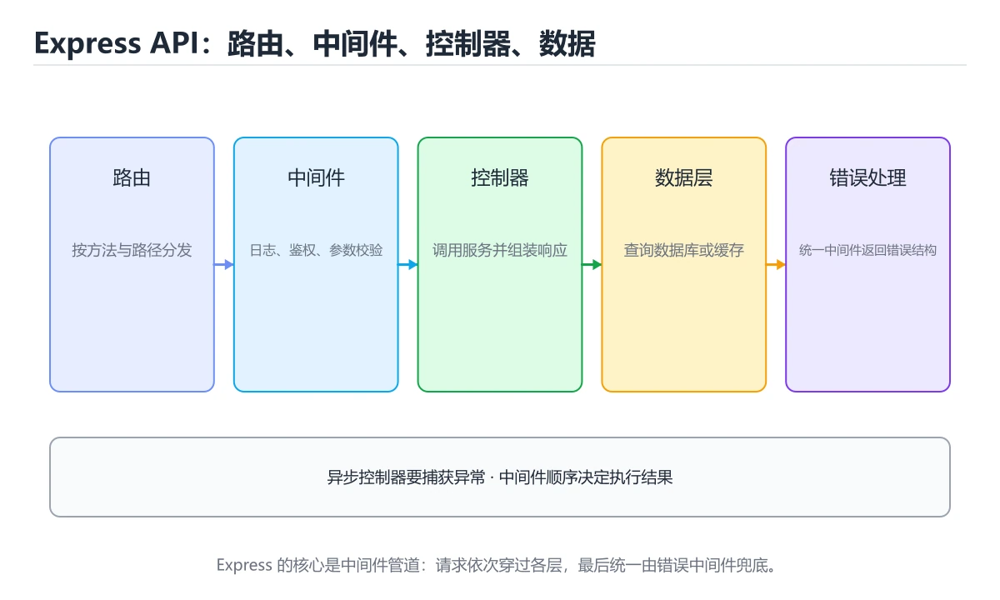
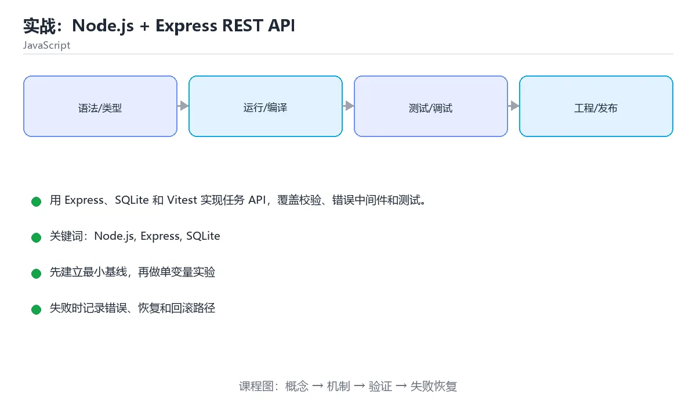

# 实战：Node.js + Express REST API





> 内容更新时间：2026-10-06 · 学习阶段：高级 · 预计用时：60 分钟

## 本节知识框架

**课程定位**：所属分类 `javascript`（JavaScript），课程主题 `实战：Node.js + Express REST API`，学习阶段 高级，建议用时 70 分钟。

本课主线：用 Express、SQLite 和 Vitest 实现任务 API，覆盖校验、错误中间件和测试。

**学完本课应当能够**
- 说清 `Node.js` 与 `参数化查询` 的含义与区别，并各举一个正例和一个反例。
- 用本课示例验证 `请求校验` 的行为，记录输入、输出与失败条件。
- 遇到「把业务逻辑写进路由」这类问题时，能说出触发条件与修复顺序。

### 复习清单

- [ ] 能不看正文复述本课核心术语，并指出一个边界或反例。
- [ ] 能运行或推演本课示例，记录输入、输出与失败现象。
- [ ] 能完成一次自测，并把错题对照错误表定位原因。

## 核心概念定义

| 术语 | 操作性定义 | 常见边界与风险 |
| --- | --- | --- |
| Node.js | 基于 V8 的服务端 JavaScript 运行时：单线程事件循环加异步 IO，适合 IO 密集型服务。 | 共享状态与调度顺序会改变结论，单线程或串行测试通过不等于并发下成立。 |
| 参数化查询 | 用占位符绑定参数而不是拼接 SQL 字符串，从根上杜绝注入。 | 易错：脏数据和注入风险；正确做法是使用校验和参数化查询。 |
| 请求校验 | 在入口用 schema 校验外部输入并收窄类型，编译期类型保护不了网络数据。 | 网络延迟、超时与版本协商会改变行为，只在真实链路或多版本客户端上验证才算数。 |
| 错误中间件 | 集中把异常转成统一错误响应，避免每个路由各写一套。 | 易错：调用方处理困难；正确做法是集中错误中间件和错误码。 |
| 可观测性 | 由日志、指标与链路追踪组成，能在不重启、不改代码的前提下问出新问题 | 只在「由日志、指标与链路追踪组成，能在不重启、不改代码的前提下问出新问题」这一前提下成立，换输入或换环境要重新验证。 |

## 原理与运行机制

### 机制总览

**教材衔接：技术栈**

- Node.js 22
- Express
- better-sqlite3
- Zod
- Vitest
- supertest

**教材衔接：架构与数据流**

- 读路径要明确 Node.js 的查询条件、分页方式和返回字段，避免一次加载全部数据。
- CreateTask 的写入要以幂等键为准，失败后能补偿或安全重试。
- 外部调用要设置超时、重试上限和降级策略。
- 每个关键阶段都要留下日志、指标或测试证据。

**教材衔接：功能范围**

- [ ] 创建任务并返回 201
- [ ] 按状态和负责人过滤
- [ ] 更新任务状态
- [ ] 删除任务并处理不存在情况

**教材衔接：实施步骤**

### 步骤 1：建立路由、服务和仓储目录

- 把 Express 这一步的依赖与交付物写成两行清单，再开始实现。
- 验证方法：用最小请求或单元测试证明 Node.js 这一步的结果正确。
- 为 CreateTask 定义失败分类与重试上限，超出后走人工处理。
- 证据留存：保留命令、输出、日志或截图，方便评审与复盘。

### 步骤 2：定义 Zod 请求模型

- 定位：这一节说明步骤 2：定义 Zod 请求模型在「实战：Node.js + Express REST API」知识体系里的位置。
- 要点：本课涉及：Node.js、Express、SQLite、REST、Vitest。
- 自检：能否用一个最小例子解释步骤 2：定义 Zod 请求模型？

### 步骤 3：实现 SQLite 表与参数化查询

- 定位：这一节说明步骤 3：实现 SQLite 表与参数化查询在「实战：Node.js + Express REST API」知识体系里的位置。
- 要点：一句话摘要：用 Express、SQLite 和 Vitest 实现任务 API，覆盖校验、错误中间件和测试。
- 自检：能否用一个最小例子解释步骤 3：实现 SQLite 表与参数化查询？

### 步骤 4：加入统一错误中间件

- 定位：这一节说明步骤 4：加入统一错误中间件在「实战：Node.js + Express REST API」知识体系里的位置。
- 检查点：用空值、极值和依赖失败各跑一次《实战：Node.js + Express REST API》，确认边界行为与正文一致。
- 自检：能否用一个最小例子解释步骤 4：加入统一错误中间件？

### 步骤 5：用 supertest 写接口测试

- 定位：这一节说明步骤 5：用 supertest 写接口测试在「实战：Node.js + Express REST API」知识体系里的位置。
- 检查点：用空值、极值和依赖失败各跑一次《实战：Node.js + Express REST API》，确认边界行为与正文一致。
- 自检：能否用一个最小例子解释步骤 5：用 supertest 写接口测试？

### 步骤 6：补分页、排序和健康检查

- 定位：这一节说明步骤 6：补分页、排序和健康检查在「实战：Node.js + Express REST API」知识体系里的位置。
- 检查点：在《实战：Node.js + Express REST API》中用最小输入复现问题，逐项核对版本、边界和失败路径后再修改。
- 自检：能否用一个最小例子解释步骤 6：补分页、排序和健康检查？

**教材衔接：建议目录结构**

**教材衔接：质量门禁**

- [ ] 格式化和静态检查通过，不遗留明显警告。
- [ ] 测试分层：核心规则用单元测试，Express 的边界用集成测试。
- [ ] 错误响应不泄露堆栈、SQL 和密钥。
- [ ] 配置来自环境变量或配置文件，不硬编码敏感信息。
- [ ] README 写清启动、测试、配置和回滚步骤。

**教材衔接：安全、成本与可观测性**

- 权限遵循最小授权：Node.js 用到的数据库账号、云资源和令牌都不能使用管理员默认权限。
- 所有进入 Node.js 的外部输入都要校验、限长并转义，错误信息不能泄露内部路径。
- 密钥通过环境变量或密钥管理服务注入，并记录轮换方式。
- 给 Express 的资源使用设定配额，超出后降级而不是拖垮整个进程。
- 至少记录 Node.js 的请求量、错误率、P95/P99 延迟与资源使用趋势。
- 为 CreateTask 的失败留下可检索的日志字段，能按请求定位到具体环节。

**教材衔接：扩展任务**

- 加入 JWT 认证和用户隔离
- 用 OpenAPI 生成接口文档
- 加入速率限制和审计日志

**教材衔接：实施记录与复盘**

每完成一步，记录以下内容：

1. 本步的输入、命令和输出是什么？
2. 遇到的最小失败是什么，如何定位和修复？
3. 哪个假设被验证或推翻？
4. 下一步的风险是什么，如何回滚？
5. 规模扩大 10 倍后，Express 会先成为瓶颈还是先暴露一致性风险？

**教材衔接：完成标准**

- [ ] 能从干净环境按 README 启动项目。
- [ ] 为 CreateTask 补三条测试：正常、边界、失败各一条。
- [ ] 能演示一次错误、一次恢复和一次回滚。
- [ ] 有一份资源或性能基线，能说明瓶颈在哪里。
- [ ] 能说清一个尚未解决的问题和下一步验证方法。

**教材衔接：版本与时效**

- 运行时要同时考虑浏览器基线与 Node LTS；Node.js 的降级策略要写清楚。
- 升级「实战：Node.js + Express REST API」涉及的依赖前，先用 CreateTask 复现当前行为，再逐项核对版本说明与破坏性变更。

### 二、需要写下来的决策（ADR）

| 决策点 | 本课给出的做法 | 备选方案 | 代价与回滚 |
| --- | --- | --- | --- |
| 步骤 2：定义 Zod 请求模型 | 「实战：Node.js + Express REST API」的「步骤 2：定义 Zod 请求模型」一节补全如下： | 不做「步骤 2：定义 Zod 请求模型」，沿用最朴素的实现（需要额外补一次对照实验） | 若「步骤 2：定义 Zod 请求模型」出问题，回到上一版本并按本课验收场景重跑 |
| 架构与数据流 | 用户/输入 → 接口或命令 → 领域逻辑 → 存储/外部依赖 → 输出与监控 | 不做「架构与数据流」，沿用最朴素的实现（需要额外补一次对照实验） | 若「架构与数据流」出问题，回到上一版本并按本课验收场景重跑 |

### 四、「实战：Node.js + Express REST API」的验收指标

| 指标 | 目标值 | 测量方式 | 不达标时的动作 |
| --- | --- | --- | --- |
| 请求量、错误率与尾延迟趋势 | 本课未定绝对毫秒数：首轮记下请求量、错误率和 P95、P99 延迟作基线，后续迭代不得劣于这条线 | 固定同一份任务数据集逐步加压 Express 路由，同时观察进程的资源使用趋势 | P99 上抬而吞吐不动，先查事件循环是否被同步代码或大 JSON 序列化堵住，再看数据库连接 |
| CreateTask 的写入幂等 | 同一幂等键重复提交只落一条任务，失败能补偿或安全重试 | supertest 并发重放两次创建请求，核对仓储条数与可检索的日志字段 | 落库出现两条就说明幂等键没进唯一约束，先修写入路径再重测 |
| 任务表与日志体积 | 记下 better-sqlite3 文件与索引字节数，扩到 10 倍任务量后按状态和负责人过滤仍可用 | 反复翻到末页，同时看磁盘占用、连接占用与写等待先在哪一项见顶 | 容量先在磁盘或写锁上顶住就收窄返回字段与分页大小，再考虑归档已完成的老任务 |
| 输入校验的失败面 | 缺少 title 一律返回 422 并给出字段错误，错误响应不含堆栈、SQL 和密钥 | 用 Zod 模型逐条投空值、超长字符串和非法枚举 | 变成 500 或泄露内部路径时，把校验前置到路由入口，别在各层塞 try catch 兜住 |
| 分页顺序与测试覆盖 | 分页返回稳定顺序且不重复，CreateTask 的正常、边界、失败三条测试全绿 | Vitest 分别打首页、末页与越界页，连跑两遍比对两次结果 | 记录重复或有漏项就补显式排序键，不能依赖插入顺序恰好稳定 |

### 五、评审记录模板

| 记录项 | 填写要求 |
| --- | --- |
| 项目标识 | `js_project_node_api` |
| 本次范围 | 说明这一轮交付了「实战：Node.js + Express REST API」的哪些部分 |
| 未完成项 | 列出与 Node.js 相关但本轮未做的内容 |
| 证据位置 | 指向 evidence/ 目录下的具体文件 |
| 风险与回滚 | 写清剩余风险、回滚步骤和验证方式 |
| 结论 | 通过 / 有条件通过 / 不通过，三者选一 |

## 典型应用场景

**教材衔接：项目背景**

团队需要一个本地任务服务：创建任务、分配负责人、更新状态和查询列表。API 要能在 CI 中独立启动，不依赖外部数据库。

一句话摘要：用 Express、SQLite 和 Vitest 实现任务 API，覆盖校验、错误中间件和测试。

**教材衔接：项目专属规格：实战：Node.js + Express REST API**

### 核心场景

用 Express、SQLite 和 Vitest 实现任务 API，覆盖校验、错误中间件和测试。 项目目标是把「Node.js、Express、SQLite、REST、Vitest」落实为可运行、可测试、可回滚的交付物。

### 验收场景

1. 正常路径：最小输入得到预期输出，并留下日志与指标。
2. 边界路径：Express 在重复提交与超长输入下不产生额外副作用。
3. 失败路径：依赖超时或不可用时能快速失败、重试或降级。
4. 幂等路径：同一请求执行两次不会产生重复副作用。
5. 回滚路径：Express 的失败能按预案恢复，并记录影响范围。

**教材衔接：项目交付物**

### 建议仓库结构

```text
src/
  routes/
  services/
  repositories/
tests/
package.json
```

### 验收数据

```json
{
  "project": "js_project_node_api",
  "scenario": "Node.js的正常路径",
  "input": {"case": "normal", "value": "CreateTask"},
  "expected": {"ok": true, "checks": ["Node.js可复现", "Express有记录"]},
  "failure_case": {"case": "Express越界或缺失", "error": "validation_error"},
  "idempotency_key": "js_project_node_api-001"
}
```

### 复盘模板

- **把业务逻辑写进路由**：典型现象是难以测试和复用；正确做法是拆分 service 和 repository。
- **直接把 req.body 写库**：典型现象是脏数据和注入风险；正确做法是使用校验和参数化查询。
- **错误响应格式不统一**：典型现象是调用方处理困难；正确做法是集中错误中间件和错误码。
- **测试依赖真实数据库文件**：典型现象是测试互相污染；正确做法是每个测试使用内存数据库。

### 最小验证场景

- 准备：保留 `text` 示例的原始输入，先记录 `实战：Node.js + Express REST API` 的基线输出和完整运行命令。
- 判定：新结果与 `实战：Node.js + Express REST API` 的基线不同不等于错误；只有当差异破坏了 `Node.js` 的定义或错误表中的约束，才判定为失败。

### 选择与边界

- 使用 `Node.js` 时，先满足它的定义：基于 V8 的服务端 JavaScript 运行时：单线程事件循环加异步 IO，适合 IO 密集型服务；共享状态与调度顺序会改变结论，单线程或串行测试通过不等于并发下成立。
- 使用 `参数化查询` 时，先满足它的定义：用占位符绑定参数而不是拼接 SQL 字符串，从根上杜绝注入；易错：脏数据和注入风险；正确做法是使用校验和参数化查询。
- 使用 `请求校验` 时，先满足它的定义：在入口用 schema 校验外部输入并收窄类型，编译期类型保护不了网络数据；网络延迟、超时与版本协商会改变行为，只在真实链路或多版本客户端上验证才算数。
- 使用 `错误中间件` 时，先满足它的定义：集中把异常转成统一错误响应，避免每个路由各写一套；易错：调用方处理困难；正确做法是集中错误中间件和错误码。
- 使用 `可观测性` 时，先满足它的定义：由日志、指标与链路追踪组成，能在不重启、不改代码的前提下问出新问题。

## 代码/协议/SQL 示例

### 最小可验证示例

**教材衔接：示例数据与边界**

**教材衔接：关键代码**

```javascript
import express from 'express';
import { z } from 'zod';

const app = express();
app.use(express.json());

const CreateTask = z.object({ title: z.string().min(1), priority: z.enum(['low', 'high']) });
app.post('/tasks', (req, res) => {
  const result = CreateTask.safeParse(req.body);
  if (!result.success) return res.status(422).json({ error: result.error.issues });
  res.status(201).json({ id: 1, ...result.data });
});
export default app;
```

**教材衔接：验证命令与预期输出**

**教材衔接：测试与验收**

- 缺少 title 返回 422 和字段错误
- 不存在的任务更新返回 404
- 分页返回稳定顺序且不重复

## 时间/空间复杂度或性能分析

**性能关注点（实战：Node.js + Express REST API）**：事件循环与 DOM 操作是瓶颈来源：记录脚本执行时间、长任务与主线程阻塞时长。

**本课特有开销（实战：Node.js + Express REST API · Node.js）**：重试与超时会成倍放大尾延迟，记录 P99 而不是平均值。

**测量方法**：以 `实战：Node.js + Express REST API` 的 `Node.js` 场景为对象，固定输入跑一遍记录基线，再把规模或并发度提高一个数量级复测；两次结果的差值与波动范围才是结论依据。

## 常见误区与易错点

| 容易写错的做法 | 实际现象 | 原因与正确做法 |
| --- | --- | --- |
| 把业务逻辑写进路由 | 难以测试和复用 | 拆分 service 和 repository |
| 直接把 req.body 写库 | 脏数据和注入风险 | 使用校验和参数化查询 |
| 错误响应格式不统一 | 调用方处理困难 | 集中错误中间件和错误码 |
| 测试依赖真实数据库文件 | 测试互相污染 | 每个测试使用内存数据库 |

### 现场 1：把业务逻辑写进路由

**症状**：难以测试和复用。

**根因与修复**：拆分 service 和 repository。

**自检**：在本课示例里复现「把业务逻辑写进路由」，改成拆分 service 和 repository后重跑；如果症状消失且失败路径按预期变化，说明定位正确。

### 现场 2：直接把 req.body 写库

**症状**：脏数据和注入风险。

**根因与修复**：使用校验和参数化查询。

**自检**：在本课示例里复现「直接把 req.body 写库」，改成使用校验和参数化查询后重跑；如果症状消失且失败路径按预期变化，说明定位正确。

### 现场 3：错误响应格式不统一

**症状**：调用方处理困难。

**根因与修复**：集中错误中间件和错误码。

**自检**：在本课示例里复现「错误响应格式不统一」，改成集中错误中间件和错误码后重跑；如果症状消失且失败路径按预期变化，说明定位正确。

### 现场 4：测试依赖真实数据库文件

**症状**：测试互相污染。

**根因与修复**：每个测试使用内存数据库。

**自检**：在本课示例里复现「测试依赖真实数据库文件」，改成每个测试使用内存数据库后重跑；如果症状消失且失败路径按预期变化，说明定位正确。

## 与其他知识点的关系

**教材衔接：复习与迁移**

## 自测题与参考答案

> 先独立作答，再对照参考答案；答案都能在本课正文、术语表或错误表里找到依据。

### 自测 1（概念复述）

不看正文，写出 `Node.js` 的操作性定义，并说明它与 `参数化查询` 的区别。

**参考答案**：基于 V8 的服务端 JavaScript 运行时：单线程事件循环加异步 IO，适合 IO 密集型服务。

`参数化查询` 的定位是：用占位符绑定参数而不是拼接 SQL 字符串，从根上杜绝注入；两者的差别要从适用对象与失败模式上说明。

### 自测 2（排错）

本课错误表记录了「把业务逻辑写进路由」这类做法。请写出它会出现的现象、根因，以及修复顺序。

**参考答案**：现象是难以测试和复用；正确做法是拆分 service 和 repository。修复时先复现现象并保留证据，再改动一处假设重跑，确认现象消失。

### 自测 3（动手验证）

运行本课的 `text` 示例，改动其中一个输入后重新运行，记录输出与错误信息。

**参考答案**：正常输入下 `text` 示例应当复现正文给出的结果；改动输入后，如果结果改变或报错，先核对它是否满足 `实战：Node.js + Express REST API` 中`Node.js` 的适用范围，再检查错误表里是否有同类现象。

### 自测 4（代码阅读）

阅读本课开头的 `text` 示例，说明它体现了`Node.js` 的哪一条性质，并指出改动哪个输入会让这条性质不再成立。

**参考答案**：`Node.js` 的定义是 基于 V8 的服务端 JavaScript 运行时：单线程事件循环加异步 IO，适合 IO 密集型服务，示例正是在实现这条定义。改动与 `Node.js` 有关的一个输入后，如果结果不再符合 `实战：Node.js + Express REST API` 的正文描述，就说明该性质只在当前前提成立。

### 自测 5（迁移）

把 `实战：Node.js + Express REST API` 的方法迁移到自己的项目：围绕 `Node.js` 写出一个与错误表同类的风险点，并说明触发条件和检验方式。

**参考答案**：例如「测试依赖真实数据库文件」，它会导致测试互相污染；检验方式是按每个测试使用内存数据库改一处再复现，确认现象消失且没有引入新的失败分支。

### 自测 6（对比）

用一个表格对比 `Node.js` 与 `参数化查询`：各写一行适用场景、一行失败表现。

**参考答案**：`Node.js` 的定义是基于 V8 的服务端 JavaScript 运行时：单线程事件循环加异步 IO，适合 IO 密集型服务；`参数化查询` 的定义是用占位符绑定参数而不是拼接 SQL 字符串，从根上杜绝注入。两者的失败表现分别对应本课错误表里与本术语相关的行。

### 自测 7（排错顺序）

面对「把业务逻辑写进路由」引发的问题，请把“复现 难以测试和复用 → 保留证据 → 拆分 service 和 repository → 回归验证”四步写成可执行的检查清单。

**参考答案**：第一步按难以测试和复用复现；第二步记录输入、版本与完整报错；第三步按拆分 service 和 repository只改一处；第四步重跑并确认失败路径也按预期变化。

### 自测 8（边界判断）

针对 `可观测性`，分别写出“可以使用”的条件和“结论不再成立”的条件。

**参考答案**：要把 `可观测性` 的定义 由日志、指标与链路追踪组成，能在不重启、不改代码的前提下问出新问题 与实际输入逐项对照。

### 自测 9（机制重建）

不看正文，按输入、转换、输出、验证四段重建 `Node.js` → `参数化查询` → `请求校验` → `错误中间件` 的作用链。

**参考答案**：起点是 `Node.js` 的定义 基于 V8 的服务端 JavaScript 运行时：单线程事件循环加异步 IO，适合 IO 密集型服务；中间每一步都保留可观察状态；终点由 `可观测性` 检查，失败时回到错误表定位第一个偏离定义的步骤。

### 自测 10（综合排错）

在 `实战：Node.js + Express REST API` 中，现象是 测试互相污染。请围绕 测试依赖真实数据库文件 写出最小复现、关键证据、修复动作和回归验证，并说明为什么不能只凭一次运行下结论。

**参考答案**：先复现 测试依赖真实数据库文件，记录输入与完整错误；再按 每个测试使用内存数据库 只改一处。回归时同时跑正常路径和边界路径，只有两次结果都可解释，才把修复视为完成。

### 自测 11（一分钟复述）

用每分钟约 200 字的速度复述 `实战：Node.js + Express REST API`：先给主问题，再按顺序说出 `Node.js`、`参数化查询`、`请求校验`、`错误中间件`，最后给一个失败案例。

**自评标准**：主问题必须对应 用 Express、SQLite 和 Vitest 实现任务 API，覆盖校验、错误中间件和测试；每个术语都要能接上一句定义或边界；失败案例必须写成可观察现象，不能用“可能有风险”代替证据。

## 术语速查

| 术语 | 一句话说明 |
| --- | --- |
| `Node.js` | 基于 V8 的服务端 JavaScript 运行时：单线程事件循环加异步 IO，适合 IO 密集型服务。 |
| `参数化查询` | 用占位符绑定参数而不是拼接 SQL 字符串，从根上杜绝注入。 |
| `请求校验` | 在入口用 schema 校验外部输入并收窄类型，编译期类型保护不了网络数据。 |
| `错误中间件` | 集中把异常转成统一错误响应，避免每个路由各写一套。 |
| `可观测性` | 由日志、指标与链路追踪组成，能在不重启、不改代码的前提下问出新问题。 |

**术语关系**：`Node.js`（基于 V8 的服务端 JavaScript 运行时：单线程事件循环加异步 IO） → `参数化查询`（用占位符绑定参数而不是拼接 SQL 字符串） → `请求校验`（在入口用 schema 校验外部输入并收窄类型） → `错误中间件`（集中把异常转成统一错误响应）。

## 考点精讲

`实战：Node.js + Express REST API` 的题库有 6 道题，下面逐题给出题干、正确项与判断依据：先自己作答，再核对正确项，最后回到正文对应小节复核。

### 考点 1：第 1 题

- **题目**：哪个库适合做请求结构校验？
- **正确项**：Zod
- **判断依据**：按《实战：Node.js + Express REST API》的正文口径，本题正确项是「Zod」。术语「Node.js」在本课里的界定是基于 V8 的服务端 JavaScript 运行时：单线程事件循环加异步 IO，适合 IO 密集型服务，题干「哪个库适合做请求结构校验」问的就是这一条。常见错法是把业务逻辑写进路由，其后果是难以测试和复用。正确做法是拆分 service 和 repository。干扰项「Day.js」与题干「哪个库适合做请求结构校验」的要求对不上，应排除。

### 考点 2：第 2 题

- **题目**：创建资源成功最适合返回什么？
- **正确项**：201
- **判断依据**：按《实战：Node.js + Express REST API》的正文口径，本题正确项是「201」。术语「Node.js」在本课里的界定是基于 V8 的服务端 JavaScript 运行时：单线程事件循环加异步 IO，适合 IO 密集型服务，题干「创建资源成功最适合返回什么」问的就是这一条。常见错法是把业务逻辑写进路由，其后果是难以测试和复用。正确做法是拆分 service 和 repository。

### 考点 3：第 3 题

- **题目**：围绕“实战：Node.js + Express REST API”中的 Node.js、Express、SQLite，下列哪两项是本课强调的实践判断？
- **正确项**：学习 Node.js 时要同时说明输入、输出和失败路径，不能只看正常流程；验证 Express 时要固定版本并覆盖边界输入，结论才可复现
- **判断依据**：按《实战：Node.js + Express REST API》的正文口径，本题要同时选中「学习 Node.js 时要同时说明输入、输出和失败路径，不能只看正常流程」、「验证 Express 时要固定版本并覆盖边界输入，结论才可复现」，漏掉任一项都算没答全。术语 Node.js（实战：Node.js + Express REST API）：基于 V8 的服务端 JavaScript 运行时：单线程事件循环加异步 IO，适合 IO 密集型服务。易错点是错误响应格式不统一，会造成调用方处理困难，改法是集中错误中间件和错误码。

### 考点 4：第 4 题

- **题目**：统一错误中间件解决什么问题？
- **正确项**：让错误响应格式一致
- **判断依据**：本题正确项是「让错误响应格式一致」。术语 错误中间件（实战：Node.js + Express REST API）：集中把异常转成统一错误响应，避免每个路由各写一套，本题取「让错误响应格式一致」这条。易错点是测试依赖真实数据库文件，会造成测试互相污染，改法是每个测试使用内存数据库。

### 考点 5：第 5 题

- **题目**：请求体缺少 title 时，下面代码会返回什么？
- **正确项**：422 和包含字段错误的 JSON
- **判断依据**：本题正确项是「422 和包含字段错误的 JSON」。术语 Node.js（实战：Node.js + Express REST API）：基于 V8 的服务端 JavaScript 运行时：单线程事件循环加异步 IO，适合 IO 密集型服务，本题取「422 和包含字段错误的 JSON」这条。易错点是把业务逻辑写进路由，会造成难以测试和复用，改法是拆分 service 和 repository。

### 考点 6：第 6 题

- **题目**：下面几项都与 `Node.js` 有关，请按 `实战：Node.js + Express REST API` 的正文顺序排列；该课主线是用 Express、SQLite 和 Vitest 实现任务 API，覆盖校验、错误中间件和测试。
- **正确项**：项目背景 → 技术栈 → 架构与数据流 → 功能范围
- **判断依据**：按《实战：Node.js + Express REST API》正文的先后，本题顺序是「项目背景」 → 「技术栈」 → 「架构与数据流」 → 「功能范围」。术语 Node.js（实战：Node.js + Express REST API）：基于 V8 的服务端 JavaScript 运行时：单线程事件循环加异步 IO，适合 IO 密集型服务。易错点是把业务逻辑写进路由会造成难以测试和复用，改法是拆分 service 和 repository。

### 考点 7：`Node.js`

- **要点**：基于 V8 的服务端 JavaScript 运行时：单线程事件循环加异步 IO，适合 IO 密集型服务。
- **Node.js 的边界**：共享状态与调度顺序会改变结论，单线程或串行测试通过不等于并发下成立。

### 考点 8：`参数化查询`

- **要点**：用占位符绑定参数而不是拼接 SQL 字符串，从根上杜绝注入。
- **参数化查询 的边界**：易错：脏数据和注入风险；正确做法是使用校验和参数化查询。

### 考点 9：`请求校验`

- **要点**：在入口用 schema 校验外部输入并收窄类型，编译期类型保护不了网络数据。
- **请求校验 的边界**：网络延迟、超时与版本协商会改变行为，只在真实链路或多版本客户端上验证才算数。

### 考点 10：`错误中间件`

- **要点**：集中把异常转成统一错误响应，避免每个路由各写一套。
- **错误中间件 的边界**：易错：调用方处理困难；正确做法是集中错误中间件和错误码。

### 考点 11：`可观测性`

- **要点**：由日志、指标与链路追踪组成，能在不重启、不改代码的前提下问出新问题

### 考点 12：排错——把业务逻辑写进路由

- **现象**：难以测试和复用。
- **处理**：拆分 service 和 repository。

### 考点 13：排错——直接把 req.body 写库

- **现象**：脏数据和注入风险。
- **处理**：使用校验和参数化查询。

### 考点 14：综合辨析——`Node.js` 与 `可观测性`

- **辨析点**：`Node.js` 的定义是 基于 V8 的服务端 JavaScript 运行时：单线程事件循环加异步 IO，适合 IO 密集型服务；`可观测性` 的定义是 由日志、指标与链路追踪组成，能在不重启、不改代码的前提下问出新问题。
- **答题要求**：面对 `实战：Node.js + Express REST API` 的题目，先判断描述的是 `Node.js` 还是 `可观测性`，再归到对应定义，最后写出一个会让该定义失效的边界输入。

### 考点 15：排错评分点

- **现象分**：能写出 难以测试和复用，而不是只写“程序有错”。
- **证据分**：保留触发 把业务逻辑写进路由 的输入、版本和错误原文。
- **修复分**：按 拆分 service 和 repository 只改一处，并同时回归正常路径与边界路径。

## 内容元数据

- 内容版本：v2.0
- 最后更新：2026-10-06
- 学习阶段：高级
- 适用环境：Node.js 22+ / 现代浏览器；本课聚焦 Node.js。
- 内容来源：内置结构化课程与工程实践整理
- 相关主题：Node.js、Express、SQLite、REST、Vitest
- 质量版本：P0 测验标准 + P1 覆盖扩展 + P2 体验补全

## 参考资料与复核

- 最后复核：2026-10-04
- 下次复核：2027-05-17
- 复核范围：版本兼容、API 行为、安全建议与工程实践
- 来源性质：官方文档、标准或权威教材；本课核对关键词：Node.js、Express、SQLite、REST、Vitest。

| 参考资料 | 本课用途 |
| --- | --- |
| [Node.js 文档](https://nodejs.org/docs/latest/api/) | 服务端运行时与模块 |
| [Jest 文档](https://jestjs.io/docs/getting-started) | JavaScript 测试与断言 |
| [Node 事件循环](https://nodejs.org/en/learn/asynchronous-work/event-loop-timers-and-nexttick) | 事件循环与异步顺序 |

| [本课术语索引：实战：Node.js + Express REST API](#核心概念定义) | 按本课输入、术语边界和错误表现逐项核对 |
> 「实战：Node.js + Express REST API」的链接用于离线阅读后的延伸核对；App 不会自动联网。