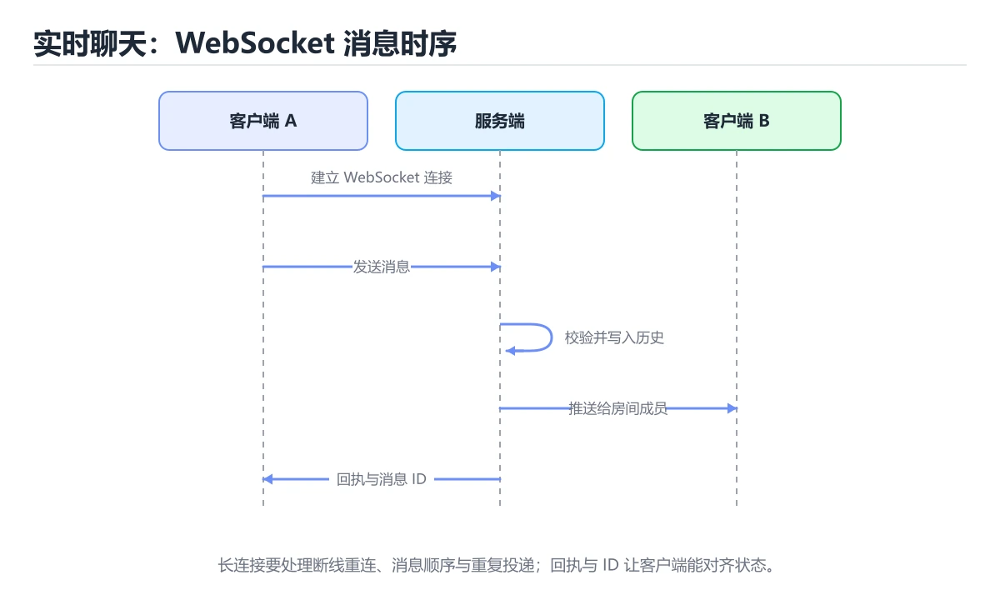
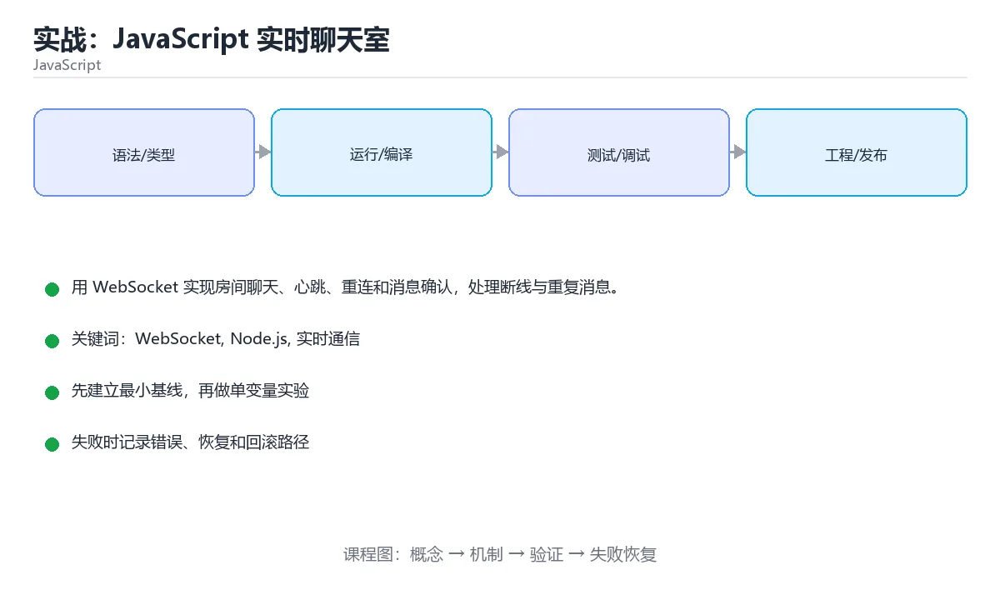

# 实战：JavaScript 实时聊天室





> 内容更新时间：2026-10-06 · 学习阶段：高级 · 预计用时：60 分钟

## 本节知识框架

**课程定位**：所属分类 `javascript`（JavaScript），课程主题 `实战：JavaScript 实时聊天室`，学习阶段 高级，建议用时 70 分钟。

本课主线：用 WebSocket 实现房间聊天、心跳、重连和消息确认，处理断线与重复消息。

**学完本课应当能够**
- 说清 `WebSocket` 与 `Node.js` 的含义与区别，并各举一个正例和一个反例。
- 用本课示例验证 `实时通信` 的行为，记录输入、输出与失败条件。
- 遇到「没有消息 ID」这类问题时，能说出触发条件与修复顺序。

### 复习清单

- [ ] 能不看正文复述本课核心术语，并指出一个边界或反例。
- [ ] 能运行或推演本课示例，记录输入、输出与失败现象。
- [ ] 能完成一次自测，并把错题对照错误表定位原因。

## 核心概念定义

| 术语 | 操作性定义 | 常见边界与风险 |
| --- | --- | --- |
| WebSocket | 在一条 TCP 连接上做全双工通信的协议：HTTP 握手之后双方可随时推送消息。 | 网络延迟、超时与版本协商会改变行为，只在真实链路或多版本客户端上验证才算数。 |
| Node.js | 基于 V8 的 JavaScript 运行时，用事件循环和非阻塞 I/O 构建服务端程序。 | 只在「基于 V8 的 JavaScript 运行时，用事件循环和非阻塞 I/O 构建服务端程序」这一前提下成立，换输入或换环境要重新验证。 |
| 实时通信 | 客户端与服务器保持长连接并及时交换消息，常见协议包括 WebSocket 与 WebRTC。 | 网络延迟、超时与版本协商会改变行为，只在真实链路或多版本客户端上验证才算数。 |
| 重连 | 用 WebSocket 实现房间聊天、心跳、重连和消息确认，处理断线与重复消息。 | 易错：重连后重复显示；正确做法是为每条消息分配稳定 ID 并去重。 |
| JavaScript | JavaScript 是动态类型、基于原型的脚本语言，标准名为 ECMAScript。它既能跑在浏览器里操作页面 | 静态检查只在编译期成立，运行期输入仍需校验。 |

## 原理与运行机制

### 机制总览

**教材衔接：技术栈**

- Node.js 22
- ws
- 浏览器 WebSocket API
- Vitest

**教材衔接：架构与数据流**

- 查询 Node.js 时限定字段与分页范围，把全表扫描留作最后手段。
- WebSocketServer 的写入要以幂等键为准，失败后能补偿或安全重试。
- 外部调用要设置超时、重试上限和降级策略。
- 每个关键阶段都要留下日志、指标或测试证据。

**教材衔接：功能范围**

- [ ] 加入/离开房间
- [ ] 广播文本消息
- [ ] 心跳检测死连接
- [ ] 断线重连并补发未确认消息

**教材衔接：实施步骤**

### 步骤 1：定义消息类型和错误码

- 输入与产出：先写清 WebSocket 依赖的配置、数据和最终产物，再开始编码。
- 为 Node.js 补一个最小用例，明确通过标准再扩展规模。
- 为 WebSocketServer 定义失败分类与重试上限，超出后走人工处理。
- 证据留存：保留命令、输出、日志或截图，方便评审与复盘。

### 步骤 2：实现房间与客户端映射

- 定位：这一节说明步骤 2：实现房间与客户端映射在「实战：JavaScript 实时聊天室」知识体系里的位置。
- 要点：能设计 WebSocket 消息协议和消息 ID。
- 自检：能否用一个最小例子解释步骤 2：实现房间与客户端映射？

### 步骤 3：加入消息 ID 和确认机制

- 定位：这一节说明步骤 3：加入消息 ID 和确认机制在「实战：JavaScript 实时聊天室」知识体系里的位置。
- 要点：本课涉及：WebSocket、Node.js、实时通信、重连、消息确认。
- 自检：能否用一个最小例子解释步骤 3：加入消息 ID 和确认机制？

### 步骤 4：实现服务端心跳与超时清理

- 定位：这一节说明步骤 4：实现服务端心跳与超时清理在「实战：JavaScript 实时聊天室」知识体系里的位置。
- 要点：一个多房间聊天服务需要支持在线列表、消息广播、断线重连和消息去重；弱网下不能丢失或重复显示消息。
- 自检：能否用一个最小例子解释步骤 4：实现服务端心跳与超时清理？

### 步骤 5：客户端实现退避重连

- 定位：这一节说明步骤 5：客户端实现退避重连在「实战：JavaScript 实时聊天室」知识体系里的位置。
- 要点：一句话摘要：用 WebSocket 实现房间聊天、心跳、重连和消息确认，处理断线与重复消息。
- 自检：能否用一个最小例子解释步骤 5：客户端实现退避重连？

### 步骤 6：用模拟网络抖动验证消息顺序

- 定位：这一节说明步骤 6：用模拟网络抖动验证消息顺序在「实战：JavaScript 实时聊天室」知识体系里的位置。
- 检查点：用空值、极值和依赖失败各跑一次《实战：JavaScript 实时聊天室》，确认边界行为与正文一致。
- 自检：能否用一个最小例子解释步骤 6：用模拟网络抖动验证消息顺序？

**教材衔接：建议目录结构**

**教材衔接：质量门禁**

- [ ] 格式化和静态检查通过，不遗留明显警告。
- [ ] 单元测试覆盖 WebSocket 的核心规则，集成测试覆盖数据库或外部边界。
- [ ] 错误响应不泄露堆栈、SQL 和密钥。
- [ ] 配置来自环境变量或配置文件，不硬编码敏感信息。
- [ ] README 写清启动、测试、配置和回滚步骤。

**教材衔接：安全、成本与可观测性**

- 权限遵循最小授权：WebSocket 用到的数据库账号、云资源和令牌都不能使用管理员默认权限。
- 把 Node.js 的输入约束写成白名单，并统一错误结构。
- 密钥通过环境变量或密钥管理服务注入，并记录轮换方式。
- WebSocketServer 的并发度要有上限，并在达到上限时给出可解释的拒绝。
- 至少记录 WebSocket 的请求量、错误率、P95/P99 延迟与资源使用趋势。
- 把 Node.js 的日志与指标对齐到同一时间轴，便于事后复盘。

**教材衔接：扩展任务**

- 加入历史消息和离线补发
- 支持图片和文件分片
- 用 Redis 支持多实例广播

**教材衔接：实施记录与复盘**

每完成一步，记录以下内容：

1. 本步的输入、命令和输出是什么？
2. 遇到的最小失败是什么，如何定位和修复？
3. 哪个假设被验证或推翻？
4. 下一步的风险是什么，如何回滚？
5. 把 WebSocketServer 的负载提高一个数量级，预期哪一项指标先触顶？

**教材衔接：完成标准**

- [ ] 能从干净环境按 README 启动项目。
- [ ] 为 WebSocketServer 补三条测试：正常、边界、失败各一条。
- [ ] 能演示一次错误、一次恢复和一次回滚。
- [ ] 有一份资源或性能基线，能说明瓶颈在哪里。
- [ ] 能说清一个尚未解决的问题和下一步验证方法。

**教材衔接：版本与时效**

- WebSocketServer 依赖的新 API 必须有降级路径，否则老环境直接报错。
- 升级「实战：JavaScript 实时聊天室」涉及的依赖前，先用 WebSocketServer 复现当前行为，再逐项核对版本说明与破坏性变更。

### 四、「实战：JavaScript 实时聊天室」的验收指标

| 指标 | 目标值 | 测量方式 | 不达标时的动作 |
| --- | --- | --- | --- |
| 连接数与消息投递延迟 | 本课没给绝对毫秒数：固定房间与消息量先跑一轮，把请求量、错误率和 P95、P99 记成基线 | 逐步加客户端连接数压 WebSocketServer，并把日志与指标对齐到同一时间轴 | 发送超时变多而连接数上不去，先看房间广播是不是串行了，再查心跳定时器有没有拖慢事件循环 |
| 有界并发与拒绝表现 | WebSocketServer 的并发度有上限，达到上限时给出可解释的拒绝而不是静默丢消息 | 压到上限后继续接入新连接，统计被拒次数与返回的错误码 | 进程被拖垮说明配额没生效，先补上限和降级分支，再考虑用 Redis 拆多实例广播 |
| 重连风暴抑制 | 客户端按指数退避加随机抖动重连，服务端恢复的瞬间不再出现二次雪崩 | 重启服务并统计所有客户端的重连时间分布，看是否挤在同一秒 | 间隔固定导致再次被打满就补抖动与重试上限，把补发未确认消息排在重连成功之后 |
| 消息去重与房间隔离 | 同一消息 ID 重复发送只显示一次，房间广播不会发给其他房间 | 重连后回放同 ID 消息，再跨房间发一条检查订阅集合 | 重复显示就补稳定消息 ID 与去重逻辑，串房就先校验房间权限再决定投递范围 |
| 死连接清理与历史堆积 | 半开连接在心跳周期内被剔除；历史消息扩到 10 倍后进程驻留量仍可控 | 制造 TCP 半开场景看应用层心跳能否主动发现，同时长跑一个房间统计落盘量 | 剔除不及时就缩短心跳周期并设超时次数，存储侧撑不住（文件涨、连接排队或写锁等待）就按房间建索引并清理过期历史 |

### 五、评审记录模板

| 记录项 | 填写要求 |
| --- | --- |
| 项目标识 | `js_project_realtime_chat` |
| 本次范围 | 说明这一轮交付了「实战：JavaScript 实时聊天室」的哪些部分 |
| 未完成项 | 列出与 WebSocket 相关但本轮未做的内容 |
| 证据位置 | 指向 evidence/ 目录下的具体文件 |
| 风险与回滚 | 写清剩余风险、回滚步骤和验证方式 |
| 结论 | 通过 / 有条件通过 / 不通过，三者选一 |

## 典型应用场景

**教材衔接：项目背景**

一个多房间聊天服务需要支持在线列表、消息广播、断线重连和消息去重；弱网下不能丢失或重复显示消息。

一句话摘要：用 WebSocket 实现房间聊天、心跳、重连和消息确认，处理断线与重复消息。

**教材衔接：项目专属规格：实战：JavaScript 实时聊天室**

### 核心场景

用 WebSocket 实现房间聊天、心跳、重连和消息确认，处理断线与重复消息。 项目目标是把「WebSocket、Node.js、实时通信、重连、消息确认」落实为可运行、可测试、可回滚的交付物。

### 验收场景

1. 正常路径：最小输入得到预期输出，并留下日志与指标。
2. 边界路径：Node.js 在重复提交与超长输入下不产生额外副作用。
3. 失败路径：依赖超时或不可用时能快速失败、重试或降级。
4. 幂等路径：同一请求执行两次不会产生重复副作用。
5. 回滚路径：撤掉 WebSocketServer 的变更后，数据与资源都回到变更前的状态。

**教材衔接：项目交付物**

### 建议仓库结构

```text
src/
  routes/
  services/
  repositories/
tests/
package.json
```

### 验收数据

```json
{
  "project": "js_project_realtime_chat",
  "scenario": "WebSocket的正常路径",
  "input": {"case": "normal", "value": "WebSocketServer"},
  "expected": {"ok": true, "checks": ["WebSocket可复现", "Node.js有记录"]},
  "failure_case": {"case": "Node.js越界或缺失", "error": "validation_error"},
  "idempotency_key": "js_project_realtime_chat-001"
}
```

### 复盘模板

- **没有消息 ID**：典型现象是重连后重复显示；正确做法是为每条消息分配稳定 ID 并去重。
- **只依赖 TCP 保活**：典型现象是半开连接无法及时发现；正确做法是应用层心跳和超时清理。
- **重连间隔固定**：典型现象是服务端恢复时再次被打满；正确做法是指数退避加随机抖动。
- **广播不检查房间**：典型现象是消息串房；正确做法是按房间维护订阅集合并校验权限。

### 最小验证场景

- 准备：保留 `text` 示例的原始输入，先记录 `实战：JavaScript 实时聊天室` 的基线输出和完整运行命令。
- 判定：新结果与 `实战：JavaScript 实时聊天室` 的基线不同不等于错误；只有当差异破坏了 `WebSocket` 的定义或错误表中的约束，才判定为失败。

### 选择与边界

- 使用 `WebSocket` 时，先满足它的定义：在一条 TCP 连接上做全双工通信的协议：HTTP 握手之后双方可随时推送消息；网络延迟、超时与版本协商会改变行为，只在真实链路或多版本客户端上验证才算数。
- 使用 `Node.js` 时，先满足它的定义：基于 V8 的 JavaScript 运行时，用事件循环和非阻塞 I/O 构建服务端程序。
- 使用 `实时通信` 时，先满足它的定义：客户端与服务器保持长连接并及时交换消息，常见协议包括 WebSocket 与 WebRTC；网络延迟、超时与版本协商会改变行为，只在真实链路或多版本客户端上验证才算数。
- 使用 `重连` 时，先满足它的定义：用 WebSocket 实现房间聊天、心跳、重连和消息确认，处理断线与重复消息；易错：重连后重复显示；正确做法是为每条消息分配稳定 ID 并去重。
- 使用 `JavaScript` 时，先满足它的定义：JavaScript 是动态类型、基于原型的脚本语言，标准名为 ECMAScript。它既能跑在浏览器里操作页面；静态检查只在编译期成立，运行期输入仍需校验。

## 代码/协议/SQL 示例

### 最小可验证示例

**教材衔接：示例数据与边界**

**教材衔接：关键代码**

```javascript
import { WebSocketServer } from 'ws';

const wss = new WebSocketServer({ port: 8080 });
wss.on('connection', (socket) => {
  socket.on('message', (raw) => {
    const msg = JSON.parse(raw.toString());
    const frame = JSON.stringify({ id: msg.id, type: 'message', text: msg.text });
    for (const client of wss.clients) {
      if (client.readyState === client.OPEN) client.send(frame);
    }
  });
});
```

**教材衔接：验证命令与预期输出**

**教材衔接：测试与验收**

- 同一消息 ID 重复发送只显示一次
- 连接断开后客户端按退避策略重连
- 房间广播不会发送给其他房间

## 时间/空间复杂度或性能分析

**性能关注点（实战：JavaScript 实时聊天室）**：事件循环与 DOM 操作是瓶颈来源：记录脚本执行时间、长任务与主线程阻塞时长。

**测量方法**：以 `实战：JavaScript 实时聊天室` 的 `WebSocket` 场景为对象，固定输入跑一遍记录基线，再把规模或并发度提高一个数量级复测；两次结果的差值与波动范围才是结论依据。

## 常见误区与易错点

| 容易写错的做法 | 实际现象 | 原因与正确做法 |
| --- | --- | --- |
| 没有消息 ID | 重连后重复显示 | 为每条消息分配稳定 ID 并去重 |
| 只依赖 TCP 保活 | 半开连接无法及时发现 | 应用层心跳和超时清理 |
| 重连间隔固定 | 服务端恢复时再次被打满 | 指数退避加随机抖动 |
| 广播不检查房间 | 消息串房 | 按房间维护订阅集合并校验权限 |

### 现场 1：没有消息 ID

**症状**：重连后重复显示。

**根因与修复**：为每条消息分配稳定 ID 并去重。

**自检**：在本课示例里复现「没有消息 ID」，改成为每条消息分配稳定 ID 并去重后重跑；如果症状消失且失败路径按预期变化，说明定位正确。

### 现场 2：只依赖 TCP 保活

**症状**：半开连接无法及时发现。

**根因与修复**：应用层心跳和超时清理。

**自检**：在本课示例里复现「只依赖 TCP 保活」，改成应用层心跳和超时清理后重跑；如果症状消失且失败路径按预期变化，说明定位正确。

### 现场 3：重连间隔固定

**症状**：服务端恢复时再次被打满。

**根因与修复**：指数退避加随机抖动。

**自检**：在本课示例里复现「重连间隔固定」，改成指数退避加随机抖动后重跑；如果症状消失且失败路径按预期变化，说明定位正确。

### 现场 4：广播不检查房间

**症状**：消息串房。

**根因与修复**：按房间维护订阅集合并校验权限。

**自检**：在本课示例里复现「广播不检查房间」，改成按房间维护订阅集合并校验权限后重跑；如果症状消失且失败路径按预期变化，说明定位正确。

## 与其他知识点的关系

**教材衔接：复习与迁移**

### 测验回顾

1. 阅读「实战：JavaScript 实时聊天室」正文里的这段 JavaScript 代码，下面哪一项判断是正确的？
   - 依据：在「实战：JavaScript 实时聊天室」里，这段代码包含条件分支，不同输入会走不同的执行路径。这段代码出自「实战：JavaScript 实时聊天室」的正文示例，围绕WebSocket、Node.js、实时通信展开；把输入或边界换成空值、极值或失败情况后，结论要以「实战：JavaScript 实时聊天室」的实际运行结果为准。
2. 消息 ID 的主要作用是什么？
   - 依据：稳定消息 ID 让客户端识别重复消息并做确认。作答时，先用WebSocket建立输入与输出的基线，再把去重和确认代入边界条件核对，结论才能复现。“的主要作用是什么”与「实战：JavaScript 实时聊天室」的术语表相呼应，只有符合WebSocket、Node.js、实时通信约束的“去重和确认”才是正文支持的结论。
3. 应用层心跳解决什么问题？
   - 依据：TCP 不一定及时感知断线，应用层心跳能主动检测。作答时，先用WebSocket建立输入与输出的基线，再把发现半开连接代入边界条件核对，结论才能复现。「实战：JavaScript 实时聊天室」要求先交代WebSocket、Node.js、实时通信的前提再下结论，所以“发现半开连接”只在题干“应用层心跳解决什么问题”给定的条件下成立。
4. 重连为什么要加随机抖动？
   - 依据：抖动分散重连时间，避免惊群和二次雪崩。在「实战：JavaScript 实时聊天室」里，作答时，先用WebSocket建立输入与输出的基线，再把避免所有客户端同时重连代入边界条件核对，结论才能复现。在「实战：JavaScript 实时聊天室」里，这道题要求区分概念与边界，「避免所有客户端同时重连」只有在题干给出的前提下才成立，而「提升 CPU」、「减少消息 ID」缺少同一组条件。
5. 围绕“实战：JavaScript 实时聊天室”中的 WebSocket、Node.js、实时通信，下列哪两项是本课强调的实践判断？
   - 依据：本课把实战：JavaScript 实时聊天室拆成概念、示例与故障现场三部分，因此判断 WebSocket 时必须同时交代输入、输出和失败路径，这使“学习 WebSocket 时要同时说明输入、输出和失败路径，不能只看正常流程”成立。在实战：JavaScript 实时聊天室里，判断 Node.js 时要固定版本与边界输入，所以“验证 Node.js 时要固定版本并覆盖边界输入，结论才可复现”才可复现。
6. 补全代码：「实战：JavaScript 实时聊天室」示例中，下面这行代码缺少哪个关键字或函数名？请填入 ____。

`"project": "____",`
   - 依据：空格应填写「js_project_realtime_chat」。"project": "", 限定的语境来判断。把“jsprojectrealtimecha”代回「实战：JavaScript 实时聊天室」里“实战：JavaScript 实时聊天室示例中，下面这行代码缺”的例子核对，条件一旦改变，结论就要用WebSocket、Node.js、实时通信重新推导。

## 自测题与参考答案

> 先独立作答，再对照参考答案；答案都能在本课正文、术语表或错误表里找到依据。

### 自测 1（概念复述）

不看正文，写出 `WebSocket` 的操作性定义，并说明它与 `Node.js` 的区别。

**参考答案**：在一条 TCP 连接上做全双工通信的协议：HTTP 握手之后双方可随时推送消息。

`Node.js` 的定位是：基于 V8 的 JavaScript 运行时，用事件循环和非阻塞 I/O 构建服务端程序；两者的差别要从适用对象与失败模式上说明。

### 自测 2（排错）

本课错误表记录了「没有消息 ID」这类做法。请写出它会出现的现象、根因，以及修复顺序。

**参考答案**：现象是重连后重复显示；正确做法是为每条消息分配稳定 ID 并去重。修复时先复现现象并保留证据，再改动一处假设重跑，确认现象消失。

### 自测 3（动手验证）

运行本课的 `text` 示例，改动其中一个输入后重新运行，记录输出与错误信息。

**参考答案**：正常输入下 `text` 示例应当复现正文给出的结果；改动输入后，如果结果改变或报错，先核对它是否满足 `实战：JavaScript 实时聊天室` 中`WebSocket` 的适用范围，再检查错误表里是否有同类现象。

### 自测 4（代码阅读）

阅读本课开头的 `text` 示例，说明它体现了`WebSocket` 的哪一条性质，并指出改动哪个输入会让这条性质不再成立。

**参考答案**：`WebSocket` 的定义是 在一条 TCP 连接上做全双工通信的协议：HTTP 握手之后双方可随时推送消息，示例正是在实现这条定义。改动与 `WebSocket` 有关的一个输入后，如果结果不再符合 `实战：JavaScript 实时聊天室` 的正文描述，就说明该性质只在当前前提成立。

### 自测 5（迁移）

把 `实战：JavaScript 实时聊天室` 的方法迁移到自己的项目：围绕 `WebSocket` 写出一个与错误表同类的风险点，并说明触发条件和检验方式。

**参考答案**：例如「广播不检查房间」，它会导致消息串房；检验方式是按房间维护订阅集合并校验权限改一处再复现，确认现象消失且没有引入新的失败分支。

### 自测 6（对比）

用一个表格对比 `WebSocket` 与 `Node.js`：各写一行适用场景、一行失败表现。

**参考答案**：`WebSocket` 的定义是在一条 TCP 连接上做全双工通信的协议：HTTP 握手之后双方可随时推送消息；`Node.js` 的定义是基于 V8 的 JavaScript 运行时，用事件循环和非阻塞 I/O 构建服务端程序。两者的失败表现分别对应本课错误表里与本术语相关的行。

### 自测 7（排错顺序）

面对「没有消息 ID」引发的问题，请把“复现 重连后重复显示 → 保留证据 → 为每条消息分配稳定 ID 并去重 → 回归验证”四步写成可执行的检查清单。

**参考答案**：第一步按重连后重复显示复现；第二步记录输入、版本与完整报错；第三步按为每条消息分配稳定 ID 并去重只改一处；第四步重跑并确认失败路径也按预期变化。

### 自测 8（边界判断）

针对 `JavaScript`，分别写出“可以使用”的条件和“结论不再成立”的条件。

**参考答案**：静态检查只在编译期成立，运行期输入仍需校验。 同时要把 `JavaScript` 的定义 JavaScript 是动态类型、基于原型的脚本语言，标准名为 ECMAScript。它既能跑在浏览器里操作页面 与实际输入逐项对照。

### 自测 9（机制重建）

不看正文，按输入、转换、输出、验证四段重建 `WebSocket` → `Node.js` → `实时通信` → `重连` 的作用链。

**参考答案**：起点是 `WebSocket` 的定义 在一条 TCP 连接上做全双工通信的协议：HTTP 握手之后双方可随时推送消息；中间每一步都保留可观察状态；终点由 `JavaScript` 检查，失败时回到错误表定位第一个偏离定义的步骤。

### 自测 10（综合排错）

在 `实战：JavaScript 实时聊天室` 中，现象是 消息串房。请围绕 广播不检查房间 写出最小复现、关键证据、修复动作和回归验证，并说明为什么不能只凭一次运行下结论。

**参考答案**：先复现 广播不检查房间，记录输入与完整错误；再按 按房间维护订阅集合并校验权限 只改一处。回归时同时跑正常路径和边界路径，只有两次结果都可解释，才把修复视为完成。

### 自测 11（一分钟复述）

用每分钟约 200 字的速度复述 `实战：JavaScript 实时聊天室`：先给主问题，再按顺序说出 `WebSocket`、`Node.js`、`实时通信`、`重连`，最后给一个失败案例。

**自评标准**：主问题必须对应 用 WebSocket 实现房间聊天、心跳、重连和消息确认，处理断线与重复消息；每个术语都要能接上一句定义或边界；失败案例必须写成可观察现象，不能用“可能有风险”代替证据。

## 术语速查

| 术语 | 一句话说明 |
| --- | --- |
| `WebSocket` | 在一条 TCP 连接上做全双工通信的协议：HTTP 握手之后双方可随时推送消息。 |
| `Node.js` | 基于 V8 的 JavaScript 运行时，用事件循环和非阻塞 I/O 构建服务端程序。 |
| `实时通信` | 客户端与服务器保持长连接并及时交换消息，常见协议包括 WebSocket 与 WebRTC。 |
| `重连` | 用 WebSocket 实现房间聊天、心跳、重连和消息确认，处理断线与重复消息。 |
| `JavaScript` | JavaScript 是动态类型、基于原型的脚本语言，标准名为 ECMAScript。它既能跑在浏览器里操作页面。 |

**术语关系**：`WebSocket`（在一条 TCP 连接上做全双工通信的协议：HTTP 握手之后双方可随时推送消息） → `Node.js`（基于 V8 的 JavaScript 运行时） → `实时通信`（客户端与服务器保持长连接并及时交换消息） → `重连`（用 WebSocket 实现房间聊天、心跳、重连和消息确认）。

## 考点精讲

`实战：JavaScript 实时聊天室` 的题库有 6 道题，下面逐题给出题干、正确项与判断依据：先自己作答，再核对正确项，最后回到正文对应小节复核。

### 考点 1：第 1 题

- **题目**：阅读 `实战：JavaScript 实时聊天室` 的 `WebSocket` 示例。它服务于用 WebSocket 实现房间聊天、心跳、重连和消息确认，处理断线与重复消息。代码中实际包含下列哪一项？
- **正确项**：代码里出现了 `WebSocket` 这个名字
- **判断依据**：按《实战：JavaScript 实时聊天室》的正文口径，本题正确项是「代码里出现了 `WebSocket` 这个名字」。术语「WebSocket」在本课里的界定是在一条 TCP 连接上做全双工通信的协议：HTTP 握手之后双方可随时推送消息，题干「阅读 `实战：JavaScript 实时聊天室` 的 `WebSocket` 示例。它服务于用 WebSocket 实现房间聊天、心跳、重连和消息确认，处理断线与重复消息。代码中实际包含下列哪一项？」问的就是这一条。常见错法是没有消息 ID，其后果是重连后重复显示。正确做法是为每条消息分配稳定 ID 并去重。

### 考点 2：第 2 题

- **题目**：消息 ID 的主要作用是什么？
- **正确项**：去重和确认
- **判断依据**：本题正确项是「去重和确认」。术语 WebSocket（实战：JavaScript 实时聊天室）：在一条 TCP 连接上做全双工通信的协议：HTTP 握手之后双方可随时推送消息，本题取「去重和确认」这条。易错点是只依赖 TCP 保活，会造成半开连接无法及时发现，改法是应用层心跳和超时清理。

### 考点 3：第 3 题

- **题目**：应用层心跳解决什么问题？
- **正确项**：发现半开连接
- **判断依据**：本题正确项是「发现半开连接」。术语 WebSocket（实战：JavaScript 实时聊天室）：在一条 TCP 连接上做全双工通信的协议：HTTP 握手之后双方可随时推送消息，本题取「发现半开连接」这条。易错点是重连间隔固定，会造成服务端恢复时再次被打满，改法是指数退避加随机抖动。

### 考点 4：第 4 题

- **题目**：重连为什么要加随机抖动？
- **正确项**：避免所有客户端同时重连
- **判断依据**：本题正确项是「避免所有客户端同时重连」。术语 重连（实战：JavaScript 实时聊天室）：用 WebSocket 实现房间聊天、心跳、重连和消息确认，处理断线与重复消息，本题取「避免所有客户端同时重连」这条。易错点是广播不检查房间，会造成消息串房，改法是按房间维护订阅集合并校验权限。

### 考点 5：第 5 题

- **题目**：围绕“实战：JavaScript 实时聊天室”中的 WebSocket、Node.js、实时通信，下列哪两项是本课强调的实践判断？
- **正确项**：验证 Node.js 时要固定版本并覆盖边界输入，结论才可复现；学习 WebSocket 时要同时说明输入、输出和失败路径，不能只看正常流程
- **判断依据**：按《实战：JavaScript 实时聊天室》的正文口径，本题要同时选中「验证 Node.js 时要固定版本并覆盖边界输入，结论才可复现」、「学习 WebSocket 时要同时说明输入、输出和失败路径，不能只看正常流程」，漏掉任一项都算没答全。术语 WebSocket（实战：JavaScript 实时聊天室）：在一条 TCP 连接上做全双工通信的协议：HTTP 握手之后双方可随时推送消息。易错点是没有消息 ID，会造成重连后重复显示，改法是为每条消息分配稳定 ID 并去重。

### 考点 6：第 6 题

- **题目**：填空：补齐下面这段术语说明中的空缺。课程 `用 WebSocket 实现房间聊天、心跳、重连和消息确认，处理断线与重复消息。`，这段说明是：`____`：基于 V8 的 JavaScript 运行时，用事件循环和非阻塞 I/O 构建服务端程序。空缺处应填哪个术语？
- **正确项**：Node.js
- **判断依据**：《实战：JavaScript 实时聊天室》这题的填空口径是「Node.js」或「node.js」，正文写法与其中任一项一致即可。术语「WebSocket」在本课里的界定是在一条 TCP 连接上做全双工通信的协议：HTTP 握手之后双方可随时推送消息，题干问的就是这一条。常见错法是没有消息 ID，其后果是重连后重复显示。正确做法是为每条消息分配稳定 ID 并去重。

### 考点 7：`WebSocket`

- **要点**：在一条 TCP 连接上做全双工通信的协议：HTTP 握手之后双方可随时推送消息。
- **WebSocket 的边界**：网络延迟、超时与版本协商会改变行为，只在真实链路或多版本客户端上验证才算数。

### 考点 8：`Node.js`

- **要点**：基于 V8 的 JavaScript 运行时，用事件循环和非阻塞 I/O 构建服务端程序。

### 考点 9：`实时通信`

- **要点**：客户端与服务器保持长连接并及时交换消息，常见协议包括 WebSocket 与 WebRTC。
- **实时通信 的边界**：网络延迟、超时与版本协商会改变行为，只在真实链路或多版本客户端上验证才算数。

### 考点 10：`重连`

- **要点**：用 WebSocket 实现房间聊天、心跳、重连和消息确认，处理断线与重复消息。
- **重连 的边界**：易错：重连后重复显示；正确做法是为每条消息分配稳定 ID 并去重。

### 考点 11：`JavaScript`

- **要点**：JavaScript 是动态类型、基于原型的脚本语言，标准名为 ECMAScript。它既能跑在浏览器里操作页面
- **JavaScript 的边界**：静态检查只在编译期成立，运行期输入仍需校验。

### 考点 12：排错——没有消息 ID

- **现象**：重连后重复显示。
- **处理**：为每条消息分配稳定 ID 并去重。

### 考点 13：排错——只依赖 TCP 保活

- **现象**：半开连接无法及时发现。
- **处理**：应用层心跳和超时清理。

### 考点 14：综合辨析——`WebSocket` 与 `JavaScript`

- **辨析点**：`WebSocket` 的定义是 在一条 TCP 连接上做全双工通信的协议：HTTP 握手之后双方可随时推送消息；`JavaScript` 的定义是 JavaScript 是动态类型、基于原型的脚本语言，标准名为 ECMAScript。它既能跑在浏览器里操作页面。
- **答题要求**：面对 `实战：JavaScript 实时聊天室` 的题目，先判断描述的是 `WebSocket` 还是 `JavaScript`，再归到对应定义，最后写出一个会让该定义失效的边界输入。

### 考点 15：排错评分点

- **现象分**：能写出 重连后重复显示，而不是只写“程序有错”。
- **证据分**：保留触发 没有消息 ID 的输入、版本和错误原文。
- **修复分**：按 为每条消息分配稳定 ID 并去重 只改一处，并同时回归正常路径与边界路径。

## 内容元数据

- 内容版本：v2.0
- 最后更新：2026-10-06
- 学习阶段：高级
- 适用环境：Node.js 22+ / 现代浏览器；本课聚焦 WebSocket。
- 内容来源：内置结构化课程与工程实践整理
- 相关主题：WebSocket、Node.js、实时通信、重连、消息确认
- 质量版本：P0 测验标准 + P1 覆盖扩展 + P2 体验补全

## 参考资料与复核

- 最后复核：2026-10-04
- 下次复核：2027-05-17
- 复核范围：版本兼容、API 行为、安全建议与工程实践
- 来源性质：官方文档、标准或权威教材；本课核对关键词：WebSocket、Node.js、实时通信、重连、消息确认。

| 参考资料 | 本课用途 |
| --- | --- |
| [Node.js 文档](https://nodejs.org/docs/latest/api/) | 服务端运行时与模块 |
| [MDN 模块](https://developer.mozilla.org/docs/Web/JavaScript/Guide/Modules) | ES Module 与依赖组织 |
| [Node 事件循环](https://nodejs.org/en/learn/asynchronous-work/event-loop-timers-and-nexttick) | 事件循环与异步顺序 |

| [本课术语索引：实战：JavaScript 实时聊天室](#核心概念定义) | 按本课输入、术语边界和错误表现逐项核对 |
> 「实战：JavaScript 实时聊天室」的链接用于离线阅读后的延伸核对；App 不会自动联网。