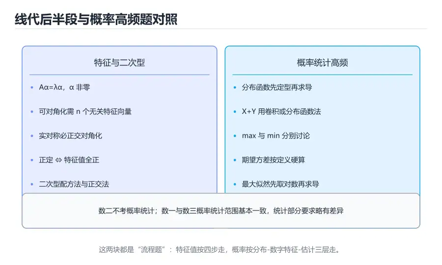

# 特征值、二次型与概率统计：两栏对照的流程题



> 内容更新时间：2026-10-06 · 学习阶段：高级 · 预计用时：55 分钟

## 本节知识框架

**课程定位**：所属分类 `kaoyan_math`（考研数学），课程主题 `特征值对角化与概率统计`，学习阶段 高级，建议用时 55 分钟。左栏的线性代数后半段三种卷种都考，是数二的重仓区；右栏的概率统计数学二不考，数学一与数学三范围基本一致、统计部分要求略有差异。两块加起来在数一与数三的卷面上约占 55~60 分，是「会做就能拿满、不会做就整片失守」的典型区域。

配图是左右对照而不是流水线：左栏「特征与二次型」按 Aα = λα、可对角化需 n 个无关特征向量、实对称必正交对角化、正定等价于特征值全正、配方法与正交法两条路；右栏「概率统计高频」按分布函数先定型再求导、X + Y 用卷积或分布函数法、max 与 min 分别讨论、期望方差按定义硬算、最大似然先取对数再求导。图的说明点出两者的共性：这两块都是流程题。特征值按四步走，概率按「分布—数字特征—估计」三层走，步骤背熟了题目的难度会下降一大截，因为考卷考的是流程完整性而不是灵感。

一句话贯通两栏：左栏把矩阵看成「一个可以换坐标系来看的线性变换」，特征值就是换到最省事坐标系后剩下的那几个数；右栏把随机变量看成「一个有分布函数的对象」，一切运算都从写出它的分布函数开始。

**学完本节应当能够**

- 由 Aα = λα 求全部特征值与特征向量，并用秩判断能否对角化。
- 对实对称矩阵做正交对角化，写出正交矩阵 Q 与标准形。
- 用特征值、顺序主子式、正负惯性指数三种方式判二次型正定。
- 用分布函数法求 Z = X + Y、max(X, Y)、min(X, Y) 的密度。
- 按定义计算期望与方差，并处理协方差与相关性、独立性的关系。
- 写出常见总体的最大似然估计，并说清哪些情形不能靠求导得到。

### 复习清单

- [ ] 对 A = [[2, 1], [1, 2]] 求出特征值与两个单位正交的特征向量，写出 Q 与 QᵀAQ。
- [ ] 解释为什么 [[3, 1], [0, 3]] 不可对角化，并算出 A − 3E 的秩。
- [ ] 用两种方法判 f = x1² + 2x2² + 2x1x2 的正定性，各写出关键数字。
- [ ] 设 X 与 Y 独立同服从 U(0,1)，写出 max 与 min 的分布函数、密度与期望。

## 核心概念定义

| 术语 | 操作性定义 | 常见边界与风险 |
| --- | --- | --- |
| 特征值与特征向量 | 存在非零向量 α 使 Aα = λα，则 λ 是特征值、α 是属于它的特征向量。 | α 必须非零；λ = 0 可以是特征值，此时等价于 A 不可逆。 |
| 特征方程 | det(A − λE) = 0，其根即特征值。n 次多项式有 n 个根（计重数）。 | 展开 det 时符号最容易错，算完要用 tr(A) = Σλ 与 det(A) = Πλ 各验一次。 |
| 代数重数与几何重数 | 特征值作为根的重数叫代数重数；对应特征子空间的维数 n − r(A − λE) 叫几何重数。 | 几何重数 ≤ 代数重数，两者不等时矩阵不可对角化。 |
| 可对角化 | A 相似于对角阵，充要条件是有 n 个线性无关的特征向量。 | 有 n 个互不相同的特征值只是充分条件，不是必要；重根要单独查秩。 |
| 相似与正交相似 | A 与 B 相似指存在可逆 P 使 P⁻¹AP = B；P 为正交矩阵时称正交相似。 | 相似保持特征值、行列式、迹、秩；正交相似额外保持二次型的几何形状。 |
| 实对称矩阵 | 满足 Aᵀ = A 的实矩阵。 | 必可正交对角化，特征值全为实数，不同特征值的特征向量自动正交。 |
| 施密特正交化 | 把一组线性无关向量逐个减去已得正交方向的分量，再单位化。 | 只在同一特征值内部需要；跨特征值的向量本来已正交，正交化反而可能引入错误。 |
| 二次型的矩阵 | f = xᵀAx，其中 A 为对称矩阵，交叉项系数一半放非对角元。 | 把 x1x2 的系数整个写进 a12 而忘记除以 2，是二次型第一号错因。 |
| 标准形与规范形 | 只含平方项的形式称标准形，系数只取 1、−1、0 的形式称规范形。 | 标准形不唯一（配方法随变换而变），规范形由正负惯性指数唯一确定。 |
| 惯性定理 | 无论用什么可逆变换，正系数个数 p 与负系数个数 q 都不变。 | p − q 是符号差，p + q 是秩；判「等价」只看这两个数。 |
| 正交变换化标准形 | 令 x = Qy，Q 的列是单位特征向量，标准形系数即特征值。 | 特征值顺序必须与 Q 中特征向量的排列一致，交换列就要交换系数。 |
| 正定 | 对任意非零 x 有 f(x) > 0，等价于特征值全正、顺序主子式全正、p = n。 | 顺序主子式判据要用「从左上角开始的前 k 阶」，不是任意 k 阶子式。 |
| 分布函数法 | 先写 F_Z(z) = P(Z ≤ z) 把事件化成 (X, Y) 平面上的区域积分，再对 z 求导得密度。 | 求导前必须先分段落定范围；分段点单独检查。 |
| 卷积公式 | X 与 Y 独立时 f_Z(z) = ∫ f_X(x) f_Y(z − x) dx。 | 积分限由两个密度的支撑集交集决定，写成全实轴就会算错。 |
| 顺序统计量 | max 的分布 F(z) = F_X(z)F_Y(z)，min 的分布 1 − [1 − F(z)]²（同分布时）。 | 独立是乘法的前提；不独立时不能这样写。 |
| 协方差与相关系数 | cov(X, Y) = E[(X − EX)(Y − EY)]，ρ = cov / (√DX·√DY)。 | ρ = 0 称不相关，只表示没有线性关系，不等于独立。 |
| 最大似然估计 | 把样本视为独立观测，写 L(θ) = Π f(x_i; θ)，取对数后对 θ 求导置零。 | L 不可导或在边界取到最大时（如 U(0, θ)）不能靠求导，必须直接分析单调性。 |

## 原理与运行机制

### 特征值的三步与两条验算

以 A = [[2, −1, 0], [−1, 2, −1], [0, −1, 2]] 为例。det(A − λE) = 0 给出 (2 − λ)[(2 − λ)² − 2] = 0，特征值是 2 − √2、2、2 + √2，约 0.585786、2、3.414214。两条验算必须做：迹等于特征值之和，2 + 2 + 2 = 6 ✓；行列式等于特征值之积，按第一行展开 det(A) = 2·3 − (−1)·(−2) = 4，而 (2 − √2)·2·(2 + √2) = 2·(4 − 2) = 4 ✓。再加一条 Σλ² = 16，等于 A 的九个元素平方和（三个 2 与四个 −1），这也是实对称矩阵的自检式。

对 A = [[2, 1], [1, 2]]，特征方程 λ² − 4λ + 3 = 0 得 λ = 3 与 1。λ = 3 时 (A − 3E)x = 0 给出 x1 = x2，λ = 1 时给出 x1 = −x2，两个方向 (1, 1) 与 (1, −1) 已经正交，单位化后拼成 Q = (1/√2)[[1, 1], [1, −1]]，得 QᵀAQ = diag(3, 1)。实对称矩阵的这一步几乎不需要额外计算正交性，这是它比一般矩阵好处理的根本原因。

### 什么时候对不齐：一个反例

A = [[3, 1], [0, 3]] 的特征值是二重的 3。算 A − 3E = [[0, 1], [0, 0]]，秩为 1，于是特征子空间维数 = 2 − 1 = 1，只有一个独立特征向量。两个代数重数加起来的特征向量凑不出 2 个，所以不可对角化。

把这条判据写成一句话：对每个特征值都要检查 n − r(A − λE) 是否等于它的重数。全部相等就能对角化，只要有一个不相等就不能。若题目问「a 取何值时可对角化」，答案永远是「让重根对应的 A − λE 秩降到最低」这件事。

### 二次型的两条路

f = x1² + 2x2² + 2x1x2 的矩阵是 A = [[1, 1], [1, 2]]：平方项系数放对角，交叉项系数 2 拆成两个 1 放副对角。判正定有三把尺子。

顺序主子式：Δ1 = 1 > 0，Δ2 = 1·2 − 1·1 = 1 > 0，故正定。
特征值：λ² − 3λ + 1 = 0 得 (3 ± √5)/2，即 2.618034 与 0.381966，全正，故正定。
配方法：f = (x1 + x2)² + x2²，两个正平方项，故正定。

三条路结论一致，但用途不同。配方法（拉格朗日法）快、只需可逆变换，得到的标准形系数依赖于配方顺序，不唯一；正交变换法多解一遍特征值，但标准形系数恰好是特征值，唯一且直接可读正定性。考研里若题目要求「用正交变换」就必须走第二条，走配方法拿不到这部分的步骤分。

若二次型含三个变量且没有平方项，例如 f = 2x1x2 + 2x1x3，配方法要先用 x1 = y1 + y2、x2 = y1 − y2 造出平方项，这是配方法的固定起手式，与正交变换法无关。

### 概率：一切从分布函数开始

设 X 与 Y 相互独立且都服从 U(0, 1)。求 Z = max(X, Y)：

F_Z(z) = P(X ≤ z, Y ≤ z) = z²（0 ≤ z ≤ 1）

于是 f_Z(z) = 2z，E(Z) = ∫(0..1) z·2z dz = 2/3 = 0.66667，E(Z²) = ∫ 2z³ dz = 1/2，D(Z) = 1/2 − 4/9 = 1/18 ≈ 0.05556。对 W = min(X, Y) 用 P(W ≤ z) = 1 − P(X > z, Y > z) = 1 − (1 − z)²，密度 2(1 − z)，期望 1/3 = 0.33333。两个期望加起来正好是 1，符合对称直觉。

推广到 n 个同分布样本，max 的分布是 z^n，期望 n/(n + 1)。U(0, θ) 的矩估计是 θ/2 的样本均值乘 2，而最大似然估计是 max(X_i)，其期望是 nθ/(n + 1)，比 θ 小，所以要除以 n/(n + 1) 才无偏——这个修正因子正是「MLE 可以有偏」的标准例子，也解释了为什么对 U(0, θ) 求导找不到极值：似然 L = θ^(−n) 在允许区域内单调下降，最大值出现在边界而不是驻点。

### 卷积与数字特征

X 与 Y 独立同服从参数 1 的指数分布时，Z = X + Y 的密度由卷积公式给出

f_Z(z) = ∫(0..z) e^(−x) e^(−(z − x)) dx = z e^(−z)，z > 0

这就是 Gamma(2, 1)。E(Z) = ∫(0..∞) z²e^(−z) dz = Γ(3) = 2，正好等于两个期望之和，验证了线性性不需要独立性。方差 D(Z) = 2 = 1 + 1，因为独立时协方差项为零。

一般情形下 D(X + Y) = D(X) + D(Y) + 2cov(X, Y)。cov = 0（等价于 ρ = 0，称不相关）只保证方差可加，不保证独立；反过来独立必不相关。二维正态是唯一的例外：对它而言不相关与独立等价，因为协方差矩阵非对角元为零时联合密度正好分解成两个边缘密度的乘积。

### 二维正态的参数读法

若 (X, Y) 服从二维正态，边缘 X ~ N(μ1, σ1²)、Y ~ N(μ2, σ2²)，相关系数为 ρ，则 X + Y 与 X − Y 仍是正态，D(X + Y) = σ1² + σ2² + 2ρσ1σ2，D(X − Y) = σ1² + σ2² − 2ρσ1σ2，两者当 ρ = 0 时相等。考研常考的反问是：已知 aX + bY 与 cX + dY 独立，求参数——在正态情形下「独立」可以直接换成「协方差为零」来解方程，这是二维正态给的唯一便利。

## 典型应用场景

| 场景 | 典型输入或前提 | 期望产物 |
| --- | --- | --- |
| 矩阵的幂 | A 可对角化，需要 A^n | 分解 A = PΛP⁻¹，用 Λ^n 计算，最后乘回。 |
| 判对角化 | 给含参数的 3 阶矩阵 | 逐个特征值算 r(A − λE)，比较几何重数与代数重数。 |
| 二次化标准形 | 给实对称矩阵或二次型 | 求特征值、正交化单位化、写 Q 与标准形，并判正负定性。 |
| 几何曲面判别 | 给含交叉项的二次曲线方程 | 正交变换消交叉项，由特征值符号判椭圆或双曲线。 |
| 顺序统计量 | 独立同分布样本求 max/min | 写分布函数、求导得密度、按定义算期望方差。 |
| 和的分布 | 两个独立随机变量之和 | 判是否用卷积，定积分限，或直接用正态可加性。 |
| 点估计评价 | 给总体密度与样本 | 写似然、取对数、判断能否求导，并检验无偏性。 |
| 协方差计算 | 给二维分布或离散分布表 | 按 cov = E(XY) − EX·EY 硬算，再答相关性与独立性。 |

## 代码/协议/SQL 示例

特征值与顺序统计量的期望都可以用脚本互验：一个走辛普森积分，一个走行列式展开。

```python
import math

def simpson(f, a, b, n=2000):
    hstep = (b - a) / n
    total = f(a) + f(b)
    for i in range(1, n):
        total += (4 if i % 2 else 2) * f(a + i * hstep)
    return total * hstep / 3.0

def det3(m):
    return (m[0][0] * (m[1][1] * m[2][2] - m[1][2] * m[2][1])
            - m[0][1] * (m[1][0] * m[2][2] - m[1][2] * m[2][0])
            + m[0][2] * (m[1][0] * m[2][1] - m[1][1] * m[2][0]))

print(round(simpson(lambda z: z * 2.0 * z, 0.0, 1.0), 5),
      round(simpson(lambda z: z * 2.0 * (1.0 - z), 0.0, 1.0), 5))
print(round(simpson(lambda z: z * z * math.exp(-z), 0.0, 30.0), 5))

lam = [2.0 - math.sqrt(2.0), 2.0, 2.0 + math.sqrt(2.0)]
a = [[2.0, -1.0, 0.0], [-1.0, 2.0, -1.0], [0.0, -1.0, 2.0]]
print(round(sum(lam), 5), round(lam[0] * lam[1] * lam[2], 5))
print(round(det3(a), 5), round(lam[0] ** 2 + lam[1] ** 2 + lam[2] ** 2, 5))
```

运行结果：

```text
0.66667 0.33333
2.0
6.0 4.0
4.0 16.0
```

第一行是 U(0,1) 两个独立变量 max 与 min 的期望，被积函数已经写成 z 乘以密度，辛普森对二次函数是精确的，所以 0.66667 与 0.33333 不是近似值而是 2/3 与 1/3。第二行是 Gamma(2, 1) 的期望，即两个单位指数之和，2000 段积分在 [0, 30] 上给出 2.0，与 Γ(3) = 2! = 2 相符。第三行按迹与行列式验特征值：和 6.0、积 4.0。第四行是同一个矩阵的 det 展开（4.0）与特征值平方和（16.0），后者应等于九个元素的平方和，这一步能立刻暴露特征方程解错的情况。

## 时间/空间复杂度或性能分析

| 题型 | 标准动作数 | 常见耗时 | 提速点 |
| --- | --- | --- | --- |
| 求全部特征值与向量 | 特征方程、逐根解齐次组、验算 | 5~7 分钟 | 展开 det 前先用行变换造零，比硬展开省一半时间。 |
| 判能否对角化 | 求根、算各重根处的秩 | 3~4 分钟 | 只查重根，单根不必查。 |
| 正交对角化 | 求特征值、求向量、正交化单位化、拼 Q | 8~12 分钟 | 实对称跨特征值已正交，正交化只在重根内部做。 |
| 判二次型正定 | 写矩阵、算顺序主子式 | 2~3 分钟 | 顺序主子式比求特征值快得多，优先用它。 |
| max/min 的分布 | 写 F、求导、算期望 | 4~6 分钟 | 先判独立性，独立才能把联合概率写成乘积。 |
| 卷积求和的分布 | 定支撑集、写积分限、算积分 | 6~9 分钟 | 画 (x, z − x) 的交集区域，积分限一目了然。 |
| 最大似然 | 写 L、取对数、求导或看单调 | 5~8 分钟 | 先看参数是否出现在支撑集边界上，是则不走求导路线。 |

辛普森积分把 [a, b] 分成 n 段，复杂度 O(n)，对三次以内的多项式是精确的（误差 O(h⁴)，n = 2000 时约 1e-13 量级），所以脚本里的 0.66667 是闭式值而不是近似。三阶行列式展开是固定 6 项的 O(1) 运算；换成 n 阶时按高斯消元走 O(n³)。求特征值的数值方法（QR 迭代）也是 O(n³) 级，但考试中给的矩阵都不超过 3 阶，真正的成本花在算错后重算上，两条验算式（迹与行列式）就是把重算概率压下去的手段。

## 常见误区与易错点

| 容易踩的做法 | 实际现象 | 原因与正确做法 |
| --- | --- | --- |
| 交叉项系数不除 2 | 二次型矩阵写错，全盘皆输 | f = xᵀAx 中 a_ij = a_ji = 交叉项系数的一半。 |
| 用任意 k 阶子式判正定 | 判据不成立 | 顺序主子式必须是从左上角开始的 Δ1、Δ2、Δ3。 |
| 单根也去查几何重数 | 白算一遍 | 单根的特征子空间维数必为 1，只有重根需要查。 |
| 正交矩阵的列与特征值顺序不一致 | 标准形系数错位 | 写出 Q 后逐个标注对应的特征值，再写对角阵。 |
| 认为不相关就是独立 | 概率题判错 | 只有二维正态（或特殊分布）里两者等价，一般情形独立强于不相关。 |
| 卷积公式写全实轴积分 | 结果偏大或偏小 | 积分限取两个密度支撑集的交集，分段讨论。 |
| max 与 min 用同一个分布函数 | 密度算反 | max 用乘积 F^n，min 用 1 − (1 − F)^n，两者不同。 |
| 对所有 MLE 都求导置零 | U(0, θ) 型题目无解 | 参数影响支撑集时似然不连续可导，要直接看单调性与边界。 |
| 忘记特征值可以是 0 | 误判可逆性 | λ = 0 是特征值 ⇔ det A = 0 ⇔ A 不可逆。 |
| 把相似与合同混用 | 二次型变换选错 | 相似保特征值，合同保正负惯性指数；正交变换同时是两者。 |

### 现场 1：重根处少一个特征向量

**症状**：写出 λ = 3 是二重根后，直接宣布 A 可对角化。

**根因与修复**：可对角化要求凑满 n 个线性无关特征向量，二重根必须提供两个。正确动作是算 r(A − 3E)：若秩为 n − 2 则刚好有两个，若秩更大就不可对角化。含参数的题目里，这个秩条件就是要解的方程。

**自检**：给 [[1, a], [0, 1]] 与 [[1, 0], [0, 1]]，说明 a 取何值时可对角化，并说出各自的 r(A − E)。

### 现场 2：二次型矩阵非对称

**症状**：把 f = x1² + 4x2² + 2x1x2 写成矩阵 [[1, 2], [2, 4]] 之外的形状，例如 [[1, 2], [0, 4]]。

**根因与修复**：二次型的矩阵必须取对称形式，交叉项对半分。写成非对称矩阵后特征值全变，正定性判断和标准形系数都跟着错。检查办法是把矩阵转置一下，若不相等就说明写错了。

**自检**：口述 f = 2x1x2 + 2x1x3 的矩阵，并说明它为什么没有对角元、为什么仍要按对称矩阵写。

### 现场 3：概率题跳过分布函数直接猜密度

**症状**：求 Z = max(X, Y) 时直接写 f_Z = 2f(z)F(z) 却不验证前提，或把 F 的表达式在支持区间外当 0 漏掉。

**根因与修复**：顺序统计量密度 f_max(z) = n f(z)[F(z)]^(n−1) 的推导前提是样本独立，且公式只在 F 连续的区间成立。稳妥做法永远是先写 F_Z(z) 在整个实轴上的分段表达式（小于下界为 0、大于上界为 1），再逐段求导。分段点是否可导要单独说明。

**自检**：写出 X 与 Y 独立、X ~ U(0, 1)、Y ~ U(0, 2) 时 max 的完整分布函数，并指出 Z 密度的分段点。

## 与其他知识点的关系

**前置知识**：`kaoyan_math_matrix`（行列式按行展开、矩阵的秩与齐次方程组基础解系，是特征值与对角化判定的全部计算地基）；`kaoyan_math_integral`（定积分、变限积分与分部积分，是密度函数求期望与方差的计算工具）。

**横向关联**：

- 无穷级数（`kaoyan_math_series`）：矩阵幂级数收敛、特征函数展开都建立在数项级数判敛之上。
- 多元函数微分学（`kaoyan_math_multivar_diff`）：二维正态的联合密度本质是二元函数，二重积分算概率与算期望同法。
- 重积分（`kaoyan_math_multiple_integral`）：卷积公式与分布函数法里的二重积分区域划分直接依赖这一块。

**后续延伸**：

- 数理统计（`kaoyan_math_eigen_probability` 下半部分）：估计量的无偏性、有效性与一致性评价全部使用本章的数字特征计算。
- 微分方程组（超出考研主线）：系数矩阵的特征值决定解的衰减与振荡，与常微分方程的特征方程是同一套代数。

## 自测题与参考答案

下面 6 道题由本课题库直接生成，题号与「考点精讲」一一对应；建议先写下自己的答案与推理，再核对参考答案里的字母与原文。

### 自测 1

设二次型 f(x1, x2) = x1² + 2x2² + 2x1x2，则下列结论正确的是？

- A. f 的矩阵是 [[1, 2], [2, 2]]，顺序主子式一正一负，故 f 不正定
- B. f 的两个特征值是 1 与 2，因此 f 正定且标准形为 y1² + 2y2²
- C. f 的矩阵行列式为 −1，因此 f 是半正定
- D. f 的矩阵是 [[1, 1], [1, 2]]，顺序主子式为 1 与 1 均正，故 f 正定

**参考答案**：D，即「f 的矩阵是 [[1, 1], [1, 2]]，顺序主子式为 1 与 1 均正，故 f 正定」

### 自测 2

矩阵 A = [[3, 1], [0, 3]] 是否可对角化？

- A. 可对角化，因为它的特征值 3 是二重的
- B. 可对角化，因为上三角矩阵总能对角化
- C. 不可对角化，因为 r(A − 3E) = 1，特征子空间只有一维
- D. 不可对角化，因为它没有两个不同的特征值

**参考答案**：C，即「不可对角化，因为 r(A − 3E) = 1，特征子空间只有一维」

### 自测 3

设 X 与 Y 相互独立且都服从 U(0, 1)，则 Z = max(X, Y) 的期望是？

- A. 2/3
- B. 1/2
- C. 1/3
- D. 3/4

**参考答案**：A，即「2/3」

### 自测 4

阅读下面的 Python 代码，第三行与第四行输出说明的是？

- A. det3(a) 与特征值之积不相等，说明特征值算错了
- B. 两个数都等于 6.0，说明该矩阵的三个特征值全部相等
- C. 特征值之和 6.0 等于迹、特征值之积 4.0 等于行列式、平方和 16.0 等于九元素平方和，三条验算同时通过
- D. 平方和 16.0 只能用来验对称性，与特征值无关

题面代码：

```python
import math

def det3(m):
    return (m[0][0] * (m[1][1] * m[2][2] - m[1][2] * m[2][1])
            - m[0][1] * (m[1][0] * m[2][2] - m[1][2] * m[2][0])
            + m[0][2] * (m[1][0] * m[2][1] - m[1][1] * m[2][0]))

lam = [2.0 - math.sqrt(2.0), 2.0, 2.0 + math.sqrt(2.0)]
a = [[2.0, -1.0, 0.0], [-1.0, 2.0, -1.0], [0.0, -1.0, 2.0]]
print(round(sum(lam), 5), round(lam[0] * lam[1] * lam[2], 5))
print(round(det3(a), 5), round(lam[0] ** 2 + lam[1] ** 2 + lam[2] ** 2, 5))
```

**参考答案**：C，即「特征值之和 6.0 等于迹、特征值之积 4.0 等于行列式、平方和 16.0 等于九元素平方和，三条验算同时通过」

### 自测 5

关于多维随机变量与参数估计，下列说法正确的是？

- A. 求 Z = X + Y 的密度时，先用分布函数法把它写成二重积分再对 z 求导，比硬套卷积公式更稳
- B. 若 D(X + Y) = D(X) + D(Y)，则 X 与 Y 必定相互独立
- C. 对任意二维分布，不相关与独立都是同一件事
- D. 由分布函数求密度时，分段点要单独检查，分段处的导数可能不存在
- E. 二维正态分布中不相关与独立等价，而对一般二维分布不相关只表示协方差为零

**参考答案**：A D E，即 A「求 Z = X + Y 的密度时，先用分布函数法把它写成二重积分再对 z 求导，比硬套卷积公式更稳」 → D「由分布函数求密度时，分段点要单独检查，分段处的导数可能不存在」 → E「二维正态分布中不相关与独立等价，而对一般二维分布不相关只表示协方差为零」

### 自测 6

把「用正交变换把二次型化为标准形」的四个动作按先后顺序排列：

- A. 对每个特征值求特征向量，正交化与单位化后拼成正交矩阵 Q
- B. 写出二次型的矩阵 A，并确认它是对称矩阵
- C. 令 x = Qy 写出标准形，并用特征值的符号判断正定性
- D. 解特征方程 det(A − λE) = 0 求出全部特征值，它们就是标准形的系数

**参考答案**：B D A C，即 B「写出二次型的矩阵 A，并确认它是对称矩阵」 → D「解特征方程 det(A − λE) = 0 求出全部特征值，它们就是标准形的系数」 → A「对每个特征值求特征向量，正交化与单位化后拼成正交矩阵 Q」 → C「令 x = Qy 写出标准形，并用特征值的符号判断正定性」

## 考点精讲

逐题复述题干、选项原文、答案字母（A 即下标 0）与判断依据，文字与本课题库 JSON 完全一致，判卷以这里列出的正确项为准。

### 考点 1

- **题干**：设二次型 f(x1, x2) = x1² + 2x2² + 2x1x2，则下列结论正确的是？
- **选项原文**：A. f 的矩阵是 [[1, 2], [2, 2]]，顺序主子式一正一负，故 f 不正定　B. f 的两个特征值是 1 与 2，因此 f 正定且标准形为 y1² + 2y2²　C. f 的矩阵行列式为 −1，因此 f 是半正定　D. f 的矩阵是 [[1, 1], [1, 2]]，顺序主子式为 1 与 1 均正，故 f 正定
- **答案**：D
- **正确项原文**：f 的矩阵是 [[1, 1], [1, 2]]，顺序主子式为 1 与 1 均正，故 f 正定
- **判断依据**：本题正确项是「f 的矩阵是 [[1, 1], [1, 2]]，顺序主子式为 1 与 1 均正，故 f 正定」。交叉项 2x1x2 的系数要一半分给 a12 与 a21，所以矩阵是 [[1, 1], [1, 2]]；Δ1 = 1、Δ2 = 1·2 − 1·1 = 1，两个顺序主子式都正，正定成立。用特征值复核：λ² − 3λ + 1 = 0 得 2.618034 与 0.381966，全正，结论一致。干扰项「f 的矩阵是 [[1, 2], [2, 2]]，顺序主子式一正一负，故 f 不正定」正是忘记对半分那个错误的直接后果：照着它算出 Δ2 = 1·2 − 2·2 = −2，于是把一个正定二次型判成了不正定。干扰项「f 的两个特征值是 1 与 2，因此 f 正定且标准形为 y1² + 2y2²」的结论方向没错，但特征值算错了：1 与 2 的和是 3 恰与迹相符，积却是 2 而 det 是 1，代入特征方程 λ² − 3λ + 1 两个都得到 −1 而非 0，说明这对数根本不是本矩阵的特征值。

### 考点 2

- **题干**：矩阵 A = [[3, 1], [0, 3]] 是否可对角化？
- **选项原文**：A. 可对角化，因为它的特征值 3 是二重的　B. 可对角化，因为上三角矩阵总能对角化　C. 不可对角化，因为 r(A − 3E) = 1，特征子空间只有一维　D. 不可对角化，因为它没有两个不同的特征值
- **答案**：C
- **正确项原文**：不可对角化，因为 r(A − 3E) = 1，特征子空间只有一维
- **判断依据**：本题正确项是「不可对角化，因为 r(A − 3E) = 1，特征子空间只有一维」。上三角矩阵的特征值就是对角元，这里是二重的 3。A − 3E = [[0, 1], [0, 0]] 的秩为 1，于是特征子空间维数 = 2 − 1 = 1，比代数重数少一个，两个无关特征向量凑不出来。干扰项「可对角化，因为上三角矩阵总能对角化」把结论说过头了，本例就是它的反例；干扰项「不可对角化，因为它没有两个不同的特征值」理由错了——有重根只是触发检查，真正决定成败的是那个重根对应的秩，[[1, 0], [0, 1]] 有二重特征值 1 却完全可对角化。

### 考点 3

- **题干**：设 X 与 Y 相互独立且都服从 U(0, 1)，则 Z = max(X, Y) 的期望是？
- **选项原文**：A. 2/3　B. 1/2　C. 1/3　D. 3/4
- **答案**：A
- **正确项原文**：2/3
- **判断依据**：本题正确项是「2/3」。独立同分布时 F_Z(z) = P(X ≤ z)P(Y ≤ z) = z²（0 ≤ z ≤ 1），求导得密度 2z，期望 ∫(0..1) 2z² dz = 2/3 ≈ 0.66667。同理 min 的密度是 2(1 − z)、期望 1/3，两者相加为 1，与对称性直觉一致。干扰项「1/2」是把 max 当成了原来的均匀变量本身，忘了分布已经被平方过一次；干扰项「1/3」是 min 的期望，属于把两个顺序统计量记混。n 个样本时 max 的期望是 n/(n + 1)，把 n = 2 代进去同样是 2/3。

### 考点 4

- **题干**：阅读下面的 Python 代码，第三行与第四行输出说明的是？
- **选项原文**：A. det3(a) 与特征值之积不相等，说明特征值算错了　B. 两个数都等于 6.0，说明该矩阵的三个特征值全部相等　C. 特征值之和 6.0 等于迹、特征值之积 4.0 等于行列式、平方和 16.0 等于九元素平方和，三条验算同时通过　D. 平方和 16.0 只能用来验对称性，与特征值无关
- **答案**：C
- **正确项原文**：特征值之和 6.0 等于迹、特征值之积 4.0 等于行列式、平方和 16.0 等于九元素平方和，三条验算同时通过
- **判断依据**：本题正确项是「特征值之和 6.0 等于迹、特征值之积 4.0 等于行列式、平方和 16.0 等于九元素平方和，三条验算同时通过」。代码里 lam 是 2 − √2、2、2 + √2，和为 6 恰好是三个对角元之和，积为 4 与 det3(a) 的展开一致；平方和 (2 − √2)² + 4 + (2 + √2)² = 16，而 A 的九个元素平方和是 3 个 4 加 4 个 1，也是 16。干扰项「det3(a) 与特征值之积不相等，说明特征值算错了」把浮点误差当成矛盾证据，实际两者都是 4.0；干扰项「平方和 16.0 只能用来验对称性，与特征值无关」说反了，平方和是特征值的性质，对称矩阵只是让它等于元素平方和。

### 考点 5

- **题干**：关于多维随机变量与参数估计，下列说法正确的是？
- **选项原文**：A. 求 Z = X + Y 的密度时，先用分布函数法把它写成二重积分再对 z 求导，比硬套卷积公式更稳　B. 若 D(X + Y) = D(X) + D(Y)，则 X 与 Y 必定相互独立　C. 对任意二维分布，不相关与独立都是同一件事　D. 由分布函数求密度时，分段点要单独检查，分段处的导数可能不存在　E. 二维正态分布中不相关与独立等价，而对一般二维分布不相关只表示协方差为零
- **答案**：A D E
- **正确项原文**：A. 求 Z = X + Y 的密度时，先用分布函数法把它写成二重积分再对 z 求导，比硬套卷积公式更稳；D. 由分布函数求密度时，分段点要单独检查，分段处的导数可能不存在；E. 二维正态分布中不相关与独立等价，而对一般二维分布不相关只表示协方差为零
- **判断依据**：多选题要同时选中「求 Z = X + Y 的密度时，先用分布函数法把它写成二重积分再对 z 求导，比硬套卷积公式更稳」、「由分布函数求密度时，分段点要单独检查，分段处的导数可能不存在」与「二维正态分布中不相关与独立等价，而对一般二维分布不相关只表示协方差为零」。第一项的价值在于积分区域是自己画出来的，卷积公式的积分限本质上就是同一个区域；第二项是分段函数求导的通用要求，分布函数在支撑集边界上常出现折角；第三项是二维正态的特例，联合密度在 ρ = 0 时恰好分解成两个边缘密度之积。干扰项「若 D(X + Y) = D(X) + D(Y)，则 X 与 Y 必定相互独立」把方差可加当成独立，它只能说明协方差为零；干扰项「对任意二维分布，不相关与独立都是同一件事」把正态的特例推广成普适结论，独立永远强于不相关。

### 考点 6

- **题干**：把「用正交变换把二次型化为标准形」的四个动作按先后顺序排列：
- **选项原文**：A. 对每个特征值求特征向量，正交化与单位化后拼成正交矩阵 Q　B. 写出二次型的矩阵 A，并确认它是对称矩阵　C. 令 x = Qy 写出标准形，并用特征值的符号判断正定性　D. 解特征方程 det(A − λE) = 0 求出全部特征值，它们就是标准形的系数
- **答案**：B D A C
- **正确序号**：B D A C
- **作答顺序原文**：B「写出二次型的矩阵 A，并确认它是对称矩阵」 → D「解特征方程 det(A − λE) = 0 求出全部特征值，它们就是标准形的系数」 → A「对每个特征值求特征向量，正交化与单位化后拼成正交矩阵 Q」 → C「令 x = Qy 写出标准形，并用特征值的符号判断正定性」
- **判断依据**：本题顺序是「写出二次型的矩阵 A，并确认它是对称矩阵」 → 「解特征方程 det(A − λE) = 0 求出全部特征值，它们就是标准形的系数」 → 「对每个特征值求特征向量，正交化与单位化后拼成正交矩阵 Q」 → 「令 x = Qy 写出标准形，并用特征值的符号判断正定性」。矩阵不对称时正交对角化的前提就不成立，必须先确认这一步；特征值先出来才知道标准形长什么样、也才知道要解几组 (A − λE)x = 0；Q 拼好之后代换才有对象可写。把 A 提到 D 之前是典型错序，因为不知道特征值就无法列出要解的齐次方程组，也正交化的对象是按特征值分组的。

## 术语速查

| 术语 | 一句话说明 |
| --- | --- |
| 特征子空间 | 属于同一特征值的全部特征向量加零向量，维数等于 n 减去 A − λE 的秩。 |
| 相似不变量 | 特征值、行列式、迹、秩在相似变换下都不变，用来快速排除选项。 |
| 正交矩阵 | 满足 QᵀQ = E 的矩阵，列向量是标准正交基，逆变换就是转置。 |
| 惯性指数 | 标准形中正系数个数 p 与负系数个数 q，与所用可逆变换无关。 |
| 规范形 | 把标准形系数压成 1、−1、0 的形式，由惯性指数唯一确定。 |
| 顺序主子式 | 从左上角依次取 1、2、…、n 阶的子式，全部为正才叫正定。 |
| 边缘分布 | 从联合分布里单独取出一个变量的分布，可由联合密度积分另一变量得到。 |
| 协方差 | 衡量两个变量线性联动强度，独立则必为零，为零却不一定独立。 |
| 似然函数 | 把样本看作已发生事件后关于参数的函数，取对数便于求导与比较。 |
| 无偏性 | 估计量的期望等于被估参数，max 型估计通常需要乘修正因子。 |

## 参考资料与复核

- [研招网 硕士研究生招生考试大纲](https://yz.chsi.com.cn/kyzx/jyxd/)
- [NumPy 线性代数例行文档（特征值与分解）](https://numpy.org/doc/stable/reference/routines.linalg.html)
- [SciPy 统计分布文档](https://docs.scipy.org/doc/scipy/reference/stats.html)
- 最后复核：2026-10-04
- 下次复核：2027-07-24
- 来源性质：官方大纲 + 科学计算库文档，用于核对特征值定义顺序、正定判据与常见分布的密度形式
- 数值结论复核方式：三阶矩阵的迹与行列式、二次型特征值、max 与 min 的期望、Gamma 分布均值均由脚本独立重算

## 内容元数据

> 内容更新时间：2026-10-06 · 学习阶段：高级 · 预计用时：55 分钟

- 内容版本：v2.0
- 最后更新：2026-10-06
- 学习阶段：高级
- 适用环境：通用备考环境；数学二只考左栏的特征值与二次型而不考概率统计，数学一与数学三两栏都考，统计部分数三要求略细。
- 内容来源：内置结构化课程与历年考研数学大纲整理
- 相关主题：eigenvalues, orthogonal diagonalization, quadratic forms, distribution function, maximum likelihood
- 质量版本：P0 测验标准 + P1 覆盖扩展 + P2 体验补全

- [ ] 能在 5 分钟内求出一个三阶实对称矩阵的全部特征值并完成正交对角化。
- [ ] 能用三种判据分别说明一个二次型是否正定，并指出最快的判据。
- [ ] 能对独立同分布样本写出 max 与 min 的分布函数、密度与期望。
- [ ] 能解释 U(0, θ) 的最大似然估计为什么不能靠求导得到，并给出修正因子。
