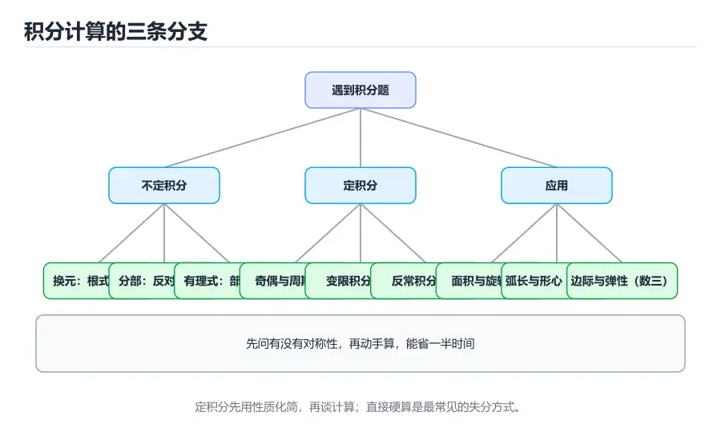

# 一元函数积分学：不定积分、定积分与几何应用



> 内容更新时间：2026-10-06 · 学习阶段：进阶 · 预计用时：45 分钟

## 本节知识框架

**课程定位**：所属分类 `kaoyan_math`（考研数学），课程主题 `一元函数积分学`，学习阶段 进阶，建议用时 45 分钟。三种卷种都考，且是整张卷子的算力底座：数学一与数学二在此追加定积分的几何应用与反常积分，数学三在此追加边际、弹性与总成本的经济应用。

积分的白话含义是「把无数小段累加起来」。不定积分回答「谁的导数是它」，是一道逆向的求导题；定积分回答「这条曲线下面有多少」，是一个和式的极限。考研把这两件事缝合在一起：牛顿—莱布尼茨公式让定积分靠不定积分落地，变限积分又把定积分变成一个新的函数，可以再次求导。这一来一回是选择题最爱考的机关。

配图把积分题拆成三条分支：不定积分看换元、分部、有理式；定积分先看奇偶与周期、再看变限与反常；应用分支管面积、旋转体积、弧长、形心与经济量。图的注记就是本节最重要的一句话：先问有没有对称性，再动手算。

**学完本节应当能够**

- 拿到一个不定积分，在三十秒内判断该用第一换元、第二换元还是分部积分。
- 用奇偶性、周期性与区间再现把定积分先化简再计算，并说清每条性质的前提。
- 对三种形状的变限积分正确求导，尤其是上限含 x、被积函数也含 x 的情形。
- 用 p-判据判断反常积分收敛性，并解释为什么 ln x 是两个临界情形。
- 用圆盘法、柱壳法与帕普斯定理算同一个旋转体体积，并互相验算。

### 复习清单

- [ ] 不查表算出 ∫x ln x dx、∫e^(−x) sin x dx、∫dx/(x² − 1) 三个不定积分，并对结果求导验算。
- [ ] 写出 p-判据的两条结论：∫(1,+∞) dx/x^p 与 ∫(0,1) dx/x^p 各自的收敛范围，并说明 ∫(1,+∞) dx/x 为什么发散。
- [ ] 用两种方法算 y = x²、x = 1、y = 0 围成的区域绕 y 轴旋转的体积，确认结果都是 π/2。
- [ ] 推导一次区间再现公式 ∫0^π x f(sin x)dx = (π/2)∫0^π f(sin x)dx，说清它用了哪一步换元。

## 核心概念定义

| 术语 | 操作性定义 | 常见边界与风险 |
| --- | --- | --- |
| 原函数与不定积分 | 若 F′(x) = f(x)，则 F 是 f 的一个原函数；f 的全部原函数写成 ∫f(x)dx = F(x) + C。 | 定义区间必须连通。函数 1/x 在 (0,+∞) 与 (−∞,0) 上可以各带一个常数，两个 C 不一定相等。 |
| 基本积分表 | 由求导表反推的十二条：∫x^a dx = x^(a+1)/(a+1)（a ≠ −1）、∫dx/x = ln abs x、∫e^x dx = e^x、∫cos x dx = sin x、∫dx/(1+x²) = arctan x、∫dx/√(1−x²) = arcsin x 等。 | ∫dx/(1+x²) 与 ∫dx/√(1−x²) 只差一个根号，前者出 arctan、后者出 arcsin，代错就全错。 |
| 第一换元（凑微分） | 把 ∫g(φ(x))φ′(x)dx 认成 ∫g(u)du，u = φ(x)。核心是认出「函数与它的导数同时出现」。 | 凑出 du 后必须把剩下的 x 全部消掉；只要还残留 x，就是换元没做完。 |
| 第二换元 | 反过来令 x = ψ(t) 代入，把根式或复杂式子变简单，最后要把 t 换回 x。常见配方：√(a²−x²) 令 x = a sin t，√(a²+x²) 令 x = a tan t，√(x²−a²) 令 x = a sec t。 | 第二类换元必须声明 t 的范围使 ψ 单调可逆，否则回代会出现符号错误。 |
| 分部积分 | ∫u dv = uv − ∫v du，用于「两类不同函数相乘」。取 u 的顺序按「反对幂指三」：反三角、对数、幂、指数、三角，靠前的当 u。 | 选错 u 会让右边的积分更复杂；出现循环（如 ∫e^x cos x dx）时要把原式解出来而不是继续做下去。 |
| 有理函数积分 | 先把假分式除成真分式加多项式，再把分母因式分解做部分分式，最后逐段积分。 | 分母出现不可约二次因式 x²+px+q 时，分子要写成 Mx+N 待定，不能只写常数。 |
| 定积分 | ∫a^b f(x)dx = lim Σ f(ξi)Δxi，存在条件之一是 f 在 [a,b] 连续或有界且只有有限个间断点。 | 它是一个数，与积分变量字母无关：∫a^b f(x)dx = ∫a^b f(t)dt。下限大于上限时定义给出 ∫a^b = −∫b^a。 |
| 定积分的性质 | 线性、可加性（拆区间）、保号性（f ≥ 0 则积分 ≥ 0）、估值定理、积分中值定理 ∫a^b f = f(ξ)(b − a)。 | 积分中值定理要求 f 连续，ξ 落在闭区间 [a,b] 而不是开区间，用来估界时经常要补绝对值。 |
| 奇偶与周期 | 对称区间上奇函数积分为 0、偶函数积分翻倍；周期为 T 的函数在任意长度为 T 的区间上积分相等。 | 「对称区间」是奇偶性的前提，∫(−1)^2 f 对奇函数并不为 0；这两条是最常漏看的前提。 |
| 区间再现公式 | ∫0^a f(x)dx = ∫0^a f(a − x)dx；由此得 ∫0^π x f(sin x)dx = (π/2)∫0^π f(sin x)dx。 | 用的是 x → a − x 的对称换元，把 x 从被积函数里摘出来是它的唯一目的。 |
| 变限积分 | Φ(x) = ∫a^x f(t)dt。f 连续时 Φ 可导且 Φ′(x) = f(x)；上下限都是函数时对上下限各求导再相加。 | 被积函数里也含 x 时必须先拆项或换元把 x 移进积分限，不能直接套公式。 |
| 牛顿—莱布尼茨公式 | ∫a^b f(x)dx = F(b) − F(a)，F 为 f 的任一原函数。 | 前提是 f 在 [a,b] 上可积且 F 连续；被积函数在区间内有无穷间断点时属于反常积分，不能直接代端点。 |
| 反常积分 | 无穷区间 ∫a^(+∞) f 与无界函数（瑕积分）∫a^b f，都定义为「极限存在才叫收敛」。 | p-判据：∫(1,+∞) dx/x^p 当 p > 1 收敛、p ≤ 1 发散；∫(0,1) dx/x^p 当 p < 1 收敛、p ≥ 1 发散，两条方向相反。 |
| 面积与旋转体积 | 两曲线间面积 ∫(上 − 下)dx；绕 x 轴 V = π∫y²dx（圆盘），绕 y 轴柱壳 V = 2π∫x y dx；帕普斯定理 V = 2π d A。 | 圆盘与柱壳的轴是反的：绕哪个轴，柱壳法的半径就是到那个轴的距离 x 或 y，写错轴会差一个倍数。 |
| 弧长与形心 | 弧长 s = ∫√(1 + y′²)dx；平面区域形心 x̄ = (1/A)∫x·f(x)dx，ȳ = (1/A)∫f(x)²/2 dx。 | 形心公式对曲边梯形成立，ȳ 那一栏是「以 f(x) 为高的窄条的质心在 f/2」，写成 ∫f dx 就漏了平方与除以 2。 |
| 经济应用（数三） | 由边际量积分还原总量：∫0^q C′(q)dq = C(q) − C(0)；需求弹性 η = (x/p)·(dp/dx)。 | 边际是导数、总量是它的积分，固定成本 C(0) 不会被边际信息带出来，必须另外给出。 |

## 原理与运行机制

### 一、判断不定积分走哪条路

拿到 ∫f dx 先做三问：能不能凑出某个函数的导数？是不是两类不同函数相乘？是不是有理分式？

- **凑微分**：∫2x e^(x²)dx，认出 (x²)′ = 2x，令 u = x²，得 e^(x²) + C。∫dx/(x ln x) 同理，认出 (ln x)′ = 1/x，得 ln abs(ln x) + C。
- **分部**：∫x ln x dx，按「反对幂指三」把 ln x 取作 u，得 (x²/2)ln x − x²/4 + C。验算：求导得 x ln x + x/2 − x/2 = x ln x，与方括号内一致。
- **循环分部**：∫e^x cos x dx 连续分部两次会回到原式，设它为 I，得 I = e^x cos x + e^x sin x − I，解出 I = e^x(sin x + cos x)/2 + C。同理 ∫e^(−x) sin x dx = −e^(−x)(sin x + cos x)/2 + C，这一条在振荡衰减的题里反复出现。
- **部分分式**：1/(x² − 1) = ½[1/(x − 1) − 1/(x + 1)]，积分得 ½ ln abs((x − 1)/(x + 1)) + C。在 x = 2 处对它求导的数值检查为 0.333333，与 1/(2² − 1) 相符。
- **配方降次**：1/(x² + 2x + 2) = 1/((x + 1)² + 1)，直接出 arctan(x + 1)。分子分母同次时先做除法，例如 x²/(1 + x²) = 1 − 1/(1 + x²)，积分是 x − arctan x + C。

### 二、定积分先化简再算

化简的优先级高于计算，四条常用手段：

1. **奇偶**：∫(−1)^1 (x³ cos x + x²)dx，奇函数项整段为 0，剩 ∫(−1)^1 x²dx = 2/3。
2. **周期**：f 以 T 为周期，则 ∫a^(a+T) f = ∫0^T f，任意起点都一样。
3. **区间再现**：由 x → π − x 得 ∫0^π x f(sin x)dx = (π/2)∫0^π f(sin x)dx。取 f ≡ 1 与 f(u) = u 之外的最简例 f = sin：∫0^π x sin x dx = (π/2)∫0^π sin x dx = (π/2)·2 = π。数值积分给出的结果是 3.141593，与 π 吻合到小数点后六位。
4. **华里士公式**：∫0^(π/2) sin^n x dx，n 为奇数 5 时等于 (4·2)/(5·3) = 8/15 ≈ 0.533333；n 为偶数 6 时等于 (5·3·1)/(6·4·2)·(π/2) = 5π/32 ≈ 0.490874。两条数值都与数值积分一致，背下递推式比现场分部快得多。

### 三、变限积分求导的三种形状

设 f 连续，三种形状要分开处理：

- 上限是函数：Φ(x) = ∫0^(x²) (sin t / t)dt，则 Φ′(x) = (sin(x²)/x²)·2x = 2 sin(x²)/x。先代上限、再乘上限的导数，两步缺一不可。
- 上下限都含 x：Φ(x) = ∫x^(x²) f(t)dt，则 Φ′(x) = f(x²)·2x − f(x)·1，拆成两个变限积分再各求导。
- 被积函数也含 x：Φ(x) = ∫0^x (x − t)f(t)dt。这里的 x 对积分变量 t 是常数，先把括号拆开成 x∫0^x f(t)dt − ∫0^x t f(t)dt，再乘积求导，得 Φ′(x) = ∫0^x f(t)dt，Φ″(x) = f(x)。直接把 x 当成 t 求导是本节错得最多的一处。

### 四、反常积分的判敛

两条 p-判据方向相反，用一张对照记：

| 类型 | 形式 | 收敛条件 | 发散条件 | 记忆线索 |
| --- | --- | --- | --- | --- |
| 无穷区间 | ∫(1,+∞) dx/x^p | p > 1 | p ≤ 1 | 尾部要衰减得比 1/x 更快 |
| 瑕积分 | ∫(0,1) dx/x^p | p < 1 | p ≥ 1 | 奇点处翘起得比 1/x 更缓 |

临界情形 p = 1 都落在 ln：∫(1,+∞) dx/x = ln x 趋于无穷，∫(0,1) dx/x = −ln x 也趋于无穷，所以 p = 1 两栏都写发散。典型收敛值：∫1^(+∞) dx/x² = 1；∫0^1 dx/√x = 2√x 从 0 到 1 等于 2；∫0^(+∞) dx/(1 + x²) = π/2；∫0^(+∞) x e^(−x)dx = 1；∫0^(+∞) e^(−x²)dx = √π/2 ≈ 0.886227。最后一条在实数范围里算不出初等原函数，但收敛性由 e^(−x²) ≤ e^(−x)（x ≥ 1）与 0 到 1 段的有界性保证。

### 五、几何应用：同一个旋转体算三遍

取区域 D：y = x²、x = 1、y = 0 围成的曲边三角形，面积 A = ∫0^1 x²dx = 1/3。

- **绕 x 轴（圆盘法）**：V = π∫0^1 (x²)²dx = π·(1/5) = π/5 ≈ 0.628319。
- **绕 y 轴（柱壳法）**：V = 2π∫0^1 x·x²dx = 2π·(1/4) = π/2 ≈ 1.570796。
- **绕 y 轴（垫片法）**：对 y 积分，外半径 1、内半径 √y，V = π∫0^1 (1 − y)dy = π(1 − 1/2) = π/2，与柱壳法一致，可当自查。
- **帕普斯定理验算**：形心 x̄ = (1/A)∫0^1 x·x²dx = (1/4)/(1/3) = 3/4，ȳ = (1/A)∫0^1 (x²)²/2 dx = (1/10)/(1/3) = 3/10，于是 V = 2π x̄ A = 2π·(3/4)·(1/3) = π/2。三种算法得到同一个数，说明公式与代点都没错。
- **弧长**：y = x² 在 [0,1] 上 s = ∫0^1 √(1 + 4x²)dx = √5/2 + (1/4)ln(2 + √5) = 1.118034 + 0.360909 ≈ 1.478943，数值积分给出的同样是 1.478943。
- **静水压力与功**（数一）：把力写成「压强 × 薄条面积」再积分，例如深度 h 处宽度 w(h) 的薄板，压力 P = ∫ρg h w(h)dh；关键是先把微元写对，积分只是收尾。

## 自测题与参考答案

下面 6 道题由本课题库直接生成，题号与「考点精讲」一一对应；建议先写下自己的答案与推理，再核对参考答案里的字母与原文。

### 自测 1

设 Φ(x) = ∫0^(x²) (sin t)/t dt，则 Φ′(x) 等于？

- A. sin(x²)/x²
- B. 2x sin(x²)
- C. 2 sin(x²)/x
- D. sin(x²)/(2x)

**参考答案**：C，即「2 sin(x²)/x」

### 自测 2

按 p-判据，下列两组反常积分都收敛的是？

- A. ∫(1,+∞) dx/x² 与 ∫(0,1) dx/√x
- B. ∫(1,+∞) dx/x 与 ∫(0,1) dx/x²
- C. ∫(1,+∞) dx/√x 与 ∫(0,1) dx/x
- D. ∫(0,+∞) dx/(1+x) 与 ∫(1,+∞) dx/x³

**参考答案**：A，即「∫(1,+∞) dx/x² 与 ∫(0,1) dx/√x」

### 自测 3

用区间再现公式，定积分 ∫0^π x sin x dx 的值是？

- A. 0，因为 sin x 在 [0,π] 上左右对称
- B. π/2
- C. 2
- D. π

**参考答案**：D，即「π」

### 自测 4

阅读下面的 Python 代码，三行打印合起来输出的数值依次是？

- A. 0.386294，0.62832 与 1.5708
- B. 0.636294，0.62832 与 1.5708
- C. 0.386294，1.5708 与 0.62832
- D. 0.386294，0.62832 与 1.57079

题面代码：

```python
import math

def integral_ln(x):
    return x * math.log(x) - x

print(round(integral_ln(2) - integral_ln(1), 6))
print(round(math.pi * 1 / 5, 5))
print(round(math.pi / 2, 5))
```

**参考答案**：A，即「0.386294，0.62832 与 1.5708」

### 自测 5

关于定积分的性质与变限积分，下列说法正确的是？

- A. f 在 [a,b] 连续且 ∫a^b f(x)dx = 0，不能由此推出 f 在区间上恒为 0
- B. ∫0^1 x f(x²)dx 换元后等于 ∫0^1 f(u)du
- C. f 连续时变限积分 Φ(x) = ∫a^x f(t)dt 可导，且 Φ′(x) = f(x)
- D. f 为奇函数时 ∫(−1)^2 f(x)dx 一定等于 0
- E. 周期为 T 的函数在任意长度为 T 的区间上的积分都相等

**参考答案**：A C E，即 A「f 在 [a,b] 连续且 ∫a^b f(x)dx = 0，不能由此推出 f 在区间上恒为 0」 → C「f 连续时变限积分 Φ(x) = ∫a^x f(t)dt 可导，且 Φ′(x) = f(x)」 → E「周期为 T 的函数在任意长度为 T 的区间上的积分都相等」

### 自测 6

把「求曲线围成区域的旋转体体积」四个动作按先后顺序排列：

- A. 选定圆盘法或柱壳法，写出体积微元
- B. 画草图并解出交点，确定积分限与被积区域
- C. 计算定积分，并用另一种方法复核数值
- D. 把边界整理成 y = f(x) 或 x = g(y)，选定积分变量

**参考答案**：B D A C，即 B「画草图并解出交点，确定积分限与被积区域」 → D「把边界整理成 y = f(x) 或 x = g(y)，选定积分变量」 → A「选定圆盘法或柱壳法，写出体积微元」 → C「计算定积分，并用另一种方法复核数值」

## 考点精讲

逐题复述题干、选项原文、答案字母（A 即下标 0）与判断依据，文字与本课题库 JSON 完全一致，判卷以这里列出的正确项为准。

### 考点 1

- **题干**：设 Φ(x) = ∫0^(x²) (sin t)/t dt，则 Φ′(x) 等于？
- **选项原文**：A. sin(x²)/x²　B. 2x sin(x²)　C. 2 sin(x²)/x　D. sin(x²)/(2x)
- **答案**：C
- **正确项原文**：2 sin(x²)/x
- **判断依据**：本题正确项是「2 sin(x²)/x」。变上限求导分两步：先把被积函数里的 t 换成上限 x²，得到 sin(x²)/x²；再乘上限对 x 的导数 2x，两者相乘约掉一个 x 就是 2 sin(x²)/x。干扰项「sin(x²)/x²」只做了第一步，把内层导数丢了；干扰项「2x sin(x²)」做了第二步却把被积函数代回时漏掉分母的 x²；干扰项「sin(x²)/(2x)」把 2x 除到了分母上，方向反了。

### 考点 2

- **题干**：按 p-判据，下列两组反常积分都收敛的是？
- **选项原文**：A. ∫(1,+∞) dx/x² 与 ∫(0,1) dx/√x　B. ∫(1,+∞) dx/x 与 ∫(0,1) dx/x²　C. ∫(1,+∞) dx/√x 与 ∫(0,1) dx/x　D. ∫(0,+∞) dx/(1+x) 与 ∫(1,+∞) dx/x³
- **答案**：A
- **正确项原文**：∫(1,+∞) dx/x² 与 ∫(0,1) dx/√x
- **判断依据**：本题正确项是「∫(1,+∞) dx/x² 与 ∫(0,1) dx/√x」。无穷区间那一条要求 p > 1，x² 的 p = 2 满足，值恰为 1；瑕点在 0 那一条要求 p < 1，1/√x 即 p = 1/2 满足，值为 2。两条判据方向相反，是这道题唯一的机关。干扰项「∫(1,+∞) dx/x 与 ∫(0,1) dx/x²」两个都踩在临界或发散侧，前者原函数是 ln x 趋于无穷；干扰项「∫(1,+∞) dx/√x 与 ∫(0,1) dx/x」把两个 p 用到了相反的区间上；干扰项「∫(0,+∞) dx/(1+x) 与 ∫(1,+∞) dx/x³」里第二个收敛而第一个的原函数是 ln(1+x)，同样发散。

### 考点 3

- **题干**：用区间再现公式，定积分 ∫0^π x sin x dx 的值是？
- **选项原文**：A. 0，因为 sin x 在 [0,π] 上左右对称　B. π/2　C. 2　D. π
- **答案**：D
- **正确项原文**：π
- **判断依据**：本题正确项是「π」。令 x → π − x 可得 I = ∫0^π (π − x) sin x dx，与原式相加得 2I = π∫0^π sin x dx = 2π，于是 I = π，数值积分 3.141593 与之吻合。干扰项「0，因为 sin x 在 [0,π] 上左右对称」把对称轴 π/2 当成了关于原点的奇对称，sin x 在这一段上始终非负，积分不可能为 0；干扰项「π/2」是公式里 (π/2)∫0^π f(sin x)dx 的系数，被当成了最终结果；干扰项「2」只是 ∫0^π sin x dx 本身的值，少乘了那个 π/2。

### 考点 4

- **题干**：阅读下面的 Python 代码，三行打印合起来输出的数值依次是？
- **选项原文**：A. 0.386294，0.62832 与 1.5708　B. 0.636294，0.62832 与 1.5708　C. 0.386294，1.5708 与 0.62832　D. 0.386294，0.62832 与 1.57079
- **答案**：A
- **正确项原文**：0.386294，0.62832 与 1.5708
- **判断依据**：本题正确项是「0.386294，0.62832 与 1.5708」。integral_ln 是 ln x 的原函数 x ln x − x，差值 (2 ln 2 − 2) − (−1) = 2 ln 2 − 1 ≈ 0.386294，正好是 ∫1^2 ln x dx；后两行分别是 π/5 与 π/2 保留 5 位小数的结果，对应同一个曲边三角形绕 x 轴与绕 y 轴的体积。干扰项「0.636294，0.62832 与 1.5708」把 ∫1^2 x ln x dx 的值 2 ln 2 − 3/4 当成了 ∫1^2 ln x dx；干扰项「0.386294，1.5708 与 0.62832」把绕 x 轴与绕 y 轴两个体积调了顺序，代码里 π*1/5 先打印；干扰项「0.386294，0.62832 与 1.57079」多留了一位小数，round 到 5 位时 π/2 输出的是 1.5708。

### 考点 5

- **题干**：关于定积分的性质与变限积分，下列说法正确的是？
- **选项原文**：A. f 在 [a,b] 连续且 ∫a^b f(x)dx = 0，不能由此推出 f 在区间上恒为 0　B. ∫0^1 x f(x²)dx 换元后等于 ∫0^1 f(u)du　C. f 连续时变限积分 Φ(x) = ∫a^x f(t)dt 可导，且 Φ′(x) = f(x)　D. f 为奇函数时 ∫(−1)^2 f(x)dx 一定等于 0　E. 周期为 T 的函数在任意长度为 T 的区间上的积分都相等
- **答案**：A C E
- **正确项原文**：A. f 在 [a,b] 连续且 ∫a^b f(x)dx = 0，不能由此推出 f 在区间上恒为 0；C. f 连续时变限积分 Φ(x) = ∫a^x f(t)dt 可导，且 Φ′(x) = f(x)；E. 周期为 T 的函数在任意长度为 T 的区间上的积分都相等
- **判断依据**：多选题要同时选中「f 在 [a,b] 连续且 ∫a^b f(x)dx = 0，不能由此推出 f 在区间上恒为 0」、「f 连续时变限积分 Φ(x) = ∫a^x f(t)dt 可导，且 Φ′(x) = f(x)」与「周期为 T 的函数在任意长度为 T 的区间上的积分都相等」。第一项的反例是任意关于区间中点反对称的连续函数，正负面积相互抵消；第二项是微积分基本定理的标准叙述，条件是 f 连续而不是可积；第三项说明周期函数积分与起点无关，常用于把 ∫(−π/2)^(π/2) 换成 ∫0^T。干扰项「∫0^1 x f(x²)dx 换元后等于 ∫0^1 f(u)du」漏了系数：u = x² 时 du = 2x dx，正确结果是 (1/2)∫0^1 f(u)du；干扰项「f 为奇函数时 ∫(−1)^2 f(x)dx 一定等于 0」用错了前提，奇函数积分为 0 要求区间关于原点对称，[−1, 2] 并不对称。

### 考点 6

- **题干**：把「求曲线围成区域的旋转体体积」四个动作按先后顺序排列：
- **选项原文**：A. 选定圆盘法或柱壳法，写出体积微元　B. 画草图并解出交点，确定积分限与被积区域　C. 计算定积分，并用另一种方法复核数值　D. 把边界整理成 y = f(x) 或 x = g(y)，选定积分变量
- **答案**：B D A C
- **正确序号**：B D A C
- **作答顺序原文**：B「画草图并解出交点，确定积分限与被积区域」 → D「把边界整理成 y = f(x) 或 x = g(y)，选定积分变量」 → A「选定圆盘法或柱壳法，写出体积微元」 → C「计算定积分，并用另一种方法复核数值」
- **判断依据**：本题顺序是「画草图并解出交点，确定积分限与被积区域」 → 「把边界整理成 y = f(x) 或 x = g(y)，选定积分变量」 → 「选定圆盘法或柱壳法，写出体积微元」 → 「计算定积分，并用另一种方法复核数值」。区域没画对，积分限与上下位置关系就无从谈起；积分变量选定之后才谈得上选哪种体积微元，最后一步复核在这道题里可以是垫片法对柱壳法，两者都得 π/2 才算落稳。

## 典型应用场景

| 场景 | 典型输入或前提 | 期望产物 |
| --- | --- | --- |
| 求平面图形面积 | 两条曲线或曲线与坐标轴围成区域 | 先解交点分区，写 ∫(上 − 下)dx 或 ∫(右 − 左)dy，结果必须为正。 |
| 求旋转体体积 | 区域绕坐标轴旋转 | 绕 x 轴用 π∫y²dx，绕 y 轴用 2π∫x y dx，再用第二种方法复核。 |
| 求弧长与形心（数一） | 给出光滑曲线或曲边梯形 | s = ∫√(1 + y′²)dx；形心用 x̄ = (1/A)∫x f dx、ȳ = (1/A)∫f²/2 dx。 |
| 变限积分的极限题 | 分子分母都是积分式 | 判定 0/0 后用洛必达，把积分求导换成被积函数代上限。 |
| 定积分估界与比较 | 给出两个函数的大小关系 | 用保号性与估值定理比大小，或写出 m(b − a) ≤ ∫ ≤ M(b − a)。 |
| 反常积分判敛 | 含幂函数、指数或根式的无穷或瑕积分 | 找出所有奇点，逐个套 p-判据或与已知收敛积分做比较。 |
| 经济应用（数三） | 边际成本、边际收益、需求函数 | 由边际量积分还原总增量，减去固定成本得总量；弹性写成 (x/p)(dp/dx)。 |
| 物理应用（数一、数二） | 变力做功、水压力、引力 | 先写微元 dW = F(x)dx 或 dP = ρg h w(h)dh，再定限积分。 |

## 代码/协议/SQL 示例

数值积分不依赖原函数，是验算手算结果最省事的办法。下面这段代码把本节的四个关键数值全部重算一遍。

```python
import math

def simpson(a, b, n, fn):
    if n % 2:
        n += 1
    h = (b - a) / n
    s = fn(a) + fn(b)
    for i in range(1, n):
        s += fn(a + i * h) * (4 if i % 2 else 2)
    return s * h / 3

ln_int = lambda x: math.log(x)
print(round(simpson(1.0, 2.0, 2000, ln_int), 6))
print(round(simpson(1.0, 2.0, 2000, lambda x: x * math.log(x)), 6))

print(round(math.pi * simpson(0.0, 1.0, 2000, lambda x: x ** 4), 6))
print(round(2.0 * math.pi * simpson(0.0, 1.0, 2000, lambda x: x ** 3), 6))

print(round(simpson(0.0, math.pi, 2000, lambda x: x * math.sin(x)), 6))
print(round(simpson(0.0, 1.0, 2000, lambda x: math.sqrt(1.0 + 4.0 * x * x)), 6))
print(round(simpson(1.0, 1.0e4, 200000, lambda x: 1.0 / (x * x)), 4))
```

运行结果：

```text
0.386294
0.636294
0.628319
1.570796
3.141593
1.478943
0.9999
```

第一行是 ∫1^2 ln x dx，与手算的 2 ln 2 − 1 完全一致；第二行是 ∫1^2 x ln x dx，等于 2 ln 2 − 3/4，两行只差一个 x 因子，结果却不同，正好用来区分自测 4 里的两个数值。第三、四行是同一个曲边三角形绕 x 轴与绕 y 轴的体积，分别是 π/5 与 π/2。第五行确认区间再现公式给出 π。第六行是 y = x² 在 [0,1] 上的弧长。最后一行把 ∫1^(1e4) dx/x² 截断到有限上限，得到 0.9999，与 ∫1^(+∞) dx/x² = 1 相差 1e−4；这个差额正好是尾部 1/b，说明截断误差的量级就是被舍掉的那一段。

## 时间/空间复杂度或性能分析

| 题型 | 标准动作数 | 常见耗时 | 提速点 |
| --- | --- | --- | --- |
| 凑微分型不定积分 | 认出内层函数、写 du、回代 | 1~2 分钟 | 背 12 条基本积分表与 6 个常用凑微分式 |
| 分部积分 | 选 u、算 dv、拆一次积分 | 3~4 分钟 | 用「反对幂指三」一次定序，不来回试 |
| 有理函数积分 | 除法化假分式、分解分母、待定系数 | 5~8 分钟 | 先用对称技巧拆分子，能省掉一半待定系数 |
| 定积分化简计算 | 判奇偶、找周期、套区间再现 | 2~3 分钟 | 动手前先花 10 秒扫一遍对称性 |
| 变限积分求导 | 分形状、代上限、乘内层导数 | 2 分钟 | 见到被积函数含 x 先拆项，再不求导 |
| 反常积分判敛 | 标出全部奇点、逐个套 p-判据 | 2~3 分钟 | 把 p = 1 单独记成「两边都发散」 |
| 旋转体体积 | 画图、定限、选法、复核 | 6~10 分钟 | 用帕普斯定理或另一种方法做一次快速验算 |
| 数值验算脚本 | 辛普森一次循环 O(n) | 秒级 | n 取 2000 已有 6 位有效数字，无穷区间换元后再积 |

辛普森公式的截断误差是 O(h⁴)，把步长减半误差约缩到 1/16；表中所有闭式与数值结果相减都在 1e−6 以内。数无穷区间时先把 x = 1/u 换代回有限区间，比直接截断到 1e4 更稳，因为截断项 1/b 会以 1e−4 的量级留在结果里。

## 常见误区与易错点

| 容易踩的做法 | 实际现象 | 原因与正确做法 |
| --- | --- | --- |
| 不定积分漏写常数 C | 填空与选择题直接扣分 | 写完立刻补 C，再检查 C 是否要分区间各写一个。 |
| 换元后没把 x 换干净 | 结果里同时出现 x 与 u | 换元是双向的：积分完必须回代，答案里只允许剩下原来的变量。 |
| 变限积分求导漏乘内层导数 | 少一个 2x 之类的因子 | 记住「代上限，再乘上限的导数」两步连做。 |
| 被积函数含 x 却直接求导 | 得到一个错得离谱的表达式 | 先把 x 提出积分号或换元，使 x 只出现在积分限上。 |
| 奇偶性用在不对称区间 | 该非零的积分算成 0 | 奇偶化简只在关于原点对称的区间上成立。 |
| 两条 p-判据记反方向 | 收敛判成发散 | 无穷区间要 p > 1，瑕点附近要 p < 1，用 ln x 做临界记忆。 |
| 瑕点没找全 | 把发散积分算成收敛 | 先看分母零点、对数真数趋零、根号内趋零，再决定拆几段。 |
| 圆盘法与柱壳法的轴写反 | 体积差一个 π 或倍数 | 绕哪个轴，柱壳半径就是到那个轴的距离，用垫片法复核一次。 |
| 形心 ȳ 写成 (1/A)∫f dx | 形心偏高 | 窄条质心在高的一半处，正确式子是 (1/A)∫f(x)²/2 dx。 |
| 弧长公式漏开方或漏平方 | 数值偏小 | s = ∫√(1 + (y′)²)dx，先写出 y′ 再整体平方。 |
| 反常积分直接代端点 | 出现 ln 0 之类的非法值 | 永远写成极限，先判敛再算值。 |

### 现场 1：把 ∫0^x (x − t)f(t)dt 求导成 (x − x)f(x)

**症状**：对被积函数含参数 x 的变限积分，直接套用「把上限代进被积函数」，得到恒为 0 的导数。

**根因与修复**：这个式子里的 x 对积分变量 t 而言是常数，它不在被积函数的 t 位置上。正确做法是先拆成 x∫0^x f(t)dt − ∫0^x t f(t)dt，再对第一项用乘积求导，得 Φ′(x) = ∫0^x f(t)dt，再求一次导才得 f(x)。凡是带卷积形状的积分（∫0^x (x − t)f(t)dt 就是 f 与常函数 1 的卷积）都要先拆再导。

**自检**：给出 ∫0^x (x − t)² f(t)dt，能否在两步内求出它的二阶导数并说明每一步用了什么法则。

### 现场 2：分部积分选错 u 导致越做越复杂

**症状**：算 ∫x ln x dx 时把 u 取成 x，得到 ∫x²/(2x)dx 之后再绕回来。

**根因与修复**：「反对幂指三」给出取 u 的优先级，对数排在幂之前，所以 u = ln x、dv = x dx，一次分部就结束。反过来若把 ln x 放进 dv，需要积分 ln x 本身，反而更麻烦。两条经验：多项式乘指数或多项式乘三角，把多项式当 u；出现 ln x 或反三角，它们一定当 u，因为没有更简单的原函数。

**自检**：对 ∫x² e^x dx、∫x cos 2x dx、∫arctan x dx 三题，各说出 u 与 dv 的取法并给出结果。

### 现场 3：旋转体两法结果不一致时不查错

**症状**：柱壳法算出 π/2，垫片法算出 π/3，随手抄一个交上去。

**根因与修复**：两种方法算同一个立体必须相等，不一致说明至少有一处写错。检查顺序是：交点与积分限、半径到旋转轴的距离、高（或内外半径）的表达式、以及最后一步定积分。本节的样板例子里三条路径（圆盘 π/5、柱壳 π/2、帕普斯 π/2）都闭合，才敢说结果可靠。

**自检**：把同一个区域改成绕直线 x = 1 旋转，能否用柱壳法写出新半径 1 − x 并算出新的体积。

## 与其他知识点的关系

**前置知识**：`kaoyan_math_single_diff`（不定积分是求导的逆运算，分部积分直接来自乘积求导法则）；`kaoyan_math_limit_continuity`（反常积分与变限积分的极限行为、连续函数可积的判据都在这里）；`kaoyan_math_overview`（数二不考三重积分与曲线曲面积分，但本节定积分的几何应用要求最深）。

**横向关联**：

- 矩阵与行列式（`kaoyan_math_matrix`）：二重积分换元时的雅可比行列式，正是一元换元 dx = ψ′(t)dt 的多元版本。
- 多元微分（`kaoyan_math_multivar_diff`）：变限积分求导与偏导数定义同构，把「对一个变量求导、其余当常数」这件事做到极致。

**后续延伸**：

- 重积分与曲线曲面积分（`kaoyan_math_multiple_integral`）：二重积分按累次计算，内层就是一次本节的一元定积分；对称性化简的规则也完全沿用。
- 常微分方程（`kaoyan_math_ode`）：一阶线性方程的通解公式 e^(−∫p dx)∫Q e^(∫p dx)dx 全靠凑微分与分部积分落地。
- 无穷级数（`kaoyan_math_series`）：幂级数在收敛区间内可以逐项积分与逐项求导，把积分法搬到级数上。
- 概率统计（`kaoyan_math_eigen_probability`）：期望 E(X) = ∫x f(x)dx、连续型全概率与分布函数求导，都是本节工具的直接应用。

## 术语速查

| 术语 | 一句话说明 |
| --- | --- |
| 凑微分 | 认出被积式里的 g(φ(x))φ′(x)，把 φ′(x)dx 写成 d(φ(x)) 的第一类换元法。 |
| 分部积分 | ∫u dv = uv − ∫v du，把乘积的积分转成另一个更好算的积分。 |
| 反对幂指三 | 分部积分选 u 的顺序口诀，反三角与对数优先，指数与三角靠后。 |
| 部分分式 | 把有理分式拆成一次与不可约二次因式上的简单分式之和，再逐项积分。 |
| 区间再现 | 用 x 换成 a − x 得到的对称式子，专治被积函数里乘了一个 x 的定积分。 |
| 华里士公式 | 0 到 π/2 上 sin 或 cos 的 n 次方积分的递推结果，奇偶两种写法要分开背。 |
| 变限积分 | 上限写成变量得到的函数，被积函数连续时它的导数就是被积函数代上限。 |
| p-判据 | 判断 1/x^p 型反常积分收敛与否的标准，无穷区间要 p 大于 1、瑕区间要 p 小于 1。 |
| 瑕点 | 被积函数趋于无穷的那个点，反常积分必须先找全瑕点再分段讨论。 |
| 柱壳法 | 绕 y 轴旋转时把区域切成竖薄条，体积微元写成 2π 乘半径乘高乘 dx。 |
| 帕普斯定理 | 旋转体体积等于 2π 乘形心到轴的距离再乘区域面积，用来快速复核。 |
| 边际量 | 数三概念，总量函数的导数，由边际还原总量要对它做定积分。 |

## 参考资料与复核

- [中国研究生招生信息网 数学考试分析](https://yz.chsi.com.cn/kyzx/jyxd/)
- [SymPy 微积分模块文档（integrate 与极限求导）](https://docs.sympy.org/latest/modules/calculus.html)
- [SymPy 官方文档首页](https://docs.sympy.org/latest/index.html)
- 最后复核：2026-10-04
- 下次复核：2027-07-24
- 来源性质：官方大纲与计算机代数系统文档，用于核对积分公式、判敛条件与公式前提
- 数值结论复核方式：本节的定积分值、旋转体积、弧长与反常积分截断误差均由辛普森数值积分独立重算

## 内容元数据

> 内容更新时间：2026-10-06 · 学习阶段：进阶 · 预计用时：45 分钟

- 内容版本：v2.0
- 最后更新：2026-10-06
- 学习阶段：进阶
- 适用环境：通用备考环境；数一需补弧长、形心与物理应用，数二对定积分几何应用要求最高，数三需额外练习边际、弹性与总成本还原。
- 内容来源：内置结构化课程与历年考研数学大纲整理
- 相关主题：antiderivative, substitution, integration by parts, improper integral, area and volume
- 质量版本：P0 测验标准 + P1 覆盖扩展 + P2 体验补全

- [ ] 能不查表写出十二条基本积分公式，并各配一道用它的例题。
- [ ] 能用圆盘法、柱壳法与帕普斯定理三种途径算出同一个旋转体体积。
- [ ] 能把含参数的变限积分先拆项再求导，并解释为什么不能直接代上限。
- [ ] 能对任意反常积分先列全奇点，再逐条套用 p-判据给出收敛性结论。
