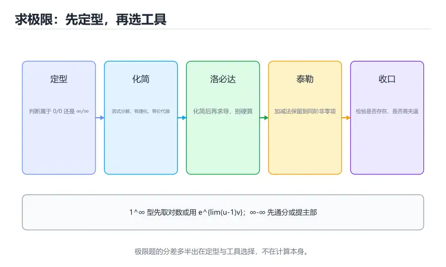

# 函数极限与连续：七种未定式与求极限的工具选择



> 内容更新时间：2026-10-06 · 学习阶段：基础 · 预计用时：40 分钟

## 本节知识框架

**课程定位**：所属分类 `kaoyan_math`（考研数学），课程主题 `函数极限与连续`，学习阶段 基础，建议用时 40 分钟。三种卷种都在这里重叠：数学一、数学二、数学三都考，而且它是每年客观题的第一道主力题。

主线只有一句：求极限不是拼计算量，而是拼「先定型、再选工具」。把一道题归入七种未定式之一，工具基本就定下来了；归错类型，后面洛必达求三遍导也做不出来。

**学完本节应当能够**

- 看到式子先判断类型（0/0、∞/∞、0·∞、∞−∞、1^∞、0^0、∞^0），并说出这一型该用哪一步。
- 讲清等价无穷小替换在什么位置安全、什么位置会算错，并能用一个反例证明自己的判断。
- 把「极限存在」与「左右极限」「数列极限」这三件事的关系写成自己的语言。
- 判断一个点是可去、跳跃、无穷还是振荡间断点，并说明补定义后是否连续。

### 复习清单

- [ ] 不看正文，把 lim(x→0) (1 − cos x)/x² 用三种方法各做一遍，答案都应是 1/2。
- [ ] 写出 lim(x→∞) (1 + 2/x)^(3x) 的类型名与最终值，并解释为什么不是 1。
- [ ] 举一个「等价无穷小用在加减里就出错」的具体例子，算出正确答案。
- [ ] 给 f(x) = x·sin(1/x)（补 f(0)=0）画一张「连续但不可导」的说明图，一句话讲清原因。

## 核心概念定义

| 术语 | 操作性定义 | 常见边界与风险 |
| --- | --- | --- |
| 函数极限 | 当 x 无限接近 x0（可以不相等）时，f(x) 无限接近某个确定的数 A，记作 lim(x→x0) f(x) = A。极限值只与「附近的行为」有关，与 f(x0) 有没有定义无关。 | 风险是把 lim(x→x0) f(x) 当成 f(x0) 来算。初等函数在定义区间内可以直接代值，其余情形代值就是错的起点。 |
| 左极限与右极限 | 分别记作 f(x0−0) 与 f(x0+0)，是 x 从两侧单独逼近时 f(x) 的趋向值。极限存在的充要条件是两侧都存在且相等。 | 带绝对值、分段、e^(1/x)、arctan(1/x) 的式子必须分侧算；只算一侧就下结论是这一类题的通用错法。 |
| 未定式 | 七种「代进去看不出一个数」的形状：0/0、∞/∞、0·∞、∞−∞、1^∞、0^0、∞^0。后四种都要先化成前两种。 | 「未定」不等于「不确定」，它只是说形状不够，必须靠变形把形状暴露出来。 |
| 无穷小 | 在给定变化过程中极限为 0 的量。两个无穷小 α、β 若 lim β/α = 0，说 β 是比 α 高阶的无穷小，记 β = o(α)。 | 无穷小是「过程量」而不是「很小的数」，不能把它当成 0 直接参与除法。 |
| 等价无穷小 | 若 lim α/β = 1，记 α ~ β。常用配对：x ~ sin x ~ tan x ~ arcsin x ~ arctan x ~ ln(1+x) ~ e^x − 1，1 − cos x ~ x²/2，(1+x)^a − 1 ~ a x。 | 替换只在乘除因子位置安全。加减时如果两个替换后的量恰好抵消，就要升到更高阶或用泰勒展开。 |
| 洛必达法则 | 对 0/0 或 ∞/∞ 型，若 lim f′(x)/g′(x) 存在（或为无穷），则 lim f(x)/g(x) 与它相等。 | 条件不满足时不能反着用：lim f′/g′ 不存在并不代表 lim f/g 不存在，例如 f = x + sin x、g = x 在 x→∞ 时导数比振荡但原比趋于 1。 |
| 泰勒公式（麦克劳林） | 把函数写成多项式加余项：e^x = 1 + x + x²/2! + x³/3! + …，sin x = x − x³/3! + …，ln(1+x) = x − x²/2 + x³/3 − …。加减法里用它，等于把「精度」显式写出来。 | 展开阶数不够会得到 0/0 的假答案；口诀是分母是 x 的几次，分子就展到几次。 |
| 夹逼准则 | 若在某邻域内 g(x) ≤ f(x) ≤ h(x)，且 g、h 极限同为 A，则 f 的极限也是 A。数列版同样成立。 | 上下界要「贴得住」：放缩太粗会让两侧极限不相等，白做一步。 |
| 单调有界准则 | 单调递增且有上界的数列必收敛（递减有下界同理）。极限值常由递推式两边取极限解出。 | 准则只保证存在，不能保证你算的就是它；先证单调有界，再解方程 L = φ(L)。 |
| 海涅定理 | lim(x→x0) f(x) = A 等价于「任取 x_n → x0 且 x_n ≠ x0，都有 f(x_n) → A」。 | 它的实战用法是否定：找两个不同的子列得到不同极限，就能判定极限不存在。 |
| 连续 | f 在 x0 连续 ⇔ lim(x→x0) f(x) = f(x0)，即极限存在、有定义、两者相等三件事同时成立。 | 三个条件缺一就断；把「有定义」当成「极限等于函数值」是常见误区。 |
| 间断点分类 | 第一类：左右极限都存在（相等为可去，不等为跳跃）；第二类：至少一侧极限不存在（无穷、振荡等）。 | 分类依据是左右极限的「存在性」，不是函数在该点是否有定义。 |
| 闭区间上连续函数的三大定理 | 有界性与最值定理、介值定理、零点定理。零点定理：f 在 [a,b] 连续且 f(a)·f(b) < 0，则 (a,b) 内至少有一个根。 | 开区间或不连续时结论会失效；证明「唯一根」要再叠一条单调性。 |

## 原理与运行机制

### 第一步：拿一个最小的例子把三种工具都跑一遍

求 lim(x→0) (1 − cos x)/x²。

**做法 A（等价无穷小）**：1 − cos x ~ x²/2，于是原式 = lim (x²/2)/x² = 1/2。三行结束。

**做法 B（洛必达）**：这是 0/0 型，分子分母各求一次导得 lim(x→0) sin x/(2x) = 1/2（再用一次 sin x ~ x 或再一次洛必达）。

**做法 C（泰勒）**：cos x = 1 − x²/2 + x⁴/24 + o(x⁴)，代入得 (x²/2 − x⁴/24 + …)/x² → 1/2。

三条路都到 1/2，但它们的「成本」不同：A 需要你把常用等价关系记牢；B 需要两次求导且要检查条件；C 需要正确的展开阶数。考场上优先 A，A 走不通（分母是加减结构）时立刻切 C。

### 第二步：定型，把七种未定式压成两种

0·∞ 与 ∞−∞ 都不是最终形状：0·∞ 写成 f/(1/g) 就变成 ∞/∞，∞−∞ 先通分或有理化就变成 0/0。指数三型（1^∞、0^0、∞^0）统一用取对数处理：

lim u^v = e^(lim v·ln u)，而 v·ln u 一定落在 0·∞ 型里。1^∞ 还有一条更快的通道：

若 u → 1、v → ∞，则 lim u^v = e^(lim (u − 1)·v)。

用这条算 lim(x→∞) (1 + 2/x)^(3x)：u − 1 = 2/x，v = 3x，乘积 = 6，答案 e^6 ≈ 403.4288。数值验证在 x = 10⁷ 处给 403.4286，与 e^6 差在万分位以内。

### 第三步：加减法里为什么要升阶

求 lim(x→0) (tan x − sin x)/x³。若按「tan x ~ x，sin x ~ x」直接替换，分子变成 x − x = 0，得到极限 0 —— 错。原因是替换后的主部互相抵消，真正起作用的是下一阶。正确做法是提因子：

tan x − sin x = tan x(1 − cos x) ~ x · x²/2 = x³/2，所以极限 = 1/2。

或者泰勒展开到三阶：tan x = x + x³/3 + …，sin x = x − x³/6 + …，差 = x³/2 + …，同样得 1/2。这条教训值得写成一句话：**乘除可换，加减看最低次非零项**。

### 第四步：数列极限的两条专属通道

数列没有「左右」，工具换成两条：

- **夹逼**：算 lim(n→∞) Σ(k=1..n) 1/√(n²+k)。把每一项的分母放大成 √(n²+n)、缩小成 √(n²+1)，得到 n/√(n²+n) ≤ S_n ≤ n/√(n²+1)，两端都趋于 1，故 S_n → 1。数值上 n = 10、1000、100000 时的和分别是 0.9739、0.9997、1.0000。
- **单调有界 + 递推**：x₁ = √2，x(n+1) = √(2 + x_n)。先由归纳法证 x_n < 2 且递增，则极限存在；对递推式两边取极限得 L = √(2+L)，即 L² − L − 2 = 0，取正根 L = 2。迭代 40 步的数值结果给 2.000000000000。

函数极限与数列极限之间由海涅定理连接：它的实战用法是**举反证不存在**。例如 lim(x→0) sin x/|x|，右极限 1、左极限 −1，故极限不存在，x = 0 是第一类里的跳跃间断点。

### 第五步：连续与间断的判定顺序

判定一个可疑点 x0，按四问走：有定义吗？极限存在吗？两者相等吗？两侧极限各自是什么形状？

- f(x) = x·sin(1/x)（补 f(0) = 0）：|x·sin(1/x)| ≤ |x| → 0，所以连续；但差商 (f(h) − f(0))/h = sin(1/h) 在 ±1 之间振荡，故不可导。这是一个「连续不一定可导」的标准样本。
- f(x) = 1/x 在 x = 0：两侧都趋于无穷，是第二类无穷间断点。
- f(x) = sin(1/x) 在 x = 0：极限不存在但不是无穷，是第二类振荡间断点。
- f(x) = (x² − 1)/(x − 1) 在 x = 1：极限 = 2 但无定义，补上 f(1) = 2 就连续，故为可去间断点。

### 第六步：闭区间连续定理怎么用

零点定理负责「存在」，单调性负责「唯一」。例：证 x³ + x − 1 = 0 在 (0,1) 内有且只有一个根。令 f(x) = x³ + x − 1，f(0) = −1 < 0，f(1) = 1 > 0，f 连续，故至少一根；又 f′(x) = 3x² + 1 > 0，f 严格递增，故至多一根。数值解出根为 0.68232780（把该值代回原式约为 −1e−16，验证通过）。

介值定理的常用考法是「证明存在 ξ 使 f(ξ) = 某个中间值」，写法是把目标值改写成某个辅助函数取 0，再用零点定理。

## 自测题与参考答案

下面 6 道题由本课题库直接生成，题号与「考点精讲」一一对应；建议先写下自己的答案与推理，再核对参考答案里的字母与原文。

### 自测 1

lim(x→0) (tan x − sin x)/x³ 的正确结果是？

- A. 极限值为 1/2
- B. 极限值为 1
- C. 极限值为 0
- D. 极限不存在

**参考答案**：A，即「极限值为 1/2」

### 自测 2

lim(x→∞) (1 + 2/x)^(3x) 的值最接近下面哪个数？

- A. 1.000，因为底数趋于 1
- B. 403.43，即 e 的 6 次方
- C. 20.09，即 e 的 3 次方
- D. 7.39，即 e 的 2 次方

**参考答案**：B，即「403.43，即 e 的 6 次方」

### 自测 3

求 lim(x→0) (tan x − sin x)/x³ 时，符合评分口径的变形做法是？

- A. 分别用 tan x ~ x 与 sin x ~ x 替换，直接把分子写成 0
- B. 把分子分母同乘 cos x，再把 sin x 整体换成 x²
- C. 提取因子写成 tan x(1 − cos x)，再用 x 与 x²/2 替换得 x³/2
- D. 判定分子是分母的高阶无穷小，因此极限等于 0

**参考答案**：C，即「提取因子写成 tan x(1 − cos x)，再用 x 与 x²/2 替换得 x³/2」

### 自测 4

函数 f(x) = sin x / |x| 在 x = 0 处无定义，该点属于哪一种间断点？

- A. 可去间断点，因为左右极限相等
- B. 无穷间断点，因为分母趋于 0
- C. 振荡间断点，因为分子反复变号
- D. 跳跃间断点，左极限 −1 而右极限 1

**参考答案**：D，即「跳跃间断点，左极限 −1 而右极限 1」

### 自测 5

阅读下面的 Python 代码，随着 n 变大，输出的数值稳定在哪个数上？

- A. 0.5，说明每一项单独取极限后再相加
- B. 0，说明根号的增长速度比项数更快
- C. 1，与夹逼准则推出的极限一致
- D. e，说明和式里含有指数增长

题面代码：

```python
import math
for n in (10, 1000, 100000):
    s = sum(1 / math.sqrt(n * n + k) for k in range(1, n + 1))
    print(n, round(s, 4))
```

**参考答案**：C，即「1，与夹逼准则推出的极限一致」

### 自测 6

关于闭区间上连续函数的三条定理，下面哪些说法是准确的？

- A. 在闭区间上连续的函数一定有界，并且能取到最大值与最小值
- B. 只在开区间内连续、两端函数值异号时，区间内部就一定有零点
- C. 连续函数在闭区间上能取到两端函数值之间的一切值
- D. 函数在闭区间上存在最大值，就足以说明它在该区间上连续

**参考答案**：AC，即 A「在闭区间上连续的函数一定有界，并且能取到最大值与最小值」 与 C「连续函数在闭区间上能取到两端函数值之间的一切值」


## 考点精讲

逐题复述题干、选项原文、答案字母（A 即下标 0）与判断依据，文字与本课题库 JSON 完全一致，判卷以这里列出的正确项为准。

### 考点 1

- **题干**：lim(x→0) (tan x − sin x)/x³ 的正确结果是？
- **选项原文**：A. 极限值为 1/2　B. 极限值为 1　C. 极限值为 0　D. 极限不存在
- **答案**：A
- **正确项原文**：极限值为 1/2
- **判断依据**：本题正确项是「极限值为 1/2」。分子提出 tan x 后写成 tan x(1 − cos x)，两个因子分别等价于 x 与 x²/2，于是分子是 x³/2，与分母同阶。干扰项「极限值为 0」来自最典型的错误：把 tan x 与 sin x 各换成 x 后写成 x − x = 0，主部抵消时等价无穷小必须升阶，改法是用泰勒展开到 x³ 或直接提因子。

### 考点 2

- **题干**：lim(x→∞) (1 + 2/x)^(3x) 的值最接近下面哪个数？
- **选项原文**：A. 1.000，因为底数趋于 1　B. 403.43，即 e 的 6 次方　C. 20.09，即 e 的 3 次方　D. 7.39，即 e 的 2 次方
- **答案**：B
- **正确项原文**：403.43，即 e 的 6 次方
- **判断依据**：本题正确项是「403.43，即 e 的 6 次方」。这是 1^∞ 型，用 lim u^v = e^{lim (u−1)v}：u − 1 = 2/x，v = 3x，乘积恒等于 6，所以结果是 e^6 ≈ 403.4288。干扰项「1.000，因为底数趋于 1」只看了底数没看指数，幂指函数两侧同时变化时必须先取对数，否则会把非 1 的答案读成 1。

### 考点 3

- **题干**：求 lim(x→0) (tan x − sin x)/x³ 时，符合评分口径的变形做法是？
- **选项原文**：A. 分别用 tan x ~ x 与 sin x ~ x 替换，直接把分子写成 0　B. 把分子分母同乘 cos x，再把 sin x 整体换成 x²　C. 提取因子写成 tan x(1 − cos x)，再用 x 与 x²/2 替换得 x³/2　D. 判定分子是分母的高阶无穷小，因此极限等于 0
- **答案**：C
- **正确项原文**：提取因子写成 tan x(1 − cos x)，再用 x 与 x²/2 替换得 x³/2
- **判断依据**：本题正确项是「提取因子写成 tan x(1 − cos x)，再用 x 与 x²/2 替换得 x³/2」。等价无穷小只能作用在乘除因子上，化成乘积之后两个因子各自的主部不再抵消，分母 x³ 也刚好对上。干扰项「分别用 tan x ~ x 与 sin x ~ x 替换，直接把分子写成 0」正是加减替换踩的坑，泰勒展到三阶同样能看出正确答案是 1/2。

### 考点 4

- **题干**：函数 f(x) = sin x / |x| 在 x = 0 处无定义，该点属于哪一种间断点？
- **选项原文**：A. 可去间断点，因为左右极限相等　B. 无穷间断点，因为分母趋于 0　C. 振荡间断点，因为分子反复变号　D. 跳跃间断点，左极限 −1 而右极限 1
- **答案**：D
- **正确项原文**：跳跃间断点，左极限 −1 而右极限 1
- **判断依据**：本题正确项是「跳跃间断点，左极限 −1 而右极限 1」。去掉绝对值分两侧算：x 趋于 0+ 时是 sin x/x → 1，x 趋于 0− 时 sin x/(−x) → −1，两侧都存在但不相等，正好落在第一类间断点的跳跃情形。干扰项「可去间断点，因为左右极限相等」把两侧当成同一个值，凡出现绝对值、e^(1/x)、分段表达式都要逐侧验证。

### 考点 5

- **题干**：阅读下面的 Python 代码，随着 n 变大，输出的数值稳定在哪个数上？
- **选项原文**：A. 0.5，说明每一项单独取极限后再相加　B. 0，说明根号的增长速度比项数更快　C. 1，与夹逼准则推出的极限一致　D. e，说明和式里含有指数增长
- **答案**：C
- **正确项原文**：1，与夹逼准则推出的极限一致
- **判断依据**：本题正确项是「1，与夹逼准则推出的极限一致」。这段代码算的是 Σ(k=1..n) 1/√(n²+k)，把分母放成 √(n²+n) 与 √(n²+1) 两个边界，两端都趋于 1，因此 n = 100000 时 round(s, 4) 直接输出 1.0。干扰项「0.5，说明每一项单独取极限后再相加」错在先对每项取极限再求和，n 个趋于 0 的项相加结果由项数与阶数共同决定，不能逐项极限。

### 考点 6

- **题干**：关于闭区间上连续函数的三条定理，下面哪些说法是准确的？
- **选项原文**：A. 在闭区间上连续的函数一定有界，并且能取到最大值与最小值　B. 只在开区间内连续、两端函数值异号时，区间内部就一定有零点　C. 连续函数在闭区间上能取到两端函数值之间的一切值　D. 函数在闭区间上存在最大值，就足以说明它在该区间上连续
- **答案**：AC
- **全部正确项**：A. 在闭区间上连续的函数一定有界，并且能取到最大值与最小值　C. 连续函数在闭区间上能取到两端函数值之间的一切值
- **判断依据**：多选题要逐条比对前提，本题选中的是「在闭区间上连续的函数一定有界，并且能取到最大值与最小值」与「连续函数在闭区间上能取到两端函数值之间的一切值」：前者是有界性与最值定理，后者是介值定理，两条都把闭区间加连续当成前提。第三条干扰描述把区间换成开区间后结论不一定成立，例如 f(x) = x 在 (0,1) 内就取不到端点处的值；第四条把最值定理的方向倒过来用，能取到最大值推不出连续。


## 典型应用场景

| 场景 | 典型输入或前提 | 期望产物 |
| --- | --- | --- |
| 客观题第一道计算 | 一个 0/0 或 1^∞ 型的封闭表达式 | 定型 → 一步变形 → 数值，控制在 2 分钟内。 |
| 分段函数连续性讨论 | 分段点处含参数 a、b | 由左右极限与函数值相等列出方程组求参数。 |
| 渐近线求解 | y = f(x) 的表达式 | 水平渐近线看 x→∞ 的极限，垂直渐近线找无穷间断点，斜渐近线算 lim f(x)/x 与 lim(f(x) − kx)。 |
| 级数判敛的前置检查 | 数项级数一般项 u_n | 先算 lim u_n，不为 0 直接判发散，省掉整套判别法。 |
| 导数定义题 | lim(h→0) [f(x0 + h) − f(x0 − h)]/(2h) | 认出这就是 f′(x0)，别自动补上「f 可导」之外的条件。 |
| 定积分定义题 | lim(n→∞) Σ f(k/n)·(1/n) | 化成 ∫₀¹ f(x) dx，前提是 f 可积。 |
| 方程根的存在性证明 | 连续函数 + 端点异号 | 零点定理给出存在，单调性给出唯一。 |

## 代码/协议/SQL 示例

下面这段脚本把本节出现过的四个结论都算一遍，输出可以直接和正文对照。第一个例子还顺手演示了「数值算极限」的失效边界。

```python
import math

def ratio(x):
    return (1 - math.cos(x)) / x ** 2

for x in (1e-2, 1e-4, 1e-6, 1e-8):
    print(x, round(ratio(x), 6))

n = 1000
s = sum(1 / math.sqrt(n * n + k) for k in range(1, n + 1))
print("squeeze sum:", round(s, 4))

x = 1e7
print("1^inf type:", round((1 + 2 / x) ** (3 * x), 3), math.exp(6))

t, L = math.sqrt(2), 0
for _ in range(40):
    t = math.sqrt(2 + t)
print("monotone bounded:", round(t, 12))
```

运行结果：

```text
0.01 0.499996
0.0001 0.5
1e-06 0.500044
1e-08 0.0
squeeze sum: 0.9997
1^inf type: 403.429 403.429
monotone bounded: 2.0
```

四行输出对应四个结论：极限是 1/2；夹逼的和趋于 1；1^∞ 型算出 e^6 ≈ 403.429；递推数列收敛到 2。最后一列 1e-8 的输出是 0.0，这不是数学结果，而是浮点误差：当 x 很小时 1 − cos x 的两个主位相减，有效数字几乎全被吃掉（称为「灾难性抵消」）。**数值验证只能确认量级，不能代替推导**；真要验证精度，用 `mpmath` 提高工作精度，或者改用恒等式 (1 − cos x)/x² = (1/2)·(sin(x/2)/(x/2))²。

## 时间/空间复杂度或性能分析

把「解一道极限题」当成一次计算，成本可以拆成三项：定型耗时、变形次数、每步的计算量。

| 工具 | 前置记忆成本 | 执行步数 | 失效风险 |
| --- | --- | --- | --- |
| 等价无穷小替换 | 需要记住十余条常用关系 | 1~2 步 | 加减抵消时必须升阶，否则得 0 |
| 洛必达 | 无 | 每次求导一步，常需 2~3 次 | 导数比更复杂或不存在时白做 |
| 泰勒展开 | 记住 5~6 个展开式 | 展开 + 合并同类项 | 阶数不够得到 0/0 |
| 夹逼准则 | 需要构造上下界 | 放缩 1 次 + 两端求极限 | 放缩过粗，两端极限不等 |
| 单调有界 | 需归纳法证明 | 证单调、证有界、解方程 | 只解方程不证存在，逻辑分丢光 |
| 数值验证 | 会写循环 | 常数时间 O(n)，n 取 10³ 量级即可 | 步长太小触发浮点抵消 |

数值实验的规模也是可量化的：夹逼例子里 n 从 10 增到 1000，误差从 2.6e−2 降到 2.5e−4，n 增到 10⁵ 时误差约 2.5e−6，与 1/n 量级一致。这说明「用数值猜极限」的收敛速度本身是可以估计的，看到误差按 1/n 缩小，就能确认猜出来的 1 是对的。

## 常见误区与易错点

| 容易踩的做法 | 实际现象 | 原因与正确做法 |
| --- | --- | --- |
| 见到分式就代值 | 得到 0/0 却写「极限为 0」 | 0/0 是形状而不是结论，先定型再变形。 |
| 加减法里直接换等价无穷小 | 分子被换成 0，答案算成 0 或不存在 | 先合并同类项或提因子，或泰勒到分母同阶。 |
| 不管条件就上洛必达 | 导数比振荡，误判原极限不存在 | 洛必达是充分而不是必要；导数比不存在时换路（夹逼、拆分）。 |
| 把 1^∞ 当成 1 | lim(x→∞)(1+2/x)^(3x) 写成 1 | 幂指函数先取对数，或用 e 的 (u−1)v 次方这条捷径，答案是 e^6。 |
| 用 x→0 代替左右极限 | 含绝对值的式子漏掉一侧 | 形如 sin x 除以 x 的绝对值这类式子必须分侧算，两侧不等即极限不存在。 |
| 认为等价可以套在复合里任意位置 | ln(sin x + x) 型算错 | 只在整体因子位置替换；括号内有加减时展开到有效阶。 |
| 记住「单调有界」却跳过证明 | 解出 L 但没证存在 | 先证单调与有界，再对递推式取极限解 L，并舍去不合理解。 |
| 把可去间断点当成第二类 | 分类题丢分 | 左右极限存在且相等但函数值不等或无定义，就是第一类可去。 |
| 零点定理只写「有根」 | 证明题步骤分不全 | 题目问「唯一根」时必须补 f′ > 0 的单调性论证。 |
| 数值验证取极小步长 | 输出 0 或乱跳 | 步长取 1e−2 到 1e−6，出现量级异常要想到浮点误差。 |

### 现场 1：把「极限为 0」当成「是无穷小」

**症状**：在 lim(x→0) x²·sin(1/x) 上写「因为 sin 有界所以极限不确定」。

**根因与修复**：无穷小乘有界量仍是无穷小，这是定理。这里 |x²·sin(1/x)| ≤ x² → 0，极限就是 0。有界量不破坏无穷小，但「无穷小乘无穷大」就未必，必须变形。

**自检**：能说出三个「无穷小 × 有界 = 无穷小」的例子并写出放缩不等式。

### 现场 2：等价关系背串

**症状**：把 1 − cos x 记成 x²，算出 (1 − cos x)/x² = 1。

**根因与修复**：正确关系是 1 − cos x ~ x²/2。记忆办法是把它交给泰勒：cos x = 1 − x²/2 + …，第一项非零项就是等价主部，系数 1/2 是自然带出来的。

**自检**：默写 8 条常用等价无穷小时，每条同时写出它的泰勒首项，两个来源互相校对。

### 现场 3：忽略「极限存在」与「函数值」

**症状**：分段题里只算 lim(x→0) f(x)，忘了和 f(0) 比较。

**根因与修复**：连续是「极限存在、有定义、相等」三件事同时成立，写答案时逐条打勾，缺一条就不连续。

**自检**：给一个含参数的分段函数，列出三个条件对应的三个方程，能解出参数就算过关。

## 与其他知识点的关系

**前置知识**：中学的因式分解、有理化、指数对数运算；`kaoyan_math_overview` 里对卷种范围的界定（数二在这里计算量要求最高）。

**横向关联**：

- 一元微分（`kaoyan_math_single_diff`）：导数本身就是差商的极限，等价无穷小与泰勒直接决定求导题的速度。
- 一元积分（`kaoyan_math_integral`）：定积分定义是黎曼和的极限，反常积分又回到极限语言。
- 无穷级数（`kaoyan_math_series`）：判敛第一步就是「一般项是否趋于 0」，用的正是本节的极限计算。

**后续延伸**：

- 多元微分（`kaoyan_math_multivar_diff`）：二重极限要沿任意路径一致，本节左右极限的思想升级为「沿任意方向趋近」。
- 常微分方程（`kaoyan_math_ode`）：解的渐近行为、稳定性判断都是求极限。
- 概率统计（`kaoyan_math_eigen_probability`）：分布函数在端点的连续性、大数定律的依概率收敛，都建立在本节定义之上。

## 术语速查

| 术语 | 一句话说明 |
| --- | --- |
| 未定式 | 代入后看不出结果七种形状的统称，需要先变形化成 0/0 或 ∞/∞ 再处理。 |
| 等价无穷小 | 同一变化过程中比值趋于 1 的两个无穷小，替换时只能作用在乘除因子上。 |
| 高阶无穷小 | β/α → 0 时记 β = o(α)，泰勒余项就是用这个符号写出被丢弃的部分。 |
| 洛必达法则 | 对 0/0 与 ∞/∞ 型把极限转化为导数比的极限，条件是导数比的极限存在或为无穷。 |
| 麦克劳林公式 | 在 x = 0 处展开的泰勒公式，加减型极限题里用来把主部逐阶摆出来。 |
| 夹逼准则 | 用上下两个同极限的函数（或数列）把目标夹住，从两侧推出中间的答案。 |
| 单调有界准则 | 单调且有界的数列必收敛，常配合递推式两边取极限求出具体的 L。 |
| 海涅定理 | 把函数极限翻译成「任何趋于该点的数列都收敛到同一个值」，用于判定极限不存在。 |
| 可去间断点 | 左右极限存在且相等，只是函数值缺定义或不等于该极限，补上即连续。 |
| 跳跃间断点 | 左右极限都存在但不相等，含绝对值的分式最容易造出这一类。 |
| 零点定理 | 闭区间上连续的函数在两端取值异号，则区间内部至少有一个零点。 |
| 介值定理 | 连续函数能取到端点函数值之间的任何数，是「存在某个 ξ」类证明的常用底座。 |

## 参考资料与复核

- [研招网 硕士研究生招生考试大纲](https://yz.chsi.com.cn/kyzx/jyxd/)
- [MIT OpenCourseWare 18.01SC 单变量微积分](https://ocw.mit.edu/courses/18-01sc-single-variable-calculus-fall-2010/)
- [UC Davis 数学系 B. Hunter《Introduction to Real Analysis》](https://www.math.ucdavis.edu/~hunter/intro_analysis_pdf/)
- 最后复核：2026-10-04
- 下次复核：2027-01-10
- 来源性质：官方大纲渠道 + 公开课与教材讲义，用于核对范围与定理表述
- 数值结论复核方式：所有近似值均由脚本重算，误差量级与正文一致

## 内容元数据

> 内容更新时间：2026-10-06 · 学习阶段：基础 · 预计用时：40 分钟

- 内容版本：v2.0
- 最后更新：2026-10-06
- 学习阶段：基础
- 适用环境：通用备考环境；本课覆盖数学一、数学二、数学三共同的极限与连续要求。
- 内容来源：内置结构化课程与历年考研数学大纲整理
- 相关主题：limits, continuity, indeterminate forms, equivalent infinitesimals
- 质量版本：P0 测验标准 + P1 覆盖扩展 + P2 体验补全

- [ ] 能不看正文，把七种未定式各自的转化目标说全，并各配一个例子。
- [ ] 能用代码复现本节四个数值结论，并解释 1e−8 处输出为 0 的原因。
- [ ] 能对任意可疑点走完「有定义、极限存在、两者相等」三问，写出间断类型。
- [ ] 能完整写出一道零点定理证明题的步骤，包括存在性与唯一性两部分。
