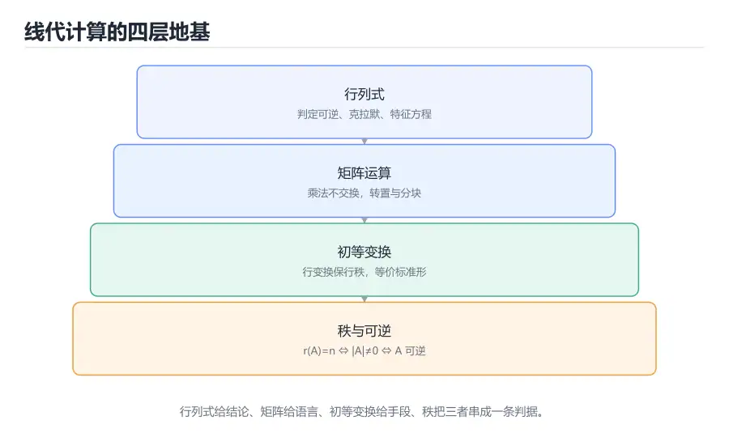

# 行列式、矩阵与线性方程组：线性代数的四层计算地基



> 内容更新时间：2026-10-06 · 学习阶段：基础 · 预计用时：40 分钟

## 本节知识框架

**课程定位**：所属分类 `kaoyan_math`（考研数学），课程主题 `行列式与矩阵`，学习阶段 基础，建议用时 40 分钟。三种卷种在这里范围一致，是整门线性代数里最值得先攻下的一块。

可以把线性代数想成一栋四层楼：行列式给结论（能不能逆、特征方程长什么样），矩阵给语言（把方程组压缩成一个符号），初等变换给手段（所有计算都能靠行变换走一遍），秩把前三层串成一条判据。

**学完本节应当能够**

- 用按行展开、化上三角、加边法三种方式算同一个三阶行列式，并说出各自什么时候更快。
- 讲清「矩阵乘法不满足交换律」的具体反例，并据此检查自己的推导有没有偷换顺序。
- 把初等行变换与可逆矩阵、秩、方程组解的存在性连成一条判据链。
- 看到一个含参数的方程组，直接按 r(A) 与 r(A|b) 的大小关系给出解的个数。

### 复习清单

- [ ] 手算 |1 2 3; 2 4 5; 3 5 6| = −1，并用行变换再算一遍核对。
- [ ] 写出 2×2 矩阵 A = [[1,1],[0,2]] 满足 A² − 3A + 2E = 0 的完整验证过程。
- [ ] 解释为什么 |kA| = kⁿ|A|，而不是 k|A|。
- [ ] 给一个 r(A) = r(A|b) < n 的例子，写出通解的结构。

## 核心概念定义

| 术语 | 操作性定义 | 常见边界与风险 |
| --- | --- | --- |
| 行列式 | 由 n² 个数按方阵排成的一个数。二阶为 ad − bc，三阶可展开或用对角线法则；一般情形按某一行（列）展开为「元素 × 代数余子式」之和。 | 行列式是数，矩阵是表，两者不能混写；把 det(A) 当成 A 本身，后面的运算全部错位。 |
| 代数余子式 | A_ij = (−1)^(i+j) M_ij，其中 M_ij 是划掉第 i 行第 j 列剩下的 n−1 阶行列式。 | 符号 (−1)^(i+j) 最容易漏；展开时行与列必须固定一条，混着展开会得到错的和。 |
| 范德蒙德行列式 | 第 i 行为 1, x_i, x_i², … 的行列式，值为所有 (x_j − x_i)（j > i）之积。 | 只有严格按幂次排列才能套公式；题目要先化成这个形状再用。 |
| 矩阵乘法 | (AB)_ij = Σ(k=1..s) a_ik b_kj，要求 A 的列数等于 B 的行数。 | 不满足交换律：AB 与 BA 常常都算得出但不相等；也不能由 AB = O 推出 A = O 或 B = O。 |
| 转置与运算律 | (AB)^T = B^T A^T，(A + B)^T = A^T + B^T。顺序必须交换。 | 记成 (AB)^T = A^T B^T 是这一层最高频的错误。 |
| 逆矩阵 | 若存在 B 使 AB = BA = E，称 A 可逆，B 记作 A^(−1)。可逆 ⇔ det(A) ≠ 0 ⇔ r(A) = n ⇔ 齐次方程组只有零解 ⇔ 0 不是特征值。 | 只有方阵才谈逆；求逆前先算 det(A)，等于 0 就直接停笔。 |
| 伴随矩阵 | A* = (A_ij)^T，即代数余子式矩阵的转置，满足 A A* = A* A = det(A)·E。 | 当 det(A) ≠ 0 时 A^(−1) = A*/det(A)；det(A*) = det(A)^(n−1)，(A*)* 的阶数关系另有一套公式，不要临时推。 |
| 初等变换 | 交换两行（列）、某行乘非零数 k、把某行的 k 倍加到另一行，共三种。行变换保持行等价，列变换同理。 | 解方程组只能用行变换；行列式计算里三种变换都可用，但交换两行要整体变号。 |
| 秩 | 矩阵中非零子式的最大阶数，等于行阶梯形中非零行的行数，也等于行向量组与列向量组的极大无关组所含向量个数。 | r(A) 与行列式的关系是一句话：r(A) = n 等价于 det(A) ≠ 0；秩小于 n 时行列式必为 0。 |
| 增广矩阵 | 把常数列拼到系数矩阵右边得到的 (n × (n+1)) 矩阵，通常记作「A 拼 b」。 | 判解时只对增广矩阵做行变换；一旦做了列变换，方程组的解就被改掉了。 |
| 解的判定 | Ax = b 有解 ⇔ 系数矩阵的秩等于增广矩阵的秩；有解时唯一 ⇔ 该秩等于未知数个数 n；小于 n 时有 n − r 个自由参数。 | 只看系数矩阵的秩就宣布「有解」是错的，必须与增广矩阵的秩比较。 |
| 齐次方程组基础解系 | Ax = 0 的解集是子空间，当 r(A) = r 时含 n − r 个线性无关解向量，通解是它们的任意线性组合。 | 基础解系要求「无关」且「个数正好」，多写一个向量并不代表更完整。 |
| 克拉默法则 | det(A) ≠ 0 时 Ax = b 的唯一解为 x_i = det(A_i)/det(A)，A_i 是把 A 的第 i 列换成 b 得到的行列式。 | 只适用于方阵且 det(A) ≠ 0；n 阶要算 n + 1 个行列式，考研里通常不如行变换快。 |

## 原理与运行机制

### 从一个 2×2 例子起楼

设 A = [[1,1],[0,2]]。

- 行列式 |A| = 1×2 − 1×0 = 2 ≠ 0，所以可逆，A^(−1) = (1/2)[[2,−1],[0,1]] = [[1,−1/2],[0,1/2]]。
- 算平方：A² = [[1,3],[0,4]]。再看 A² − 3A + 2E = [[1−3+2, 3−3],[0, 4−6+2]] = [[0,0],[0,0]] = O。
- 由这条等式能反推出逆矩阵：A² − 3A + 2E = O 移项得 A(3E − A) = 2E，所以 A^(−1) = (3E − A)/2 = [[1,−1/2],[0,1/2]]，与直接用公式求的结果一致。

这条链条是本节的缩影：**矩阵等式可以像多项式一样变形，但乘法顺序不能随便换**。

### 第一层：行列式的三种算法与选择

算 |1 2 3; 2 4 5; 3 5 6|。

- 按第一行展开：1·|4 5; 5 6| − 2·|2 5; 3 6| + 3·|2 4; 3 5| = 1·(24−25) − 2·(12−15) + 3·(10−12) = −1 + 6 − 6 = −1。
- 行变换化上三角：r2 − 2r1、r3 − 3r1 得 |1 2 3; 0 0 −1; 0 −1 −3|，再交换第 2、3 行（变号）后化成上三角，主对角线乘积带符号同样给出 −1。
- 性质判断：先看有没有两行成比例，有就直接写 0，不做无谓展开。

三阶以下展开最快；四阶以上先造零再展开；带参数的行列式优先用「行减行」把它降成低阶。

范德蒙德是必背形状。取

D(a) = |1 1 1; 1 2 a; 1 4 a²|

这是 x 分别为 1、2、a 的范德蒙德行列式，值 = (2 − 1)(a − 1)(a − 2) = (a − 1)(a − 2)。代入 a = 3 得 2，代 a = 0 也得 2，代 a = 1 或 a = 2 得 0，与展开结果一致。由此立刻知道：a = 1 或 a = 2 时该矩阵降秩。

### 第二层：矩阵运算最容易翻车的三条

1. **不交换**：取 A = [[1,2],[0,1]]、B = [[1,0],[3,1]]，算得 AB = [[7,2],[3,1]]，BA = [[1,2],[3,7]]，两者不相等。凡是把 (A + B)² 直接写成 A² + 2AB + B² 的步骤，都需要先确认 AB = BA。
2. **零因子**：AB = O 不代表 A 或 B 是零矩阵。例如 [[1,0],[0,0]] 与 [[0,0],[1,0]] 相乘得 O。由此「AB = O 且 B ≠ O 则 A 不可逆」才是可用的结论。
3. **转置换序**：(AB)^T = B^T A^T。这一条在推导 A A* = |A| E、(A^(−1))^T = (A^T)^(−1) 时都会用到。

数乘要分清：|kA| = kⁿ|A|，而 (kA)^(T) = kA^T，(kA)^(−1) = A^(−1)/k。三阶矩阵 A 满足 |A| = −1 时，|2A| = 2³·(−1) = −8，|A*| = |A|² = 1，且 A A* = −E。

### 第三层：初等变换是唯一的手段

- 求逆：对 (A|E) 只做行变换，把左边化成 E，右边就是 A^(−1)。以 A = [[1,2,3],[2,4,5],[3,5,6]] 为例，结果是 A^(−1) = [[1,−3,2],[−3,3,−1],[2,−1,0]]，把它代回乘法可验证 A A^(−1) = E。
- 求秩：化成行阶梯形数非零行。r = 非零子式的最高阶数。
- 判解：对 (A|b) 做行变换，同时读出 r(A) 与 r(A|b)。

行变换对应左乘初等矩阵，列变换对应右乘，这是「初等变换」与「矩阵乘法」两层之间的桥，也是证明题里最常用的翻译。

### 第四层：秩把一切串起来

对 n 阶方阵，以下等价：|A| ≠ 0 ⇔ r(A) = n ⇔ A 可逆 ⇔ Ax = 0 只有零解 ⇔ Ax = b 有唯一解 ⇔ 列向量组线性无关 ⇔ 0 不是 A 的特征值。

对一般的 m×n 矩阵，常用不等式是 r(AB) ≤ min(r(A), r(B))，以及 r(A + B) ≤ r(A) + r(B)。含参数矩阵的秩讨论要按参数分情况：前面 D(a) 的例子给出 a = 1 或 a = 2 时秩为 2，其余取值秩为 3。

### 方程组解的结构：先判再解

设 B = [[1,1,1],[1,2,1],[2,3,2]]，b = (1,1,2)。

- r(B) = 2，r(B|b) = 2，两者相等且小于未知数个数 3，故有无穷多解，自由参数 1 个。
- 取特解：令第三个分量为 0 试出 x* = (1,0,0)，验算 B x* = (1,1,2) ✓。
- 对应齐次解：ξ = (1,0,−1)，验算 B ξ = (0,0,0) ✓。
- 通解写成 x = (1,0,0) + k(1,0,−1)，k 为任意常数。

再看无解的例子：A = [[1,2,3],[2,4,6],[1,3,5]]、b = (1,1,0)。行变换给出 r(A) = 2 而 r(A|b) = 3，两者不等，方程组无解——这不是算法没跑好，而是问题本身没有解。

## 自测题与参考答案

下面 6 道题由本课题库直接生成，题号与「考点精讲」一一对应；建议先写下自己的答案与推理，再核对参考答案里的字母与原文。

### 自测 1

三阶行列式 D = |1 2 3; 2 4 5; 3 5 6| 的值与由此得到的结论是？

- A. D = −1，因此这个矩阵可逆
- B. D = 0，因此这个矩阵降秩
- C. D = 6，等于主对角线三个元素之积
- D. D = −6，交换两行后整体变号一次

**参考答案**：A，即「D = −1，因此这个矩阵可逆」

### 自测 2

设 D(a) = |1 1 1; 1 2 a; 1 4 a²|，使 D(a) = 0 的 a 取值是？

- A. a = 0 或 a = 3
- B. a = 1 或 a = 2
- C. 只有 a = 1 这一个值
- D. 任意实数 a 都使 D(a) = 0

**参考答案**：B，即「a = 1 或 a = 2」

### 自测 3

设 A = [[1, 2], [0, 1]]、B = [[1, 0], [3, 1]]，关于 AB 与 BA 的说法正确的是？

- A. AB = BA，因为两者都由三角矩阵相乘得到
- B. AB 与 BA 都等于二阶单位矩阵 E
- C. AB = [[7, 2], [3, 1]]，BA = [[1, 2], [3, 7]]，两者不相等
- D. AB 的行列式为 0，因此乘积不可逆

**参考答案**：C，即「AB = [[7, 2], [3, 1]]，BA = [[1, 2], [3, 7]]，两者不相等」

### 自测 4

设 A 为三阶矩阵且 det(A) = −1，A* 是它的伴随矩阵，则 det(A*) 等于？

- A. −1，与 det(A) 保持同号
- B. −3，因为要把阶数 3 乘进去
- C. 1/3，因为伴随矩阵相当于除以 3
- D. 1，因为三阶时 det(A*) = det(A)²

**参考答案**：D，即「1，因为三阶时 det(A*) = det(A)²」

### 自测 5

下面这段 NumPy 代码想解线性方程组 Ax = b，最后一行抛出 LinAlgError。正确的诊断是？

- A. dtype 应该写成整数，浮点转换让秩算错了
- B. np.c_ 用法不对，应改用 np.vstack 拼增广矩阵
- C. 只要把 b 改成列向量形状，solve 就能正常返回
- D. 系数矩阵秩为 2 而增广矩阵秩为 3，方程组本就无解

题面代码：

```python
import numpy as np

A = np.array([[1, 2, 3], [2, 4, 6], [1, 3, 5]], dtype=float)
b = np.array([1, 1, 0], dtype=float)
print(np.linalg.matrix_rank(A), np.linalg.matrix_rank(np.c_[A, b]))
print(np.linalg.solve(A, b))
```

**参考答案**：D，即「系数矩阵秩为 2 而增广矩阵秩为 3，方程组本就无解」

### 自测 6

填空：设 A 为 n 阶方阵、k 为非零常数，则 det(kA) =____（用 k 的幂与 det(A) 表示）。

**参考答案**：k^n·det(A) / kⁿdet(A) / k 的 n 次方乘 det(A)


## 考点精讲

逐题复述题干、选项原文、答案字母（A 即下标 0）与判断依据，文字与本课题库 JSON 完全一致，判卷以这里列出的正确项为准。

### 考点 1

- **题干**：三阶行列式 D = |1 2 3; 2 4 5; 3 5 6| 的值与由此得到的结论是？
- **选项原文**：A. D = −1，因此这个矩阵可逆　B. D = 0，因此这个矩阵降秩　C. D = 6，等于主对角线三个元素之积　D. D = −6，交换两行后整体变号一次
- **答案**：A
- **正确项原文**：D = −1，因此这个矩阵可逆
- **判断依据**：本题正确项是「D = −1，因此这个矩阵可逆」。按第一行展开得 1·(24−25) − 2·(12−15) + 3·(10−12) = −1 + 6 − 6 = −1，不为零即可逆。干扰项「D = 6，等于主对角线三个元素之积」只在三角行列式里成立，本题既不是上三角也不是下三角，主对角线乘积没有任何依据。

### 考点 2

- **题干**：设 D(a) = |1 1 1; 1 2 a; 1 4 a²|，使 D(a) = 0 的 a 取值是？
- **选项原文**：A. a = 0 或 a = 3　B. a = 1 或 a = 2　C. 只有 a = 1 这一个值　D. 任意实数 a 都使 D(a) = 0
- **答案**：B
- **正确项原文**：a = 1 或 a = 2
- **判断依据**：本题正确项是「a = 1 或 a = 2」。这三行按 1、x、x² 排列，是范德蒙德形状，值等于 (2 − 1)(a − 1)(a − 2)，零点只有 a = 1 与 a = 2。代入核对：a = 3 时得 2，a = 0 时也得 2，与因式分解结果一致。干扰项「a = 0 或 a = 3」把两个使行列式为 2 的值当成了零点。

### 考点 3

- **题干**：设 A = [[1, 2], [0, 1]]、B = [[1, 0], [3, 1]]，关于 AB 与 BA 的说法正确的是？
- **选项原文**：A. AB = BA，因为两者都由三角矩阵相乘得到　B. AB 与 BA 都等于二阶单位矩阵 E　C. AB = [[7, 2], [3, 1]]，BA = [[1, 2], [3, 7]]，两者不相等　D. AB 的行列式为 0，因此乘积不可逆
- **答案**：C
- **正确项原文**：AB = [[7, 2], [3, 1]]，BA = [[1, 2], [3, 7]]，两者不相等
- **判断依据**：本题正确项是「AB = [[7, 2], [3, 1]]，BA = [[1, 2], [3, 7]]，两者不相等」。逐项乘出来：AB 的第一行是 1·1 + 2·3 = 7 与 1·0 + 2·1 = 2，BA 的第一行是 1·1 + 0·0 = 1 与 1·2 + 0·1 = 2，两个矩阵确实不同。干扰项「AB 的行列式为 0，因此乘积不可逆」不成立，det(A) = det(B) = 1，乘积的行列式也是 1。

### 考点 4

- **题干**：设 A 为三阶矩阵且 det(A) = −1，A* 是它的伴随矩阵，则 det(A*) 等于？
- **选项原文**：A. −1，与 det(A) 保持同号　B. −3，因为要把阶数 3 乘进去　C. 1/3，因为伴随矩阵相当于除以 3　D. 1，因为三阶时 det(A*) = det(A)²
- **答案**：D
- **正确项原文**：1，因为三阶时 det(A*) = det(A)²
- **判断依据**：本题正确项是「1，因为三阶时 det(A*) = det(A)²」。一般公式是 det(A*) = det(A)^(n−1)，n = 3 时指数为 2，于是 (−1)² = 1。配套的另一条是 A A* = det(A) E，本题里等于负的单位矩阵。干扰项「−3，因为要把阶数 3 乘进去」把数乘行列式的 det(kA) = k³det(A) 与伴随矩阵的公式混在了一起。

### 考点 5

- **题干**：下面这段 NumPy 代码想解线性方程组 Ax = b，最后一行抛出 LinAlgError。正确的诊断是？
- **选项原文**：A. dtype 应该写成整数，浮点转换让秩算错了　B. np.c_ 用法不对，应改用 np.vstack 拼增广矩阵　C. 只要把 b 改成列向量形状，solve 就能正常返回　D. 系数矩阵秩为 2 而增广矩阵秩为 3，方程组本就无解
- **答案**：D
- **正确项原文**：系数矩阵秩为 2 而增广矩阵秩为 3，方程组本就无解
- **判断依据**：本题正确项是「系数矩阵秩为 2 而增广矩阵秩为 3，方程组本就无解」。前两行输出的 2 与 3 已经把结论写出来了：r(A) ≠ r(A 拼 b)，按解的判定定理属于无解情形，solve 找不到解才抛异常。干扰项「只要把 b 改成列向量形状，solve 就能正常返回」把问题归给形状，实际矩阵奇异与形状无关，改判之前先算两个秩。

### 考点 6

- **题干**：填空：设 A 为 n 阶方阵、k 为非零常数，则 det(kA) =____（用 k 的幂与 det(A) 表示）。
- **答案**：k^n·det(A) 或 kⁿdet(A) 或 k 的 n 次方乘 det(A)
- **参考答案**：k^n·det(A) 或 kⁿdet(A) 或 k 的 n 次方乘 det(A)
- **判断依据**：填空处应填 k^n·det(A)。理由是 kA 相当于把 A 的每一行都乘以 k，而行列式对每一行都能提出一个公因子，n 行就提出 n 个 k。三阶时 det(2A) = 8det(A)，代进 det(A) = −1 得到 −8，与直接展开 2A 的结果一致。写成 k·det(A) 是漏掉了「按行提因子」这一步，只在一阶方阵时偶然成立。


## 典型应用场景

| 场景 | 典型输入或前提 | 期望产物 |
| --- | --- | --- |
| 判定可逆并求逆 | 给定的三阶数字矩阵 | 先算 det(A)，非零则对 A 与 E 拼成的矩阵做行变换给出逆矩阵。 |
| 含参行列式讨论 | 元素里带 a、b 的三阶式子 | 因式分解成 (a − 1)(a − 2) 这类形状，再按零点分段讨论秩。 |
| 方程组解的个数判断 | 系数矩阵与常数列 | 比较系数矩阵与增广矩阵的秩，再与 n 比大小/g，给出无解、唯一解或无穷多解。 |
| 抽象矩阵证明题 | 只给关系式，如 A² − 3A + 2E = O | 因式分解后配出可逆矩阵与逆的表达式。 |
| 向量组线性相关性 | 若干 n 维向量拼成矩阵 | 求秩，r < 向量个数即相关，并给出一个极大无关组。 |
| 克拉默法则 | det(A) ≠ 0 的三方程三未知数 | 算 n + 1 个行列式得 x_i = det(A_i)/det(A)，用于理论推导或简单数字题。 |

数二与数一、数三在这块的题风差别不大，常见的是「含参数的方程组讨论」与「用秩证明向量组相关」两类。数字题优先行变换，抽象题优先看条件能凑出哪个可逆矩阵。

## 代码/协议/SQL 示例

`numpy` 能把本节所有结论都验一遍：行列式、秩、逆、增广矩阵的秩，以及解的结构。

```python
import numpy as np

A = np.array([[1, 2, 3], [2, 4, 5], [3, 5, 6]], dtype=float)
B = np.array([[1, 1, 1], [1, 2, 1], [2, 3, 2]], dtype=float)
b = np.array([1, 1, 2], dtype=float)
C = np.array([[1, 2, 3], [2, 4, 6], [1, 3, 5]], dtype=float)
c = np.array([1, 1, 0], dtype=float)

print(round(np.linalg.det(A), 6))
print(np.linalg.matrix_rank(A), np.linalg.matrix_rank(B))
print(np.linalg.matrix_rank(C), np.linalg.matrix_rank(np.c_[C, c]))
print(B @ np.array([1, 0, 0]), B @ np.array([1, 0, -1]))
print(np.linalg.solve(A, np.array([1, 2, 3])))
```

运行结果：

```text
-1.0
3 2
2 3
[1 1 2] [0 0 0]
[1. 0. 0.]
```

四行输出依次对应：|A| = −1；r(A) = 3 而 r(B) = 2；r(C) = 2 但增广后为 3，故无解；特解 (1,0,0) 与齐次解 (1,0,−1) 代回验算的结果；以及 A x = (1,2,3) 的解正好是 (1,0,0)。

浮点行列式要小心：`np.linalg.det` 走 LU 分解，返回的是近似值，整数结果会出现 −0.9999999999999998 这类尾巴，所以脚本里统一 `round(..., 6)`。判定秩时给一个很小的容差也是必要的，`matrix_rank` 默认用 SVD，遇到接近零的数会按阈值取舍。

## 时间/空间复杂度或性能分析

本节四类基本操作的量级（n 为阶数）：

| 操作 | 算术量级 | 考场耗时感受 | 备注 |
| --- | --- | --- | --- |
| 按行展开算行列式 | 递归法约 O(n!)，化上三角约 O(n³) | 四阶以上一律先造零 | 手工计算时化上三角比展开快得多 |
| 矩阵乘法 | O(n³) | 三阶两矩阵相乘约 1 分钟 | 先检查是否可用性质绕开乘法 |
| 初等行变换求逆 | 约 O(n³)，对 2n 列操作 | 三阶 4~6 分钟 | 全程只允许行变换 |
| 求秩 | O(n³) 化阶梯形 | 含参题要按参数分类 | 分类边界由行列式零点给出 |
| 克拉默法则 | n + 1 个行列式，约 O(n·n!) | 只适合二阶三阶 | n 增大时立刻失去优势 |

抽象题的「性能」体现在步数上：条件给 A² − 3A + 2E = O，能一步凑出 A(3E − A) = 2E 就直接得到逆；如果先去求 |A| 再算伴随，往往多做三倍工作。

## 常见误区与易错点

| 容易踩的做法 | 实际现象 | 原因与正确做法 |
| --- | --- | --- |
| 由 AB = AC 推出 B = C | 结论不成立 | 只有 A 可逆时才能左乘 A^(−1)；A 不可逆时反例很容易构造。 |
| 把 det(kA) 写成 k·det(A) | 三阶时结果差 8 倍 | 每一行都提出一个 k，共 n 行，故 det(kA) = k^n·det(A)。 |
| 交换两行忘记变号 | 行列式符号反了 | 交换行是变号操作，倍加与数乘才不变。 |
| 对增广矩阵做列变换 | 解被改掉 | 列变换会混合未知数，判解只用行变换。 |
| 认为 (AB)^T = A^T B^T | 后续推导全错 | 转置要换序：(AB)^T = B^T A^T。 |
| 只看 r(A) 判解 | 把无解当成无穷多解 | 必须先比 r(A) 与 r(A|b)，不等直接判无解。 |
| 基础解系向量个数写错 | 通解空间维数不对 | 个数 = n − r(A)，先算秩再写解。 |
| 用伴随矩阵求逆时漏除 | A^(−1) = A*（少除 det(A)） | 正确式子是 A^(−1) = A*/det(A)，且前提是 det(A) ≠ 0。 |
| 认为 r(AB) = r(A)r(B) | 秩被放大 | 只有不等式 r(AB) ≤ min(r(A), r(B))。 |
| 克拉默法则用在不可逆矩阵上 | 分母为 0 | 用之前先验 det(A) ≠ 0。 |

### 现场 1：把矩阵当成数来约分

**症状**：由 AB = O 直接写「B = O」。

**根因与修复**：矩阵环里有零因子。正确结论是：若 B ≠ O 且 AB = O，则 A 必不可逆（否则左乘 A^(−1) 会逼出 B = O）。这类题真正的考点是「用可逆性反推」。

**自检**：能否在 1 分钟内写出一个 2×2 的 AB = O 且 A、B 都非零的例子。

### 现场 2：含参数行列式硬展开

**症状**：对 D(a) = |1 1 1; 1 2 a; 1 4 a²| 直接按行展开，得到一团关于 a 的多项式，再因式分解时算错。

**根因与修复**：先做 r2 − r1、r3 − r1 造出零，或者识别出范德蒙德形状，一步写出 (a − 1)(a − 2)。形状识别永远比硬展开省时间，也不容易错。

**自检**：把范德蒙德行列式的结论默写一遍，并用 a = 3 的具体值核对为 2。

### 现场 3：解的结构写成「唯一解」

**症状**：算出 r(A) = 2、n = 3 就写「方程组有 2 个解」。

**根因与修复**：r(A) = r(A|b) < n 时是无穷多解，自由参数个数为 n − r = 1；解的「个数」不是秩的值。写完通解要逐项代回原方程验一遍。

**自检**：能否用一句话区分「无解、唯一解、无穷多解」三种情形各自对应的秩关系。

## 与其他知识点的关系

**前置知识**：`kaoyan_math_limit_continuity`（多项式因式分解与化简习惯直接复用）；`kaoyan_math_overview`（线代在三种卷种里都约占 20%）。

**横向关联**：

- 特征值与二次型：特征方程 |λE − A| = 0 是行列式计算的第一个应用，本课的秩与可逆判据是它的前提。
- 一元积分与多元微分：雅可比行列式、梯度与 Hessian 矩阵都建立在矩阵乘法与行列式之上。
- 概率统计：协方差矩阵的半正定性、多元正态的行列式因子，都用到本课的语言。

**后续延伸**：

- `kaoyan_math_eigen_probability`：把本课的「秩与可逆」推进到「相似、对角化与正定」。
- `kaoyan_math_series`、`kaoyan_math_multiple_integral`：需要矩阵乘法与行列式的熟练度作为计算底座。

## 术语速查

| 术语 | 一句话说明 |
| --- | --- |
| 行列式 | 方阵对应的那个数，用来判定可逆性、写特征方程，也用于克拉默法则与体积因子。 |
| 代数余子式 | 划掉所在行与列后的低阶行列式，再乘上 (−1)^(i+j) 得到的带符号量。 |
| 范德蒙德行列式 | 按幂次排列的行列式，值是所有两两之差的乘积，含参题里常用它省事。 |
| 初等矩阵 | 由单位矩阵做一次初等变换得到的矩阵，左乘实行行变换，右乘实行列变换。 |
| 伴随矩阵 | 代数余子式排成矩阵再转置，满足 A A* = det(A)·E，是求逆公式的另一条路。 |
| 矩阵的秩 | 非零子式的最高阶数，行阶梯形里就是非零行的行数，决定方程组解的维数。 |
| 增广矩阵 | 系数矩阵右边拼上常数列，用来同时读出 r(A) 与 r(A|b)。 |
| 基础解系 | 齐次方程组解空间的一组基，个数等于未知数个数减去系数矩阵的秩。 |
| 克拉默法则 | 行列式不为零时用 n + 1 个行列式表达唯一解的公式，理论价值高于计算价值。 |
| 零因子 | 两个非零矩阵乘出零矩阵的现象，说明矩阵运算不能像实数那样约分。 |

## 参考资料与复核

- [研招网 硕士研究生招生考试大纲](https://yz.chsi.com.cn/kyzx/jyxd/)
- [MIT OpenCourseWare 18.06 线性代数](https://ocw.mit.edu/courses/18-06-linear-algebra-spring-2010/)
- [NumPy 官方文档 线性代数例程](https://numpy.org/doc/stable/reference/routines.linalg.html)
- 最后复核：2026-10-04
- 下次复核：2027-01-10
- 来源性质：官方大纲 + 公开课与工具文档，用于核对定义与数值结果
- 数值结论复核方式：行列式、秩、逆矩阵与解的验算均由脚本重跑

## 内容元数据

> 内容更新时间：2026-10-06 · 学习阶段：基础 · 预计用时：40 分钟

- 内容版本：v2.0
- 最后更新：2026-10-06
- 学习阶段：基础
- 适用环境：通用备考环境；本课覆盖数学一、数学二、数学三一致的行列式与矩阵要求。
- 内容来源：内置结构化课程与历年考研数学大纲整理
- 相关主题：determinant, matrix operations, elementary transformations, rank, linear systems
- 质量版本：P0 测验标准 + P1 覆盖扩展 + P2 体验补全

- [ ] 能不看正文完成三阶行列式的两种算法并核对结果一致。
- [ ] 能用行变换解释 (A|E) 求逆为什么有效，并跑一遍脚本验证。
- [ ] 能对含参数的方程组写出 r(A)、r(A|b)、n 三者的全部分类讨论。
- [ ] 能举出一个 AB = BA 不成立的 2×2 例子，并说出哪条常用公式因此不能用。
