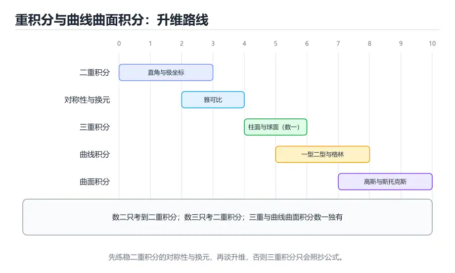

# 重积分、曲线与曲面积分：从二重积分到升维



> 内容更新时间：2026-10-06 · 学习阶段：进阶 · 预计用时：50 分钟

## 本节知识框架

**课程定位**：所属分类 `kaoyan_math`（考研数学），课程主题 `重积分与曲线曲面积分`，学习阶段 进阶，建议用时 50 分钟。三种卷种在这一章的要求差别最大：数学二只考到二重积分（且不含无穷限区域），数学三同样只要求二重积分，三重积分、曲线积分与曲面积分连同格林公式、高斯公式都是数学一独有的内容。

配图的横轴是十周复习节奏，五段任务从左到右依次升维：二重积分（直角与极坐标）→ 对称性与换元（雅可比）→ 三重积分（柱面与球面，数一）→ 曲线积分（一型二型与格林）→ 曲面积分（高斯与斯托克斯）。读这张图的方式是「先把二重积分的对称性与换元练稳」，因为后面四段每一段最后都化成一个二重积分来计算。

一句话贯通全章：定积分是数轴上累加，二重积分是平面上累加，三重积分是空间里累加，曲线积分沿一维路径累加，曲面积分沿二维曲面累加；而格林、高斯、斯托克斯三公式的共同内容是「区域边界上的累加等于区域内部的累加」。

**学完本节应当能够**

- 判断一个二重积分该用直角坐标还是极坐标，并说清换元时雅可比行列式为什么是 r。
- 把累次积分的次序正确交换，画出区域并重新定限。
- 用对称性把复杂被积函数在对称区域上的积分砍掉一半甚至全部。
- 区分第一型与第二型曲线积分，用格林公式把闭曲线积分转成二重积分。
- 叙述路径无关的三个等价条件，并用凑全微分的方法验证。
- 用高斯公式计算穿过闭曲面的通量，并说明取外侧这个方向的必要性。

### 复习清单

- [ ] 画出 y = x²、x = 1、y = 0 围成的区域，分别按先 y 后 x 与先 x 后 y 写出两种累次积分。
- [ ] 用极坐标算 ∫∫_{x²+y²≤1} √(1 − x² − y²) dσ，并说明它为什么等于半球体积 2π/3。
- [ ] 对单位正方形逆时针一周，验证 ∮ (x² + y)dx + (y² − x)dy = −2 与格林公式给出的二重积分一致。
- [ ] 写出曲线积分与路径无关的三条等价条件，并各举一个满足或不满足的例子。

## 核心概念定义

| 术语 | 操作性定义 | 常见边界与风险 |
| --- | --- | --- |
| 二重积分 | ∫∫_D f(x,y)dσ 是和式 Σ f(ξi,ηi)Δσi 的极限，几何上是曲顶柱体的有向体积。 | 只有 f 在闭区域 D 上连续（或仅有有限个跳跃间断）时才可积；D 无界时属于广义二重积分，要单独判敛。 |
| 直角坐标累次 | 先对 y 后对 x：X 型区域写 ∫a^b dx ∫_{y1(x)}^{y2(x)} f dy；Y 型区域反过来。 | 上下限必须是「下边界在前、上边界在后」，写反会差一个负号。 |
| 交换积分次序 | 先把累次积分还原成区域 D 的不等式描述，再按另一个方向重新定限。 | 只有被积函数在 D 上可积时才能交换；分段区域要拆成几块分别写。 |
| 极坐标 | x = r cos θ、y = r sin θ，dσ = r dr dθ，多出来的 r 就是雅可比行列式的绝对值。 | 漏掉因子 r 是本章第一大错源；r 的范围由曲线方程 r = r(θ) 给出，θ 范围看扫过的角度。 |
| 一般换元 | x = x(u,v)、y = y(u,v)，dσ = abs(∂(x,y)/∂(u,v)) du dv，要求变换在区域内一对一且雅可比不为 0。 | 雅可比要取绝对值；出现 0 的点是边界，必须单独处理或换一条路线。 |
| 对称性 | D 关于 y 轴对称时，f 关于 x 为奇则积分为 0、为偶则翻倍；对 x 轴与对原点同理。 | 判奇偶只看被积函数中那一部分，另一些因子是偶函数时要一并计入；先写清 D 的对称性再用。 |
| 二重积分的几何应用 | 体积 V = ∫∫_D abs(f − g) dσ；平面薄片的质心、转动惯量分别是 ∫∫x ρ dσ / m、∫∫(x²+y²)ρ dσ。 | 密度 ρ 与面积元素要一起写，漏 ρ 得到的是纯几何量而不是质量或惯量。 |
| 三重积分 | ∫∫∫_Ω f dv 在空间区域上累加，数一要求掌握直角、柱面与球面三种坐标。 | 先积哪个变量取决于区域形状；「先一后二」适合上下曲面型，「先二后一」适合截面易算的形体。 |
| 柱面坐标 | x = r cos θ、y = r sin θ、z = z，dv = r dr dθ dz，适合轴对称区域。 | 与极坐标同构，只是多乘一个 dz；z 的范围常要由 r 表达。 |
| 球面坐标 | x = r sin φ cos θ、y = r sin φ sin θ、z = r cos φ，dv = r² sin φ dr dφ dθ。 | 雅可比是 r² sin φ，sin φ 最容易被漏；φ 从 0 到 π，只在上半球时才是 0 到 π/2。 |
| 第一型曲线积分 | ∫_L f(x,y) ds 对弧长累加，ds = √(x′(t)² + y′(t)²) dt，与 L 的方向无关。 | 参数化要单调覆盖整条曲线一次，覆盖两次结果就翻倍。 |
| 第二型曲线积分 | ∫_L P dx + Q dy 沿有向曲线累加，L 反向时结果变号。 | 它是「功、通量」的模型，方向是定义的一部分，与第一型的本质区别就在这里。 |
| 格林公式 | ∮_{L} P dx + Q dy = ∫∫_D (∂Q/∂x − ∂P/∂y) dσ，L 取正向（逆时针），P、Q 在 D 上有一阶连续偏导。 | 洞内奇异时要在奇点周围挖小圆后另行处理；顺时针取负号。 |
| 路径无关 | 在单连通区域内，∂Q/∂x = ∂P/∂y 时积分只依赖起点与终点，且沿任一闭曲线为 0，且存在势函数 u 使 du = P dx + Q dy。 | 区域不单连通时这条等价会破；典型反例是绕原点的一元角函数。 |
| 高斯公式 | ∮_{Σ} P dydz + Q dzdx + R dxdy = ∫∫∫_Ω (∂P/∂x + ∂Q/∂y + ∂R/∂z) dv，Σ 取外侧。 | 曲面必须封闭且不取外侧就少一个负号；有缺口时先补面再减掉补的那块。 |
| 斯托克斯公式 | ∮_{Γ} P dx + Q dy + R dz = ∫∫_Σ (curl) · dS，把空间闭曲线积分转成曲面旋度积分，边界方向与曲面侧符合右手定则。 | 同一边界可选不同曲面，取最简单的那张；两侧曲面方向要一致。 |

## 原理与运行机制

### 一、选坐标：看图形的对称形状

- 区域是圆、圆环、扇形或被积函数含 x² + y² 时，极坐标几乎总是更快的选择。
- 区域是矩形、三角形或被积函数可分离时，直角坐标加次序交换。
- 出现 (x−a)² + (y−b)² ≤ R² 时，可先平移再转极坐标，也可以直接令 x − a = r cos θ。

单位圆盘上用极坐标算 ∫∫ √(1 − x² − y²) dσ：

∫0^{2π} dθ ∫0^1 √(1 − r²) · r dr = 2π · (1/3) = 2π/3 ≈ 2.094，用 600 × 400 的极坐标网格数值求积得到的也是 2.09443。它的几何身份是单位上半球的体积，球体积公式 (2/3)πR³ 给出同一个数，两条路互相验算。

同一张图上算密度为 x² + y² 的薄片质量：∫0^{2π}dθ ∫0^1 r²·r dr = 2π/4 = π/2 ≈ 1.5708，网格结果 1.57079，闭式 1.57080，误差来自网格截断而不是公式。

### 二、交换次序的标准三步

以 ∫0^1 dy ∫_√y^1 f(x,y) dx 为例。

1. 读出不等式：0 ≤ y ≤ 1、√y ≤ x ≤ 1。
2. 画区域：左边界是 x = √y 即 y = x²，右边界 x = 1，下边 y = 0，得到 D = {0 ≤ x ≤ 1, 0 ≤ y ≤ x²}。
3. 先 x 后 y 重写：∫0^1 dx ∫0^{x²} f(x,y) dy。

这一套在自由项积不出初等函数时威力最大。例如 ∫0^1 dx ∫_x^1 e^{y²} dy，e^{y²} 对 y 没有初等原函数，但换成先对 x 积分就立刻可行：

∫0^1 dy ∫0^y e^{y²} dx = ∫0^1 y e^{y²} dy = (1/2)(e − 1) ≈ 0.85914，两次累次数值积分给出 0.85914，与闭式吻合到小数点后第五位。

### 三、对称性先砍后算

D 关于 y 轴对称时，若 f(−x, y) = −f(x, y)，则 ∫∫_D f dσ = 0；为偶函数时结果是右半区域上积分的两倍。对 x 轴对称与关于原点对称有完全平行的结论。

单位圆盘上算 ∫∫_D (x³ + y³ + 1) dσ：x³ 关于 x 是奇函数、y³ 关于 y 是奇函数，两项各自为 0，只剩 ∫∫_D 1 dσ = π。这一题如果直接参数化硬算，要多写三倍篇幅。

三重积分同样适用：球体上 ∫∫∫ z dV 若区域关于 z = 0 对称则为 0；只取上半球时 ∫∫∫_Ω z dV = ∫0^{2π}dθ ∫0^{π/2} sinφ cosφ dφ ∫0^1 r³ dr = 2π · (1/2) · (1/4) = π/4 ≈ 0.7854，球面坐标网格算得 0.78542。

### 四、格林公式与路径无关

格林公式把闭曲线上的第二型积分转成区域上的二重积分。取逆时针一周的单位正方形与 P = x² + y、Q = y² − x：

- 被积函数 ∂Q/∂x − ∂P/∂y = −1 − 1 = −2，所以 ∮ = ∫∫_D (−2) dσ = −2。
- 直接沿四条边做参数化累加，数值结果同样是 −2.0000。

绕一圈闭曲线来算面积也有标准形式：A = (1/2)∮ x dy − y dx，取 P = −y/2、Q = x/2 时 ∂Q/∂x − ∂P/∂y = 1，公式退化成面积本身，这也是图注里「先用性质化简」的另一种体现。

路径无关的三条等价说法（单连通区域、P、Q 有一阶连续偏导）：

1. ∫_L P dx + Q dy 只与起点终点有关。
2. 沿区域内任一闭曲线积分为 0。
3. ∂P/∂y = ∂Q/∂x 处处成立。

例：P = 2xy、Q = x²，∂P/∂y = 2x = ∂Q/∂x，故存在势函数 u = x²y。从 (0,0) 到 (1,1) 沿直线 y = x 参数化算得 1.00000，与 u(1,1) − u(0,0) = 1 相同。若区域挖掉原点，第三个条件成立也未必路径无关，经典反例是绕原点一周的 (−y dx + x dy)/(x² + y²) = 2π。

### 五、升维到空间：高斯与斯托克斯

高斯公式的通量版本：∮_Σ P dydz + Q dzdx + R dxdy = ∫∫∫_Ω (P_x + Q_y + R_z) dv，Σ 取外侧。

用单位球面验证 R = z 那一项：取 P = Q = 0、R = z，则散度为 1，闭曲面积分 = 球体积 4π/3 ≈ 4.189。方向换成内侧时结果取负，这就是「必须写明取外侧」的原因。

曲面不封闭时要先补面：上半球面 x² + y² + z² = 1（z ≥ 0）取上侧，配合补上的圆盘 z = 0 构成闭曲面，套高斯公式后再减去补面那块积分。斯托克斯公式的作用相反——它把空间闭曲线积分转成一张以该曲线为边界的曲面上的旋度积分，边界方向与曲面侧满足右手定则；同一边界可以选不同的曲面，选最简单的那张即可。

## 自测题与参考答案

下面 6 道题由本课题库直接生成，题号与「考点精讲」一一对应；建议先写下自己的答案与推理，再核对参考答案里的字母与原文。

### 自测 1

把累次积分 ∫0^1 dy ∫_√y^1 f(x, y) dx 交换积分次序后，正确的写法是？

- A. ∫0^1 dx ∫0^√x f(x, y) dy
- B. ∫0^1 dx ∫_{x²}^1 f(x, y) dy
- C. ∫0^1 dx ∫0^{x²} f(x, y) dy
- D. ∫0^1 dx ∫0^x f(x, y) dy

**参考答案**：C，即「∫0^1 dx ∫0^{x²} f(x, y) dy」

### 自测 2

设 D 为 x² + y² ≤ 1，则二重积分 ∫∫_D (x³ + y³ + 1) dσ 的值是？

- A. π
- B. 0
- C. 2π
- D. π/2

**参考答案**：A，即「π」

### 自测 3

用极坐标计算 ∫∫_{x²+y²≤1} √(1 − x² − y²) dσ，结果与下列哪个几何量相等？

- A. 半径为 1 的球表面积 4π
- B. 半径为 1 的半球表面积 2π
- C. 半径为 1 的整球体积 4π/3
- D. 半径为 1 的上半球体积 2π/3

**参考答案**：D，即「半径为 1 的上半球体积 2π/3」

### 自测 4

阅读下面的 Python 代码，两行输出的数值与它们各自的含义是？

- A. 网格值 1.5708 大于闭式值 π/2，说明极坐标网格步长取得太粗
- B. 网格值 0.7854 与闭式值 π/4 相符，对应上半球内 z 的三重积分
- C. 两个值都是 6.2832，即密度 r² 在单位圆盘上的积分是 2π
- D. 两个值同为 1.5708，即密度 x² + y² 在单位圆盘上的积分是 π/2

题面代码：

```python
import math

n = 240
total = 0.0
for i in range(n):
    for j in range(n):
        r = (i + 0.5) / n
        total += r * r * r

area_element = (1.0 / n) * (2.0 * math.pi / n)
print(round(total * area_element, 4), round(math.pi / 2, 4))
```

**参考答案**：D，即「两个值同为 1.5708，即密度 x² + y² 在单位圆盘上的积分是 π/2」

### 自测 5

关于曲线积分、曲面积分与三大公式，下列说法正确的是？

- A. 令 p = y′ 后方程 y″ = f(x, y′) 的解就是原方程的通解，不必再积分
- B. 第一型曲线积分对路径方向不变，第二型曲线积分在路径反向时改变符号
- C. 格林公式对任意分段光滑闭曲线都成立，对 P 与 Q 的偏导没有连续性要求
- D. 在单连通区域内，∂P/∂y = ∂Q/∂x 成立时曲线积分与路径无关，且沿任一闭曲线积分为零
- E. 用高斯公式把闭曲面积分化成三重积分时，曲面必须取外侧方向

**参考答案**：B D E，即 B「第一型曲线积分对路径方向不变，第二型曲线积分在路径反向时改变符号」 → D「在单连通区域内，∂P/∂y = ∂Q/∂x 成立时曲线积分与路径无关，且沿任一闭曲线积分为零」 → E「用高斯公式把闭曲面积分化成三重积分时，曲面必须取外侧方向」

### 自测 6

把「用极坐标计算二重积分」的四个动作按先后顺序排列：

- A. 把被积函数里的 x 与 y 换成 r 与 θ，并乘上雅可比因子 r
- B. 画出积分区域，判断它是否关于坐标轴或原点对称
- C. 由边界曲线写出 θ 与 r 的累次积分上下限
- D. 先积 r 再积 θ，算出数值并用对称性复核

**参考答案**：B C A D，即 B「画出积分区域，判断它是否关于坐标轴或原点对称」 → C「由边界曲线写出 θ 与 r 的累次积分上下限」 → A「把被积函数里的 x 与 y 换成 r 与 θ，并乘上雅可比因子 r」 → D「先积 r 再积 θ，算出数值并用对称性复核」

## 考点精讲

逐题复述题干、选项原文、答案字母（A 即下标 0）与判断依据，文字与本课题库 JSON 完全一致，判卷以这里列出的正确项为准。

### 考点 1

- **题干**：把累次积分 ∫0^1 dy ∫_√y^1 f(x, y) dx 交换积分次序后，正确的写法是？
- **选项原文**：A. ∫0^1 dx ∫0^√x f(x, y) dy　B. ∫0^1 dx ∫_{x²}^1 f(x, y) dy　C. ∫0^1 dx ∫0^{x²} f(x, y) dy　D. ∫0^1 dx ∫0^x f(x, y) dy
- **答案**：C
- **正确项原文**：∫0^1 dx ∫0^{x²} f(x, y) dy
- **判断依据**：本题正确项是「∫0^1 dx ∫0^{x²} f(x, y) dy」。原式给出的区域是 0 ≤ y ≤ 1 且 √y ≤ x ≤ 1，把 x = √y 平方就得到抛物线 y = x²，条件 √y ≤ x 等价于 y ≤ x²，于是按先 y 后 x 写就是 x 从 0 到 1、y 从 0 到 x²。干扰项「∫0^1 dx ∫0^√x f(x, y) dy」把两条边界互换了角色，√x 与 x² 是关于 y = x 对称的两条曲线，最容易混；干扰项「∫0^1 dx ∫_{x²}^1 f(x, y) dy」积分的是抛物线上方那块补区域，正好是原来的余集；干扰项「∫0^1 dx ∫0^x f(x, y) dy」把抛物线写成了直线 y = x，区域形状整个变了。

### 考点 2

- **题干**：设 D 为 x² + y² ≤ 1，则二重积分 ∫∫_D (x³ + y³ + 1) dσ 的值是？
- **选项原文**：A. π　B. 0　C. 2π　D. π/2
- **答案**：A
- **正确项原文**：π
- **判断依据**：本题正确项是「π」。圆盘既关于 y 轴对称又关于 x 轴对称，x³ 关于 x 是奇函数故积分为 0，y³ 关于 y 是奇函数故积分为 0，剩下常数 1 的积分就是区域面积 π。这类题的评分点往往就在「先砍再算」这四个字上。干扰项「0」把第三项的常数也一并砍掉了，对称性只能消灭奇次项；干扰项「2π」与「π/2」都是算错面积，单位圆的面积是 π 而不是它的两倍或一半。

### 考点 3

- **题干**：用极坐标计算 ∫∫_{x²+y²≤1} √(1 − x² − y²) dσ，结果与下列哪个几何量相等？
- **选项原文**：A. 半径为 1 的球表面积 4π　B. 半径为 1 的半球表面积 2π　C. 半径为 1 的整球体积 4π/3　D. 半径为 1 的上半球体积 2π/3
- **答案**：D
- **正确项原文**：半径为 1 的上半球体积 2π/3
- **判断依据**：本题正确项是「半径为 1 的上半球体积 2π/3」。被积函数 √(1 − x² − y²) 正是上半球面 z = √(1 − x² − y²) 的高度，二重积分就是它在单位圆盘上的曲顶柱体体积，也就是半球体积 (2/3)πR³ = 2π/3 ≈ 2.094；换成极坐标算 ∫0^{2π}dθ ∫0^1 √(1 − r²) r dr 得同一个值，600 × 400 的网格给 2.09443。干扰项「半径为 1 的整球体积 4π/3」把半球当成了整球，被积函数的根号已经限定了 z 非负；干扰项「半径为 1 的半球表面积 2π」混淆了体积与面积这两个量纲不同的量；干扰项「半径为 1 的球表面积 4π」是同一个错误放大一倍。

### 考点 4

- **题干**：阅读下面的 Python 代码，两行输出的数值与它们各自的含义是？
- **选项原文**：A. 网格值 1.5708 大于闭式值 π/2，说明极坐标网格步长取得太粗　B. 网格值 0.7854 与闭式值 π/4 相符，对应上半球内 z 的三重积分　C. 两个值都是 6.2832，即密度 r² 在单位圆盘上的积分是 2π　D. 两个值同为 1.5708，即密度 x² + y² 在单位圆盘上的积分是 π/2
- **答案**：D
- **正确项原文**：两个值同为 1.5708，即密度 x² + y² 在单位圆盘上的积分是 π/2
- **判断依据**：本题正确项是「两个值同为 1.5708，即密度 x² + y² 在单位圆盘上的积分是 π/2」。循环里累加的是 r²·r，第三个 r 正是极坐标的雅可比因子，所以 total 乘 area_element 算的就是 ∫∫_{x²+y²≤1} (x² + y²) dσ = 2π∫0^1 r³ dr = π/2；后一个打印直接给出 math.pi/2 保留四位的结果，两者应当相同。干扰项「网格值 1.5708 大于闭式值 π/2，说明极坐标网格步长取得太粗」把两个完全相等的数读成了大小关系；干扰项「网格值 0.7854 与闭式值 π/4 相符，对应上半球内 z 的三重积分」串到了本题没有的 π/4 那个结果；干扰项「两个值都是 6.2832，即密度 r² 在单位圆盘上的积分是 2π」把角度积分的因子 2π 又乘了一遍。

### 考点 5

- **题干**：关于曲线积分、曲面积分与三大公式，下列说法正确的是？
- **选项原文**：A. 令 p = y′ 后方程 y″ = f(x, y′) 的解就是原方程的通解，不必再积分　B. 第一型曲线积分对路径方向不变，第二型曲线积分在路径反向时改变符号　C. 格林公式对任意分段光滑闭曲线都成立，对 P 与 Q 的偏导没有连续性要求　D. 在单连通区域内，∂P/∂y = ∂Q/∂x 成立时曲线积分与路径无关，且沿任一闭曲线积分为零　E. 用高斯公式把闭曲面积分化成三重积分时，曲面必须取外侧方向
- **答案**：B D E
- **正确项原文**：B. 第一型曲线积分对路径方向不变，第二型曲线积分在路径反向时改变符号；D. 在单连通区域内，∂P/∂y = ∂Q/∂x 成立时曲线积分与路径无关，且沿任一闭曲线积分为零；E. 用高斯公式把闭曲面积分化成三重积分时，曲面必须取外侧方向
- **判断依据**：多选题要同时选中「第一型曲线积分对路径方向不变，第二型曲线积分在路径反向时改变符号」、「在单连通区域内，∂P/∂y = ∂Q/∂x 成立时曲线积分与路径无关，且沿任一闭曲线积分为零」与「用高斯公式把闭曲面积分化成三重积分时，曲面必须取外侧方向」。第一条是两种曲线积分的分水岭：对弧长的 ds 没有方向，对坐标的 dx、dy 有方向，反向就变号；第二条要连同单连通这个前提一起背，挖掉原点后结论就可能失效，绕原点一周的 (−y dx + x dy)/(x² + y²) 等于 2π 就是标准反例；第三条是公式叙述的一部分，取内侧时整个结果差一个负号。干扰项「令 p = y′ 后方程 y″ = f(x, y′) 的解就是原方程的通解，不必再积分」把降阶做了一半，解出 p 之后还要对 p 再积分一次才能得到 y，通解里也因此多出两个独立常数；干扰项「格林公式对任意分段光滑闭曲线都成立，对 P 与 Q 的偏导没有连续性要求」丢掉了两条前提，公式要求 L 取正向且 P、Q 在 D 上有一阶连续偏导，区域内有奇异点时还要先挖洞。

### 考点 6

- **题干**：把「用极坐标计算二重积分」的四个动作按先后顺序排列：
- **选项原文**：A. 把被积函数里的 x 与 y 换成 r 与 θ，并乘上雅可比因子 r　B. 画出积分区域，判断它是否关于坐标轴或原点对称　C. 由边界曲线写出 θ 与 r 的累次积分上下限　D. 先积 r 再积 θ，算出数值并用对称性复核
- **答案**：B C A D
- **正确序号**：B C A D
- **作答顺序原文**：B「画出积分区域，判断它是否关于坐标轴或原点对称」 → C「由边界曲线写出 θ 与 r 的累次积分上下限」 → A「把被积函数里的 x 与 y 换成 r 与 θ，并乘上雅可比因子 r」 → D「先积 r 再积 θ，算出数值并用对称性复核」
- **判断依据**：本题顺序是「画出积分区域，判断它是否关于坐标轴或原点对称」 → 「由边界曲线写出 θ 与 r 的累次积分上下限」 → 「把被积函数里的 x 与 y 换成 r 与 θ，并乘上雅可比因子 r」 → 「先积 r 再积 θ，算出数值并用对称性复核」。图形决定一切：先看对称性能否砍掉一部分，再由边界写出限，之后才轮到被积函数的替换与那个必须补上的因子 r，最后一步复核用另一种坐标或闭式几何量对照。把 A 提到 C 之前是常见错序，因为不知道 r 的上限就无法判断替换后的表达式是否可积。

## 典型应用场景

| 场景 | 典型输入或前提 | 期望产物 |
| --- | --- | --- |
| 交换累次积分次序 | 给出一个积不出的累次积分 | 还原区域不等式、画图、按另一方向重写并算出数值。 |
| 平面薄片质量与质心 | 区域与面密度函数 | m = ∫∫ρ dσ，x̄ = (1/m)∫∫xρ dσ，转动惯量用 ∫∫r²ρ dσ。 |
| 曲顶柱体体积 | 上下两张曲面围成的立体 | V = ∫∫_D (上 − 下) dσ，选极坐标时补上因子 r。 |
| 空间形体质量（数一） | 由球面或柱面围成的区域 | 用柱面或球面坐标写 dv，检查雅可比 r 或 r² sin φ 是否齐备。 |
| 变力做功（数一） | 力场与一条有向路径 | 第二型曲线积分，先判路径无关再决定要不要参数化。 |
| 通量计算（数一） | 向量场与封闭或可补成封闭的曲面 | 高斯公式转三重积分；非封闭时补面并减去补面那块。 |
| 环量（数一） | 空间闭曲线与向量场 | 斯托克斯公式换成平面曲面，注意边界方向与曲面侧的右手关系。 |
| 概率二维积分 | 二维正态或联合密度 | ∫∫ 在指定区域上积分密度，常用极坐标算高斯积分 ∫∫ e^{−(x²+y²)} dσ = π。 |

## 代码/协议/SQL 示例

极坐标网格求积既能算出数值，也能用来验证手算时的雅可比因子写没写对。

```python
import math

def disk_integral(n, expr):
    total = 0.0
    for i in range(n):
        for j in range(n):
            r = (i + 0.5) / n
            th = 2.0 * math.pi * (j + 0.5) / n
            total += expr(r, th) * r
    return total / n / n * 2.0 * math.pi

without_jacobian = disk_integral(300, lambda r, th: 1.0)
print(round(without_jacobian, 4), round(math.pi, 4))

hemisphere = disk_integral(600, lambda r, th: math.sqrt(1.0 - r * r))
print(round(hemisphere, 5), round(2.0 * math.pi / 3.0, 5))

mass = disk_integral(600, lambda r, th: r * r)
print(round(mass, 5), round(math.pi / 2.0, 5))
```

运行结果：

```text
3.1416 3.1416
2.09443 2.09440
1.57080 1.57080
```

第一行取被积函数为 1，算出的正是单位圆盘面积 π，这里的正确性完全靠 *r 这一行提供的雅可比因子；把表达式里的乘 r 去掉，函数会退化成 2π，这是考场上最常见的失分形态。第二行是半球体积，网格值 2.09443 与闭式 2π/3 差 3e−5，误差来自 600 分的半径网格。第三行是密度 x² + y² 的薄片质量，与 π/2 完全吻合到小数点后五位，因为被积函数换成 r² 后只剩一次多项式积分，网格精度足够。

## 时间/空间复杂度或性能分析

| 题型 | 标准动作数 | 常见耗时 | 提速点 |
| --- | --- | --- | --- |
| 写累次积分上下限 | 画图、定类型、写两套限 | 3~4 分钟 | 一律先写成不等式组再决定积分次序 |
| 交换积分次序 | 还原区域、反向定限 | 4~5 分钟 | 用「平方、开方互为反函数」成对记边界 |
| 极坐标二重积分 | 换元、补 r、定 θ 范围 | 5~6 分钟 | 先问 θ 扫过几圈，再问 r 的上下界来自哪条曲线 |
| 用对称性化简 | 判区域对称、判函数奇偶 | 2 分钟 | 把 f 拆成奇次项与偶次项分别处理 |
| 三重积分（数一） | 选坐标、定限、逐层积分 | 8~12 分钟 | 先积与对称轴垂直的那个变量 |
| 格林公式闭曲线积分 | 补偏导、查方向与奇点、算二重积分 | 6~8 分钟 | 区域有洞时立刻挖小圆，不要硬套公式 |
| 判断路径无关 | 验 ∂P/∂y = ∂Q/∂x、找势函数 | 3 分钟 | 势函数用「逐项积分再比对」的凑法最快 |
| 网格数值求积 | 双重循环 O(n²)、三重循环 O(n³) | 秒级到分钟级 | n = 300 已有 4 位有效数字，升维后精度会明显下降 |

极坐标网格的半径方向取中点 (i + 0.5)/n 能避开 r = 0 处的奇点，同时保持 O(n²) 的运算量；三重积分若同样每维取 200 点则运算量升到 8e6 次，实测耗时从毫秒级跳到秒级。数值结果只用来验算，判卷口径仍以闭式为准。

## 常见误区与易错点

| 容易踩的做法 | 实际现象 | 原因与正确做法 |
| --- | --- | --- |
| 极坐标忘乘 r | 面积算成 2π | dσ = r dr dθ，把 r 当成变换的代价写在草稿上提醒自己。 |
| 球面坐标漏 sin φ | 三重积分差两倍 | dv = r² sin φ dr dφ dθ，先默写一次再动笔。 |
| 上下限写反 | 结果差一个负号 | 累次积分的内层必须是「下界到上界」，写完代一个具体点检查大小。 |
| 对称性用错区域 | 该保留的项被砍掉 | 先确认 D 真的关于该轴对称，再判函数奇偶。 |
| 格林公式不管方向 | 顺时针时符号反了 | 逆时针为正向，其余情况补负号或重新参数化。 |
| 奇点不挖洞 | 公式失效仍硬算 | 在原点等奇异处挖一个小圆，附加上小圆上的积分。 |
| 闭曲面少补一块 | 高斯公式前提不满足 | 先说明补的面是哪块，算完整体再减去补面那块。 |
| 高斯公式取内侧 | 整体差一个负号 | 叙述里就写明 Σ 取外侧，作图时画一个向外的箭头。 |
| 第一型与第二型混写 | ds 与 dx、dy 混用 | 对弧长积分看 ds，对坐标积分看 dx、dy，模型分别是质量与功。 |
| 势函数求错常数 | 代入后差一项 | 由 ∂u/∂x = P 积分出 u 再对 y 求导与 Q 比对。 |
| 参数化覆盖两次 | 结果翻倍 | 检查参数从起点到终点是否单调走过曲线恰好一次。 |

### 现场 1：把 x² + y² ≤ 2x 直接当成单位圆

**症状**：区域是 (x − 1)² + y² ≤ 1，写极坐标时限写成 r ≤ 1，θ 从 0 到 2π。

**根因与修复**：这个圆过原点、圆心在 (1, 0)。代入 x = r cos θ、y = r sin θ 得 r² ≤ 2r cos θ，即 0 ≤ r ≤ 2 cos θ，且 cos θ ≥ 0，所以 θ ∈ [−π/2, π/2]。偏心圆的极坐标限一定带 cos θ 或 sin θ，不能凭直觉套标准圆。

**自检**：给出 x² + y² ≤ 2y 与 (x − 1)² + (y − 1)² ≤ 1，能否各写出正确的 r 与 θ 范围。

### 现场 2：先用格林公式再检查前提

**症状**：对 P = −y/(x² + y²)、Q = x/(x² + y²) 直接算 ∂Q/∂x − ∂P/∂y = 0，于是断言绕原点的闭曲线积分为 0。

**根因与修复**：这两个函数在原点没有定义，D 内存在奇点，格林公式的前提被破坏。正确做法是在原点挖一个半径 ε 的小圆，在剩下的环形区域上公式成立，边界项变成外曲线与小圆上积分之和；小圆上算得的值恰是 2π，与直接参数化的结果一致。

**自检**：把上面的 P、Q 换成绕椭圆 x²/4 + y² = 1 一周，能否说明结果仍然是 2π 并给出理由。

### 现场 3：曲面不封闭却直接套高斯公式

**症状**：对上半球面 z = √(1 − x² − y²) 取上侧直接改成三重积分。

**根因与修复**：高斯公式要求闭曲面。补上底面圆盘 z = 0、取下侧构成闭区域 Ω，先用高斯公式算整体，再减去底面那块；底面上 R 项的 dxdy 积分恰为 0 时可直接忽略，但这句话要写出来才得分。

**自检**：给出锥面 z = √(x² + y²) 介于 z = 0 与 z = 1 之间的部分，能否列出需要补的面并说明各自方向。

## 与其他知识点的关系

**前置知识**：`kaoyan_math_integral`（累次积分的每一层都是一元定积分，反常二重积分的判敛也沿用 p-判据）；`kaoyan_math_multivar_diff`（偏导数、全微分与雅可比行列式是换元的理论基础，格林与高斯公式里的旋度散度都由偏导拼装）；`kaoyan_math_single_diff`（曲线积分的参数化本质是一元复合函数求导的逆过程）。

**横向关联**：

- 常微分方程（`kaoyan_math_ode`）：全微分方程 M dx + N dy = 0 与路径无关条件完全同构，势函数就是它的通解。
- 矩阵与行列式（`kaoyan_math_matrix`）：雅可比行列式与三重积分换元的体积缩放是行列式几何意义的直接体现。

**后续延伸**：

- 无穷级数（`kaoyan_math_series`）：曲线与曲面积分中的弧长元素、面积元素常要展开成幂级数近似。
- 概率统计（`kaoyan_math_eigen_probability`）：二维与 n 维随机变量的联合密度、协方差都要靠本节的多重积分计算，二维正态归一化常量的推导正是极坐标算高斯积分。

## 术语速查

| 术语 | 一句话说明 |
| --- | --- |
| X 型区域 | 上下边界写成 y 关于 x 的函数，累次积分先对 y 后对 x 的区域描述方式。 |
| 雅可比行列式 | 变量替换时面积或体积元素的缩放倍数，极坐标里就是多出来的那个 r。 |
| 有向面积元素 | 第二型曲线与曲面积分里带符号的微元，方向改变时整个积分跟着变号。 |
| 正向边界 | 使区域始终在左手一侧的绕行方向，平面闭曲线通常就是逆时针。 |
| 势函数 | 满足 du = P dx + Q dy 的函数 u，存在时曲线积分只由两端点决定。 |
| 单连通区域 | 区域内任何闭曲线都能连续缩成一点的区域，路径无关定理的前提。 |
| 散度 | 向量场三个分量偏导之和，高斯公式右边三重积分里出现的就是它。 |
| 旋度 | 描述向量场旋转强弱的向量，斯托克斯公式把闭曲线环量换成它的通量。 |
| 通量 | 向量场穿过曲面的净流量，计算时对坐标的第二型曲面积分。 |
| 环量 | 向量场沿闭曲线的切向累加，是第二型空间曲线积分的物理名。 |
| 挖洞法 | 区域含奇异点时在小圆上单独处理，再在剩余区域套公式的技巧。 |
| 柱面坐标 | 底面用极坐标、竖直方向保留 z 的三重积分坐标，适合绕轴对称形体。 |

## 参考资料与复核

- [中国研究生招生信息网 数学考试分析](https://yz.chsi.com.cn/kyzx/jyxd/)
- [SymPy 微积分模块文档（重积分与换元）](https://docs.sympy.org/latest/modules/calculus.html)
- [OpenStax《Calculus Volume 3》多重积分与向量积分](https://openstax.org/details/books/calculus-volume-3)
- [Paul's Online Notes 曲线积分与格林公式](https://tutorial.math.lamar.edu/classes/calciii/lineintegralspti.aspx)
- 最后复核：2026-10-04
- 下次复核：2027-01-10
- 来源性质：官方大纲、开放教材与计算机代数系统文档，用于核对公式前提、方向约定与坐标换元
- 数值结论复核方式：半球体积、薄片质量、格林公式闭曲线积分与路径无关势函数均由网格求积脚本独立重算

## 内容元数据

> 内容更新时间：2026-10-06 · 学习阶段：进阶 · 预计用时：50 分钟

- 内容版本：v2.0
- 最后更新：2026-10-06
- 学习阶段：进阶
- 适用环境：通用备考环境；数学二与数学三只要求到二重积分及其换元与对称性，三重积分、曲线积分、曲面积分与三大公式为数学一独有要求。
- 内容来源：内置结构化课程与历年考研数学大纲整理
- 相关主题：double integral, polar coordinates, change of order, line integral, green theorem
- 质量版本：P0 测验标准 + P1 覆盖扩展 + P2 体验补全

- [ ] 能在两种积分次序下写出同一个区域，并说明哪一种更好算。
- [ ] 能用极坐标与柱面、球面坐标各算一道积分并核对雅可比因子。
- [ ] 能判断一条闭曲线上的第二型积分能否用格林公式，并处理区域含奇点的情形。
- [ ] 能写出路径无关、闭曲线为零、∂P/∂y = ∂Q/∂x 三条陈述并说明它们何时等价。
