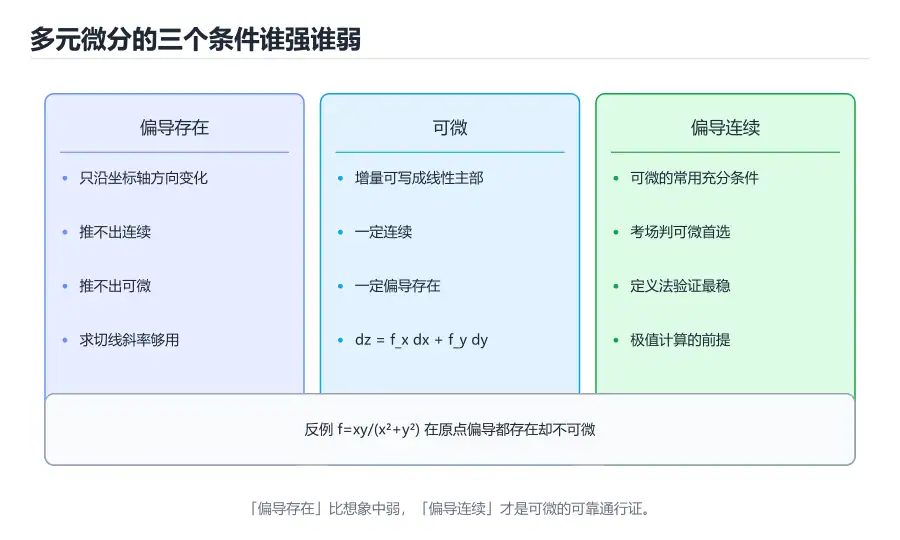

# 多元函数微分学：偏导数、全微分与极值



> 内容更新时间：2026-10-06 · 学习阶段：进阶 · 预计用时：50 分钟

## 本节知识框架

**课程定位**：所属分类 `kaoyan_math`（考研数学），课程主题 `多元函数微分学`，学习阶段 进阶，建议用时 50 分钟。数学一、数学二、数学三都考这一章，数三的深度要求最低但计算量不减；方向导数与梯度是数学一独有的内容，数二与数三只要求到多元复合与隐函数求导、极值与最值。

一元微积分里「可导」几乎无所不能，进入多元以后它的替身分成了三个互不等价的概念：沿坐标轴方向能不能求导（偏导存在）、整个平面上的增量能不能被一张平面近似（可微）、以及近似得是否均匀（偏导连续）。选择题的全部陷阱都在这三个词之间来回替换。

配图画的就是这三者的强弱排序：偏导存在最弱，只沿坐标轴看；可微居中，一定连续且一定偏导存在；偏导连续最强，是考场上判可微最常用的通行证。图注的提醒要记住：反例 f = xy/(x² + y²) 在原点偏导都存在却连连续都做不到。

**学完本节应当能够**

- 用定义算出分段二元函数在原点的偏导数，并解释为什么不能先求导再代点。
- 说出连续、偏导存在、可微、偏导连续四者的推出关系，各给一个反例。
- 用链式法则完成两层、三层复合求导，并画得出变量依赖图。
- 用公式 −F_x/F_z 求隐函数偏导，并对隐函数求二阶偏导。
- 用一阶偏导解驻点、二阶判别 AC − B² 定极值，并用拉格朗日乘数法解条件最值。

### 复习清单

- [ ] 对 f = xy/√(x² + y²)（补 f(0,0) = 0）验证它连续、两个偏导都存在，但按定义不可微。
- [ ] 手算 z = x³ + y³ − 3xy 的全部驻点，并用二阶判别式指出哪个是极值点。
- [ ] 用两种方法求 z = x² + xy 在点 (1, 2) 沿方向 (2, 1) 的方向导数，结果应一致。
- [ ] 写出拉格朗日函数 L = f − λg 的三个偏导方程组，并解释 λ 的几何含义。

## 核心概念定义

| 术语 | 操作性定义 | 常见边界与风险 |
| --- | --- | --- |
| 偏导数 | f_x(x0, y0) = lim(h→0) [f(x0 + h, y0) − f(x0, y0)]/h，即固定其余变量后的一元导数。几何意义是过该点平行于坐标面的截线的切线斜率。 | 它只反映沿坐标轴方向的变化。两个偏导都存在也不能说明函数在该点连续。 |
| 全增量 | Δz = f(x0 + Δx, y0 + Δy) − f(x0, y0)，是二维步长 (Δx, Δy) 的函数，趋近方式有无数条路径。 | 极限题里要沿多条路径逼近验证；只要有一条不同，极限不存在。 |
| 可微 | 若 Δz = AΔx + BΔy + o(ρ)，其中 ρ = √(Δx² + Δy²)，则称 f 在 P 可微，A、B 必是 f_x、f_y。 | 定义里的 o(ρ) 要求对一切趋于 0 的路径一致成立，只沿 x 轴或 y 轴验证不算数。 |
| 全微分 | dz = f_x dx + f_y dy，是 Δz 的线性主部。可微是全微分存在的前提。 | 形式不变性：无论 u、v 是自变量还是中间变量，du、dv 的写法一样，这是做变量替换时最好用的性质。 |
| 连续与可微 | 可微 ⇒ 连续；可微 ⇒ 偏导存在。反向两条都不成立。 | 一元里「可导必连续」，多元里「偏导存在不保证连续」，这是本章最容易被忽视的断裂。 |
| 偏导连续 | f_x 与 f_y 作为新的函数在点 P 连续。它是可微的充分条件而不是必要条件。 | 判可微时先用它，因为「偏导存在且连续 ⇒ 可微」是最省事的路线；反过来说可微的函数偏导未必连续。 |
| 高阶偏导 | f_xy = (f_x)_y，先对 x 再对 y。若 f_xy 与 f_yx 都连续，则两者相等（混合偏导可交换）。 | 不连续时两个混合偏导可能不等，题目给出「二阶偏导连续」就是为了允许交换次序。 |
| 复合函数求导 | z = f(u, v)，u = φ(x, y)，v = ψ(x, y)，则 z_x = f_u φ_x + f_v ψ_x。画依赖图，把每条路径的贡献相加。 | 中间变量个数决定项数；f_u 是对第一个位置变量求导，代回时要写清楚代的是什么。 |
| 隐函数求导 | F(x, y, z) = 0 确定 z = z(x, y) 时，z_x = −F_x/F_z，z_y = −F_y/F_z，要求 F_z ≠ 0。 | 负号最容易漏；求二阶时要把 z_x 再对 x 求导，此时 z 仍是 x 的函数，必须再次带上 z_x。 |
| 方程组确定的隐函数 | 由两个方程解出两个因变量，对每个方程求偏导得到线性方程组，用系数行列式判可解。 | 系数行列式非零正是隐函数存在定理的条件，写答案时要把「不为 0」交代一句。 |
| 无条件极值 | 可微函数取极值的必要条件是两偏导为 0（驻点）；记 A = f_xx、B = f_xy、C = f_yy，判别式 Δ = AC − B²。 | Δ > 0 时才有极值（A > 0 极小、A < 0 极大）；Δ < 0 是鞍点；Δ = 0 判别失效，要另用定义。 |
| 条件极值与拉格朗日 | 求 f 在 g = 0 下的极值，构造 L = f − λg，解 L_x = 0、L_y = 0、g = 0。 | λ 是乘子不是变量；方程组常有多个解，要逐个代回目标函数比较大小，不能只看第一个。 |
| 闭区域最值 | 先求区域内部的驻点，再求边界上的条件极值，把候选点的函数值一起排序。 | 「在闭区域上连续所以最值存在」这一步要写出来；只查内部驻点是最常见的漏解。 |
| 方向导数（数一） | ∂f/∂l = ∇f · e，e 是方向上的单位向量，前提是函数可微。 | 必须先把方向单位化；不单位化得到的数值是真实方向导数的若干倍。 |
| 梯度（数一） | ∇f = (f_x, f_y)，方向是函数增加最快的方向，模长是最大变化率，且与等值线垂直。 | 梯度是向量、方向导数是数量，两者不能互换；求「最大方向导数」就是求梯度的模。 |

## 原理与运行机制

### 一、三个概念谁强谁弱：把反例背下来

配图给出的链条是：偏导连续 ⇒ 可微 ⇒（连续 且 偏导存在）。两条反向箭头都不成立，靠两个反例记住。

**反例 A（偏导存在却不连续）**：f(x, y) = xy/(x² + y²)，补 f(0,0) = 0。
- 沿 x 轴 f(x, 0) ≡ 0，故 f_x(0,0) = 0；同理 f_y(0,0) = 0，两个偏导都存在。
- 但沿直线 y = x 有 f(t, t) = t²/(2t²) = 1/2，沿坐标轴恒为 0。趋近原点得到两个不同的极限值，函数在 0 处连极限都不存在，更谈不上连续。

**反例 B（连续且偏导存在却不可微）**：g(x, y) = xy/√(x² + y²)，补 g(0,0) = 0。
- 由 abs(xy) ≤ (x² + y²)/2 得 abs(g) ≤ ρ/2 → 0，所以连续。
- g_x(0,0) = lim [g(h,0) − 0]/h = 0，同理 g_y(0,0) = 0，两个偏导都存在且都是 0。
- 若可微，线性主部只能是 0，就必须有 g(x,y) = o(ρ)。沿 y = x 取 t，得 g(t,t)/ρ = (t/√2)/(t√2) = 1/2，不趋于 0，故不可微。

于是考场判定顺序是：先看偏导是否连续（能直接判可微），不行就回到定义算 Δz − AΔx − BΔy 是否为 o(ρ)。

### 二、全微分怎么近似一个数

z = x² + xy + y² 在 (1,1) 处，dz = (2x + y)dx + (x + 2y)dy。取 dx = 0.02、dy = −0.01，得 dz = 3(0.02) + 3(−0.01) = 0.03；真实增量 z(1.02, 0.99) − z(1,1) = 0.0303，两者的差 3e−4 正是二阶小量 dx² + dx·dy + dy²。这说明全微分近似的误差量级是步长的平方，与一元微分的结论完全平行。

### 三、链式法则：数清路径再动笔

- 一层复合：z = f(x² − y², e^(xy))，令 u = x² − y²、v = e^(xy)，则 z_x = f_u·2x + f_v·y e^(xy)。这里的 f_u、f_v 仍是 f 的第一个与第二个位置的偏导，代回时要写成 f_1、f_2 而不是具体数值。
- 两层复合：z = f(u)，u = x²y，则 dz/dx = f′(u)·2xy。中间变量只有一个时，链上只有一条路径。
- 全导数：z = f(x, y) 而 y = y(x)，则 dz/dx = f_x + f_y·(dy/dx)，别丢掉第二条路径。

### 四、隐函数与二阶偏导

设 F(x, y, z) = x² + y² + z² − 4z = 0 在点 (1, 1, 2 − √2) 附近确定 z = z(x, y)。

- F_x = 2x，F_z = 2z − 4，故 z_x = −F_x/F_z = −2x/(2z − 4)。
- 代 x = 1、z = 2 − √2，分母是 2(2 − √2) − 4 = −2√2，于是 z_x = −2/(−2√2) = 1/√2 = √2/2 ≈ 0.707。
- 求 z_xx 时要记得 z 本身还是 x 的函数：对 z_x = −x/(z − 2) 再对 x 求导，分子分母都要带上 z_x 这一项，得 z_xx = (z_x² − (z − z_x·x))/(z − 2)² 之类的表达式，整理时先代数值再化简更省力。
- 关键点：F_z ≠ 0 是公式成立的前提，代完数值要确认分母不为 0。

### 五、极值与最值的三套动作

**无条件极值**：z = x³ + y³ − 3xy。
- 解 3x² − 3y = 0 与 3y² − 3x = 0，得 y = x²、x = y²，联立得驻点 (0, 0) 与 (1, 1)。
- A = 6x、B = −3、C = 6y。在 (1,1)：A = 6、C = 6、AC − B² = 36 − 9 = 27 > 0 且 A > 0，取极小值 f(1,1) = 1 + 1 − 3 = −1。
- 在 (0,0)：AC − B² = 0 − 9 = −9 < 0，不是极值，图像在这里是鞍点。

**条件极值**：表面积为 24 的长方体求最大体积。设三边为 x、y、z，目标 V = xyz，约束 2(xy + yz + zx) = 24。
- L = xyz − λ(2xy + 2yz + 2zx − 24)，三个偏导方程相减可得 x = y = z。
- 代回约束得 6x² = 24，x = 2，故最大体积 V = 8。这条结论也能用「正方体最省表面积」的直觉快速自查。

**闭区域最值**：内部驻点与边界条件极值的候选值一起排序，缺一不可。若区域边界由几段曲线拼成，还要单独检查拼接点。

### 六、方向导数与梯度（数一）

f = x² + xy 在 (1, 2) 处，∇f = (2x + y, x) = (4, 1)。

- 沿 l = (2, 1)：先单位化得 e = (2, 1)/√5，方向导数 = ∇f · e = (8 + 1)/√5 = 9/√5 ≈ 4.025。
- 最大方向导数是梯度的模 abs(∇f) = √17 ≈ 4.123，出现在梯度本身的方向上。
- 与等值线 f = 3 垂直的方向就是梯度方向，这条性质常用来说明「沿等值线走一步，函数值不变」。

## 自测题与参考答案

下面 6 道题由本课题库直接生成，题号与「考点精讲」一一对应；建议先写下自己的答案与推理，再核对参考答案里的字母与原文。

### 自测 1

关于二元函数在某点连续、偏导存在与可微三者的关系，下列说法正确的是？

- A. 只要两个偏导数都存在，函数在该点就一定可微
- B. 函数在该点连续，就一定能推出它沿两个方向可微
- C. 两个偏导数都存在且函数连续，则函数在该点必然可微
- D. 两个偏导数都存在且都连续才可断言可微，否则要回到定义验证

**参考答案**：D，即「两个偏导数都存在且都连续才可断言可微，否则要回到定义验证」

### 自测 2

方程 x² + y² + z² − 4z = 0 在点 (1, 1, 2 − √2) 附近确定隐函数 z = z(x, y)，则 z_x 在该点的值是？

- A. √2/2
- B. −√2/2
- C. √2
- D. 2√2

**参考答案**：A，即「√2/2」

### 自测 3

阅读下面的 Python 代码，两行打印给出的判别式与函数值说明什么？

- A. 两处一阶偏导都为 0，判别式也都是正数，故两个驻点都取极小值
- B. 原点处判别式为 27 取极小，点 (1, 1) 处判别式为 −9 不是极值
- C. 原点处判别式为 −9 不是极值，点 (1, 1) 处判别式为 27 且函数值为 −1 取极小
- D. 两处一阶偏导都为 0，因此都只是驻点，二阶判别式对它们都不适用

题面代码：

```python
f = lambda x, y: x ** 3 + y ** 3 - 3 * x * y
grad = lambda x, y: (3 * x * x - 3 * y, 3 * y * y - 3 * x)
hess = lambda x, y: (6 * x, -3.0, 6 * y)

for p in ((0.0, 0.0), (1.0, 1.0)):
    fx, fy = grad(*p)
    A, B, C = hess(*p)
    print(p[0], p[1], round(fx, 6), round(fy, 6), round(A * C - B * B, 3), round(f(*p), 3))
```

**参考答案**：C，即「原点处判别式为 −9 不是极值，点 (1, 1) 处判别式为 27 且函数值为 −1 取极小」

### 自测 4

设 f = x² + xy，则它在点 (1, 2) 沿方向 (2, 1) 的方向导数与最大方向导数分别是？

- A. 4/√5 与 √17
- B. 9 与 17
- C. 1 与 √17
- D. 9/√5 与 √17

**参考答案**：D，即「9/√5 与 √17」

### 自测 5

关于多元函数的微分概念，下列说法正确的是？

- A. 全微分 dz 是函数增量 Δz 的线性主部，两者之差是比 ρ 高阶的无穷小
- B. 两个偏导数在点 P 连续，则函数在点 P 可微
- C. 两个偏导数存在就能推出函数在该点连续
- D. 一元函数的导数与微分是同一个量，只是写法不同
- E. 函数可微则必连续，且方向导数等于梯度与单位方向向量的数量积

**参考答案**：A B E，即 A「全微分 dz 是函数增量 Δz 的线性主部，两者之差是比 ρ 高阶的无穷小」 → B「两个偏导数在点 P 连续，则函数在点 P 可微」 → E「函数可微则必连续，且方向导数等于梯度与单位方向向量的数量积」

### 自测 6

把「求二元函数无条件极值」的四个动作按先后顺序排列：

- A. 解方程组 f_x = 0 与 f_y = 0，求出全部驻点
- B. 对每个驻点计算 A、B、C 并判断 AC − B² 的符号
- C. 写出函数表达式并求出一阶偏导数
- D. 判别式为正时再看 A 的符号定极大或极小，为负则排除该点

**参考答案**：C A B D，即 C「写出函数表达式并求出一阶偏导数」 → A「解方程组 f_x = 0 与 f_y = 0，求出全部驻点」 → B「对每个驻点计算 A、B、C 并判断 AC − B² 的符号」 → D「判别式为正时再看 A 的符号定极大或极小，为负则排除该点」

## 考点精讲

逐题复述题干、选项原文、答案字母（A 即下标 0）与判断依据，文字与本课题库 JSON 完全一致，判卷以这里列出的正确项为准。

### 考点 1

- **题干**：关于二元函数在某点连续、偏导存在与可微三者的关系，下列说法正确的是？
- **选项原文**：A. 只要两个偏导数都存在，函数在该点就一定可微　B. 函数在该点连续，就一定能推出它沿两个方向可微　C. 两个偏导数都存在且函数连续，则函数在该点必然可微　D. 两个偏导数都存在且都连续才可断言可微，否则要回到定义验证
- **答案**：D
- **正确项原文**：两个偏导数都存在且都连续才可断言可微，否则要回到定义验证
- **判断依据**：本题正确项是「两个偏导数都存在且都连续才可断言可微，否则要回到定义验证」。偏导连续是可微的充分条件，考场上判可微首选这条路；条件不满足时不能直接判否，要退回定义检查 Δz 减去 AΔx 加 BΔy 是否等于 o(ρ)。干扰项「只要两个偏导数都存在，函数在该点就一定可微」把最弱的一条当成了最强，f = xy/(x² + y²) 在原点两个偏导都是 0 却连极限都不存在；干扰项「函数在该点连续，就一定能推出它沿两个方向可微」把连续与偏导混为一谈，连续函数完全可以处处不可导；干扰项「两个偏导数都存在且函数连续，则函数在该点必然可微」正是 g = xy/√(x² + y²) 这个标准反例要打掉的说法。

### 考点 2

- **题干**：方程 x² + y² + z² − 4z = 0 在点 (1, 1, 2 − √2) 附近确定隐函数 z = z(x, y)，则 z_x 在该点的值是？
- **选项原文**：A. √2/2　B. −√2/2　C. √2　D. 2√2
- **答案**：A
- **正确项原文**：√2/2
- **判断依据**：本题正确项是「√2/2」。按公式 z_x = −F_x/F_z，这里 F_x = 2x、F_z = 2z − 4，代 x = 1 与 z = 2 − √2 得分母 2(2 − √2) − 4 = −2√2，于是 z_x = −2/(−2√2) = 1/√2，有理化后是 √2/2，约等于 0.707。干扰项「−√2/2」漏掉了公式最前面的负号，是这一类题失分最多的写法；干扰项「√2」把 1/√2 的有理化方向做反了；干扰项「2√2」代分母时把 2z − 4 算成了 z − 2 的两倍关系，数值放大了四倍。

### 考点 3

- **题干**：阅读下面的 Python 代码，两行打印给出的判别式与函数值说明什么？
- **选项原文**：A. 两处一阶偏导都为 0，判别式也都是正数，故两个驻点都取极小值　B. 原点处判别式为 27 取极小，点 (1, 1) 处判别式为 −9 不是极值　C. 原点处判别式为 −9 不是极值，点 (1, 1) 处判别式为 27 且函数值为 −1 取极小　D. 两处一阶偏导都为 0，因此都只是驻点，二阶判别式对它们都不适用
- **答案**：C
- **正确项原文**：原点处判别式为 −9 不是极值，点 (1, 1) 处判别式为 27 且函数值为 −1 取极小
- **判断依据**：本题正确项是「原点处判别式为 −9 不是极值，点 (1, 1) 处判别式为 27 且函数值为 −1 取极小」。grad 给出 (3x² − 3y, 3y² − 3x)，两个驻点上都是 (0, 0)，确认它们是驻点；hess 给出 A = 6x、B = −3、C = 6y，在原点 AC − B² = 0 − 9 = −9，为负说明是鞍点而非极值，在 (1, 1) 得 36 − 9 = 27 为正且 A = 6 > 0，故取极小值 f(1,1) = 1 + 1 − 3 = −1。干扰项「两处一阶偏导都为 0，判别式也都是正数，故两个驻点都取极小值」把原点那行的 −9 看成了正数；干扰项「原点处判别式为 27 取极小，点 (1, 1) 处判别式为 −9 不是极值」把两行的结果调换了位置；干扰项「两处一阶偏导都为 0，因此都只是驻点，二阶判别式对它们都不适用」误以为驻点就不能继续判，实际上二阶判别式正是给驻点用的。

### 考点 4

- **题干**：设 f = x² + xy，则它在点 (1, 2) 沿方向 (2, 1) 的方向导数与最大方向导数分别是？
- **选项原文**：A. 4/√5 与 √17　B. 9 与 17　C. 1 与 √17　D. 9/√5 与 √17
- **答案**：D
- **正确项原文**：9/√5 与 √17
- **判断依据**：本题正确项是「9/√5 与 √17」。梯度是 (2x + y, x)，在 (1, 2) 处等于 (4, 1)；方向 (2, 1) 先单位化成 (2, 1)/√5，两者做数量积得 (8 + 1)/√5 = 9/√5，最大方向导数是梯度的模 √(16 + 1) = √17。干扰项「4/√5 与 √17」只用了梯度的第一个分量与方向的第一分量相乘，漏掉 x 那一项的贡献；干扰项「9 与 17」把方向向量忘掉了单位化，两个数都放大了一个根号；干扰项「1 与 √17」把数量积算成了梯度第二分量与方向第二分量的比。

### 考点 5

- **题干**：关于多元函数的微分概念，下列说法正确的是？
- **选项原文**：A. 全微分 dz 是函数增量 Δz 的线性主部，两者之差是比 ρ 高阶的无穷小　B. 两个偏导数在点 P 连续，则函数在点 P 可微　C. 两个偏导数存在就能推出函数在该点连续　D. 一元函数的导数与微分是同一个量，只是写法不同　E. 函数可微则必连续，且方向导数等于梯度与单位方向向量的数量积
- **答案**：A B E
- **正确项原文**：A. 全微分 dz 是函数增量 Δz 的线性主部，两者之差是比 ρ 高阶的无穷小；B. 两个偏导数在点 P 连续，则函数在点 P 可微；E. 函数可微则必连续，且方向导数等于梯度与单位方向向量的数量积
- **判断依据**：多选题要同时选中「全微分 dz 是函数增量 Δz 的线性主部，两者之差是比 ρ 高阶的无穷小」、「两个偏导数在点 P 连续，则函数在点 P 可微」与「函数可微则必连续，且方向导数等于梯度与单位方向向量的数量积」。第一条就是可微的定义式，ρ 取 √(Δx² + Δy²)，误差比它高阶才叫线性主部；第二条是教材里判可微的充分条件定理；第三条把可微的两条推论与方向导数公式 ∂f/∂l = ∇f · e 串在一起，注意 e 必须是单位向量。干扰项「两个偏导数存在就能推出函数在该点连续」与 xy/(x² + y²) 的原点行为直接冲突；干扰项「一元函数的导数与微分是同一个量，只是写法不同」忽略了微分还带着 dx 这个因子，导数是比值、微分是乘上自变量增量的量。

### 考点 6

- **题干**：把「求二元函数无条件极值」的四个动作按先后顺序排列：
- **选项原文**：A. 解方程组 f_x = 0 与 f_y = 0，求出全部驻点　B. 对每个驻点计算 A、B、C 并判断 AC − B² 的符号　C. 写出函数表达式并求出一阶偏导数　D. 判别式为正时再看 A 的符号定极大或极小，为负则排除该点
- **答案**：C A B D
- **正确序号**：C A B D
- **作答顺序原文**：C「写出函数表达式并求出一阶偏导数」 → A「解方程组 f_x = 0 与 f_y = 0，求出全部驻点」 → B「对每个驻点计算 A、B、C 并判断 AC − B² 的符号」 → D「判别式为正时再看 A 的符号定极大或极小，为负则排除该点」
- **判断依据**：本题顺序是「写出函数表达式并求出一阶偏导数」 → 「解方程组 f_x = 0 与 f_y = 0，求出全部驻点」 → 「对每个驻点计算 A、B、C 并判断 AC − B² 的符号」 → 「判别式为正时再看 A 的符号定极大或极小，为负则排除该点」。一阶偏导是求驻点的原料，驻点清单是逐点判别的对象，判别式先决定「有没有极值」，A 的符号再决定「极大还是极小」，这个次序颠倒就会把鞍点误报成极值点。若函数还有不可导点，第一步之后要把它们一并列进候选名单。

## 典型应用场景

| 场景 | 典型输入或前提 | 期望产物 |
| --- | --- | --- |
| 判可微与求全微分 | 给定分段或含根号的二元函数 | 先试偏导连续，失败则用定义验证 o(ρ)，并写出 dz。 |
| 复合函数求偏导 | 显式给出的多层复合结构 | 画依赖图，按路径条数写出项数，最后把中间变量换回自变量。 |
| 隐函数与方程组 | F(x, y, z) = 0 或两个方程两个因变量 | 用 −F_x/F_z 或解线性方程组，说明分母（系数行列式）不为 0。 |
| 无条件极值 | 二元可导函数 | 驻点清单加逐点 AC − B² 判别，写出极值与极值点。 |
| 条件极值与实际最值 | 有约束的体积、面积、用料问题 | 拉格朗日函数、三个方程、把候选值排序并回答实际意义。 |
| 方向导数与梯度（数一） | 给定可微函数、点与方向 | 单位化方向后做数量积；同时给出梯度与最大变化率。 |
| 近似计算 | 某点附近的函数值估计 | f + f_x Δx + f_y Δy，并用真实值算出误差量级。 |

## 代码/协议/SQL 示例

把偏导数、二阶判别与全微分近似都交给数值方法验一遍，是发现自己手算错误最快的办法。

```python
h = 1e-4

f = lambda x, y: x ** 3 + y ** 3 - 3 * x * y
dx = lambda x, y: (f(x + h, y) - f(x - h, y)) / (2 * h)
dy = lambda x, y: (f(x, y + h) - f(x, y - h)) / (2 * h)

for p in ((0.0, 0.0), (1.0, 1.0)):
    x0, y0 = p
    print(x0, y0, round(dx(x0, y0), 5), round(dy(x0, y0), 5))

z = lambda x, y: x * x + x * y + y * y
dz = (2 * 1 + 1) * 0.02 + (1 + 2 * 1) * (-0.01)
print(round(dz, 4), round(z(1.02, 0.99) - z(1.0, 1.0), 4))

g = lambda x, y: x * y / (x * x + y * y) if (x or y) else 0.0
print(round(g(1e-3, 0.0), 6), round(g(1e-3, 1e-3), 6))
```

运行结果：

```text
0.0 0.0 0.0 0.0
1.0 1.0 0.0 0.0
0.03 0.0303
0.0 0.5
```

第一组打印驻点坐标与两个方向的一阶偏导：dx 与 dy 各沿一个坐标轴做中心差商，在原点与 (1, 1) 都得到 0，说明这两处的确是驻点，而 f(1,1) = −1 与 f(0,0) = 0 已能看出它们性质不同。第二组比较全微分与真实增量，0.03 与 0.0303 相差 3e−4，就是二阶小量 dx² + dx·dy + dy² 的大小。第三组把 f = xy/(x² + y²) 沿 x 轴与沿 y = x 各取一个点，两个函数值分别是 0 与 0.5，同一个趋近速度下给出不同极限，直接说明它在原点不连续。

## 时间/空间复杂度或性能分析

| 题型 | 标准动作数 | 常见耗时 | 提速点 |
| --- | --- | --- | --- |
| 定义型偏导计算 | 固定其余变量、按一元极限求 | 2~3 分钟 | 分段点一律回到定义，不要先求导再代点 |
| 判可微 | 先试偏导连续，再用定义 | 4~6 分钟 | 定义法只需沿两条路径比较比值，能省大量代数 |
| 两层复合求偏导 | 画依赖图、逐路径求导、回代 | 3~5 分钟 | 路径条数等于中间变量个数，先数清再动笔 |
| 隐函数二阶偏导 | 一阶公式、再对结果求导、代点 | 5~8 分钟 | 先代数值再化简，能少写一半的项 |
| 无条件极值 | 解驻点、算 A、B、C、判别、结论 | 4~6 分钟 | 因式分解驻点方程组，避免漏解 (0, 0) 这类点 |
| 条件极值 | 写 L、解三方程、回代比较 | 8~10 分钟 | 三个方程相减常常直接得到 x = y = z |
| 数值梯度扫描 | 双循环遍历 m × n 网格，O(mn) | 秒级 | 网格加密一倍，运算量变四倍，一般 201 点足够定位 |

中心差商对一阶导的误差是 O(h²)，本例取 h = 1e−4 时误差在 1e−8 量级；但二阶导的差商公式会放大舍入误差，h 太小时结果反而失真，所以二阶量仍按解析式手算再让代码复核数值。

## 常见误区与易错点

| 容易踩的做法 | 实际现象 | 原因与正确做法 |
| --- | --- | --- |
| 由偏导存在断言连续 | 结论直接被反例推翻 | 偏导只看两条十字路径，连续要看所有路径。 |
| 判可微只沿 x 轴与 y 轴验证 | 误判成可微 | o(ρ) 必须对任意路径一致成立，至少补一条斜线路径。 |
| 隐函数求导漏负号 | 结果差一个符号 | 背 z_x = −F_x/F_z，代完检查一次符号。 |
| 求二阶隐函数偏导时把 z 当常数 | 少一项，结果偏小 | z 仍是 x 的函数，每次求导都要带上 z_x。 |
| 忘记混合偏导的前提 | 交换次序后出错 | 只有 f_xy 与 f_yx 连续时才能交换。 |
| 只求驻点不下结论 | 答案不完整 | 必须逐点做 AC − B² 判别并写明极值或鞍点。 |
| 把 Δ = 0 判成极小 | 判别失效当成有效 | Δ = 0 时二阶法失效，改用定义或特殊路径分析。 |
| 闭区域最值只查内部 | 漏掉边界最大值 | 内部驻点、边界条件极值、边界拼接点三类一起比较。 |
| 方向向量没单位化 | 方向导数放大若干倍 | 先除以模长再与梯度做数量积。 |
| 把梯度写成数量 | 概念混淆 | 梯度是向量，方向导数是数量，最大方向导数等于梯度的模。 |

### 现场 1：先求偏导表达式再代原点

**症状**：算 f = xy/(x² + y²) 在原点的偏导时，先用商法则求出 f_x 的通式，再代 x = y = 0，得到 0/0。

**根因与修复**：通式只在函数可导的点有效，分段点必须回到定义：f_x(0,0) = lim(h→0) [f(h,0) − f(0,0)]/h = lim 0/h = 0。同理 f_y(0,0) = 0。这个反例的价值在于，两个偏导都存在却连函数连续都保证不了。

**自检**：给出 f = (x² − y²)/(x² + y²) 补零，能否在 3 分钟内写出两个偏导并说明它在原点是否连续。

### 现场 2：条件极值方程组解不全

**症状**：拉格朗日方程组解出 x = y = z 之后就停笔，忘了边界退化情形或 λ 的其他取值。

**根因与修复**：三个方程两两相减得到的因式里常常含 (x − y) 这类因子，必须讨论因子为零与非零两支；实际问题还要检查变量能否为 0，例如长方体某条边趋于 0 时体积也趋于 0，只可能给最小值而不给最大值，这类结论要写一句作为排除理由。

**自检**：把约束改成 xyz = 1 求 x² + y² + z² 的最小值，能否在 5 分钟内解出全部驻点并给出答案 3。

### 现场 3：把鞍点当极值点

**症状**：解出 (0, 0) 是驻点后，因为 f(0,0) = 0 比附近某些点大就断言是极大。

**根因与修复**：极值要求存在整个邻域内一致的大小关系。z = x³ + y³ − 3xy 在原点的任意小邻域内既有正值也有负值（沿 y = 0 得 x³ 可正可负，沿 y = x 得 2x³ − 3x² 在小 x 处为负），AC − B² = −9 已经提前告诉你这里是鞍点。判别式为负时不要再尝试用定义找极值。

**自检**：能否在原点邻域里各找一条使函数为正与为负的路径，并说清它们为什么与鞍点一致。

## 与其他知识点的关系

**前置知识**：`kaoyan_math_single_diff`（偏导就是把其余变量当常数的一元导数，链式法则与乘积求导全部沿用）；`kaoyan_math_limit_continuity`（多元极限的路径检验、o(ρ) 与无穷小比较都在这一章复用）；`kaoyan_math_matrix`（隐函数方程组的系数行列式与克莱姆法则是解出偏导的工具）。

**横向关联**：

- 一元积分（`kaoyan_math_integral`）：变限积分求导与全微分形式不变性是同一件事的一元版本；方向导数的最值问题常用到定积分估界。
- 常微分方程（`kaoyan_math_ode`）：全微分方程 M dx + N dy = 0 的判据 ∂M/∂y = ∂N/∂x 正是混合偏导可交换这条定理。

**后续延伸**：

- 重积分（`kaoyan_math_multiple_integral`）：二重积分的区域划分与换元需要偏导与雅可比行列式，全微分是它的推导起点。
- 无穷级数（`kaoyan_math_series`）：多元函数的泰勒展开把偏导组合成高阶项，二阶判别式本质上就是展开式的二次型判正定。
- 概率统计（`kaoyan_math_eigen_probability`）：二维随机变量的联合密度性质、边缘密度都要对多元函数求偏导与二重积分。

## 术语速查

| 术语 | 一句话说明 |
| --- | --- |
| 偏导数 | 固定其余变量后对某一个变量的一元导数，只反映沿坐标轴方向的变化快慢。 |
| 全增量 | 自变量按任意小步长移动引起的函数改变量，记作 Δz，趋近路径有无数条。 |
| 可微 | 全增量能写成线性主部加一个比 ρ 高阶的无穷小，这部分线性主部就是全微分。 |
| 全微分 | dz = f_x dx + f_y dy，是 Δz 的一次近似，其形式在中间变量替换下保持不变。 |
| 混合偏导 | 先对一个变量求导再对另一个求导，二阶偏导连续时两种次序结果相等。 |
| 驻点 | 两个一阶偏导同时为零的点，是极值的候选，但本身可能是鞍点。 |
| 鞍点 | 该点两侧函数值一边大一边小，判别式 AC − B² 为负就是它的信号。 |
| 二阶判别式 | Δ = AC − B²，为正时有极值且由 A 的符号定极大极小，为负时无极值。 |
| 拉格朗日乘子 | 把约束并入目标函数时引入的辅助变量 λ，几何上对应梯度共线的比例系数。 |
| 方向导数 | 沿某个指定方向的变化率，等于梯度与单位方向向量的数量积。 |
| 梯度 | 由全部偏导数组成的向量，指向函数增加最快的方向，模长是最大变化率。 |
| 等值线 | 函数值相同的点连成的曲线，梯度处处与它垂直。 |

## 参考资料与复核

- [中国研究生招生信息网 数学考试分析](https://yz.chsi.com.cn/kyzx/jyxd/)
- [SymPy 微积分模块文档（偏导数与极限）](https://docs.sympy.org/latest/modules/calculus.html)
- 最后复核：2026-10-04
- 下次复核：2027-01-10
- 来源性质：官方大纲与计算机代数系统文档，用于核对可微判据、隐函数公式与极值判别条件
- 数值结论复核方式：驻点、判别式、方向导数与全微分误差均由数值差分脚本独立重算

## 内容元数据

> 内容更新时间：2026-10-06 · 学习阶段：进阶 · 预计用时：50 分钟

- 内容版本：v2.0
- 最后更新：2026-10-06
- 学习阶段：进阶
- 适用环境：通用备考环境；方向导数与梯度仅数学一要求，数二与数三在这一节的重心是复合求导、隐函数求导与无条件极值。
- 内容来源：内置结构化课程与历年考研数学大纲整理
- 相关主题：partial derivative, total differential, implicit function, extremum, gradient
- 质量版本：P0 测验标准 + P1 覆盖扩展 + P2 体验补全

- [ ] 能写出连续、偏导存在、可微、偏导连续四个概念的两两推出关系并配反例。
- [ ] 能用定义法判定一个分段二元函数在原点是否可微。
- [ ] 能对一个隐函数求出 z_x 与 z_xx，并说明每一步用了什么法则。
- [ ] 能用拉格朗日乘数法解一个有实际背景的条件最值问题并给出结论。
