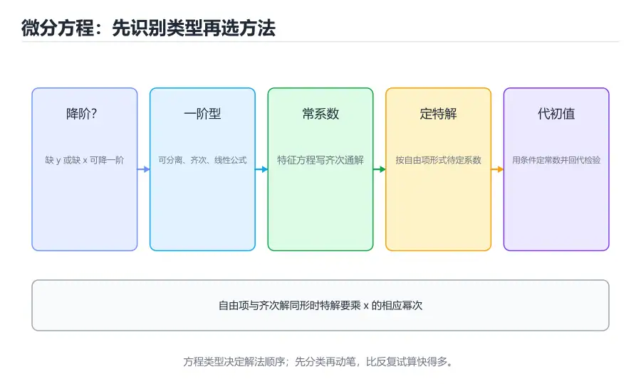

# 常微分方程：先认类型，再套解法，最后定常数



> 内容更新时间：2026-10-06 · 学习阶段：高级 · 预计用时：50 分钟

## 本节知识框架

**课程定位**：所属分类 `kaoyan_math`（考研数学），课程主题 `常微分方程`，学习阶段 高级，建议用时 50 分钟。三种卷种都考这一章：数学二与数学三考到一阶方程与二阶常系数线性方程，数学一额外要求可降阶方程与欧拉方程。历年这一章的分值稳定在一到两道小题（约 8~10 分），偶尔与变限积分或导数应用结合出大题。

配图是一条五步流水线：降阶？→ 一阶型 → 常系数 → 定特解 → 代初值。它想强调的是「先分类再动笔」——这一章几乎不存在通用算法，每一步能用什么工具完全由方程长成什么样决定。拿到方程先花十秒读结构（缺不缺 y、缺不缺 x、系数是不是常数、自由项是什么形式），比直接开始积分划算得多。图下方那条备注是本章失分最集中的地方：自由项与齐次解同形时，特解要乘 x 的相应幂次。

一句话贯通全章：解微分方程就是「把导数关系反着积回去」，而每积一次就要冒出一个新的任意常数；通解里常数的个数等于方程的阶数，初值条件的作用就是把它们一个个定掉。

**学完本节应当能够**

- 看一眼方程就说出它属于哪一类：可分离、齐次、一阶线性、可降阶、常系数线性、欧拉方程。
- 用积分因子或通解公式解一阶线性方程，并说清公式里两个指数分别从哪来。
- 由特征方程的三种根型（相异实根、重根、共轭复根）直接写出齐次通解。
- 按自由项类型设出特解，并正确判断要不要乘 x 或 x²。
- 处理缺 y 型与缺 x 型的可降阶方程，知道各自令什么为 p。
- 把初值条件代进通解定常数，并用代回原方程的方式验算。

### 复习清单

- [ ] 默写一阶线性方程 y′ + p(x)y = q(x) 的通解公式，并解释 e^(∫p dx) 为什么是积分因子。
- [ ] 对 r² − 3r + 2 = 0、r² − 4r + 4 = 0、r² + 2r + 5 = 0 三组特征方程，各写出齐次通解。
- [ ] 说明 y″ − 3y′ + 2y = e^x 与 = e^(2x) 两题的特解形式为什么不同，系数分别是多少。
- [ ] 用代回原方程的方式验证 y = √(1 + 4x) 是初值问题 y″ + (y′)²/y = 0, y(0) = 1, y′(0) = 2 的解。

## 核心概念定义

| 术语 | 操作性定义 | 常见边界与风险 |
| --- | --- | --- |
| 微分方程的阶 | 方程中出现的未知函数最高阶导数的阶数。阶数决定通解里任意常数的个数。 | 阶数不是自变量个数；y′² + y = 0 是一阶二次（非线性），别把幂次读成阶数。 |
| 通解与特解 | 含与阶数同样多个独立任意常数的解叫通解；由条件定掉常数后得到的解叫特解。 | 通解不一定包含全部解，奇解可能在通解之外，例如 y = x y′ + (y′)² 型方程。 |
| 可分离变量 | 能写成 g(y)dy = f(x)dx 的方程，两边各积各的。 | 除以含 y 的式子时会丢掉使该式为零的常值解，要单独补验。 |
| 齐次方程 | 可写成 y′ = φ(y/x) 的形式，令 u = y/x 后可分离。 | 判定方法是把 y′ 的右式分子分母同除 x 的最高次幂，能只剩 y/x 才算。 |
| 一阶线性方程 | y′ + p(x)y = q(x)，q ≡ 0 时称齐次。通解 y = e^(−∫p dx)[∫q e^(∫p dx)dx + C]。 | 公式里两处积分都不带常数；q ≡ 0 时公式退化成 C e^(−∫p dx)。 |
| 积分因子 | 乘上 μ(x) = e^(∫p dx) 后左边恰好成为 (μy)′ 的那个乘子。 | 必须先把方程化成 y′ 系数为 1 的标准形式再算 μ，否则整体差一个倍数。 |
| 伯努利方程 | y′ + py = q y^n（n ≠ 0,1），令 z = y^(1−n) 化为一阶线性。 | 代换后别忘了 dz/dx = (1−n) y^(−n) y′ 这个系数 (1−n)。 |
| 特征方程 | 对 y″ + py′ + qy = 0 设 y = e^(rx)，得 r² + pr + q = 0。 | 只适用于常系数；系数含 x 时写特征方程是无效动作。 |
| 三种根型 | 相异实根给 C1 e^(r1 x) + C2 e^(r2 x)；重根 r 给 (C1 + C2 x)e^(rx)；共轭 α ± βi 给 e^(αx)(C1 cos βx + C2 sin βx)。 | 复根那一项的 x 只出现在三角函数里（cos βx 而非 cos x），β 不能丢。 |
| 待定系数法 | 自由项为 P_n(x)e^(λx) 或 e^(λx)[P cos ωx + Q sin ωx] 时，按同形多项式设特解。 | 设出的多项式要按最高次补全低次项，例如 3x 要设 Ax + B。 |
| 共振（乘 x 的幂次） | λ 是特征方程的 k 重根时，特解乘 x^k。k 可为 0、1、2。 | 只看自由项不看特征根是本章第一号错因；λ 与 ω 要分别核对。 |
| 可降阶：缺 x 型 | 方程不含 x，形如 y″ = f(y, y′)，令 p = y′ 并把 y 当自变量，y″ = p dp/dy。 | 把 y″ 写成 dp/dx 是错的，因为 p 现在是 y 的函数。 |
| 可降阶：缺 y 型 | 方程不含 y，形如 y″ = f(x, y′)，令 p = y′ 直接得关于 x 的一阶方程 p′ = f(x, p)。 | 解出 p 之后还要再积一次才到 y，容易提前收尾。 |
| 欧拉方程 | x²y″ + pxy′ + qy = f(x)，令 x = e^t（或 t = ln x）化为常系数方程。 | 代换后 y′ 前多出减一项：x²y″ 变成 d²y/dt² − dy/dt，忘了这一项全盘皆错。 |
| 解的结构 | 非齐次通解 = 齐次通解 + 一个非齐次特解；两个特解之差是齐次解。 | 该结论只对线性方程成立，非线性方程不满足叠加。 |
| 初值条件 | n 阶方程需要 n 个独立条件（函数值或导数值）才能定全部常数。 | 条件数够但相互矛盾（如周期边界）时可能无解或有无穷多解。 |

## 原理与运行机制

### 为什么积分因子长那样

一阶线性标准式 y′ + p(x)y = q(x) 的左边差一个乘子就能凑成乘积导数。设乘子为 μ，乘完左边是 μy′ + μpy，要它等于 (μy)′ = μy′ + μ′y，只需 μ′ = μp，这是可分离方程，解出 μ = e^(∫p dx)。于是原方程化为 (μy)′ = μq，两边积分直接得

y = e^(−∫p dx) [ ∫ q e^(∫p dx) dx + C ]

拿 y′ + y = e^(−x) 走一遍：p = 1，∫p dx = x，μ = e^x，右边 μq = e^x · e^(−x) = 1，积分得 x + C，除回 e^x 得 y = e^(−x)(x + C)。这里的巧处全在 μq 恰好是 1——出题人挑这个自由项就是为了考「同形时不乘 x，而是积分后自然长出 x」。

### 特征方程的三种根型

设 y = e^(rx) 代入 y″ + py′ + qy = 0，约掉非零因子 e^(rx) 就得到 r² + pr + q = 0。三组对照：

| 特征方程 | 根 | 齐次通解 |
| --- | --- | --- |
| r² − 3r + 2 = 0 | r = 1, 2 | C1 e^x + C2 e^(2x) |
| r² − 4r + 4 = 0 | r = 2（二重） | (C1 + C2 x)e^(2x) |
| r² + 2r + 5 = 0 | r = −1 ± 2i | e^(−x)(C1 cos 2x + C2 sin 2x) |

重根要补 x 是因为两个 e^(rx) 线性相关，凑不出通解要求的两个独立解；复根写成实函数靠的是欧拉公式，把 e^((α+βi)x) 与 e^((α−βi)x) 相加相减即得 e^(αx)cos βx 与 e^(αx)sin βx。第三组配初值 y(0) = 1、y′(0) = 0 得 C1 = 1、C2 = 0.5，这一步要靠 y′ 而不是 y 的表达式，先求导再代值。

### 自由项与齐次解撞车时怎么处理

待定系数法的规则是：自由项形如 P_n(x)e^(λx) 时设 y* = x^k Q_n(x)e^(λx)，其中 k 是 λ 作为特征根的重数。以 y″ − 3y′ + 2y = e^x 为例，λ = 1 是单根，所以 k = 1，设 y* = A x e^x。求导两次代回去：

y*′ = A e^x(1 + x)，y*″ = A e^x(2 + x)
y*″ − 3y*′ + 2y* = A e^x[(2 + x) − 3(1 + x) + 2x] = −A e^x

令 −A e^x = e^x 得 A = −1，故 y* = −x e^x。同一个方程若自由项换成 e^(2x)，λ = 2 也是单根，同样要乘 x，只是系数变成 A = 1，特解为 x e^(2x)。若是 y″ + y = sin x，λ = i 对特征根 r = ±i 而言是单根，且三角型要同时保留 sin 与 cos 两项，解出 y* = −(x cos x)/2。三个例子放在一起，就能看出「乘 x 的幂次由根的重数决定」这句话的份量。

### 可降阶的两种方向

不含 x 的 y″ = f(y, y′)：把 y 当自变量，令 p = y′，则 y″ = dp/dx = (dp/dy)(dy/dx) = p dp/dy，方程降为关于 p、y 的一阶方程。

不含 y 的 y″ = f(x, y′)：同样令 p = y′，但这次 y″ = dp/dx，直接得到关于 x 的一阶方程。

拿缺 x 的 y″ + (y′)²/y = 0 加初值 y(0) = 1、y′(0) = 2 走一遍。代 p = y′ 得 p dp/dy + p²/y = 0，约去 p（p = 0 给常值解，不满足初值）得 dp/p = −dy/y，积分得 p = C/y，即 y dy = C dx，再积分得 y² = 2Cx + C2。由 y(0) = 1 得 C2 = 1；由 y′ = C/y 与 y′(0) = 2 得 C = 2。于是 y² = 4x + 1，取正支 y = √(1 + 4x)。回代检验：y′ = 2/y，y″ = −2y′/y² = −4/y³，而 (y′)²/y = 4/y³，两者相加为零。

### 欧拉方程与变系数

x²y″ + xy′ + y = 0 令 t = ln x 后，xy′ 变为 dy/dt，x²y″ 变为 d²y/dt² − dy/dt，方程化成 y‵‵ + y = 0（对 t 求导），通解 C1 cos t + C2 sin t，换回 x 得 C1 cos(ln x) + C2 sin(ln x)。那个「减去一阶导」的项是这类题唯一的坑：不做代换直接猜 cos(ln x) 也能得分，但考试里更稳的做法是照流程代换。

### 一阶方程的应用题模板：混合问题

容积 100 L 的桶里装满清水，以 2 L/min 注入含盐 5 g/L 的盐水，同时以 2 L/min 放出搅拌均匀的溶液，问盐量 x(t)。体积不变，进盐速率 2 × 5 = 10 g/min，出盐速率 2 × (x/100) = x/50 g/min，于是

dx/dt = 10 − x/50，x(0) = 0

这是一阶线性方程，解为 x(t) = 500(1 − e^(−t/50))。500 = 10 × 50 是稳态值（进盐与出盐速率相等时的盐量），50 min 是特征时间。t = 100 即两个时间常数，达到 1 − e^(−2) = 86.47%，即 432.33 g；t = 250 即五个时间常数，达到 99.33%，即 496.6 g。凡是「进出速率与当前量成正比」的模型——混合、冷却、放射衰变、按连续复利增长的本金——都套这同一个式子，只是稳态值与特征时间不同。

## 典型应用场景

| 场景 | 典型输入或前提 | 期望产物 |
| --- | --- | --- |
| 物理运动方程 | 加速度只含速度与位置，如 m v′ = mg − kv | 一阶线性方程求速度，再积分求位移与终端速度。 |
| 混合与稀释 | 容器体积、进出流量与浓度 | x′ = 进速率 − 出速率，稳态值与时间常数一起给出。 |
| 放射性衰变与碳测年 | 衰变常数或半衰期 | dx/dt = −kx，x = x0 e^(−kt)，半衰期 = ln2/k。 |
| Newton 冷却 | 环境温度与初始温差 | T(t) = T_env + (T0 − T_env)e^(−kt)，用第二个温度读数定 k。 |
| 电路 RLC | 电源电动势与 R、L、C | L Q″ + R Q′ + Q/C = E(t)，二阶常系数标准题型。 |
| 几何切线问题 | 切线截距或斜率满足某关系 | 先把几何条件翻译成 y′ 的表达式，再认方程类型。 |
| 与变限积分结合 | 方程里出现 ∫a^x f(t)dt | 两边求导转成微分方程，注意补出由原式给出的初值。 |
| 幂级数解法（数一选做） | 变系数方程无法初等求解 | 设 y = Σ a_n x^n，比较系数得递推关系。 |

## 代码/协议/SQL 示例

数值手段不能替你分类，但能很快告诉你「这个函数到底满不满足这条方程」。下面这段用中心差商近似一阶与二阶导数，把前面手算的几个解逐个回代。

```python
import math

h = 1e-4
d1 = lambda f, x: (f(x + h) - f(x - h)) / (2 * h)
d2 = lambda f, x: (f(x + h) - 2 * f(x) + f(x - h)) / (h * h)

yh = lambda x: math.exp(2 * x)
print(round(d2(yh, 0.5), 4), round(3 * d1(yh, 0.5) - 2 * yh(0.5), 4))

yp = lambda x: -x * math.exp(x)
print(round(d2(yp, 1.0) - 3 * d1(yp, 1.0) + 2 * yp(1.0), 4), round(math.exp(1.0), 4))

yl = lambda x: math.exp(-x) * (x + 3.0)
print(round(d1(yl, 0.9) + yl(0.9), 5), round(math.exp(-0.9), 5))

eu = lambda x: math.cos(math.log(x))
print(round(2.3 * 2.3 * d2(eu, 2.3), 5), round(2.3 * d1(eu, 2.3), 5), round(eu(2.3), 5))

sq = lambda x: math.sqrt(1.0 + 4.0 * x)
print(round(d2(sq, 3.0), 6), round(d1(sq, 3.0) ** 2 / sq(3.0), 6))

salt = lambda t: 500.0 * (1.0 - math.exp(-t / 50.0))
print(round(salt(100), 2), round(salt(250), 1), round(salt(100) / 500, 4))
```

运行结果：

```text
10.8731 10.8731
2.7183 2.7183
0.40657 0.40657
0.06717 -0.73989 0.67273
-0.085338 0.085338
432.33 496.6 0.8647
```

逐行读法：第一行验证 e^(2x) 满足 y″ = 3y′ − 2y（即 r = 2 是 r² − 3r + 2 的根），两个值同为 4e；第二行是特解 y* = −x e^x 代回 y″ − 3y′ + 2y 的结果，等于右端 e^1；第三行验证 y′ + y = e^(−x)，左边数值与右边完全一致；第四行把欧拉方程 x²y″ + xy′ + y = 0 的三项分开列出，0.06717 − 0.73989 + 0.67273 只剩差商截断误差；第五行是缺 x 型那道题，y″ 与 (y′)²/y 恰好互为相反数；最后一行给出混合问题的两个时刻的盐量与达到的比例。

## 时间/空间复杂度或性能分析

| 题型 | 标准动作数 | 常见耗时 | 提速点 |
| --- | --- | --- | --- |
| 认类型选题 | 读结构、对号入座 | 20~40 秒 | 背四类判据：缺 y、缺 x、系数是否常数、自由项形状。 |
| 一阶线性方程 | 化标准式、算 μ、代公式 | 2~3 分钟 | 先写成 y′ + py = q，再动手算 e^(∫p dx)。 |
| 二阶常系数齐次加初值 | 特征方程、写通解、解二元一次 | 2~3 分钟 | 三组根型的通解形式必须条件反射式写出。 |
| 二阶常系数非齐次 | 齐次解、判重数、设特解、定系数 | 4~6 分钟 | 先把 λ 与特征根比一遍再设形式，能省一次返工。 |
| 可降阶方程 | 选 p、降阶、再积分、代初值 | 5~7 分钟 | 缺 y 令 p = y′ 对 x 求导，缺 x 令 p = y′ 对 y 求导，两条不能混。 |
| 欧拉方程 | 代换、解常系数、换回 x | 4~5 分钟 | 记住 x²y″ → y‵‵ − y‵ 这一条就够了。 |

数值回代的代价是每点多算两次函数值，复杂度 O(n)（n 为检验点数），主要误差来自差商：中心差商的截断误差是 O(h²)，h = 1e−4 时约 1e−8 量级，配舍入误差 ε/h ≈ 1e−12，因此上面第四行的三项之和只剩 1e−5 量级的残差而不是零——这是差商精度决定的，不是解析解有问题。想看清收敛阶可以把 h 每次减半，残差应当缩到约四分之一。

## 常见误区与易错点

| 容易踩的做法 | 实际现象 | 原因与正确做法 |
| --- | --- | --- |
| 自由项照抄成特解 | 代入后左边恒为 0 | 自由项与齐次解同形时必须乘 x^k，先解特征方程再设形式。 |
| 一阶线性不化标准式 | 积分因子整体差倍数 | 先把 y′ 的系数化成 1，再算 e^(∫p dx)。 |
| 公式里的积分带常数 | 通解多出无意义的 C | ∫p dx 与 ∫q e^(∫p dx)dx 都取一个原函数即可，常数只在最外层出现一次。 |
| 重根只写 C e^(rx) | 少一个独立解 | 二重根要写 (C1 + C2 x)e^(rx)。 |
| 复根把 β 丢掉 | 解不满足原方程 | 三角函数的自变量是 βx，不是 x。 |
| 缺 x 型写成 dp/dx | 方程降不下来 | 缺 x 时 y″ = p dp/dy，把 y 当自变量。 |
| 欧拉方程漏掉减项 | 化出的方程系数不对 | x²y″ = y‵‵ − y‵，一阶项必须减掉。 |
| 约去含未知函数的因子 | 丢解 | 约 p 或约 g(y) 之前先检查它能否恒为零，能就补上对应的常值解。 |
| 初值代错表达式 | 常数解出来不满足条件 | 涉及导数的条件必须对求导后的式子代值，不能对原式代。 |
| 只验函数值不代回方程 | 错误解一路带走 | 最后花二十秒把解代回原方程，两端各算一次。 |

### 现场 1：把「λ 不是特征根」与「λ 是特征根」混成一类

**症状**：解 y″ − 3y′ + 2y = e^x 时直接设 y* = A e^x，代入得 0 = e^x，卡住。

**根因与修复**：e^x 正是齐次解（r = 1 是单根），任何 A e^x 代进左边都是零。出现「代进去变成恒等式 0 = 自由项」这个现象，本身就是撞车的诊断信号。补救办法只有一条：把设出的形式乘一个 x；若乘一次仍然全零，说明是二重根，再乘一次。

**自检**：给三个自由项 e^x、e^(2x)、e^(3x)，配方程 y″ − 3y′ + 2y，能立刻说出三种特解形式与三个系数值（−x e^x、x e^(2x)、e^(3x)/2）。

### 现场 2：可降阶方程代换后停半路

**症状**：解 y″ = y′ + x 时令 p = y′，解出 p 之后直接把 p 当成 y 交卷。

**根因与修复**：p 是 y′，不是 y。缺 y 型方程降一次阶得到关于 p(x) 的一阶方程，解出 p 之后还要再积一次分才回到 y，并且第二次积分会引入第二个任意常数——这也是为什么二阶方程最终仍有两个常数。

**自检**：口算 y″ = y′ + x 的完整通解，确认最后出现 C1 与 C2 两个常数（提示：先解 p′ − p = x）。

### 现场 3：应用题把「出流浓度」写成进流浓度

**症状**：混合问题里把出盐速率写成 2 × 5，得 dx/dt = 10，解出线性增长的盐量，与物理直觉不符。

**根因与修复**：流出的是搅拌均匀后的溶液，其浓度是当前的 x/V，不是进水的浓度。于是出速率 = 流量 × x/V，方程才带负反馈、才有稳态。凡是解出来「无限增长」而题目里明明有流出项，基本可以判定这一处写错了。

**自检**：把进水流量改成 3 L/min、出水 2 L/min（体积随时间增加），说明此时 V 要写成 100 + t 而不是常数。

## 与其他知识点的关系

**前置知识**：`kaoyan_math_single_diff`（导数、微分与中值定理是「反解」的基础）；`kaoyan_math_integral`（不定积分与分部积分直接用于一阶方程与常系数方程的公式）。

**横向关联**：

- 一元函数积分学（`kaoyan_math_integral`）：变限积分作未知函数的方程，求导后才成为微分方程，再由原式补出初值。
- 多元函数微分学（`kaoyan_math_multivar_diff`）：全微分方程 M dx + N dy = 0 的判定用的是偏导相等，与一阶方程的积分因子是同一思想。
- 无穷级数（`kaoyan_math_series`）：幂级数解法把变系数方程转成系数的递推关系，与本章的初等解法互补。

**后续延伸**：

- 重积分与曲线曲面积分（`kaoyan_math_multiple_integral`）：数一的物理应用题（做功、流量）常以微分方程形式出现。
- 概率统计（`kaoyan_math_eigen_probability`）：连续型随机变量的分布函数与密度关系、微分方程在可靠性模型里的用法相互借用。

## 自测题与参考答案

下面 6 道题由本课题库直接生成，题号与「考点精讲」一一对应；建议先写下自己的答案与推理，再核对参考答案里的字母与原文。

### 自测 1

方程 y″ − 3y′ + 2y = e^x 的一个特解是？

- A. y* = e^x
- B. y* = 2x e^x
- C. y* = x² e^x
- D. y* = −x e^x

**参考答案**：D，即「y* = −x e^x」

### 自测 2

一阶线性方程 y′ + y = e^(−x) 的通解是？

- A. y = e^(−x)(x + C)
- B. y = e^x(x + C)
- C. y = e^(−x)(−x + C)
- D. y = e^x(x + C) + C

**参考答案**：A，即「y = e^(−x)(x + C)」

### 自测 3

初值问题 y″ − 3y′ + 2y = 0，y(0) = 1，y′(0) = 2 的解是？

- A. y = e^x + e^(2x)
- B. y = 2e^x − e^(2x)
- C. y = e^(2x)
- D. y = e^x

**参考答案**：C，即「y = e^(2x)」

### 自测 4

阅读下面的 Python 代码，三行输出描述的是哪个过程？

- A. 盐量随时间指数增长且没有上限，t = 250 min 时已超过 1000 g
- B. 盐量趋于稳态 500 g，t = 100 与 250 min 时为 432.33 g 与 496.6 g，0.8647 是前一时刻达到的比例
- C. 盐量先升后降，t = 250 min 时回落到 432.33 g
- D. 代码说明该方程没有解析解，只能用指数函数近似

题面代码：

```python
import math

salt = lambda t: 500.0 * (1.0 - math.exp(-t / 50.0))

print(round(salt(100), 2), round(salt(250), 1))
print(round(salt(100) / 500, 4), round(salt(250) / 500, 4))
print(round(50.0 * math.log(2.0), 3))
```

**参考答案**：B，即「盐量趋于稳态 500 g，t = 100 与 250 min 时为 432.33 g 与 496.6 g，0.8647 是前一时刻达到的比例」

### 自测 5

关于常微分方程的解法与解的结构，下列说法正确的是？

- A. 特征方程有二重根 r 时，齐次通解只写 C e^(rx) 就够了
- B. 一阶线性方程 y′ + p(x)y = q(x) 的通解可由 y = e^(−∫p dx)[∫q e^(∫p dx)dx + C] 写出
- C. 方程 y″ = f(x, y′) 令 p = y 即可降成一阶
- D. 自由项与齐次解同形时，特解形式要乘 x 的相应幂次
- E. 特征根为一对共轭复数 α ± β i 时，齐次通解写成 e^(αx)(C1 cos βx + C2 sin βx)

**参考答案**：B D E，即 B「一阶线性方程 y′ + p(x)y = q(x) 的通解可由 y = e^(−∫p dx)[∫q e^(∫p dx)dx + C] 写出」 → D「自由项与齐次解同形时，特解形式要乘 x 的相应幂次」 → E「特征根为一对共轭复数 α ± β i 时，齐次通解写成 e^(αx)(C1 cos βx + C2 sin βx)」

### 自测 6

把「解二阶常系数非齐次线性方程并满足初值条件」的四个动作按先后顺序排列：

- A. 判断方程类型并写出对应的标准形式
- B. 按自由项形式设出特解，用待定系数法确定系数
- C. 代入初始条件定出任意常数，并回代检验
- D. 解特征方程，写出对应齐次方程的通解

**参考答案**：A D B C，即 A「判断方程类型并写出对应的标准形式」 → D「解特征方程，写出对应齐次方程的通解」 → B「按自由项形式设出特解，用待定系数法确定系数」 → C「代入初始条件定出任意常数，并回代检验」

## 考点精讲

逐题复述题干、选项原文、答案字母（A 即下标 0）与判断依据，文字与本课题库 JSON 完全一致，判卷以这里列出的正确项为准。

### 考点 1

- **题干**：方程 y″ − 3y′ + 2y = e^x 的一个特解是？
- **选项原文**：A. y* = e^x　B. y* = 2x e^x　C. y* = x² e^x　D. y* = −x e^x
- **答案**：D
- **正确项原文**：y* = −x e^x
- **判断依据**：本题正确项是「y* = −x e^x」。特征方程 r² − 3r + 2 = 0 的两根是 1 与 2，自由项 e^x 的指数 λ = 1 正好是单根，所以待定系数形式要乘一个 x，设 y* = A x e^x。求导得 y*′ = A e^x(1 + x)、y*″ = A e^x(2 + x)，代回左端得 A e^x[(2 + x) − 3(1 + x) + 2x] = −A e^x，令其等于 e^x 得 A = −1。干扰项「y* = e^x」把自由项直接当特解，而 e^x 本身就是齐次解，代进左端恒为 0，等式不可能成立；干扰项「y* = x² e^x」是 λ = 1 为二重根时才需要的形式，本题用不上。

### 考点 2

- **题干**：一阶线性方程 y′ + y = e^(−x) 的通解是？
- **选项原文**：A. y = e^(−x)(x + C)　B. y = e^x(x + C)　C. y = e^(−x)(−x + C)　D. y = e^x(x + C) + C
- **答案**：A
- **正确项原文**：y = e^(−x)(x + C)
- **判断依据**：本题正确项是「y = e^(−x)(x + C)」。标准式里 p = 1、q = e^(−x)，积分因子 μ = e^(∫p dx) = e^x，两边同乘后左端恰为 (y e^x)′，右端为 e^x · e^(−x) = 1，积分得 y e^x = x + C，再除回 e^x。干扰项「y = e^(−x)(−x + C)」把积分因子取成 e^(−x)，等于把公式里的正负号写反；干扰项「y = e^x(x + C)」算对了括号里的 x + C 却忘了最后要除而不是乘，写出的其实是 y e^x 本身。自由项与齐次解 e^(−x) 同形但没有撞车问题，因为一阶线性公式本来就会自动长出那个 x。

### 考点 3

- **题干**：初值问题 y″ − 3y′ + 2y = 0，y(0) = 1，y′(0) = 2 的解是？
- **选项原文**：A. y = e^x + e^(2x)　B. y = 2e^x − e^(2x)　C. y = e^(2x)　D. y = e^x
- **答案**：C
- **正确项原文**：y = e^(2x)
- **判断依据**：本题正确项是「y = e^(2x)」。特征根为 1 与 2，齐次通解 y = C1 e^x + C2 e^(2x)。代 y(0) = 1 得 C1 + C2 = 1，对通解求导后代 y′(0) = 2 得 C1 + 2C2 = 2，两式相减得 C2 = 1、C1 = 0，解退化成单个指数。干扰项「y = 2e^x − e^(2x)」确实满足 y(0) = 1，但 y′(0) = 2 − 2 = 0，是只核对第一个条件就容易被挑走的答案；干扰项「y = e^x + e^(2x)」在 x = 0 处取值 2，连第一个条件都不满足。这类题的关键在于第二个条件必须对导数表达式代值。

### 考点 4

- **题干**：阅读下面的 Python 代码，三行输出描述的是哪个过程？
- **选项原文**：A. 盐量随时间指数增长且没有上限，t = 250 min 时已超过 1000 g　B. 盐量趋于稳态 500 g，t = 100 与 250 min 时为 432.33 g 与 496.6 g，0.8647 是前一时刻达到的比例　C. 盐量先升后降，t = 250 min 时回落到 432.33 g　D. 代码说明该方程没有解析解，只能用指数函数近似
- **答案**：B
- **正确项原文**：盐量趋于稳态 500 g，t = 100 与 250 min 时为 432.33 g 与 496.6 g，0.8647 是前一时刻达到的比例
- **判断依据**：本题正确项是「盐量趋于稳态 500 g，t = 100 与 250 min 时为 432.33 g 与 496.6 g，0.8647 是前一时刻达到的比例」。代码里的式子来自 dx/dt = 10 − x/50、x(0) = 0，稳态由右端为零解出 x = 500，特征时间是 50 min。t = 100 与 250 分别是两个与五个时间常数，故达到 1 − e^(−2) = 0.8647 与 1 − e^(−5) = 0.9933，第三行的 34.657 是 50 ln2，即盐量到达稳态一半所需的半衰期。干扰项「盐量先升后降，t = 250 min 时回落到 432.33 g」把 1 − e^(−t/50) 的单调性读反，这个式子只会一路上趋；干扰项「盐量随时间指数增长且没有上限，t = 250 min 时已超过 1000 g」把它读成了 500 e^(t/50)，方向同样错了。

### 考点 5

- **题干**：关于常微分方程的解法与解的结构，下列说法正确的是？
- **选项原文**：A. 特征方程有二重根 r 时，齐次通解只写 C e^(rx) 就够了　B. 一阶线性方程 y′ + p(x)y = q(x) 的通解可由 y = e^(−∫p dx)[∫q e^(∫p dx)dx + C] 写出　C. 方程 y″ = f(x, y′) 令 p = y 即可降成一阶　D. 自由项与齐次解同形时，特解形式要乘 x 的相应幂次　E. 特征根为一对共轭复数 α ± β i 时，齐次通解写成 e^(αx)(C1 cos βx + C2 sin βx)
- **答案**：B D E
- **正确项原文**：B. 一阶线性方程 y′ + p(x)y = q(x) 的通解可由 y = e^(−∫p dx)[∫q e^(∫p dx)dx + C] 写出；D. 自由项与齐次解同形时，特解形式要乘 x 的相应幂次；E. 特征根为一对共轭复数 α ± β i 时，齐次通解写成 e^(αx)(C1 cos βx + C2 sin βx)
- **判断依据**：多选题要同时选中「一阶线性方程 y′ + p(x)y = q(x) 的通解可由 y = e^(−∫p dx)[∫q e^(∫p dx)dx + C] 写出」、「自由项与齐次解同形时，特解形式要乘 x 的相应幂次」与「特征根为一对共轭复数 α ± β i 时，齐次通解写成 e^(αx)(C1 cos βx + C2 sin βx)」。第一项是一阶线性的标准公式，适用前提是 p 与 q 在所讨论区间上连续；第二项里乘的幂次等于 λ 作为特征根的重数，单根乘 x，二重根乘 x²；第三项来自欧拉公式把两个共轭复指数解线性组合成实函数，注意三角函数的自变量是 βx。干扰项「特征方程有二重根 r 时，齐次通解只写 C e^(rx) 就够了」少了那个 x，两个解线性相关，凑不出二阶方程要求的两个独立解；干扰项「方程 y″ = f(x, y′) 令 p = y 即可降成一阶」代错变量，应令 p = y′，此时 y″ = dp/dx。

### 考点 6

- **题干**：把「解二阶常系数非齐次线性方程并满足初值条件」的四个动作按先后顺序排列：
- **选项原文**：A. 判断方程类型并写出对应的标准形式　B. 按自由项形式设出特解，用待定系数法确定系数　C. 代入初始条件定出任意常数，并回代检验　D. 解特征方程，写出对应齐次方程的通解
- **答案**：A D B C
- **正确序号**：A D B C
- **作答顺序原文**：A「判断方程类型并写出对应的标准形式」 → D「解特征方程，写出对应齐次方程的通解」 → B「按自由项形式设出特解，用待定系数法确定系数」 → C「代入初始条件定出任意常数，并回代检验」
- **判断依据**：本题顺序是「判断方程类型并写出对应的标准形式」 → 「解特征方程，写出对应齐次方程的通解」 → 「按自由项形式设出特解，用待定系数法确定系数」 → 「代入初始条件定出任意常数，并回代检验」。类型判断必须打头，因为后面三步能否执行完全取决于方程是不是常系数线性；齐次通解必须排在设特解之前，因为只有先拿到特征根，才知道自由项要不要乘 x 的幂次；两个条件都定完之后，初值才有对象可代。把 B 提到 D 前面是最常见的错序，代价往往是待定系数的形式整个写错，算完发现左端恒为零才发现返工。

## 术语速查

| 术语 | 一句话说明 |
| --- | --- |
| 积分因子 | 乘上方程能把左边凑成乘积导数的那个乘子，一阶线性方程里就是 e^(∫p dx)。 |
| 特征方程 | 把 y = e^(rx) 代入常系数齐次方程后关于 r 的代数方程，根型直接决定通解形状。 |
| 待定系数法 | 按自由项的形状猜一个同族函数当特解，再把系数比较出来，只适用于特定几类自由项。 |
| 共振 | 自由项与齐次解同形的现象，处理办法是给特解乘 x 的重数次幂。 |
| 齐次化 | 一阶方程右端能写成 y/x 的函数时，令 u = y/x 把它变成可分离方程的手法。 |
| 降阶 | 令 p = y′ 把二阶方程化成关于 p 的一阶方程，缺 x 与缺 y 两种情形代换后的导数写法不同。 |
| 欧拉方程 | 各项 x 的幂次与导数阶数相同的变系数方程，用 t = ln x 可化成常系数。 |
| 解的结构 | 非齐次通解等于齐次通解加一个特解，两个特解之差落在齐次解空间里。 |
| 稳态值 | 一阶线性模型中使导数为零的那个常数值，解总是朝它指数靠拢。 |
| 特征时间 | 一阶衰减式 e^(−t/τ) 里的 τ，走过一个 τ 完成 63.2%，走过两个完成 86.5%。 |

## 参考资料与复核

- [研招网 硕士研究生招生考试大纲](https://yz.chsi.com.cn/kyzx/jyxd/)
- [SymPy 常微分方程模块文档](https://docs.sympy.org/latest/modules/ode.html)
- 最后复核：2026-10-04
- 下次复核：2027-07-24
- 来源性质：官方大纲 + 计算机代数系统文档，用于核对各类方程的求解流程与公式前提
- 数值结论复核方式：特解系数、三种根型、欧拉方程与混合问题的稳态值均由差商回代脚本独立验算

## 内容元数据

> 内容更新时间：2026-10-06 · 学习阶段：高级 · 预计用时：50 分钟

- 内容版本：v2.0
- 最后更新：2026-10-06
- 学习阶段：高级
- 适用环境：通用备考环境；数学二与数学三不要求可降阶方程与欧拉方程，数一需额外掌握这两类以及常系数方程的自由项推广。
- 内容来源：内置结构化课程与历年考研数学大纲整理
- 相关主题：first-order linear ODE, characteristic equation, undetermined coefficients, reduction of order, mixing problem
- 质量版本：P0 测验标准 + P1 覆盖扩展 + P2 体验补全

- [ ] 能在 30 秒内说出给定方程属于哪一类，并写出第一步动作。
- [ ] 能对三种特征根型各写一个带初值的完整解答，并验算两个条件。
- [ ] 能解释 λ = 1 在单根与二重根两种情形下特解形式的差别。
- [ ] 能从进流量、出流量与浓度三个数据搭出混合问题的方程并给出稳态值。
