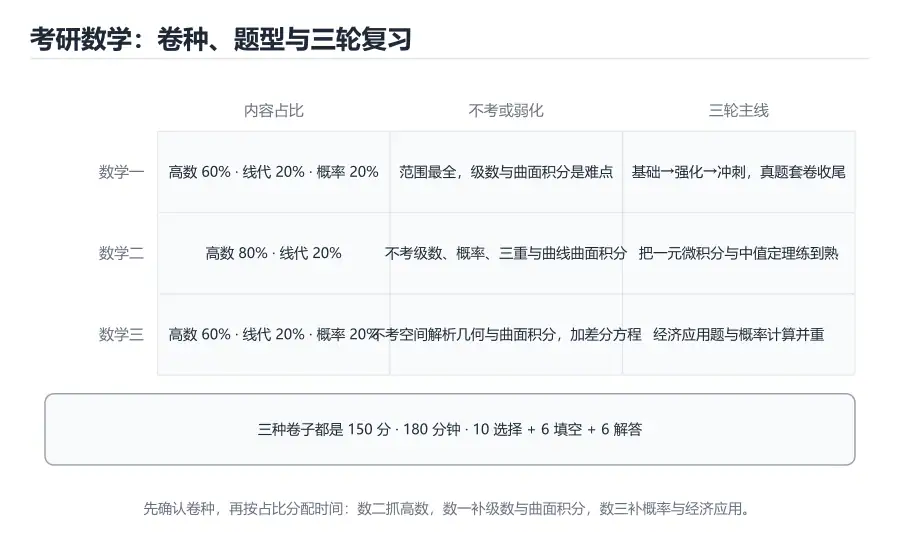

# 考研数学考纲全景与复习路线



> 内容更新时间：2026-10-06 · 学习阶段：入门 · 预计用时：30 分钟

## 本节知识框架

**课程定位**：所属分类 `kaoyan_math`（考研数学），课程主题 `考纲全景与复习路线`，学习阶段 入门，建议用时 30 分钟。

本课主线：先分清数学一、数学二、数学三各考什么、不考什么，再把 150 分拆成可执行的时间预算与三轮复习计划。

**学完本课应当能够**

- 说出三种卷种的内容占比与题型结构，并指出自己目标专业对应哪一卷。
- 把「数二不考无穷级数与概率统计」这类范围差异写成清单，避免复习超纲内容。
- 遇到「复习时间不够」时，能按分值权重给出取舍顺序，而不是平均用力。

### 复习清单

- [ ] 不看正文复述 150 分的题型构成（选择、填空、解答各多少题、多少分）。
- [ ] 用自己的话写出数学一与数学三在高等数学部分的三处主要范围差异。
- [ ] 依据本课的时间预算表，算出自己每周应投入在高等数学上的小时数。
- [ ] 找出上一届真题里一道「超出自己卷种范围」的题，说明为什么可以不做。

## 核心概念定义

| 术语 | 操作性定义 | 常见边界与风险 |
| --- | --- | --- |
| 数学一 | 内容范围最广的卷种，高等数学约 60%、线性代数约 20%、概率论与数理统计约 20%，含空间解析几何、三重积分、曲线与曲面积分、无穷级数与傅里叶级数。 | 风险是把范围当成难度：数一的级数与曲面积分占分不多，却常被投入过量时间，挤压了高等数学主干。 |
| 数学二 | 不考概率论与数理统计，高等数学约 80%、线性代数约 20%，且不考无穷级数、空间解析几何、三重积分、曲线与曲面积分；一元微积分与微分方程的考查深度最大。 | 边界是二重积分仍要考，曲率也在范围内；把「数二不考级数」误推成「数二不考多元积分」是常见错记。 |
| 数学三 | 面向经济类与管理类专业，高等数学约 60%、线性代数约 20%、概率论与数理统计约 20%，含常数项级数与幂级数、差分方程与经济应用，不考空间解析几何与曲线曲面积分。 | 差分方程与边际、弹性问题是数三特色，用数一教材直接复习会漏掉这部分专门训练。 |
| 题型结构 | 三种卷种一致：10 道选择题（每题 5 分，共 50 分）、6 道填空题（每题 5 分，共 30 分）、6 道解答与证明题（共 70 分），满分 150 分，考试时长 180 分钟。 | 客观题共 80 分，占总分的 53%；把练习全部放在大题上，等于放弃了过半分数的可控性。 |
| 内容占比 | 大纲对各部分给分的宏观比例，用于分配复习时间，不等于逐题对应。 | 比例是「约」，个别年份会出现浮动；据此押题而不补齐短板是危险用法。 |
| 三轮复习法 | 基础轮补齐概念与基本运算、强化轮按考点做真题分类、冲刺轮做套卷与限时模拟的分阶段安排。 | 每轮要有可检验的出口标准，否则基础轮会无限延长，把强化与冲刺挤没。 |
| 大纲与考试分析 | 由教育部招生考试机构发布的范围说明与真题分析，是判定「考与不考」的唯一权威依据。 | 教材目录与辅导书章节不等于大纲；只按辅导书顺序复习，容易把已删内容当重点。 |
| 真题分层 | 把历年真题按「卷种—章节—题型—年份」四个维度拆开重练，而不是一套从头做到尾。 | 只做本卷种真题会错过相邻卷种的同考点题；跨卷种练题要标注来源，避免误记范围。 |
| 计算失误率 | 同一套卷里因抄错、符号错、约分错丢分占总丢分的比例，用来自我诊断。 | 把计算失误当成「粗心」而不做记录，考场上仍会以同样的方式重复失分。 |

## 原理与运行机制

### 一、先看结构：150 分是怎么拼起来的

| 项目 | 数学一 | 数学二 | 数学三 |
| --- | --- | --- | --- |
| 高等数学 | 约 60%（约 90 分） | 约 80%（约 120 分） | 约 60%（约 90 分） |
| 线性代数 | 约 20%（约 30 分） | 约 20%（约 30 分） | 约 20%（约 30 分） |
| 概率论与数理统计 | 约 20%（约 30 分） | 不考 | 约 20%（约 30 分） |
| 选择 / 填空 / 解答 | 10 / 6 / 6 题 | 10 / 6 / 6 题 | 10 / 6 / 6 题 |
| 时间与满分 | 180 分钟 · 150 分 | 180 分钟 · 150 分 | 180 分钟 · 150 分 |

结构里有两个可直接用于决策的数字。其一是客观题 80 分：选择加填空共 16 题，每题 5 分，做对与做错之间没有中间分，所以「会而算错」在这里代价最大。其二是解答题 70 分通常按步骤给分，写出关键的中值定理条件、正确的积分区间、正确的特征方程，都能拿到过程分，即使最后结果算错。

### 二、再划范围：三种卷种的差异清单

以「高等数学」为例，把差异写成可勾选的清单，比背大段文字更可靠：

| 内容模块 | 数学一 | 数学二 | 数学三 |
| --- | --- | --- | --- |
| 函数、极限、连续 | 考 | 考，且计算量大 | 考 |
| 一元函数微分学（含中值定理） | 考 | 考，重点 | 考 |
| 一元函数积分学（含反常积分） | 考 | 考，重点 | 考，另加经济应用 |
| 向量代数与空间解析几何 | 考 | 不考 | 不考 |
| 多元函数微分学（偏导、全微分、极值） | 考 | 考，不含方向导数与梯度 | 考，不含方向导数与梯度 |
| 二重积分 | 考 | 考 | 考 |
| 三重积分、曲线与曲面积分 | 考，重点难点 | 不考 | 不考 |
| 无穷级数（含傅里叶级数） | 考，含傅里叶级数 | 不考 | 考常数项级数与幂级数，不含傅里叶级数 |
| 常微分方程 | 考，含伯努利方程与欧拉方程 | 考，不含伯努利方程与欧拉方程 | 考，另加差分方程 |
| 曲率与弧微分 | 考 | 考 | 一般不作要求 |
| 概率论与数理统计 | 考 | 不考 | 考 |

上表是「范围差异」，不是「难度差异」。真实备考中的三档优先级建议：

1. **先做全覆盖**：把三种卷种共有的主干（极限、一元微分、一元积分、多元微分、二重积分、微分方程、线性代数）练到稳定得分，这部分在数二占 120 分以上，在数一与数三占 90 分左右。
2. **再做卷种专属**：数一补三重积分、曲线与曲面积分、傅里叶级数；数三补差分方程、经济应用与概率统计；数二把一元微积分的证明与计算深度加满。
3. **最后做取舍**：明确「不考」清单并在错题本上标注，避免在超纲内容上消耗时间。

### 三、三轮复习法的运行逻辑

- **基础轮**：目标是把定义、公式与基本运算变成条件反射。出口标准：任意一套基础题的客观题错误不超过 2 个，且每个错误都能归因到具体概念。
- **强化轮**：目标是按考点做真题分类，把同一考点的不同命题外壳拆开。出口标准：能在不看答案的情况下复述每类题的解题顺序，例如「级数判敛先看一般项是否趋于 0，再看正项、交错、绝对」。
- **冲刺轮**：目标是时间与准确率。出口标准：连续三套限时模拟的完成时间不超过 165 分钟，且计算失误丢分不超过 10 分。

三轮之间的耦合点是错题本：基础轮记录概念漏洞，强化轮记录命题外壳，冲刺轮记录时间分配与失误类型。只抄答案不写错因的错题本，在第三轮会变成没用的废纸。

### 四、时间预算的机制

以总投入 900 小时为例，按分值权重（而非章节数量）分配：数二考生把高等数学的预算提到 80%，数一与数三按 60/20/20 分配。线性代数虽然只占 20%，但它的考点集中（行列式、矩阵与秩、向量组、特征值、二次型），单位时间的分数回报最高，通常用 15% 左右的时间就能拿到 20% 的分数；概率统计概念零碎，需要错题反复回炉。

## 典型应用场景

| 场景 | 典型输入或前提 | 期望产物 |
| --- | --- | --- |
| 择校定卷种 | 目标院校专业的考试编号（数学一 / 二 / 三） | 一张写有「必考 / 选考 / 不考」的模块清单，作为教材与题库的过滤条件。 |
| 制定周计划 | 每周可投入小时数与当前所处轮次 | 按内容占比折算的各模块小时预算，并留出 10% 机动时间。 |
| 中期复盘 | 最近 4 次练习的分数与失分分布 | 失分归因表：概念不清、审题失误、计算错误、时间不足各占多少。 |
| 冲刺排雷 | 一套 180 分钟限时模拟卷 | 完成时间、客观题正确率、被跳过的题目清单与跳过理由。 |

三个高频现实问题与对应做法：

- **跨专业、数学基础弱**：先只做「极限—一元微分—一元积分」三章的基础题，把等价无穷小、洛必达、泰勒公式、不定积分套路练成固定动作，再进入多元与级数。
- **数二考生想省事**：数二不考级数与概率，但一元微积分的深度是三种卷种里最大的，中值定理与定积分证明题必须专项加练。
- **数三考生按数一教材复习**：会漏掉差分方程与边际、弹性问题，同时把大量时间花在不考的曲面积分上，性价比很低。

## 代码/协议/SQL 示例

下面两段代码用 `sympy` 之外的标准库做两件事：把分值结构算清楚，把时间预算按权重折算。第一段先跑通，第二段改一个条件（卷种）观察差异。

```python
total_score = 150
objective = 10 * 5 + 6 * 5          # 选择 10 题 + 填空 6 题
answers = 70                        # 解答题共 70 分
weights = {"高数": 0.6, "线代": 0.2, "概率": 0.2}

print("客观题", objective, "解答题", answers)
for name, ratio in weights.items():
    print(name, int(total_score * ratio))
```

运行结果：

```text
客观题 80 解答题 70
高数 90
线代 30
概率 30
```

把权重换成数二的 `{"高数": 0.8, "线代": 0.2, "概率": 0.0}`，同样代码给出的分数预算就变成 120 / 30 / 0，与大纲比例一致。第二段时间预算用 `sympy` 做一次精确验算，顺便验证「线性代数用较少时间拿较高分数」这个判断在数值上意味着什么：

```python
import sympy as sp

hours = sp.Rational(900)            # 假设总投入 900 小时
math_ratio = sp.Rational(6, 10)     # 高等数学占 60%
linear_ratio = sp.Rational(2, 10)   # 线性代数占 20%

math_hours = hours * math_ratio
linear_hours = hours * linear_ratio
print(math_hours)
print(linear_hours)
print(sp.nsimplify((linear_hours / hours) / sp.Rational(20, 100)))
```

`6/10` 与 `2/10` 用 `sp.Rational` 而不是浮点数，是为了让输出保持 `540`、`180` 这样的精确整数；最后一行算的是「时间占比与分数占比之比」，结果为 `1` 说明按分值等比例投入时间，小于 1 说明这门课的时间投入比它给分更少。

## 时间/空间复杂度或性能分析

本课的「性能」指标是单位时间产出分数，测量方式与代码复杂度分析同构：固定输入（同一套卷、同一限时），只改一个条件（卷种权重或轮次安排），比较输出差异。

| 观测项 | 基线做法 | 改进做法 | 可观测差异 |
| --- | --- | --- | --- |
| 客观题正确率 | 平时练习不限时 | 每题限时 3 分钟 | 80 分的客观题在考场上平均耗时 45~55 分钟，超时说明计算不够熟 |
| 解答题步骤分 | 只写最终答案 | 写出定理条件与关键中间量 | 同一道错题通常能多拿 2~4 分 |
| 复习时间投放 | 按章节数量平均 | 按分值权重投放 | 线性代数用约 15% 时间拿 20% 分数，高等数学必须占大头 |
| 错题处理成本 | 抄题 + 抄答案 | 只写错因一句话 + 同类题 2 道 | 回炉时间从每题 6 分钟降到 2 分钟，可复查第二遍 |

一条经验性约束：冲刺阶段每周做一套完整限时卷，超过 180 分钟不继续做，先把超时题目列出来，找出是「知识点没掌握」还是「计算太慢」。前者回到强化轮补专项，后者用每天的定时小题训练解决。

## 常见误区与易错点

| 容易踩的做法 | 实际现象 | 原因与正确做法 |
| --- | --- | --- |
| 按辅导书目录复习，不看大纲 | 做完全书仍漏掉差分方程或经济应用 | 辅导书章节与当年大纲不同步，每轮开始时用大纲逐条核对一遍目录。 |
| 认为数二最省时间 | 一元微积分证明题得分低 | 数二只是范围窄，高等数学占比 80%，中值定理与定积分证明要求更高。 |
| 数一考生把级数放到最后两个月 | 傅里叶级数与幂级数只求懂不求熟 | 数一的级数是完整一块，应在强化轮与多元积分同期推进。 |
| 把概率当成背公式 | 二维随机变量函数分布不会推 | 概率的核心是画图与分区域讨论，先建立区域图再套公式。 |
| 只做大题，不练客观题 | 80 分客观题失分过半 | 客观题没有步骤分，必须单独限时训练并统计正确率。 |
| 错题本只抄答案 | 同类题反复错 | 每条错题写一句错因，按概念、审题、计算三类打标签。 |
| 押题跳过薄弱环节 | 高分值模块出现空洞 | 按分值权重排序，优先补齐占比最高且波动最大的模块。 |
| 起步就刷模拟卷 | 分数震荡且不知错因 | 基础轮用分类题集建立框架，套卷只放在冲刺轮做检测。 |
| 忽视线性代数 | 30 分只拿一半 | 线代考点集中、套路固定，是投入产出比最高的模块。 |
| 把「不考」记错 | 复习超纲内容耗时 | 用范围差异清单逐条勾选，数二不考级数与概率，数三不考曲面积分。 |

### 现场 1：把范围窄当成任务少

**症状**：数二考生复习到 11 月，一元微积分证明题仍然不会动笔。

**根因与修复**：数二的 120 分高等数学里，中值定理与定积分计算是主力，需要按「题型—解法顺序」专项训练，而不是靠广度取胜。

**自检**：从近十年数二真题里抽 10 道中值定理与不等式证明，限时完成；若正确率低于 50%，说明深度训练不足。

### 现场 2：按章节平均分配时间

**症状**：线性代数与高等数学花了一样的时间，最后高数失分更多。

**根因与修复**：时间应随分值权重走，同时利用线代「套路集中」的特点用较少时间换稳定分数，把节省下来的时间加给高等数学计算训练。

**自检**：写下自己过去两周的时间流水账，与 `高数 540 / 线代 180 / 概率 180` 这类按权重的预算表逐行比对，偏差超过 20% 的模块下周调整。

### 现场 3：错题本只记录答案

**症状**：冲刺轮翻错题本，仍然想不起当时为什么错。

**根因与修复**：错题本的价值在归因。每条错题固定三项：题干关键词、错因标签（概念、审题、计算）、同类练习题号。

**自检**：随机翻到 5 条错题，只看题干关键词能否复述当年的错因；复述不出来说明记录方式需要改。

## 与其他知识点的关系

**前置知识**：无，本课是本分类的第一课，建议在读完本课后再决定后续课程的推进顺序。

**横向关联**：

- 极限与连续（`kaoyan_math_limit_continuity`）：所有卷种的第一道计算题常出自这里，直接决定客观题正确率。
- 行列式与矩阵（`kaoyan_math_matrix`）：三个卷种范围一致，是本分类里投入产出比最高的模块。
- 一元微分与积分（`kaoyan_math_single_diff`、`kaoyan_math_integral`）：数二的核心战场，也是数一与数三的地基。

**后续延伸**：

- 多元微分与重积分（`kaoyan_math_multivar_diff`、`kaoyan_math_multiple_integral`）：数一在这里的范围明显大于数二与数三，需要按清单取舍。
- 常微分方程与无穷级数（`kaoyan_math_ode`、`kaoyan_math_series`）：数二不考级数，数三额外考差分方程。
- 特征值与概率统计高频题（`kaoyan_math_eigen_probability`）：数二考生可以整块跳过概率统计部分。

## 自测题与参考答案

### 自测 1

写出考研数学的题型结构与满分、时长。

**参考答案**：满分 150 分，考试时长 180 分钟。题型为 10 道单项选择题（每题 5 分，共 50 分）、6 道填空题（每题 5 分，共 30 分）、6 道解答与证明题（共 70 分）。客观题合计 80 分，超过总分的一半，因此计算准确度直接决定分数上限。

### 自测 2

列出数学二不考而数学一必考的四块内容。

**参考答案**：向量代数与空间解析几何、三重积分与曲线曲面积分（含格林、高斯、斯托克斯公式）、无穷级数（含傅里叶级数）、概率论与数理统计。此外数二不要求方向导数与梯度、不要求伯努利方程与欧拉方程，但二重积分与曲率仍在数二范围内。

### 自测 3

若总复习时间为 600 小时，按数一的内容占比给出三个模块的小时预算，并说明为什么线代可以适当压缩。

**参考答案**：高等数学 360 小时、线性代数 120 小时、概率论与数理统计 120 小时。线性代数考点集中在行列式、矩阵与秩、向量组线性相关性、特征值与二次型五块，题型套路固定，通常用低于 20% 的时间即可稳定拿到对应分数；压缩出来的时间应加给高等数学的计算训练。

### 自测 4

三轮复习法各轮的「出口标准」应该长什么样？举一个可量化的例子。

**参考答案**：每轮都要有可检验而不是感受式的标准。例如基础轮：一套基础题的客观题错误不超过 2 个，且每个错误都能写出具体概念名称；强化轮：给任一考点能默写出解题顺序与两个典型变形；冲刺轮：连续三套限时卷在 165 分钟内完成，计算失误丢分不超过 10 分。

### 自测 5

某数三考生用数一教材复习，把两个月花在曲面积分上。用本课的框架评价这一决定。

**参考答案**：这是范围判断错误带来的资源错配。曲面积分属于数一专属内容，数三不考；同两个月若投入数三的专属考点（差分方程、边际与弹性的积分应用、概率统计的高频题型），对应的分数收益明显更高。正确顺序是先按大纲勾选「必考 / 不考」清单，再按分值权重做时间预算，最后才安排具体题量。

## 考点精讲

本课题库有 6 道题，下面逐题给出题干、正确项与判断依据：先独立作答，再核对正确项。

### 考点 1：第 1 题

- **题目**：考研数学三种卷种在题型结构与满分设置上的共同点是？
- **正确项**：都是 10 道选择、6 道填空、6 道解答，满分 150 分
- **判断依据**：本题正确项是「都是 10 道选择、6 道填空、6 道解答，满分 150 分」。干扰项「三种卷种都是 8 道选择、8 道填空、6 道解答，满分 150 分」把选择与填空的题数改成了对半分配，与大纲规定的 10 道选择（50 分）加 6 道填空（30 分）结构不符，正确做法是把客观题 80 分这个数字记牢。

### 考点 2：第 2 题

- **题目**：按大纲给出的内容占比，数学二与数学一在分数分布上的关键差别是？
- **正确项**：数学二高等数学约 80% 且不考概率统计
- **判断依据**：本题正确项是「数学二高等数学约 80% 且不考概率统计」。干扰项「数学二高等数学约 60%，概率统计约 20%，与数学一相同」把数一的比例套到了数二上，数二实际是把概率统计的 20% 并进了高等数学，使高数占比升到约 80%，线代仍是 20%。

### 考点 3：第 3 题

- **题目**：下列哪两项属于数学一而不属于数学三的内容？
- **正确项**：三重积分的计算与用法、向量代数与空间解析几何
- **判断依据**：按大纲范围口径，本题要同时选中「三重积分的计算与用法」、「向量代数与空间解析几何」，漏掉任一项都算没答全。数三的二重积分仍要考，但不上升到三重积分与空间解析几何；把「数三不考曲线积分」误推成「数三不考任何多元积分」会连带漏掉二重积分。复习数三时应把这两块从任务清单里整块删去，只保留二重积分的对称性与换元训练。

### 考点 4：第 4 题

- **题目**：运行下面的 Python 代码，控制台输出是什么？
- **正确项**：高数 90 换行 线代 30 换行 概率 30
- **判断依据**：本题正确项是「高数 90 换行 线代 30 换行 概率 30」。逐项算：150×0.6=90、150×0.2=30、150×0.2=30，`print` 每次输出一行，因此是三行。干扰项「客观题 80 解答题 70」是代码前两条语句合并输出的结果，只对应 `print("客观题", objective, "解答题", answers)`，不是循环输出的内容。

### 考点 5：第 5 题

- **题目**：把三轮复习法的四个动作排成从起步到考前检测的合理顺序。
- **正确项**：用大纲勾选必考与不考模块 → 按分值权重做小时预算 → 真题分类做专项突破 → 限时套卷统计失分类型
- **判断依据**：按本课正文的先后，本题顺序是「用大纲勾选必考与不考模块」 → 「按分值权重做小时预算」 → 「真题分类做专项突破」 → 「限时套卷统计失分类型」。先定范围再定预算，先专项再套卷：范围错了预算就错，专项不足套卷只能反复暴露同一个漏洞。顺序倒过来做，等于用套卷的时间去补范围与预算的缺口，是投入产出比最低的安排。

### 考点 6：第 6 题

- **题目**：填空：数学三在常微分方程部分比数学一、数学二多要求的内容是____。
- **正确项**：差分方程
- **判断依据**：涉及术语 差分方程：数学三特有的方程类型，用来描述按周期变动的经济动态模型，考试要求会解一阶线性差分方程并讨论解的稳定性。填空处应填「差分方程」，判断时先确认卷种，再对照大纲逐条勾选，避免把辅导书目录当成考试范围。因此用数三教材备考时，凡涉及差分方程与经济应用的章节都不能跳过，反而空间解析几何可以整章删掉。

## 术语速查

| 术语 | 一句话说明 |
| --- | --- |
| 卷种 | 数学一、数学二、数学三的统称，由报考专业的规定决定，决定考试范围而不是难度上限。 |
| 客观题 | 选择题与填空题的合称，共 16 题 80 分，答错即零分，没有步骤分。 |
| 内容占比 | 大纲对高等数学、线性代数、概率统计给分比例的宏观描述，用作时间分配权重。 |
| 基础轮 | 以定义、公式与基本运算为主的阶段，出口标准是客观题错误可控且能归因。 |
| 强化轮 | 以真题分类专项为主的阶段，目标是能复述每类题的解法顺序与常见变形。 |
| 冲刺轮 | 以限时套卷与错题回炉为主的阶段，重点统计失分类型与超时题目。 |
| 错因标签 | 把每次失分归入概念不清、审题失误、计算错误、时间不足四类之一的记录方式。 |
| 大纲核对 | 逐条比对当年大纲与教材、辅导书目录，确定「考 / 不考」清单的动作。 |

## 内容元数据

> 内容更新时间：2026-10-06 · 学习阶段：入门 · 预计用时：30 分钟

- 内容版本：v2.0
- 最后更新：2026-10-06
- 学习阶段：入门
- 适用环境：通用备考环境；本课聚焦数学一、数学二、数学三的考纲全景与复习路线。
- 内容来源：内置结构化课程与历年考研数学大纲整理
- 相关主题：exam syllabus, score structure, three-round revision plan
- 质量版本：P0 测验标准 + P1 覆盖扩展 + P2 体验补全

## 参考资料与复核

- [研招网 硕士研究生招生考试大纲](https://yz.chsi.com.cn/kyzx/jyxd/)
- [教育部教育考试院 考试说明](https://www.neea.edu.cn/)
- [中国教育在线 考研频道](https://kaoyan.eol.cn/)
- 最后复核：2026-10-04
- 下次复核：2027-01-10
- 来源性质：官方发布渠道为主，用于核对卷种范围与题型结构

- [ ] 能不看正文复述三种卷种的内容占比与不考清单。
- [ ] 能推演本课的时间预算代码：先写预期输出，再运行并记录差异。
- [ ] 能完成一次自测，并把错题按概念、审题、计算三类归因。
