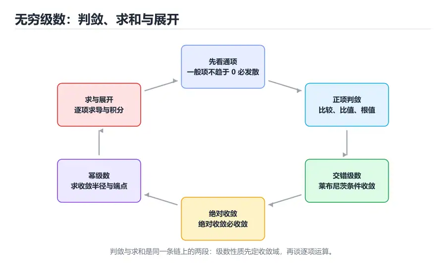

# 无穷级数：判敛、求和函数与傅里叶展开



> 内容更新时间：2026-10-06 · 学习阶段：高级 · 预计用时：55 分钟

## 本节知识框架

**课程定位**：所属分类 `kaoyan_math`（考研数学），课程主题 `无穷级数`，学习阶段 高级，建议用时 55 分钟。数学一与数学三考这一章，数学二不考数项级数判敛也不考幂级数（只在一元微分部分用到泰勒展开）。数一还额外要求傅里叶级数，数三不考。这一章通常是一道小题加一道求和或展开的大题，合计 10~14 分。

配图是一个闭环：先看通项 → 正项判敛 → 交错级数 → 绝对收敛 → 幂级数 → 求与展开，再回到通项。它想说的是「判敛与求和是同一条链上的两段」：级数的性质先定下收敛域，只有落在收敛域内部才谈得上逐项求导与逐项积分；而逐项运算又反过来把陌生的级数变回熟悉的函数。链条上任何一环跳过去，后面的数值就失去依据。

一句话贯通全章：级数是「有限求和的极限」，所以一切判敛法本质都在比较「部分和数列有没有极限」；而幂级数是「用多项式逼近函数」，所以它的一切运算规则都从多项式的运算规则继承而来。

**学完本节应当能够**

- 用必要条件一票否决发散的级数，并解释为什么通项趋于零不足以保证收敛。
- 对正项级数在比较、比值、根值、积分四种判别法之间做选型。
- 区分绝对收敛、条件收敛与发散，并说清重排对它们的影响。
- 求幂级数的收敛半径并单独检验两个端点，写出收敛域。
- 用逐项求导、逐项积分与已知展开式求出和函数，并处理端点的延拓。
- 把简单函数展开成幂级数，或写出周期函数的傅里叶级数并说明收敛值。

### 复习清单

- [ ] 不查表写出 Σ 1/n、Σ 1/n²、Σ 1/(n ln n)、Σ 1/(n (ln n)²) 四个级数的敛散性。
- [ ] 求 Σ x^n/(n · 3^n) 的收敛半径，并逐个检验 x = ±3 两个端点。
- [ ] 由几何级数出发，推出 Σ n x^n 与 Σ x^n/n 的和函数，写清各自适用范围。
- [ ] 写出 f(x) = x（−π < x < π）的傅里叶级数，并用它推出 Σ 1/n² = π²/6。

## 核心概念定义

| 术语 | 操作性定义 | 常见边界与风险 |
| --- | --- | --- |
| 级数收敛 | 部分和数列 S_n = Σ(k=1..n) a_k 存在有限极限时称级数收敛，该极限称为和。 | 收敛的对象是数列而不是级数本身；所有判敛法最终都在判 S_n 是否有极限。 |
| 收敛的必要条件 | 级数收敛 ⇒ 通项 a_n → 0。逆命题不成立。 | 调和级数 Σ 1/n 通项趋于 0 却发散，判敛题第一步永远是先看这条能否一票否决。 |
| p-级数 | Σ 1/n^p 当 p > 1 收敛，p ≤ 1 发散，是比较判别法的标准参照。 | p 与 1 的大小关系是唯一的判据，换成别的参照要重新验证。 |
| 对数级数 | Σ 1/(n (ln n)^q)（n ≥ 2）当 q > 1 收敛、q ≤ 1 发散。 | 它是 p-级数判据在「只差一点」时的精化，考研里用来区分 Σ1/(n ln n) 与 Σ1/(n ln²n)。 |
| 比较判别法 | 正项级数与已知级数逐项比大小，大收敛则小收敛、小发散则大发散。 | 要用极限形式（比值为正常数）才能忽略有限项差异，原始形式必须整个数列成立。 |
| 比值判别法 | lim a_{n+1}/a_n = ρ，ρ < 1 收敛、ρ > 1 发散、ρ = 1 失效。 | ρ = 1 时对 Σ1/n 与 Σ1/n² 给出同样结论，必须换法；这是最常见的「判不出来」。 |
| 根值判别法 | lim (a_n)^(1/n) = ρ，结论同上，对含 n 次幂的通项更快。 | 同样在 ρ = 1 处失效；a_n 含阶乘时优先用比值而不是根值。 |
| 积分判别法 | 正项递减函数 f 满足 f(n) = a_n 时，Σ a_n 与 ∫_1^∞ f(x)dx 同敛散。 | 单调递减是前提；不满足时只能证一个方向的界。 |
| 交错级数 | 形如 Σ(−1)^(n−1) a_n（a_n > 0）。莱布尼茨条件：a_n 单调递减且趋于 0，则收敛。 | 只趋于 0 不单调时结论可能不成立；余项不超过下一项 a_{n+1}，可直接用来估精度。 |
| 绝对收敛 | Σ |a_n| 收敛。绝对收敛 ⇒ 原级数收敛，且任意重排不改变和。 | 反过来不成立；判绝对收敛时把通项取绝对值后就变成了正项级数问题。 |
| 条件收敛 | 原级数收敛但绝对值级数发散，例如 Σ(−1)^(n−1)/n = ln 2。 | 条件收敛的级数重排后可以凑出任意实数（黎曼重排定理），故不能随意打乱顺序。 |
| 收敛半径 | 幂级数 Σ a_n x^n 的收敛区间半宽，R = 1/lim |a_{n+1}/a_n| 或 1/lim (|a_n|)^(1/n)。 | R 只给开区间，两个端点必须分别代入用数项级数判敛法单独检验。 |
| 和函数 | S(x) = Σ a_n x^n，在收敛域内定义的函数。 | 求和结果只在开区间内保证可逐项运算；端点处要用连续性另行论证。 |
| 逐项求导与积分 | 幂级数在收敛区间内可逐项求导、积分，收敛半径不变，收敛域可能缩小。 | 求导后端点常由收敛变发散，积分后端点常由发散变收敛，两端都要重验。 |
| 泰勒与麦克劳林展开 | f(x) = Σ f^(n)(x0)/n! · (x − x0)^n，x0 = 0 时称麦克劳林展开。 | 展开成立要求余项趋于 0；写出级数不等于证明函数等于它。 |
| 傅里叶级数 | 周期函数按 sin、cos 展开，a_n = (1/π)∫ f cos nx dx，b_n = (1/π)∫ f sin nx dx。 | 数一独有。展开前先判奇偶：奇函数只有 b_n，偶函数只有 a_n，能省一半计算。 |
| 狄利克雷收敛定理 | 分段光滑函数的傅里叶级数在连续点收敛于 f(x)，在间断点收敛于左右极限的平均值。 | 端点 ±π 处的收敛值是 f(π−) 与 f(−π+) 的平均，不是 f(π) 本身。 |

## 原理与运行机制

### 必要条件为什么这么好用

拿到一个级数，第一件事是把通项取极限。Σ n/(n+1) 通项趋于 1，直接判发散；Σ (1 + 1/n)^n 通项趋于 e，也直接判发散；Σ (−1)^n n/(n+1) 的通项没有极限，同样发散。这三类题在考卷上用三十秒就能处理，却被大量考生拿去套比值判别法，绕远路还容易算错。

反过来，通项趋于 0 什么都不能说明。调和级数的部分和按 ln n 增长，1/(n ln n) 按 ln ln n 增长，都是发散，但发散得极慢：算到一千万项，Σ 1/(n ln n)（从 n = 2 起）才累积到 3.575，看起来像在收敛。这正是「慢发散」在数值上的样子，也是积分判别法存在的理由——它能给出增长速度的证据，而部分和数列给不出。

### 正项级数的四种判据怎么选

参照物决定方法。含 n! 或连乘的，用比值判别法；含 n 次幂的，用根值判别法；形如 1/（n 的多项式或对数组合）的，与 p-级数或对数级数比较；能顺手写出对应函数的，用积分判别法。

比值判别法在 ρ = 1 处失效这一点必须记住，因为它恰好把 Σ 1/n 与 Σ 1/n² 这两兄弟放在一起：两者都给出 ρ = 1，一个发散一个收敛。此时改用比较或积分，一条就分开了。

### 绝对收敛、条件收敛与重排

Σ(−1)^(n−1)/n 收敛于 ln 2 = 0.693147，但取绝对值后是调和级数，发散，所以它是条件收敛。部分和的逼近很慢：走 10 项只得 0.645635，走 1000 项得 0.692647。莱布尼茨余项估计 |R_n| ≤ a_{n+1} = 1/(n+1) 精确预测了这个速度——想要三位小数就得取到 n ≈ 1000。

对比 Σ(−1)^(n−1)/n²，它绝对收敛（因为 Σ 1/n² 收敛），和为 π²/12 = 0.822467。绝对收敛的级数可以任意重排、可以逐项相加、可以乘常数，运算规则和普通函数一样宽松；条件收敛的级数重排后能被凑到任何指定值，所以任何打乱顺序的变形都必须在绝对收敛的前提下才合法。

### 收敛半径、收敛域与端点

Σ x^n/(n · 3^n) 的系数比 |a_{n+1}/a_n| = n/(n+1) · 1/3 → 1/3，所以 R = 3，开区间是 (−3, 3)。端点必须单独算：x = 3 时级数变成 Σ 1/n，发散；x = −3 时变成 Σ(−1)^n/n，条件收敛。于是收敛域是 [−3, 3)。

两个补充例子给出对照。Σ n! x^n/n^n 用比值法算出 |a_{n+1}/a_n| → 1/e，故 R = e，这是阶乘型通项的典型结果；Σ x^n/n! 的比值极限是 0，故 R = +∞，全轴收敛。三个例子放在一起正好覆盖「有限正数、无穷、零点」三种情形。

### 求和函数：把陌生级数变回熟面孔

四个必须背下来的展开式：

| 展开式 | 适用范围 |
| --- | --- |
| 1/(1 − x) = Σ(n=0..∞) x^n | \|x\| < 1 |
| e^x = Σ(n=0..∞) x^n/n! | 全实轴 |
| ln(1 + x) = Σ(n=1..∞) (−1)^(n−1) x^n/n | −1 < x ≤ 1 |
| arctan x = Σ(n=0..∞) (−1)^n x^(2n+1)/(2n+1) | \|x\| ≤ 1 |

求和的三个动作是「拆、导、积」。以 Σ n x^n 为例：先取公比级数 1/(1 − x) = Σ x^n，两边求导得 1/(1 − x)² = Σ n x^{n−1}，再乘一个 x，得到 Σ n x^n = x/(1 − x)²（|x| < 1）。代 x = 1/2 得 2，与直接累加 Σ n/2^n 的数值 2.000000 一致。

反过来 Σ x^n/n 需要先积分：由 1/(1 − x) = Σ x^{n−1} 从 0 积到 x，得 −ln(1 − x) = Σ x^n/n（x ∈ [−1, 1)）。代 x = 1/2 得 ln 2 = 0.693147，与数值累加完全吻合。

有些级数要先拆成两项再各自套用。Σ(−1)^(n−1)(2n − 1)/2^n 拆成 2Σ n(−1/2)^n 与 Σ(−1/2)^n 的组合后算得 0.111111 = 1/9，这类「看不出原型」的题基本都靠拆与移指标解决。

### 傅里叶级数与它顺手给出的数项级数和

f(x) = x（−π < x < π）是奇函数，所以只有正弦项：b_n = (1/π)∫(−π..π) x sin nx dx = 2(−1)^(n+1)/n，展开式为

x = 2 Σ(n=1..∞) (−1)^(n+1) sin(nx)/n，−π < x < π

数值检验：在 x = 1 处取 20 万项得 1.0000，在 x = π/2 处得 1.5708，都对得上。由 Parseval 等式 (1/π)∫(−π..π) x² dx = Σ b_n²，左边是 2π²/3，右边是 4Σ 1/n²，于是 Σ 1/n² = π²/6 = 1.644934——这就是数一常考的「用一个傅里叶展开反推数项级数和」。

同一个展开式代 x = π/2 还能得到 π/4 = Σ(n=0..∞) (−1)^n/(2n+1)，数值上累加 200 万项得 0.785398，与 π/4 相符；它同样收敛得慢，取 1000 项只有 0.785648，这也是莱布尼茨余项估计的又一处用武之地。

## 典型应用场景

| 场景 | 典型输入或前提 | 期望产物 |
| --- | --- | --- |
| 判敛选型题 | 给出一个通项，问敛散性 | 先看通项极限，再按含阶乘/含 n 次幂/像 p-级数三类选判据。 |
| 求幂级数收敛域 | 给出 Σ a_n x^n | 算 R、检验两个端点、写成区间形式。 |
| 求和函数 | 给出含 n、n² 或组合数的级数 | 拆成基本展开式的导数或积分，标明适用范围。 |
| 函数展开成幂级数 | 给出解析式与展开点 | 用已知展开式套合并调整指标，写出收敛区间。 |
| 近似计算与误差控制 | 要求指定精度 | 用交错级数余项或泰勒余项确定需要累加的项数。 |
| 傅里叶展开（数一） | 给出周期或半区间上的函数 | 判奇偶、算系数、写级数，并按狄利克雷定理说明收敛值。 |
| 反推数项级数和 | 需要 Σ 1/n² 之类的数值 | 选一个合适的展开式代特殊点或用 Parseval。 |

## 代码/协议/SQL 示例

判敛法给的是定性结论，数值累加能给出具象感受。下面这段把条件收敛与绝对收敛两条链并排跑，顺便把两个闭式值列在最后。

```python
import math

def partial(f, n):
    return sum(f(k) for k in range(1, n + 1))

alt = lambda k: (-1) ** (k - 1) / k
pos = lambda k: 1.0 / (k * k)

for n in (10, 100, 1000):
    print(n, round(partial(alt, n), 6), round(partial(pos, n), 6))

print(round(math.pi ** 2 / 6, 6), round(math.log(2), 6))
```

运行结果：

```text
10 0.645635 1.549768
100 0.688172 1.634984
1000 0.692647 1.643935
1.644934 0.693147
```

读表方式：左列是 Σ(−1)^(n−1)/n 的部分和，它向 ln 2 = 0.693147 逼近，误差由 1/(n+1) 控制，所以项数每乘十，误差也约缩十倍；右列是 Σ 1/n² 的部分和，向 π²/6 = 1.644934 逼近，但它是正项级数，误差由余项积分估计约 1/n，量级相同却没有交错级数那种「已经夹住」的把握。两者并排可以看出：交错级数的慢是「可预测的慢」，正项级数的慢是「只知在收、不知收到哪」的慢。

## 时间/空间复杂度或性能分析

| 题型 | 标准动作数 | 常见耗时 | 提速点 |
| --- | --- | --- | --- |
| 判敛单选题 | 通项极限、选判据、比对参照 | 1~2 分钟 | 把 p-级数与对数级数两条分界线背成条件反射。 |
| 求收敛域 | 算 R、代两端、各判一次 | 2~3 分钟 | 端点只有四种下场：绝对、条件、发散、无界，列出来逐个排除。 |
| 求和函数 | 认原型、拆或导积、定范围 | 6~10 分钟 | 先写目标级数与四个基本展开式的距离，再决定求导还是积分。 |
| 幂级数展开 | 变形到已知形式、调指标 | 4~6 分钟 | 指标起点不同不要硬套，先把前几项手算三项对一遍。 |
| 傅里叶系数 | 判奇偶、两次分部积分 | 8~12 分钟 | 奇偶判断能砍掉一半系数；sin nπ 一律为 0、cos nπ = (−1)^n 要提前代入。 |

数值累加的代价是 O(n)，但有效精度并不与 n 成正比：条件收敛的交错级数每加一项只推进 1/n 的误差，想把 ln 2 算到六位小数需要上亿项，远不如改用加速后的级数。泰勒展开的收敛速度由|x| 与半径之比决定，|x| 接近 1 时 e^x 型级数收敛极快（10 项误差 3e−8，5 项误差 1.6e−3），而 arctan x 在 x = 1 处退化为莱布尼茨级数，是同一族里最慢的一端。

## 常见误区与易错点

| 容易踩的做法 | 实际现象 | 原因与正确做法 |
| --- | --- | --- |
| 由 a_n → 0 断定收敛 | 调和级数被判成收敛 | 必要条件不是充分条件，收敛还要看部分和是否有界。 |
| 比值等于 1 时说「无法判断」就放弃 | 空着不答 | 立刻换比较判别法或积分判别法，p-级数是标准出口。 |
| 交错级数只验通项趋于 0 | 莱布尼茨条件不全 | 还须单调递减；不单调时改用绝对收敛或狄利克雷判别。 |
| 收敛半径当成收敛域 | 端点漏判被扣分 | R 只给开区间，两个端点要分别代入按数项级数重判。 |
| 逐项求导后不重验端点 | 端点结论写错 | 求导可能让条件收敛的端点变成发散，积分则相反。 |
| 直接重排条件收敛级数 | 和可能被改成任意值 | 只有绝对收敛才允许任意重排与逐项运算。 |
| 把傅里叶级数在间断点写成 f(x) | 收敛值算错 | 间断点收敛于左右极限的平均，端点要按周期延拓理解。 |
| 忘记展开式的适用区间 | 和函数范围写错 | 每个和函数都必须带适用范围，写全才得分。 |
| 指标起点没调就套公式 | 多一项或少一项 | 手算前三项与公式对照，一秒抓出指标错位。 |
| 认为幂级数在端点一定不可导 | 延拓判断失误 | 端点处的性质要单独论证，连续性常可由阿贝尔定理补上。 |

### 现场 1：判敛法用错就下「发散」结论

**症状**：对 Σ 1/n² 用比值判别法，算出 ρ = 1，于是写「级数发散」。

**根因与修复**：ρ = 1 只表示比值判别法失效，既不证收敛也不证发散。此时级数的形状已经明摆着是 p-级数（p = 2 > 1），应直接改判收敛。判据失效与级数发散是两件事，混起来会连带把 Σ 1/n 也写错方向。

**自检**：给 Σ 1/n、Σ 1/n²、Σ 1/(n ln n)、Σ 1/(n ln²n) 四个级数，两分钟内说出哪些比值法失效、该换哪条判据、结论分别是什么。

### 现场 2：求和时把适用范围丢掉

**症状**：算出 Σ n x^n = x/(1 − x)² 就直接交卷，不写条件。

**根因与修复**：等号只在收敛区间 |x| < 1 内成立；端点 x = ±1 处级数发散，右端却在 x = −1 处取到有限值 1/4，两边不等价。阅卷时漏写范围通常直接扣掉结论分。凡是逐项求导得到的结果，端点都要重新验一次。

**自检**：口述 Σ x^n/n、Σ n x^n、Σ x^(2n)/(2n) 三个级数各自的收敛域与和函数，并指出端点上哪些能靠连续性补上。

### 现场 3：傅里叶展开没判奇偶就硬积分

**症状**：对 f(x) = x 在 (−π, π) 上老老实实算 a_n，算满两页发现全是 0。

**根因与修复**：奇函数在对称区间上的傅里叶展开只含正弦项，a_n（含 a0）恒为 0。先花十秒判奇偶（必要时先做平移或周期延拓后再判），能省掉一半积分。半区间 (0, π) 的题目还要先决定做正弦级数还是余弦级数，也就是奇延拓还是偶延拓。

**自检**：写出 f(x) = |x|（−π < x < π）的展开式中哪些系数必为零，并说出这个级数在 x = 0 处收敛到什么值。

## 与其他知识点的关系

**前置知识**：`kaoyan_math_limit_continuity`（级数就是数列极限的另一种写法，夹逼与单调有界准则直接复用）；`kaoyan_math_single_diff`（泰勒公式与高阶导数是幂级数展开的工具）。

**横向关联**：

- 一元函数积分学（`kaoyan_math_integral`）：积分判别法、分部积分算傅里叶系数、逐项积分求和函数都在用定积分技巧。
- 常微分方程（`kaoyan_math_ode`）：幂级数解法把变系数方程转成系数递推，本章的收敛半径理论决定解的定义范围。
- 多元函数微分学（`kaoyan_math_multivar_diff`）：全微分与泰勒展开在高维的推广，本质上仍是级数逼近。

**后续延伸**：

- 概率统计（`kaoyan_math_eigen_probability`）：分布函数的级数表示、特征函数的泰勒展开、大数定律里的极限论证都靠本章工具。
- 复变函数与傅里叶变换（超出考研范围）：洛朗级数与傅里叶积分是幂级数与三角级数的直接推广。

## 自测题与参考答案

下面 6 道题由本课题库直接生成，题号与「考点精讲」一一对应；建议先写下自己的答案与推理，再核对参考答案里的字母与原文。

### 自测 1

下列四个正项级数中收敛的是？

- A. Σ 1/(n ln n)，n 从 2 开始
- B. Σ (1 + 1/n)^n
- C. Σ 1/√n
- D. Σ 1/(n (ln n)²)，n 从 2 开始

**参考答案**：D，即「Σ 1/(n (ln n)²)，n 从 2 开始」

### 自测 2

幂级数 Σ x^n/(n · 3^n) 的收敛域是？

- A. [−3, 3)
- B. (−3, 3)
- C. [−3, 3]
- D. (−3, 3]

**参考答案**：A，即「[−3, 3)」

### 自测 3

级数 Σ(n=1..∞) (−1)^(n−1)/n 的敛散性与和分别是？

- A. 绝对收敛，其和等于 π²/6
- B. 发散，因为通项取绝对值后是调和级数
- C. 条件收敛，其和等于 ln 2
- D. 收敛但无法用初等函数表出其和

**参考答案**：C，即「条件收敛，其和等于 ln 2」

### 自测 4

阅读下面的 Python 代码，四行输出说明的是？

- A. 两列都向同一个数逼近，说明这两个级数绝对收敛且和相等
- B. 左列是正项级数且发散，右列是交错级数且条件收敛
- C. 左列误差由 1/(n + 1) 控制、收敛较慢，右列向 π²/6 = 1.644934 逼近，两者都不是指数收敛
- D. 最后一行的 1.644934 与 0.693147 说明代码里的两个级数都算错了

题面代码：

```python
import math

def partial(f, n):
    return sum(f(k) for k in range(1, n + 1))

alt = lambda k: (-1) ** (k - 1) / k
pos = lambda k: 1.0 / (k * k)

for n in (10, 100, 1000):
    print(n, round(partial(alt, n), 6), round(partial(pos, n), 6))

print(round(math.pi ** 2 / 6, 6), round(math.log(2), 6))
```

**参考答案**：C，即「左列误差由 1/(n + 1) 控制、收敛较慢，右列向 π²/6 = 1.644934 逼近，两者都不是指数收敛」

### 自测 5

关于数项级数与幂级数，下列说法正确的是？

- A. 幂级数在其收敛区间的内部可以逐项求导与逐项积分，且收敛半径不变
- B. 交错级数只要一般项趋于 0 就一定收敛
- C. 绝对收敛的级数一定收敛，且任意重排各项后其和不变
- D. 若 Σ a_n 与 Σ b_n 都发散，则 Σ (a_n + b_n) 也必发散
- E. 比值判别法在极限等于 1 时失效，此时需要改用比较判别法或积分判别法

**参考答案**：A C E，即 A「幂级数在其收敛区间的内部可以逐项求导与逐项积分，且收敛半径不变」 → C「绝对收敛的级数一定收敛，且任意重排各项后其和不变」 → E「比值判别法在极限等于 1 时失效，此时需要改用比较判别法或积分判别法」

### 自测 6

把「求幂级数和函数」的四个动作按先后顺序排列：

- A. 认出可用的基本展开式，如几何级数、e^x、ln(1 + x)、arctan x
- B. 把待求级数变形为已知展开式的线性组合，或对它先求导、先积分
- C. 写出收敛半径并分别检验两个端点，确定逐项运算合法的开区间
- D. 化简出闭合表达式，标出适用范围并单独讨论端点能否用连续性补上

**参考答案**：C A B D，即 C「写出收敛半径并分别检验两个端点，确定逐项运算合法的开区间」 → A「认出可用的基本展开式，如几何级数、e^x、ln(1 + x)、arctan x」 → B「把待求级数变形为已知展开式的线性组合，或对它先求导、先积分」 → D「化简出闭合表达式，标出适用范围并单独讨论端点能否用连续性补上」

## 考点精讲

逐题复述题干、选项原文、答案字母（A 即下标 0）与判断依据，文字与本课题库 JSON 完全一致，判卷以这里列出的正确项为准。

### 考点 1

- **题干**：下列四个正项级数中收敛的是？
- **选项原文**：A. Σ 1/(n ln n)，n 从 2 开始　B. Σ (1 + 1/n)^n　C. Σ 1/√n　D. Σ 1/(n (ln n)²)，n 从 2 开始
- **答案**：D
- **正确项原文**：Σ 1/(n (ln n)²)，n 从 2 开始
- **判断依据**：本题正确项是「Σ 1/(n (ln n)²)，n 从 2 开始」。用积分判别法：∫(2..∞) dx/(x ln²x) 令 u = ln x 化为 ∫ du/u²，收敛于 1/ln 2，所以原级数收敛，数值上累加到三百万项约为 2.04 并仍在缓慢上升但已确定有界。干扰项「Σ 1/(n ln n)，n 从 2 开始」是同族的临界情形，积分给出 ln ln x，一千万项只累加到 3.575，属于增长极慢的发散；干扰项「Σ (1 + 1/n)^n」连必要条件都不满足，通项趋于 e 而不是 0，发散；干扰项「Σ 1/√n」是 p = 1/2 的 p-级数，p ≤ 1 故发散。

### 考点 2

- **题干**：幂级数 Σ x^n/(n · 3^n) 的收敛域是？
- **选项原文**：A. [−3, 3)　B. (−3, 3)　C. [−3, 3]　D. (−3, 3]
- **答案**：A
- **正确项原文**：[−3, 3)
- **判断依据**：本题正确项是「[−3, 3)」。系数比 |a_{n+1}/a_n| = n/(n + 1) · 1/3 → 1/3，故收敛半径 R = 3，开区间先写成 (−3, 3)。两个端点各判一次：x = 3 时级数化为 Σ 1/n，调和级数发散；x = −3 时化为 Σ(−1)^n/n，莱布尼茨条件成立故收敛，但取绝对值后仍发散，属条件收敛。因此左端闭、右端开。干扰项「(−3, 3)」把收敛半径直接当成收敛域，跳过了端点这一步；干扰项「[−3, 3]」在右端点把发散判成收敛，正是阅卷时最常见的扣分位置。

### 考点 3

- **题干**：级数 Σ(n=1..∞) (−1)^(n−1)/n 的敛散性与和分别是？
- **选项原文**：A. 绝对收敛，其和等于 π²/6　B. 发散，因为通项取绝对值后是调和级数　C. 条件收敛，其和等于 ln 2　D. 收敛但无法用初等函数表出其和
- **答案**：C
- **正确项原文**：条件收敛，其和等于 ln 2
- **判断依据**：本题正确项是「条件收敛，其和等于 ln 2」。莱布尼茨判别法保证收敛（1/n 单调递减且趋于 0），取绝对值后是调和级数故不发散于绝对值意义下——绝对值级数发散，两者合起来就是条件收敛。和由 ln(1 + x) 的麦克劳林展开在 x = 1 处取到，即 ln 2 = 0.693147，数值累加 1000 项得 0.692647，误差与 1/(n + 1) 一致。干扰项「绝对收敛，其和等于 π²/6」把这一级数与 Σ 1/n² 混为一谈，π²/6 = 1.644934 只属于后者；干扰项「收敛但无法用初等函数表出其和」否掉了现成的 ln(1 + x) 展开，属于知识盲区而不是题目难点。

### 考点 4

- **题干**：阅读下面的 Python 代码，四行输出说明的是？
- **选项原文**：A. 两列都向同一个数逼近，说明这两个级数绝对收敛且和相等　B. 左列是正项级数且发散，右列是交错级数且条件收敛　C. 左列误差由 1/(n + 1) 控制、收敛较慢，右列向 π²/6 = 1.644934 逼近，两者都不是指数收敛　D. 最后一行的 1.644934 与 0.693147 说明代码里的两个级数都算错了
- **答案**：C
- **正确项原文**：左列误差由 1/(n + 1) 控制、收敛较慢，右列向 π²/6 = 1.644934 逼近，两者都不是指数收敛
- **判断依据**：本题正确项是「左列误差由 1/(n + 1) 控制、收敛较慢，右列向 π²/6 = 1.644934 逼近，两者都不是指数收敛」。alt 是 Σ(−1)^(k−1)/k，向 ln 2 逼近：10 项 0.645635、100 项 0.688172、1000 项 0.692647，误差严格按约十分之一递减，正是莱布尼茨余项 |R_n| ≤ a_{n+1} 的表现；pos 是 Σ 1/k²，向 π²/6 逼近，误差约 1/n，同样只有多项式速度。最后一行列出两个闭式值供对照，说明两列都在正确收敛而不是算错。干扰项「最后一行的 1.644934 与 0.693147 说明代码里的两个级数都算错了」把闭式参照值误读成矛盾证据，实际上第四行的作用恰恰是验证前三行。

### 考点 5

- **题干**：关于数项级数与幂级数，下列说法正确的是？
- **选项原文**：A. 幂级数在其收敛区间的内部可以逐项求导与逐项积分，且收敛半径不变　B. 交错级数只要一般项趋于 0 就一定收敛　C. 绝对收敛的级数一定收敛，且任意重排各项后其和不变　D. 若 Σ a_n 与 Σ b_n 都发散，则 Σ (a_n + b_n) 也必发散　E. 比值判别法在极限等于 1 时失效，此时需要改用比较判别法或积分判别法
- **答案**：A C E
- **正确项原文**：A. 幂级数在其收敛区间的内部可以逐项求导与逐项积分，且收敛半径不变；C. 绝对收敛的级数一定收敛，且任意重排各项后其和不变；E. 比值判别法在极限等于 1 时失效，此时需要改用比较判别法或积分判别法
- **判断依据**：多选题要同时选中「幂级数在其收敛区间的内部可以逐项求导与逐项积分，且收敛半径不变」、「绝对收敛的级数一定收敛，且任意重排各项后其和不变」与「比值判别法在极限等于 1 时失效，此时需要改用比较判别法或积分判别法」。第一项的范围限定词「内部」是关键，端点要另行检验；第二项是绝对收敛的两条好处，条件收敛的级数重排后可以凑出任意实数，因此重排必须先有绝对收敛背书；第三项解释了为什么 Σ 1/n 与 Σ 1/n² 用比值法给出同一个 ρ = 1 却结论相反。干扰项「交错级数只要一般项趋于 0 就一定收敛」漏了莱布尼茨的单调递减条件；干扰项「若 Σ a_n 与 Σ b_n 都发散，则 Σ (a_n + b_n) 也必发散」不成立，取 a_n = 1、b_n = −1 时两个级数都发散，相加却是收敛的零级数。

### 考点 6

- **题干**：把「求幂级数和函数」的四个动作按先后顺序排列：
- **选项原文**：A. 认出可用的基本展开式，如几何级数、e^x、ln(1 + x)、arctan x　B. 把待求级数变形为已知展开式的线性组合，或对它先求导、先积分　C. 写出收敛半径并分别检验两个端点，确定逐项运算合法的开区间　D. 化简出闭合表达式，标出适用范围并单独讨论端点能否用连续性补上
- **答案**：C A B D
- **正确序号**：C A B D
- **作答顺序原文**：C「写出收敛半径并分别检验两个端点，确定逐项运算合法的开区间」 → A「认出可用的基本展开式，如几何级数、e^x、ln(1 + x)、arctan x」 → B「把待求级数变形为已知展开式的线性组合，或对它先求导、先积分」 → D「化简出闭合表达式，标出适用范围并单独讨论端点能否用连续性补上」
- **判断依据**：本题顺序是「写出收敛半径并分别检验两个端点，确定逐项运算合法的开区间」 → 「认出可用的基本展开式，如几何级数、e^x、ln(1 + x)、arctan x」 → 「把待求级数变形为已知展开式的线性组合，或对它先求导、先积分」 → 「化简出闭合表达式，标出适用范围并单独讨论端点能否用连续性补上」。先定区间是因为逐项求导与积分只在开区间内部自动合法，范围不清时后面所有变形都可能越界；认原型与做变形是一读一做，必须先后衔接；端点讨论放在最末尾，因为它要用已经成形的闭合表达式来判断能否靠连续性补上。把 D 提到 B 之前是常见错序——表达式还没变形就讨论端点，等于在算一个还不知道结果的东西。

## 术语速查

| 术语 | 一句话说明 |
| --- | --- |
| 部分和 | 前 n 项的和 S_n，级数的一切敛散性讨论都是这个数列的极限讨论。 |
| 通项检验 | 看 a_n 是否趋于 0 的第一道筛子，能一票否决发散，但通不过时什么也不能证明。 |
| p-级数参照 | Σ 1/n^p 以 p = 1 为分界的结论，比较判别法几乎都靠它当标尺。 |
| 对数级数 | 形如 Σ 1/(n ln^q n) 的临界族，q = 1 发散、q > 1 收敛，用来处理「只差一点」的情形。 |
| 条件收敛 | 原级数收敛而绝对值级数发散，可以收敛但重排会改变和，运算自由度小。 |
| 收敛半径 | 幂级数收敛区间的半宽，由系数比的极限的倒数给出，只管开区间不管端点。 |
| 和函数 | 级数在收敛域上定义的函数，求和就是把它写成有限形式的解析式。 |
| 逐项运算 | 在收敛区间内部对幂级数逐项求导或积分，半径不变但端点要重验。 |
| 阿贝尔定理 | 幂级数在某端点收敛则在该侧闭区间上一致收敛，是把结论延到端点的依据。 |
| 狄利克雷收敛定理 | 傅里叶级数的收敛值规则：连续点取函数值，间断点取左右极限的平均。 |

## 参考资料与复核

- [研招网 硕士研究生招生考试大纲](https://yz.chsi.com.cn/kyzx/jyxd/)
- [Paul's Online Notes 幂级数与收敛区间](https://tutorial.math.lamar.edu/classes/calcii/powerseries.aspx)
- [SymPy 级数模块文档（泰勒展开与渐近级数）](https://docs.sympy.org/latest/modules/series/series.html)
- 最后复核：2026-10-04
- 下次复核：2027-07-24
- 来源性质：官方大纲 + 开放讲义与计算机代数系统文档，用于核对判敛条件、收敛端点约定与展开式适用范围
- 数值结论复核方式：四个正项级数、两条部分和数列、ln 2 与 π²/6、傅里叶展开的收敛值均由累加脚本独立重算

## 内容元数据

> 内容更新时间：2026-10-06 · 学习阶段：高级 · 预计用时：55 分钟

- 内容版本：v2.0
- 最后更新：2026-10-06
- 学习阶段：高级
- 适用环境：通用备考环境；数学二不考本章，数学三不考傅里叶级数，数一对判敛、幂级数与傅里叶级数三块都有要求。
- 内容来源：内置结构化课程与历年考研数学大纲整理
- 相关主题：series convergence, alternating series, radius of convergence, sum function, fourier series
- 质量版本：P0 测验标准 + P1 覆盖扩展 + P2 体验补全

- [ ] 能用四种判据各解决一个正项级数，并说出选它的理由。
- [ ] 能写出三个幂级数的收敛域，端点结论逐个交代清楚。
- [ ] 能把两个含 n 或 n 次方的级数求成闭合形式的和函数并标范围。
- [ ] 能写出 f(x) = x 的傅里叶级数并反推出 Σ 1/n² 的值。
