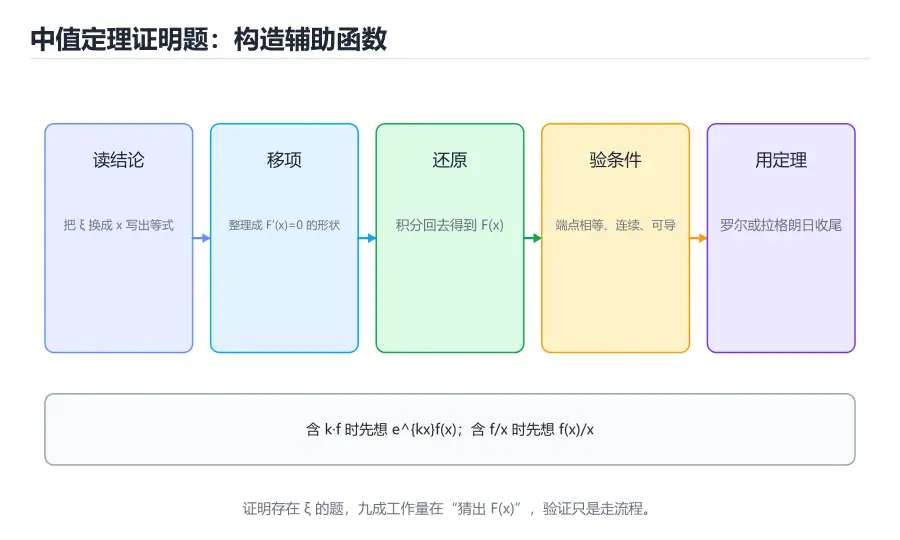

# 一元函数微分学：中值定理与导数的四大应用



> 内容更新时间：2026-10-06 · 学习阶段：进阶 · 预计用时：45 分钟

## 本节知识框架

**课程定位**：所属分类 `kaoyan_math`（考研数学），课程主题 `一元函数微分学`，学习阶段 进阶，建议用时 45 分钟。数学一、数学二、数学三都考，数二在这里深度最大（中值定理证明题常作为压轴小题出现）。

导数的白话含义是「把曲线放大到足够大时看成那条直线的斜率」。中值定理则把这条局部性质与整段区间的平均变化率接起来：只要函数在闭区间连续、开区间可导，就一定存在某一点，它的瞬时变化率等于整体的平均变化率。证明题的所有技巧都围绕这句话展开。

**学完本节应当能够**

- 用定义处理「凑增量」型的导数极限题，并说清每个系数从哪来。
- 讲清可导、连续、导函数连续三者的强弱关系，各举一个反例。
- 拿到一道中值定理证明题，按五步流程构造出辅助函数。
- 用导数完成单调性、极值、凹凸与拐点、渐近线、曲率四类计算。

### 复习清单

- [ ] 手算 f(x) = x² 在 [1,3] 上的拉格朗日中值点 ξ，验证 ξ = 2。
- [ ] 写出三个反例：连续但不可导、可导但导函数不连续、两端相等但不满足罗尔条件。
- [ ] 把「ξ f′(ξ) + 2f(ξ) = 0」还原成辅助函数 F(x)，并说明为什么 F(0) = F(1)。
- [ ] 不查公式，算出 y = x² 在原点处的曲率与 y = ln x 在 x = 1 处的曲率。

## 核心概念定义

| 术语 | 操作性定义 | 常见边界与风险 |
| --- | --- | --- |
| 导数 | f′(x0) = lim(h→0) [f(x0 + h) − f(x0)]/h，这个极限存在才叫「f 在 x0 可导」。它同时是切线斜率与瞬时变化率。 | 定义里的极限必须是同一个 h 从两侧逼近都存在且相等；只有单侧极限时只能说单侧可导。 |
| 左右导数 | 分别用 h→0+ 与 h→0− 得到的两个极限。可导 ⇔ 两者都存在且相等。 | 分段函数在分段点必须回到定义算，不能对两段各自求导后代值。 |
| 微分 | dy = f′(x)dx，是函数增量的线性主部：Δy = f′(x)Δx + o(Δx)。 | 把 dy 当成 Δy 是近似而不是相等；dx 就是自变量的增量。 |
| 可导与连续 | 可导 ⇒ 连续；连续 ⇏ 可导。 | f(x) = abs(x) 在 0 连续但左右导数是 −1 与 1；f(x) = x² sin(1/x)（补 f(0)=0）可导且 f′(0)=0，但 f′ 在 0 不连续。 |
| 高阶导数 | 对导函数再求导。常用结论：(e^(ax))^(n) = a^n e^(ax)，(sin x)^(n) = sin(x + nπ/2)，(x e^x)^(n) = (x + n)e^x。 | 莱布尼茨公式 (uv)^(n) = Σ C(n,k) u^(k) v^(n−k) 用于高阶导数，别与一次乘积求导混起来。 |
| 罗尔定理 | f 在 [a,b] 连续、(a,b) 可导且 f(a) = f(b)，则存在 ξ ∈ (a,b) 使 f′(ξ) = 0。 | 三条条件缺一条就可能不成立，还要能举出结论失效的反例，例如 f = |x| 在 [−1,1]。 |
| 拉格朗日中值定理 | 在前两条条件下，存在 ξ 使 f′(ξ) = [f(b) − f(a)]/(b − a)，即 f(b) − f(a) = f′(ξ)(b − a)。 | 它是罗尔的平移版本：辅助函数取 F(x) = f(x) − [f(b) − f(a)]/(b − a) · x。 |
| 柯西中值定理 | 两条曲线一起看：存在 ξ 使 [f(b) − f(a)]/[g(b) − g(a)] = f′(ξ)/g′(ξ)，要求 g′ 在区间内不为 0。 | 分母函数同样要满足连续与可导；它是洛必达法则证明里的核心工具。 |
| 泰勒公式 | f(x) = Σ(k=0..n) f^(k)(x0)/k! · (x − x0)^k + R_n，考研常用拉格朗日余项 R_n = f^(n+1)(ξ)/(n+1)! · (x − x0)^(n+1)。 | 展开点选在哪里决定难度；带 ξ 的余项是把误差写成另一阶导数的关键。 |
| 极值与第二充分条件 | 驻点处若 f″(x0) < 0 取极大，f″(x0) > 0 取极小；f″(x0) = 0 时该判别失效，要退回第一充分条件看 f′ 变号。 | 可导函数的极值点必是驻点，但驻点不一定是极值点，f = x³ 在 0 就是反例。 |
| 凹凸与拐点 | f″ > 0 的区间上曲线凹（开口向上），f″ < 0 时凸；凹凸的分界点称拐点。 | 判定拐点要看 f″ 是否变号，仅 f″ = 0 不够，f = x⁴ 在 0 处 f″ = 0 却不是拐点。 |
| 渐近线 | 水平看 lim(x→∞) f(x)；垂直找使函数趋于无穷的点；斜渐近线 k = lim f(x)/x，b = lim [f(x) − kx]。 | 斜渐近线要先确认 lim f(x)/x 存在且非零，否则整条流程白走一遍。 |
| 曲率 | k = abs(y″) / (1 + (y′)²)^(3/2)，是切线方向对弧长的变化率；曲率半径 ρ = 1/k。 | 参数方程与隐函数要先化出 y′ 与 y″，代错点是这一类题最常见的失分方式。 |
| 相关变化率 | 两个随时间变化的量满足某个关系式，两边对 t 求导即可由已知速度求未知速度。 | 先写几何关系式再求导，不要先把数值代进去。 |

## 原理与运行机制

### 一个最小例子把中值定理落地

取 f(x) = x²，区间 [1,3]。割线斜率 = (9 − 1)/(3 − 1) = 4。令 f′(ξ) = 2ξ = 4，解得 ξ = 2，确实落在 (1,3) 内。这就是拉格朗日中值定理的全部内容：平均变化率一定被某一点的瞬时变化率取到。

把同一个函数放在 [−1,1] 上，f(−1) = f(1) = 1，两端相等，于是定理给出的 ξ 满足 f′(ξ) = 0，即 ξ = 0 —— 这正是罗尔定理的特例。

### 导数定义题的凑定义手法

已知 f 在 x0 可导，求 lim(h→0) [f(x0 + 2h) − f(x0 − h)]/h。做法是把分子拆成两段增量：

[f(x0 + 2h) − f(x0)]/h + [f(x0) − f(x0 − h)]/h = 2 · [f(x0 + 2h) − f(x0)]/(2h) + [f(x0 − h) − f(x0)]/(−h)

两个方括号都趋于 f′(x0)，所以答案是 3f′(x0)。系数 2 与 1 来自增量本身而不是猜的；若题目改成 [f(x0 + h) − f(x0 − h)]/(2h)，答案才是 f′(x0)。

### 三个层次的强弱关系

把「连续」「可导」「导函数连续」排序，从弱到强是：连续 < 可导 < 导函数连续。

- 连续但不可导：f(x) = |x| 在 x = 0。
- 可导但导函数不连续：f(x) = x² sin(1/x)（补 f(0) = 0）。此时 f′(0) = lim(h→0) h sin(1/h) = 0，而当 x ≠ 0 时 f′(x) = 2x sin(1/x) − cos(1/x)，其中 cos(1/x) 振荡无极限，所以 f′ 在 0 不连续。
- 三条全不满足：分段函数在分段点没有定义，谈不上可导。

这一串在考研里以「下列说法正确的有几个」的形式反复出现，背三个反例比背定理叙述更管用。

### 中值定理证明题：五步构造辅助函数

配图里的流程可以直接当模板：把 ξ 换成 x 写出等式 → 移项整理成 F′(x) = 0 的形状 → 积分还原出 F(x) → 验证端点值、连续性与可导性 → 套罗尔或拉格朗日收尾。

例题：设 f 在 [0,1] 连续、在 (0,1) 内可导，且 f(1) = 0。证明存在 ξ ∈ (0,1) 使 ξ f′(ξ) + 2f(ξ) = 0。

1. 把 ξ 换成 x：x f′(x) + 2f(x) = 0。
2. 两边同乘 x，得到 x² f′(x) + 2x f(x) = 0，左边正好是 (x² f(x))′。
3. 于是取 F(x) = x² f(x)，则 F′(x) = x(2f(x) + x f′(x))。
4. 验证：F 在 [0,1] 连续、在 (0,1) 可导，且 F(0) = 0²·f(0) = 0，F(1) = 1²·f(1) = 0，两端相等。
5. 由罗尔定理，存在 ξ ∈ (0,1) 使 F′(ξ) = 0，即 ξ(2f(ξ) + ξ f′(ξ)) = 0；因 ξ ≠ 0，括号必为零，正是要证的等式。

两条常用的还原口诀：式子里出现 k f(x) + f′(x)，就往 e^(kx) f(x) 想；出现 x f′(x) − n f(x)，就往 f(x)/x^n 想。

### 导数的四类计算应用

- **单调性与极值**：f(x) = x³ − 3x，f′ = 3x² − 3 = 3(x − 1)(x + 1)。在 x = −1 处导数由正转负，取极大 f(−1) = 2；在 x = 1 处由负转正，取极小 f(1) = −2。
- **凹凸与拐点**：y = x⁴ − 6x²，y″ = 12x² − 12 = 12(x − 1)(x + 1)，在 x = ±1 两侧变号，故 (−1, −5) 与 (1, −5) 是拐点。
- **渐近线**：y = x²/(x − 1)。做除法得 y = x + 1 + 1/(x − 1)，故斜渐近线是 y = x + 1，垂直渐近线是 x = 1（分母趋于 0 而分子趋于 1，函数值趋于无穷）。
- **曲率**：公式 k = |y″|/(1 + (y′)²)^(3/2)。y = x² 在原点：y′ = 0、y″ = 2，得 k = 2，曲率半径 ρ = 1/2；y = ln x 在 x = 1：y′ = 1、y″ = −1，得 k = 1/(2√2) ≈ 0.35355。
- **微分近似**：√(1 + x) ≈ 1 + x/2。取 x = 0.05 得 1.025，真实值 1.024695077，误差 3.05e−5。用二阶泰勒余项估上界：|f″| = 1/(4(1+x)^(3/2)) ≤ 1/4，故误差不超过 x²/8 ≈ 3.1e−4，实际误差落在这个界内且还小一个量级。

## 自测题与参考答案

下面 6 道题由本课题库直接生成，题号与「考点精讲」一一对应；建议先写下自己的答案与推理，再核对参考答案里的字母与原文。

### 自测 1

设 f 在 x0 处可导，则 lim(h→0) [f(x0 + 2h) − f(x0 − h)]/h 等于？

- A. 极限等于 3 f′(x0)
- B. 极限等于 f′(x0)
- C. 极限等于 2 f′(x0)
- D. 极限不一定存在，与 f 的具体形式有关

**参考答案**：A，即「极限等于 3 f′(x0)」

### 自测 2

曲线 y = x² 在原点处的曲率与曲率半径分别是多少？

- A. 曲率为 0，因为该点切线水平
- B. 曲率为 2，曲率半径为 1/2
- C. 曲率为 1，曲率半径为 1
- D. 曲率为 4，曲率半径为 1/4

**参考答案**：B，即「曲率为 2，曲率半径为 1/2」

### 自测 3

关于 f(x) = |x| 在区间 [−1, 1] 上能否使用罗尔定理，下列说法正确的是？

- A. 三条条件全部满足，因此必存在 ξ 使 f′(ξ) = 0
- B. 它在区间上不连续，所以罗尔定理完全不适用
- C. 闭区间上连续但 x = 0 不可导，条件不满足且确实找不到这样的 ξ
- D. 只要两端函数值相等，罗尔定理就一定可以使用

**参考答案**：C，即「闭区间上连续但 x = 0 不可导，条件不满足且确实找不到这样的 ξ」

### 自测 4

设 f 在 [0,1] 连续、在 (0,1) 内可导且 f(1) = 0，要证明存在 ξ 使 ξ f′(ξ) + 2f(ξ) = 0，应取的辅助函数是？

- A. F(x) = f(x) − x²
- B. F(x) = e^(2x) f(x)
- C. F(x) = f(x)/x
- D. F(x) = x² f(x)，且 F(0) = F(1) = 0

**参考答案**：D，即「F(x) = x² f(x)，且 F(0) = F(1) = 0」

### 自测 5

阅读下面的 Python 代码，两行输出的含义是？

- A. 割线斜率 4.0，使 f′(ξ) = 4 的点 ξ = 2.0 落在区间内
- B. 割线斜率 4.0，但中值点 ξ = 1.0 落在区间之外
- C. 割线斜率 2.0，对应中值点 ξ = 4.0 已超出区间
- D. 这段代码无法验证中值定理，因为 x 的平方非线性

题面代码：

```python
f = lambda x: x * x
a, b = 1.0, 3.0
slope = (f(b) - f(a)) / (b - a)
print(slope, slope / 2)
```

**参考答案**：A，即「割线斜率 4.0，使 f′(ξ) = 4 的点 ξ = 2.0 落在区间内」

### 自测 6

把中值定理证明题的四个动作按从读题到收尾的先后顺序排列：

- A. 验证辅助函数在端点取值相等且在闭区间连续、开区间可导
- B. 把结论里的 ξ 换成 x，写出关于 x 的等式
- C. 对辅助函数套用罗尔定理，写出存在 ξ 的结论
- D. 移项整理成 F′(x) = 0 的形状并积分还原出 F(x)

**参考答案**：B D A C，即 B「把结论里的 ξ 换成 x，写出关于 x 的等式」 → D「移项整理成 F′(x) = 0 的形状并积分还原出 F(x)」 → A「验证辅助函数在端点取值相等且在闭区间连续、开区间可导」 → C「对辅助函数套用罗尔定理，写出存在 ξ 的结论」


## 考点精讲

逐题复述题干、选项原文、答案字母（A 即下标 0）与判断依据，文字与本课题库 JSON 完全一致，判卷以这里列出的正确项为准。

### 考点 1

- **题干**：设 f 在 x0 处可导，则 lim(h→0) [f(x0 + 2h) − f(x0 − h)]/h 等于？
- **选项原文**：A. 极限等于 3 f′(x0)　B. 极限等于 f′(x0)　C. 极限等于 2 f′(x0)　D. 极限不一定存在，与 f 的具体形式有关
- **答案**：A
- **正确项原文**：极限等于 3 f′(x0)
- **判断依据**：本题正确项是「极限等于 3 f′(x0)」。把分子拆成两段增量：前一段的增量是 2h，除以 h 后多出系数 2；后一段的增量是 −h，除以 h 后带出一个负号，与分子里的减号抵消得系数 1，两段都趋于 f′(x0)，合计 3 倍。干扰项「极限等于 2 f′(x0)」只处理了前一段，漏掉后半段那份 f′(x0)，是这类题最常见的漏项。

### 考点 2

- **题干**：曲线 y = x² 在原点处的曲率与曲率半径分别是多少？
- **选项原文**：A. 曲率为 0，因为该点切线水平　B. 曲率为 2，曲率半径为 1/2　C. 曲率为 1，曲率半径为 1　D. 曲率为 4，曲率半径为 1/4
- **答案**：B
- **正确项原文**：曲率为 2，曲率半径为 1/2
- **判断依据**：本题正确项是「曲率为 2，曲率半径为 1/2」。代公式 k = |y″| 除以 (1 + (y′)²) 的 3/2 次方：y′ = 2x 在原点为 0，y″ = 2，于是 k = 2/1 = 2，半径取倒数得 1/2。干扰项「曲率为 0，因为该点切线水平」把 y′ = 0 当成了曲率为 0，实际上曲率衡量的是切线转动的快慢，由 y″ 主导。

### 考点 3

- **题干**：关于 f(x) = |x| 在区间 [−1, 1] 上能否使用罗尔定理，下列说法正确的是？
- **选项原文**：A. 三条条件全部满足，因此必存在 ξ 使 f′(ξ) = 0　B. 它在区间上不连续，所以罗尔定理完全不适用　C. 闭区间上连续但 x = 0 不可导，条件不满足且确实找不到这样的 ξ　D. 只要两端函数值相等，罗尔定理就一定可以使用
- **答案**：C
- **正确项原文**：闭区间上连续但 x = 0 不可导，条件不满足且确实找不到这样的 ξ
- **判断依据**：本题正确项是「闭区间上连续但 x = 0 不可导，条件不满足且确实找不到这样的 ξ」。f(−1) = f(1) = 1 满足第三条，连续也满足，唯独在 0 处左右导数分别为 −1 与 1，开区间可导这一条被破坏；而 f′ 只能取 ±1，结论里的 ξ 确实不存在。干扰项「只要两端函数值相等，罗尔定理就一定可以使用」把三条条件压成一条，正是这类判断题的陷阱。

### 考点 4

- **题干**：设 f 在 [0,1] 连续、在 (0,1) 内可导且 f(1) = 0，要证明存在 ξ 使 ξ f′(ξ) + 2f(ξ) = 0，应取的辅助函数是？
- **选项原文**：A. F(x) = f(x) − x²　B. F(x) = e^(2x) f(x)　C. F(x) = f(x)/x　D. F(x) = x² f(x)，且 F(0) = F(1) = 0
- **答案**：D
- **正确项原文**：F(x) = x² f(x)，且 F(0) = F(1) = 0
- **判断依据**：本题正确项是「F(x) = x² f(x)，且 F(0) = F(1) = 0」。把待证等式两边同乘 x 就得到 x² f′(x) + 2x f(x) = 0，它正好是 (x² f(x))′；又 F(0) = 0、F(1) = 1²·f(1) = 0，罗尔定理直接可用。干扰项「F(x) = e^(2x) f(x)」对应的是 f′(ξ) + 2f(ξ) = 0 这一型，式子里没有 ξ 系数时才用它，两类模板不能混。

### 考点 5

- **题干**：阅读下面的 Python 代码，两行输出的含义是？
- **选项原文**：A. 割线斜率 4.0，使 f′(ξ) = 4 的点 ξ = 2.0 落在区间内　B. 割线斜率 4.0，但中值点 ξ = 1.0 落在区间之外　C. 割线斜率 2.0，对应中值点 ξ = 4.0 已超出区间　D. 这段代码无法验证中值定理，因为 x 的平方非线性
- **答案**：A
- **正确项原文**：割线斜率 4.0，使 f′(ξ) = 4 的点 ξ = 2.0 落在区间内
- **判断依据**：本题正确项是「割线斜率 4.0，使 f′(ξ) = 4 的点 ξ = 2.0 落在区间内」。slope 算的是 (9 − 1)/(3 − 1) = 4，而 f′(x) = 2x，解 2ξ = 4 得 ξ = 2，正好是 slope/2，也在 (1,3) 内部。干扰项「割线斜率 2.0，对应中值点 ξ = 4.0 已超出区间」把两个数值调了个位置，代码里的 slope 与 slope/2 各有明确含义，读输出时要按表达式的顺序对照。

### 考点 6

- **题干**：把中值定理证明题的四个动作按从读题到收尾的先后顺序排列：
- **选项原文**：A. 验证辅助函数在端点取值相等且在闭区间连续、开区间可导　B. 把结论里的 ξ 换成 x，写出关于 x 的等式　C. 对辅助函数套用罗尔定理，写出存在 ξ 的结论　D. 移项整理成 F′(x) = 0 的形状并积分还原出 F(x)
- **答案**：B D A C
- **正确序号**：B D A C
- **作答顺序原文**：B「把结论里的 ξ 换成 x，写出关于 x 的等式」 → D「移项整理成 F′(x) = 0 的形状并积分还原出 F(x)」 → A「验证辅助函数在端点取值相等且在闭区间连续、开区间可导」 → C「对辅助函数套用罗尔定理，写出存在 ξ 的结论」
- **判断依据**：本题顺序是「把结论里的 ξ 换成 x，写出关于 x 的等式」 → 「移项整理成 F′(x) = 0 的形状并积分还原出 F(x)」 → 「验证辅助函数在端点取值相等且在闭区间连续、开区间可导」 → 「对辅助函数套用罗尔定理，写出存在 ξ 的结论」。先读结论才知道要构造什么，先还原才知道构造对不对，条件验证必须写在套定理之前，否则整段证明的逻辑链是断的。


## 典型应用场景

| 场景 | 典型输入或前提 | 期望产物 |
| --- | --- | --- |
| 方程根个数讨论 | 含参数的方程 f(x) = a | 求导找极值，列出单调区间表，用极值与 a 的大小关系读交点个数。 |
| 不等式证明 | 需要在区间上比较两个函数 | 作差构造辅助函数，证单调性；或直接用中值定理把差写成 f′(ξ)Δx。 |
| 函数作图与性质表 | 给出解析式 | 定义域、极限、单调、极值、凹凸、拐点、渐近线七列表格。 |
| 边际与弹性（数三） | 成本、收益、需求函数 | 边际就是导数，弹性等于 x 乘 y′ 再除以 y，用来讨论价格与需求的联动。 |
| 近似计算与误差估计 | 需要某点函数值 | 用一阶微分或二阶泰勒展开，并用余项给出误差上限。 |
| 物理与几何应用 | 曲线运动、相关变化率问题 | 先建立几何关系式，再两边对时间求导。 |

## 代码/协议/SQL 示例

数值微分能帮你确认手算结果，但它自身也有误差结构，值得跑一遍看看。

```python
import math

f = lambda x: x * x
a, b = 1.0, 3.0
slope = (f(b) - f(a)) / (b - a)
xi = slope / 2                      # 解 2*xi = slope
print(slope, xi)

g = math.exp
for h in (1e-2, 1e-4, 1e-6, 1e-8, 1e-10):
    print(h, round((g(h) - g(0)) / h, 9))

def curvature(y1, y2):
    return abs(y2) / (1 + y1 * y1) ** 1.5

print(curvature(0.0, 2.0), round(curvature(1.0, -1.0), 5))
print(round(math.sqrt(1.05), 9), 1 + 0.05 / 2)
```

运行结果：

```text
4.0 2.0
0.01 1.005016708
0.0001 1.000050002
1e-06 1.0000005
1e-08 0.999999994
1e-10 1.000000083
2.0 0.35355
1.024695077 1.025
```

第一组确认中值点 ξ = 2；第二组是 e^x 在 x = 0 的前向差商，误差先按 h/2 缩小，到 1e−10 反而变大，因为舍入误差量级约 1e−16/h，两项之和在 h ≈ 1e−8 附近最小；第三组是曲率公式，两个结果分别对应 y = x² 在原点（2）与 y = ln x 在 x = 1（0.35355）；最后一行是微分近似与真实值的对照。

## 时间/空间复杂度或性能分析

| 题型 | 标准动作数 | 常见耗时 | 提速点 |
| --- | --- | --- | --- |
| 定义型导数极限 | 拆增量、凑系数、代 f′ | 1~2 分钟 | 记住「分子增量比是几，答案就是几倍的 f′」 |
| 分段函数可导判定 | 分别求两段表达式、算左右导数 | 3~4 分钟 | 先看是否连续，不连续直接判不可导 |
| 中值定理证明 | 构造 F、验三条件、套定理 | 8~12 分钟 | 用两条还原口诀把构造时间压到 3 分钟内 |
| 单调极值与作图 | 求 f′、解驻点、列表变号 | 5~6 分钟 | 因式分解 f′ 而不是硬解方程 |
| 曲率计算 | 求 y′、y″、代公式 | 3 分钟 | 先化简表达式再代点，避免代点后出现繁分数 |
| 数值验证脚本 | 一次循环 O(n)，n 为网格点数 | 秒级 | 网格步长取 1e−3 已够看趋势 |

数值微分的误差可以拆成两项：E(h) ≈ C₁h + C₂ε/h（前向差商的截断项加舍入项），取 h ≈ √ε ≈ 1e−8 时最小；中心差商的截断项是 O(h²)，同样精度下步长可以放大一些，代价是每步多算一次函数值。

## 常见误区与易错点

| 容易踩的做法 | 实际现象 | 原因与正确做法 |
| --- | --- | --- |
| 由 f′(x0) = 0 直接判极值 | 把驻点当成极值点 | 补看 f″(x0) 是否为 0；为 0 时回到 f′ 变号讨论。 |
| 对分段点直接代导函数 | 算出根本不存在的导数 | 分段点必须回到定义分别算左右导数。 |
| 认为连续就能用罗尔定理 | 条件不足被扣分 | 罗尔要闭区间连续、开区间可导、两端相等三条。 |
| 中值点 ξ 与变量 x 混写 | 辅助函数构造不出来 | 先把结论里的 ξ 全换成 x，整理成 F′ = 0 后再换回来。 |
| 忘记端点与不可导点 | 单调区间划分出错 | 列表时把不可导点也标进去，它们同样可能是极值点。 |
| 把拐点写成 f″ = 0 的点 | 多写不存在的拐点 | 必须是凹凸变号处，f = x⁴ 在 0 就是反例。 |
| 斜渐近线只求 k | 直线方程不完整 | k 与 b 都要算，b = lim [f(x) − kx]。 |
| 曲率公式漏绝对值或漏 3/2 次方 | 数值偏大或偏小 | 背一次公式并代 y = x² 在原点自查得 2。 |
| 泰勒展开阶数不够 | 极限题算成 0/0 | 分母是几次就展到几次，余项写成 o(x^n)。 |
| 用微分近似却不估误差 | 近似值可信度不明 | 用二阶泰勒余项给出误差上限再下结论。 |

### 现场 1：把可导当成导函数连续

**症状**：由 f 在 x0 可导推出 f′ 在 x0 附近连续，进而对 f′ 用介值定理或积分。

**根因与修复**：可导只保证 f′(x0) 这一个数存在，导函数在别处甚至可能不连续（x² sin(1/x) 就是标准反例）。要用连续的导函数，题目必须明确给出「f′ 连续」这一条。

**自检**：能否在 2 分钟内写出一个可导但导函数不连续的例子，并说明它为什么成立。

### 现场 2：辅助函数猜不出来

**症状**：拿到 f′(ξ) + 2f(ξ) = 0 这类结论，只会硬套拉格朗日。

**根因与修复**：把等式当成微分方程倒推。f′ + 2f = 0 的积分因子是 e^(2x)，于是取 F = e^(2x) f(x)；ξ f′(ξ) + 2f(ξ) = 0 等价于 (x² f(x))′ = 0，取 F = x² f(x)。倒推一次就能背下两类模板。

**自检**：给三个结论式（含 f′/f、含 ξ 系数、含 f(ξ)/ξ），各写出一个对应的 F(x)。

### 现场 3：渐近线漏掉垂直方向

**症状**：y = x²/(x − 1) 只写出斜渐近线 y = x + 1。

**根因与修复**：垂直渐近线的查找对象是所有使函数趋于无穷的点（分母为零、对数真数趋零等），必须单独把定义域边界扫一遍。

**自检**：给一个含对数与有理分式的函数，能否把三类渐近线一次列全。

## 与其他知识点的关系

**前置知识**：`kaoyan_math_limit_continuity`（导数就是差商的极限，等价无穷小与泰勒在此直接复用）；`kaoyan_math_overview`（数二对这一章的深度要求最高）。

**横向关联**：

- 一元积分（`kaoyan_math_integral`）：变限积分求导、分部积分与牛顿—莱布尼茨公式都靠本章的求导体系。
- 多元微分（`kaoyan_math_multivar_diff`）：偏导数是一元导数沿坐标轴的重复，中值思想推广成方向上的增量估计。
- 常微分方程（`kaoyan_math_ode`）：解的存在唯一性与积分因子思想，都建立在微分与高阶导数运算之上。

**后续延伸**：

- 级数（`kaoyan_math_series`）：泰勒级数与幂级数展开是本章泰勒公式的无限阶版本。
- 概率统计（`kaoyan_math_eigen_probability`）：由分布函数求密度要对分布函数求导，最大似然要求导置零，都是本章手法。

## 术语速查

| 术语 | 一句话说明 |
| --- | --- |
| 差商 | 函数增量与自变量增量之比，让 h 趋于 0 就得到导数，是一切定义题的起点。 |
| 驻点 | 使 f′(x) = 0 的点，是极值的候选而不是结论，还要看导数是否变号。 |
| 第二充分条件 | 在驻点处比较 f″ 的符号，负则极大、正则极小，等于 0 时该判据失效。 |
| 拉格朗日中值定理 | 把区间上的平均变化率写成某一点的瞬时变化率，是证明等式与不等式的通用桥梁。 |
| 柯西中值定理 | 两个函数一起用的中值定理，洛必达法则的推导正是靠它。 |
| 积分因子 | 把 f′ + kf = 0 这类式子凑成 (e^(kx)f)′ 的乘子，构造辅助函数时最常借用。 |
| 拐点 | 曲线凹凸性的分界点，判定标准是 f″ 在该点两侧变号。 |
| 曲率 | 切线方向对弧长的变化率，数值越大弯得越急，曲率半径是它的倒数。 |
| 斜渐近线 | 由 k = lim f(x)/x 与 b = lim (f(x) − kx) 确定的直线，x 趋于无穷时函数贴近它。 |
| 弹性 | 数三常用的相对变化率，等于 x 乘 y′ 再除以 y，用来讨论价格与需求的联动。 |

## 参考资料与复核

- [研招网 硕士研究生招生考试大纲](https://yz.chsi.com.cn/kyzx/jyxd/)
- [OpenStax《Calculus Volume 1》](https://openstax.org/details/books/calculus-volume-1)
- [Khan Academy 微积分 AB（导数与中值定理单元）](https://www.khanacademy.org/math/ap-calculus-ab)
- 最后复核：2026-10-04
- 下次复核：2027-01-10
- 来源性质：官方大纲 + 开放教材与公开课，用于核对定理条件与公式形式
- 数值结论复核方式：中值点、曲率、渐近线与近似误差均由脚本重算

## 内容元数据

> 内容更新时间：2026-10-06 · 学习阶段：进阶 · 预计用时：45 分钟

- 内容版本：v2.0
- 最后更新：2026-10-06
- 学习阶段：进阶
- 适用环境：通用备考环境；本课覆盖三种卷种共同的一元微分要求，数二需额外加强证明深度，数三需补边际与弹性。
- 内容来源：内置结构化课程与历年考研数学大纲整理
- 相关主题：derivative definition, mean value theorem, auxiliary function, curvature, asymptote
- 质量版本：P0 测验标准 + P1 覆盖扩展 + P2 体验补全

- [ ] 能不看正文完成一道中值定理证明题的五步书写，并检查三条条件是否写全。
- [ ] 能用代码复现数值微分误差先降后升的现象，并解释原因。
- [ ] 能对任意函数列出七列性质表（定义域、极限、单调、极值、凹凸、拐点、渐近线）。
- [ ] 能默写曲率公式并代两个不同函数自查数值。
