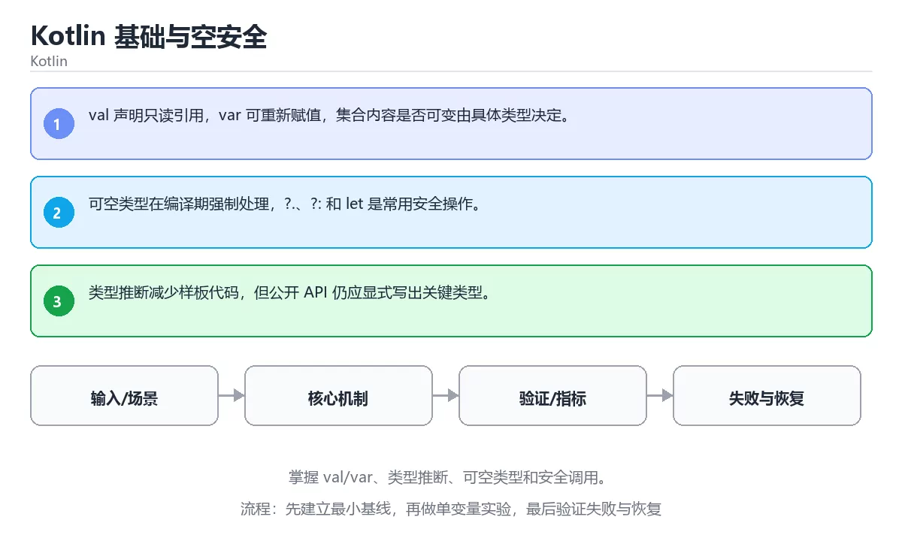

# Kotlin 基础与空安全




> 内容更新时间：2026-10-06 · 学习阶段：基础 · 预计用时：35 分钟

## 本节知识框架

**课程定位**：所属分类 `kotlin`（Kotlin），课程主题 `Kotlin 基础与空安全`，学习阶段 基础，建议用时 50 分钟。

本课主线：掌握 val/var、类型推断、可空类型和安全调用。

**学完本课应当能够**
- 说清 `Kotlin` 与 `空安全` 的含义与区别，并各举一个正例和一个反例。
- 用本课示例验证 `val` 的行为，记录输入、输出与失败条件。
- 遇到「用非空断言处理可空类型」这类问题时，能说出触发条件与修复顺序。

### 复习清单

- [ ] 能不看正文复述本课核心术语，并指出一个边界或反例。
- [ ] 能运行或推演本课示例，记录输入、输出与失败现象。
- [ ] 能完成一次自测，并把错题对照错误表定位原因。

## 核心概念定义

| 术语 | 操作性定义 | 常见边界与风险 |
| --- | --- | --- |
| Kotlin | 运行于 JVM 等平台、强调空安全与简洁语法的现代编程语言。 | 权限与密钥策略变化会让结论失效，按最小权限并用真实凭据流程复验。 |
| 空安全 | 类型系统区分可空与非空值，并在编译期要求显式处理空值。 | 静态检查只在编译期成立，运行期输入仍需校验。 |
| val | Kotlin 中声明只读引用的关键字，引用一旦赋值不能再指向其他对象。 | 越界、悬垂引用与释放顺序会破坏结论，必须在边界输入下复验。 |
| 类型推断 | 编译器根据初始值推断变量类型（val x = 1 即 Int），显式标注只在需要澄清时使用。 | 静态检查只在编译期成立，运行期输入仍需校验。 |
| `var` | 允许再指向其他对象的可变引用，需要累积状态或就地推进时才用。 | 作用域过大的 `var` 让状态来源难以追踪，读写点一散就不好验证。 |
| 可空类型 | 类型后加 `?`（如 `String?`）表示允许 null；非空类型不接受 null，赋值与传参都在编译期判。 | 反射和部分泛型调用能绕过可空推断，边界处仍要自己判空。 |
| `!!` 非空断言 | 把可空类型强行当非空使用，遇到 null 立刻抛 `NullPointerException`。 | 编译器从此不再提醒，异常出现的位置还可能不是空值的来源。 |

## 原理与运行机制

### 机制总览

**教材衔接：核心知识**

### 1. val 声明只读引用，var 可重新赋值，集合内容是否可变由具体类型决定。

- 关键做法：先让 Kotlin 的最小示例可复现，再加入并发或规模条件。
- 验证标准：main 的输出能被他人复现，边界输入有对应用例。

### 2. 可空类型在编译期强制处理，?.、?: 和 let 是常用安全操作。

把这条结论放回「Kotlin 基础与空安全」的完整流程里展开：

- 正文依据：能用自己的话解释：val 声明只读引用，var 可重新赋值，集合内容是否可变由具体类型决定。
- 落地检查：把「2. 可空类型在编译期强制处理，?.、?: 和 let 是常用安全操作。」改写成一条可执行的核对项，逐条验证输入、超时与失败路径。

### 3. 类型推断减少样板代码，但公开 API 仍应显式写出关键类型。

把这条结论放回「Kotlin 基础与空安全」的完整流程里展开：

- 正文依据：能用自己的话解释：类型推断减少样板代码，但公开 API 仍应显式写出关键类型。
- 落地检查：把「3. 类型推断减少样板代码，但公开 API 仍应显式写出关键类型。」改写成一条可执行的核对项，逐条验证输入、超时与失败路径。

**教材衔接：关键流程**

**教材衔接：实践路径**

**教材衔接：语言专项实践：Kotlin 基础与空安全**

### 一、工具链

| 阶段 | 推荐工具 | 验收标准 |
| --- | --- | --- |
| 编译构建 | kotlinc / Gradle | 命令可复现且错误能被定位 |
| 测试 | JUnit + coroutines-test | 命令可复现且错误能被定位 |
| 静态检查 | detekt / ktlint | 命令可复现且错误能被定位 |
| 发布 | R8/ProGuard + App Bundle | 命令可复现且错误能被定位 |

### 四、发布检查

**教材衔接：版本与时效**

- 版本提示：Kotlin 的行为在最近几个大版本里有过调整，升级「Kotlin 基础与空安全」前先用 main 复现当前输出，再对照官方发布说明逐条核对。
- 升级前确认 Kotlin 的兼容范围，把不可回退的改动单独拆成一次提交。
- 显式 API 模式与多平台源集是团队协作时的重点
- 官方说明：https://kotlinlang.org/docs/releases.html

### val 锁的是引用，不是内容

```kotlin
val items = mutableListOf("A")
items.add("B")              // 合法：改的是列表内容
// items = mutableListOf()  // 不合法：val 不能再指向别的对象
```

`val` 保证的是「这个名字不再换对象」，至于对象里面能不能改，取决于它的类型是 `List` 还是 `MutableList`。所以「默认用不可变声明」只解决第一层，真正防住意外修改要靠只读接口与不可变数据：对外发 `List`，内部才留 `MutableList`，或者交出一份 `toList()` 的副本。把 `val` 当成深度不可变，就是「对象被意外修改」这个坑的源头。

### 可空类型在编译期逼你处理的三条路径

`?.` 负责「有就往下走，没有就是 null」，`?:` 负责「null 时换个值」，`?.let { }` 负责「确认非空之后再执行一段代码」，块里的 `it` 是非空版本。三条拼起来就能一行处理缺失数据：`val city = user?.address?.city ?: "未知城市"`。关键不在语法糖，而在 `String?` 与 `String` 是两个不兼容的类型——想把可空值当非空用，编译器当场拒绝，处理方式只能显式写出来。

### 类型推断省的是样板，不是契约

`val year = 1815` 推成 `Int`，`val year = 1815L` 是 `Long`，`val list = listOf("a")` 是 `List<String>`，函数内部这些都不用写。但两处要显式：一是模块对外的函数返回值与类的公开属性，推断结果一旦随实现改动而变化，依赖方就跟着编译失败；二是可空性，`fun find(): User?` 与 `fun find(): User` 对调用方是两种承诺，靠推断出来的类型别人根本看不见。

### 平台类型与 `!!`：崩在运行期的那条缝

调 Java 库拿回的 `String` 既没标 `@Nullable` 也没标 `@NotNull` 时，Kotlin 当它是「平台类型」放行：你按非空用，编译器不拦；一旦那个方法真返回 null，异常出现在使用处而不是赋值处，中间可能已经穿过好几层。修法是在边界把可空性写死，例如 `fun load(name: String): User? = javaDao.find(name)`，或给 Java 侧补注解。`!!` 是同一类问题的另一种写法，它把「以后再说」变成「现在就炸」：断言抛出的异常只给你堆栈，而 `?: error("缺少 userId")` 会直接告诉你少了什么，所以断言只留给逻辑上确定非空、且能举出反例证明的位置。

## 典型应用场景

**课程内置实验入口**：`sandbox:kotlin`，用于动手验证《Kotlin 基础与空安全》的机制；实验结论不替代概念定义与复杂度分析。

- **用非空断言处理可空类型**：典型现象是运行期空指针异常；正确做法是用安全调用与默认值替代断言。
- **可变与不可变声明混用**：典型现象是对象被意外修改；正确做法是默认使用不可变声明，只在需要时开放可变。
- **依赖平台类型的可空性**：典型现象是编译期不报错，运行期崩溃；正确做法是在边界处显式声明可空性。

### 最小验证场景

- 准备：保留 `text` 示例的原始输入，先记录 `Kotlin 基础与空安全` 的基线输出和完整运行命令。
- 观察：先核对 调用了 `main()`，再改变一个与 `Kotlin` 相关的条件。
- 判定：新结果与 `Kotlin 基础与空安全` 的基线不同不等于错误；只有当差异破坏了 `Kotlin` 的定义或错误表中的约束，才判定为失败。

### 选择与边界

- 使用 `Kotlin` 时，先满足它的定义：运行于 JVM 等平台、强调空安全与简洁语法的现代编程语言；权限与密钥策略变化会让结论失效，按最小权限并用真实凭据流程复验。
- 使用 `空安全` 时，先满足它的定义：类型系统区分可空与非空值，并在编译期要求显式处理空值；静态检查只在编译期成立，运行期输入仍需校验。
- 使用 `val` 时，先满足它的定义：Kotlin 中声明只读引用的关键字，引用一旦赋值不能再指向其他对象；越界、悬垂引用与释放顺序会破坏结论，必须在边界输入下复验。
- 使用 `类型推断` 时，先满足它的定义：编译器根据初始值推断变量类型（val x = 1 即 Int），显式标注只在需要澄清时使用；静态检查只在编译期成立，运行期输入仍需校验。

### 场景：表单里的 null 与空白是两件事

字段可能没填（null），也可能填了一串空格，两者不是一回事：可空类型管「有没有」，`isBlank()` 管「有没有内容」。处理顺序是先判缺失再判空白——`val name = raw?.trim() ?: return "请先填写姓名"`，接着 `if (name.isEmpty()) return "姓名不能是空白"`。正常输入、空白输入、缺失输入三条路径都要各跑一次；只测「你好，Ada」那条，等于失败分支从没被说明过。

### 场景：把 Java 服务返回的资料拼成展示文案

`user?.address?.city ?: "未知城市"` 一次到位：链子上任何一环是 null，结果就落到默认值，不会出现「检查了 address 却忘了 user」这种遗漏。这就是把非空断言换成安全调用后的主要收益——链子变长也不必手写层层 if，而编译期仍然要求你对最终的可空结果做一次交代。

## 代码/协议/SQL 示例

### 最小可验证示例

**教材衔接：最小可运行示例**

先用 main 跑通最小示例，然后只改一个与 Kotlin 相关的取值：

```kotlin
fun main() {
    val name = "Ada"
    val year = 1815
    println("$name born in $year")
}
```

**教材衔接：预期输出**

```text
Ada born in 1815
```

### 完整示例：val/var、类型推断与可空处理放在一起

```kotlin
fun parseAge(raw: String?): Int? {
    val trimmed = raw?.trim() ?: return null
    if (trimmed.isEmpty()) return null
    return trimmed.toIntOrNull()        // 转不了就是 null，而不是抛异常
}

fun main() {
    val inputs = listOf("1815", " 19 ", null, "", "abc")
    var ok = 0
    for (item in inputs) {
        val age: Int? = parseAge(item)
        println(age?.let { "年龄 $it" } ?: "无法解析：$item")
        if (age != null) ok++
    }
    println("成功 $ok / ${inputs.size}")
}
```

`val age: Int?` 显式写出可空类型，因为它的值要分岔进 `let` 与 `?:`；`toIntOrNull()` 是「失败不炸」的转换，比 `toInt()` 少一条异常路径；`ok` 用 `var` 是因为它确实要在循环里累加，其余全是 `val`。预期输出五行：前两行给出 1815 与 19，中间两行分别是「无法解析：null」和「无法解析：」，最后一行是「成功 2 / 5」。

### 练习：把安全调用换成断言再复现一次

把 `parseAge` 里的 `?: return null` 改成 `raw!!.trim()`，喂进那条 `null` 输入，记下异常出现的行号——它指向断言那一行，而不是数据真正缺失的地方。这个差别就是排错成本，也是错误表第一条「运行期空指针异常」的由来。

## 时间/空间复杂度或性能分析

**性能关注点（Kotlin 基础与空安全）**：JVM 与协程调度影响开销：记录吞吐、延迟与调度器线程占用。

**测量方法**：以 `Kotlin 基础与空安全` 的 `Kotlin` 场景为对象，固定输入跑一遍记录基线，再把规模或并发度提高一个数量级复测；两次结果的差值与波动范围才是结论依据。

## 常见误区与易错点

| 容易写错的做法 | 实际现象 | 原因与正确做法 |
| --- | --- | --- |
| 用非空断言处理可空类型 | 运行期空指针异常。 | 用安全调用与默认值替代断言。 |
| 可变与不可变声明混用 | 对象被意外修改。 | 默认使用不可变声明，只在需要时开放可变。 |
| 依赖平台类型的可空性 | 编译期不报错，运行期崩溃。 | 在边界处显式声明可空性。 |
| 把 `val` 当成深度不可变 | 列表内容在别处被改掉，读到脏数据。 | 只读接口配不可变数据，要改时显式做一份可变副本。 |
| 一路 `!!` 把可空链写完 | 崩溃点落在断言行，不是空值真正产生的地方。 | 每一环用 `?.` 与 `?:`，断言只留给逻辑上确定非空的值。 |
| 公开函数省略返回类型 | 实现一改，调用方跟着编译失败。 | 对外函数与公开属性显式标类型，内部局部变量交给推断。 |
| 把 null 与空白字符串当一个情况处理 | 空标题被当成有效数据存进库。 | 先判缺失、再判有无内容，两步分开写。 |

### 现场 1：用非空断言处理可空类型

**症状**：运行期空指针异常。

**根因与修复**：用安全调用与默认值替代断言。

**自检**：在本课示例里复现「用非空断言处理可空类型」，改成用安全调用与默认值替代断言后重跑；如果症状消失且失败路径按预期变化，说明定位正确。

### 现场 2：可变与不可变声明混用

**症状**：对象被意外修改。

**根因与修复**：默认使用不可变声明，只在需要时开放可变。

**自检**：在本课示例里复现「可变与不可变声明混用」，改成默认使用不可变声明，只在需要时开放可变后重跑；如果症状消失且失败路径按预期变化，说明定位正确。

### 现场 3：依赖平台类型的可空性

**症状**：编译期不报错，运行期崩溃。

**根因与修复**：在边界处显式声明可空性。

**自检**：在本课示例里复现「依赖平台类型的可空性」，改成在边界处显式声明可空性后重跑；如果症状消失且失败路径按预期变化，说明定位正确。

## 与其他知识点的关系

**教材衔接：复习与迁移**

## 自测题与参考答案

> 先独立作答，再对照参考答案；答案都能在本课正文、术语表或错误表里找到依据。

### 自测 1（概念复述）

不看正文，写出 `Kotlin` 的操作性定义，并说明它与 `空安全` 的区别。

**参考答案**：运行于 JVM 等平台、强调空安全与简洁语法的现代编程语言。

`空安全` 的定位是：类型系统区分可空与非空值，并在编译期要求显式处理空值；两者的差别要从适用对象与失败模式上说明。

### 自测 2（排错）

本课错误表记录了「用非空断言处理可空类型」这类做法。请写出它会出现的现象、根因，以及修复顺序。

**参考答案**：现象是运行期空指针异常；正确做法是用安全调用与默认值替代断言。修复时先复现现象并保留证据，再改动一处假设重跑，确认现象消失。

### 自测 3（动手验证）

运行本课的 `text` 示例，改动其中一个输入后重新运行，记录输出与错误信息。

**参考答案**：正常输入下 `text` 示例应当复现正文给出的结果；改动输入后，如果结果改变或报错，先核对它是否满足 `Kotlin 基础与空安全` 中`Kotlin` 的适用范围，再检查错误表里是否有同类现象。

### 自测 4（代码阅读）

阅读本课开头的 `text` 示例，说明它体现了`Kotlin` 的哪一条性质，并指出改动哪个输入会让这条性质不再成立。

**参考答案**：`Kotlin` 的定义是 运行于 JVM 等平台、强调空安全与简洁语法的现代编程语言，示例正是在实现这条定义。改动与 `Kotlin` 有关的一个输入后，如果结果不再符合 `Kotlin 基础与空安全` 的正文描述，就说明该性质只在当前前提成立。

### 自测 5（迁移）

把 `Kotlin 基础与空安全` 的方法迁移到自己的项目：围绕 `Kotlin` 写出一个与错误表同类的风险点，并说明触发条件和检验方式。

**参考答案**：例如「依赖平台类型的可空性」，它会导致编译期不报错，运行期崩溃；检验方式是按在边界处显式声明可空性改一处再复现，确认现象消失且没有引入新的失败分支。

### 自测 6（对比）

用一个表格对比 `Kotlin` 与 `空安全`：各写一行适用场景、一行失败表现。

**参考答案**：`Kotlin` 的定义是运行于 JVM 等平台、强调空安全与简洁语法的现代编程语言；`空安全` 的定义是类型系统区分可空与非空值，并在编译期要求显式处理空值。两者的失败表现分别对应本课错误表里与本术语相关的行。

### 自测 7（排错顺序）

面对「用非空断言处理可空类型」引发的问题，请把“复现 运行期空指针异常 → 保留证据 → 用安全调用与默认值替代断言 → 回归验证”四步写成可执行的检查清单。

**参考答案**：第一步按运行期空指针异常复现；第二步记录输入、版本与完整报错；第三步按用安全调用与默认值替代断言只改一处；第四步重跑并确认失败路径也按预期变化。

### 自测 8（边界判断）

针对 `类型推断`，分别写出“可以使用”的条件和“结论不再成立”的条件。

**参考答案**：静态检查只在编译期成立，运行期输入仍需校验。 同时要把 `类型推断` 的定义 编译器根据初始值推断变量类型（val x = 1 即 Int），显式标注只在需要澄清时使用 与实际输入逐项对照。

### 自测 9（机制重建）

不看正文，按输入、转换、输出、验证四段重建 `Kotlin` → `空安全` → `val` → `类型推断` 的作用链。

**参考答案**：起点是 `Kotlin` 的定义 运行于 JVM 等平台、强调空安全与简洁语法的现代编程语言；中间每一步都保留可观察状态；终点由 `类型推断` 检查，失败时回到错误表定位第一个偏离定义的步骤。

### 自测 10（综合排错）

在 `Kotlin 基础与空安全` 中，现象是 编译期不报错，运行期崩溃。请围绕 依赖平台类型的可空性 写出最小复现、关键证据、修复动作和回归验证，并说明为什么不能只凭一次运行下结论。

**参考答案**：先复现 依赖平台类型的可空性，记录输入与完整错误；再按 在边界处显式声明可空性 只改一处。回归时同时跑正常路径和边界路径，只有两次结果都可解释，才把修复视为完成。

### 自测 11（一分钟复述）

用每分钟约 200 字的速度复述 `Kotlin 基础与空安全`：先给主问题，再按顺序说出 `Kotlin`、`空安全`、`val`、`类型推断`，最后给一个失败案例。

**自评标准**：主问题必须对应 掌握 val/var、类型推断、可空类型和安全调用；每个术语都要能接上一句定义或边界；失败案例必须写成可观察现象，不能用“可能有风险”代替证据。

## 术语速查

| 术语 | 一句话说明 |
| --- | --- |
| `Kotlin` | 运行于 JVM 等平台、强调空安全与简洁语法的现代编程语言。 |
| `空安全` | 类型系统区分可空与非空值，并在编译期要求显式处理空值。 |
| `val` | Kotlin 中声明只读引用的关键字，引用一旦赋值不能再指向其他对象。 |
| `类型推断` | 编译器根据初始值推断变量类型（val x = 1 即 Int），显式标注只在需要澄清时使用。 |
| `var` | 可再指向其他对象的引用，需要状态累积时才用。 |
| `?.` | 左边是 null 就整段短路成 null。 |
| `?:` | 左边是 null 就用右边的值顶上。 |
| `?.let { }` | 确认非空后，在块里用非空版本执行一段逻辑。 |
| `!!` | 强行当非空用，遇到 null 就抛异常。 |
| 平台类型 | 来自 Java 且未标注可空性的类型，需要自己声明。 |

**术语关系**：`Kotlin`（运行于 JVM 等平台、强调空安全与简洁语法的现代编程语言） → `空安全`（类型系统区分可空与非空值） → `val`（Kotlin 中声明只读引用的关键字） → `类型推断`（编译器根据初始值推断变量类型（val x = 1 即 Int））。

## 考点精讲

`Kotlin 基础与空安全` 的题库有 6 道题，下面逐题给出题干、正确项与判断依据：先自己作答，再核对正确项，最后回到正文对应小节复核。

### 考点 1：第 1 题

- **题目**：代码语言为 `kotlin`，选自 `Kotlin 基础与空安全` 的 `Kotlin` 部分。课程问题为掌握 val/var、类型推断、可空类型和安全调用。哪一项描述与代码一致？
- **正确项**：出现字面量 `$name born in $year`
- **判断依据**：本题正确项是「出现字面量 `$name born in $year`」。术语 Kotlin（Kotlin 基础与空安全）：运行于 JVM 等平台、强调空安全与简洁语法的现代编程语言，本题取「出现字面量 `$name born in $year`」这条。易错点是用非空断言处理可空类型，会造成运行期空指针异常，改法是用安全调用与默认值替代断言。本题干扰项「出现字面量 `离线可用的计算机与编程学习课程`」不成立：展示代码里找不到 `离线可用的计算机与编程学习课程`。

### 考点 2：第 2 题

- **题目**：在 `Kotlin 基础与空安全` 里，与 `Kotlin` 有关的说法中，哪一项最符合掌握 val/var、类型推断、可空类型和安全调用？
- **正确项**：可空类型在编译期强制处理，?.、?: 和 let 是常用安全操作。
- **判断依据**：本题正确项是「可空类型在编译期强制处理，?.、?: 和 let 是常用安全操作」。术语 Kotlin（Kotlin 基础与空安全）：运行于 JVM 等平台、强调空安全与简洁语法的现代编程语言，本题取「可空类型在编译期强制处理，?.、?: 和 let 是常用安全操作」这条。易错点是可变与不可变声明混用，会造成对象被意外修改，改法是默认使用不可变声明，只在需要时开放可变。

### 考点 3：第 3 题

- **题目**：在 `Kotlin 基础与空安全` 里，与 `Kotlin` 有关的说法中，哪一项最符合掌握 val/var、类型推断、可空类型和安全调用？（Kotlin 基础与空安全·Kotlin 第 3 题）
- **正确项**：类型推断减少样板代码，但公开 API 仍应显式写出关键类型。
- **判断依据**：本题正确项是「类型推断减少样板代码，但公开 API 仍应显式写出关键类型」。术语 Kotlin（Kotlin 基础与空安全）：运行于 JVM 等平台、强调空安全与简洁语法的现代编程语言，本题取「类型推断减少样板代码，但公开 API 仍应显式写出关键类型」这条。易错点是依赖平台类型的可空性，会造成编译期不报错，运行期崩溃，改法是在边界处显式声明可空性。

### 考点 4：第 4 题

- **题目**：`Kotlin 基础与空安全` 的主线是：掌握 val/var、类型推断、可空类型和安全调用。下面哪一项与这条主线一致？
- **正确项**：掌握 val/var、类型推断、可空类型和安全调用。
- **判断依据**：本题正确项是「掌握 val/var、类型推断、可空类型和安全调用」。术语 Kotlin（Kotlin 基础与空安全）：运行于 JVM 等平台、强调空安全与简洁语法的现代编程语言，本题取「掌握 val/var、类型推断、可空类型和安全调用」这条。易错点是用非空断言处理可空类型，会造成运行期空指针异常，改法是用安全调用与默认值替代断言。

### 考点 5：第 5 题

- **题目**：课程 `掌握 val/var、类型推断、可空类型和安全调用。`。在 `Kotlin 基础与空安全` 里，`Kotlin`、`空安全` 与下面哪些选项属于同一层概念？（多选）
- **正确项**：Kotlin；空安全
- **判断依据**：按《Kotlin 基础与空安全》的正文口径，本题要同时选中「Kotlin」、「空安全」，漏掉任一项都算没答全。术语 Kotlin（Kotlin 基础与空安全）：运行于 JVM 等平台、强调空安全与简洁语法的现代编程语言。易错点是可变与不可变声明混用，会造成对象被意外修改，改法是默认使用不可变声明，只在需要时开放可变。

### 考点 6：第 6 题

- **题目**：下面几项都与 `Kotlin` 有关，请按 `Kotlin 基础与空安全` 的正文顺序排列；该课主线是掌握 val/var、类型推断、可空类型和安全调用。
- **正确项**：核心知识 → 关键流程 → 实践路径 → 常见误区
- **判断依据**：按《Kotlin 基础与空安全》正文的先后，本题顺序是「核心知识」 → 「关键流程」 → 「实践路径」 → 「常见误区」。术语「Kotlin」在本课里的界定是运行于 JVM 等平台、强调空安全与简洁语法的现代编程语言，题干「下面几项都与 `Kotlin` 有关，请按 `Kotlin 基础与空安全` 的正文顺序排列；该课主线是掌握 val/var、类型推断、可空类型和安全调用。」问的就是这一条。常见错法是用非空断言处理可空类型，其后果是运行期空指针异常。正确做法是用安全调用与默认值替代断言。

### 考点 7：`Kotlin`

- **要点**：运行于 JVM 等平台、强调空安全与简洁语法的现代编程语言。
- **Kotlin 的边界**：权限与密钥策略变化会让结论失效，按最小权限并用真实凭据流程复验。

### 考点 8：`空安全`

- **要点**：类型系统区分可空与非空值，并在编译期要求显式处理空值。
- **空安全 的边界**：静态检查只在编译期成立，运行期输入仍需校验。

### 考点 9：`val`

- **要点**：Kotlin 中声明只读引用的关键字，引用一旦赋值不能再指向其他对象。
- **val 的边界**：越界、悬垂引用与释放顺序会破坏结论，必须在边界输入下复验。

### 考点 10：`类型推断`

- **要点**：编译器根据初始值推断变量类型（val x = 1 即 Int），显式标注只在需要澄清时使用。
- **类型推断 的边界**：静态检查只在编译期成立，运行期输入仍需校验。

### 考点 11：排错——用非空断言处理可空类型

- **现象**：运行期空指针异常。
- **处理**：用安全调用与默认值替代断言。

### 考点 12：排错——可变与不可变声明混用

- **现象**：对象被意外修改。
- **处理**：默认使用不可变声明，只在需要时开放可变。

### 考点 13：综合辨析——`Kotlin` 与 `类型推断`

- **辨析点**：`Kotlin` 的定义是 运行于 JVM 等平台、强调空安全与简洁语法的现代编程语言；`类型推断` 的定义是 编译器根据初始值推断变量类型（val x = 1 即 Int），显式标注只在需要澄清时使用。
- **答题要求**：面对 `Kotlin 基础与空安全` 的题目，先判断描述的是 `Kotlin` 还是 `类型推断`，再归到对应定义，最后写出一个会让该定义失效的边界输入。

### 考点 14：排错评分点

- **现象分**：能写出 运行期空指针异常，而不是只写“程序有错”。
- **证据分**：保留触发 用非空断言处理可空类型 的输入、版本和错误原文。
- **修复分**：按 用安全调用与默认值替代断言 只改一处，并同时回归正常路径与边界路径。

## 内容元数据

- 内容版本：v2.0
- 最后更新：2026-10-06
- 学习阶段：基础
- 适用环境：Kotlin 2.x / Android SDK；本课聚焦 Kotlin。
- 内容来源：内置结构化课程与工程实践整理
- 相关主题：Kotlin、空安全、val、类型推断
- 质量版本：P0 测验标准 + P1 覆盖扩展 + P2 体验补全

## 参考资料与复核

- 最后复核：2026-10-04
- 下次复核：2026-11-10
- 复核范围：版本兼容、API 行为、安全建议与工程实践
- 来源性质：官方文档、标准或权威教材；本课核对关键词：Kotlin、空安全、val、类型推断。

| 参考资料 | 本课用途 |
| --- | --- |
| [Kotlin 基础语法](https://kotlinlang.org/docs/basic-syntax.html) | 语法、类型与函数 |
| [Android Kotlin](https://developer.android.com/kotlin) | Android 官方 Kotlin 实践 |
| [Android 架构指南](https://developer.android.com/topic/architecture) | 分层、状态与生命周期 |

| [本课术语索引：Kotlin 基础与空安全](#核心概念定义) | 按本课输入、术语边界和错误表现逐项核对 |
> 「Kotlin 基础与空安全」的链接用于离线阅读后的延伸核对；App 不会自动联网。