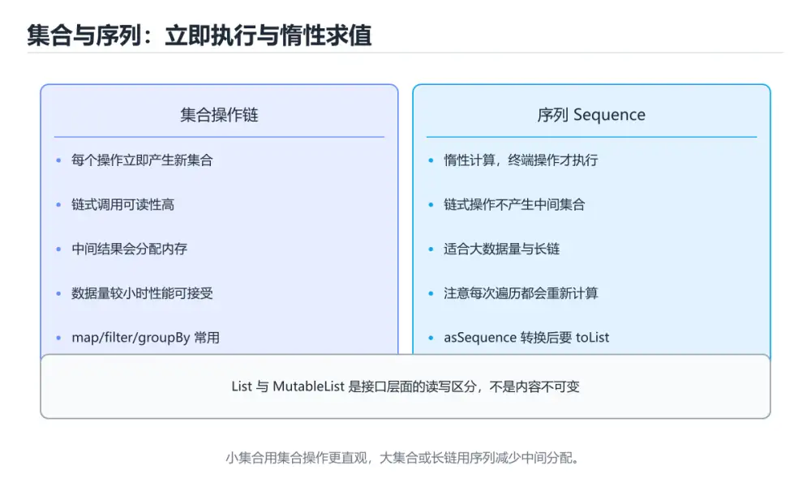
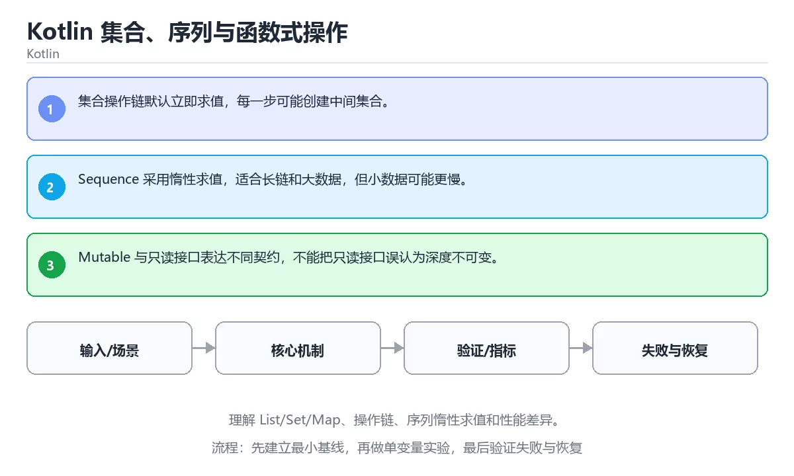

# Kotlin 集合、序列与函数式操作





> 内容更新时间：2026-10-06 · 学习阶段：进阶 · 预计用时：30 分钟

## 本节知识框架

**课程定位**：所属分类 `kotlin`（Kotlin），课程主题 `Kotlin 集合、序列与函数式操作`，学习阶段 进阶，建议用时 45 分钟。

本课主线：理解 List/Set/Map、操作链、序列惰性求值和性能差异。

**学完本课应当能够**
- 说清 `集合` 与 `Sequence` 的含义与区别，并各举一个正例和一个反例。
- 用本课示例验证 `惰性求值` 的行为，记录输入、输出与失败条件。
- 遇到「需要惰性时用了集合操作」这类问题时，能说出触发条件与修复顺序。

### 复习清单

- [ ] 能不看正文复述本课核心术语，并指出一个边界或反例。
- [ ] 能运行或推演本课示例，记录输入、输出与失败现象。
- [ ] 能完成一次自测，并把错题对照错误表定位原因。

## 核心概念定义

| 术语 | 操作性定义 | 常见边界与风险 |
| --- | --- | --- |
| 集合 | Kotlin 区分只读与可变集合（List/MutableList），默认不可变，避免共享状态被意外修改。 | 易错：中间结果被提前计算，开销变大；正确做法是明确需要惰性时用序列，需要具体结果时用集合。 |
| Sequence | 按需产生元素的惰性序列抽象，可链式变换而不一次性分配集合。 | 惰性省掉的是中间集合，数据量小或链很短时反而更慢；接上聚合类终端操作还得先处理空集合。 |
| 惰性求值 | 二、运行时与内存模型：围绕「集合、Sequence、map、惰性求值」说明变量生命周期、资源释放、并发模型和错误传播。 | 它不是集合的默认行为：操作链每一步都会立即创建中间集合，只有转成序列后才按需产出元素。 |
| 扩展函数 | 在不修改类的前提下为它添加新方法，标准库的集合操作大量基于它实现。 | 它不会真的改动原类，只是多一层调用写法；本课 filterValues 产出的是新集合，与就地修改混用会让顺序和内容难以预测。 |

## 原理与运行机制

### 机制总览

**教材衔接：核心知识**

### 1. 集合操作链默认立即求值，每一步可能创建中间集合。

- 关键做法：先用 filterValues 建立 集合 的基线，再逐步加入边界与失败条件。
- 验证标准：filterValues 的输出能被他人复现，边界输入有对应用例。

### 2. Sequence 采用惰性求值，适合长链和大数据，但小数据可能更慢。

把这条结论放回「Kotlin 集合、序列与函数式操作」的完整流程里展开：

- 正文依据：能用自己的话解释：集合操作链默认立即求值，每一步可能创建中间集合。
- 落地检查：把「2. Sequence 采用惰性求值，适合长链和大数据，但小数据可能更慢。」改写成一条可执行的核对项，逐条验证输入、超时与失败路径。

### 3. Mutable 与只读接口表达不同契约，不能把只读接口误认为深度不可变。

把这条结论放回「Kotlin 集合、序列与函数式操作」的完整流程里展开：

- 正文依据：能用自己的话解释：Sequence 采用惰性求值，适合长链和大数据，但小数据可能更慢。
- 落地检查：把「3. Mutable 与只读接口表达不同契约，不能把只读接口误认为深度不可变。」改写成一条可执行的核对项，逐条验证输入、超时与失败路径。

**教材衔接：关键流程**

**教材衔接：实践路径**

**教材衔接：语言专项实践：Kotlin 集合、序列与函数式操作**

### 一、工具链

| 阶段 | 推荐工具 | 验收标准 |
| --- | --- | --- |
| 编译构建 | kotlinc / Gradle | 命令可复现且错误能被定位 |
| 测试 | JUnit + coroutines-test | 命令可复现且错误能被定位 |
| 静态检查 | detekt / ktlint | 命令可复现且错误能被定位 |
| 发布 | R8/ProGuard + App Bundle | 命令可复现且错误能被定位 |

### 四、发布检查

**教材衔接：版本与时效**

- 版本提示：集合 的行为在最近几个大版本里有过调整，升级「Kotlin 集合、序列与函数式操作」前先用 filterValues 复现当前输出，再对照官方发布说明逐条核对。
- 升级「Kotlin 集合、序列与函数式操作」涉及的依赖前，先用 filterValues 复现当前行为，再逐项核对版本说明与破坏性变更。
- 显式 API 模式与多平台源集是团队协作时的重点
- 官方说明：https://kotlinlang.org/docs/releases.html

### 先建立一个直觉

本课的摘要可以当作一张地图：理解 List/Set/Map、操作链、序列惰性求值和性能差异。

### 逐步拆解

1. 澄清输入与目标。先写清「Kotlin 集合、序列与函数式操作」要解决的问题、合法输入范围和成功标准，再进入后续步骤。
2. 描述处理过程。把「集合、Sequence、map、惰性求值」映射到具体步骤，每步都要求能单独验证。
3. 定义输出。把 filterValues 的返回值、日志和失败信号都写清楚，缺一项都不算完整。
4. 让「Kotlin 集合、序列与函数式操作」的失败路径尽早暴露：把集合推到边界值，记录错误信息、重试或降级动作，以及人工兜底条件。
5. 用 filterValues 贯穿一次小实验：先预测输出，再运行或逐步推演，最后解释差异来自哪一步。

### 把正文串成一条执行链

- **三、测试策略**：- 单元测试覆盖核心规则和边界

### 从测验反推易错点

- 参考判断：集合操作链默认立即求值，每一步可能创建中间集合。
- 自问：如果去掉题干里的一个限定词，结论还成立吗？

- 参考判断：Sequence 采用惰性求值，适合长链和大数据，但小数据可能更慢。

- 参考判断：Mutable 与只读接口表达不同契约，不能把只读接口误认为深度不可变。

**检查点 4：本课的核心学习目标是什么？**

- 参考判断：理解 List/Set/Map、操作链、序列惰性求值和性能差异。

- 参考判断：集合、Sequence

### 变式训练

1. 把 集合 的实现压缩到一个进程内，去掉所有外部依赖后再谈扩展。
2. 扩大 Sequence 的规模，记录本课结论在哪一个量级开始不成立。
3. 制造一次 集合 相关的依赖超时或错误输入，要求错误可解释且不留半完成状态。
5. 删掉一个看似必要的步骤（例如 集合 相关的校验），观察哪个测试或指标先失败，用证据说明它为什么不能省。
6. 把 集合 的方案切换到低资源设备，重新评估默认参数、超时和降级策略。

### 迁移案例库

围绕 filterValues 重复同一套方法，每完成一轮就把差异写进笔记。

#### 迁移案例 1：围绕「集合」做一次小实验

**验收**：集合的结论要有证据、差异可解释、失败可恢复；做不到时回到「核心知识」缩小问题范围。

#### 迁移案例 3：围绕「map」做一次小实验

**步骤**：
1. 复述当前方案对「map」的假设，写成一句可证伪的话。

#### 迁移案例 4：围绕「惰性求值」做一次小实验

**步骤**：
1. 复述当前方案对「惰性求值」的假设，写成一句可证伪的话。

#### 迁移案例 5：围绕「集合」做一次小实验

**步骤**：

#### 迁移案例 6：围绕「Sequence」做一次小实验

**步骤**：

#### 迁移案例 7：围绕「map」做一次小实验

**步骤**：

#### 迁移案例 8：围绕「惰性求值」做一次小实验

**步骤**：

#### 迁移案例 9：围绕「集合」做一次小实验

**步骤**：

#### 迁移案例 10：围绕「Sequence」做一次小实验

**步骤**：

#### 迁移案例 11：围绕「map」做一次小实验

**步骤**：

#### 迁移案例 12：围绕「惰性求值」做一次小实验

**步骤**：

#### 迁移案例 13：围绕「集合」做一次小实验

**步骤**：

#### 迁移案例 14：围绕「Sequence」做一次小实验

**步骤**：

#### 迁移案例 15：围绕「map」做一次小实验

**步骤**：

#### 迁移案例 16：围绕「惰性求值」做一次小实验

**步骤**：

<!-- p0-depth-v2:end -->

**教材衔接：验证步骤**

## 典型应用场景

**课程内置实验入口**：`sandbox:kotlin`，用于动手验证《Kotlin 集合、序列与函数式操作》的机制；实验结论不替代概念定义与复杂度分析。

**教材衔接：深度拓展与实战**

这一节把「Kotlin 集合、序列与函数式操作」正文里的定义、代码和失败模式串成一条可操作的复习路线。

### 工程检查表

- [ ] 能否用自己的话说明Kotlin 集合、序列与函数式操作解决什么问题，以及它不负责什么？
- [ ] 能否用「Kotlin 集合、序列与函数式操作」的最小示例复现一次失败并解释原因？
- [ ] 能否解释本课关键词在真实项目中的边界与取舍？
- [ ] 能否把 集合 的方法迁移到相近问题，并说明需要改哪一步？

### 最小验证场景

- 准备：保留 `text` 示例的原始输入，先记录 `Kotlin 集合、序列与函数式操作` 的基线输出和完整运行命令。
- 观察：先核对 调用了 `main()`，再改变一个与 `集合` 相关的条件。
- 判定：新结果与 `Kotlin 集合、序列与函数式操作` 的基线不同不等于错误；只有当差异破坏了 `集合` 的定义或错误表中的约束，才判定为失败。

### 选择与边界

- 使用 `集合` 时，先满足它的定义：Kotlin 区分只读与可变集合（List/MutableList），默认不可变，避免共享状态被意外修改；易错：中间结果被提前计算，开销变大；正确做法是明确需要惰性时用序列，需要具体结果时用集合。
- 使用 `Sequence` 时，先满足它的定义：按需产生元素的惰性序列抽象，可链式变换而不一次性分配集合。
- 使用 `惰性求值` 时，先满足它的定义：二、运行时与内存模型：围绕「集合、Sequence、map、惰性求值」说明变量生命周期、资源释放、并发模型和错误传播；共享状态与调度顺序会改变结论，单线程或串行测试通过不等于并发下成立。
- 使用 `扩展函数` 时，先满足它的定义：在不修改类的前提下为它添加新方法，标准库的集合操作大量基于它实现。

## 代码/协议/SQL 示例

### 最小可验证示例

**教材衔接：最小可运行示例**

下面这段代码演示 集合 的最小路径，先原样运行，再按注释改一处：

```kotlin
fun main() {
    val scores = mapOf("a" to 90, "b" to 72)
    println(scores.filterValues { it >= 80 }.keys)
}
```

**教材衔接：预期输出**

```text
[a]
```

## 时间/空间复杂度或性能分析

**性能关注点（Kotlin 集合、序列与函数式操作）**：JVM 与协程调度影响开销：记录吞吐、延迟与调度器线程占用。

**本课特有开销（Kotlin 集合、序列与函数式操作 · 集合）**：并发度提高后要观察是否出现拐点：延迟上升而吞吐不增，说明瓶颈已转移。

**测量方法**：以 `Kotlin 集合、序列与函数式操作` 的 `集合` 场景为对象，固定输入跑一遍记录基线，再把规模或并发度提高一个数量级复测；两次结果的差值与波动范围才是结论依据。

## 常见误区与易错点

| 容易写错的做法 | 实际现象 | 原因与正确做法 |
| --- | --- | --- |
| 需要惰性时用了集合操作 | 中间结果被提前计算，开销变大。 | 明确需要惰性时用序列，需要具体结果时用集合。 |
| 就地修改与函数式操作混用 | 结果顺序与内容难以预测。 | 一次只选一种风格，必要时先复制。 |
| 空集合未处理 | 聚合操作抛异常。 | 使用安全聚合并给出默认值。 |

### 现场 1：需要惰性时用了集合操作

**症状**：中间结果被提前计算，开销变大。

**根因与修复**：明确需要惰性时用序列，需要具体结果时用集合。

**自检**：在本课示例里复现「需要惰性时用了集合操作」，改成明确需要惰性时用序列，需要具体结果时用集合后重跑；如果症状消失且失败路径按预期变化，说明定位正确。

### 现场 2：就地修改与函数式操作混用

**症状**：结果顺序与内容难以预测。

**根因与修复**：一次只选一种风格，必要时先复制。

**自检**：在本课示例里复现「就地修改与函数式操作混用」，改成一次只选一种风格，必要时先复制后重跑；如果症状消失且失败路径按预期变化，说明定位正确。

### 现场 3：空集合未处理

**症状**：聚合操作抛异常。

**根因与修复**：使用安全聚合并给出默认值。

**自检**：在本课示例里复现「空集合未处理」，改成使用安全聚合并给出默认值后重跑；如果症状消失且失败路径按预期变化，说明定位正确。

## 与其他知识点的关系

**教材衔接：复习与迁移**

## 自测题与参考答案

> 先独立作答，再对照参考答案；答案都能在本课正文、术语表或错误表里找到依据。

### 自测 1（概念复述）

不看正文，写出 `集合` 的操作性定义，并说明它与 `Sequence` 的区别。

**参考答案**：Kotlin 区分只读与可变集合（List/MutableList），默认不可变，避免共享状态被意外修改。

`Sequence` 的定位是：按需产生元素的惰性序列抽象，可链式变换而不一次性分配集合；两者的差别要从适用对象与失败模式上说明。

### 自测 2（排错）

本课错误表记录了「需要惰性时用了集合操作」这类做法。请写出它会出现的现象、根因，以及修复顺序。

**参考答案**：现象是中间结果被提前计算，开销变大；正确做法是明确需要惰性时用序列，需要具体结果时用集合。修复时先复现现象并保留证据，再改动一处假设重跑，确认现象消失。

### 自测 3（动手验证）

运行本课的 `text` 示例，改动其中一个输入后重新运行，记录输出与错误信息。

**参考答案**：正常输入下 `text` 示例应当复现正文给出的结果；改动输入后，如果结果改变或报错，先核对它是否满足 `Kotlin 集合、序列与函数式操作` 中`集合` 的适用范围，再检查错误表里是否有同类现象。

### 自测 4（代码阅读）

阅读本课开头的 `text` 示例，说明它体现了`集合` 的哪一条性质，并指出改动哪个输入会让这条性质不再成立。

**参考答案**：`集合` 的定义是 Kotlin 区分只读与可变集合（List/MutableList），默认不可变，避免共享状态被意外修改，示例正是在实现这条定义。改动与 `集合` 有关的一个输入后，如果结果不再符合 `Kotlin 集合、序列与函数式操作` 的正文描述，就说明该性质只在当前前提成立。

### 自测 5（迁移）

把 `Kotlin 集合、序列与函数式操作` 的方法迁移到自己的项目：围绕 `集合` 写出一个与错误表同类的风险点，并说明触发条件和检验方式。

**参考答案**：例如「空集合未处理」，它会导致聚合操作抛异常；检验方式是按使用安全聚合并给出默认值改一处再复现，确认现象消失且没有引入新的失败分支。

### 自测 6（对比）

用一个表格对比 `集合` 与 `Sequence`：各写一行适用场景、一行失败表现。

**参考答案**：`集合` 的定义是Kotlin 区分只读与可变集合（List/MutableList），默认不可变，避免共享状态被意外修改；`Sequence` 的定义是按需产生元素的惰性序列抽象，可链式变换而不一次性分配集合。两者的失败表现分别对应本课错误表里与本术语相关的行。

### 自测 7（排错顺序）

面对「需要惰性时用了集合操作」引发的问题，请把“复现 中间结果被提前计算，开销变大 → 保留证据 → 明确需要惰性时用序列，需要具体结果时用集合 → 回归验证”四步写成可执行的检查清单。

**参考答案**：第一步按中间结果被提前计算，开销变大复现；第二步记录输入、版本与完整报错；第三步按明确需要惰性时用序列，需要具体结果时用集合只改一处；第四步重跑并确认失败路径也按预期变化。

### 自测 8（边界判断）

针对 `扩展函数`，分别写出“可以使用”的条件和“结论不再成立”的条件。

**参考答案**：要把 `扩展函数` 的定义 在不修改类的前提下为它添加新方法，标准库的集合操作大量基于它实现 与实际输入逐项对照。

### 自测 9（机制重建）

不看正文，按输入、转换、输出、验证四段重建 `集合` → `Sequence` → `惰性求值` → `扩展函数` 的作用链。

**参考答案**：起点是 `集合` 的定义 Kotlin 区分只读与可变集合（List/MutableList），默认不可变，避免共享状态被意外修改；中间每一步都保留可观察状态；终点由 `扩展函数` 检查，失败时回到错误表定位第一个偏离定义的步骤。

### 自测 10（综合排错）

在 `Kotlin 集合、序列与函数式操作` 中，现象是 聚合操作抛异常。请围绕 空集合未处理 写出最小复现、关键证据、修复动作和回归验证，并说明为什么不能只凭一次运行下结论。

**参考答案**：先复现 空集合未处理，记录输入与完整错误；再按 使用安全聚合并给出默认值 只改一处。回归时同时跑正常路径和边界路径，只有两次结果都可解释，才把修复视为完成。

### 自测 11（一分钟复述）

用每分钟约 200 字的速度复述 `Kotlin 集合、序列与函数式操作`：先给主问题，再按顺序说出 `集合`、`Sequence`、`惰性求值`、`扩展函数`，最后给一个失败案例。

**自评标准**：主问题必须对应 理解 List/Set/Map、操作链、序列惰性求值和性能差异；每个术语都要能接上一句定义或边界；失败案例必须写成可观察现象，不能用“可能有风险”代替证据。

## 术语速查

| 术语 | 一句话说明 |
| --- | --- |
| `集合` | Kotlin 区分只读与可变集合（List/MutableList），默认不可变，避免共享状态被意外修改。 |
| `Sequence` | 按需产生元素的惰性序列抽象，可链式变换而不一次性分配集合。 |
| `惰性求值` | 二、运行时与内存模型：围绕「集合、Sequence、map、惰性求值」说明变量生命周期、资源释放、并发模型和错误传播。 |
| `扩展函数` | 在不修改类的前提下为它添加新方法，标准库的集合操作大量基于它实现。 |

**术语关系**：`集合`（Kotlin 区分只读与可变集合（List/MutableList）） → `Sequence`（按需产生元素的惰性序列抽象） → `惰性求值`（二、运行时与内存模型：围绕「集合、Sequence、map、惰性求值」说明变量生命周期、资源释放、并发模型和错误传播） → `扩展函数`（在不修改类的前提下为它添加新方法）。

## 考点精讲

`Kotlin 集合、序列与函数式操作` 的题库有 6 道题，下面逐题给出题干、正确项与判断依据：先自己作答，再核对正确项，最后回到正文对应小节复核。

### 考点 1：第 1 题

- **题目**：在 `Kotlin 集合、序列与函数式操作` 里，与 `集合` 有关的说法中，哪一项最符合理解 List/Set/Map、操作链、序列惰性求值和性能差异？
- **正确项**：集合操作链默认立即求值，每一步可能创建中间集合。
- **判断依据**：本题正确项是「集合操作链默认立即求值，每一步可能创建中间集合」。术语 集合（Kotlin 集合、序列与函数式操作）：Kotlin 区分只读与可变集合（List/MutableList），默认不可变，避免共享状态被意外修改，本题取「集合操作链默认立即求值，每一步可能创建中间集合」这条。易错点是需要惰性时用了集合操作，会造成中间结果被提前计算，开销变大，改法是明确需要惰性时用序列，需要具体结果时用集合。

### 考点 2：第 2 题

- **题目**：在 `Kotlin 集合、序列与函数式操作` 里，与 `集合` 有关的说法中，哪一项最符合理解 List/Set/Map、操作链、序列惰性求值和性能差异？（Kotlin 集合、序列与函数式操作·Kotlin 第 2 题）
- **正确项**：Sequence 采用惰性求值，适合长链和大数据，但小数据可能更慢。
- **判断依据**：本题正确项是「Sequence 采用惰性求值，适合长链和大数据，但小数据可能更慢」。术语 集合（Kotlin 集合、序列与函数式操作）：Kotlin 区分只读与可变集合（List/MutableList），默认不可变，避免共享状态被意外修改，本题取「Sequence 采用惰性求值，适合长链和大数据，但小数据可能更慢」这条。易错点是就地修改与函数式操作混用，会造成结果顺序与内容难以预测，改法是一次只选一种风格，必要时先复制。

### 考点 3：第 3 题

- **题目**：按“Kotlin 集合、序列与函数式操作”中 集合、Sequence、map 的实践顺序，把四个步骤排成从准备到复盘的合理顺序。
- **正确项**：先明确 集合 的输入、输出与约束 → 写出最小示例并核对 Sequence 的基线结果 → 只改一个变量，记录边界与失败路径的变化 → 固定版本与证据，把“Kotlin 集合、序列与函数式操作”的结论写成可复现记录
- **判断依据**：按《Kotlin 集合、序列与函数式操作》正文的先后，本题顺序是「先明确 集合 的输入、输出与约束」 → 「写出最小示例并核对 Sequence 的基线结果」 → 「只改一个变量，记录边界与失败路径的变化」 → 「固定版本与证据，把“Kotlin 集合、序列与函数式操作”的结论写成可复现记录」。术语 集合（Kotlin 集合、序列与函数式操作）：Kotlin 区分只读与可变集合（List/MutableList），默认不可变，避免共享状态被意外修改。易错点是需要惰性时用了集合操作会造成中间结果被提前计算，开销变大，改法是明确需要惰性时用序列，需要具体结果时用集合。

### 考点 4：第 4 题

- **题目**：`Kotlin 集合、序列与函数式操作` 的主线是：理解 List/Set/Map、操作链、序列惰性求值和性能差异。下面哪一项与这条主线一致？
- **正确项**：理解 List/Set/Map，操作链
- **判断依据**：本题正确项是「理解 List/Set/Map，操作链」。术语 集合（Kotlin 集合、序列与函数式操作）：Kotlin 区分只读与可变集合（List/MutableList），默认不可变，避免共享状态被意外修改，本题取「理解 List/Set/Map，操作链」这条。易错点是需要惰性时用了集合操作，会造成中间结果被提前计算，开销变大，改法是明确需要惰性时用序列，需要具体结果时用集合。

### 考点 5：第 5 题

- **题目**：课程 `理解 List/Set/Map、操作链、序列惰性求值和性能差异。`。在 `Kotlin 集合、序列与函数式操作` 里，`集合`、`Sequence` 与下面哪些选项属于同一层概念？（多选）
- **正确项**：集合；Sequence
- **判断依据**：按《Kotlin 集合、序列与函数式操作》的正文口径，本题要同时选中「集合」、「Sequence」，漏掉任一项都算没答全。术语 集合（Kotlin 集合、序列与函数式操作）：Kotlin 区分只读与可变集合（List/MutableList），默认不可变，避免共享状态被意外修改。易错点是就地修改与函数式操作混用，会造成结果顺序与内容难以预测，改法是一次只选一种风格，必要时先复制。

### 考点 6：第 6 题

- **题目**：`Kotlin 集合、序列与函数式操作` 的示例代码服务于“理解 List/Set/Map、操作链、序列惰性求值和性能差异。”哪一条判断是正确的？
- **正确项**：集合操作链默认立即求值，每一步可能创建中间集合。
- **判断依据**：本题正确项是「集合操作链默认立即求值，每一步可能创建中间集合」。术语 集合（Kotlin 集合、序列与函数式操作）：Kotlin 区分只读与可变集合（List/MutableList），默认不可变，避免共享状态被意外修改，本题取「集合操作链默认立即求值，每一步可能创建中间集合」这条。易错点是空集合未处理，会造成聚合操作抛异常，改法是使用安全聚合并给出默认值。

### 考点 7：`集合`

- **要点**：Kotlin 区分只读与可变集合（List/MutableList），默认不可变，避免共享状态被意外修改。
- **集合 的边界**：易错：中间结果被提前计算，开销变大；正确做法是明确需要惰性时用序列，需要具体结果时用集合。

### 考点 8：`Sequence`

- **要点**：按需产生元素的惰性序列抽象，可链式变换而不一次性分配集合。

### 考点 9：`惰性求值`

- **要点**：二、运行时与内存模型：围绕「集合、Sequence、map、惰性求值」说明变量生命周期、资源释放、并发模型和错误传播。
- **惰性求值 的边界**：共享状态与调度顺序会改变结论，单线程或串行测试通过不等于并发下成立。

### 考点 10：`扩展函数`

- **要点**：在不修改类的前提下为它添加新方法，标准库的集合操作大量基于它实现。

### 考点 11：排错——需要惰性时用了集合操作

- **现象**：中间结果被提前计算，开销变大。
- **处理**：明确需要惰性时用序列，需要具体结果时用集合。

### 考点 12：排错——就地修改与函数式操作混用

- **现象**：结果顺序与内容难以预测。
- **处理**：一次只选一种风格，必要时先复制。

### 考点 13：综合辨析——`集合` 与 `扩展函数`

- **辨析点**：`集合` 的定义是 Kotlin 区分只读与可变集合（List/MutableList），默认不可变，避免共享状态被意外修改；`扩展函数` 的定义是 在不修改类的前提下为它添加新方法，标准库的集合操作大量基于它实现。
- **答题要求**：面对 `Kotlin 集合、序列与函数式操作` 的题目，先判断描述的是 `集合` 还是 `扩展函数`，再归到对应定义，最后写出一个会让该定义失效的边界输入。

### 考点 14：排错评分点

- **现象分**：能写出 中间结果被提前计算，开销变大，而不是只写“程序有错”。
- **证据分**：保留触发 需要惰性时用了集合操作 的输入、版本和错误原文。
- **修复分**：按 明确需要惰性时用序列，需要具体结果时用集合 只改一处，并同时回归正常路径与边界路径。

## 内容元数据

- 内容版本：v2.0
- 最后更新：2026-10-06
- 学习阶段：进阶
- 适用环境：Kotlin 2.x / Android SDK；本课聚焦 集合。
- 内容来源：内置结构化课程与工程实践整理
- 相关主题：集合、Sequence、map、惰性求值
- 质量版本：P0 测验标准 + P1 覆盖扩展 + P2 体验补全

## 参考资料与复核

- 最后复核：2026-10-04
- 下次复核：2026-11-10
- 复核范围：版本兼容、API 行为、安全建议与工程实践
- 来源性质：官方文档、标准或权威教材；本课核对关键词：集合、Sequence、map、惰性求值。

| 参考资料 | 本课用途 |
| --- | --- |
| [Kotlin 基础语法](https://kotlinlang.org/docs/basic-syntax.html) | 语法、类型与函数 |
| [Android Kotlin](https://developer.android.com/kotlin) | Android 官方 Kotlin 实践 |
| [Kotlin 多平台](https://kotlinlang.org/docs/multiplatform.html) | 跨平台共享与平台适配 |

| [本课术语索引：Kotlin 集合、序列与函数式操作](#核心概念定义) | 按本课输入、术语边界和错误表现逐项核对 |
> 「Kotlin 集合、序列与函数式操作」的链接用于离线阅读后的延伸核对；App 不会自动联网。