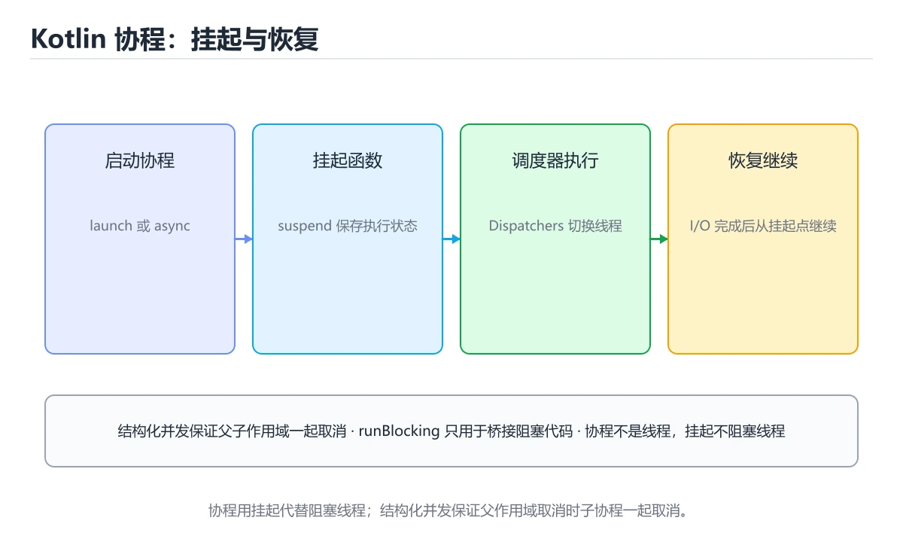
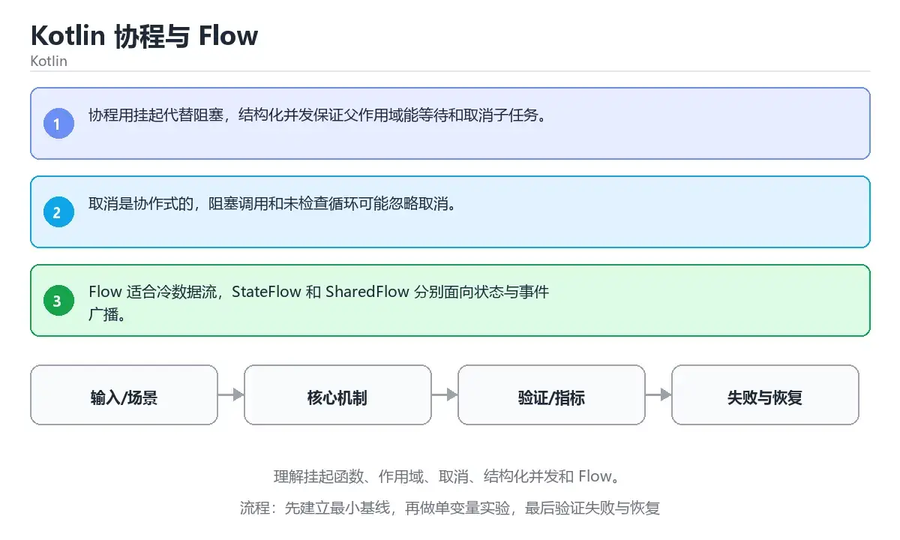

# Kotlin 协程与 Flow

> 内容更新时间：2026-10-06 · 学习阶段：高级 · 预计用时：35 分钟





## 本节知识框架

**课程定位**：所属分类 `kotlin`（Kotlin），课程主题 `Kotlin 协程与 Flow`，学习阶段 高级，建议用时 35 分钟。

本课主线：理解挂起函数、作用域、取消、结构化并发和 Flow。

**学完本课应当能够**
- 说清 `协程` 与 `suspend` 的含义与区别，并各举一个正例和一个反例。
- 用本课示例验证 `Flow` 的行为，记录输入、输出与失败条件。
- 遇到「在协程里阻塞线程」这类问题时，能说出触发条件与修复顺序。

### 复习清单

- [ ] 能不看正文复述 协程，并指出 suspend 的一个边界或反例。
- [ ] 能用「Kotlin 协程与 Flow」的示例复现结果，并说明suspend出错时输出的第一条信息。
- [ ] 能完成一次自测，并把错题对照错误表定位原因。

## 核心概念定义

| 术语 | 操作性定义 | 常见边界与风险 |
| --- | --- | --- |
| 协程 | 可挂起和恢复的轻量执行单元，由运行时或语言调度。 | 易错：调度器被占用，并发能力下降；正确做法是使用挂起函数并选择合适的调度器。 |
| suspend | Kotlin 协程中的挂起标记，函数可在不阻塞线程的情况下暂停并稍后恢复。 | 易错：在 suspend 函数里写阻塞调用；线程没被挂起反而被占住，调度器并发能力下降，取消也得等下个挂起点。 |
| Flow | Kotlin 的冷异步数据流，按需依次发出值并支持背压与取消。 | 冷流每个订阅者各自触发一次生产，多处同时收集就重复请求；要共享得改用热流并定好重放策略。 |
| 取消 | 协程的协作式取消：取消会传播到子协程，挂起点抛出取消异常，需在 finally 里释放资源。 | 易错：页面退出后任务仍在运行；正确做法是用作用域管理并在耗时点检查取消。 |
| 结构化并发 | 让子任务的生命周期受父作用域约束的并发模型 | 易错：子任务起在父作用域之外，取消不向下传播，页面退出后仍在运行；父作用域只约束它管理的子任务。 |

## 原理与运行机制

### 挂起函数不是"停线程"

Kotlin 编译器把每个 `suspend` 函数改写成状态机：挂起点对应状态编号，局部变量和参数打包进 `Continuation` 对象。遇到挂起调用时函数先返回 `COROUTINE_SUSPENDED`，线程回到调度器去执行别的协程；数据就绪后从对应状态恢复，继续执行下一段。

所以挂起是"让出线程"，不是"占住线程"：

- 8 个线程可以承载上万个等待网络的协程，因为绝大多数协程都在挂起状态，不占 CPU。
- 如果换成阻塞调用（`Thread.sleep`、同步 `read`），每个任务都要独占一个线程；1 万个线程仅栈空间就要数 GB。

代价也要承认：每次挂起都有状态保存与对象分配开销，高频、极短的挂起不如批量处理；`suspend` 只是标记，编译器不保证函数真的不阻塞，里面写阻塞调用照样卡线程。

### 调度器决定跑在哪个线程池

| 调度器 | 线程规模 | 适用场景 |
| --- | --- | --- |
| `Dispatchers.Default` | 默认等于 CPU 核数（至少 2） | 排序、解析、加解密等 CPU 密集任务 |
| `Dispatchers.IO` | 默认上限 64 线程 | JDBC、文件、旧式阻塞 API |
| `Dispatchers.Main` | 平台主线程 | 只做 UI 更新，不能放耗时逻辑 |
| `limitedParallelism(n)` | 自定义并发上限 | 保护数据库连接池或下游服务 |

`withContext` 用来切换调度器，但切换本身有线程调度成本。连续的小段切换应合并；CPU 密集任务误用 `IO` 只会增加线程数和切换开销，不会更快。

### 结构化并发：父子关系是硬约束

`coroutineScope { }`、`runBlocking { }` 和 `viewModelScope` 都会建立作用域。作用域内的子任务满足三条规则：

1. 父协程要等所有子协程结束才结束。
2. 任一子协程失败，默认取消父协程与所有兄弟协程。
3. 父协程被取消，所有子协程一起取消。

并行分解用 `async`，在需要结果时 `await`；只关心副作用用 `launch`。若希望一个子任务失败不影响其他子任务，用 `supervisorScope` 或 `SupervisorJob`，但每个子任务要自己处理异常。`GlobalScope` 没有父作用域，页面销毁后任务仍可能运行，应避免。

### 取消是协作式的

`job.cancel()` 只是把状态改成 cancelling，真正退出要等协程在挂起点检查。`delay`、`yield`、`await`、`emit` 都会检查；纯计算循环必须自己调用 `isActive` 或 `ensureActive()`。

清理逻辑放在 `finally`，如果清理本身会挂起，要用 `withContext(NonCancellable)` 包住，否则协程已经取消，清理会被立即中断。`CancellationException` 表示正常取消，不能吞掉；吞掉会让父作用域以为任务正常结束，取消无法向上传播。`withTimeout` 超时抛的是 `TimeoutCancellationException`。

### 异常传播：launch 与 async 不一样

- `launch` 里未捕获的异常立即取消父作用域，并交给 `CoroutineExceptionHandler`（若已到顶层）。
- `async` 把异常存进结果，等到 `await` 时才抛出；不 `await` 就可能静默丢失。
- `supervisorScope` 下子协程失败只影响自己，父作用域继续；适合首页多个互不依赖的请求。

Android 的 `viewModelScope` 默认是 `SupervisorJob + Dispatchers.Main.immediate`，这也是它适合页面级并发的原因。

### Flow 是冷的，共享流是热的

`flow { emit(...) }` 只有被 `collect` 时才执行，每个收集者都会触发一次独立生产。`map`、`filter` 是中间操作，返回的仍是冷流；`buffer` 拉开生产与消费的节奏，`conflate` 只保留最新值，`collectLatest` 在新值到达时取消上一段处理。

`flowOn` 只改变上游执行的调度器，必须放在中间操作之前；放在 `collect` 附近不会生效。

- `StateFlow`：始终有当前值，相同值自动去重，适合 UI 状态；用 `stateIn` 把冷流变成热状态。
- `SharedFlow`：广播事件，可配置 `replay` 与 `extraBufferCapacity`；没有订阅者时事件会丢失，不适合必须送达的命令。

`shareIn`/`stateIn` 都要绑定作用域和启动策略。Android 常见 `SharingStarted.WhileSubscribed(5000)`：界面离开 5 秒后停止上游，避免旋转屏幕时重复请求。

### 测试与版本

`runTest` 使用虚拟时间，`delay(10_000)` 会瞬间跳过；`TestDispatcher` 控制调度顺序，`advanceUntilIdle()` 推进所有挂起任务。协程库升级前先用现有测试复现行为，再对照官方发布说明检查弃用 API 与调度语义变化。

## 典型应用场景

**课程内置实验入口**：`sandbox:kotlin`，用于动手验证《Kotlin 协程与 Flow》的机制；实验结论不替代概念定义与复杂度分析。

### 五类真实场景

| 场景 | 用法 | 关键点 |
| --- | --- | --- |
| Android 页面加载 | `viewModelScope` + `StateFlow<UiState>` | 页面销毁自动取消，状态只有一个来源 |
| 并行请求聚合 | `coroutineScope` + `async` | 任一子任务失败会取消其余，避免半成品结果 |
| 搜索联想 | `MutableStateFlow` + `debounce` + `flatMapLatest` | 新输入到达时取消旧请求，只保留最后一次 |
| 数据库或传感器持续流 | Room `Flow` + `stateIn(WhileSubscribed)` | 冷流转热状态，配置变化不重复订阅 |
| 必须完成的后台上传 | WorkManager + 协程 | 进程被杀仍要完成的任务不能只靠页面作用域 |

### 排障顺序

1. **任务在哪个作用域**：先用 `viewModelScope`、`lifecycleScope` 或自定义作用域确认生命周期，排除 `GlobalScope`。
2. **是否阻塞线程**：检查 `suspend` 函数里有没有 `Thread.sleep`、同步 IO 或大循环；有就换挂起 API 或 `Dispatchers.IO`。
3. **取消有没有检查点**：纯计算循环要加 `ensureActive()`，清理逻辑放进 `finally`。
4. **Flow 订阅了几次**：在 `collect` 前打日志，确认是否每个重组或每个页面都新建了一条冷流。
5. **异常去哪了**：`async` 的结果有没有 `await`，`launch` 的异常是否被 `CoroutineExceptionHandler` 静默吞掉。

### 最小验证场景

- 准备：运行本课示例，记录 `answer`、`pair`、`flow total`、`cleanup`、`cancelled` 五行基线与完整命令。
- 观察：先把 `repeat(1000)` 改成 3 次，让任务在取消前自然结束，观察 `cancelled` 变为 `false`；再把 `delay(10)` 换成不带检查点的纯计算循环，观察取消是否还能及时生效。
- 判定：基线输出必须完全一致；改动后 `cleanup` 与 `cancelled` 不符合预期，说明取消检查点或作用域位置有问题。
- 失败信号：页面退出后日志仍持续输出、同一接口被请求两次、崩溃平台出现本应被处理的 `CancellationException`。

### 选择与边界

- `协程` 适合大量等待型并发；CPU 密集任务应限制并发度并交给 `Dispatchers.Default`。
- `suspend` 只表示可以挂起，不保证不阻塞；函数内部仍要避免阻塞调用。
- `Flow` 适合按需生产的数据序列；UI 状态用 `StateFlow`，一次性事件用 `SharedFlow` 并明确 `replay`。
- `取消` 是协作式的，没有检查点的循环不会响应取消；清理逻辑必须用 `NonCancellable` 保护。
- `结构化并发` 要求子任务留在父作用域内；`GlobalScope` 破坏生命周期约束，不应在业务代码中使用。

## 代码/协议/SQL 示例

### 最小可验证示例

**教材衔接：最小可运行示例**

下面的示例把挂起、并行分解、冷流和协作式取消放进同一个 `runBlocking`，先原样运行，再按小节说明改一处：

```kotlin
import kotlinx.coroutines.Dispatchers
import kotlinx.coroutines.NonCancellable
import kotlinx.coroutines.async
import kotlinx.coroutines.cancelAndJoin
import kotlinx.coroutines.coroutineScope
import kotlinx.coroutines.delay
import kotlinx.coroutines.flow.Flow
import kotlinx.coroutines.flow.fold
import kotlinx.coroutines.flow.flow
import kotlinx.coroutines.flow.map
import kotlinx.coroutines.launch
import kotlinx.coroutines.runBlocking
import kotlinx.coroutines.withContext

suspend fun fetchValue(): Int = 42

suspend fun loadPair(): Pair<Int, Int> = coroutineScope {
    val a = async { fetchValue() }
    val b = async {
        delay(10)
        fetchValue() + 1
    }
    a.await() to b.await()
}

fun numbers(): Flow<Int> = flow {
    for (i in 1..3) {
        delay(5)
        emit(i)
    }
}

fun main() = runBlocking {
    val value = withContext(Dispatchers.Default) { 6 * 7 }
    println("answer=$value")
    println("pair=${loadPair()}")

    val total = numbers().map { it * 2 }.fold(0) { acc, v -> acc + v }
    println("flow total=$total")

    val job = launch {
        try {
            repeat(1000) { delay(10) }
        } finally {
            withContext(NonCancellable) { println("cleanup") }
        }
    }
    delay(25)
    job.cancelAndJoin()
    println("cancelled=${job.isCancelled}")
}
```

**教材衔接：预期输出**

```text
answer=42
pair=(42, 43)
flow total=12
cleanup
cancelled=true
```

`loadPair` 的两个 `async` 在 `coroutineScope` 内并行，`pair=(42, 43)` 说明两个结果都被 `await`；`numbers()` 每次 `collect`（这里是 `fold`）都会重新执行，`(1+2+3)×2=12`；`cancelAndJoin` 等到 `finally` 执行完才返回，所以 `cleanup` 先于 `cancelled` 打印。

### 只改一个值：让任务自然结束

把 `repeat(1000)` 改成 `repeat(1)`：任务在约 10 ms 结束，25 ms 时取消的是一个已完成的 Job，`cancelled=false`，但 `cleanup` 依然执行。再把 `delay(10)` 换成不带 `ensureActive()` 的纯计算循环，`cancelAndJoin` 只能等循环跑完才返回——这组对比说明取消不是"强制杀线程"，而是协作式信号。

## 时间/空间复杂度或性能分析

**协程与线程的内存账**：JVM 线程默认栈大小约 1 MB（可用 `-Xss` 调整），1 万个线程仅栈就要约 10 GB；一个挂起协程的状态对象通常只有几百字节，1 万个等待网络的协程可以轻松放进几十 MB。协程的优势在等待型并发，不是让 CPU 计算变快。

**调度与挂起开销**：一次挂起-恢复通常为百纳秒到微秒级，`withContext` 切线程还要叠加线程调度成本（约 1~10 µs，取决于平台）。`Dispatchers.Default` 默认线程数为 `max(2, CPU 核数)`，`Dispatchers.IO` 默认上限 64；把 CPU 密集任务放进 IO 只会增加线程竞争。

**Flow 链路的成本**：每个中间操作都是一层包装，链越长每元素开销越大；`buffer(n)` 会占用 n 个元素的内存，`conflate` 丢弃中间值换取实时性，`collectLatest` 取消上一段处理。`stateIn` 只保留一个当前值，`shareIn(replay = n)` 要为 n 个历史事件付内存。

**复杂度**：一次完整 `collect` 是 O(n)（n 为发射元素数）；`combine(k)` 每次发射要看 k 个上游的最新值；`flatMapLatest` 会取消旧内层流，避免 O(订阅数) 的堆积。

**测量方法**：用 `measureTimeMillis` 记录端到端耗时，用 `kotlinx-benchmark` 测挂起与 Flow 操作吞吐，用 JFR 或 DebugProbes 观察活跃协程数与调度器队列长度。固定输入跑基线，再把并发度提高一个数量级复测，比较 P99 与线程占用，而不是只看平均值。

## 常见误区与易错点

| 容易写错的做法 | 实际现象 | 原因与正确做法 |
| --- | --- | --- |
| 在协程里阻塞线程 | 调度器被占用，并发能力下降。 | 使用挂起函数并选择合适的调度器。 |
| 取消不向下传播 | 页面退出后任务仍在运行。 | 用作用域管理并在耗时点检查取消。 |
| 冷流被重复订阅 | 重复请求与资源浪费。 | 需要共享时使用共享流并明确重放策略。 |
| CPU 密集任务放进 Dispatchers.IO | 线程数飙升、切换开销变大，吞吐反而下降 | CPU 密集用 `Default`，阻塞 IO 才用 `IO`。 |
| catch 后吞掉 CancellationException | 取消无法向上传播，页面退出后仍在执行 | 不拦截取消异常，清理逻辑放 `finally` + `NonCancellable`。 |
| 在 UI 层直接 collect 冷流 | 重组或旋转屏幕时重复订阅、重复请求 | 用 `stateIn`/`shareIn` 或生命周期感知的收集方式。 |

### 现场 1：在协程里阻塞线程

**症状**：调度器被占用，并发能力下降。

**根因与修复**：使用挂起函数并选择合适的调度器。

**自检**：在本课示例里复现「在协程里阻塞线程」，改成使用挂起函数并选择合适的调度器后重跑；如果症状消失且失败路径按预期变化，说明定位正确。

### 现场 2：取消不向下传播

**症状**：页面退出后任务仍在运行。

**根因与修复**：用作用域管理并在耗时点检查取消。

**自检**：在本课示例里复现「取消不向下传播」，改成用作用域管理并在耗时点检查取消后重跑；如果症状消失且失败路径按预期变化，说明定位正确。

### 现场 3：冷流被重复订阅

**症状**：重复请求与资源浪费。

**根因与修复**：需要共享时使用共享流并明确重放策略。

**自检**：在本课示例里复现「冷流被重复订阅」，改成需要共享时使用共享流并明确重放策略后重跑；如果症状消失且失败路径按预期变化，说明定位正确。

### 现场 4：async 的异常静默丢失

**症状**：并行请求中有一个失败，页面却一直停在加载中，日志里没有异常。

**根因与修复**：`async` 把异常存进结果，代码只 `await` 了成功的那个，失败的那个从未被等待；同时它仍在父作用域内，协程结束时异常才可能暴露。修复是确保每个 `async` 都被 `await`，或用 `awaitAll` 统一收集；不关心结果的子任务改用 `launch` 并配置异常处理。

### 现场 5：旋转屏幕后接口被请求两次

**症状**：每次旋转屏幕，首页接口都会重复调用，偶尔出现两次结果覆盖。

**根因与修复**：Repository 返回冷流，每个新的收集者都触发一次独立请求。修复是把数据源改成 `stateIn(viewModelScope, SharingStarted.WhileSubscribed(5000), initial)`，让多个界面共享同一份上游结果。

## 与其他知识点的关系

| 关系 | 课程 | 为什么 |
| --- | --- | --- |
| 先修 | 《Kotlin 函数、Lambda 与扩展》 | `suspend` 函数、扩展函数与高阶函数是协程 API 的语法基础。 |
| 关联 | 《Kotlin 集合、序列与函数式操作》 | Flow 的 `map`、`filter`、`fold` 与序列操作一一对应，区别在异步与背压。 |
| 后续 | 《Kotlin Android 架构》 | `viewModelScope`、`StateFlow` 与生命周期收集是页面层的直接应用。 |
| 后续 | 《Kotlin 测试与协程测试》 | 用 `runTest` 与虚拟时间验证取消、超时和 Flow。 |

## 自测题与参考答案

> 先独立作答，再对照参考答案；答案都能在本课正文、术语表或错误表里找到依据。

### 自测 1（概念复述）

不看正文，写出 `协程` 的操作性定义，并说明它与 `suspend` 的区别。

**参考答案**：可挂起和恢复的轻量执行单元，由运行时或语言调度。

`suspend` 的定位是：Kotlin 协程中的挂起标记，函数可在不阻塞线程的情况下暂停并稍后恢复；两者的差别要从适用对象与失败模式上说明。

### 自测 2（排错）

本课错误表记录了「在协程里阻塞线程」这类做法。请写出它会出现的现象、根因，以及修复顺序。

**参考答案**：现象是调度器被占用，并发能力下降；正确做法是使用挂起函数并选择合适的调度器。修复时先复现现象并保留证据，再改动一处假设重跑，确认现象消失。

### 自测 3（动手验证）

运行本课的 Kotlin 示例，先把 `repeat(1000)` 改成 `repeat(1)`，再把 `delay(10)` 换成不带 `ensureActive()` 的纯计算循环，分别记录 `cleanup` 与 `cancelled` 的输出。

**参考答案**：`repeat(1)` 时任务在取消前已结束，`cancelled=false`，`cleanup` 仍打印；纯计算循环没有挂起点，`cancelAndJoin` 要等循环结束才返回，取消不能及时生效。这说明取消依赖协程主动检查。

### 自测 4（代码阅读）

阅读本课的 `loadPair`，说明 `coroutineScope` 与两个 `async` 各自负责什么，并指出哪个改动会让 `pair` 的结果不再可靠。

**参考答案**：`coroutineScope` 建立父子作用域并等待所有子协程，两个 `async` 并行执行 `fetchValue` 和 `fetchValue()+1`，`await` 取回结果组成 Pair。如果把其中一个 `async` 移出作用域（例如改用 `GlobalScope`），父作用域取消时它不会一起取消，失败也不会按结构化规则传播，任务可能比 `loadPair` 活得更久，结果不再受生命周期约束。

### 自测 5（迁移）

把 `Kotlin 协程与 Flow` 的方法迁移到自己的项目：围绕 `协程` 写出一个与错误表同类的风险点，并说明触发条件和检验方式。

**参考答案**：例如「冷流被重复订阅」，它会导致重复请求与资源浪费；检验方式是按需要共享时使用共享流并明确重放策略改一处再复现，确认现象消失且没有引入新的失败分支。

### 自测 6（对比）

用一个表格对比 `协程` 与 `suspend`：各写一行适用场景、一行失败表现。

**参考答案**：`协程` 的定义是可挂起和恢复的轻量执行单元，由运行时或语言调度；`suspend` 的定义是Kotlin 协程中的挂起标记，函数可在不阻塞线程的情况下暂停并稍后恢复。两者的失败表现分别对应本课错误表里与本术语相关的行。

### 自测 7（排错顺序）

面对「在协程里阻塞线程」引发的问题，请把“复现 调度器被占用，并发能力下降 → 保留证据 → 使用挂起函数并选择合适的调度器 → 回归验证”四步写成可执行的检查清单。

**参考答案**：第一步按调度器被占用，并发能力下降复现；第二步记录输入、版本与完整报错；第三步按使用挂起函数并选择合适的调度器只改一处；第四步重跑并确认失败路径也按预期变化。

### 自测 8（边界判断）

针对 `结构化并发`，分别写出“可以使用”的条件和“结论不再成立”的条件。

**参考答案**：可以使用：所有子任务都通过 `coroutineScope`、`viewModelScope` 等作用域启动，父协程能等待它们结束，失败与取消能向下传播。不再成立：子任务用 `GlobalScope` 或外部作用域启动，父协程结束时子任务仍在运行，此时"父作用域约束子任务生命周期"的前提已被破坏。

### 自测 9（机制重建）

不看正文，按输入、转换、输出、验证四段重建 `协程` → `suspend` → `Flow` → `取消` 的作用链。

**参考答案**：起点是 `协程`：编译后的状态机在挂起点让出线程；`suspend` 提供可挂起的函数边界；`Flow` 把异步结果组织成按需生产的序列；`取消` 通过挂起点检查并抛出 `CancellationException` 向上传播。终点检查 `取消` 是否在 `finally` 完成清理，失败时回到错误表定位第一个偏离定义的步骤。

### 自测 10（综合排错）

在 `Kotlin 协程与 Flow` 中，现象是 重复请求与资源浪费。请围绕 冷流被重复订阅 写出最小复现、关键证据、修复动作和回归验证，并说明为什么不能只凭一次运行下结论。

**参考答案**：先复现 冷流被重复订阅，记录输入与完整错误；再按 需要共享时使用共享流并明确重放策略 只改一处。回归时同时跑正常路径和边界路径，只有两次结果都可解释，才把修复视为完成。

### 自测 11（一分钟复述）

用每分钟约 200 字的速度复述 `Kotlin 协程与 Flow`：先给主问题，再按顺序说出 `协程`、`suspend`、`Flow`、`取消`，最后给一个失败案例。

**自评标准**：主问题必须对应 理解挂起函数、作用域、取消、结构化并发和 Flow；每个术语都要能接上一句定义或边界；失败案例必须写成可观察现象，不能用“可能有风险”代替证据。

## 延伸阅读

想更直观地理解本课概念？推荐参阅以下图解专题：

- [图解并发调度：线程、协程与 Goroutine](visual_concurrency_schedule.md)

## 术语速查

| 术语 | 一句话说明 |
| --- | --- |
| `协程` | 可挂起和恢复的轻量执行单元，由运行时或语言调度。 |
| `suspend` | Kotlin 协程中的挂起标记，函数可在不阻塞线程的情况下暂停并稍后恢复。 |
| `挂起` | 保存当前状态并让出线程，数据就绪后从对应状态恢复执行。 |
| `调度器` | 决定协程在哪个线程池运行的组件，`Default`、`IO`、`Main` 各自面向不同任务。 |
| `结构化并发` | 让子任务的生命周期受父作用域约束的并发模型。 |
| `取消` | 协作式取消：取消信号传播到子协程，挂起点抛出取消异常，需在 finally 里释放资源。 |
| `Flow` | 冷异步数据流，按需依次发出值并支持背压与取消。 |
| `StateFlow` | 始终持有当前值、自动去重的热流，适合表达 UI 状态。 |
| `SharedFlow` | 可配置 replay 的热流，适合事件广播，但没有订阅者时事件会丢失。 |
| `背压` | 消费者处理不过来时的流量控制策略，如缓冲、合并或只处理最新值。 |

**术语关系**：`协程`（轻量执行单元） → `suspend`（提供挂起点） → `调度器`（决定在哪个线程恢复） → `结构化并发`（约束父子生命周期） → `取消`（沿作用域向下传播） → `Flow`（异步数据序列） → `StateFlow` 与 `SharedFlow`（把冷流共享为热流，配合 `背压` 策略）。

## 考点精讲

`Kotlin 协程与 Flow` 的题库有 6 道题，下面逐题给出题干、正确项与判断依据：先自己作答，再核对正确项，最后回到正文对应小节复核。

### 考点 1：第 1 题

- **题目**：围绕“Kotlin 协程与 Flow”中的 协程、suspend、Flow，下列哪两项是本课强调的实践判断？
- **正确项**：学习 协程 时要同时说明输入、输出和失败路径，不能只看正常流程；验证 suspend 时要固定版本并覆盖边界输入，结论才可复现
- **判断依据**：按《Kotlin 协程与 Flow》的正文口径，本题要同时选中「学习 协程 时要同时说明输入、输出和失败路径，不能只看正常流程」、「验证 suspend 时要固定版本并覆盖边界输入，结论才可复现」，漏掉任一项都算没答全。术语 协程（Kotlin 协程与 Flow）：可挂起和恢复的轻量执行单元，由运行时或语言调度。易错点是在协程里阻塞线程，会造成调度器被占用，并发能力下降，改法是使用挂起函数并选择合适的调度器。

### 考点 2：第 2 题

- **题目**：在 `Kotlin 协程与 Flow` 里，与 `协程` 有关的说法中，哪一项最符合理解挂起函数、作用域、取消、结构化并发和 Flow？
- **正确项**：取消是协作式的，阻塞调用和未检查循环可能忽略取消。
- **判断依据**：本题正确项是「取消是协作式的，阻塞调用和未检查循环可能忽略取消」。术语 协程（Kotlin 协程与 Flow）：可挂起和恢复的轻量执行单元，由运行时或语言调度，本题取「取消是协作式的，阻塞调用和未检查循环可能忽略取消」这条。易错点是取消不向下传播，会造成页面退出后任务仍在运行，改法是用作用域管理并在耗时点检查取消。

### 考点 3：第 3 题

- **题目**：在 `Kotlin 协程与 Flow` 里，与 `协程` 有关的说法中，哪一项最符合理解挂起函数、作用域、取消、结构化并发和 Flow？（Kotlin 协程与 Flow·Kotlin 第 3 题）
- **正确项**：Flow 适合冷数据流
- **判断依据**：本题正确项是「Flow 适合冷数据流」。术语 协程（Kotlin 协程与 Flow）：可挂起和恢复的轻量执行单元，由运行时或语言调度，本题取「Flow 适合冷数据流」这条。易错点是冷流被重复订阅，会造成重复请求与资源浪费，改法是需要共享时使用共享流并明确重放策略。

### 考点 4：第 4 题

- **题目**：`Kotlin 协程与 Flow` 的主线是：理解挂起函数、作用域、取消、结构化并发和 Flow。下面哪一项与这条主线一致？
- **正确项**：理解挂起函数、作用域、取消、结构化并发和 Flow。
- **判断依据**：本题正确项是「理解挂起函数、作用域、取消、结构化并发和 Flow」。术语 协程（Kotlin 协程与 Flow）：可挂起和恢复的轻量执行单元，由运行时或语言调度，本题取「理解挂起函数、作用域、取消、结构化并发和 Flow」这条。易错点是在协程里阻塞线程，会造成调度器被占用，并发能力下降，改法是使用挂起函数并选择合适的调度器。

### 考点 5：第 5 题

- **题目**：填空：补齐下面这段术语说明中的空缺。课程 `理解挂起函数、作用域、取消、结构化并发和 Flow。`，这段说明是：`____`：Kotlin 的冷异步数据流，按需依次发出值并支持背压与取消。空缺处应填哪个术语？
- **正确项**：Flow
- **判断依据**：《Kotlin 协程与 Flow》这题的填空口径是「Flow」或「flow」，正文写法与其中任一项一致即可。术语「Flow」在本课里的界定是Kotlin 的冷异步数据流，按需依次发出值并支持背压与取消，题干问的就是这一条。常见错法是在协程里阻塞线程，其后果是调度器被占用，并发能力下降。正确做法是使用挂起函数并选择合适的调度器。

### 考点 6：第 6 题

- **题目**：`Kotlin 协程与 Flow` 的示例代码服务于“理解挂起函数、作用域、取消、结构化并发和 Flow。”哪一条判断是正确的？
- **正确项**：协程用挂起代替阻塞，结构化并发保证父作用域能等待和取消子任务。
- **判断依据**：本题正确项是「协程用挂起代替阻塞，结构化并发保证父作用域能等待和取消子任务」。术语 协程（Kotlin 协程与 Flow）：可挂起和恢复的轻量执行单元，由运行时或语言调度，本题取「协程用挂起代替阻塞，结构化并发保证父作用域能等待和取消子任务」这条。易错点是冷流被重复订阅，会造成重复请求与资源浪费，改法是需要共享时使用共享流并明确重放策略。

## 内容元数据

- 内容版本：v2.0
- 最后更新：2026-10-06
- 学习阶段：高级
- 适用环境：Kotlin 2.x / Android SDK；本课聚焦 协程。
- 内容来源：内置结构化课程与工程实践整理
- 相关主题：协程、suspend、Flow、取消
- 质量版本：P0 测验标准 + P1 覆盖扩展 + P2 体验补全

## 参考资料与复核

- 最后复核：2026-10-04
- 下次复核：2026-11-10
- 复核范围：版本兼容、API 行为、安全建议与工程实践
- 来源性质：官方文档、标准或权威教材；本课核对关键词：协程、suspend、Flow、取消。

| 参考资料 | 本课用途 |
| --- | --- |
| [Kotlin 协程](https://kotlinlang.org/docs/coroutines-guide.html) | 结构化并发与异步流 |
| [Kotlin 基础语法](https://kotlinlang.org/docs/basic-syntax.html) | 语法、类型与函数 |
| [Kotlin Serialization](https://kotlinlang.org/docs/serialization.html) | 序列化与数据模型 |

| [本课术语索引：Kotlin 协程与 Flow](#核心概念定义) | 按本课输入、术语边界和错误表现逐项核对 |
> 「Kotlin 协程与 Flow」的链接用于离线阅读后的延伸核对；App 不会自动联网。