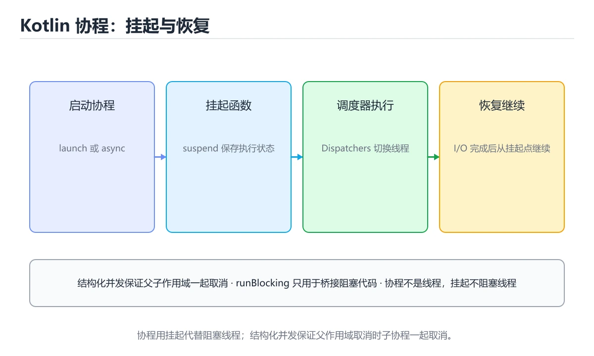
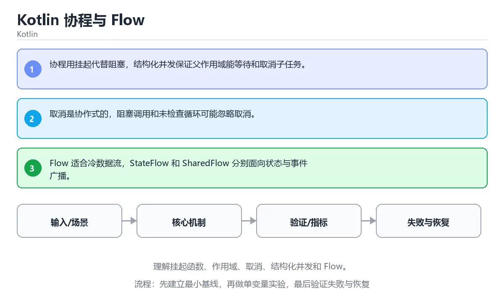

# Kotlin 协程与 Flow

> 内容更新时间：2026-10-06 · 学习阶段：高级 · 预计用时：25 分钟





## 本节知识框架

**课程定位**：所属分类 `kotlin`（Kotlin），课程主题 `Kotlin 协程与 Flow`，学习阶段 高级，建议用时 45 分钟。

本课主线：理解挂起函数、作用域、取消、结构化并发和 Flow。

**学完本课应当能够**
- 说清 `协程` 与 `suspend` 的含义与区别，并各举一个正例和一个反例。
- 用本课示例验证 `Flow` 的行为，记录输入、输出与失败条件。
- 遇到「在协程里阻塞线程」这类问题时，能说出触发条件与修复顺序。

### 复习清单

- [ ] 能不看正文复述 协程，并指出 suspend 的一个边界或反例。
- [ ] 能用「Kotlin 协程与 Flow」的示例复现结果，并说明suspend出错时输出的第一条信息。
- [ ] 能完成一次自测，并把错题对照错误表定位原因。

## 核心概念定义

| 术语 | 操作性定义 | 常见边界与风险 |
| --- | --- | --- |
| 协程 | 可挂起和恢复的轻量执行单元，由运行时或语言调度。 | 易错：调度器被占用，并发能力下降；正确做法是使用挂起函数并选择合适的调度器。 |
| suspend | Kotlin 协程中的挂起标记，函数可在不阻塞线程的情况下暂停并稍后恢复。 | 易错：在 suspend 函数里写阻塞调用；线程没被挂起反而被占住，调度器并发能力下降，取消也得等下个挂起点。 |
| Flow | Kotlin 的冷异步数据流，按需依次发出值并支持背压与取消。 | 冷流每个订阅者各自触发一次生产，多处同时收集就重复请求；要共享得改用热流并定好重放策略。 |
| 取消 | 协程的协作式取消：取消会传播到子协程，挂起点抛出取消异常，需在 finally 里释放资源。 | 易错：页面退出后任务仍在运行；正确做法是用作用域管理并在耗时点检查取消。 |
| 结构化并发 | 让子任务的生命周期受父作用域约束的并发模型 | 易错：子任务起在父作用域之外，取消不向下传播，页面退出后仍在运行；父作用域只约束它管理的子任务。 |

## 原理与运行机制

### 机制总览

**教材衔接：核心知识**

### 1. 协程用挂起代替阻塞，结构化并发保证父作用域能等待和取消子任务。

- 关键做法：先用 runBlocking 建立 协程 的基线，再逐步加入边界与失败条件。
- 验证标准：runBlocking 的输出能被他人复现，边界输入有对应用例。

### 2. 取消是协作式的，阻塞调用和未检查循环可能忽略取消。

把这条结论放回「Kotlin 协程与 Flow」的完整流程里展开：

- 正文依据：能用自己的话解释：协程用挂起代替阻塞，结构化并发保证父作用域能等待和取消子任务。
- 落地检查：把「2. 取消是协作式的，阻塞调用和未检查循环可能忽略取消。」改写成一条可执行的核对项，逐条验证输入、超时与失败路径。

### 3. Flow 适合冷数据流，StateFlow 和 SharedFlow 分别面向状态与事件广播。

把这条结论放回「Kotlin 协程与 Flow」的完整流程里展开：

- 正文依据：能用自己的话解释：取消是协作式的，阻塞调用和未检查循环可能忽略取消。
- 落地检查：把「3. Flow 适合冷数据流，StateFlow 和 SharedFlow 分别面向状态与事件广播。」改写成一条可执行的核对项，逐条验证输入、超时与失败路径。

**教材衔接：关键流程**

**教材衔接：实践路径**

**教材衔接：语言专项实践：Kotlin 协程与 Flow**

### 一、工具链

| 阶段 | 推荐工具 | 验收标准 |
| --- | --- | --- |
| 编译构建 | kotlinc / Gradle | 命令可复现且错误能被定位 |
| 测试 | JUnit + coroutines-test | 命令可复现且错误能被定位 |
| 静态检查 | detekt / ktlint | 命令可复现且错误能被定位 |
| 发布 | R8/ProGuard + App Bundle | 命令可复现且错误能被定位 |

### 三、测试策略

- 单元测试覆盖核心规则和边界。
- 集成测试覆盖文件、网络、数据库或平台 API。
- 失败测试覆盖超时、取消、异常和资源耗尽。
- 性能测试记录基线，避免只凭感觉优化。

### 四、发布检查

**教材衔接：版本与时效**

- 版本提示：协程 的行为在最近几个大版本里有过调整，升级「Kotlin 协程与 Flow」前先用 runBlocking 复现当前输出，再对照官方发布说明逐条核对。
- 升级前确认 协程 的兼容范围，把不可回退的改动单独拆成一次提交。
- 显式 API 模式与多平台源集是团队协作时的重点
- 官方说明：https://kotlinlang.org/docs/releases.html

## 典型应用场景

**课程内置实验入口**：`sandbox:kotlin`，用于动手验证《Kotlin 协程与 Flow》的机制；实验结论不替代概念定义与复杂度分析。

- **在协程里阻塞线程**：典型现象是调度器被占用，并发能力下降；正确做法是使用挂起函数并选择合适的调度器。
- **取消不向下传播**：典型现象是页面退出后任务仍在运行；正确做法是用作用域管理并在耗时点检查取消。
- **冷流被重复订阅**：典型现象是重复请求与资源浪费；正确做法是需要共享时使用共享流并明确重放策略。

### 最小验证场景

- 准备：保留 `text` 示例的原始输入，先记录 `Kotlin 协程与 Flow` 的基线输出和完整运行命令。
- 观察：先核对 调用了 `main()`，再改变一个与 `协程` 相关的条件。
- 判定：新结果与 `Kotlin 协程与 Flow` 的基线不同不等于错误；只有当差异破坏了 `协程` 的定义或错误表中的约束，才判定为失败。

### 选择与边界

- 使用 `协程` 时，可挂起和恢复的轻量执行单元，由运行时或语言调度；易错：调度器被占用，并发能力下降；正确做法是使用挂起函数并选择合适的调度器。
- 使用 `suspend` 时，Kotlin 协程中的挂起标记，函数可在不阻塞线程的情况下暂停并稍后恢复；共享状态与调度顺序会改变结论，单线程或串行测试通过不等于并发下成立。
- 使用 `Flow` 时，Kotlin 的冷异步数据流，按需依次发出值并支持背压与取消。
- 使用 `取消` 时，协程的协作式取消：取消会传播到子协程，挂起点抛出取消异常，需在 finally 里释放资源；易错：页面退出后任务仍在运行；正确做法是用作用域管理并在耗时点检查取消。
- 使用 `结构化并发` 时，让子任务的生命周期受父作用域约束的并发模型；共享状态与调度顺序会改变结论，单线程或串行测试通过不等于并发下成立。

## 代码/协议/SQL 示例

### 最小可验证示例

**教材衔接：最小可运行示例**

下面的示例覆盖「Kotlin 协程与 Flow」中 协程 的核心路径。先原样运行，再按注释改一处：

```kotlin
import kotlinx.coroutines.Dispatchers
import kotlinx.coroutines.runBlocking
import kotlinx.coroutines.withContext

fun main() = runBlocking {
    val value = withContext(Dispatchers.Default) { 6 * 7 }
    println("answer=$value")
}
```

**教材衔接：预期输出**

```text
answer=42
```

## 时间/空间复杂度或性能分析

**性能关注点（Kotlin 协程与 Flow）**：JVM 与协程调度影响开销：记录吞吐、延迟与调度器线程占用。

**本课特有开销（Kotlin 协程与 Flow · 协程）**：并发度提高后要观察是否出现拐点：延迟上升而吞吐不增，说明瓶颈已转移。

**测量方法**：以 `Kotlin 协程与 Flow` 的 `协程` 场景为对象，固定输入跑一遍记录基线，再把规模或并发度提高一个数量级复测；两次结果的差值与波动范围才是结论依据。

## 常见误区与易错点

| 容易写错的做法 | 实际现象 | 原因与正确做法 |
| --- | --- | --- |
| 在协程里阻塞线程 | 调度器被占用，并发能力下降。 | 使用挂起函数并选择合适的调度器。 |
| 取消不向下传播 | 页面退出后任务仍在运行。 | 用作用域管理并在耗时点检查取消。 |
| 冷流被重复订阅 | 重复请求与资源浪费。 | 需要共享时使用共享流并明确重放策略。 |

### 现场 1：在协程里阻塞线程

**症状**：调度器被占用，并发能力下降。

**根因与修复**：使用挂起函数并选择合适的调度器。

**自检**：在本课示例里复现「在协程里阻塞线程」，改成使用挂起函数并选择合适的调度器后重跑；如果症状消失且失败路径按预期变化，说明定位正确。

### 现场 2：取消不向下传播

**症状**：页面退出后任务仍在运行。

**根因与修复**：用作用域管理并在耗时点检查取消。

**自检**：在本课示例里复现「取消不向下传播」，改成用作用域管理并在耗时点检查取消后重跑；如果症状消失且失败路径按预期变化，说明定位正确。

### 现场 3：冷流被重复订阅

**症状**：重复请求与资源浪费。

**根因与修复**：需要共享时使用共享流并明确重放策略。

**自检**：在本课示例里复现「冷流被重复订阅」，改成需要共享时使用共享流并明确重放策略后重跑；如果症状消失且失败路径按预期变化，说明定位正确。

## 与其他知识点的关系

**教材衔接：复习与迁移**

## 自测题与参考答案

> 先独立作答，再对照参考答案；答案都能在本课正文、术语表或错误表里找到依据。

### 自测 1（概念复述）

不看正文，写出 `协程` 的操作性定义，并说明它与 `suspend` 的区别。

**参考答案**：可挂起和恢复的轻量执行单元，由运行时或语言调度。

`suspend` 的定位是：Kotlin 协程中的挂起标记，函数可在不阻塞线程的情况下暂停并稍后恢复；两者的差别要从适用对象与失败模式上说明。

### 自测 2（排错）

本课错误表记录了「在协程里阻塞线程」这类做法。请写出它会出现的现象、根因，以及修复顺序。

**参考答案**：现象是调度器被占用，并发能力下降；正确做法是使用挂起函数并选择合适的调度器。修复时先复现现象并保留证据，再改动一处假设重跑，确认现象消失。

### 自测 3（动手验证）

运行本课的 `text` 示例，改动一个与 协程 有关的输入后重跑，记录输出与错误信息。

**参考答案**：正常输入下 `text` 示例应当复现正文给出的结果；改动输入后，如果结果改变或报错，先核对它是否满足 `Kotlin 协程与 Flow` 中`协程` 的适用范围，再检查错误表里是否有同类现象。

### 自测 4（代码阅读）

阅读本课开头的 `text` 示例，说明它体现了`协程` 的哪一条性质，并指出改动哪个输入会让这条性质不再成立。

**参考答案**：`协程` 的定义是 可挂起和恢复的轻量执行单元，由运行时或语言调度，示例正是在实现这条定义。改动与 `协程` 有关的一个输入后，如果结果不再符合 `Kotlin 协程与 Flow` 的正文描述，就说明该性质只在当前前提成立。

### 自测 5（迁移）

把 `Kotlin 协程与 Flow` 的方法迁移到自己的项目：围绕 `协程` 写出一个与错误表同类的风险点，并说明触发条件和检验方式。

**参考答案**：例如「冷流被重复订阅」，它会导致重复请求与资源浪费；检验方式是按需要共享时使用共享流并明确重放策略改一处再复现，确认现象消失且没有引入新的失败分支。

### 自测 6（对比）

用一个表格对比 `协程` 与 `suspend`：各写一行适用场景、一行失败表现。

**参考答案**：`协程` 的定义是可挂起和恢复的轻量执行单元，由运行时或语言调度；`suspend` 的定义是Kotlin 协程中的挂起标记，函数可在不阻塞线程的情况下暂停并稍后恢复。两者的失败表现分别对应本课错误表里与本术语相关的行。

### 自测 7（排错顺序）

面对「在协程里阻塞线程」引发的问题，请把“复现 调度器被占用，并发能力下降 → 保留证据 → 使用挂起函数并选择合适的调度器 → 回归验证”四步写成可执行的检查清单。

**参考答案**：第一步按调度器被占用，并发能力下降复现；第二步记录输入、版本与完整报错；第三步按使用挂起函数并选择合适的调度器只改一处；第四步重跑并确认失败路径也按预期变化。

### 自测 8（边界判断）

针对 `结构化并发`，分别写出“可以使用”的条件和“结论不再成立”的条件。

**参考答案**：共享状态与调度顺序会改变结论，单线程或串行测试通过不等于并发下成立。 同时要把 `结构化并发` 的定义 让子任务的生命周期受父作用域约束的并发模型 与实际输入逐项对照。

### 自测 9（机制重建）

不看正文，按输入、转换、输出、验证四段重建 `协程` → `suspend` → `Flow` → `取消` 的作用链。

**参考答案**：起点是 `协程` 的定义 可挂起和恢复的轻量执行单元，由运行时或语言调度；中间每一步都保留可观察状态；终点由 `结构化并发` 检查，失败时回到错误表定位第一个偏离定义的步骤。

### 自测 10（综合排错）

在 `Kotlin 协程与 Flow` 中，现象是 重复请求与资源浪费。请围绕 冷流被重复订阅 写出最小复现、关键证据、修复动作和回归验证，并说明为什么不能只凭一次运行下结论。

**参考答案**：先复现 冷流被重复订阅，记录输入与完整错误；再按 需要共享时使用共享流并明确重放策略 只改一处。回归时同时跑正常路径和边界路径，只有两次结果都可解释，才把修复视为完成。

### 自测 11（一分钟复述）

用每分钟约 200 字的速度复述 `Kotlin 协程与 Flow`：先给主问题，再按顺序说出 `协程`、`suspend`、`Flow`、`取消`，最后给一个失败案例。

**自评标准**：主问题必须对应 理解挂起函数、作用域、取消、结构化并发和 Flow；每个术语都要能接上一句定义或边界；失败案例必须写成可观察现象，不能用“可能有风险”代替证据。

## 延伸阅读

想更直观地理解本课概念？推荐参阅以下图解专题：

- [图解并发调度：线程、协程与 Goroutine](visual_concurrency_schedule.md)

## 术语速查

| 术语 | 一句话说明 |
| --- | --- |
| `协程` | 可挂起和恢复的轻量执行单元，由运行时或语言调度。 |
| `suspend` | Kotlin 协程中的挂起标记，函数可在不阻塞线程的情况下暂停并稍后恢复。 |
| `Flow` | Kotlin 的冷异步数据流，按需依次发出值并支持背压与取消。 |
| `取消` | 协程的协作式取消：取消会传播到子协程，挂起点抛出取消异常，需在 finally 里释放资源。 |
| `结构化并发` | 让子任务的生命周期受父作用域约束的并发模型。 |

**术语关系**：`协程`（可挂起和恢复的轻量执行单元） → `suspend`（Kotlin 协程中的挂起标记） → `Flow`（Kotlin 的冷异步数据流） → `取消`（协程的协作式取消：取消会传播到子协程）。

## 考点精讲

`Kotlin 协程与 Flow` 的题库有 6 道题，下面逐题给出题干、正确项与判断依据：先自己作答，再核对正确项，最后回到正文对应小节复核。

### 考点 1：第 1 题

- **题目**：围绕“Kotlin 协程与 Flow”中的 协程、suspend、Flow，下列哪两项是本课强调的实践判断？
- **正确项**：学习 协程 时要同时说明输入、输出和失败路径，不能只看正常流程；验证 suspend 时要固定版本并覆盖边界输入，结论才可复现
- **判断依据**：按《Kotlin 协程与 Flow》的正文口径，本题要同时选中「学习 协程 时要同时说明输入、输出和失败路径，不能只看正常流程」、「验证 suspend 时要固定版本并覆盖边界输入，结论才可复现」，漏掉任一项都算没答全。术语 协程（Kotlin 协程与 Flow）：可挂起和恢复的轻量执行单元，由运行时或语言调度。易错点是在协程里阻塞线程，会造成调度器被占用，并发能力下降，改法是使用挂起函数并选择合适的调度器。

### 考点 2：第 2 题

- **题目**：在 `Kotlin 协程与 Flow` 里，与 `协程` 有关的说法中，哪一项最符合理解挂起函数、作用域、取消、结构化并发和 Flow？
- **正确项**：取消是协作式的，阻塞调用和未检查循环可能忽略取消。
- **判断依据**：本题正确项是「取消是协作式的，阻塞调用和未检查循环可能忽略取消」。术语 协程（Kotlin 协程与 Flow）：可挂起和恢复的轻量执行单元，由运行时或语言调度，本题取「取消是协作式的，阻塞调用和未检查循环可能忽略取消」这条。易错点是取消不向下传播，会造成页面退出后任务仍在运行，改法是用作用域管理并在耗时点检查取消。

### 考点 3：第 3 题

- **题目**：在 `Kotlin 协程与 Flow` 里，与 `协程` 有关的说法中，哪一项最符合理解挂起函数、作用域、取消、结构化并发和 Flow？（Kotlin 协程与 Flow·Kotlin 第 3 题）
- **正确项**：Flow 适合冷数据流
- **判断依据**：本题正确项是「Flow 适合冷数据流」。术语 协程（Kotlin 协程与 Flow）：可挂起和恢复的轻量执行单元，由运行时或语言调度，本题取「Flow 适合冷数据流」这条。易错点是冷流被重复订阅，会造成重复请求与资源浪费，改法是需要共享时使用共享流并明确重放策略。

### 考点 4：第 4 题

- **题目**：`Kotlin 协程与 Flow` 的主线是：理解挂起函数、作用域、取消、结构化并发和 Flow。下面哪一项与这条主线一致？
- **正确项**：理解挂起函数、作用域、取消、结构化并发和 Flow。
- **判断依据**：本题正确项是「理解挂起函数、作用域、取消、结构化并发和 Flow」。术语 协程（Kotlin 协程与 Flow）：可挂起和恢复的轻量执行单元，由运行时或语言调度，本题取「理解挂起函数、作用域、取消、结构化并发和 Flow」这条。易错点是在协程里阻塞线程，会造成调度器被占用，并发能力下降，改法是使用挂起函数并选择合适的调度器。

### 考点 5：第 5 题

- **题目**：填空：补齐下面这段术语说明中的空缺。课程 `理解挂起函数、作用域、取消、结构化并发和 Flow。`，这段说明是：`____`：Kotlin 的冷异步数据流，按需依次发出值并支持背压与取消。空缺处应填哪个术语？
- **正确项**：Flow
- **判断依据**：《Kotlin 协程与 Flow》这题的填空口径是「Flow」或「flow」，正文写法与其中任一项一致即可。术语「Flow」在本课里的界定是Kotlin 的冷异步数据流，按需依次发出值并支持背压与取消，题干问的就是这一条。常见错法是在协程里阻塞线程，其后果是调度器被占用，并发能力下降。正确做法是使用挂起函数并选择合适的调度器。

### 考点 6：第 6 题

- **题目**：`Kotlin 协程与 Flow` 的示例代码服务于“理解挂起函数、作用域、取消、结构化并发和 Flow。”哪一条判断是正确的？
- **正确项**：协程用挂起代替阻塞，结构化并发保证父作用域能等待和取消子任务。
- **判断依据**：本题正确项是「协程用挂起代替阻塞，结构化并发保证父作用域能等待和取消子任务」。术语 协程（Kotlin 协程与 Flow）：可挂起和恢复的轻量执行单元，由运行时或语言调度，本题取「协程用挂起代替阻塞，结构化并发保证父作用域能等待和取消子任务」这条。易错点是冷流被重复订阅，会造成重复请求与资源浪费，改法是需要共享时使用共享流并明确重放策略。

### 考点 7：`协程`

- **要点**：可挂起和恢复的轻量执行单元，由运行时或语言调度。
- **协程 的边界**：易错：调度器被占用，并发能力下降；正确做法是使用挂起函数并选择合适的调度器。

### 考点 8：`suspend`

- **要点**：Kotlin 协程中的挂起标记，函数可在不阻塞线程的情况下暂停并稍后恢复。
- **suspend 的边界**：共享状态与调度顺序会改变结论，单线程或串行测试通过不等于并发下成立。

### 考点 9：`Flow`

- **要点**：Kotlin 的冷异步数据流，按需依次发出值并支持背压与取消。

### 考点 10：`取消`

- **要点**：协程的协作式取消：取消会传播到子协程，挂起点抛出取消异常，需在 finally 里释放资源。
- **取消 的边界**：易错：页面退出后任务仍在运行；正确做法是用作用域管理并在耗时点检查取消。

### 考点 11：`结构化并发`

- **要点**：让子任务的生命周期受父作用域约束的并发模型
- **结构化并发 的边界**：共享状态与调度顺序会改变结论，单线程或串行测试通过不等于并发下成立。

### 考点 12：排错——在协程里阻塞线程

- **现象**：调度器被占用，并发能力下降。
- **处理**：使用挂起函数并选择合适的调度器。

### 考点 13：排错——取消不向下传播

- **现象**：页面退出后任务仍在运行。
- **处理**：用作用域管理并在耗时点检查取消。

### 考点 14：综合辨析——`协程` 与 `结构化并发`

- **辨析点**：`协程` 的定义是 可挂起和恢复的轻量执行单元，由运行时或语言调度；`结构化并发` 的定义是 让子任务的生命周期受父作用域约束的并发模型。
- **答题要求**：面对 `Kotlin 协程与 Flow` 的题目，先判断描述的是 `协程` 还是 `结构化并发`，再归到对应定义，最后写出一个会让该定义失效的边界输入。

### 考点 15：排错评分点

- **现象分**：能写出 调度器被占用，并发能力下降，而不是只写“程序有错”。
- **证据分**：保留触发 在协程里阻塞线程 的输入、版本和错误原文。
- **修复分**：按 使用挂起函数并选择合适的调度器 只改一处，并同时回归正常路径与边界路径。

## 内容元数据

- 内容版本：v2.0
- 最后更新：2026-10-06
- 学习阶段：高级
- 适用环境：Kotlin 2.x / Android SDK；本课聚焦 协程。
- 内容来源：内置结构化课程与工程实践整理
- 相关主题：协程、suspend、Flow、取消
- 质量版本：P0 测验标准 + P1 覆盖扩展 + P2 体验补全

## 参考资料与复核

- 最后复核：2026-10-04
- 下次复核：2026-11-10
- 复核范围：版本兼容、API 行为、安全建议与工程实践
- 来源性质：官方文档、标准或权威教材；本课核对关键词：协程、suspend、Flow、取消。

| 参考资料 | 本课用途 |
| --- | --- |
| [Kotlin 协程](https://kotlinlang.org/docs/coroutines-guide.html) | 结构化并发与异步流 |
| [Kotlin 基础语法](https://kotlinlang.org/docs/basic-syntax.html) | 语法、类型与函数 |
| [Kotlin Serialization](https://kotlinlang.org/docs/serialization.html) | 序列化与数据模型 |

| [本课术语索引：Kotlin 协程与 Flow](#核心概念定义) | 按本课输入、术语边界和错误表现逐项核对 |
> 「Kotlin 协程与 Flow」的链接用于离线阅读后的延伸核对；App 不会自动联网。