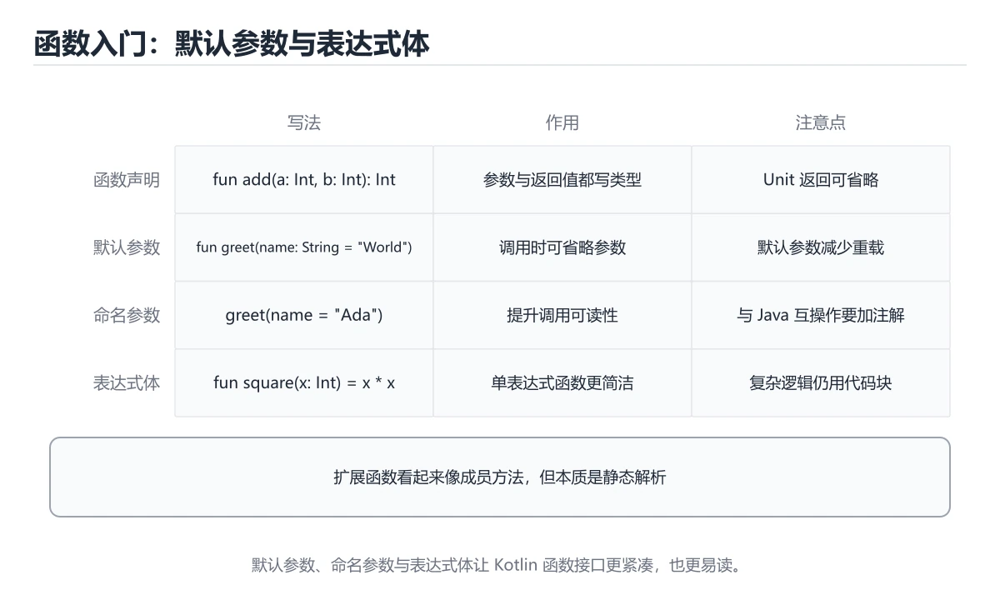
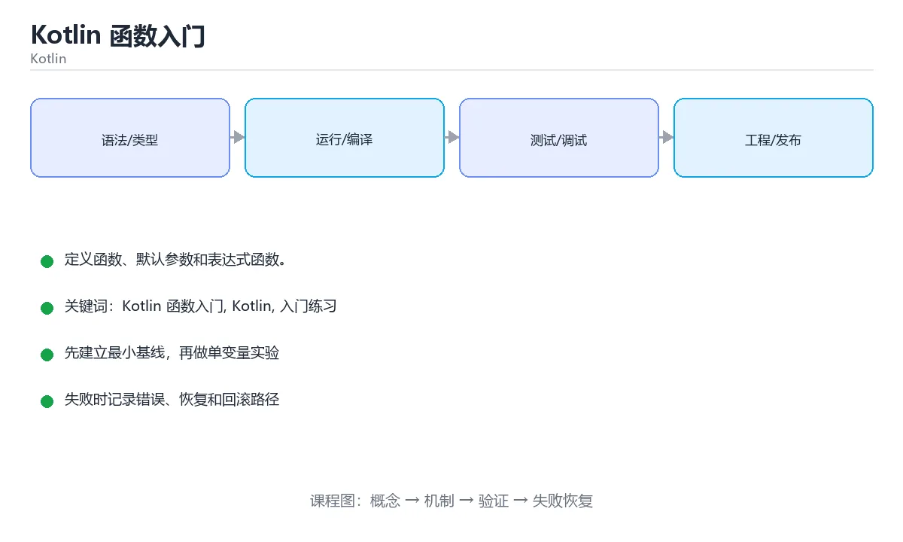

# Kotlin 函数入门

> 内容更新时间：2026-10-06 · 学习阶段：基础 · 预计用时：30 分钟





## 本节知识框架

**课程定位**：所属分类 `kotlin`（Kotlin），课程主题 `Kotlin 函数入门`，学习阶段 基础，建议用时 55 分钟。

本课主线：定义函数、默认参数和表达式函数。

**学完本课应当能够**
- 说清 `fun` 与 `参数与默认值` 的含义与区别，并各举一个正例和一个反例。
- 用本课示例验证 `返回值` 的行为，记录输入、输出与失败条件。
- 遇到「默认参数与位置参数混用」这类问题时，能说出触发条件与修复顺序。

### 复习清单

- [ ] 能不看正文复述本课核心术语，并指出一个边界或反例。
- [ ] 能运行或推演本课示例，记录输入、输出与失败现象。
- [ ] 能完成一次自测，并把错题对照错误表定位原因。

## 核心概念定义

| 术语 | 操作性定义 | 常见边界与风险 |
| --- | --- | --- |
| fun | 声明函数的关键字，后面跟函数名与参数列表。 | 易错：用 `fun` 声明却省略参数类型——Kotlin 不允许在函数签名里省类型，每个参数名后都得写上类型。 |
| 参数与默认值 | 参数可以带默认值，调用时省略即使用默认值。 | 易错：默认参数与位置参数混用导致传参与预期不符；应改用命名参数去跳过带默认值的那一位。 |
| 返回值 | 函数体最后一个表达式的值可以作为返回值，也可以显式 return。 | 块体函数声明了返回类型却忘记写 `return` 编译不过；只有返回 Unit 的函数才能省。 |
| 具名参数 | 调用时写参数名，可读性更好，也可以跳过有默认值的参数。 | 易错：顺序写反——具名参数之后不能再放位置参数，违反时传参与预期不符。 |
| 单表达式函数 | 函数体只有一个表达式时，用 = 直接写，省略花括号。 | 易错：等号形式里写 `return` 会编译失败；`=` 右边只放一个表达式，它的值直接就是返回值。 |
| 函数 | Kotlin 函数是表达式，单表达式函数可以省略花括号和 return | 易错：把函数调用当自带动作的语句；函数是表达式，`add(3, 4)` 的结果要接住或直接作为实参传给 `printResult`。 |

## 原理与运行机制

### 机制总览

**教材衔接：一句话入门**

定义函数、默认参数和表达式函数。

**教材衔接：Kotlin 基础机制速览**

### JVM、Android 与工具链

Kotlin 主要编译成 JVM 字节码，也可以编译成 JavaScript 或原生代码。Android 开发常用 Gradle 构建，Kotlin 与 Java 可以互操作：Kotlin 调用 Java 时要注意平台类型可能为空，Java 调用 Kotlin 时要注意默认参数、扩展函数和顶层函数的生成方式。理解编译目标和互操作边界，能解释很多“本地能跑、发布变慢或崩溃”的问题。

### val/var、类型与空安全

`val` 是只读引用，`var` 是可重新赋值的引用；只读引用指向的对象内容仍可能可变。Kotlin 区分可空类型 `T?` 和非空类型 `T`，编译器要求使用安全调用 `?.`、Elvis 运算符 `?:`、非空断言 `!!` 或智能转换处理空值。`lateinit` 适合生命周期保证会初始化的 var，`by lazy` 适合第一次访问时初始化；两者都不能滥用。

### 函数、表达式与数据类

Kotlin 函数是表达式，单表达式函数可以省略花括号和 return。默认参数、命名参数、扩展函数和顶层函数减少工具类的数量。`data class` 自动生成 equals、hashCode、toString 和 copy，适合值对象；`sealed class` 和 sealed interface 表达有限的互斥状态，配合 when 可以做穷尽检查。高阶函数和 lambda 让集合操作更简洁，但要注意内联与分配成本。

### 集合、泛型与作用域函数

`List`、`Set`、`Map` 默认只读接口，`MutableList` 等提供修改操作。集合操作 `map`、`filter`、`groupBy`、`associate` 返回新集合，序列 Sequence 适合大数据惰性处理。泛型通过 `out` 和 `in` 表达协变与逆变，类型投影处理更复杂的使用位置。`let`、`run`、`with`、`apply`、`also` 的作用域和返回值不同，应根据“访问对象、配置对象还是返回结果”选择。

### 协程、异常与测试

协程用 suspend 函数表达可暂停的异步计算，CoroutineScope 决定生命周期，Dispatcher 决定运行线程，Job 支持取消和结构化并发。不要使用 GlobalScope 泄漏任务，异常传播和取消需要按层级处理。Kotlin 没有受检异常，资源应使用 `use` 自动关闭。测试要覆盖空值、集合边界、协程取消和线程切换，不能只验证 happy path。

**教材衔接：版本与时效**

- 版本提示：Kotlin 函数入门 的行为在最近几个大版本里有过调整，升级「Kotlin 函数入门」前先用 square 复现当前输出，再对照官方发布说明逐条核对。
- 升级「Kotlin 函数入门」涉及的依赖前，先用 square 复现当前行为，再逐项核对版本说明与破坏性变更。
- 显式 API 模式与多平台源集是团队协作时的重点
- 官方说明：https://kotlinlang.org/docs/releases.html

### 一、工具链

| 阶段 | 推荐工具 | 验收标准 |
| --- | --- | --- |
| 编译构建 | kotlinc / Gradle | 命令可复现且错误能被定位 |
| 测试 | JUnit + coroutines-test | 命令可复现且错误能被定位 |
| 静态检查 | detekt / ktlint | 命令可复现且错误能被定位 |
| 发布 | R8/ProGuard + App Bundle | 命令可复现且错误能被定位 |

### 二、运行时与内存模型

「Kotlin 函数入门」的「二、运行时与内存模型」一节补全如下：

- 定位：这一节说明二、运行时与内存模型在「Kotlin 函数入门」知识体系里的位置。
- 检查点：固定版本与输入重跑《Kotlin 函数入门》，记录两次差异并定位不稳定条件。
- 自检：能否用一个最小例子解释二、运行时与内存模型？

## 典型应用场景

**课程内置实验入口**：`sandbox:kotlin`，用于动手验证《Kotlin 函数入门》的机制；实验结论不替代概念定义与复杂度分析。

**教材衔接：代码实验：把示例跑成证据**

### 实验一：建立基线

```kotlin
fun square(n: Int) = n * n

fun main() {
    println("square(7)=${square(7)}")
}
```

### 实验二：只改一个输入

沿用「Kotlin 函数入门」的最小示例做一次单变量实验：

做完后用一句话写出「Kotlin 函数入门」的结论：输入怎么变，结果才怎么变。

### 实验三：制造一个可控错误

把 square 的一个参数换成不兼容的类型，先预测报错位置再实际运行；预测与实际的差异就是本课的考点。

### 实验四：用三句话复述

1. Kotlin 函数入门 的输入是什么，哪些取值合法，哪些属于边界或非法范围？
2. 在 代码实验：把示例跑成证据 里，Kotlin 的状态是在什么条件下被改变的？
3. 输出如何验证，失败时第一条可观察证据是什么？

- **默认参数与位置参数混用**：典型现象是传参与预期不符；正确做法是使用命名参数提高可读性。
- **单表达式函数忽略返回类型**：典型现象是返回值与预期不符；正确做法是显式写清返回类型。
- **嵌套函数捕获外层变量**：典型现象是逻辑难以追踪；正确做法是需要复用时提取为成员方法。

### 最小验证场景

- 准备：保留 `kotlin` 示例的原始输入，先记录 `Kotlin 函数入门` 的基线输出和完整运行命令。
- 观察：先核对 调用了 `square()`，再改变一个与 `fun` 相关的条件。
- 判定：新结果与 `Kotlin 函数入门` 的基线不同不等于错误；只有当差异破坏了 `fun` 的定义或错误表中的约束，才判定为失败。

### 选择与边界

- 使用 `fun` 时，声明函数的关键字，后面跟函数名与参数列表；结果依赖数据分布、模型版本与算力预算，换数据集或换硬件都要重新评估。
- 使用 `参数与默认值` 时，参数可以带默认值，调用时省略即使用默认值；结果依赖数据分布、模型版本与算力预算，换数据集或换硬件都要重新评估。
- 使用 `返回值` 时，函数体最后一个表达式的值可以作为返回值，也可以显式 return；易错：返回值与预期不符；正确做法是显式写清返回类型。
- 使用 `具名参数` 时，调用时写参数名，可读性更好，也可以跳过有默认值的参数；结果依赖数据分布、模型版本与算力预算，换数据集或换硬件都要重新评估。
- 使用 `单表达式函数` 时，函数体只有一个表达式时，用 = 直接写，省略花括号；易错：返回值与预期不符；正确做法是显式写清返回类型。

## 代码/协议/SQL 示例

### 最小可验证示例

**教材衔接：最小示例**

**教材衔接：预期输出**

```text
square(7)=49
```

**教材衔接：零基础通俗讲：Kotlin 函数入门**

### 一句话说清它是什么

Kotlin 函数用 fun 声明，参数和返回值都要写类型；单表达式函数可以用等号直接写，省掉花括号。

### 用生活比喻理解

单表达式函数像把菜谱压缩成一行：原料和成品都写清楚，中间步骤足够简单时就省略，读起来反而更快。

### 完整可运行代码

```kotlin
fun add(a: Int, b: Int): Int {
    return a + b
}

fun multiply(a: Int, b: Int): Int = a * b

fun printResult(value: Int) {
    println("结果是 $value")
}

fun main() {
    printResult(add(3, 4))
    printResult(multiply(3, 4))
}
```

### 逐行拆开看

- 块体函数用花括号包围，返回类型写在参数列表之后。
- 冒号后面的 Int 是返回类型，参数类型写在参数名之后。
- 单表达式函数用等号连接，等号右边直接是返回值。
- `fun printResult(value: Int)` 不写返回类型，默认返回 Unit。
- 顶层函数不需要包在类里，Kotlin 允许文件级函数。
- 调用 `add(3, 4)` 得到 7，再作为实参传给 printResult。

### 把程序跑一遍

- `add(3, 4)` 返回 7，输出「结果是 7」。
- `multiply(3, 4)` 返回 12，输出「结果是 12」。
- 两个函数都不依赖对象，直接调用即可。
- main 执行完毕，进程退出。

### 新手最容易踩的坑

- 参数不写类型：Kotlin 不允许在函数签名里省略类型。
- 有返回类型却忘记 return：块体函数必须显式返回，除非返回 Unit。
- 单表达式函数里写 return：等号形式不能写 return，会编译失败。
- 用 Java 的可变参数写法：Kotlin 用 vararg 关键字。
- 命名参数和位置参数混用顺序错误：命名参数之后不能再写位置参数。

### 动手练一练

- 增加一个 `fun subtract(a: Int, b: Int): Int = a - b`。
- 给 printResult 增加一个前缀参数，调用时使用命名参数。
- 把 multiply 改回块体写法，比较两种风格。

### 本课速查卡

把下面八行抄进自己的笔记，复习时只看这一页就能回忆整课：

| 复习项 | 本课要点 |
| --- | --- |
| 核心结论 | Kotlin 函数用 fun 声明，参数和返回值都要写类型；单表达式函数可以用等号直接写，省掉花括号。 |
| 最少要写的代码 | `fun add(a: Int, b: Int): Int {` |
| 正确做法 | `add(3, 4)` 返回 7，输出「结果是 7」。 |
| 最常见的错误 | 参数不写类型：Kotlin 不允许在函数签名里省略类型。 |
| 出错先查什么 | 先读第一条报错信息，再回到最小示例只改一个地方 |
| 怎么确认学会了 | 增加一个 `fun subtract(a: Int, b: Int): Int = a - b`。 |
| 和别的知识点的关系 | 本课打下的语法与思维方式会被后面每一课反复用到 |
| 接下来做什么 | 合上教程，凭记忆把上面的最小代码重写一遍再运行 |

**运行方式**：运行 `Kotlin 函数入门` 的示例时，用 `kotlinc` 编译或用 Gradle 任务运行；注意 JVM 目标版本。

## 时间/空间复杂度或性能分析

**性能关注点（Kotlin 函数入门）**：JVM 与协程调度影响开销：记录吞吐、延迟与调度器线程占用。

**本课特有开销（Kotlin 函数入门 · Kotlin 函数入门）**：小文件看元数据开销，大文件看吞吐，两者要分别测量。

**测量方法**：以 `Kotlin 函数入门` 的 `Kotlin 函数入门` 场景为对象，固定输入跑一遍记录基线，再把规模或并发度提高一个数量级复测；两次结果的差值与波动范围才是结论依据。

## 常见误区与易错点

| 容易写错的做法 | 实际现象 | 原因与正确做法 |
| --- | --- | --- |
| 默认参数与位置参数混用 | 传参与预期不符。 | 使用命名参数提高可读性。 |
| 单表达式函数忽略返回类型 | 返回值与预期不符。 | 显式写清返回类型。 |
| 嵌套函数捕获外层变量 | 逻辑难以追踪。 | 需要复用时提取为成员方法。 |

### 现场 1：默认参数与位置参数混用

**症状**：传参与预期不符。

**根因与修复**：使用命名参数提高可读性。

**自检**：在本课示例里复现「默认参数与位置参数混用」，改成使用命名参数提高可读性后重跑；如果症状消失且失败路径按预期变化，说明定位正确。

### 现场 2：单表达式函数忽略返回类型

**症状**：返回值与预期不符。

**根因与修复**：显式写清返回类型。

**自检**：在本课示例里复现「单表达式函数忽略返回类型」，改成显式写清返回类型后重跑；如果症状消失且失败路径按预期变化，说明定位正确。

### 现场 3：嵌套函数捕获外层变量

**症状**：逻辑难以追踪。

**根因与修复**：需要复用时提取为成员方法。

**自检**：在本课示例里复现「嵌套函数捕获外层变量」，改成需要复用时提取为成员方法后重跑；如果症状消失且失败路径按预期变化，说明定位正确。

## 与其他知识点的关系

**教材衔接：复习与迁移**

## 自测题与参考答案

> 先独立作答，再对照参考答案；答案都能在本课正文、术语表或错误表里找到依据。

### 自测 1（概念复述）

不看正文，写出 `fun` 的操作性定义，并说明它与 `参数与默认值` 的区别。

**参考答案**：声明函数的关键字，后面跟函数名与参数列表。

`参数与默认值` 的定位是：参数可以带默认值，调用时省略即使用默认值；两者的差别要从适用对象与失败模式上说明。

### 自测 2（排错）

本课错误表记录了「默认参数与位置参数混用」这类做法。请写出它会出现的现象、根因，以及修复顺序。

**参考答案**：现象是传参与预期不符；正确做法是使用命名参数提高可读性。修复时先复现现象并保留证据，再改动一处假设重跑，确认现象消失。

### 自测 3（动手验证）

运行本课的 `kotlin` 示例，把其中的 `"square(7)=${square(7)}"` 换成一个边界值后重新运行，记录输出与错误信息。

**参考答案**：正常输入下 `kotlin` 示例应当复现正文给出的结果；把 `"square(7)=${square(7)}"` 换成边界值后，如果结果改变或报错，先核对它是否满足 `Kotlin 函数入门` 中`fun` 的适用范围，再检查错误表里是否有同类现象。

### 自测 4（代码阅读）

阅读本课开头的 `kotlin` 示例，说明它体现了`fun` 的哪一条性质，并指出改动哪个输入会让这条性质不再成立。

**参考答案**：`fun` 的定义是 声明函数的关键字，后面跟函数名与参数列表，示例正是在实现这条定义。改动与 `fun` 有关的一个输入后，如果结果不再符合 `Kotlin 函数入门` 的正文描述，就说明该性质只在当前前提成立。

### 自测 5（迁移）

把 `Kotlin 函数入门` 的方法迁移到自己的项目：围绕 `fun` 写出一个与错误表同类的风险点，并说明触发条件和检验方式。

**参考答案**：例如「嵌套函数捕获外层变量」，它会导致逻辑难以追踪；检验方式是按需要复用时提取为成员方法改一处再复现，确认现象消失且没有引入新的失败分支。

### 自测 6（对比）

用一个表格对比 `fun` 与 `参数与默认值`：各写一行适用场景、一行失败表现。

**参考答案**：`fun` 的定义是声明函数的关键字，后面跟函数名与参数列表；`参数与默认值` 的定义是参数可以带默认值，调用时省略即使用默认值。两者的失败表现分别对应本课错误表里与本术语相关的行。

### 自测 7（排错顺序）

面对「默认参数与位置参数混用」引发的问题，请把“复现 传参与预期不符 → 保留证据 → 使用命名参数提高可读性 → 回归验证”四步写成可执行的检查清单。

**参考答案**：第一步按传参与预期不符复现；第二步记录输入、版本与完整报错；第三步按使用命名参数提高可读性只改一处；第四步重跑并确认失败路径也按预期变化。

### 自测 8（边界判断）

针对 `函数`，分别写出“可以使用”的条件和“结论不再成立”的条件。

**参考答案**：易错：返回值与预期不符；正确做法是显式写清返回类型。 同时要把 `函数` 的定义 Kotlin 函数是表达式，单表达式函数可以省略花括号和 return 与实际输入逐项对照。

### 自测 9（机制重建）

不看正文，按输入、转换、输出、验证四段重建 `fun` → `参数与默认值` → `返回值` → `具名参数` 的作用链。

**参考答案**：起点是 `fun` 的定义 声明函数的关键字，后面跟函数名与参数列表；中间每一步都保留可观察状态；终点由 `函数` 检查，失败时回到错误表定位第一个偏离定义的步骤。

### 自测 10（综合排错）

在 `Kotlin 函数入门` 中，现象是 逻辑难以追踪。请围绕 嵌套函数捕获外层变量 写出最小复现、关键证据、修复动作和回归验证，并说明为什么不能只凭一次运行下结论。

**参考答案**：先复现 嵌套函数捕获外层变量，记录输入与完整错误；再按 需要复用时提取为成员方法 只改一处。回归时同时跑正常路径和边界路径，只有两次结果都可解释，才把修复视为完成。

### 自测 11（一分钟复述）

用每分钟约 200 字的速度复述 `Kotlin 函数入门`：先给主问题，再按顺序说出 `fun`、`参数与默认值`、`返回值`、`具名参数`，最后给一个失败案例。

**自评标准**：主问题必须对应 定义函数、默认参数和表达式函数；每个术语都要能接上一句定义或边界；失败案例必须写成可观察现象，不能用“可能有风险”代替证据。

## 术语速查

| 术语 | 一句话说明 |
| --- | --- |
| `fun` | 声明函数的关键字，后面跟函数名与参数列表。 |
| `参数与默认值` | 参数可以带默认值，调用时省略即使用默认值。 |
| `返回值` | 函数体最后一个表达式的值可以作为返回值，也可以显式 return。 |
| `具名参数` | 调用时写参数名，可读性更好，也可以跳过有默认值的参数。 |
| `单表达式函数` | 函数体只有一个表达式时，用 = 直接写，省略花括号。 |
| `函数` | Kotlin 函数是表达式，单表达式函数可以省略花括号和 return。 |

**术语关系**：`fun`（声明函数的关键字） → `参数与默认值`（参数可以带默认值） → `返回值`（函数体最后一个表达式的值可以作为返回值） → `具名参数`（调用时写参数名）。

## 考点精讲

`Kotlin 函数入门` 的题库有 5 道题，下面逐题给出题干、正确项与判断依据：先自己作答，再核对正确项，最后回到正文对应小节复核。

### 考点 1：第 1 题

- **题目**：代码语言为 `kotlin`，选自 `Kotlin 函数入门` 的 `fun` 部分。课程问题为定义函数、默认参数和表达式函数。哪一项描述与代码一致？
- **正确项**：出现字面量 `square(7)=${square(7)}`
- **判断依据**：本题正确项是「出现字面量 `square(7)=${square(7)}`」。术语 fun（Kotlin 函数入门）：声明函数的关键字，后面跟函数名与参数列表，本题取「出现字面量 `square(7)=${square(7)}`」这条。易错点是默认参数与位置参数混用，会造成传参与预期不符，改法是使用命名参数提高可读性。本题干扰项「出现字面量 `is_multicast`」不成立：展示代码里找不到 `is_multicast`。

### 考点 2：第 2 题

- **题目**：围绕“Kotlin 函数入门”中的 Kotlin 函数入门、Kotlin、入门练习，下列哪两项是本课强调的实践判断？
- **正确项**：学习 Kotlin 函数入门 时要同时说明输入、输出和失败路径，不能只看正常流程；验证 Kotlin 时要固定版本并覆盖边界输入，结论才可复现
- **判断依据**：按《Kotlin 函数入门》的正文口径，本题要同时选中「学习 Kotlin 函数入门 时要同时说明输入、输出和失败路径，不能只看正常流程」、「验证 Kotlin 时要固定版本并覆盖边界输入，结论才可复现」，漏掉任一项都算没答全。术语 函数（Kotlin 函数入门）：Kotlin 函数是表达式，单表达式函数可以省略花括号和 return。易错点是单表达式函数忽略返回类型，会造成返回值与预期不符，改法是显式写清返回类型。

### 考点 3：第 3 题

- **题目**：字符串模板 println("square(7)=${square(7)}") 中的 ${} 起什么作用？
- **正确项**：在字符串中求值表达式并把结果插入文本
- **判断依据**：本题正确项是「在字符串中求值表达式并把结果插入文本」。术语 fun（Kotlin 函数入门）：声明函数的关键字，后面跟函数名与参数列表，本题取「在字符串中求值表达式并把结果插入文本」这条。易错点是嵌套函数捕获外层变量，会造成逻辑难以追踪，改法是需要复用时提取为成员方法。

### 考点 4：第 4 题

- **题目**：示例运行后输出的内容是什么？
- **正确项**：square(7)=49，函数返回参数平方并插入模板
- **判断依据**：本题正确项是「square(7)=49，函数返回参数平方并插入模板」。术语 函数（Kotlin 函数入门）：Kotlin 函数是表达式，单表达式函数可以省略花括号和 return，本题取「square(7)=49，函数返回参数平方并插入模板」这条。易错点是默认参数与位置参数混用，会造成传参与预期不符，改法是使用命名参数提高可读性。

### 考点 5：第 5 题

- **题目**：填空：补齐下面这段术语说明中的空缺。课程 `定义函数、默认参数和表达式函数。`，这段说明是：函数体最后一个表达式的值可以作为`____`，也可以显式 return。空缺处应填哪个术语？
- **正确项**：返回值
- **判断依据**：涉及术语 返回值：函数体最后一个表达式的值可以作为返回值，也可以显式 return。易错点：默认参数与位置参数混用会造成传参与预期不符。正确做法：使用命名参数提高可读性。判断时先确认输入和适用范围，对照 `Kotlin 函数入门`、`Kotlin`、`入门练习` 复现一次，最后把错误表现与正确做法逐项对照。

### 考点 6：`fun`

- **要点**：声明函数的关键字，后面跟函数名与参数列表。
- **fun 的边界**：结果依赖数据分布、模型版本与算力预算，换数据集或换硬件都要重新评估。

### 考点 7：`参数与默认值`

- **要点**：参数可以带默认值，调用时省略即使用默认值。
- **参数与默认值 的边界**：结果依赖数据分布、模型版本与算力预算，换数据集或换硬件都要重新评估。

### 考点 8：`返回值`

- **要点**：函数体最后一个表达式的值可以作为返回值，也可以显式 return。
- **返回值 的边界**：易错：返回值与预期不符；正确做法是显式写清返回类型。

### 考点 9：`具名参数`

- **要点**：调用时写参数名，可读性更好，也可以跳过有默认值的参数。
- **具名参数 的边界**：结果依赖数据分布、模型版本与算力预算，换数据集或换硬件都要重新评估。

### 考点 10：`单表达式函数`

- **要点**：函数体只有一个表达式时，用 = 直接写，省略花括号。
- **单表达式函数 的边界**：易错：返回值与预期不符；正确做法是显式写清返回类型。

### 考点 11：`函数`

- **要点**：Kotlin 函数是表达式，单表达式函数可以省略花括号和 return
- **函数 的边界**：易错：返回值与预期不符；正确做法是显式写清返回类型。

### 考点 12：排错——默认参数与位置参数混用

- **现象**：传参与预期不符。
- **处理**：使用命名参数提高可读性。

### 考点 13：排错——单表达式函数忽略返回类型

- **现象**：返回值与预期不符。
- **处理**：显式写清返回类型。

### 考点 14：综合辨析——`fun` 与 `函数`

- **辨析点**：`fun` 的定义是 声明函数的关键字，后面跟函数名与参数列表；`函数` 的定义是 Kotlin 函数是表达式，单表达式函数可以省略花括号和 return。
- **答题要求**：面对 `Kotlin 函数入门` 的题目，先判断描述的是 `fun` 还是 `函数`，再归到对应定义，最后写出一个会让该定义失效的边界输入。

### 考点 15：排错评分点

- **现象分**：能写出 传参与预期不符，而不是只写“程序有错”。
- **证据分**：保留触发 默认参数与位置参数混用 的输入、版本和错误原文。
- **修复分**：按 使用命名参数提高可读性 只改一处，并同时回归正常路径与边界路径。

## 内容元数据

- 内容版本：v2.0
- 最后更新：2026-10-06
- 学习阶段：基础
- 适用环境：Kotlin 2.x / Android SDK；本课聚焦 Kotlin 函数入门。
- 内容来源：内置结构化课程与工程实践整理
- 相关主题：Kotlin 函数入门、Kotlin、入门练习
- 质量版本：P0 测验标准 + P1 覆盖扩展 + P2 体验补全

## 参考资料与复核

- 最后复核：2026-10-04
- 下次复核：2026-11-10
- 复核范围：版本兼容、API 行为、安全建议与工程实践
- 来源性质：官方文档、标准或权威教材；本课核对关键词：Kotlin 函数入门、Kotlin、入门练习。

| 参考资料 | 本课用途 |
| --- | --- |
| [Kotlin 基础语法](https://kotlinlang.org/docs/basic-syntax.html) | 语法、类型与函数 |
| [Kotlin 协程](https://kotlinlang.org/docs/coroutines-guide.html) | 结构化并发与异步流 |
| [Kotlin 测试](https://kotlinlang.org/docs/testing.html) | 单元测试与断言 |

| [本课术语索引：Kotlin 函数入门](#核心概念定义) | 按本课输入、术语边界和错误表现逐项核对 |
> 「Kotlin 函数入门」的链接用于离线阅读后的延伸核对；App 不会自动联网。