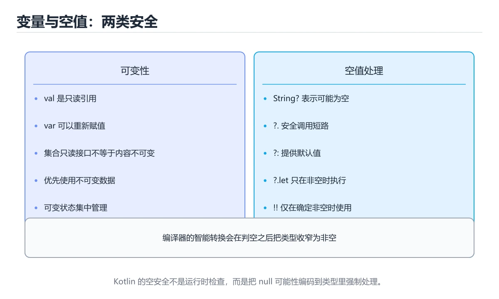
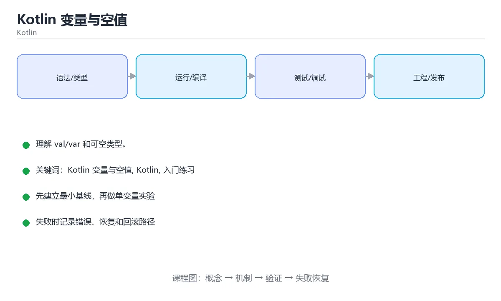

# Kotlin 变量与空值

> 内容更新时间：2026-10-06 · 学习阶段：入门 · 预计用时：30 分钟





## 本节知识框架

**课程定位**：所属分类 `kotlin`（Kotlin），课程主题 `Kotlin 变量与空值`，学习阶段 入门，建议用时 50 分钟。

本课主线：理解 val/var 和可空类型。

**学完本课应当能够**
- 说清 `val 与 var` 与 `类型推断` 的含义与区别，并各举一个正例和一个反例。
- 用本课示例验证 `可空类型` 的行为，记录输入、输出与失败条件。
- 遇到「到处使用非空断言」这类问题时，能说出触发条件与修复顺序。

### 复习清单

- [ ] 能不看正文复述本课核心术语，并指出一个边界或反例。
- [ ] 能运行或推演本课示例，记录输入、输出与失败现象。
- [ ] 能完成一次自测，并把错题对照错误表定位原因。

## 核心概念定义

| 术语 | 操作性定义 | 常见边界与风险 |
| --- | --- | --- |
| val 与 var | val 只能赋值一次，var 可以重新赋值，优先用 val。 | 只在「val 只能赋值一次，var 可以重新赋值，优先用 val」这一前提下成立，换输入或换环境要重新验证。 |
| 类型推断 | 编译器根据初值推断类型，也可以显式写出类型注解。 | 静态检查只在编译期成立，运行期输入仍需校验。 |
| 可空类型 | 在类型后加 ?，如 String?，表示这个变量可能为 null。 | 静态检查只在编译期成立，运行期输入仍需校验。 |
| Kotlin | 运行于 JVM 等平台、强调空安全与简洁语法的现代编程语言。 | 权限与密钥策略变化会让结论失效，按最小权限并用真实凭据流程复验。 |
| 函数 | Kotlin 函数是表达式，单表达式函数可以省略花括号和 return | 只在「Kotlin 函数是表达式，单表达式函数可以省略花括号和 return」这一前提下成立，换输入或换环境要重新验证。 |
| 集合 | 集合操作 map、filter、groupBy、associate 返回新集合，序列 Sequence 适合大数据惰性处理 | 易错：遍历时出现空值异常；正确做法是先过滤空值或逐个显式处理。 |
| 编译构建 | kotlinc / Gradle | 只在「kotlinc / Gradle」这一前提下成立，换输入或换环境要重新验证。 |
| 测试 | JUnit + coroutines-test | 只在「JUnit + coroutines-test」这一前提下成立，换输入或换环境要重新验证。 |
| 静态检查 | detekt / ktlint | 只在「detekt / ktlint」这一前提下成立，换输入或换环境要重新验证。 |
| 发布 | R8/ProGuard + App Bundle | 只在「R8/ProGuard + App Bundle」这一前提下成立，换输入或换环境要重新验证。 |
| 核心结论 | val 声明不可变引用、var 声明可变变量；类型后面加问号表示可空，使用前必须先处理 null。 | 静态检查只在编译期成立，运行期输入仍需校验。 |
| 最少要写的代码 | `fun main() {` | 只在「`fun main() {`」这一前提下成立，换输入或换环境要重新验证。 |
| 正确做法 | name、age、height 依次绑定，nickname 绑定为 null。 | 只在「name、age、height 依次绑定，nickname 绑定为 null」这一前提下成立，换输入或换环境要重新验证。 |
| 最常见的错误 | 用双叹号强行解包可空值：为 null 时抛 NullPointerException，等于放弃 Kotlin 的保护。 | 只在「用双叹号强行解包可空值：为 null 时抛 NullPointerException，等于放弃 Kotlin 的保护」这一前提下成立，换输入或换环境要重新验证。 |
| 出错先查什么 | 先读第一条报错信息，再回到最小示例只改一个地方 | 只在「先读第一条报错信息，再回到最小示例只改一个地方」这一前提下成立，换输入或换环境要重新验证。 |
| 怎么确认学会了 | 把 val 改成 var 再尝试重新赋值，观察两种声明方式的差异。 | 只在「把 val 改成 var 再尝试重新赋值，观察两种声明方式的差异」这一前提下成立，换输入或换环境要重新验证。 |
| 和别的知识点的关系 | 本课打下的语法与思维方式会被后面每一课反复用到 | 只在「本课打下的语法与思维方式会被后面每一课反复用到」这一前提下成立，换输入或换环境要重新验证。 |
| 接下来做什么 | 合上教程，凭记忆把上面的最小代码重写一遍再运行 | 只在「合上教程，凭记忆把上面的最小代码重写一遍再运行」这一前提下成立，换输入或换环境要重新验证。 |

## 原理与运行机制

### 机制总览

**教材衔接：一句话入门**

理解 val/var 和可空类型。

**教材衔接：Kotlin 基础机制速览**

### JVM、Android 与工具链

Kotlin 主要编译成 JVM 字节码，也可以编译成 JavaScript 或原生代码。Android 开发常用 Gradle 构建，Kotlin 与 Java 可以互操作：Kotlin 调用 Java 时要注意平台类型可能为空，Java 调用 Kotlin 时要注意默认参数、扩展函数和顶层函数的生成方式。理解编译目标和互操作边界，能解释很多“本地能跑、发布变慢或崩溃”的问题。

### val/var、类型与空安全

`val` 是只读引用，`var` 是可重新赋值的引用；只读引用指向的对象内容仍可能可变。Kotlin 区分可空类型 `T?` 和非空类型 `T`，编译器要求使用安全调用 `?.`、Elvis 运算符 `?:`、非空断言 `!!` 或智能转换处理空值。`lateinit` 适合生命周期保证会初始化的 var，`by lazy` 适合第一次访问时初始化；两者都不能滥用。

### 函数、表达式与数据类

Kotlin 函数是表达式，单表达式函数可以省略花括号和 return。默认参数、命名参数、扩展函数和顶层函数减少工具类的数量。`data class` 自动生成 equals、hashCode、toString 和 copy，适合值对象；`sealed class` 和 sealed interface 表达有限的互斥状态，配合 when 可以做穷尽检查。高阶函数和 lambda 让集合操作更简洁，但要注意内联与分配成本。

### 集合、泛型与作用域函数

`List`、`Set`、`Map` 默认只读接口，`MutableList` 等提供修改操作。集合操作 `map`、`filter`、`groupBy`、`associate` 返回新集合，序列 Sequence 适合大数据惰性处理。泛型通过 `out` 和 `in` 表达协变与逆变，类型投影处理更复杂的使用位置。`let`、`run`、`with`、`apply`、`also` 的作用域和返回值不同，应根据“访问对象、配置对象还是返回结果”选择。

### 协程、异常与测试

协程用 suspend 函数表达可暂停的异步计算，CoroutineScope 决定生命周期，Dispatcher 决定运行线程，Job 支持取消和结构化并发。不要使用 GlobalScope 泄漏任务，异常传播和取消需要按层级处理。Kotlin 没有受检异常，资源应使用 `use` 自动关闭。测试要覆盖空值、集合边界、协程取消和线程切换，不能只验证 happy path。

**教材衔接：版本与时效**

- 版本提示：Kotlin 变量与空值 的行为在最近几个大版本里有过调整，升级「Kotlin 变量与空值」前先用 length 复现当前输出，再对照官方发布说明逐条核对。
- 升级前确认 Kotlin 变量与空值 的兼容范围，把不可回退的改动单独拆成一次提交。
- 显式 API 模式与多平台源集是团队协作时的重点
- 官方说明：https://kotlinlang.org/docs/releases.html

## 典型应用场景

**课程内置实验入口**：`sandbox:kotlin`，用于动手验证《Kotlin 变量与空值》的机制；实验结论不替代概念定义与复杂度分析。

**教材衔接：代码实验：把示例跑成证据**

### 实验一：建立基线

```kotlin
fun main() {
    val name: String? = "Ada"
    println(name?.length ?: 0)
}
```

### 实验二：只改一个输入

沿用「Kotlin 变量与空值」的最小示例做一次单变量实验：

做完后用一句话写出「Kotlin 变量与空值」的结论：输入怎么变，结果才怎么变。

### 实验三：制造一个可控错误

删掉 Kotlin 相关的一处必要写法，观察错误在哪一层出现，再恢复代码确认基线仍然可运行。

### 实验四：用三句话复述

1. 先写清 Kotlin 变量与空值 的输入契约：类型、范围、缺省值与非法值分别怎么处理？
2. 在 代码实验：把示例跑成证据 里，Kotlin 的状态是在什么条件下被改变的？
3. 输出如何验证，失败时第一条可观察证据是什么？

- **到处使用非空断言**：典型现象是运行期空指针异常；正确做法是用安全调用与默认值替代断言。
- **集合元素可空却没处理**：典型现象是遍历时出现空值异常；正确做法是先过滤空值或逐个显式处理。
- **可空性只写在实现里**：典型现象是调用方无法感知；正确做法是在接口签名中声明可空性。

### 最小验证场景

- 准备：保留 `kotlin` 示例的原始输入，先记录 `Kotlin 变量与空值` 的基线输出和完整运行命令。
- 观察：先核对 调用了 `main()`，再改变一个与 `val 与 var` 相关的条件。
- 判定：新结果与 `Kotlin 变量与空值` 的基线不同不等于错误；只有当差异破坏了 `val 与 var` 的定义或错误表中的约束，才判定为失败。

### 选择与边界

- 使用 `val 与 var` 时，先满足它的定义：val 只能赋值一次，var 可以重新赋值，优先用 val；只在「val 只能赋值一次，var 可以重新赋值，优先用 val」这一前提下成立，换输入或换环境要重新验证。
- 使用 `类型推断` 时，先满足它的定义：编译器根据初值推断类型，也可以显式写出类型注解；静态检查只在编译期成立，运行期输入仍需校验。
- 使用 `可空类型` 时，先满足它的定义：在类型后加 ?，如 String?，表示这个变量可能为 null；静态检查只在编译期成立，运行期输入仍需校验。
- 使用 `Kotlin` 时，先满足它的定义：运行于 JVM 等平台、强调空安全与简洁语法的现代编程语言；权限与密钥策略变化会让结论失效，按最小权限并用真实凭据流程复验。
- 使用 `函数` 时，先满足它的定义：Kotlin 函数是表达式，单表达式函数可以省略花括号和 return；只在「Kotlin 函数是表达式，单表达式函数可以省略花括号和 return」这一前提下成立，换输入或换环境要重新验证。

## 代码/协议/SQL 示例

### 最小可验证示例

**教材衔接：最小示例**

**教材衔接：预期输出**

```text
3
```

**运行方式**：运行 `Kotlin 变量与空值` 的示例时，用 `kotlinc` 编译或用 Gradle 任务运行；注意 JVM 目标版本。

## 时间/空间复杂度或性能分析

**性能关注点（Kotlin 变量与空值）**：JVM 与协程调度影响开销：记录吞吐、延迟与调度器线程占用。

**本课特有开销（Kotlin 变量与空值 · Kotlin 变量与空值）**：小文件看元数据开销，大文件看吞吐，两者要分别测量。

**测量方法**：以 `Kotlin 变量与空值` 的 `Kotlin 变量与空值` 场景为对象，固定输入跑一遍记录基线，再把规模或并发度提高一个数量级复测；两次结果的差值与波动范围才是结论依据。

## 常见误区与易错点

| 容易写错的做法 | 实际现象 | 原因与正确做法 |
| --- | --- | --- |
| 到处使用非空断言 | 运行期空指针异常。 | 用安全调用与默认值替代断言。 |
| 集合元素可空却没处理 | 遍历时出现空值异常。 | 先过滤空值或逐个显式处理。 |
| 可空性只写在实现里 | 调用方无法感知。 | 在接口签名中声明可空性。 |

### 现场 1：到处使用非空断言

**症状**：运行期空指针异常。

**根因与修复**：用安全调用与默认值替代断言。

**自检**：在本课示例里复现「到处使用非空断言」，改成用安全调用与默认值替代断言后重跑；如果症状消失且失败路径按预期变化，说明定位正确。

### 现场 2：集合元素可空却没处理

**症状**：遍历时出现空值异常。

**根因与修复**：先过滤空值或逐个显式处理。

**自检**：在本课示例里复现「集合元素可空却没处理」，改成先过滤空值或逐个显式处理后重跑；如果症状消失且失败路径按预期变化，说明定位正确。

### 现场 3：可空性只写在实现里

**症状**：调用方无法感知。

**根因与修复**：在接口签名中声明可空性。

**自检**：在本课示例里复现「可空性只写在实现里」，改成在接口签名中声明可空性后重跑；如果症状消失且失败路径按预期变化，说明定位正确。

## 与其他知识点的关系

**教材衔接：复习与迁移**

## 自测题与参考答案

> 先独立作答，再对照参考答案；答案都能在本课正文、术语表或错误表里找到依据。

### 自测 1（概念复述）

不看正文，写出 `val 与 var` 的操作性定义，并说明它与 `类型推断` 的区别。

**参考答案**：val 只能赋值一次，var 可以重新赋值，优先用 val。

`类型推断` 的定位是：编译器根据初值推断类型，也可以显式写出类型注解；两者的差别要从适用对象与失败模式上说明。

### 自测 2（排错）

本课错误表记录了「到处使用非空断言」这类做法。请写出它会出现的现象、根因，以及修复顺序。

**参考答案**：现象是运行期空指针异常；正确做法是用安全调用与默认值替代断言。修复时先复现现象并保留证据，再改动一处假设重跑，确认现象消失。

### 自测 3（动手验证）

运行本课的 `kotlin` 示例，把其中的 `"小明"` 换成一个边界值后重新运行，记录输出与错误信息。

**参考答案**：正常输入下 `kotlin` 示例应当复现正文给出的结果；把 `"小明"` 换成边界值后，如果结果改变或报错，先核对它是否满足 `Kotlin 变量与空值` 中`val 与 var` 的适用范围，再检查错误表里是否有同类现象。

### 自测 4（代码阅读）

阅读本课开头的 `kotlin` 示例，说明它体现了`val 与 var` 的哪一条性质，并指出改动哪个输入会让这条性质不再成立。

**参考答案**：`val 与 var` 的定义是 val 只能赋值一次，var 可以重新赋值，优先用 val，示例正是在实现这条定义。改动与 `val 与 var` 有关的一个输入后，如果结果不再符合 `Kotlin 变量与空值` 的正文描述，就说明该性质只在当前前提成立。

### 自测 5（迁移）

把 `Kotlin 变量与空值` 的方法迁移到自己的项目：围绕 `val 与 var` 写出一个与错误表同类的风险点，并说明触发条件和检验方式。

**参考答案**：例如「可空性只写在实现里」，它会导致调用方无法感知；检验方式是按在接口签名中声明可空性改一处再复现，确认现象消失且没有引入新的失败分支。

### 自测 6（对比）

用一个表格对比 `val 与 var` 与 `类型推断`：各写一行适用场景、一行失败表现。

**参考答案**：`val 与 var` 的定义是val 只能赋值一次，var 可以重新赋值，优先用 val；`类型推断` 的定义是编译器根据初值推断类型，也可以显式写出类型注解。两者的失败表现分别对应本课错误表里与本术语相关的行。

### 自测 7（排错顺序）

面对「到处使用非空断言」引发的问题，请把“复现 运行期空指针异常 → 保留证据 → 用安全调用与默认值替代断言 → 回归验证”四步写成可执行的检查清单。

**参考答案**：第一步按运行期空指针异常复现；第二步记录输入、版本与完整报错；第三步按用安全调用与默认值替代断言只改一处；第四步重跑并确认失败路径也按预期变化。

### 自测 8（边界判断）

针对 `集合`，分别写出“可以使用”的条件和“结论不再成立”的条件。

**参考答案**：易错：遍历时出现空值异常；正确做法是先过滤空值或逐个显式处理。 同时要把 `集合` 的定义 集合操作 map、filter、groupBy、associate 返回新集合，序列 Sequence 适合大数据惰性处理 与实际输入逐项对照。

### 自测 9（机制重建）

不看正文，按输入、转换、输出、验证四段重建 `val 与 var` → `类型推断` → `可空类型` → `Kotlin` 的作用链。

**参考答案**：起点是 `val 与 var` 的定义 val 只能赋值一次，var 可以重新赋值，优先用 val；中间每一步都保留可观察状态；终点由 `集合` 检查，失败时回到错误表定位第一个偏离定义的步骤。

### 自测 10（综合排错）

在 `Kotlin 变量与空值` 中，现象是 调用方无法感知。请围绕 可空性只写在实现里 写出最小复现、关键证据、修复动作和回归验证，并说明为什么不能只凭一次运行下结论。

**参考答案**：先复现 可空性只写在实现里，记录输入与完整错误；再按 在接口签名中声明可空性 只改一处。回归时同时跑正常路径和边界路径，只有两次结果都可解释，才把修复视为完成。

### 自测 11（一分钟复述）

用每分钟约 200 字的速度复述 `Kotlin 变量与空值`：先给主问题，再按顺序说出 `val 与 var`、`类型推断`、`可空类型`、`Kotlin`，最后给一个失败案例。

**自评标准**：主问题必须对应 理解 val/var 和可空类型；每个术语都要能接上一句定义或边界；失败案例必须写成可观察现象，不能用“可能有风险”代替证据。

## 术语速查

| 术语 | 一句话说明 |
| --- | --- |
| `val 与 var` | val 只能赋值一次，var 可以重新赋值，优先用 val。 |
| `类型推断` | 编译器根据初值推断类型，也可以显式写出类型注解。 |
| `可空类型` | 在类型后加 ?，如 String?，表示这个变量可能为 null。 |
| `Kotlin` | 运行于 JVM 等平台、强调空安全与简洁语法的现代编程语言。 |
| `函数` | Kotlin 函数是表达式，单表达式函数可以省略花括号和 return。 |
| `集合` | 集合操作 map、filter、groupBy、associate 返回新集合，序列 Sequence 适合大数据惰性处理。 |

**术语关系**：`val 与 var`（val 只能赋值一次） → `类型推断`（编译器根据初值推断类型） → `可空类型`（在类型后加 ?） → `Kotlin`（运行于 JVM 等平台、强调空安全与简洁语法的现代编程语言）。

## 考点精讲

`Kotlin 变量与空值` 的题库有 5 道题，下面逐题给出题干、正确项与判断依据：先自己作答，再核对正确项，最后回到正文对应小节复核。

### 考点 1：第 1 题

- **题目**：围绕“Kotlin 变量与空值”中的 Kotlin 变量与空值、Kotlin、入门练习，下列哪两项是本课强调的实践判断？
- **正确项**：学习 Kotlin 变量与空值 时要同时说明输入、输出和失败路径，不能只看正常流程；验证 Kotlin 时要固定版本并覆盖边界输入，结论才可复现
- **判断依据**：这道题落在术语 `Kotlin` 上：运行于 JVM 等平台、强调空安全与简洁语法的现代编程语言。复习时把 `Kotlin` 的定义、适用边界和一个反例一起说清楚，再回到「核心概念定义」核对原文。

### 考点 2：第 2 题

- **题目**：表达式 name?.length ?: 0 的求值过程是？
- **正确项**：name 非空时取其长度，为 null 时整个表达式取 0
- **判断依据**：这道题检验本课主问题：理解 val/var 和可空类型。复习时先复述本课主问题，再举一个会让结论失效的输入。

### 考点 3：第 3 题

- **题目**：下面这段 `kotlin` 代码来自 `Kotlin 变量与空值`。课程主线是理解 val/var 和可空类型。代码与 `val 与 var` 有关。哪一项是代码里真实出现的内容？
- **正确项**：出现字面量 `昵称长度：`
- **判断依据**：这道题落在术语 `val 与 var` 上：val 只能赋值一次，var 可以重新赋值，优先用 val。复习时把 `val 与 var` 的定义、适用边界和一个反例一起说清楚，再回到「核心概念定义」核对原文。

### 考点 4：第 4 题

- **题目**：为什么 Kotlin 中很少需要写 null 检查，但仍要关注空值？
- **正确项**：类型系统强制区分可空与非空，但平台类型仍可能引入 null
- **判断依据**：这道题落在术语 `Kotlin` 上：运行于 JVM 等平台、强调空安全与简洁语法的现代编程语言。复习时把 `Kotlin` 的定义、适用边界和一个反例一起说清楚，再回到「核心概念定义」核对原文。

### 考点 5：第 5 题

- **题目**：填空：补齐下面这段术语说明中的空缺。课程 `理解 val/var 和可空类型。`，这段说明是：Kotlin `____`是表达式，单表达式`____`可以省略花括号和 return。空缺处应填哪个术语？
- **正确项**：函数
- **判断依据**：这道题落在术语 `可空类型` 上：在类型后加 ?，如 String?，表示这个变量可能为 null。复习时把 `可空类型` 的定义、适用边界和一个反例一起说清楚，再回到「核心概念定义」核对原文。

### 考点 6：`val 与 var`

- **要点**：val 只能赋值一次，var 可以重新赋值，优先用 val。
- **val 与 var 的边界**：只在「val 只能赋值一次，var 可以重新赋值，优先用 val」这一前提下成立，换输入或换环境要重新验证。

### 考点 7：`类型推断`

- **要点**：编译器根据初值推断类型，也可以显式写出类型注解。
- **类型推断 的边界**：静态检查只在编译期成立，运行期输入仍需校验。

### 考点 8：`可空类型`

- **要点**：在类型后加 ?，如 String?，表示这个变量可能为 null。
- **可空类型 的边界**：静态检查只在编译期成立，运行期输入仍需校验。

### 考点 9：`Kotlin`

- **要点**：运行于 JVM 等平台、强调空安全与简洁语法的现代编程语言。
- **Kotlin 的边界**：权限与密钥策略变化会让结论失效，按最小权限并用真实凭据流程复验。

### 考点 10：`函数`

- **要点**：Kotlin 函数是表达式，单表达式函数可以省略花括号和 return
- **函数 的边界**：只在「Kotlin 函数是表达式，单表达式函数可以省略花括号和 return」这一前提下成立，换输入或换环境要重新验证。

### 考点 11：`集合`

- **要点**：集合操作 map、filter、groupBy、associate 返回新集合，序列 Sequence 适合大数据惰性处理
- **集合 的边界**：易错：遍历时出现空值异常；正确做法是先过滤空值或逐个显式处理。

### 考点 12：排错——到处使用非空断言

- **现象**：运行期空指针异常。
- **处理**：用安全调用与默认值替代断言。

### 考点 13：排错——集合元素可空却没处理

- **现象**：遍历时出现空值异常。
- **处理**：先过滤空值或逐个显式处理。

### 考点 14：综合辨析——`val 与 var` 与 `集合`

- **辨析点**：`val 与 var` 的定义是 val 只能赋值一次，var 可以重新赋值，优先用 val；`集合` 的定义是 集合操作 map、filter、groupBy、associate 返回新集合，序列 Sequence 适合大数据惰性处理。
- **答题要求**：面对 `Kotlin 变量与空值` 的题目，先判断描述的是 `val 与 var` 还是 `集合`，再归到对应定义，最后写出一个会让该定义失效的边界输入。

### 考点 15：排错评分点

- **现象分**：能写出 运行期空指针异常，而不是只写“程序有错”。
- **证据分**：保留触发 到处使用非空断言 的输入、版本和错误原文。
- **修复分**：按 用安全调用与默认值替代断言 只改一处，并同时回归正常路径与边界路径。

## 内容元数据

- 内容版本：v2.0
- 最后更新：2026-10-06
- 学习阶段：入门
- 适用环境：Kotlin 2.x / Android SDK；本课聚焦 Kotlin 变量与空值。
- 内容来源：内置结构化课程与工程实践整理
- 相关主题：Kotlin 变量与空值、Kotlin、入门练习
- 质量版本：P0 测验标准 + P1 覆盖扩展 + P2 体验补全

## 参考资料与复核

- [本课资料锚点 kotlin_variables_null](https://zh.wikipedia.org/w/index.php?search=kotlin_variables_null)

- 最后复核：2026-10-04
- 下次复核：2026-11-10
- 复核范围：版本兼容、API 行为、安全建议与工程实践
- 来源性质：官方文档、标准或权威教材；本课核对关键词：Kotlin 变量与空值、Kotlin、入门练习。

| 参考资料 | 本课用途 |
| --- | --- |
| [Kotlin 基础语法](https://kotlinlang.org/docs/basic-syntax.html) | 语法、类型与函数 |
| [Android 架构指南](https://developer.android.com/topic/architecture) | 分层、状态与生命周期 |
| [Kotlin Serialization](https://kotlinlang.org/docs/serialization.html) | 序列化与数据模型 |

| [本课术语索引：Kotlin 变量与空值](#核心概念定义) | 按本课输入、术语边界和错误表现逐项核对 |
> 「Kotlin 变量与空值」的链接用于离线阅读后的延伸核对；App 不会自动联网。