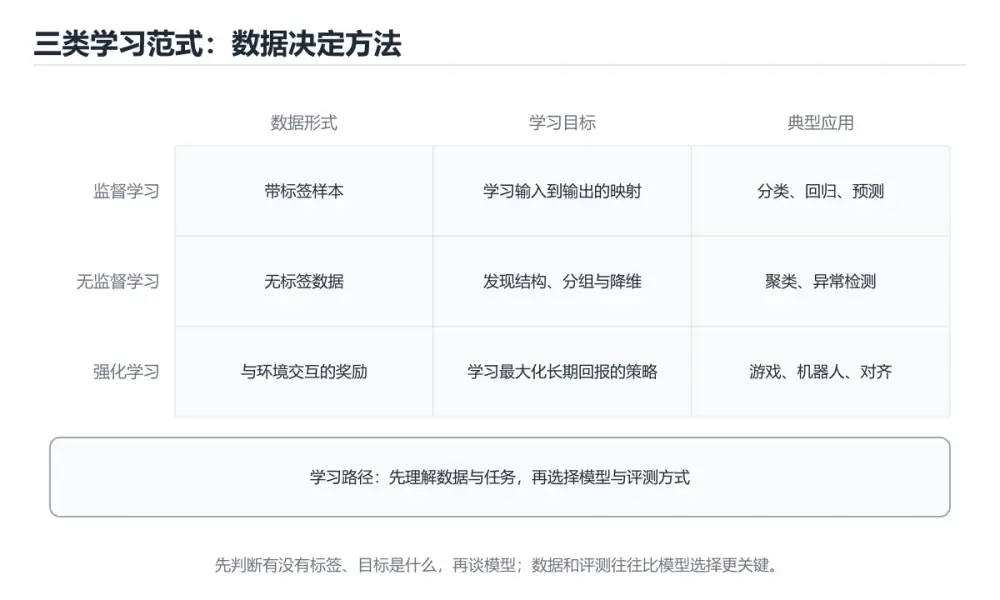

# RAG 检索增强生成基础



> 内容更新时间：2026-10-06 · 学习阶段：应用 · 预计用时：50 分钟

## 本节知识框架

**课程定位**：所属分类 `llm_apps`（LLM 应用开发），课程主题 `RAG 检索增强生成基础`，学习阶段 应用，建议用时 50 分钟。

本课主线：沿「切分—嵌入—入库—检索—精排—生成」六步链路展开，讲清分块策略如何决定召回粒度、Embedding 如何选型、五类向量库的取舍、稀疏与稠密两条检索路如何融合，以及 Rerank 为什么是收益最稳定的一步。

**学完本课应当能够**

- 针对给定文档形态设计 `分块策略`，说明块长、重叠与结构边界三个参数的取值理由。
- 用 `Recall@K` 与 `MRR` 在自有语料上完成 `Embedding` 选型，并解释为何不能只看公开榜单。
- 搭出 `混合检索` 加 `Rerank` 的两段式召回，指出每段各自解决哪一类漏召。

### 复习清单

- [ ] 能不看正文复述六步链路各自的关键参数，并说出哪一步最先影响最终答案质量。
- [ ] 能写出一份中文客服语料的召回评测脚本骨架，标出需要人工标注的条数。
- [ ] 能完成一次对照实验：仅向量、仅 BM25、混合加精排三种配置各跑同一问题集，记录命中差异。

## 核心概念定义

| 术语 | 操作性定义 | 常见边界与风险 |
| --- | --- | --- |
| 分块 | 把长文档切成可独立检索的片段，边界尽量落在语义单元上。 | 易错：块越小召回越准，过小的块丢失上下文，模型读不懂。 |
| 块重叠 | 相邻块之间共享的一段文字，用于避免关键句被切断。 | 易错：重叠越大越好，重叠直接放大索引体积与输入 Token。 |
| Embedding | 把文本映射为固定维度向量，使语义相近的文本距离更近。 | 易错：向量维度越高效果越好，维度还带来存储与计算成本。 |
| 向量库 | 存储向量并支持近似最近邻检索的专用存储组件。 | 易错：向量库只负责相似度，权限过滤要靠元数据字段配合。 |
| BM25 | 基于词频与逆文档频率的稀疏检索打分函数，擅长精确词匹配。 | 易错：BM25 是「老技术」，在专有名词与型号检索上仍常胜过向量。 |
| 混合检索 | 稀疏与稠密两路各自召回后按分数或排名融合的策略。 | 易错：两路分数不可直接相加，需要先归一化或用排名融合。 |
| Rerank | 用交叉编码器对候选片段逐条与问题联合打分，做二次精排。 | 易错：精排能救回排序错误但救不回根本没召回的证据。 |
| Recall@K | 前 K 个候选里包含正确证据的问题占比，检索阶段的主指标。 | 易错：只看最终答案质量，无法定位问题出在检索还是生成。 |

## 原理与运行机制

### 机制总览：召回质量决定答案上限

检索增强系统有一条硬上界：模型只能基于送进上下文的内容作答。检索没召回证据时，再强的模型也只能靠猜。因此链路里每一步都在优化同一个量——把真正有用的片段稳定排进前几名。

**教材衔接：分块的三种边界策略**

| 策略 | 适用文档 | 优点 | 代价 |
| --- | --- | --- | --- |
| 固定长度加重叠 | 结构松散的长文本 | 实现简单、块长可控 | 常把句子和表格切一半 |
| 递归分隔符切分 | Markdown、HTML、带标题层级的制度文件 | 尊重标题与段落层级 | 块长分布不均 |
| 语义单元切分 | 含表格、代码、条款编号的规范文档 | 保留结构，表格可被读通 | 需要解析器与规则维护 |

```python
def split_by_heading(text: str, max_chars: int = 800) -> list[dict]:
    blocks, current, title = [], [], '开篇'
    for line in text.splitlines():
        if line.startswith('#'):
            if current:
                blocks.append({'title': title, 'text': '\n'.join(current)[:max_chars]})
            title, current = line.lstrip('# ').strip(), []
        else:
            current.append(line)
    if current:
        blocks.append({'title': title, 'text': '\n'.join(current)[:max_chars]})
    return blocks

chunks = split_by_heading(open('handbook.md', encoding='utf-8').read())
print(len(chunks), chunks[0]['title'])
```

**教材衔接：Embedding 选型要点**

| 考量维度 | 建议做法 | 反面做法 |
| --- | --- | --- |
| 语言覆盖 | 用自有中文语料标注几百条问答实测 Recall@K | 只看公开榜单名次 |
| 向量维度 | 平衡召回与存储，必要时用降维或二进制量化 | 默认选最高维 |
| 最大输入长度 | 与分块长度对齐，避免长块被静默截断 | 块长超过模型上限 |
| 部署形态 | 内部数据评估是否允许调用外部嵌入端点 | 把敏感文档送公网嵌入 |
| 版本一致性 | 换模型必须全量重建索引 | 新旧向量混在同一集合 |

**教材衔接：五类向量存储的取舍**

| 方案 | 定位 | 优势 | 需要注意 |
| --- | --- | --- | --- |
| Chroma | 本地原型与小型知识库 | 起得快、API 简洁 | 大规模与高并发不是目标场景 |
| FAISS | 进程内索引库 | 检索速度极快、索引类型丰富 | 只提供索引，需自建服务与元数据管理 |
| Milvus | 分布式向量数据库 | 水平扩展、多副本、生产级 | 运维组件多，小项目过重 |
| pgvector | 关系库扩展 | 与业务表同库同事务，过滤直观 | 超大规模下索引性能弱于专用库 |
| Qdrant | 专用向量库，过滤表达力强 | 载荷过滤与向量检索一体 | 需要独立部署与备份策略 |

**教材衔接：混合检索与排名融合**

稀疏与稠密分数量纲不同，稳妥做法是用倒数排名融合，把两路的排名而不是分数合起来，再交给精排。

```python
def rrf(dense: list[str], sparse: list[str], k: int = 60) -> list[tuple[str, float]]:
    score: dict[str, float] = {}
    for ranks in (dense, sparse):
        for pos, doc_id in enumerate(ranks, start=1):
            score[doc_id] = score.get(doc_id, 0.0) + 1.0 / (k + pos)
    return sorted(score.items(), key=lambda item: item[1], reverse=True)

top = rrf(['d3', 'd1', 'd9'], ['d1', 'd7', 'd3'])
print(top[0][0])
```

**教材衔接：精排的输入结构**

交叉编码器把「问题加候选片段」拼成一个输入再打分，因此精度高于只比较向量的粗排，代价是每条候选都要一次前向计算，所以只能用于候选集从数百降到数十之后的第二步。

```python
def retrieve(query: str, top_k: int = 8) -> list[dict]:
    dense = vector_search(query, top_k=60)
    sparse = bm25_search(query, top_k=60)
    fused = rrf([d['id'] for d in dense], [d['id'] for d in sparse])[:30]
    ranked = rerank(query, [get_doc(i) for i, _ in fused])   # 交叉编码器精排
    return ranked[:top_k]
```

## 典型应用场景

| 场景 | 典型输入或前提 | 期望产物 |
| --- | --- | --- |
| 制度问答 | 数百份带标题层级的 PDF 制度文件 | 带条款引用的分段答案 |
| 代码库问答 | 仓库源码与注释，符号名密集 | 精确匹配符号加语义相似实现 |
| 工单历史检索 | 口语化提问，历史工单含专有型号 | 混合召回避免型号漏检 |
| 产品手册助手 | 长表格参数对比 | 保留表头的结构化块与答案 |

- 典型现象：换 Embedding 后答案更差。正确做法：先查 Recall@K 是否退化，再调分块，一次只改一个变量。
- 典型现象：检索命中但答案仍错。正确做法：把命中片段是否进入上下文、是否排在前列分开统计，问题常在拼接顺序。
- 典型现象：上线后成本暴涨。正确做法：召回条数从十条降到三条并加精排，输入 Token 常可减半而质量不降。

### 最小验证场景

- 准备：标注 80 条真实问答的「正确证据所在块编号」，固定分块结果不随实验变化。
- 观察：四种配置各自的 Recall@1、Recall@5 与平均输入 Token 数。
- 判定：混合检索的 Recall@5 至少比单一路高五个百分点，且精排后 Recall@1 明显提升，才认定两段式有价值。

## 代码/协议/SQL 示例

**教材衔接：带元数据过滤的向量检索**

生产检索几乎都要先做权限过滤。把部门、生效日期与版本写进载荷字段，检索时一次性带上条件，避免召回越权内容。

```python
import chromadb

client = chromadb.PersistentClient(path='./kb')
col = client.get_or_create_collection('policy', metadata={'hnsw:space': 'cosine'})

def search(question: str, emb: list[float], dept: str, top_k: int = 5):
    return col.query(query_embeddings=[emb],
                     n_results=top_k,
                     where={'department': dept},
                     where_document={'$contains': '试用期'})
```

**教材衔接：用 SQL 监控召回质量**

每次线上问答都可以记下候选编号与最终是否被采纳，一张表就能持续产出召回诊断数据。

```sql
SELECT substring(q_hash from 1 for 8)        AS qbucket,
       AVG(CASE WHEN cited THEN 1.0 ELSE 0 END) AS cite_rate,
       AVG(candidate_count)                  AS avg_candidates
FROM retrieval_log
WHERE ts >= now() - INTERVAL '3 day'
GROUP BY qbucket
ORDER BY cite_rate ASC;
```

错误表现：新旧 Embedding 模型产生的向量混在同一集合里，相似度计算完全失真。

```python
col.add(ids=ids, embeddings=old_model.encode(texts))   # 索引未重建就换模型
```

正确写法：换嵌入模型时全量重建，用别名切换集合，保证一次查询只用一种向量空间。

```python
new_col = client.create_collection('policy_v2', metadata={'hnsw:space': 'cosine'})
rebuild(new_col, docs)          # 全量重嵌入
alias.switch('policy_active', 'policy_v2')   # 原子切换，回滚只改别名
```

## 时间/空间复杂度或性能分析

| 环节 | 时间复杂度量级 | 空间 | 主要瓶颈 |
| --- | --- | --- | --- |
| 嵌入推理 | 与块数乘序列长度成正比 | 模型常驻显存 | 摄取批次的吞吐 |
| 向量近似检索 | 亚线性，取决于索引类型与候选规模 | 向量数组加索引结构 | 维度与副本数 |
| 稀疏检索 | 与倒排链长度相关 | 词表加倒排表 | 高频词候选爆炸 |
| 精排 | 与候选条数线性相关 | 交叉编码器激活 | 单次前向耗时 |
| 生成 | 与上下文长度线性相关 | 服务端 KV 占用 | 输入 Token 越多越贵 |

检索链路的时延结构通常是「粗排快、精排贵、生成最贵」。工程上把候选数逐级收窄——两路各取六十、融合取三十、精排取八、进上下文三到五条——每级都在用便宜的计算换更贵的 token 预算。

索引类型决定召回与速度的折中。扁平暴力检索召回接近百分之百但耗时随规模线性增长，适合十万级以下；HNSW 在百万级上把查询压到毫秒级，代价是内存占用高、构建慢；IVF 系列省内存但需要调簇数与探测簇数。选型前必须先给出数据规模与可接受时延两个数。

空间成本里最容易被低估的是重复存储。同一份文本往往同时存在原文、切分块、稀疏倒排与稠密向量，再乘以副本数，实际占用可达原始语料的数倍。二进制量化能把向量压到原尺寸的几十分之一，但要重新验证召回损失是否在可接受范围。

## 常见误区与易错点

- **认为分块越细越好。** 块小到丢失上下文时，模型即使召回也读不懂。
- **只调块长不调重叠。** 关键句被切断时，加长重叠往往比改块长更有效。
- **用公开榜单直接选型。** 领域与语言分布不匹配时榜单几乎没有预测力。
- **把两路分数直接相加。** 量纲不同会让某一路完全主导，应归一化或用排名融合。
- **指望精排救回漏召。** 交叉编码器只重排已送进的候选，没进候选集的证据无法挽回。
- **换嵌入模型不重建索引。** 新旧向量空间不可比，结果是相似度莫名失真。
- **忽略权限过滤。** 只按相似度召回会把越权文档送进上下文，属于安全事故。
- **把检索与生成混成一个指标。** 不做分层度量就无法判断该优化哪一段。
- **只看答案不看引用。** 没有引用可核查，答案正确也可能只是猜对。
- **一次改多个参数。** 分块、嵌入、召回数同时变，评测结论不可归因。

## 与其他知识点的关系

**教材衔接：与后续课程的衔接点**

本课给出可上线的基础链路，进阶课在此之上叠加图结构与层次摘要，Agent 课把检索当成一个工具来调用，框架课提供现成组件。

- 为 `llm_apps_rag_advanced` 提供分块、嵌入与召回指标的基础度量口径。
- 与 `llm_apps_function_calling` 结合，把检索封装成一个可被模型调用的工具。
- 复用 `ai_embeddings_rag` 的嵌入原理与相似度度量，本课聚焦工程参数。
- 与 `llm_apps_evaluation` 共用 Recall@K 与忠实度指标，形成检索侧回归。
- 依赖 `database_indexing` 类知识理解 HNSW 与 IVF 索引的取舍。

| 关联课程 ID | 关联主题 | 关系说明 |
| --- | --- | --- |
| ai_embeddings_rag | 嵌入与检索增强 | 提供向量空间与相似度的原理基础，本课补齐工程参数与选型 |
| llm_apps_rag_advanced | RAG 进阶 | 在混合检索之上引入图结构与层次摘要，解决多跳与全局问题 |
| llm_apps_frameworks | 框架实战 | LangChain 与 LlamaIndex 把本课每一步封装成可插拔组件 |
| llm_apps_evaluation | 评估与监控 | 用分层指标定位质量瓶颈在检索还是生成 |
| python_data_processing | 数据处理实践 | 文档解析、清洗与批量嵌入摄取的工程手段 |

## 自测题与参考答案

**教材衔接：题号 1** — 技术文档以长表格和代码块为主，分块策略应优先考虑？

**参考答案**：按语义单元切分并保留表格结构。

本题正确项是「按语义单元切分并保留表格结构」。表格与代码块内部有强关联，从中间截断会破坏行列对应关系，按标题、段落、表格和代码这类语义单元切分并保留表头与列名，召回片段才可被读懂。固定字符硬切制造半张表，按句子切分会把代码拆碎，整篇不切则超出窗口且定位粒度过粗。

**教材衔接：题号 2** — 中文客服问答选 Embedding 模型时，最先要验证的是？

**参考答案**：在自有中文语料上的召回指标。

本题正确项是「在自有中文语料上的召回指标」。Embedding 的排序能力取决于训练语料与目标领域是否匹配，公开榜单分数不等于你的数据表现，用几百条标注问答跑 Recall@K 才能定选型。参数量大不等于中文更好，多语言支持与领域适配是两件事，注意力可解释性并不改变向量空间质量。

**教材衔接：题号 3** — 向量召回漏掉专有名词、BM25 又抓不住同义改写，工程上常用解法是？

**参考答案**：混合检索后用 Rerank 精排。

本题正确项是「混合检索后用 Rerank 精排」。BM25 对稀有词和型号这类精确匹配强，向量检索对同义与改写强，两路取并集后交给交叉编码器重排，能同时压低两种漏召。单纯加维度不会带来更好的语义对齐，砍掉一路只是把问题留给另一半，温度和生成长度属于生成阶段参数，不参与检索排序。

**教材衔接：题号 4** — pgvector 与专用向量库的取舍，下列判断更贴近实际的是？

**参考答案**：业务库已是 PostgreSQL 时优先选它。

本题正确项是「业务库已是 PostgreSQL 时优先选它」。数据本身就在关系库里时，pgvector 可复用事务、权限和备份链路，一条 SQL 同时做结构化过滤与向量近似检索，运维成本最低。专用库在超大规模和极致召回上更有优势但引入新组件，说必然更快过于绝对，两者都支持元数据过滤和增量写入。

**教材衔接：题号 5** — 下面按空行分块的函数处理该文本，len(chunks) 对应几个块？
text = 'A1\nA2\n\nB1\nB2\n\nC1'
chunks = [p.strip() for p in text.split('\n\n') if p.strip()]
print(len(chunks))

**参考答案**：3 个块。

本题正确项是「3 个块」。以空行为段落边界时，连续的正文行会合并成同一个语义块，源文本被两个空行分成 A1A2、B1B2 和 C1 三段，过滤空串后长度仍是 3。把换行符也当段落边界才会得到 5 或 6，而 1 是把整篇当成单块的结果，两种偏差都来自没有区分行分隔符与段落分隔符。

## 考点精讲

**教材衔接：高频考点**

1. 分块策略与文档形态的匹配：表格与代码这类结构单元的切分原则。
2. Embedding 选型依据：以自有语料的召回指标为准，而非公开榜单。
3. 稀疏与稠密检索各自的漏召类型，以及混合检索的融合方式。
4. 精排的作用边界：改善排序而不改善召回覆盖。

**教材衔接：命题规律**

- 场景题常给出「漏召专有名词」或「同义改写抓不住」，考察能否选对检索路。
- 向量库对比题喜欢用运维成本与数据规模作为判断条件，正确项往往落在既有基础设施上。
- 指标辨析题把召回率与忠实度混在一起，要求分清哪一项属于检索阶段。

**教材衔接：常见考点**

问：技术文档以长表格和代码块为主，分块策略应优先考虑？
答：按语义单元切分并保留表格结构。

问：中文客服问答选 Embedding 模型时，最先要验证的是？
答：在自有中文语料上的召回指标。

问：向量召回漏掉专有名词、BM25 又抓不住同义改写，工程上常用解法是？
答：混合检索后用 Rerank 精排。

问：pgvector 与专用向量库的取舍，下列判断更贴近实际的是？
答：业务库已是 PostgreSQL 时优先选它。

问：下面按空行分块的函数处理该文本，len(chunks) 对应几个块？
text = 'A1\nA2\n\nB1\nB2\n\nC1'
chunks = [p.strip() for p in text.split('\n\n') if p.strip()]
print(len(chunks))
答：3 个块。

## 术语速查

| 术语 | 一句话说明 |
| --- | --- |
| 分块 | 把长文档切成可独立检索的语义片段，是召回粒度的第一决定因素。 |
| 块重叠 | 相邻块共享的文字，用来避免关键句被切断。 |
| Embedding | 把文本映射成向量，使语义相近的文本在空间上接近。 |
| 向量库 | 存储向量并提供近似最近邻检索的存储组件。 |
| BM25 | 基于词频与逆文档频率的稀疏打分函数，擅长精确词匹配。 |
| 混合检索 | 稀疏与稠密两路召回后融合，覆盖彼此的漏召类型。 |
| Rerank | 用交叉编码器对候选逐条精排，只改善排序不改善覆盖。 |
| Recall@K | 前 K 个候选命中正确证据的比例，检索阶段主指标。 |

## 内容元数据

- 内容版本：v2.0
- 最后更新：2026-11-10
- 学习阶段：应用
- 适用环境：Python 3.11+ / Node 20+；需能访问兼容 OpenAI 协议的服务端点（OpenAI / DeepSeek / 通义 / 本地 Ollama 等）。
- 内容来源：官方文档与工程实践整理
- 相关主题：大模型 API、Prompt 工程、RAG、Agent 框架、模型部署
- 质量版本：P0 测验标准 + P1 覆盖扩展 + P2 体验补全

## 参考资料与复核

- 最后复核：2026-10-04
- 下次复核：2026-11-10
- [Chroma 官方文档](https://docs.trychroma.com/)
- [FAISS 使用手册与索引说明](https://github.com/facebookresearch/faiss/wiki)
- [pgvector 扩展 README 与索引类型](https://github.com/pgvector/pgvector)
