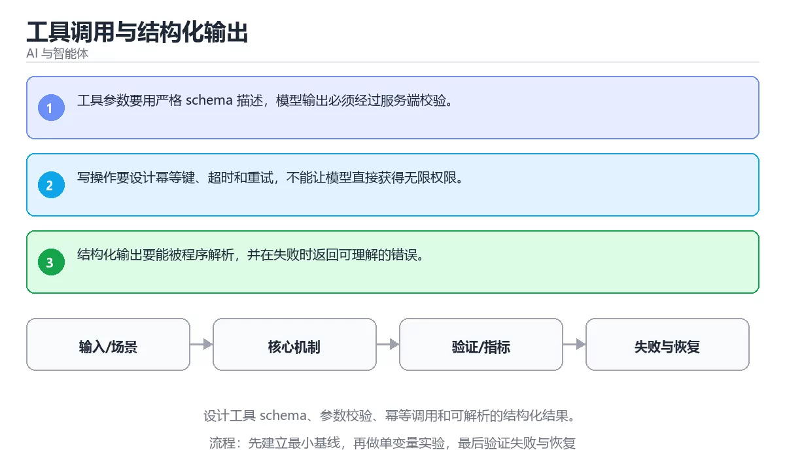

# 计算机视觉：图像分类与目标检测



> 内容更新时间：2026-10-06 · 学习阶段：基础 · 预计用时：50 分钟

## 本节知识框架

**课程定位**：分类「ml_practice」· 学习阶段 基础 · 建议用时 55 分钟。

本课主线：学习CNN卷积神经网络、迁移学习和YOLO目标检测算法。

### 复习清单

- [ ] 能不看正文复述本课核心术语，并指出一个边界或反例。
- [ ] 能运行或推演本课示例，记录输入、输出与失败现象。
- [ ] 能完成一次自测，并把错题对照考点精讲定位原因。


### 课程导言
计算机视觉让机器拥有"看"的能力，就像给机器人装上了眼睛和大脑。图像分类是识别图片中有什么物体（这是猫还是狗），目标检测不仅要识别还要定位物体的位置（猫在图片的哪个角落）。本章从经典的卷积神经网络（CNN）讲起，带你理解卷积、池化等核心操作的工作原理，然后学习如何使用预训练模型进行迁移学习，最后实现一个完整的目标检测系统。我们会用生活化的比喻解释抽象概念，让你轻松掌握这个充满魅力的领域。


### 学习目标
完成本章后，你将能够：

1. 理解卷积神经网络（CNN）的基本架构和各层的作用机制
2. 掌握卷积核、步长、填充等关键参数的含义及其对特征提取的影响
3. 使用预训练模型（如ResNet、VGG）进行迁移学习解决实际问题
4. 实现基于YOLO或SSD的目标检测算法，理解边界框回归原理
5. 学会数据增强技术以提升模型的泛化能力和鲁棒性
6. 评估图像分类和目标检测模型的性能指标（准确率、mAP、IoU）


## 核心概念定义

| 术语 | 一句话说明 |
| --- | --- |
| CNN | 学习CNN卷积神经网络、迁移学习和YOLO目标检测算法。相关：正文给出可操作定义与适用边界。 |
| 图像分类 | 学习CNN卷积神经网络、迁移学习和YOLO目标检测算法。相关：正文给出可操作定义与适用边界。 |
| 目标检测 | 学习CNN卷积神经网络、迁移学习和YOLO目标检测算法。相关：正文给出可操作定义与适用边界。 |
| YOLO | 学习CNN卷积神经网络、迁移学习和YOLO目标检测算法。相关：正文给出可操作定义与适用边界。 |
| 迁移学习 | 学习CNN卷积神经网络、迁移学习和YOLO目标检测算法。相关：正文给出可操作定义与适用边界。 |


## 原理与运行机制

《计算机视觉：图像分类与目标检测》正文各章按「输入是什么 → 中间如何转换 → 输出到哪 → 失败时怎样表现」四问展开；复习时给每个机制补一句自己的复述，再回到对应章节核对。


### 生活类比拆解
#### 1. 卷积操作：放大镜扫描图片

想象你拿着一个放大镜在照片上慢慢移动，每次只观察一小块区域。卷积核就像这个放大镜，它有不同的"滤镜"效果：有的专门找边缘，有的专门找颜色变化，有的专门找纹理。当放大镜扫过整张图片时，每个位置都会产生一个响应值，这些值组合起来就形成了特征图。多个不同的卷积核就像多个不同功能的放大镜同时工作，各自提取不同类型的特征。

#### 2. 池化层：信息压缩的智慧

池化就像把高清照片缩小成缩略图。最大池化（Max Pooling）相当于在每个小方块里只保留最亮的那个像素，平均池化（Average Pooling）则是计算小方块内所有像素的平均值。这样做的好处是减少了数据量，降低了计算复杂度，同时保留了最重要的信息。就像你看远处的风景，虽然细节模糊了，但整体轮廓依然清晰可见。

#### 3. 激活函数：神经元的开关

ReLU激活函数就像一个单向阀门：正信号可以通过，负信号被阻断。这模拟了生物神经元"要么兴奋要么沉默"的特性。想象你在听音乐会，只有当音量超过某个阈值时你才会注意到，低于阈值的背景噪音直接被忽略。ReLU的简单高效使其成为深度学习中最常用的激活函数，尽管也有Leaky ReLU、Swish等改进版本用于解决"死神经元"问题。

#### 4. 迁移学习：站在巨人的肩膀上

迁移学习就像是一个已经精通法国的厨师去学习意大利菜。他不需要从头学习刀工、火候控制等基础技能，只需要专注于意大利特有的香料搭配和烹饪技法。在深度学习中，预训练模型已经在ImageNet这样的大数据集上学会了识别各种基础特征（边缘、纹理、形状），我们只需要微调最后几层来适应自己的特定任务，这样可以大幅减少训练时间和数据需求。

#### 5. 边界框回归：精准定位的艺术

目标检测中的边界框（Bounding Box）就像是在照片中画矩形框标注物体位置。边界框回归的任务是预测四个值：中心点坐标(x, y)、宽度w和高度h。这个过程类似于玩"猜位置"游戏：模型先给出一个初始猜测，然后根据真实标签计算误差，不断调整直到框住目标物体。IoU（交并比）用来衡量预测框和真实框的重合程度，就像两张透明纸叠在一起看重叠面积占总面积的比例。

#### 6. 数据增强：创造多样性

数据增强就像是通过不同角度、光线、距离拍摄同一件商品来丰富训练数据。水平翻转相当于照镜子，旋转改变了视角，裁剪聚焦于局部细节，色彩抖动模拟不同光照条件。这些变换不会改变图片的本质内容（猫还是猫），但能让模型学习到更本质的特征而不是记住特定的像素排列。好的数据增强策略可以让小数据集发挥出大数据集的效果。


## 典型应用场景

- 结合「计算机视觉：图像分类与目标检测」的常见落地场景与选型边界，详见正文各章节的对比讨论。
- 迁移到新项目时，先明确输入规模、失败代价与可观测手段，再决定采用深度。


## 代码/协议/SQL 示例

正文首个完整示例如下，先运行确认环境，再按正文步骤改一个输入观察输出变化。

```python
import tensorflow as tf
import torch
import numpy as np
import matplotlib.pyplot as plt
from PIL import Image

# ==================== TensorFlow卷积演示 ====================

# 创建一个简单的灰度图像（8x8像素）
simple_image = np.array([
    [0, 0, 0, 0, 0, 0, 0, 0],
    [0, 0, 1, 1, 1, 1, 0, 0],
    [0, 0, 1, 1, 1, 1, 0, 0],
    [0, 0, 1, 1, 1, 1, 0, 0],
    [0, 0, 1, 1, 1, 1, 0, 0],
    [0, 0, 0, 0, 0, 0, 0, 0],
    [0, 0, 0, 0, 0, 0, 0, 0],
    [0, 0, 0, 0, 0, 0, 0, 0]
], dtype=np.float32)

# 定义一个边缘检测卷积核（Sobel算子简化版）
edge_kernel = np.array([
    [-1, -1, -1],
    [-1,  8, -1],
    [-1, -1, -1]
], dtype=np.float32)

# TensorFlow卷积操作
# 需要添加批次维度和通道维度: [batch, height, width, channels]
input_tensor = tf.constant(simple_image.reshape(1, 8, 8, 1))
kernel_tensor = tf.constant(edge_kernel.reshape(3, 3, 1, 1))

conv_output = tf.nn.conv2d(
    input_tensor, 
    kernel_tensor, 
    strides=[1, 1, 1, 1], 
    padding='SAME'
)

print("原始图像形状:", simple_image.shape)
print("卷积输出形状:", conv_output.shape)
print("\n边缘检测结果:")
print(np.round(conv_output.numpy().squeeze(), 2))

# ==================== PyTorch卷积演示 ====================

# PyTorch卷积操作
# 需要添加批次维度和通道维度: [batch, channels, height, width]
input_pt = torch.tensor(simple_image.reshape(1, 1, 8, 8))
kernel_pt = torch.tensor(edge_kernel.reshape(1, 1, 3, 3))

conv_output_pt = torch.nn.functional.conv2d(
    input_pt, 
    kernel_pt, 
    padding=1  # SAME填充等价于padding=(kernel_size-1)//2
)

print("\nPyTorch边缘检测结果:")
print(torch.round(conv_output_pt.squeeze(), decimals=2))

# 可视化对比
fig, axes = plt.subplots(1, 3, figsize=(12, 4))
axes[0].imshow(simple_image, cmap='gray')
axes[0].set_title('原始图像')
axes[1].imshow(conv_output.numpy().squeeze(), cmap='gray')
axes[1].set_title('TF卷积结果')
axes[2].imshow(conv_output_pt.squeeze().detach().numpy(), cmap='gray')
axes[2].set_title('PT卷积结果')
plt.tight_layout()
plt.savefig('conv_demo.png', dpi=150, bbox_inches='tight')
plt.show()
```


### 渐进式代码示例
#### 最小化示例：基础卷积操作

让我们从最基本的卷积操作开始，直观感受卷积核如何提取图像特征。

```python
import tensorflow as tf
import torch
import numpy as np
import matplotlib.pyplot as plt
from PIL import Image

# ==================== TensorFlow卷积演示 ====================

# 创建一个简单的灰度图像（8x8像素）
simple_image = np.array([
    [0, 0, 0, 0, 0, 0, 0, 0],
    [0, 0, 1, 1, 1, 1, 0, 0],
    [0, 0, 1, 1, 1, 1, 0, 0],
    [0, 0, 1, 1, 1, 1, 0, 0],
    [0, 0, 1, 1, 1, 1, 0, 0],
    [0, 0, 0, 0, 0, 0, 0, 0],
    [0, 0, 0, 0, 0, 0, 0, 0],
    [0, 0, 0, 0, 0, 0, 0, 0]
], dtype=np.float32)

# 定义一个边缘检测卷积核（Sobel算子简化版）
edge_kernel = np.array([
    [-1, -1, -1],
    [-1,  8, -1],
    [-1, -1, -1]
], dtype=np.float32)

# TensorFlow卷积操作
# 需要添加批次维度和通道维度: [batch, height, width, channels]
input_tensor = tf.constant(simple_image.reshape(1, 8, 8, 1))
kernel_tensor = tf.constant(edge_kernel.reshape(3, 3, 1, 1))

conv_output = tf.nn.conv2d(
    input_tensor, 
    kernel_tensor, 
    strides=[1, 1, 1, 1], 
    padding='SAME'
)

print("原始图像形状:", simple_image.shape)
print("卷积输出形状:", conv_output.shape)
print("\n边缘检测结果:")
print(np.round(conv_output.numpy().squeeze(), 2))

# ==================== PyTorch卷积演示 ====================

# PyTorch卷积操作
# 需要添加批次维度和通道维度: [batch, channels, height, width]
input_pt = torch.tensor(simple_image.reshape(1, 1, 8, 8))
kernel_pt = torch.tensor(edge_kernel.reshape(1, 1, 3, 3))

conv_output_pt = torch.nn.functional.conv2d(
    input_pt, 
    kernel_pt, 
    padding=1  # SAME填充等价于padding=(kernel_size-1)//2
)

print("\nPyTorch边缘检测结果:")
print(torch.round(conv_output_pt.squeeze(), decimals=2))

# 可视化对比
fig, axes = plt.subplots(1, 3, figsize=(12, 4))
axes[0].imshow(simple_image, cmap='gray')
axes[0].set_title('原始图像')
axes[1].imshow(conv_output.numpy().squeeze(), cmap='gray')
axes[1].set_title('TF卷积结果')
axes[2].imshow(conv_output_pt.squeeze().detach().numpy(), cmap='gray')
axes[2].set_title('PT卷积结果')
plt.tight_layout()
plt.savefig('conv_demo.png', dpi=150, bbox_inches='tight')
plt.show()
```

这个例子展示了卷积操作的本质：用一个小的滤波器（卷积核）在图像上滑动，在每个位置计算加权和。边缘检测核通过突出中心像素与周围像素的差异来识别边界。注意TensorFlow和PyTorch在张量维度顺序上的差异：TF使用NHWC（批次-高-宽-通道），PT使用NCHW（批次-通道-高-宽）。

#### 完整示例：使用预训练模型进行图像分类

现在我们来构建一个完整的图像分类系统，使用迁移学习识别自定义类别。

```python
import tensorflow as tf
from tensorflow.keras import layers, models
from tensorflow.keras.applications import ResNet50, VGG16
from tensorflow.keras.preprocessing import image_dataset_from_directory
import torch
import torch.nn as nn
import torchvision.models as models_torch
import torchvision.transforms as transforms
from torch.utils.data import DataLoader
import os
import numpy as np
from PIL import Image

# ==================== TensorFlow迁移学习 ====================

def build_transfer_learning_model_tf(num_classes=10, input_shape=(224, 224, 3)):
    """使用ResNet50进行迁移学习"""
    # 加载预训练的ResNet50，不包含顶层分类器
    base_model = ResNet50(
        weights='imagenet',                  # 使用ImageNet预训练权重
        include_top=False,                   # 不包含顶层全连接层
        input_shape=input_shape
    )
    
    # 冻结预训练层的权重（不更新）
    base_model.trainable = False
    
    # 构建新的分类头
    model = models.Sequential([
        base_model,                          # 预训练的特征提取器
        layers.GlobalAveragePooling2D(),     # 全局平均池化
        layers.Dense(256, activation='relu'), # 全连接层
        layers.Dropout(0.5),                 # Dropout防止过拟合
        layers.Dense(num_classes, activation='softmax')  # 分类输出层
    ])
    
    model.compile(
        optimizer=tf.keras.optimizers.Adam(learning_rate=0.001),
        loss='categorical_crossentropy',
        metrics=['accuracy']
    )
    return model, base_model

# 假设我们有一个按类别组织的图片目录结构：
# data/
#   train/
#     cat/
#       cat1.jpg, cat2.jpg, ...
#     dog/
#       dog1.jpg, dog2.jpg, ...
#   validation/
#     cat/
#     dog/

# 创建数据生成器
train_ds_tf = image_dataset_from_directory(
    'data/train',
    image_size=(224, 224),
    batch_size=32,
    label_mode='categorical'               # 独热编码标签
)

val_ds_tf = image_dataset_from_directory(
    'data/validation',
    image_size=(224, 224),
    batch_size=32,
    label_mode='categorical'
)

# 构建模型
tf_model, base_model = build_transfer_learning_model_tf(num_classes=2)
tf_model.summary()

# 第一阶段训练：只训练新添加的分类头
history_stage1 = tf_model.fit(
    train_ds_tf,
    validation_data=val_ds_tf,
    epochs=10,
    callbacks=[
        tf.keras.callbacks.EarlyStopping(
            monitor='val_loss', patience=3, restore_best_weights=True
        )
    ]
)

# 第二阶段训练：解冻部分预训练层进行微调
base_model.trainable = True
# 冻结前面的层，只微调后面的层
for layer in base_model.layers[:-20]:
    layer.trainable = False

# 使用较小的学习率重新编译
tf_model.compile(
    optimizer=tf.keras.optimizers.Adam(learning_rate=0.0001),
    loss='categorical_crossentropy',
    metrics=['accuracy']
)

history_stage2 = tf_model.fit(
    train_ds_tf,
    validation_data=val_ds_tf,
    epochs=10,
    callbacks=[
        tf.keras.callbacks.EarlyStopping(
            monitor='val_loss', patience=3, restore_best_weights=True
        )
    ]
)

# 保存模型
tf_model.save('animal_classifier_tf.h5')

# ==================== PyTorch迁移学习 ====================

class TransferLearningModel(nn.Module):
    """PyTorch迁移学习模型"""
    def __init__(self, num_classes=2):
        super(TransferLearningModel, self).__init__()
        # 加载预训练的ResNet50
        self.base_model = models_torch.resnet50(pretrained=True)
        
        # 冻结预训练层
        for param in self.base_model.parameters():
            param.requires_grad = False
        
        # 替换最后的全连接层
        num_features = self.base_model.fc.in_features
        self.base_model.fc = nn.Sequential(
            nn.Linear(num_features, 256),
            nn.ReLU(),
            nn.Dropout(0.5),
            nn.Linear(256, num_classes)
        )
    
    def forward(self, x):
        return self.base_model(x)
    
    def unfreeze_layers(self, num_layers_to_unfreeze=20):
        """解冻最后N层进行微调"""
        # 获取所有子模块
        children = list(self.base_model.children())
        # 解冻最后几层
        for child in children[-num_layers_to_unfreeze:]:
            for param in child.parameters():
                param.requires_grad = True

# 数据预处理和增强
train_transform = transforms.Compose([
    transforms.RandomResizedCrop(224),           # 随机裁剪并调整大小
    transforms.RandomHorizontalFlip(),           # 随机水平翻转
    transforms.ColorJitter(brightness=0.2, contrast=0.2),  # 颜色抖动
    transforms.ToTensor(),                       # 转换为张量
    transforms.Normalize(                        # 标准化
        mean=[0.485, 0.456, 0.406],             # ImageNet均值
        std=[0.229, 0.224, 0.225]               # ImageNet标准差
    )
])

val_transform = transforms.Compose([
    transforms.Resize(256),                      # 调整大小
    transforms.CenterCrop(224),                  # 中心裁剪
    transforms.ToTensor(),
    transforms.Normalize(
        mean=[0.485, 0.456, 0.406],
        std=[0.229, 0.224, 0.225]
    )
])

# 自定义数据集类
from torchvision.datasets import ImageFolder

train_dataset = ImageFolder('data/train', transform=train_transform)
val_dataset = ImageFolder('data/validation', transform=val_transform)

train_loader = DataLoader(train_dataset, batch_size=32, shuffle=True, num_workers=4)
val_loader = DataLoader(val_dataset, batch_size=32, shuffle=False, num_workers=4)

# 初始化模型
torch_model = TransferLearningModel(num_classes=2)
criterion = nn.CrossEntropyLoss()
optimizer = torch.optim.Adam(
    filter(lambda p: p.requires_grad, torch_model.parameters()), 
    lr=0.001
)

# 第一阶段训练
num_epochs_stage1 = 10
best_val_acc = 0.0

for epoch in range(num_epochs_stage1):
    torch_model.train()
    running_loss = 0.0
    correct = 0
    total = 0
    
    for inputs, labels in train_loader:
        optimizer.zero_grad()
        outputs = torch_model(inputs)
        loss = criterion(outputs, labels)
        loss.backward()
        optimizer.step()
        
        running_loss += loss.item()
        _, predicted = torch.max(outputs.data, 1)
        total += labels.size(0)
        correct += (predicted == labels).sum().item()
    
    train_acc = correct / total
    
    # 验证
    torch_model.eval()
    val_correct = 0
    val_total = 0
    with torch.no_grad():
        for inputs, labels in val_loader:
            outputs = torch_model(inputs)
            _, predicted = torch.max(outputs.data, 1)
            val_total += labels.size(0)
            val_correct += (predicted == labels).sum().item()
    
    val_acc = val_correct / val_total
    print(f'Epoch [{epoch+1}/{num_epochs_stage1}]')
    print(f'  Train Acc: {train_acc:.4f}, Val Acc: {val_acc:.4f}')
    
    # 保存最佳模型
    if val_acc > best_val_acc:
        best_val_acc = val_acc
        torch.save(torch_model.state_dict(), 'best_animal_classifier.pth')

# 第二阶段：解冻部分层进行微调
torch_model.unfreeze_layers(num_layers_to_unfreeze=20)
optimizer = torch.optim.Adam(
    filter(lambda p: p.requires_grad, torch_model.parameters()), 
    lr=0.0001  # 更小的学习率
)

# 继续训练...
```

这个完整示例展示了迁移学习的两阶段训练策略：首先冻结预训练层只训练新添加的分类头，然后解冻部分深层网络进行微调。这种方法可以在小数据集上获得很好的效果。注意数据增强的使用，这对提高模型泛化能力至关重要。

#### 实践示例：YOLO风格的目标检测

目标检测比图像分类更复杂，需要同时预测物体的类别和位置。这里我们实现一个简化版的单阶段检测器。

```python
import tensorflow as tf
from tensorflow.keras import layers, models
import torch
import torch.nn as nn
import numpy as np
import cv2

# ==================== 简化版YOLO检测器 ====================

class SimpleYOLODetector(tf.keras.Model):
    """简化版YOLO风格的目标检测器"""
    def __init__(self, num_classes=20, grid_size=7, num_boxes=2):
        super(SimpleYOLODetector, self).__init__()
        self.num_classes = num_classes
        self.grid_size = grid_size
        self.num_boxes = num_boxes
        
        # 特征提取 backbone（简化版Darknet）
        self.backbone = models.Sequential([
            layers.Conv2D(32, (3, 3), padding='same', activation='relu', input_shape=(448, 448, 3)),
            layers.MaxPooling2D((2, 2)),
            layers.Conv2D(64, (3, 3), padding='same', activation='relu'),
            layers.MaxPooling2D((2, 2)),
            layers.Conv2D(128, (3, 3), padding='same', activation='relu'),
            layers.Conv2D(64, (1, 1), padding='same', activation='relu'),
            layers.Conv2D(128, (3, 3), padding='same', activation='relu'),
            layers.MaxPooling2D((2, 2)),
            layers.Conv2D(256, (3, 3), padding='same', activation='relu'),
            layers.Conv2D(128, (1, 1), padding='same', activation='relu'),
            layers.Conv2D(256, (3, 3), padding='same', activation='relu'),
            layers.MaxPooling2D((2, 2)),
            layers.Conv2D(512, (3, 3), padding='same', activation='relu'),
            layers.Conv2D(256, (1, 1), padding='same', activation='relu'),
            layers.Conv2D(512, (3, 3), padding='same', activation='relu'),
            layers.Conv2D(256, (1, 1), padding='same', activation='relu'),
            layers.Conv2D(512, (3, 3), padding='same', activation='relu'),
        ])
        
        # 检测头
        self.detect_head = models.Sequential([
            layers.Conv2D(1024, (3, 3), padding='same', activation='relu'),
            layers.Conv2D(512, (1, 1), padding='same', activation='relu'),
            layers.Conv2D(
                num_boxes * (5 + num_classes),  # 每个格子预测num_boxes个框
                (1, 1), padding='same'           # 5 = x, y, w, h, confidence
            )
        ])
    
    def call(self, inputs):
        features = self.backbone(inputs)
        predictions = self.detect_head(features)
        # 重塑输出为 [batch, grid_size, grid_size, num_boxes, 5+num_classes]
        predictions = tf.reshape(
            predictions, 
            [-1, self.grid_size, self.grid_size, self.num_boxes, 5 + self.num_classes]
        )
        return predictions

# YOLO损失函数
def yolo_loss(y_true, y_pred, num_classes=20, grid_size=7, num_boxes=2, lambda_coord=5.0, lambda_noobj=0.5):
    """简化的YOLO损失函数"""
    # 分离预测值
    pred_xy = y_pred[..., :2]          # 中心点偏移
    pred_wh = y_pred[..., 2:4]         # 宽高
    pred_conf = y_pred[..., 4:5]       # 置信度
    pred_class = y_pred[..., 5:]       # 类别概率
    
    # 分离真实值
    true_xy = y_true[..., :2]
    true_wh = y_true[..., 2:4]
    true_conf = y_true[..., 4:5]
    true_class = y_true[..., 5:]
    
    # 存在物体的掩码
    obj_mask = true_conf
    noobj_mask = 1 - true_conf
    
    # 坐标损失（只对存在物体的格子计算）
    coord_loss = tf.reduce_sum(
        obj_mask * (tf.square(true_xy - pred_xy) + tf.square(tf.sqrt(true_wh) - tf.sqrt(pred_wh)))
    )
    
    # 置信度损失
    conf_loss_obj = tf.reduce_sum(obj_mask * tf.square(true_conf - pred_conf))
    conf_loss_noobj = tf.reduce_sum(noobj_mask * tf.square(true_conf - pred_conf))
    conf_loss = conf_loss_obj + lambda_noobj * conf_loss_noobj
    
    # 分类损失
    class_loss = tf.reduce_sum(obj_mask * tf.square(true_class - pred_class))
    
    # 总损失
    total_loss = lambda_coord * coord_loss + conf_loss + class_loss
    return total_loss

# 初始化模型
yolo_model = SimpleYOLODetector(num_classes=20, grid_size=7, num_boxes=2)
yolo_model.build(input_shape=(None, 448, 448, 3))
yolo_model.summary()

# 编译模型
optimizer = tf.keras.optimizers.Adam(learning_rate=1e-4)

@tf.function
def train_step(images, targets):
    with tf.GradientTape() as tape:
        predictions = yolo_model(images, training=True)
        loss = yolo_loss(targets, predictions)
    gradients = tape.gradient(loss, yolo_model.trainable_variables)
    optimizer.apply_gradients(zip(gradients, yolo_model.trainable_variables))
    return loss

# ==================== IoU计算与评估 ====================

def calculate_iou(box1, box2):
    """计算两个边界框的IoU（交并比）"""
    # box格式: [x_center, y_center, width, height]
    x1_min = box1[0] - box1[2] / 2
    y1_min = box1[1] - box1[3] / 2
    x1_max = box1[0] + box1[2] / 2
    y1_max = box1[1] + box1[3] / 2
    
    x2_min = box2[0] - box2[2] / 2
    y2_min = box2[1] - box2[3] / 2
    x2_max = box2[0] + box2[2] / 2
    y2_max = box2[1] + box2[3] / 2
    
    # 计算交集
    inter_x_min = max(x1_min, x2_min)
    inter_y_min = max(y1_min, y2_min)
    inter_x_max = min(x1_max, x2_max)
    inter_y_max = min(y1_max, y2_max)
    
    inter_area = max(0, inter_x_max - inter_x_min) * max(0, inter_y_max - inter_y_min)
    
    # 计算并集
    area1 = (x1_max - x1_min) * (y1_max - y1_min)
    area2 = (x2_max - x2_min) * (y2_max - y2_min)
    union_area = area1 + area2 - inter_area
    
    # IoU
    iou = inter_area / union_area if union_area > 0 else 0
    return iou

def non_max_suppression(predictions, confidence_threshold=0.5, iou_threshold=0.5):
    """非极大值抑制（NMS）去除重复检测框"""
    # predictions形状: [grid_size, grid_size, num_boxes, 5+num_classes]
    detections = []
    grid_size, num_boxes, num_info = predictions.shape[:3]
    num_classes = num_info - 5
    
    for i in range(grid_size):
        for j in range(grid_size):
            for b in range(num_boxes):
                confidence = predictions[i, j, b, 4]
                if confidence > confidence_threshold:
                    class_probs = predictions[i, j, b, 5:]
                    class_id = np.argmax(class_probs)
                    class_confidence = class_probs[class_id]
                    final_confidence = confidence * class_confidence
                    
                    # 转换为中心点绝对坐标
                    x = (j + predictions[i, j, b, 0]) / grid_size
                    y = (i + predictions[i, j, b, 1]) / grid_size
                    w = predictions[i, j, b, 2] ** 2
                    h = predictions[i, j, b, 3] ** 2
                    
                    detections.append([x, y, w, h, final_confidence, class_id])
    
    if not detections:
        return []
    
    detections = np.array(detections)
    # 按置信度排序
    indices = np.argsort(detections[:, 4])[::-1]
    detections = detections[indices]
    
    # NMS
    keep = []
    while len(detections) > 0:
        keep.append(detections[0])
        if len(detections) == 1:
            break
        
        ious = [calculate_iou(detections[0][:4], det[:4]) for det in detections[1:]]
        ious = np.array(ious)
        
        # 保留IoU小于阈值的检测框
        remaining_indices = np.where(ious <= iou_threshold)[0]
        detections = detections[remaining_indices + 1]
    
    return keep

# 示例：评估检测结果
pred_box = [0.5, 0.5, 0.3, 0.4]  # 预测框
true_box = [0.55, 0.48, 0.28, 0.42]  # 真实框
iou = calculate_iou(pred_box, true_box)
print(f"IoU: {iou:.4f}")
```

这个实践示例展示了目标检测的核心组件：特征提取backbone、检测头、YOLO损失函数、IoU计算和非极大值抑制（NMS）。实际生产环境中会使用更成熟的框架如YOLOv5、YOLOv8或Detectron2，但理解这些基础原理对于调试和优化模型至关重要。


## 时间/空间复杂度或性能分析

- 在《计算机视觉：图像分类与目标检测》里处理规模 n 时，先估计主循环与嵌套层数，再决定优化方向；小样本上的耗时读数不能外推。
- 性能结论要绑定输入分布：换数据规模、并发度或缓存命中情况后须重新测量。


## 常见误区与易错点

| 错误做法 | 典型现象 | 修复方向 |
| --- | --- | --- |
| 只验证正常输入 | 边界数据触发时才暴露问题 | 为每个结论补一个空值/极值/重复值用例 |
| 背结论不跑实验 | 换个输入就失效 | 按「预测—实测—差异归因」三步复盘 |
| 忽略环境与版本差异 | 本机可用线上报错 | 把版本、配置与依赖写入复现步骤 |


### 常见陷阱对照表
| 陷阱类型 | 具体问题描述 | 影响后果 | 解决方案 |
|---------|------------|---------|---------|
| **输入尺寸不匹配** | 预训练模型期望224x224输入，但传入其他尺寸 | 模型报错或性能大幅下降 | 始终检查模型的`input_shape`要求，使用`Resize`预处理 |
| **忘记归一化** | 像素值保持在0-255范围而非0-1或标准化 | 梯度爆炸，训练不稳定 | 除以255或使用ImageNet均值标准差标准化 |
| **数据泄露** | 训练集和测试集有相同或相似图片 | 评估指标虚高，实际部署失败 | 严格按来源划分数据集，避免同一主体出现在多个集合 |
| **类别不平衡** | 某些类别样本数量远多于其他类别 | 模型偏向多数类，少数类识别率低 | 使用类别权重、过采样少数类或Focal Loss |
| **过拟合小数据集** | 在小数据集上训练大模型 | 训练准确率高但测试准确率很低 | 加强数据增强、使用Dropout、早停、正则化 |
| **边界框编码错误** | YOLO中相对坐标与绝对坐标混淆 | 检测框位置完全错误 | 统一使用相对坐标（0-1范围），仔细处理网格偏移 |
| **NMS阈值不当** | IoU阈值设置过高或过低 | 漏检或重复检测过多 | 根据任务调整：密集场景用低阈值，稀疏场景用高阈值 |
| **评估指标误解** | 仅关注准确率而忽略召回率 | 在目标检测中表现不佳 | 使用mAP、Precision-Recall曲线综合评估 |
| **GPU内存溢出** | batch_size过大或模型太深 | 训练中断OOM错误 | 减小batch_size、使用混合精度、梯度累积 |
| **预训练权重未加载** | 忘记指定`weights='imagenet'`或`pretrained=True` | 从零开始训练，收敛极慢 | 确认预训练权重正确加载，检查第一epoch损失是否合理 |


## 与其他知识点的关系

本课与分类「ml_practice」内相邻课程互为补充，建议按清单顺序学完再做综合练习。


## 自测题与参考答案

以下题目与题库同源，作答后再看解析；错误项要能说出错在哪一步。


## 考点精讲

### 考点 1

关于卷积神经网络中的卷积操作，以下哪项描述是错误的？

A. 卷积核的大小通常为奇数（如3x3、5x5），以便有明确的中心点  
B. 步长（stride）越大，输出特征图的尺寸越小  
C. 填充（padding）的目的是保持特征图尺寸不变或控制其缩小速度  
D. 卷积操作会显著增加参数量，因此深层网络必须使用很小的卷积核 ✅  

**正确答案：** D

**解析：** 卷积操作实际上大大减少了参数量 compared to 全连接层。例如，一个3x3卷积核无论输入图像多大，都只有9个权重参数（加上偏置共10个），而全连接层需要将每个输入像素与每个输出神经元相连，参数量随输入尺寸线性增长。这正是CNN能够处理高分辨率图像的关键优势。选项A正确，奇数尺寸的卷积核确实便于对称填充；选项B正确，步长增大意味着卷积核跳跃更大，输出尺寸减小；选项C正确，填充可以控制输出尺寸。

### 考点 2

在迁移学习中，为什么通常采用"先冻结预训练层训练分类头，再解冻部分层微调"的两阶段策略？

A. 因为预训练层的权重已经是最佳的，不需要更新  
B. 因为新添加的分类头权重是随机初始化的，需要先让其收敛到合理范围，避免破坏预训练特征 ✅  
C. 因为GPU内存有限，无法同时训练所有层  
D. 这是一种历史遗留做法，现代框架已经不再需要  

**正确答案：** B

**解析：** 新添加的分类头（全连接层）的权重是随机初始化的，如果一开始就与预训练层一起训练，大的梯度更新可能会严重破坏预训练层已经学到的有用特征表示。通过先冻结预训练层，让分类头单独训练几个epoch，使其权重收敛到一个合理的范围，然后再以较小的学习率解冻部分预训练层进行微调，可以平衡"利用已有知识"和"适应新任务"之间的关系。选项A错误，预训练权重虽然好但不是针对当前任务最优的；选项C不是主要原因；选项D错误，这仍然是标准的最佳实践。

### 考点 3

关于目标检测中的IoU（Intersection over Union，交并比），以下计算正确的是？

A. IoU = 交集面积 / 预测框面积  
B. IoU = 交集面积 / 真实框面积  
C. IoU = 交集面积 / (预测框面积 + 真实框面积 - 交集面积) ✅  
D. IoU = (预测框面积 + 真实框面积) / 交集面积  

**正确答案：** C

**解析：** IoU的定义是两个框的交集面积除以并集面积。并集面积等于两个框的面积之和减去交集面积（避免重复计算重叠部分）。所以公式是：IoU = Intersection / (Area1 + Area2 - Intersection)。IoU的取值范围是0到1，值越大表示两个框重合度越高。通常IoU>0.5被认为是成功的检测。选项A和B只考虑了一个框的面积，不正确；选项D分子分母颠倒了。

### 考点 4

在图像分类任务中，以下哪种数据增强技术可能会改变图像的语义标签？

A. 水平翻转  
B. 随机旋转±15度  
C. 随机裁剪  
D. 将猫的图片垂直翻转180度 ✅  

**正确答案：** D

**解析：** 数据增强的前提是变换后的图像应该保持相同的语义标签。水平翻转对于大多数物体是合理的（左右对称的猫还是猫）；小幅旋转也不会改变物体类别；随机裁剪只要保留足够多的主体信息也是有效的。但是垂直翻转180度会将猫倒过来，这在现实世界中是不自然的，可能会改变图像的语义（例如，倒过来的车可能被误认为是其他物体）。因此，垂直翻转通常不用于自然图像分类，除非任务本身具有旋转不变性（如卫星图像中的建筑物）。

### 考点 5

关于目标检测模型的评价指标mAP（mean Average Precision），以下说法正确的是？

A. mAP只考虑检测框的位置准确性，不考虑类别判断  
B. mAP是不同IoU阈值下AP的平均值，综合评估检测质量 ✅  
C. mAP越高说明模型的推理速度越快  
D. mAP的计算与置信度阈值无关  

**正确答案：** B

**解析：** mAP（mean Average Precision）是目标检测中最常用的评价指标。它首先对每个类别计算AP（Average Precision），即在不同置信度阈值下的Precision-Recall曲线下面积，然后对所有类别的AP求平均。有些评测标准（如COCO）还会计算不同IoU阈值（0.5到0.95，步长0.05）下的mAP平均值，以更严格地评估检测框的定位精度。选项A错误，mAP同时考虑位置和类别；选项C错误，mAP与速度无关；选项D错误，AP的计算需要在不同置信度阈值下采样。


## 术语速查

| 术语 | 一句话说明 |
| --- | --- |
| CNN | 用卷积核滑动提取局部特征的神经网络，配合池化降采样，是图像任务的主干结构。 |
| 图像分类 | 判断整张图片属于哪个类别的任务，输出类别概率，以准确率和top-k衡量。 |
| 目标检测 | 分类之外还要框出每个物体的位置，靠边界框回归定位并用IoU与mAP评估。 |
| YOLO | 单阶段检测器，一次前向同时预测类别与边界框，主打实时视频与大规模推理。 |
| 迁移学习 | 复用ImageNet等大规模预训练模型的通用特征，只微调顶层，小数据也能出效果。 |


## 参考资料与复核

- [本课资料锚点 ml_computer_vision](https://zh.wikipedia.org/w/index.php?search=ml_computer_vision)

- 官方/权威资料：[scikit-learn 用户手册](https://scikit-learn.org/stable/user_guide.html)
- 主题延伸：[关于「图像分类」的检索页](https://zh.wikipedia.org/w/index.php?search=%E5%9B%BE%E5%83%8F%E5%88%86%E7%B1%BB)
- 本课索引词：[锚点 ml_computer_vision](https://scikit-learn.org/stable/user_guide.html#CNN)
- 最后复核：2026-10-04
- 下次复核：2026-11-29


## 内容元数据

- 内容更新时间：2026-10-06

- 内容版本：v2.0
- 课程标识：ml_computer_vision
- 所属分类：ml_practice
- 学习阶段：基础
- 建议用时：55 分钟

