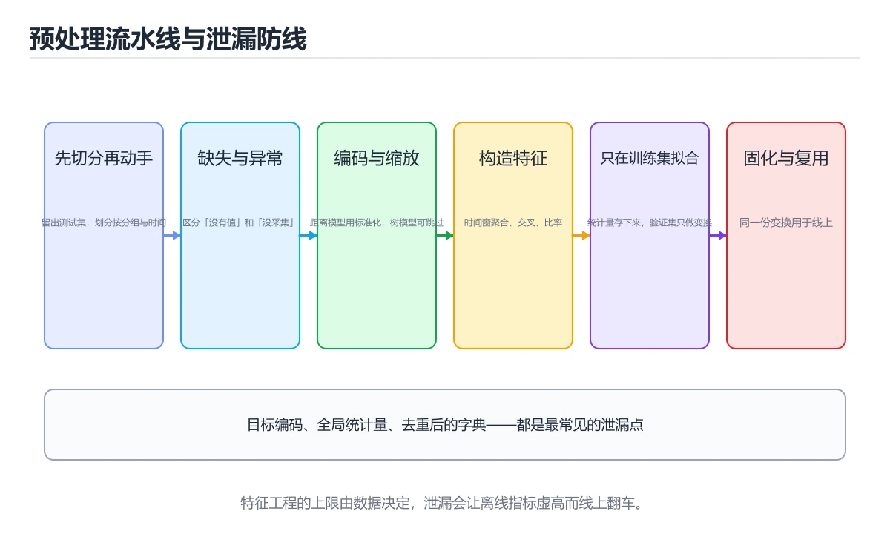

# 数据预处理与特征工程



> 内容更新时间：2026-10-06 · 学习阶段：入门 · 预计用时：70 分钟

## 本节知识框架

**课程定位**：分类「ml_practice」· 学习阶段 入门 · 建议用时 45 分钟。

本课主线：学习缺失值处理、特征编码、标准化和特征选择方法。

### 复习清单

- [ ] 能讲清 数据预处理 与 特征工程 的分工，并指出其中一个前提失效的边界。
- [ ] 能跑通 数据预处理 的最小示例，记录一组正常输出和一组失败输出。
- [ ] 能完成一次自测，并把错题对照考点精讲定位原因。

### 课程导言
数据预处理和特征工程是机器学习项目中耗时最长但影响最大的环节，就像烹饪前的食材准备：洗菜、切菜、腌制决定了最终菜肴的口味上限。Garbage In, Garbage Out（垃圾进，垃圾出）是机器学习领域的金科玉律——再先进的算法也无法从劣质数据中挖掘出有价值的模式。本章从数据清洗讲起，带你理解如何处理缺失值、异常值、重复记录等常见问题，然后深入学习特征工程的多种技术：数值变换、类别编码、特征组合、降维等，最后通过完整案例展示如何为不同类型的任务构建高质量的特征集。我们将用厨房备菜、拼图游戏等生活化比喻解释抽象概念，让你轻松掌握这个决定模型成败的关键技能。

### 学习目标
完成本章后，你将能够：

1. 掌握数据质量评估方法：完整性、一致性、准确性、时效性检查
2. 熟练处理缺失值：删除、均值/中位数填充、KNN插补、模型预测填充
3. 识别和处理异常值：统计方法（Z-score、IQR）、可视化方法、业务规则
4. 实现多种特征编码策略：独热编码、标签编码、目标编码、嵌入表示
5. 应用特征变换技术：标准化、归一化、对数变换、Box-Cox变换
6. 使用特征选择方法过滤冗余特征：过滤法、包裹法、嵌入法

## 核心概念定义

| 术语 | 一句话说明 |
| --- | --- |
| 数据预处理 | 建模前把缺失、异常、重复行和错误标注清理掉的环节，正文说数据科学家八成时间花在这里，它决定效果上限。 |
| 特征工程 | 在清洗之外主动改造输入变量：类别做编码、数值做变换、特征做组合与降维，最后用交叉验证量化收益。 |
| 缺失值 | 字段没采到形成的空值，要先分辨缺失机制：完全随机的可以统计量填充或 KNN 插补，非随机时缺失本身携带信息。 |
| 标准化 | 把特征转成均值 0、标准差 1 的分布以消除量纲差，参数只能先在训练集上算再套到测试集，顺序反了就等于数据泄露。 |
| 特征选择 | 用最少的列换最好的性能：过滤法看相关性、包裹法实测试子集、嵌入法靠 Lasso 系数收缩，正文建议先粗筛再精挑。 |

## 原理与运行机制

《数据预处理与特征工程》正文各章按「输入是什么 → 中间如何转换 → 输出到哪 → 失败时怎样表现」四问展开；复习时给每个机制补一句自己的复述，再回到对应章节核对。

### 生活类比拆解
#### 1. 数据清洗：整理杂乱的房间

原始数据就像刚搬进的新家：到处是灰尘（缺失值）、杂物堆积（异常值）、重复摆放的物品（重复记录）、贴错标签的箱子（错误标注）。数据清洗就是大扫除的过程：用吸尘器清理灰尘（填补缺失值）、扔掉垃圾（移除异常值）、合并重复物品（去重）、重新贴标签（纠正错误）。这个过程虽然枯燥，但只有干净整洁的房间才能高效生活，同样只有干净的数据才能训练出好模型。据统计，数据科学家80%的时间花在数据清洗上。

#### 2. 缺失值处理：拼图缺块的补救

数据集有缺失值就像拼图少了几块。有三种应对策略：直接忽略这块区域（删除含缺失值的行/列），根据周围图案推测缺失部分（均值/中位数/众数填充），或者请专家根据整体画面重新绘制（使用模型预测缺失值）。选择哪种策略取决于缺失比例和缺失机制：完全随机缺失（MCAR）可以简单填充；非随机缺失（MNAR）需要更谨慎的处理，因为缺失本身可能携带信息（如高收入人群不愿透露收入）。

#### 3. 异常值检测：人群中的显眼包

异常值就像班级里身高特别高或特别矮的学生。有些异常值是真实的（姚明确实很高），有些是测量错误（把180cm误录为1800cm）。统计方法如Z-score（偏离均值超过3个标准差）和IQR（超出四分位距1.5倍范围）能自动识别统计意义上的异常点，但无法判断是否为真实值。业务规则更重要：对于年龄字段，200岁显然是错误；但对于交易额字段，百万级交易可能是真实的大客户。处理策略包括：修正错误、保留真实异常、或使用鲁棒模型（如树模型对异常值不敏感）。

#### 4. 特征编码：将文字翻译成数字

机器学习模型只能理解数字，所以需要把类别型特征（如颜色：红、绿、蓝）转换为数值。独热编码（One-Hot Encoding）像给每种颜色分配一个独立的开关：红色=[1,0,0]，绿色=[0,1,0]，蓝色=[0,0,1]。这种方法简单直观，但当类别很多时会产生大量稀疏列（维度灾难）。标签编码（Label Encoding）给每个类别分配一个整数：红=0，绿=1，蓝=2，但模型可能误解为存在大小关系（2>1>0）。目标编码（Target Encoding）用该类别对应的目标变量均值来编码，既保留了信息又控制了维度，但需要防止数据泄露。

#### 5. 特征缩放：统一度量衡

不同特征的取值范围差异巨大：年龄范围0-100，收入范围0-1000000，评分范围0-5。如果不进行缩放，梯度下降优化时会偏向取值范围大的特征（因为梯度更大），距离计算（如KNN、SVM）也会被大范围特征主导。标准化（Standardization）将特征转换为均值为0、标准差为1的分布，适合大多数模型；归一化（Normalization）将特征缩放到[0,1]区间，适合神经网络和需要边界约束的场景。注意：缩放参数（均值、标准差、最小最大值）应该只在训练集上拟合，然后应用到测试集，避免数据泄露。

#### 6. 特征选择：精简工具箱

特征太多就像工具箱里塞满了各种工具：大部分用不上，还增加查找难度。特征选择的目标是用最少的特征获得最好的模型性能。过滤法（Filter Methods）像预先筛选：计算每个特征与目标的相关性，保留相关性高的；包裹法（Wrapper Methods）像实际试用：尝试不同的特征组合，选择使模型性能最好的子集，效果好但计算成本高；嵌入法（Embedded Methods）像边用边选：模型训练过程中自动学习特征重要性（如Lasso回归的系数收缩、树模型的特征重要性评分）。通常先使用过滤法快速剔除明显无关的特征，再用嵌入法精细选择。

## 典型应用场景

- 结合「数据预处理与特征工程」的常见落地场景与选型边界，详见正文各章节的对比讨论。
- 迁移 数据预处理 前先确认新项目的规模与失败代价，再决定保留多少机制。

## 代码/协议/SQL 示例

「数据预处理与特征工程」的第一个完整示例先建立 数据预处理 的基线，再按正文步骤改动一个输入。

```python
import numpy as np
import pandas as pd
import matplotlib.pyplot as plt
import seaborn as sns
from sklearn.impute import SimpleImputer, KNNImputer
from scipy import stats

# ==================== 创建示例数据集 ====================

np.random.seed(42)
n_samples = 200

data = {
    'age': np.random.randint(18, 70, n_samples),
    'income': np.random.uniform(20000, 150000, n_samples),
    'score': np.random.uniform(0, 100, n_samples),
    'category': np.random.choice(['A', 'B', 'C', 'D'], n_samples),
    'target': np.random.randint(0, 2, n_samples)
}

df = pd.DataFrame(data)

# 引入数据质量问题
# 1. 缺失值
missing_indices = np.random.choice(n_samples, 20, replace=False)
df.loc[missing_indices[:10], 'age'] = np.nan
df.loc[missing_indices[10:15], 'income'] = np.nan
df.loc[missing_indices[15:20], 'score'] = np.nan

# 2. 异常值
df.loc[5, 'age'] = 200  # 显然错误的年龄
df.loc[10, 'income'] = -5000  # 负收入
df.loc[15, 'score'] = 150  # 超过100的分数

# 3. 重复行
df = pd.concat([df, df.iloc[[0, 1, 2]]], ignore_index=True)

print("原始数据统计:")
print(df.describe())
print(f"\n数据形状: {df.shape}")
print(f"缺失值数量:\n{df.isnull().sum()}")
print(f"重复行数量: {df.duplicated().sum()}")

# ==================== 数据质量检查 ====================

def data_quality_report(df):
    """生成数据质量报告"""
    report = {
        'shape': df.shape,
        'missing_count': df.isnull().sum(),
        'missing_percentage': (df.isnull().sum() / len(df) * 100).round(2),
        'duplicate_count': df.duplicated().sum(),
        'unique_values': {col: df[col].nunique() for col in df.columns},
        'data_types': df.dtypes.to_dict()
    }
    
    print("=" * 60)
    print("数据质量报告")
    print("=" * 60)
    print(f"数据形状: {report['shape']}")
    print(f"\n缺失值统计:")
    for col in df.columns:
        if report['missing_count'][col] > 0:
            print(f"  {col}: {report['missing_count'][col]} "
                  f"({report['missing_percentage'][col]}%)")
    print(f"\n重复行: {report['duplicate_count']}")
    print(f"\n唯一值数量:")
    for col, count in report['unique_values'].items():
        print(f"  {col}: {count}")
    print("=" * 60)
    
    return report

quality_report = data_quality_report(df)

# ==================== 处理缺失值 ====================

print("\n--- 处理缺失值 ---")

# 方法1：删除含缺失值的行
df_dropped = df.dropna()
print(f"删除缺失值后: {df_dropped.shape[0]}行 (原{df.shape[0]}行)")

# 方法2：均值/中位数填充
df_filled_mean = df.copy()
imputer_mean = SimpleImputer(strategy='mean')
numeric_cols = ['age', 'income', 'score']
df_filled_mean[numeric_cols] = imputer_mean.fit_transform(df[numeric_cols])
print(f"均值填充后缺失值: {df_filled_mean.isnull().sum().sum()}")

# 方法3：KNN插补
df_knn = df.copy()
imputer_knn = KNNImputer(n_neighbors=5)
df_knn[numeric_cols] = imputer_knn.fit_transform(df[numeric_cols])
print(f"KNN插补后缺失值: {df_knn.isnull().sum().sum()}")

# 比较不同填充方法的效果
fig, axes = plt.subplots(1, 3, figsize=(15, 4))

for ax, method, data_filled in zip(
    axes, 
    ['原始(含缺失)', '均值填充', 'KNN插补'],
    [df, df_filled_mean, df_knn]
):
    ax.hist(data_filled['age'].dropna(), bins=20, alpha=0.7, edgecolor='black')
    ax.set_title(method)
    ax.set_xlabel('Age')
    ax.set_ylabel('Frequency')

plt.tight_layout()
plt.savefig('missing_value_imputation.png', dpi=150, bbox_inches='tight')
plt.show()

# ==================== 处理异常值 ====================

print("\n--- 处理异常值 ---")

# 方法1：Z-score方法
z_scores = np.abs(stats.zscore(df['age'].dropna()))
outliers_zscore = df[np.abs(stats.zscore(df['age'].dropna())) > 3]
print(f"Z-score检测到的年龄异常值数量: {len(outliers_zscore)}")

# 方法2：IQR方法
Q1 = df['income'].quantile(0.25)
Q3 = df['income'].quantile(0.75)
IQR = Q3 - Q1
lower_bound = Q1 - 1.5 * IQR
upper_bound = Q3 + 1.5 * IQR
outliers_iqr = df[(df['income'] < lower_bound) | (df['income'] > upper_bound)]
print(f"IQR检测到的收入异常值数量: {len(outliers_iqr)}")
print(f"收入合理范围: [{lower_bound:.2f}, {upper_bound:.2f}]")

# 方法3：业务规则
business_rule_outliers = df[
    (df['age'] < 0) | (df['age'] > 120) |  # 年龄不合理
    (df['income'] < 0) |                     # 收入为负
    (df['score'] < 0) | (df['score'] > 100)  # 分数超出范围
]
print(f"业务规则检测到的异常值数量: {len(business_rule_outliers)}")

# 可视化异常值
fig, axes = plt.subplots(1, 3, figsize=(15, 4))

# Boxplot显示异常值
for ax, col, title in zip(axes, ['age', 'income', 'score'], 
                           ['Age', 'Income', 'Score']):
    ax.boxplot(df[col].dropna())
    ax.set_title(title)
    ax.set_ylabel('Value')

plt.tight_layout()
plt.savefig('outlier_detection.png', dpi=150, bbox_inches='tight')
plt.show()

# 修正异常值（用边界值截断）
df_cleaned = df.copy()
df_cleaned['age'] = df_cleaned['age'].clip(lower=0, upper=120)
df_cleaned['income'] = df_cleaned['income'].clip(lower=0)
df_cleaned['score'] = df_cleaned['score'].clip(lower=0, upper=100)

print(f"\n修正后数据形状: {df_cleaned.shape}")
print(f"修正后缺失值: {df_cleaned.isnull().sum().sum()}")
```

### 渐进式代码示例
#### 最小化示例：基础数据清洗

让我们从最基本的数据质量问题处理开始。

```python
import numpy as np
import pandas as pd
import matplotlib.pyplot as plt
import seaborn as sns
from sklearn.impute import SimpleImputer, KNNImputer
from scipy import stats

# ==================== 创建示例数据集 ====================

np.random.seed(42)
n_samples = 200

data = {
    'age': np.random.randint(18, 70, n_samples),
    'income': np.random.uniform(20000, 150000, n_samples),
    'score': np.random.uniform(0, 100, n_samples),
    'category': np.random.choice(['A', 'B', 'C', 'D'], n_samples),
    'target': np.random.randint(0, 2, n_samples)
}

df = pd.DataFrame(data)

# 引入数据质量问题
# 1. 缺失值
missing_indices = np.random.choice(n_samples, 20, replace=False)
df.loc[missing_indices[:10], 'age'] = np.nan
df.loc[missing_indices[10:15], 'income'] = np.nan
df.loc[missing_indices[15:20], 'score'] = np.nan

# 2. 异常值
df.loc[5, 'age'] = 200  # 显然错误的年龄
df.loc[10, 'income'] = -5000  # 负收入
df.loc[15, 'score'] = 150  # 超过100的分数

# 3. 重复行
df = pd.concat([df, df.iloc[[0, 1, 2]]], ignore_index=True)

print("原始数据统计:")
print(df.describe())
print(f"\n数据形状: {df.shape}")
print(f"缺失值数量:\n{df.isnull().sum()}")
print(f"重复行数量: {df.duplicated().sum()}")

# ==================== 数据质量检查 ====================

def data_quality_report(df):
    """生成数据质量报告"""
    report = {
        'shape': df.shape,
        'missing_count': df.isnull().sum(),
        'missing_percentage': (df.isnull().sum() / len(df) * 100).round(2),
        'duplicate_count': df.duplicated().sum(),
        'unique_values': {col: df[col].nunique() for col in df.columns},
        'data_types': df.dtypes.to_dict()
    }
    
    print("=" * 60)
    print("数据质量报告")
    print("=" * 60)
    print(f"数据形状: {report['shape']}")
    print(f"\n缺失值统计:")
    for col in df.columns:
        if report['missing_count'][col] > 0:
            print(f"  {col}: {report['missing_count'][col]} "
                  f"({report['missing_percentage'][col]}%)")
    print(f"\n重复行: {report['duplicate_count']}")
    print(f"\n唯一值数量:")
    for col, count in report['unique_values'].items():
        print(f"  {col}: {count}")
    print("=" * 60)
    
    return report

quality_report = data_quality_report(df)

# ==================== 处理缺失值 ====================

print("\n--- 处理缺失值 ---")

# 方法1：删除含缺失值的行
df_dropped = df.dropna()
print(f"删除缺失值后: {df_dropped.shape[0]}行 (原{df.shape[0]}行)")

# 方法2：均值/中位数填充
df_filled_mean = df.copy()
imputer_mean = SimpleImputer(strategy='mean')
numeric_cols = ['age', 'income', 'score']
df_filled_mean[numeric_cols] = imputer_mean.fit_transform(df[numeric_cols])
print(f"均值填充后缺失值: {df_filled_mean.isnull().sum().sum()}")

# 方法3：KNN插补
df_knn = df.copy()
imputer_knn = KNNImputer(n_neighbors=5)
df_knn[numeric_cols] = imputer_knn.fit_transform(df[numeric_cols])
print(f"KNN插补后缺失值: {df_knn.isnull().sum().sum()}")

# 比较不同填充方法的效果
fig, axes = plt.subplots(1, 3, figsize=(15, 4))

for ax, method, data_filled in zip(
    axes, 
    ['原始(含缺失)', '均值填充', 'KNN插补'],
    [df, df_filled_mean, df_knn]
):
    ax.hist(data_filled['age'].dropna(), bins=20, alpha=0.7, edgecolor='black')
    ax.set_title(method)
    ax.set_xlabel('Age')
    ax.set_ylabel('Frequency')

plt.tight_layout()
plt.savefig('missing_value_imputation.png', dpi=150, bbox_inches='tight')
plt.show()

# ==================== 处理异常值 ====================

print("\n--- 处理异常值 ---")

# 方法1：Z-score方法
z_scores = np.abs(stats.zscore(df['age'].dropna()))
outliers_zscore = df[np.abs(stats.zscore(df['age'].dropna())) > 3]
print(f"Z-score检测到的年龄异常值数量: {len(outliers_zscore)}")

# 方法2：IQR方法
Q1 = df['income'].quantile(0.25)
Q3 = df['income'].quantile(0.75)
IQR = Q3 - Q1
lower_bound = Q1 - 1.5 * IQR
upper_bound = Q3 + 1.5 * IQR
outliers_iqr = df[(df['income'] < lower_bound) | (df['income'] > upper_bound)]
print(f"IQR检测到的收入异常值数量: {len(outliers_iqr)}")
print(f"收入合理范围: [{lower_bound:.2f}, {upper_bound:.2f}]")

# 方法3：业务规则
business_rule_outliers = df[
    (df['age'] < 0) | (df['age'] > 120) |  # 年龄不合理
    (df['income'] < 0) |                     # 收入为负
    (df['score'] < 0) | (df['score'] > 100)  # 分数超出范围
]
print(f"业务规则检测到的异常值数量: {len(business_rule_outliers)}")

# 可视化异常值
fig, axes = plt.subplots(1, 3, figsize=(15, 4))

# Boxplot显示异常值
for ax, col, title in zip(axes, ['age', 'income', 'score'], 
                           ['Age', 'Income', 'Score']):
    ax.boxplot(df[col].dropna())
    ax.set_title(title)
    ax.set_ylabel('Value')

plt.tight_layout()
plt.savefig('outlier_detection.png', dpi=150, bbox_inches='tight')
plt.show()

# 修正异常值（用边界值截断）
df_cleaned = df.copy()
df_cleaned['age'] = df_cleaned['age'].clip(lower=0, upper=120)
df_cleaned['income'] = df_cleaned['income'].clip(lower=0)
df_cleaned['score'] = df_cleaned['score'].clip(lower=0, upper=100)

print(f"\n修正后数据形状: {df_cleaned.shape}")
print(f"修正后缺失值: {df_cleaned.isnull().sum().sum()}")
```

这个例子展示了数据清洗的基本流程：识别问题（缺失值、异常值、重复行）、选择处理方法、验证效果。实际项目中，数据清洗往往是迭代过程：处理一轮后重新检查，可能发现新的问题。关键是要记录每一步的操作，确保可复现性。

#### 完整示例：特征工程全流程

现在我们来构建一个完整的特征工程流水线，涵盖编码、变换、选择等环节。

```python
import numpy as np
import pandas as pd
from sklearn.preprocessing import (
    StandardScaler, MinMaxScaler, LabelEncoder, OneHotEncoder, 
    OrdinalEncoder, PowerTransformer
)
from sklearn.feature_selection import (
    SelectKBest, f_classif, mutual_info_classif, RFE
)
from sklearn.ensemble import RandomForestClassifier
from sklearn.linear_model import Lasso
from sklearn.pipeline import Pipeline
from sklearn.model_selection import cross_val_score
import matplotlib.pyplot as plt
import seaborn as sns

# ==================== 创建复杂示例数据集 ====================

np.random.seed(42)
n_samples = 1000

# 数值特征
age = np.random.randint(18, 70, n_samples)
income = np.random.exponential(50000, n_samples) + 20000
credit_score = np.random.randint(300, 850, n_samples)
loan_amount = np.random.uniform(1000, 100000, n_samples)

# 类别特征
education = np.random.choice(
    ['High School', 'Bachelor', 'Master', 'PhD'], 
    n_samples,
    p=[0.3, 0.4, 0.2, 0.1]
)
employment = np.random.choice(
    ['Employed', 'Unemployed', 'Self-Employed', 'Student'], 
    n_samples
)
marital_status = np.random.choice(
    ['Single', 'Married', 'Divorced'], 
    n_samples
)

# 构造目标变量（与特征相关）
default_probability = (
    0.1 - 0.001 * credit_score + 
    0.00001 * loan_amount - 
    0.01 * (age > 30).astype(int) +
    np.random.normal(0, 0.05, n_samples)
)
default_probability = np.clip(default_probability, 0, 1)
target = (np.random.random(n_samples) < default_probability).astype(int)

# 创建DataFrame
df_raw = pd.DataFrame({
    'age': age,
    'income': income,
    'credit_score': credit_score,
    'loan_amount': loan_amount,
    'education': education,
    'employment': employment,
    'marital_status': marital_status,
    'default': target
})

# 添加一些噪声特征（与目标无关）
df_raw['noise_1'] = np.random.randn(n_samples)
df_raw['noise_2'] = np.random.choice(['X', 'Y', 'Z'], n_samples)

print("原始数据集:")
print(df_raw.head())
print(f"\n数据形状: {df_raw.shape}")
print(f"\n数据类型:\n{df_raw.dtypes}")

# ==================== 探索性数据分析（EDA） ====================

# 数值特征分布
numeric_cols = ['age', 'income', 'credit_score', 'loan_amount']
fig, axes = plt.subplots(2, 2, figsize=(12, 10))

for ax, col in zip(axes.ravel(), numeric_cols):
    ax.hist(df_raw[col], bins=30, edgecolor='black', alpha=0.7)
    ax.set_title(f'Distribution of {col}')
    ax.set_xlabel(col)
    ax.set_ylabel('Frequency')

plt.tight_layout()
plt.savefig('feature_distributions.png', dpi=150, bbox_inches='tight')
plt.show()

# 相关性热力图
corr_matrix = df_raw[numeric_cols + ['default']].corr()
plt.figure(figsize=(10, 8))
sns.heatmap(corr_matrix, annot=True, cmap='coolwarm', center=0, fmt='.2f')
plt.title('Feature Correlation Matrix')
plt.tight_layout()
plt.savefig('correlation_heatmap.png', dpi=150, bbox_inches='tight')
plt.show()

# 类别特征与目标的关系
fig, axes = plt.subplots(1, 3, figsize=(15, 5))

for ax, col in zip(axes, ['education', 'employment', 'marital_status']):
    cross_tab = pd.crosstab(df_raw[col], df_raw['default'], normalize='index')
    cross_tab.plot(kind='bar', ax=ax)
    ax.set_title(f'{col} vs Default')
    ax.set_xticklabels(ax.get_xticklabels(), rotation=45)
    ax.legend(title='Default')

plt.tight_layout()
plt.savefig('categorical_analysis.png', dpi=150, bbox_inches='tight')
plt.show()

# ==================== 特征编码 ====================

print("\n--- 特征编码 ---")

df_encoded = df_raw.copy()

# 方法1：独热编码（适合无序类别，类别数较少）
ohe = OneHotEncoder(sparse_output=False, handle_unknown='ignore')
ohe_features = ohe.fit_transform(df_encoded[['employment']])
ohe_columns = ohe.get_feature_names_out(['employment'])
ohe_df = pd.DataFrame(ohe_features, columns=ohe_columns, index=df_encoded.index)
df_encoded = pd.concat([df_encoded.drop('employment', axis=1), ohe_df], axis=1)
print(f"独热编码后形状: {df_encoded.shape}")

# 方法2：标签编码（适合有序类别）
ordinal_mapping = {
    'High School': 0,
    'Bachelor': 1,
    'Master': 2,
    'PhD': 3
}
df_encoded['education_encoded'] = df_encoded['education'].map(ordinal_mapping)
df_encoded.drop('education', axis=1, inplace=True)
print(f"标签编码后形状: {df_encoded.shape}")

# 方法3：目标编码（适合高基数类别）
def target_encoding(df, categorical_col, target_col, smoothing=10):
    """简单的目标编码实现"""
    global_mean = df[target_col].mean()
    
    agg = df.groupby(categorical_col)[target_col].agg(['mean', 'count'])
    smooth = (
        (agg['count'] * agg['mean'] + smoothing * global_mean) / 
        (agg['count'] + smoothing)
    )
    
    return smooth.to_dict()

marital_encoding = target_encoding(df_raw, 'marital_status', 'default')
df_encoded['marital_status_encoded'] = df_encoded['marital_status'].map(marital_encoding)
df_encoded.drop('marital_status', axis=1, inplace=True)
print(f"目标编码后形状: {df_encoded.shape}")

# 删除原始噪声类别特征
df_encoded.drop('noise_2', axis=1, inplace=True, errors='ignore')

print(f"\n编码后数据集形状: {df_encoded.shape}")
print(f"编码后列名: {list(df_encoded.columns)}")

# ==================== 特征变换 ====================

print("\n--- 特征变换 ---")

df_transformed = df_encoded.copy()

# 分离特征和目标
feature_cols = [col for col in df_transformed.columns if col != 'default']
X = df_transformed[feature_cols]
y = df_transformed['default']

# 方法1：标准化（Z-score）
scaler_standard = StandardScaler()
X_standardized = pd.DataFrame(
    scaler_standard.fit_transform(X[numeric_cols]),
    columns=numeric_cols,
    index=X.index
)

# 方法2：归一化（Min-Max）
scaler_minmax = MinMaxScaler()
X_normalized = pd.DataFrame(
    scaler_minmax.fit_transform(X[numeric_cols]),
    columns=numeric_cols,
    index=X.index
)

# 方法3：对数变换（处理偏态分布）
X_log = X.copy()
for col in ['income', 'loan_amount']:
    X_log[col] = np.log1p(X_log[col])  # log(1+x)避免log(0)

# 方法4：Box-Cox变换（使分布更接近正态）
pt = PowerTransformer(method='box-cox', standardize=True)
# Box-Cox要求输入为正数
positive_cols = ['income', 'loan_amount']
X_boxcox = X.copy()
X_boxcox[positive_cols] = pt.fit_transform(X[positive_cols])

# 比较变换效果
fig, axes = plt.subplots(2, 2, figsize=(12, 10))

for ax, method, data in zip(
    axes.ravel(),
    ['原始', '标准化', '对数变换', 'Box-Cox'],
    [X[numeric_cols], X_standardized, X_log[numeric_cols], X_boxcox[numeric_cols]]
):
    for col in numeric_cols[:2]:  # 只显示前两个特征
        ax.hist(data[col], bins=30, alpha=0.5, label=col, edgecolor='black')
    ax.set_title(method)
    ax.legend()

plt.tight_layout()
plt.savefig('feature_transformations.png', dpi=150, bbox_inches='tight')
plt.show()

# ==================== 特征选择 ====================

print("\n--- 特征选择 ---")

# 准备最终特征矩阵（使用标准化后的数值特征+编码后的类别特征）
X_final = pd.concat([X_standardized, X[['education_encoded', 'marital_status_encoded']]], axis=1)
X_final = X_final.fillna(0)  # 处理可能的NaN

# 方法1：过滤法 - 基于ANOVA F检验
selector_f = SelectKBest(score_func=f_classif, k=5)
selector_f.fit(X_final, y)
f_scores = selector_f.scores_
f_ranking = selector_f.ranking_

print("ANOVA F检验特征评分:")
for col, score in zip(X_final.columns, f_scores):
    print(f"  {col}: {score:.4f}")

top_k_f = X_final.columns[selector_f.get_support()]
print(f"\nTop-5特征 (F检验): {list(top_k_f)}")

# 方法2：过滤法 - 基于互信息
mi_scores = mutual_info_classif(X_final, y, random_state=42)
print("\n互信息特征评分:")
for col, score in zip(X_final.columns, mi_scores):
    print(f"  {col}: {score:.4f}")

top_k_mi = X_final.columns[np.argsort(mi_scores)[::-1][:5]]
print(f"\nTop-5特征 (互信息): {list(top_k_mi)}")

# 方法3：嵌入法 - 基于随机森林特征重要性
rf = RandomForestClassifier(n_estimators=100, random_state=42)
rf.fit(X_final, y)
importances = rf.feature_importances_

print("\n随机森林特征重要性:")
for col, imp in sorted(zip(X_final.columns, importances), key=lambda x: x[1], reverse=True):
    print(f"  {col}: {imp:.4f}")

top_k_rf = X_final.columns[np.argsort(importances)[::-1][:5]]
print(f"\nTop-5特征 (RF重要性): {list(top_k_rf)}")

# 方法4：嵌入法 - 基于Lasso回归
lasso = Lasso(alpha=0.01, max_iter=10000)
lasso.fit(X_final, y)
lasso_coefs = np.abs(lasso.coef_)

print("\nLasso回归系数绝对值:")
for col, coef in zip(X_final.columns, lasso_coefs):
    print(f"  {col}: {coef:.4f}")

selected_lasso = X_final.columns[lasso_coefs > 0.001]
print(f"\nLasso选择的特征: {list(selected_lasso)}")

# 可视化特征重要性
fig, ax = plt.subplots(figsize=(10, 6))
feature_imp = pd.Series(importances, index=X_final.columns).sort_values(ascending=True)
feature_imp.plot(kind='barh', ax=ax, color='steelblue')
ax.set_title('Random Forest Feature Importances')
ax.set_xlabel('Importance')
plt.tight_layout()
plt.savefig('feature_importance.png', dpi=150, bbox_inches='tight')
plt.show()

# ==================== 构建特征工程Pipeline ====================

print("\n--- 构建特征工程Pipeline ---")

from sklearn.base import BaseEstimator, TransformerMixin

class CustomFeatureEngineer(BaseEstimator, TransformerMixin):
    """自定义特征工程转换器"""
    
    def __init__(self, numeric_cols=None, categorical_cols=None):
        self.numeric_cols = numeric_cols
        self.categorical_cols = categorical_cols
        self.scaler = StandardScaler()
        self.ohe = OneHotEncoder(sparse_output=False, handle_unknown='ignore')
    
    def fit(self, X, y=None):
        if self.numeric_cols:
            self.scaler.fit(X[self.numeric_cols])
        if self.categorical_cols:
            self.ohe.fit(X[self.categorical_cols])
        return self
    
    def transform(self, X):
        transformed_parts = []
        
        # 处理数值特征
        if self.numeric_cols:
            scaled_numeric = pd.DataFrame(
                self.scaler.transform(X[self.numeric_cols]),
                columns=self.numeric_cols,
                index=X.index
            )
            transformed_parts.append(scaled_numeric)
        
        # 处理类别特征
        if self.categorical_cols:
            ohe_features = self.ohe.transform(X[self.categorical_cols])
            ohe_columns = self.ohe.get_feature_names_out(self.categorical_cols)
            ohe_df = pd.DataFrame(
                ohe_features,
                columns=ohe_columns,
                index=X.index
            )
            transformed_parts.append(ohe_df)
        
        # 合并
        result = pd.concat(transformed_parts, axis=1)
        return result

# 定义列类型
numeric_features = ['age', 'income', 'credit_score', 'loan_amount']
categorical_features = ['education', 'employment', 'marital_status']

# 创建Pipeline
preprocessing_pipeline = Pipeline([
    ('feature_engineer', CustomFeatureEngineer(
        numeric_cols=numeric_features,
        categorical_cols=categorical_features
    )),
    ('selector', SelectKBest(score_func=f_classif, k=8))
])

# 应用Pipeline
X_processed = preprocessing_pipeline.fit_transform(df_raw[numeric_features + categorical_features], y)
print(f"Pipeline处理后形状: {X_processed.shape}")

# 评估不同特征子集的模型性能
from sklearn.model_selection import cross_val_score

results = {}

# 使用所有特征
rf_all = RandomForestClassifier(n_estimators=100, random_state=42)
scores_all = cross_val_score(rf_all, X_final, y, cv=5, scoring='roc_auc')
results['All Features'] = scores_all.mean()

# 使用Top-5特征（RF重要性）
rf_top5 = RandomForestClassifier(n_estimators=100, random_state=42)
scores_top5 = cross_val_score(rf_top5, X_final[top_k_rf], y, cv=5, scoring='roc_auc')
results['Top-5 RF'] = scores_top5.mean()

# 使用Lasso选择的特征
rf_lasso = RandomForestClassifier(n_estimators=100, random_state=42)
scores_lasso = cross_val_score(rf_lasso, X_final[selected_lasso], y, cv=5, scoring='roc_auc')
results['Lasso Selected'] = scores_lasso.mean()

print("\n不同特征子集的模型性能 (ROC-AUC):")
for method, score in results.items():
    print(f"  {method}: {score:.4f}")

# 可视化对比
fig, ax = plt.subplots(figsize=(8, 5))
pd.Series(results).plot(kind='bar', ax=ax, color=['steelblue', 'coral', 'green'])
ax.set_title('Model Performance with Different Feature Subsets')
ax.set_ylabel('ROC-AUC Score')
ax.set_ylim(0.5, 1.0)
plt.xticks(rotation=45)
plt.tight_layout()
plt.savefig('feature_selection_comparison.png', dpi=150, bbox_inches='tight')
plt.show()
```

这个完整示例展示了特征工程的全流程：从EDA了解数据分布和相关性，到多种编码策略处理类别特征，到特征变换改善分布特性，再到多种特征选择方法筛选最优子集。最后通过交叉验证比较不同特征子集的性能，量化特征工程的收益。实际项目中，这个过程需要多次迭代，结合领域知识不断调整。

#### 实践示例：自动化特征工程

手动设计特征耗时且依赖经验，AutoML工具可以自动生成大量候选特征。

```python
import pandas as pd
import numpy as np
from sklearn.preprocessing import PolynomialFeatures
from sklearn.ensemble import GradientBoostingClassifier
from sklearn.model_selection import cross_val_score
import featuretools as ft
import warnings
warnings.filterwarnings('ignore')

# ==================== 多项式特征生成 ====================

print("--- 多项式特征生成 ---")

# 创建简单数据集
np.random.seed(42)
n = 500
X_poly = pd.DataFrame({
    'x1': np.random.randn(n),
    'x2': np.random.randn(n),
    'x3': np.random.randn(n)
})
# 目标与特征的交互项相关
y_poly = (X_poly['x1'] * X_poly['x2'] + np.random.randn(n) * 0.5 > 0).astype(int)

# 生成二阶多项式特征
poly = PolynomialFeatures(degree=2, interaction_only=False, include_bias=False)
X_poly_expanded = poly.fit_transform(X_poly)
poly_feature_names = poly.get_feature_names_out(X_poly.columns)

print(f"原始特征数: {X_poly.shape[1]}")
print(f"多项式扩展后特征数: {X_poly_expanded.shape[1]}")
print(f"新特征名称: {list(poly_feature_names)}")

# 评估多项式特征的效果
gb_original = GradientBoostingClassifier(n_estimators=100, random_state=42)
scores_original = cross_val_score(gb_original, X_poly, y_poly, cv=5, scoring='accuracy')

gb_poly = GradientBoostingClassifier(n_estimators=100, random_state=42)
scores_poly = cross_val_score(gb_poly, X_poly_expanded, y_poly, cv=5, scoring='accuracy')

print(f"\n原始特征准确率: {scores_original.mean():.4f} (+/- {scores_original.std():.4f})")
print(f"多项式特征准确率: {scores_poly.mean():.4f} (+/- {scores_poly.std():.4f})")

# ==================== 使用Featuretools自动特征工程 ====================

print("\n--- Featuretools自动特征工程 ---")

# 创建实体集
es = ft.EntitySet(id='customer_data')

# 添加主表
customers_df = pd.DataFrame({
    'customer_id': range(100),
    'age': np.random.randint(18, 70, 100),
    'income': np.random.uniform(20000, 150000, 100),
    'signup_date': pd.date_range('2020-01-01', periods=100, freq='D')
})
es.add_dataframe(
    dataframe_name='customers',
    dataframe=customers_df,
    index='customer_id',
    time_index='signup_date'
)

# 添加交易表
transactions_df = pd.DataFrame({
    'transaction_id': range(500),
    'customer_id': np.random.choice(100, 500),
    'amount': np.random.exponential(100, 500),
    'transaction_date': pd.date_range('2020-01-01', periods=500, freq='6H')
})
es.add_dataframe(
    dataframe_name='transactions',
    dataframe=transactions_df,
    index='transaction_id',
    time_index='transaction_date'
)

# 定义关系
es.add_relationship(ft.Relationship(
    es['customers']['customer_id'],
    es['transactions']['customer_id']
))

print(f"实体集结构:")
print(es)

# 深度特征合成（DFS）
feature_matrix, feature_defs = ft.dfs(
    entityset=es,
    target_dataframe_name='customers',
    max_depth=2,
    agg_primitives=['mean', 'std', 'min', 'max', 'sum', 'count'],
    trans_primitives=['year', 'month', 'day', 'hour']
)

print(f"\n生成的特征矩阵形状: {feature_matrix.shape}")
print(f"生成的特征数量: {len(feature_defs)}")
print(f"\n部分特征名称:")
for feat in feature_defs[:10]:
    print(f"  {feat}")

# 清理无穷值和NaN
feature_matrix = feature_matrix.replace([np.inf, -np.inf], np.nan)
feature_matrix = feature_matrix.fillna(0)

print(f"\n清理后的特征矩阵形状: {feature_matrix.shape}")

# ==================== 特征重要性分析与筛选 ====================

print("\n--- 特征重要性分析与筛选 ---")

# 生成模拟目标变量
np.random.seed(42)
target_auto = (
    0.01 * feature_matrix['age'] + 
    0.00001 * feature_matrix['income'] + 
    np.random.randn(len(feature_matrix)) * 0.5 > 0.5
).astype(int)

# 使用随机森林评估特征重要性
rf_auto = RandomForestClassifier(n_estimators=100, random_state=42)
rf_auto.fit(feature_matrix, target_auto)

# 获取特征重要性
auto_importances = pd.Series(
    rf_auto.feature_importances_,
    index=feature_matrix.columns
).sort_values(ascending=False)

print("Top-10重要特征:")
print(auto_importances.head(10))

# 可视化
fig, ax = plt.subplots(figsize=(10, 8))
auto_importances.head(15).plot(kind='barh', ax=ax, color='teal')
ax.set_title('Top-15 Auto-Generated Feature Importances')
ax.set_xlabel('Importance')
plt.tight_layout()
plt.savefig('auto_feature_importance.png', dpi=150, bbox_inches='tight')
plt.show()

# 基于重要性筛选特征
threshold = 0.01
selected_auto_features = auto_importances[auto_importances > threshold].index.tolist()
print(f"\n筛选后保留的特征数: {len(selected_auto_features)}")
print(f"保留的特征: {selected_auto_features[:10]}...")

# 比较筛选前后的性能
rf_before = RandomForestClassifier(n_estimators=100, random_state=42)
scores_before = cross_val_score(rf_before, feature_matrix, target_auto, cv=5, scoring='accuracy')

rf_after = RandomForestClassifier(n_estimators=100, random_state=42)
scores_after = cross_val_score(rf_after, feature_matrix[selected_auto_features], target_auto, cv=5, scoring='accuracy')

print(f"\n筛选前准确率: {scores_before.mean():.4f}")
print(f"筛选后准确率: {scores_after.mean():.4f}")
print(f"特征数减少: {len(feature_matrix.columns)} -> {len(selected_auto_features)}")
```

这个实践示例展示了自动化特征工程的两种方法：多项式特征生成捕捉特征间的交互效应，Featuretools通过深度特征合成（DFS）从关系数据中自动生成聚合和转换特征。自动化工具可以快速生成大量候选特征，但仍需要人工筛选和验证，避免维度灾难和过拟合。在实际项目中，通常结合手工设计的领域特征和自动生成的候选特征，再通过特征选择确定最终子集。

## 时间/空间复杂度或性能分析

- 在《数据预处理与特征工程》里处理规模 n 时，先估计主循环与嵌套层数，再决定优化方向；小样本上的耗时读数不能外推。
- 性能结论要绑定 数据预处理 的输入分布：换数据规模、并发度或缓存命中情况后须重新测量。

## 常见误区与易错点

| 错误做法 | 典型现象 | 修复方向 |
| --- | --- | --- |
| 只验证正常输入 | 边界数据触发时才暴露问题 | 为每个结论补一个空值/极值/重复值用例 |
| 背结论不跑实验 | 换个输入就失效 | 按「预测—实测—差异归因」三步复盘 |
| 忽略环境与版本差异 | 本机可用线上报错 | 把版本、配置与依赖写入复现步骤 |

### 常见陷阱对照表
| 陷阱类型 | 具体问题描述 | 影响后果 | 解决方案 |
|---------|------------|---------|---------|
| **数据泄露** | 在训练集上拟合并转换整个数据集（包括测试集） | 评估指标虚高，实际部署失败 | 仅在训练集上fit，transform同时应用于训练集和测试集；使用Pipeline |
| **缺失值处理不当** | 直接删除含缺失值的行导致样本量锐减 | 损失大量信息，样本偏差 | 分析缺失机制，选择合适的插补方法；对缺失比例高的特征考虑删除 |
| **类别编码错误** | 对无序类别使用标签编码，模型误解为有序关系 | 模型学习到错误的顺序关系 | 无序类别用独热编码或目标编码，有序类别用OrdinalEncoder指定顺序 |
| **特征缩放时机错误** | 先缩放再划分训练/测试集 | 测试集信息泄露到训练过程 | 先划分数据集，再在训练集上fit scaler，transform两个集合 |
| **高基数类别处理** | 对有成千上万取值的类别特征使用独热编码 | 维度爆炸，内存溢出，过拟合 | 使用目标编码、频率编码、嵌入表示，或分组合并低频类别 |
| **多重共线性** | 多个特征高度相关（如收入和消费水平） | 线性模型系数不稳定，解释困难 | 计算VIF（方差膨胀因子），删除高共线性特征；使用正则化 |
| **忽视特征交互** | 单独看每个特征都与目标弱相关，但组合后强相关 | 遗漏重要模式，模型性能受限 | 生成多项式特征，使用树模型自动捕捉交互，或基于领域知识构造 |
| **过度特征工程** | 生成过多特征导致维度灾难 | 过拟合，训练时间长，泛化能力差 | 特征选择，正则化，交叉验证监控泛化性能 |
| **时间序列数据泄露** | 用未来数据预测过去（如用全年均值填充年初缺失值） | 严重的数据泄露，评估完全无效 | 严格按时间顺序划分，只用历史数据进行填充和变换 |
| **忽视业务含义** | 纯统计驱动的特征工程，生成无解释性的特征 | 模型难以被业务方接受，调试困难 | 结合领域知识，确保特征有明确的业务解释，文档化特征含义 |

## 与其他知识点的关系

本课与分类「ml_practice」内相邻课程互为补充，建议按清单顺序学完再做综合练习。

## 自测题与参考答案

本课测验与题库同源，答题时先写 数据预处理 与 特征工程 的判断依据，再对照解析修正。

## 考点精讲

### 考点 1

关于缺失值处理，以下哪种情况最适合使用KNN插补而非简单均值填充？

A. 缺失比例超过50%的特征  
B. 缺失值完全随机分布（MCAR）且缺失比例很低  
C. 特征之间存在较强的相关性，可以利用邻居信息 ✅  
D. 数据集非常大，计算资源有限  

**正确答案：** C

**解析：** KNN插补的核心思想是利用相似样本的值来填补缺失值，因此当特征之间存在较强相关性时效果最好。例如，收入和消费水平相关，可以用相似收入水平的其他样本来填补某人的消费缺失值。相比之下，均值填充忽略了这种相关性，只是用全局平均值替代。选项A错误，缺失比例太高时任何插补方法都不可靠，应考虑删除该特征；选项B中简单均值填充已经足够，KNN的计算成本不必要；选项D错误，KNN计算量大，不适合资源受限场景。

### 考点 2

独热编码（One-Hot Encoding）的主要缺点是什么？

A. 无法处理数值型特征  
B. 当类别数量很多时会导致维度爆炸和稀疏矩阵 ✅  
C. 引入了虚假的顺序关系  
D. 计算复杂度太高，无法在大规模数据上使用  

**正确答案：** B

**解析：** 独热编码为每个类别创建一个二进制列，如果一个特征有1000个不同取值，就会产生1000个新列。这不仅大幅增加内存占用和计算成本，还会导致矩阵极度稀疏（大部分元素为0），影响某些算法的性能。此外，高维空间中的距离度量会失效（维度灾难）。选项A错误，独热编码专门用于类别特征；选项C错误，那是标签编码的问题；选项D部分正确但不是主要缺点，现代库可以高效处理稀疏矩阵。

### 考点 3

在特征选择中，包裹法（Wrapper Methods）相比过滤法（Filter Methods）的优势是什么？

A. 计算速度更快  
B. 考虑了特征之间的交互作用，并直接与模型性能挂钩 ✅  
C. 不需要训练模型  
D. 适用于任意数量的特征而不受计算限制  

**正确答案：** B

**解析：** 包裹法通过实际训练模型并评估不同特征子集的性能来选择特征，因此能够捕捉特征之间的交互效应，并且选择标准直接对应最终的模型性能指标。例如，递归特征消除（RFE）反复训练模型并剔除最不重要的特征。相比之下，过滤法只基于统计指标（如相关性、互信息）独立评估每个特征，忽略了特征组合的效果。选项A错误，包裹法计算更慢；选项C错误，包裹法需要多次训练模型；选项D错误，包裹法的计算成本随特征数指数增长。

### 考点 4

关于特征缩放，以下说法正确的是？

A. 树模型（如随机森林、XGBoost）对特征缩放非常敏感，必须先标准化  
B. 基于距离的算法（如KNN、SVM、K-Means）不受特征缩放影响  
C. 标准化（Standardization）将特征转换为均值为0、标准差为1的分布 ✅  
D. 归一化（Normalization）和标准化是完全相同的操作  

**正确答案：** C

**解析：** 标准化（也叫Z-score归一化）的公式是：z = (x - mean) / std，结果分布的均值为0、标准差为1。这适合大多数需要假设数据近似正态分布的算法。选项A错误，树模型基于特征值的相对大小进行分裂，不受绝对尺度影响，因此不需要缩放；选项B错误，基于距离的算法恰恰对缩放最敏感，未缩放的特征会主导距离计算；选项D错误，归一化通常指Min-Max缩放到[0,1]区间，与标准化不同。

### 考点 5

在处理时间序列数据的特征工程时，以下哪种做法会导致严重的数据泄露？

A. 使用滚动窗口计算过去30天的平均值作为特征  
B. 用整个数据集的全局均值填补缺失值 ✅  
C. 提取日期的年、月、日、星期几作为特征  
D. 对滞后特征（lag features）使用过去的值  

**正确答案：** B

**解析：** 时间序列数据的关键约束是：预测时刻t的值时，只能使用t及之前的信息。用整个数据集（包括未来数据）的全局均值填补缺失值，相当于让模型"偷看"了未来，这是严重的数据泄露。正确做法是只用截止到当前时刻的历史数据计算统计量进行填充。选项A正确，滚动窗口只使用历史信息；选项C正确，日期特征是确定的，不涉及数据泄露；选项D正确，滞后特征明确使用过去的值。

---

### 考点 6

题目：填空：本课术语表里有一条解释被挖掉了术语名称，请补全。解释：建模前清洗原始数据的环节，处理缺失、异常、重复与错误编码，决定效果上限。空缺处应填哪个术语？
正确答案：「数据预处理」

**解析**：正确项：「数据预处理」。本课术语表对它的解释是：建模前清洗原始数据的环节，处理缺失、异常、重复与错误编码，决定效果上限。题干只挖掉了术语名称，填写「数据预处理」即可。容易和它混淆的是「特征工程」：两者在「数据预处理与特征工程」里分别对应不同的使用场景，答题时先看定义里描述的对象和边界，再决定填哪一个。

---

## 术语速查

| 术语 | 一句话说明 |
| --- | --- |
| 数据预处理 | 建模前清洗原始数据的环节，处理缺失、异常、重复与错误编码，决定效果上限。 |
| 特征工程 | 从原始字段构造更能表达规律的输入变量，含变换、编码、组合与降维等手法。 |
| 缺失值 | 样本中未采集到的字段值，可按缺失机制选择删除、统计量填充或模型预测填补。 |
| 标准化 | 把特征换算成均值0、标准差1的分布以消除量纲差异，参数只在训练集上拟合。 |
| 特征选择 | 按过滤法、包裹法、嵌入法保留有信息量的变量，用更少维度换取更好泛化。 |

## 参考资料与复核

- 官方/权威资料：[scikit-learn 用户手册](https://scikit-learn.org/stable/user_guide.html)
- 主题延伸：[scikit-learn 预处理与特征工程](https://scikit-learn.org/stable/modules/preprocessing.html)
- 最后复核：2026-10-04
- 下次复核：2026-11-24

## 内容元数据

- 内容更新时间：2026-10-06

- 内容版本：v2.0
- 课程标识：ml_data_preprocessing_feature_engineering
- 所属分类：ml_practice
- 学习阶段：入门
- 建议用时：45 分钟
