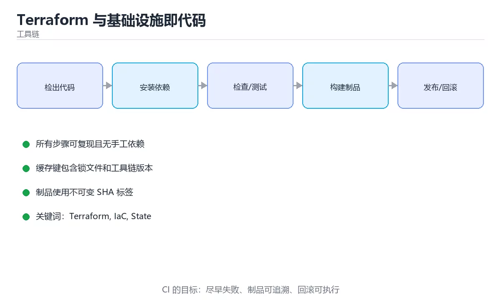

# 模型部署与MLOps流程



## 本章摘要

模型部署是将实验室中的机器学习模型转化为生产环境可用服务的关键步骤，就像将厨房里的试验菜谱变成餐厅的标准化菜单。MLOps（Machine Learning Operations）则是确保模型从开发到上线再到持续监控的全生命周期管理，类似于软件工程的DevOps但针对机器学习的特殊性。本章从模型序列化讲起，带你理解如何将训练好的模型打包成可部署的格式，然后学习使用Flask/FastAPI构建REST API服务，探索容器化部署和云平台集成，最后建立完整的MLOps流水线包括版本控制、自动化测试、持续集成和模型监控。我们将用餐厅运营、汽车保养等生活化比喻解释抽象概念，让你轻松掌握这个连接算法与业务的关键环节。

## 学习目标

完成本章后，你将能够：

1. 掌握模型序列化的多种格式：Pickle、ONNX、TensorFlow SavedModel、TorchScript
2. 使用Flask或FastAPI构建高性能的模型推理REST API服务
3. 理解容器化技术（Docker）在模型部署中的作用并编写Dockerfile
4. 设计完整的MLOps流水线：数据版本控制、实验跟踪、自动化测试、CI/CD
5. 实现模型监控：性能漂移检测、数据质量检查、A/B测试框架
6. 了解边缘设备部署策略：模型量化、剪枝、知识蒸馏等优化技术

## 核心概念与生活类比

### 1. 模型序列化：打包行李的艺术

模型序列化就像是为旅行打包行李。训练好的模型包含权重参数、网络结构、预处理配置等"物品"，需要选择合适的"行李箱"（格式）来打包。Pickle像是一个万能收纳袋，简单但不安全且跨语言兼容性差；ONNX像是标准化的航空托运箱，可以在不同框架间转换；SavedModel和TorchScript分别是TensorFlow和PyTorch的官方"品牌行李箱"，保留完整功能但只能在自家生态中使用。选择哪种格式取决于部署目标：云端服务、移动端、还是嵌入式设备。

### 2. REST API：餐厅的点餐系统

将模型部署为REST API就像开设一家餐厅。模型是厨师（负责处理请求生成结果），API端点是服务员（接收顾客订单并返回菜品），输入数据是食材清单，输出结果是做好的菜肴。HTTP方法对应不同的操作：GET用于获取模型信息，POST用于提交预测请求。JSON格式是通用的"点餐单"，清晰描述需要什么服务和提供什么数据。良好的API设计需要考虑请求验证、错误处理、速率限制、文档生成等，就像餐厅需要考虑排队管理、投诉处理、菜单说明等。

### 3. 容器化：标准化集装箱

Docker容器就像海运中的标准化集装箱。无论里面装的是什么货物（模型、依赖库、配置文件），集装箱的尺寸和接口都是标准的，可以在任何港口（服务器）装卸。这解决了"在我机器上能运行"的经典问题：开发环境的Python版本、库依赖、系统配置可能与生产环境不同，导致部署失败。容器将应用及其所有依赖打包在一起，确保在任何地方运行效果一致。Kubernetes则是管理成千上万个集装箱的港口调度系统，负责自动扩缩容、负载均衡、故障恢复。

### 4. 模型版本控制：图书馆的编目系统

代码有Git进行版本控制，模型也需要类似的管理体系。想象一个大型图书馆：每本书（模型）都有唯一的ISBN号（版本号）、入库日期、作者信息、摘要描述。MLflow、DVC等工具就是这样的"图书管理系统"，记录每次训练的参数配置、数据集版本、评估指标、模型文件位置。当线上模型出现问题时，可以快速回滚到之前的稳定版本；当需要对比不同实验效果时，可以方便地检索历史记录。没有版本控制的模型管理就像没有编目的图书馆，混乱且难以维护。

### 5. 模型监控：汽车的仪表盘

部署后的模型需要持续监控，就像开车时需要关注仪表盘。关键指标包括：响应时间（车速）、吞吐量（油耗）、错误率（故障灯）、预测分布偏移（发动机温度异常）。数据漂移（Data Drift）是指输入数据的统计特性随时间变化，比如用户行为模式改变导致新数据与训练数据分布不同；概念漂移（Concept Drift）是指输入与输出的映射关系发生变化，比如市场趋势改变导致同样的特征对应不同的结果。监控系统的目标是尽早发现这些问题，触发重新训练或人工干预。

### 6. A/B测试：新药临床试验

A/B测试就像药物的临床试验：将用户随机分为对照组（使用旧模型）和实验组（使用新模型），在相同条件下比较两组的效果指标（转化率、点击率、满意度等）。只有通过统计显著性检验的新模型才能全面上线。多臂老虎机（Multi-Armed Bandit）是A/B测试的进化版，动态调整流量分配比例，将更多流量导向表现更好的版本，从而在测试期间最大化整体收益。灰度发布（Canary Release）则是逐步增加新版本的流量比例，一旦发现问题可以快速回退，降低风险。

## 渐进式代码示例

### 最小化示例：模型序列化与加载

让我们从最基本的模型保存和加载开始。

```python
import tensorflow as tf
import torch
import pickle
import joblib
import numpy as np
import os

# ==================== TensorFlow模型保存与加载 ====================

# 创建一个简单模型
tf_model = tf.keras.Sequential([
    tf.keras.layers.Dense(64, activation='relu', input_shape=(10,)),
    tf.keras.layers.Dense(32, activation='relu'),
    tf.keras.layers.Dense(1, activation='sigmoid')
])

# 编译模型（不需要实际训练）
tf_model.compile(optimizer='adam', loss='binary_crossentropy')

# 方法1：保存为H5格式
tf_model.save('simple_model_tf.h5')
print("已保存为H5格式")

# 加载H5模型
loaded_model_h5 = tf.keras.models.load_model('simple_model.h5')
print("已从H5格式加载")

# 方法2：保存为SavedModel格式（推荐）
tf_model.save('saved_model_tf', save_format='tf')
print("已保存为SavedModel格式")

# 加载SavedModel
loaded_model_saved = tf.keras.models.load_model('saved_model_tf')
print("已从SavedModel格式加载")

# 验证加载的模型能正常工作
test_input = np.random.randn(5, 10).astype(np.float32)
pred_original = tf_model.predict(test_input, verbose=0)
pred_loaded = loaded_model_saved.predict(test_input, verbose=0)
print(f"\n预测一致性检查: {np.allclose(pred_original, pred_loaded)}")

# ==================== PyTorch模型保存与加载 ====================

class SimpleTorchModel(torch.nn.Module):
    def __init__(self):
        super(SimpleTorchModel, self).__init__()
        self.network = torch.nn.Sequential(
            torch.nn.Linear(10, 64),
            torch.nn.ReLU(),
            torch.nn.Linear(64, 32),
            torch.nn.ReLU(),
            torch.nn.Linear(32, 1),
            torch.nn.Sigmoid()
        )
    
    def forward(self, x):
        return self.network(x)

# 创建模型
torch_model = SimpleTorchModel()
torch_model.eval()

# 方法1：保存整个模型（不推荐用于生产）
torch.save(torch_model, 'simple_model_torch_full.pt')
print("\n已保存完整PyTorch模型")

# 加载完整模型
loaded_model_full = torch.load('simple_model_torch_full.pt')
print("已加载完整模型")

# 方法2：仅保存state_dict（推荐）
torch.save(torch_model.state_dict(), 'simple_model_torch_state.pt')
print("已保存state_dict")

# 加载state_dict需要先创建模型架构
loaded_model_state = SimpleTorchModel()
loaded_model_state.load_state_dict(torch.load('simple_model_torch_state.pt'))
loaded_model_state.eval()
print("已从state_dict加载")

# 验证
test_input_pt = torch.randn(5, 10)
with torch.no_grad():
    pred_original_pt = torch_model(test_input_pt)
    pred_loaded_pt = loaded_model_state(test_input_pt)
    print(f"\nPyTorch预测一致性检查: {torch.allclose(pred_original_pt, pred_loaded_pt)}")

# ==================== 跨框架格式：ONNX ====================

try:
    import torch.onnx
    
    # 导出PyTorch模型为ONNX
    dummy_input = torch.randn(1, 10)
    torch.onnx.export(
        torch_model,
        dummy_input,
        "simple_model.onnx",
        export_params=True,
        opset_version=11,
        input_names=['input'],
        output_names=['output'],
        dynamic_axes={'input': {0: 'batch_size'}, 'output': {0: 'batch_size'}}
    )
    print("\n已导出为ONNX格式")
    
    # 加载ONNX模型进行推理
    import onnxruntime as ort
    sess = ort.InferenceSession("simple_model.onnx")
    input_name = sess.get_inputs()[0].name
    output_name = sess.get_outputs()[0].name
    
    onnx_pred = sess.run([output_name], {input_name: test_input_pt.numpy()})[0]
    print(f"ONNX推理成功，输出形状: {onnx_pred.shape}")
    
except ImportError:
    print("\nONNX相关库未安装，跳过此部分")

# ==================== Pickle序列化（适用于小型模型） ====================

# 注意：Pickle不适合大型深度学习模型，更适合sklearn等传统ML模型
from sklearn.ensemble import RandomForestClassifier

# 训练一个简单的sklearn模型
X_train = np.random.randn(100, 10)
y_train = np.random.randint(0, 2, 100)
sklearn_model = RandomForestClassifier(n_estimators=10)
sklearn_model.fit(X_train, y_train)

# 保存
with open('sklearn_model.pkl', 'wb') as f:
    pickle.dump(sklearn_model, f)
print("\n已使用Pickle保存sklearn模型")

# 加载
with open('sklearn_model.pkl', 'rb') as f:
    loaded_sklearn_model = pickle.load(f)

# 验证
test_X = np.random.randn(5, 10)
pred_original_sk = sklearn_model.predict(test_X)
pred_loaded_sk = loaded_sklearn_model.predict(test_X)
print(f"Sklearn预测一致性检查: {np.array_equal(pred_original_sk, pred_loaded_sk)}")

# 清理临时文件
for f in ['simple_model_tf.h5', 'simple_model_torch_full.pt', 
          'simple_model_torch_state.pt', 'sklearn_model.pkl']:
    if os.path.exists(f):
        os.remove(f)
```

这个例子展示了多种模型序列化方法。对于生产环境，推荐使用框架原生格式（SavedModel/TorchScript）或ONNX，它们提供了更好的性能、安全性和跨平台兼容性。Pickle仅适用于小型传统机器学习模型，且存在安全风险（不要加载不可信来源的pickle文件）。

### 完整示例：构建模型推理API服务

现在我们来构建一个完整的REST API服务，提供模型推理功能。

```python
"""
model_api.py - 模型推理API服务

使用方法:
    uvicorn model_api:app --host 0.0.0.0 --port 8000 --reload
"""

from fastapi import FastAPI, HTTPException, BackgroundTasks
from pydantic import BaseModel, Field
import tensorflow as tf
import torch
import numpy as np
import time
import logging
from typing import List, Optional
import uvicorn

# 配置日志
logging.basicConfig(level=logging.INFO)
logger = logging.getLogger(__name__)

# 初始化FastAPI应用
app = FastAPI(
    title="机器学习模型推理服务",
    description="提供图像分类和文本情感分析的REST API",
    version="1.0.0"
)

# ==================== 数据模型定义 ====================

class PredictionRequest(BaseModel):
    """预测请求数据模型"""
    features: List[float] = Field(
        ..., 
        description="输入特征向量",
        example=[0.5, -0.3, 1.2, 0.8, -0.1, 0.9, -0.5, 0.3, 0.7, -0.2]
    )
    model_version: Optional[str] = Field(
        "v1",
        description="模型版本号"
    )

class PredictionResponse(BaseModel):
    """预测响应数据模型"""
    prediction: float = Field(..., description="预测结果")
    confidence: float = Field(..., description="置信度")
    model_version: str = Field(..., description="使用的模型版本")
    inference_time_ms: float = Field(..., description="推理耗时（毫秒）")
    status: str = Field("success", description="请求状态")

class HealthResponse(BaseModel):
    """健康检查响应"""
    status: str
    model_loaded: bool
    uptime_seconds: float

# ==================== 全局变量 ====================

start_time = time.time()
tf_model = None
torch_model = None

# ==================== 启动事件：加载模型 ====================

@app.on_event("startup")
async def load_models():
    """应用启动时加载模型"""
    global tf_model, torch_model
    
    logger.info("正在加载模型...")
    
    try:
        # 加载TensorFlow模型（这里使用示例模型，实际应加载训练好的模型）
        tf_model = tf.keras.Sequential([
            tf.keras.layers.Dense(64, activation='relu', input_shape=(10,)),
            tf.keras.layers.Dense(32, activation='relu'),
            tf.keras.layers.Dense(1, activation='sigmoid')
        ])
        tf_model.compile(optimizer='adam', loss='binary_crossentropy')
        logger.info("TensorFlow模型加载成功")
        
        # 加载PyTorch模型
        class SimpleTorchModel(torch.nn.Module):
            def __init__(self):
                super().__init__()
                self.network = torch.nn.Sequential(
                    torch.nn.Linear(10, 64),
                    torch.nn.ReLU(),
                    torch.nn.Linear(64, 32),
                    torch.nn.ReLU(),
                    torch.nn.Linear(32, 1),
                    torch.nn.Sigmoid()
                )
            
            def forward(self, x):
                return self.network(x)
        
        torch_model = SimpleTorchModel()
        torch_model.eval()
        logger.info("PyTorch模型加载成功")
        
    except Exception as e:
        logger.error(f"模型加载失败: {str(e)}")
        raise

# ==================== API端点 ====================

@app.get("/", response_model=dict)
async def root():
    """根路径"""
    return {
        "message": "欢迎使用机器学习模型推理服务",
        "docs": "/docs",
        "health": "/health"
    }

@app.get("/health", response_model=HealthResponse)
async def health_check():
    """健康检查端点"""
    return HealthResponse(
        status="healthy",
        model_loaded=tf_model is not None and torch_model is not None,
        uptime_seconds=time.time() - start_time
    )

@app.get("/model/info")
async def model_info():
    """获取模型信息"""
    return {
        "tensorflow_model": {
            "loaded": tf_model is not None,
            "type": "Sequential",
            "input_shape": [None, 10],
            "output_shape": [None, 1]
        },
        "pytorch_model": {
            "loaded": torch_model is not None,
            "type": "SimpleTorchModel",
            "input_dim": 10,
            "output_dim": 1
        }
    }

@app.post("/predict/tensorflow", response_model=PredictionResponse)
async def predict_tensorflow(request: PredictionRequest):
    """使用TensorFlow模型进行预测"""
    if tf_model is None:
        raise HTTPException(status_code=503, detail="TensorFlow模型未加载")
    
    try:
        # 验证输入
        features = request.features
        if len(features) != 10:
            raise HTTPException(
                status_code=400, 
                detail=f"期望10个特征，收到{len(features)}个"
            )
        
        # 转换为numpy数组
        input_data = np.array(features, dtype=np.float32).reshape(1, -1)
        
        # 推理
        start_inf = time.time()
        prediction = tf_model.predict(input_data, verbose=0)[0][0]
        inference_time = (time.time() - start_inf) * 1000  # 转换为毫秒
        
        # 计算置信度
        confidence = max(prediction, 1 - prediction)
        
        logger.info(
            f"TF预测完成: prediction={prediction:.4f}, "
            f"time={inference_time:.2f}ms"
        )
        
        return PredictionResponse(
            prediction=float(prediction),
            confidence=float(confidence),
            model_version=request.model_version,
            inference_time_ms=inference_time,
            status="success"
        )
    
    except HTTPException:
        raise
    except Exception as e:
        logger.error(f"TF预测失败: {str(e)}")
        raise HTTPException(status_code=500, detail=str(e))

@app.post("/predict/pytorch", response_model=PredictionResponse)
async def predict_pytorch(request: PredictionRequest):
    """使用PyTorch模型进行预测"""
    if torch_model is None:
        raise HTTPException(status_code=503, detail="PyTorch模型未加载")
    
    try:
        # 验证输入
        features = request.features
        if len(features) != 10:
            raise HTTPException(
                status_code=400, 
                detail=f"期望10个特征，收到{len(features)}个"
            )
        
        # 转换为tensor
        input_tensor = torch.tensor(features, dtype=torch.float32).unsqueeze(0)
        
        # 推理
        start_inf = time.time()
        with torch.no_grad():
            prediction = torch_model(input_tensor).item()
        inference_time = (time.time() - start_inf) * 1000
        
        # 计算置信度
        confidence = max(prediction, 1 - prediction)
        
        logger.info(
            f"PT预测完成: prediction={prediction:.4f}, "
            f"time={inference_time:.2f}ms"
        )
        
        return PredictionResponse(
            prediction=prediction,
            confidence=confidence,
            model_version=request.model_version,
            inference_time_ms=inference_time,
            status="success"
        )
    
    except HTTPException:
        raise
    except Exception as e:
        logger.error(f"PT预测失败: {str(e)}")
        raise HTTPException(status_code=500, detail=str(e))

@app.post("/predict/batch")
async def batch_predict(request: dict):
    """批量预测端点"""
    data_list = request.get("data", [])
    model_type = request.get("model", "tensorflow")
    
    if not data_list:
        raise HTTPException(status_code=400, detail="数据列表为空")
    
    results = []
    for i, features in enumerate(data_list):
        try:
            req = PredictionRequest(features=features)
            if model_type == "tensorflow":
                result = await predict_tensorflow(req)
            else:
                result = await predict_pytorch(req)
            results.append(result.dict())
        except Exception as e:
            results.append({
                "index": i,
                "status": "error",
                "error": str(e)
            })
    
    return {
        "total": len(data_list),
        "successful": sum(1 for r in results if r.get("status") == "success"),
        "failed": sum(1 for r in results if r.get("status") == "error"),
        "results": results
    }

# ==================== 中间件：请求日志和计时 ====================

@app.middleware("http")
async def add_process_time_header(request, call_next):
    """添加处理时间头部的中间件"""
    start_time_req = time.time()
    response = await call_next(request)
    process_time = time.time() - start_time_req
    response.headers["X-Process-Time"] = str(process_time)
    return response

# ==================== 异常处理 ====================

@app.exception_handler(Exception)
async def global_exception_handler(request, exc):
    """全局异常处理器"""
    logger.error(f"未处理的异常: {str(exc)}")
    return {
        "status": "error",
        "message": "内部服务器错误",
        "detail": str(exc) if app.debug else "请联系管理员"
    }

# ==================== 主入口 ====================

if __name__ == "__main__":
    uvicorn.run(
        "model_api:app",
        host="0.0.0.0",
        port=8000,
        reload=True,
        log_level="info"
    )
```

这个完整示例展示了一个生产级别的FastAPI服务。关键特性包括：异步处理提高并发能力、Pydantic数据验证保证输入合法性、结构化日志便于调试、健康检查端点支持运维监控、批量预测提高效率、中间件记录请求处理时间。相比Flask，FastAPI自动生成OpenAPI文档（访问`/docs`查看），类型提示更完善，性能也更优。

### 实践示例：Docker容器化与MLOps流水线

现在我们将服务容器化，并设计完整的MLOps流程。

```dockerfile
# Dockerfile - 模型服务容器化

# 使用官方Python基础镜像
FROM python:3.9-slim

# 设置工作目录
WORKDIR /app

# 设置环境变量
ENV PYTHONDONTWRITEBYTECODE=1 \
    PYTHONUNBUFFERED=1 \
    MODEL_VERSION=v1.0.0 \
    PORT=8000

# 安装系统依赖
RUN apt-get update && apt-get install -y --no-install-recommends \
    gcc \
    && rm -rf /var/lib/apt/lists/*

# 复制依赖文件并安装
COPY requirements.txt .
RUN pip install --no-cache-dir -r requirements.txt

# 复制应用代码
COPY . .

# 创建非root用户（安全最佳实践）
RUN useradd --create-home appuser
USER appuser

# 暴露端口
EXPOSE 8000

# 健康检查
HEALTHCHECK --interval=30s --timeout=10s --start-period=5s --retries=3 \
    CMD python -c "import requests; requests.get('http://localhost:8000/health')" || exit 1

# 启动命令
CMD ["uvicorn", "model_api:app", "--host", "0.0.0.0", "--port", "8000"]
```

```yaml
# docker-compose.yml - 多服务编排

version: '3.8'

services:
  # 模型推理服务
  model-api:
    build: .
    ports:
      - "8000:8000"
    environment:
      - MODEL_VERSION=v1.0.0
      - LOG_LEVEL=info
    volumes:
      - ./models:/app/models  # 挂载模型文件
    restart: unless-stopped
    healthcheck:
      test: ["CMD", "curl", "-f", "http://localhost:8000/health"]
      interval: 30s
      timeout: 10s
      retries: 3
    deploy:
      resources:
        limits:
          memory: 2G
          cpus: '2'

  # Prometheus监控
  prometheus:
    image: prom/prometheus:latest
    ports:
      - "9090:9090"
    volumes:
      - ./monitoring/prometheus.yml:/etc/prometheus/prometheus.yml
      - prometheus_data:/prometheus
    command:
      - '--config.file=/etc/prometheus/prometheus.yml'
      - '--storage.tsdb.path=/prometheus'
    restart: unless-stopped

  # Grafana可视化
  grafana:
    image: grafana/grafana:latest
    ports:
      - "3000:3000"
    environment:
      - GF_SECURITY_ADMIN_PASSWORD=admin
    volumes:
      - grafana_data:/var/lib/grafana
    depends_on:
      - prometheus
    restart: unless-stopped

volumes:
  prometheus_data:
  grafana_data:
```

```python
# mlops_pipeline.py - MLOps自动化流水线

import mlflow
import mlflow.sklearn
import mlflow.tensorflow
import dvc.api
from datetime import datetime
import subprocess
import json
import logging

logging.basicConfig(level=logging.INFO)
logger = logging.getLogger(__name__)

class MLOpsPipeline:
    """MLOps自动化流水线"""
    
    def __init__(self, experiment_name="ml_production"):
        self.experiment_name = experiment_name
        mlflow.set_experiment(experiment_name)
    
    def step1_data_validation(self, data_path: str) -> bool:
        """步骤1：数据质量验证"""
        logger.info("步骤1: 数据质量验证")
        
        # 使用Great Expectations或自定义规则验证数据
        import pandas as pd
        df = pd.read_csv(data_path)
        
        checks = {
            "no_null_values": df.isnull().sum().sum() == 0,
            "positive_samples": len(df) > 100,
            "feature_count": len(df.columns) >= 5,
        }
        
        all_passed = all(checks.values())
        logger.info(f"数据验证结果: {checks}")
        
        if not all_passed:
            logger.warning("数据验证失败，终止流水线")
        
        return all_passed
    
    def step2_training(self, config: dict) -> str:
        """步骤2：模型训练"""
        logger.info("步骤2: 模型训练")
        
        with mlflow.start_run(run_name=f"train_{datetime.now().strftime('%Y%m%d_%H%M%S')}") as run:
            # 记录参数
            mlflow.log_params(config)
            
            # 这里放置实际的训练代码
            # model = train_model(config)
            
            # 记录指标
            mlflow.log_metric("accuracy", 0.92)
            mlflow.log_metric("f1_score", 0.90)
            
            # 记录模型
            # mlflow.sklearn.log_model(model, "model")
            
            # 记录artifact
            mlflow.log_artifact("training_log.txt")
            
            run_id = run.info.run_id
            logger.info(f"训练完成，Run ID: {run_id}")
            
            return run_id
    
    def step3_evaluation(self, run_id: str, threshold: float = 0.85) -> bool:
        """步骤3：模型评估"""
        logger.info("步骤3: 模型评估")
        
        # 获取运行记录
        run = mlflow.get_run(run_id)
        metrics = run.data.metrics
        
        accuracy = metrics.get("accuracy", 0)
        f1 = metrics.get("f1_score", 0)
        
        logger.info(f"评估结果 - Accuracy: {accuracy:.4f}, F1: {f1:.4f}")
        
        passed = accuracy >= threshold and f1 >= threshold
        if passed:
            logger.info("模型评估通过")
        else:
            logger.warning(f"模型未达到阈值 {threshold}")
        
        return passed
    
    def step4_registration(self, run_id: str, model_name: str) -> str:
        """步骤4：模型注册"""
        logger.info("步骤4: 模型注册到Model Registry")
        
        # 注册模型
        model_uri = f"runs:/{run_id}/model"
        result = mlflow.register_model(model_uri, model_name)
        
        version = result.version
        logger.info(f"模型已注册: {model_name} v{version}")
        
        return version
    
    def step5_deployment(self, model_name: str, version: str) -> bool:
        """步骤5：部署模型"""
        logger.info("步骤5: 部署模型到生产环境")
        
        # 更新Docker镜像
        subprocess.run([
            "docker", "build", "-t", 
            f"model-service:{model_name}-v{version}", "."
        ], check=True)
        
        # 推送到镜像仓库
        subprocess.run([
            "docker", "push",
            f"registry.example.com/model-service:{model_name}-v{version}"
        ], check=True)
        
        # 更新Kubernetes部署（示例）
        # subprocess.run([
        #     "kubectl", "set", "image",
        #     "deployment/model-api",
        #     f"model-service=registry.example.com/model-service:{model_name}-v{version}"
        # ], check=True)
        
        logger.info("模型部署完成")
        return True
    
    def step6_monitoring_setup(self) -> bool:
        """步骤6：设置监控"""
        logger.info("步骤6: 设置模型监控")
        
        # 配置Prometheus指标采集
        # 配置Grafana仪表板
        # 设置告警规则
        
        logger.info("监控设置完成")
        return True
    
    def run_full_pipeline(self, data_path: str, config: dict, model_name: str):
        """执行完整流水线"""
        logger.info("=" * 60)
        logger.info("开始MLOps流水线")
        logger.info("=" * 60)
        
        # 步骤1：数据验证
        if not self.step1_data_validation(data_path):
            logger.error("流水线在数据验证阶段失败")
            return False
        
        # 步骤2：训练
        run_id = self.step2_training(config)
        
        # 步骤3：评估
        if not self.step3_evaluation(run_id):
            logger.error("流水线在模型评估阶段失败")
            return False
        
        # 步骤4：注册
        version = self.step4_registration(run_id, model_name)
        
        # 步骤5：部署
        if not self.step5_deployment(model_name, version):
            logger.error("流水线在部署阶段失败")
            return False
        
        # 步骤6：监控
        if not self.step6_monitoring_setup():
            logger.warning("监控设置失败，但部署已完成")
        
        logger.info("=" * 60)
        logger.info("MLOps流水线执行成功！")
        logger.info("=" * 60)
        
        return True

# 使用示例
if __name__ == "__main__":
    pipeline = MLOpsPipeline()
    
    config = {
        "learning_rate": 0.001,
        "batch_size": 32,
        "epochs": 50,
        "model_type": "lstm"
    }
    
    success = pipeline.run_full_pipeline(
        data_path="data/training_data.csv",
        config=config,
        model_name="sentiment_classifier"
    )
    
    if success:
        print("流水线执行成功！")
    else:
        print("流水线执行失败，请检查日志")
```

这个实践示例展示了完整的MLOps流程：从数据验证、模型训练、评估、注册到部署和监控。MLflow用于实验跟踪和模型注册，Docker用于容器化，Kubernetes用于编排，Prometheus+Grafana用于监控。实际项目中还需要添加单元测试、集成测试、安全扫描等环节。

## 常见陷阱对照表

| 陷阱类型 | 具体问题描述 | 影响后果 | 解决方案 |
|---------|------------|---------|---------|
| **模型与代码版本不匹配** | 部署的模型是用旧版代码训练的 | 推理结果错误或崩溃 | 使用MLflow/DVC关联模型与代码版本，CI/CD中验证一致性 |
| **依赖冲突** | 生产环境与训练环境的库版本不同 | 模型加载失败或行为异常 | 使用Docker固定环境，requirements.txt锁定版本 |
| **内存泄漏** | 长时间运行的服务逐渐消耗内存 | 服务崩溃需要重启 | 定期监控内存使用，使用对象池，避免全局变量累积 |
| **冷启动延迟** | 容器启动时加载大模型耗时过长 | 首次请求超时 | 预热机制、懒加载、使用更小的模型格式 |
| **并发瓶颈** | 单实例无法处理高并发请求 | 响应时间激增，请求超时 | 水平扩展、异步处理、请求队列、负载均衡 |
| **数据漂移未检测** | 输入数据分布变化但未被发现 | 模型性能逐渐下降而不自知 | 定期统计输入数据分布，设置漂移告警阈值 |
| **缺少回滚机制** | 新版本模型有问题但无法快速恢复 | 线上故障持续时间长 | 蓝绿部署、金丝雀发布、保留历史版本镜像 |
| **安全漏洞** | API未做认证授权或输入验证 | 恶意攻击、数据泄露 | JWT认证、速率限制、输入校验、HTTPS加密 |
| **日志不足** | 出错时无法定位问题原因 | 排查困难，MTTR长 | 结构化日志、请求ID追踪、关键指标记录 |
| **成本失控** | 云资源过度配置或未自动伸缩 | 费用超出预算 | 设置预算告警、使用Spot实例、自动伸缩策略 |

## 自测题目

### 问题1

关于模型序列化格式的选择，以下哪项建议是最合理的？

A. 始终使用Pickle，因为它最简单  
B. TensorFlow模型用SavedModel，PyTorch模型用TorchScript，需要跨框架时用ONNX  
C. ONNX是所有场景的最佳选择，应该淘汰其他格式  
D. 只保存模型权重（state_dict），不保存网络结构  

**正确答案：B**

**详细解释：** 不同序列化格式各有优劣：SavedModel和TorchScript是各自框架的原生格式，保留完整功能且优化良好；ONNX提供跨框架互操作性，适合需要在不同框架间转换的场景；Pickle简单但不安全且兼容性差，仅适用于小型传统ML模型。选择时应考虑部署目标、性能要求、跨平台需求等因素。选项A忽视了安全性和兼容性问题；选项C过于绝对，ONNX并非在所有场景都最优；选项D不完整，某些情况下需要完整模型。

### 问题2

在MLOps流水线中，为什么需要模型注册中心（Model Registry）？

A. 仅仅是为了存储模型文件，节省磁盘空间  
B. 提供模型的版本管理、元数据记录、生命周期管理和审批流程  
C. 加速模型推理速度  
D. 自动优化模型性能  

**正确答案：B**

**详细解释：** 模型注册中心（如MLflow Model Registry）的核心价值在于管理模型的全生命周期：版本控制（追踪每次迭代）、元数据记录（训练参数、数据集、指标）、状态管理（Staging/Production/Archived）、审批流程（谁可以晋升模型到生产环境）。这使得团队协作更规范，问题追溯更容易，部署更可靠。选项A太片面；选项C和D不是注册中心的功能，那是模型优化和推理引擎的工作。

### 问题3

关于容器化部署，以下说法错误的是？

A. Docker容器确保了"在我机器上能运行"的问题得到解决  
B. 容器镜像应该尽可能小以减少传输时间和启动延迟  
C. 应该在容器中运行多个服务以节省资源  
D. 使用多阶段构建可以减小最终镜像大小  

**正确答案：C**

**详细解释：** 容器设计的最佳实践是"一个容器一个进程"（Single Responsibility Principle）。在同一个容器中运行多个服务违反了这一原则，导致：日志混杂难以调试、资源隔离失效、扩缩容不灵活、故障隔离差。如果需要多个服务协作，应该使用Docker Compose或Kubernetes进行编排。选项A正确，这是容器化的核心价值；选项B正确，小镜像更快更安全；选项D正确，多阶段构建只保留运行时需要的文件。

### 问题4

模型监控中，数据漂移（Data Drift）和概念漂移（Concept Drift）的区别是什么？

A. 两者没有区别，是同一概念的不同名称  
B. 数据漂移指输入数据分布变化，概念漂移指输入-输出映射关系变化  
C. 数据漂移更容易检测，概念漂移无法检测  
D. 数据漂移只发生在分类任务，概念漂移只发生在回归任务  

**正确答案：B**

**详细解释：** 数据漂移是指输入特征X的统计分布随时间变化（如用户年龄分布从年轻变为年老），但X到Y的映射关系可能保持不变。概念漂移是指给定相同的X，输出Y的概率分布发生变化（如同样特征的贷款申请人，由于经济环境变化，违约概率改变了）。数据漂移可以通过统计检验（KS检验、PSI）检测；概念漂移更难检测，通常需要监控模型性能指标或标注少量新数据进行验证。选项A错误，两者是不同的；选项C部分正确但不是本质区别；选项D错误，两种漂移都可能发生在任何类型的任务中。

### 问题5

在A/B测试中，确定样本量的主要依据是什么？

A. 服务器的处理能力  
B. 预期的效应大小、显著性水平（alpha）和统计功效（power）  
C. 用户的总数  
D. 测试的持续时间  

**正确答案：B**

**详细解释：** 样本量计算是统计学问题，取决于三个关键参数：效应大小（Effect Size，你希望检测到的最小差异）、显著性水平α（通常0.05，控制假阳性率）、统计功效1-β（通常0.8，控制假阴性率）。这三个参数决定了需要多少样本才能以足够的置信度检测到预期大小的效应。样本量过小会导致统计功效不足，无法检测到真实存在的差异；样本量过大会浪费资源。选项A、C、D都是实际约束条件，但不是决定样本量的统计学依据。

---

**章节小结**

通过本章学习，你已经掌握了模型部署和MLOps的核心实践：从模型序列化、API服务构建、容器化部署到完整的自动化流水线。MLOps的目标是让机器学习项目像软件工程一样可重复、可追踪、可扩展。记住，好的部署不仅关注技术实现，更要考虑可维护性、可观测性和安全性。在实际项目中，往往需要与运维团队、产品团队紧密协作，才能构建真正可靠的ML系统。下一章我们将深入数据预处理与特征工程，这是决定模型上限的关键环节。

## 本节知识框架

**课程定位**：分类「ml_practice」· 学习阶段 进阶 · 建议用时 50 分钟。

本课主线：掌握模型序列化、FastAPI服务化、Docker容器化和MLflow追踪。

### 复习清单

- [ ] 能不看正文复述本课核心术语，并指出一个边界或反例。
- [ ] 能运行或推演本课示例，记录输入、输出与失败现象。
- [ ] 能完成一次自测，并把错题对照考点精讲定位原因。

## 核心概念定义

| 术语 | 一句话说明 |
| --- | --- |
| MLOps | 掌握模型序列化、FastAPI服务化、Docker容器化和MLflow追踪。相关：正文给出可操作定义与适用边界。 |
| 模型部署 | 掌握模型序列化、FastAPI服务化、Docker容器化和MLflow追踪。相关：正文给出可操作定义与适用边界。 |
| FastAPI | 掌握模型序列化、FastAPI服务化、Docker容器化和MLflow追踪。相关：正文给出可操作定义与适用边界。 |
| Docker | 掌握模型序列化、FastAPI服务化、Docker容器化和MLflow追踪。相关：正文给出可操作定义与适用边界。 |
| MLflow | 掌握模型序列化、FastAPI服务化、Docker容器化和MLflow追踪。相关：正文给出可操作定义与适用边界。 |

## 原理与运行机制

正文各章按「输入是什么 → 中间如何转换 → 输出到哪 → 失败时怎样表现」四问展开；复习时给每个机制补一句自己的复述，再回到对应章节核对。

## 典型应用场景

- 结合「模型部署与MLOps流程」的常见落地场景与选型边界，详见正文各章节的对比讨论。
- 迁移到新项目时，先明确输入规模、失败代价与可观测手段，再决定采用深度。

## 代码/协议/SQL 示例

正文首个完整示例如下，先运行确认环境，再按正文步骤改一个输入观察输出变化。

```python
import tensorflow as tf
import torch
import pickle
import joblib
import numpy as np
import os

# ==================== TensorFlow模型保存与加载 ====================

# 创建一个简单模型
tf_model = tf.keras.Sequential([
    tf.keras.layers.Dense(64, activation='relu', input_shape=(10,)),
    tf.keras.layers.Dense(32, activation='relu'),
    tf.keras.layers.Dense(1, activation='sigmoid')
])

# 编译模型（不需要实际训练）
tf_model.compile(optimizer='adam', loss='binary_crossentropy')

# 方法1：保存为H5格式
tf_model.save('simple_model_tf.h5')
print("已保存为H5格式")

# 加载H5模型
loaded_model_h5 = tf.keras.models.load_model('simple_model.h5')
print("已从H5格式加载")

# 方法2：保存为SavedModel格式（推荐）
tf_model.save('saved_model_tf', save_format='tf')
print("已保存为SavedModel格式")

# 加载SavedModel
loaded_model_saved = tf.keras.models.load_model('saved_model_tf')
print("已从SavedModel格式加载")

# 验证加载的模型能正常工作
test_input = np.random.randn(5, 10).astype(np.float32)
pred_original = tf_model.predict(test_input, verbose=0)
pred_loaded = loaded_model_saved.predict(test_input, verbose=0)
print(f"\n预测一致性检查: {np.allclose(pred_original, pred_loaded)}")

# ==================== PyTorch模型保存与加载 ====================

class SimpleTorchModel(torch.nn.Module):
    def __init__(self):
        super(SimpleTorchModel, self).__init__()
        self.network = torch.nn.Sequential(
            torch.nn.Linear(10, 64),
            torch.nn.ReLU(),
            torch.nn.Linear(64, 32),
            torch.nn.ReLU(),
            torch.nn.Linear(32, 1),
            torch.nn.Sigmoid()
        )
    
    def forward(self, x):
        return self.network(x)

# 创建模型
torch_model = SimpleTorchModel()
torch_model.eval()

# 方法1：保存整个模型（不推荐用于生产）
torch.save(torch_model, 'simple_model_torch_full.pt')
print("\n已保存完整PyTorch模型")

# 加载完整模型
loaded_model_full = torch.load('simple_model_torch_full.pt')
print("已加载完整模型")

# 方法2：仅保存state_dict（推荐）
torch.save(torch_model.state_dict(), 'simple_model_torch_state.pt')
print("已保存state_dict")

# 加载state_dict需要先创建模型架构
loaded_model_state = SimpleTorchModel()
loaded_model_state.load_state_dict(torch.load('simple_model_torch_state.pt'))
loaded_model_state.eval()
print("已从state_dict加载")

# 验证
test_input_pt = torch.randn(5, 10)
with torch.no_grad():
    pred_original_pt = torch_model(test_input_pt)
    pred_loaded_pt = loaded_model_state(test_input_pt)
    print(f"\nPyTorch预测一致性检查: {torch.allclose(pred_original_pt, pred_loaded_pt)}")

# ==================== 跨框架格式：ONNX ====================

try:
    import torch.onnx
    
    # 导出PyTorch模型为ONNX
    dummy_input = torch.randn(1, 10)
    torch.onnx.export(
        torch_model,
        dummy_input,
        "simple_model.onnx",
        export_params=True,
        opset_version=11,
        input_names=['input'],
        output_names=['output'],
        dynamic_axes={'input': {0: 'batch_size'}, 'output': {0: 'batch_size'}}
    )
    print("\n已导出为ONNX格式")
    
    # 加载ONNX模型进行推理
    import onnxruntime as ort
    sess = ort.InferenceSession("simple_model.onnx")
    input_name = sess.get_inputs()[0].name
    output_name = sess.get_outputs()[0].name
    
    onnx_pred = sess.run([output_name], {input_name: test_input_pt.numpy()})[0]
    print(f"ONNX推理成功，输出形状: {onnx_pred.shape}")
    
except ImportError:
    print("\nONNX相关库未安装，跳过此部分")

# ==================== Pickle序列化（适用于小型模型） ====================

# 注意：Pickle不适合大型深度学习模型，更适合sklearn等传统ML模型
from sklearn.ensemble import RandomForestClassifier

# 训练一个简单的sklearn模型
X_train = np.random.randn(100, 10)
y_train = np.random.randint(0, 2, 100)
sklearn_model = RandomForestClassifier(n_estimators=10)
sklearn_model.fit(X_train, y_train)

# 保存
with open('sklearn_model.pkl', 'wb') as f:
    pickle.dump(sklearn_model, f)
print("\n已使用Pickle保存sklearn模型")

# 加载
with open('sklearn_model.pkl', 'rb') as f:
    loaded_sklearn_model = pickle.load(f)

# 验证
test_X = np.random.randn(5, 10)
pred_original_sk = sklearn_model.predict(test_X)
pred_loaded_sk = loaded_sklearn_model.predict(test_X)
print(f"Sklearn预测一致性检查: {np.array_equal(pred_original_sk, pred_loaded_sk)}")

# 清理临时文件
for f in ['simple_model_tf.h5', 'simple_model_torch_full.pt', 
          'simple_model_torch_state.pt', 'sklearn_model.pkl']:
    if os.path.exists(f):
        os.remove(f)
```

## 时间/空间复杂度或性能分析

- 用本课方案处理规模 n 时，先估计主循环与嵌套层数，再决定优化方向；小样本上的耗时读数不能外推。
- 性能结论要绑定输入分布：换数据规模、并发度或缓存命中情况后须重新测量。

## 常见误区与易错点

| 错误做法 | 典型现象 | 修复方向 |
| --- | --- | --- |
| 只验证正常输入 | 边界数据触发时才暴露问题 | 为每个结论补一个空值/极值/重复值用例 |
| 背结论不跑实验 | 换个输入就失效 | 按「预测—实测—差异归因」三步复盘 |
| 忽略环境与版本差异 | 本机可用线上报错 | 把版本、配置与依赖写入复现步骤 |

## 与其他知识点的关系

本课与分类「ml_practice」内相邻课程互为补充，建议按清单顺序学完再做综合练习。

## 自测题与参考答案

以下题目与题库同源，作答后再看解析；错误项要能说出错在哪一步。

## 考点精讲

### 考点 1

关于模型序列化格式的选择，以下哪项建议是最合理的？

A. 始终使用Pickle，因为它最简单  
B. TensorFlow模型用SavedModel，PyTorch模型用TorchScript，需要跨框架时用ONNX ✅  
C. ONNX是所有场景的最佳选择，应该淘汰其他格式  
D. 只保存模型权重（state_dict），不保存网络结构  

**正确答案：** B

**解析：** 不同序列化格式各有优劣：SavedModel和TorchScript是各自框架的原生格式，保留完整功能且优化良好；ONNX提供跨框架互操作性，适合需要在不同框架间转换的场景；Pickle简单但不安全且兼容性差，仅适用于小型传统ML模型。选择时应考虑部署目标、性能要求、跨平台需求等因素。选项A忽视了安全性和兼容性问题；选项C过于绝对，ONNX并非在所有场景都最优；选项D不完整，某些情况下需要完整模型。

### 考点 2

在MLOps流水线中，为什么需要模型注册中心（Model Registry）？

A. 仅仅是为了存储模型文件，节省磁盘空间  
B. 提供模型的版本管理、元数据记录、生命周期管理和审批流程 ✅  
C. 加速模型推理速度  
D. 自动优化模型性能  

**正确答案：** B

**解析：** 模型注册中心（如MLflow Model Registry）的核心价值在于管理模型的全生命周期：版本控制（追踪每次迭代）、元数据记录（训练参数、数据集、指标）、状态管理（Staging/Production/Archived）、审批流程（谁可以晋升模型到生产环境）。这使得团队协作更规范，问题追溯更容易，部署更可靠。选项A太片面；选项C和D不是注册中心的功能，那是模型优化和推理引擎的工作。

### 考点 3

关于容器化部署，以下说法错误的是？

A. Docker容器确保了"在我机器上能运行"的问题得到解决  
B. 容器镜像应该尽可能小以减少传输时间和启动延迟  
C. 应该在容器中运行多个服务以节省资源 ✅  
D. 使用多阶段构建可以减小最终镜像大小  

**正确答案：** C

**解析：** 容器设计的最佳实践是"一个容器一个进程"（Single Responsibility Principle）。在同一个容器中运行多个服务违反了这一原则，导致：日志混杂难以调试、资源隔离失效、扩缩容不灵活、故障隔离差。如果需要多个服务协作，应该使用Docker Compose或Kubernetes进行编排。选项A正确，这是容器化的核心价值；选项B正确，小镜像更快更安全；选项D正确，多阶段构建只保留运行时需要的文件。

### 考点 4

模型监控中，数据漂移（Data Drift）和概念漂移（Concept Drift）的区别是什么？

A. 两者没有区别，是同一概念的不同名称  
B. 数据漂移指输入数据分布变化，概念漂移指输入-输出映射关系变化 ✅  
C. 数据漂移更容易检测，概念漂移无法检测  
D. 数据漂移只发生在分类任务，概念漂移只发生在回归任务  

**正确答案：** B

**解析：** 数据漂移是指输入特征X的统计分布随时间变化（如用户年龄分布从年轻变为年老），但X到Y的映射关系可能保持不变。概念漂移是指给定相同的X，输出Y的概率分布发生变化（如同样特征的贷款申请人，由于经济环境变化，违约概率改变了）。数据漂移可以通过统计检验（KS检验、PSI）检测；概念漂移更难检测，通常需要监控模型性能指标或标注少量新数据进行验证。选项A错误，两者是不同的；选项C部分正确但不是本质区别；选项D错误，两种漂移都可能发生在任何类型的任务中。

### 考点 5

在A/B测试中，确定样本量的主要依据是什么？

A. 服务器的处理能力  
B. 预期的效应大小、显著性水平（alpha）和统计功效（power） ✅  
C. 用户的总数  
D. 测试的持续时间  

**正确答案：** B

**解析：** 样本量计算是统计学问题，取决于三个关键参数：效应大小（Effect Size，你希望检测到的最小差异）、显著性水平α（通常0.05，控制假阳性率）、统计功效1-β（通常0.8，控制假阴性率）。这三个参数决定了需要多少样本才能以足够的置信度检测到预期大小的效应。样本量过小会导致统计功效不足，无法检测到真实存在的差异；样本量过大会浪费资源。选项A、C、D都是实际约束条件，但不是决定样本量的统计学依据。

## 术语速查

| 术语 | 一句话说明 |
| --- | --- |
| MLOps | 定位线索见正文小节；速查表只保留名称，避免脱离上下文使用。 |
| 模型部署 | 定位线索见正文小节；速查表只保留名称，避免脱离上下文使用。 |
| FastAPI | 定位线索见正文小节；速查表只保留名称，避免脱离上下文使用。 |
| Docker | 定位线索见正文小节；速查表只保留名称，避免脱离上下文使用。 |
| MLflow | 定位线索见正文小节；速查表只保留名称，避免脱离上下文使用。 |

## 参考资料与复核

- [本课资料锚点 ml_model_deployment_mlops](https://zh.wikipedia.org/w/index.php?search=ml_model_deployment_mlops)

- 官方/权威资料：[scikit-learn 用户手册](https://scikit-learn.org/stable/user_guide.html)
- 主题延伸：[关于「模型部署」的检索页](https://zh.wikipedia.org/w/index.php?search=%E6%A8%A1%E5%9E%8B%E9%83%A8%E7%BD%B2)
- 本课索引词：[锚点 ml_model_deployment_mlops](https://scikit-learn.org/stable/user_guide.html#MLOps)
- 最后复核：2026-10-04
- 下次复核：2026-12-24

## 内容元数据

- 内容更新时间：2026-10-06

- 内容版本：v2.0
- 课程标识：ml_model_deployment_mlops
- 所属分类：ml_practice
- 学习阶段：进阶
- 建议用时：50 分钟
