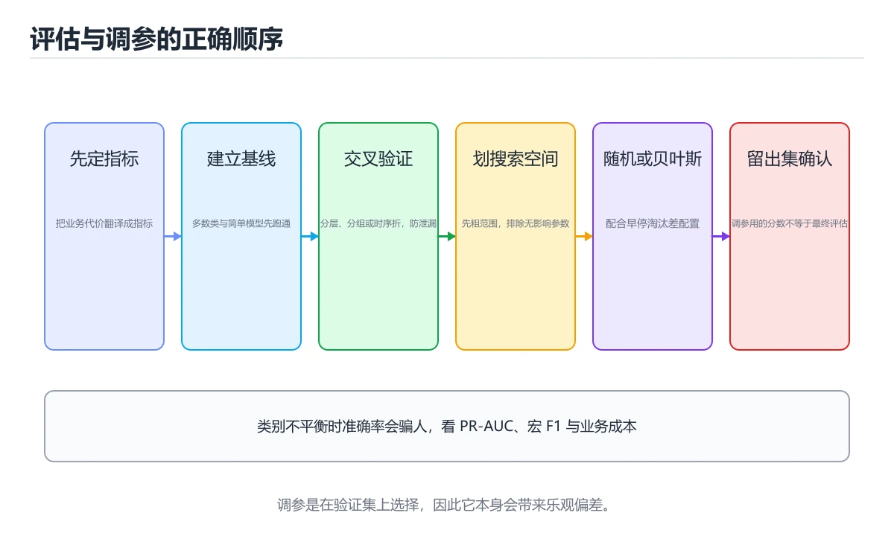

# 模型评估与超参数调优



> 内容更新时间：2026-10-06 · 学习阶段：进阶 · 预计用时：65 分钟

## 本节知识框架

**课程定位**：分类「ml_practice」· 学习阶段 进阶 · 建议用时 50 分钟。

本课主线：掌握评估指标、交叉验证、网格搜索和贝叶斯优化方法。

### 复习清单

- [ ] 能用自己的话说明「模型评估与超参数调优」里的 模型评估，再举一个它不成立的场景。
- [ ] 能运行「模型评估与超参数调优」的示例，记录输入、输出与第一次失败的现象。
- [ ] 能完成一次自测，并把错题对照考点精讲定位原因。

### 课程导言
模型评估和超参数调优是机器学习工作流中的最后两道关卡，就像考试前的模拟测试和复习策略调整。模型评估回答"这个模型有多好"的问题，需要选择合适的指标、设计合理的验证方案、进行统计显著性检验；超参数调优回答"如何让模型更好"的问题，需要在庞大的搜索空间中找到最优配置，平衡探索与计算成本。本章从基础的性能指标讲起，带你理解准确率、精确率、召回率、F1分数、AUC等指标的适用场景和局限性，然后深入学习交叉验证、自助法（Bootstrap）等验证技术，最后掌握网格搜索、随机搜索、贝叶斯优化等调参方法。我们将用体检报告、汽车 tuning等生活化比喻解释抽象概念，让你轻松掌握这个决定模型最终表现的关键环节。

### 学习目标
完成本章后，你将能够：

1. 理解分类、回归、聚类等不同任务的评估指标及其适用场景
2. 掌握混淆矩阵、ROC曲线、PR曲线的解读方法和绘制技巧
3. 设计合理的验证策略：留出法、K折交叉验证、分层抽样、时间序列分割
4. 使用网格搜索、随机搜索、贝叶斯优化进行高效的超参数调优
5. 识别和处理过拟合与欠拟合：学习曲线、偏差-方差分解、正则化
6. 进行统计显著性检验，判断模型改进是否真实可靠而非随机波动

## 核心概念定义

| 术语 | 一句话说明 |
| --- | --- |
| 模型评估 | 选指标要先看任务与类别分布：正文那份 9 成负类的数据里全预测负类也有九成准确率，改进是否真实还得靠配对 t 检验加效应量。 |
| 超参数调优 | 对象是训练前人定的配置（学习率、树深、隐藏层数），训练过程不会改它；难点在于在庞大组合里找最优并权衡算力。 |
| 交叉验证 | K 折轮流各留一折当验证再取平均，类别稀少时要用分层折保持比例，时间序列只能前向链式分割，预处理得放进 Pipeline 在每折内做。 |
| 网格搜索 | 把 param_grid 各维取值长度相乘逐一试完，示例四栏就是 144 组再各跑 5 折；只保证网格内最优，维度一多成本指数上升。 |
| 贝叶斯优化 | 拿已测过的点拟合代理模型，据此挑有希望的区域再试；示例用 BayesSearchCV 的 n_calls=30 只评估 30 个点换取速度。 |

## 原理与运行机制

《模型评估与超参数调优》正文各章按「输入是什么 → 中间如何转换 → 输出到哪 → 失败时怎样表现」四问展开；复习时给每个机制补一句自己的复述，再回到对应章节核对。

### 生活类比拆解
#### 1. 评估指标选择：体检报告的多维度

模型评估就像做体检：不能只看一个指标（如体重），而要综合多项检查（血压、血糖、胆固醇等）。分类任务中，准确率（Accuracy）像总体健康评分，但在类别不平衡时会误导（99%的人没病，全预测为没病也有99%准确率）；精确率（Precision）像"确诊为正的患者中真正有病的比例"，关注预测的可靠性；召回率（Recall）像"所有真正有病的人中被检出的比例"，关注漏诊风险；F1分数是两者的调和平均，平衡精确率和召回率；AUC-ROC曲线下面积像整体诊断能力评分，不受阈值影响。选择哪个指标取决于业务目标：垃圾邮件过滤重视精确率（别误删重要邮件），癌症筛查重视召回率（别漏掉病人）。

#### 2. 交叉验证：多次模拟考试的平均分

留出法（Hold-out）就像只进行一次模拟考试，结果可能受题目难易、当天状态等偶然因素影响。K折交叉验证（K-Fold Cross-Validation）则像进行K次模拟考试：将数据分成K份，每次用K-1份训练、1份测试，轮流进行K次，最后取平均成绩。这样得到的评估更稳定可靠，能更好地估计模型在未知数据上的表现。分层抽样（Stratified Sampling）确保每份数据中各类别的比例与原数据集一致，避免某折中某一类样本过少导致评估偏差。对于时间序列数据，必须使用前向链式验证（Forward Chaining），不能用未来的数据预测过去。

#### 3. 超参数 vs 参数：汽车改装 vs 日常驾驶

参数（Parameters）是模型在训练过程中自动学习的内部变量，如神经网络的权重、线性回归的系数，就像开车时根据路况自动调整的油门和方向盘角度。超参数（Hyperparameters）是训练前需要手动设置的配置，如学习率、树的深度、隐藏层数量，就像改装汽车时选择的引擎型号、轮胎尺寸、悬挂硬度——这些选择在训练开始前就确定了，训练过程中不会改变。超参数调优就是在众多可能的配置组合中找到使模型性能最好的那一组，这通常需要大量实验和系统化的搜索策略。

#### 4. 网格搜索 vs 随机搜索：地毯式搜索 vs 随机采样

网格搜索（Grid Search）像在地图上按经纬度格子逐一搜索目标：系统地遍历所有可能的超参数组合。这种方法保证找到网格内的最优解，但当超参数很多或取值范围很大时，组合数呈指数增长（维度灾难），计算成本极高。随机搜索（Random Search）像随机扔飞镖：从超参数空间中随机采样一定数量的组合进行评估。研究表明，随机搜索往往比网格搜索更高效，因为大多数超参数对性能影响不大，随机采样更有可能在高影响维度的多个不同值上探索。贝叶斯优化则更聪明：根据之前的实验结果建立代理模型，预测哪些区域可能有更好的解，有针对性地采样。

#### 5. 过拟合与欠拟合：死记硬背 vs 一窍不通

过拟合（Overfitting）就像学生死记硬背考题答案：在练习卷（训练集）上得满分，但换一套题（测试集）就不会做了。模型记住了训练数据中的噪声和细节，而非学习到泛化规律。欠拟合（Underfitting）则像学生根本没学好：练习卷和正式考试都考不好。模型太简单，无法捕捉数据中的模式。偏差-方差分解提供了理论框架：高偏差对应欠拟合（模型假设太强），高方差对应过拟合（模型太复杂）。学习曲线（Learning Curve）是诊断工具：绘制训练误差和验证误差随训练样本数的变化，两条曲线接近且都高说明欠拟合，差距大说明过拟合。

#### 6. 统计显著性检验：区分信号与噪音

当比较两个模型的性能差异时，如何判断这是真实的改进还是随机波动？统计显著性检验提供了科学方法。配对t检验（Paired t-test）假设两次运行的差异服从正态分布，计算p值判断差异是否显著（p<0.05通常认为显著）。Wilcoxon符号秩检验是非参数版本，不假设正态分布，更鲁棒。McNemar检验专门用于比较两个分类器在同一测试集上的表现，考虑了配对相关性。需要注意的是，统计显著不等于实际显著：在大样本下，微小的性能差异也可能统计显著，但业务价值有限。效应量（Effect Size）衡量差异的实际大小，应与p值结合解读。

## 典型应用场景

- 结合「模型评估与超参数调优」的常见落地场景与选型边界，详见正文各章节的对比讨论。
- 把「模型评估与超参数调优」的做法搬到新项目时，先评估 超参数调优 的规模与可观测条件。

## 代码/协议/SQL 示例

下面这段示例是 模型评估 的最小可运行版本；先原样跑通，再改一个输入比较输出。

```python
import numpy as np
import pandas as pd
from sklearn.metrics import (
    accuracy_score, precision_score, recall_score, f1_score,
    confusion_matrix, classification_report, roc_auc_score,
    roc_curve, precision_recall_curve, auc,
    mean_absolute_error, mean_squared_error, r2_score
)
import matplotlib.pyplot as plt
import seaborn as sns

# ==================== 分类任务评估 ====================

np.random.seed(42)

# 生成示例数据（二分类，类别不平衡）
n_samples = 1000
y_true = np.random.choice([0, 1], n_samples, p=[0.9, 0.1])  # 90%负类，10%正类
y_pred_prob = np.random.uniform(0, 1, n_samples)

# 根据概率生成预测（阈值0.5）
threshold = 0.5
y_pred = (y_pred_prob >= threshold).astype(int)

print("=== 分类任务评估 ===\n")

# 基础指标
accuracy = accuracy_score(y_true, y_pred)
precision = precision_score(y_true, y_pred, zero_division=0)
recall = recall_score(y_true, y_pred, zero_division=0)
f1 = f1_score(y_true, y_pred, zero_division=0)

print(f"准确率 (Accuracy): {accuracy:.4f}")
print(f"精确率 (Precision): {precision:.4f}")
print(f"召回率 (Recall): {recall:.4f}")
print(f"F1分数: {f1:.4f}")

# 注意：在类别不平衡时，准确率高但其他指标可能很低
print(f"\n⚠️  注意：由于类别不平衡（90%负类），准确率{accuracy:.2%}具有误导性")
print(f"   如果全部预测为负类，准确率也会达到90%")

# 混淆矩阵
cm = confusion_matrix(y_true, y_pred)
print(f"\n混淆矩阵:\n{cm}")
print(f"  TN={cm[0][0]}, FP={cm[0][1]}")
print(f"  FN={cm[1][0]}, TP={cm[1][1]}")

# 详细分类报告
print(f"\n详细分类报告:")
print(classification_report(y_true, y_pred, target_names=['Negative', 'Positive']))

# ROC曲线和AUC
fpr, tpr, thresholds_roc = roc_curve(y_true, y_pred_prob)
roc_auc = roc_auc_score(y_true, y_pred_prob)

print(f"\nROC AUC: {roc_auc:.4f}")
print(f"AUC解读: 0.5=随机猜测, 1.0=完美分类, {roc_auc:.4f}={'较好' if roc_auc > 0.7 else '一般'}")

# PR曲线（更适合不平衡数据）
precision_vals, recall_vals, thresholds_pr = precision_recall_curve(y_true, y_pred_prob)
pr_auc = auc(recall_vals, precision_vals)
print(f"PR AUC: {pr_auc:.4f}")

# 可视化
fig, axes = plt.subplots(1, 3, figsize=(18, 5))

# 混淆矩阵热力图
sns.heatmap(cm, annot=True, fmt='d', cmap='Blues', ax=axes[0],
            xticklabels=['Negative', 'Positive'],
            yticklabels=['Negative', 'Positive'])
axes[0].set_xlabel('Predicted')
axes[0].set_ylabel('Actual')
axes[0].set_title('Confusion Matrix')

# ROC曲线
axes[1].plot(fpr, tpr, 'b-', linewidth=2, label=f'ROC curve (AUC = {roc_auc:.3f})')
axes[1].plot([0, 1], [0, 1], 'r--', linewidth=1, label='Random classifier')
axes[1].set_xlabel('False Positive Rate')
axes[1].set_ylabel('True Positive Rate')
axes[1].set_title('ROC Curve')
axes[1].legend(loc='lower right')
axes[1].grid(True, alpha=0.3)

# PR曲线
axes[2].plot(recall_vals, precision_vals, 'g-', linewidth=2, label=f'PR curve (AUC = {pr_auc:.3f})')
axes[2].set_xlabel('Recall')
axes[2].set_ylabel('Precision')
axes[2].set_title('Precision-Recall Curve')
axes[2].legend(loc='lower left')
axes[2].grid(True, alpha=0.3)

plt.tight_layout()
plt.savefig('classification_metrics.png', dpi=150, bbox_inches='tight')
plt.show()

# ==================== 回归任务评估 ====================

print("\n=== 回归任务评估 ===\n")

# 生成示例数据
y_true_reg = np.random.randn(200) * 10 + 50
y_pred_reg = y_true_reg + np.random.randn(200) * 3  # 添加噪声

# 回归指标
mae = mean_absolute_error(y_true_reg, y_pred_reg)
mse = mean_squared_error(y_true_reg, y_pred_reg)
rmse = np.sqrt(mse)
r2 = r2_score(y_true_reg, y_pred_reg)

print(f"平均绝对误差 (MAE): {mae:.4f}")
print(f"均方误差 (MSE): {mse:.4f}")
print(f"均方根误差 (RMSE): {rmse:.4f}")
print(f"R²分数: {r2:.4f}")
print(f"\nR²解读: 1.0=完美拟合, 0.0=不如均值预测, {r2:.4f}={'较好' if r2 > 0.7 else '一般'}")

# 可视化残差
residuals = y_true_reg - y_pred_reg

fig, axes = plt.subplots(1, 2, figsize=(14, 5))

# 预测值vs实际值
axes[0].scatter(y_true_reg, y_pred_reg, alpha=0.5, edgecolors='k', s=50)
min_val = min(y_true_reg.min(), y_pred_reg.min())
max_val = max(y_true_reg.max(), y_pred_reg.max())
axes[0].plot([min_val, max_val], [min_val, max_val], 'r--', linewidth=2, label='Perfect prediction')
axes[0].set_xlabel('Actual Values')
axes[0].set_ylabel('Predicted Values')
axes[0].set_title('Actual vs Predicted')
axes[0].legend()
axes[0].grid(True, alpha=0.3)

# 残差分布
axes[1].hist(residuals, bins=30, edgecolor='black', alpha=0.7, color='steelblue')
axes[1].axvline(x=0, color='red', linestyle='--', linewidth=2)
axes[1].set_xlabel('Residual (Actual - Predicted)')
axes[1].set_ylabel('Frequency')
axes[1].set_title('Residual Distribution')
axes[1].grid(True, alpha=0.3)

plt.tight_layout()
plt.savefig('regression_metrics.png', dpi=150, bbox_inches='tight')
plt.show()
```

### 渐进式代码示例
#### 最小化示例：基础评估指标

让我们从最基本的分类和回归评估指标开始。

```python
import numpy as np
import pandas as pd
from sklearn.metrics import (
    accuracy_score, precision_score, recall_score, f1_score,
    confusion_matrix, classification_report, roc_auc_score,
    roc_curve, precision_recall_curve, auc,
    mean_absolute_error, mean_squared_error, r2_score
)
import matplotlib.pyplot as plt
import seaborn as sns

# ==================== 分类任务评估 ====================

np.random.seed(42)

# 生成示例数据（二分类，类别不平衡）
n_samples = 1000
y_true = np.random.choice([0, 1], n_samples, p=[0.9, 0.1])  # 90%负类，10%正类
y_pred_prob = np.random.uniform(0, 1, n_samples)

# 根据概率生成预测（阈值0.5）
threshold = 0.5
y_pred = (y_pred_prob >= threshold).astype(int)

print("=== 分类任务评估 ===\n")

# 基础指标
accuracy = accuracy_score(y_true, y_pred)
precision = precision_score(y_true, y_pred, zero_division=0)
recall = recall_score(y_true, y_pred, zero_division=0)
f1 = f1_score(y_true, y_pred, zero_division=0)

print(f"准确率 (Accuracy): {accuracy:.4f}")
print(f"精确率 (Precision): {precision:.4f}")
print(f"召回率 (Recall): {recall:.4f}")
print(f"F1分数: {f1:.4f}")

# 注意：在类别不平衡时，准确率高但其他指标可能很低
print(f"\n⚠️  注意：由于类别不平衡（90%负类），准确率{accuracy:.2%}具有误导性")
print(f"   如果全部预测为负类，准确率也会达到90%")

# 混淆矩阵
cm = confusion_matrix(y_true, y_pred)
print(f"\n混淆矩阵:\n{cm}")
print(f"  TN={cm[0][0]}, FP={cm[0][1]}")
print(f"  FN={cm[1][0]}, TP={cm[1][1]}")

# 详细分类报告
print(f"\n详细分类报告:")
print(classification_report(y_true, y_pred, target_names=['Negative', 'Positive']))

# ROC曲线和AUC
fpr, tpr, thresholds_roc = roc_curve(y_true, y_pred_prob)
roc_auc = roc_auc_score(y_true, y_pred_prob)

print(f"\nROC AUC: {roc_auc:.4f}")
print(f"AUC解读: 0.5=随机猜测, 1.0=完美分类, {roc_auc:.4f}={'较好' if roc_auc > 0.7 else '一般'}")

# PR曲线（更适合不平衡数据）
precision_vals, recall_vals, thresholds_pr = precision_recall_curve(y_true, y_pred_prob)
pr_auc = auc(recall_vals, precision_vals)
print(f"PR AUC: {pr_auc:.4f}")

# 可视化
fig, axes = plt.subplots(1, 3, figsize=(18, 5))

# 混淆矩阵热力图
sns.heatmap(cm, annot=True, fmt='d', cmap='Blues', ax=axes[0],
            xticklabels=['Negative', 'Positive'],
            yticklabels=['Negative', 'Positive'])
axes[0].set_xlabel('Predicted')
axes[0].set_ylabel('Actual')
axes[0].set_title('Confusion Matrix')

# ROC曲线
axes[1].plot(fpr, tpr, 'b-', linewidth=2, label=f'ROC curve (AUC = {roc_auc:.3f})')
axes[1].plot([0, 1], [0, 1], 'r--', linewidth=1, label='Random classifier')
axes[1].set_xlabel('False Positive Rate')
axes[1].set_ylabel('True Positive Rate')
axes[1].set_title('ROC Curve')
axes[1].legend(loc='lower right')
axes[1].grid(True, alpha=0.3)

# PR曲线
axes[2].plot(recall_vals, precision_vals, 'g-', linewidth=2, label=f'PR curve (AUC = {pr_auc:.3f})')
axes[2].set_xlabel('Recall')
axes[2].set_ylabel('Precision')
axes[2].set_title('Precision-Recall Curve')
axes[2].legend(loc='lower left')
axes[2].grid(True, alpha=0.3)

plt.tight_layout()
plt.savefig('classification_metrics.png', dpi=150, bbox_inches='tight')
plt.show()

# ==================== 回归任务评估 ====================

print("\n=== 回归任务评估 ===\n")

# 生成示例数据
y_true_reg = np.random.randn(200) * 10 + 50
y_pred_reg = y_true_reg + np.random.randn(200) * 3  # 添加噪声

# 回归指标
mae = mean_absolute_error(y_true_reg, y_pred_reg)
mse = mean_squared_error(y_true_reg, y_pred_reg)
rmse = np.sqrt(mse)
r2 = r2_score(y_true_reg, y_pred_reg)

print(f"平均绝对误差 (MAE): {mae:.4f}")
print(f"均方误差 (MSE): {mse:.4f}")
print(f"均方根误差 (RMSE): {rmse:.4f}")
print(f"R²分数: {r2:.4f}")
print(f"\nR²解读: 1.0=完美拟合, 0.0=不如均值预测, {r2:.4f}={'较好' if r2 > 0.7 else '一般'}")

# 可视化残差
residuals = y_true_reg - y_pred_reg

fig, axes = plt.subplots(1, 2, figsize=(14, 5))

# 预测值vs实际值
axes[0].scatter(y_true_reg, y_pred_reg, alpha=0.5, edgecolors='k', s=50)
min_val = min(y_true_reg.min(), y_pred_reg.min())
max_val = max(y_true_reg.max(), y_pred_reg.max())
axes[0].plot([min_val, max_val], [min_val, max_val], 'r--', linewidth=2, label='Perfect prediction')
axes[0].set_xlabel('Actual Values')
axes[0].set_ylabel('Predicted Values')
axes[0].set_title('Actual vs Predicted')
axes[0].legend()
axes[0].grid(True, alpha=0.3)

# 残差分布
axes[1].hist(residuals, bins=30, edgecolor='black', alpha=0.7, color='steelblue')
axes[1].axvline(x=0, color='red', linestyle='--', linewidth=2)
axes[1].set_xlabel('Residual (Actual - Predicted)')
axes[1].set_ylabel('Frequency')
axes[1].set_title('Residual Distribution')
axes[1].grid(True, alpha=0.3)

plt.tight_layout()
plt.savefig('regression_metrics.png', dpi=150, bbox_inches='tight')
plt.show()
```

这个例子展示了分类和回归任务的核心评估指标。分类任务中，准确率在类别不平衡时会误导，应结合精确率、召回率、F1、AUC综合判断；ROC曲线适合平衡数据，PR曲线更适合不平衡数据。回归任务中，MAE直观易解释，RMSE对大误差惩罚更重，R²表示模型解释的方差比例。可视化工具（混淆矩阵、散点图、残差图）帮助直观理解模型表现。

#### 完整示例：交叉验证与模型比较

现在我们来演示如何使用交叉验证进行可靠的模型评估和比较。

```python
import numpy as np
import pandas as pd
from sklearn.datasets import make_classification, make_regression
from sklearn.model_selection import (
    train_test_split, cross_val_score, KFold, StratifiedKFold,
    LeaveOneOut, TimeSeriesSplit, learning_curve, validation_curve
)
from sklearn.linear_model import LogisticRegression, Ridge
from sklearn.ensemble import RandomForestClassifier, GradientBoostingClassifier
from sklearn.svm import SVC
from sklearn.preprocessing import StandardScaler
from sklearn.pipeline import Pipeline
import matplotlib.pyplot as plt
import warnings
warnings.filterwarnings('ignore')

# ==================== 创建示例数据集 ====================

np.random.seed(42)

# 分类数据
X_clf, y_clf = make_classification(
    n_samples=1000,
    n_features=20,
    n_informative=10,
    n_redundant=5,
    n_classes=2,
    random_state=42
)

# 划分训练集和测试集
X_train, X_test, y_train, y_test = train_test_split(
    X_clf, y_clf, test_size=0.2, random_state=42, stratify=y_clf
)

print(f"训练集大小: {len(X_train)}, 测试集大小: {len(X_test)}")
print(f"训练集类别分布: {np.bincount(y_train)}")

# ==================== 不同验证策略对比 ====================

print("\n--- 不同验证策略对比 ---\n")

# 定义模型
models = {
    'Logistic Regression': LogisticRegression(max_iter=1000),
    'Random Forest': RandomForestClassifier(n_estimators=100, random_state=42),
    'SVM': SVC(kernel='rbf', probability=True),
    'Gradient Boosting': GradientBoostingClassifier(n_estimators=100, random_state=42)
}

# 方法1：简单留出法
print("方法1: 简单留出法 (Train/Test Split)")
for name, model in models.items():
    if hasattr(model, 'probability') or name != 'SVM':
        model_fit = model.fit(X_train, y_train)
        score = model_fit.score(X_test, y_test)
        print(f"  {name}: {score:.4f}")

# 方法2：K折交叉验证（K=5）
print("\n方法2: 5折交叉验证")
kf = KFold(n_splits=5, shuffle=True, random_state=42)
for name, model in models.items():
    scores = cross_val_score(model, X_train, y_train, cv=kf, scoring='accuracy')
    print(f"  {name}: {scores.mean():.4f} (+/- {scores.std():.4f})")

# 方法3：分层K折交叉验证（保持类别比例）
print("\n方法3: 分层5折交叉验证")
skf = StratifiedKFold(n_splits=5, shuffle=True, random_state=42)
for name, model in models.items():
    scores = cross_val_score(model, X_train, y_train, cv=skf, scoring='accuracy')
    print(f"  {name}: {scores.mean():.4f} (+/- {scores.std():.4f})")

# 方法4：留一法交叉验证（LOOCV）
print("\n方法4: 留一法交叉验证 (LOOCV, 仅前100样本)")
loo = LeaveOneOut()
sample_size = 100
for name, model in list(models.items())[:2]:  # 只用前两个模型节省时间
    scores = cross_val_score(
        model, 
        X_train[:sample_size], 
        y_train[:sample_size], 
        cv=loo, 
        scoring='accuracy'
    )
    print(f"  {name}: {scores.mean():.4f} (+/- {scores.std():.4f})")

# ==================== 学习曲线分析 ====================

print("\n--- 学习曲线分析 ---")

# 使用Pipeline确保预处理在交叉验证内正确执行
pipe_lr = Pipeline([
    ('scaler', StandardScaler()),
    ('classifier', LogisticRegression(max_iter=1000))
])

pipe_rf = Pipeline([
    ('classifier', RandomForestClassifier(n_estimators=100, random_state=42))
])

# 计算学习曲线
train_sizes, train_scores_lr, val_scores_lr = learning_curve(
    pipe_lr, X_train, y_train,
    train_sizes=np.linspace(0.1, 1.0, 10),
    cv=5,
    scoring='accuracy',
    n_jobs=-1
)

train_sizes, train_scores_rf, val_scores_rf = learning_curve(
    pipe_rf, X_train, y_train,
    train_sizes=np.linspace(0.1, 1.0, 10),
    cv=5,
    scoring='accuracy',
    n_jobs=-1
)

# 计算均值和标准差
train_mean_lr = train_scores_lr.mean(axis=1)
train_std_lr = train_scores_lr.std(axis=1)
val_mean_lr = val_scores_lr.mean(axis=1)
val_std_lr = val_scores_lr.std(axis=1)

train_mean_rf = train_scores_rf.mean(axis=1)
train_std_rf = train_scores_rf.std(axis=1)
val_mean_rf = val_scores_rf.mean(axis=1)
val_std_rf = val_scores_rf.std(axis=1)

# 可视化学习曲线
fig, axes = plt.subplots(1, 2, figsize=(14, 5))

# Logistic Regression学习曲线
axes[0].plot(train_sizes, train_mean_lr, 'o-', color='blue', label='Training score')
axes[0].fill_between(train_sizes, train_mean_lr - train_std_lr, 
                     train_mean_lr + train_std_lr, alpha=0.1, color='blue')
axes[0].plot(train_sizes, val_mean_lr, 'o-', color='red', label='Validation score')
axes[0].fill_between(train_sizes, val_mean_lr - val_std_lr, 
                     val_mean_lr + val_std_lr, alpha=0.1, color='red')
axes[0].set_xlabel('Training Set Size')
axes[0].set_ylabel('Accuracy')
axes[0].set_title('Learning Curve: Logistic Regression')
axes[0].legend(loc='best')
axes[0].grid(True, alpha=0.3)

# Random Forest学习曲线
axes[1].plot(train_sizes, train_mean_rf, 'o-', color='green', label='Training score')
axes[1].fill_between(train_sizes, train_mean_rf - train_std_rf, 
                     train_mean_rf + train_std_rf, alpha=0.1, color='green')
axes[1].plot(train_sizes, val_mean_rf, 'o-', color='orange', label='Validation score')
axes[1].fill_between(train_sizes, val_mean_rf - val_std_rf, 
                     val_mean_rf + val_std_rf, alpha=0.1, color='orange')
axes[1].set_xlabel('Training Set Size')
axes[1].set_ylabel('Accuracy')
axes[1].set_title('Learning Curve: Random Forest')
axes[1].legend(loc='best')
axes[1].grid(True, alpha=0.3)

plt.tight_layout()
plt.savefig('learning_curves.png', dpi=150, bbox_inches='tight')
plt.show()

# 解读学习曲线
print("\n学习曲线解读:")
print(f"  LR - 最终训练准确率: {train_mean_lr[-1]:.4f}, 验证准确率: {val_mean_lr[-1]:.4f}")
print(f"  RF - 最终训练准确率: {train_mean_rf[-1]:.4f}, 验证准确率: {val_mean_rf[-1]:.4f}")

gap_lr = train_mean_lr[-1] - val_mean_lr[-1]
gap_rf = train_mean_rf[-1] - val_mean_rf[-1]

if gap_lr > 0.1:
    print("  ⚠️  LR可能存在过拟合（训练-验证差距大）")
elif train_mean_lr[-1] < 0.7:
    print("  ⚠️  LR可能存在欠拟合（训练准确率低）")
else:
    print("  ✓ LR表现良好")

if gap_rf > 0.1:
    print("  ⚠️  RF可能存在过拟合（训练-验证差距大）")
elif train_mean_rf[-1] < 0.7:
    print("  ⚠️  RF可能存在欠拟合（训练准确率低）")
else:
    print("  ✓ RF表现良好")

# ==================== 模型比较与统计检验 ====================

print("\n--- 模型比较与统计检验 ---")

from scipy import stats

# 使用交叉验证获取每个模型的多次评分
cv_results = {}
for name, model in models.items():
    scores = cross_val_score(model, X_train, y_train, cv=5, scoring='accuracy')
    cv_results[name] = scores
    print(f"{name}: {scores.mean():.4f} (+/- {scores.std():.4f})")

# 配对t检验：比较最佳两个模型
best_models = sorted(cv_results.items(), key=lambda x: x[1].mean(), reverse=True)[:2]
model1_name, model1_scores = best_models[0]
model2_name, model2_scores = best_models[1]

t_stat, p_value = stats.ttest_rel(model1_scores, model2_scores)

print(f"\n配对t检验: {model1_name} vs {model2_name}")
print(f"  t统计量: {t_stat:.4f}")
print(f"  p值: {p_value:.4f}")
print(f"  结论: {'差异显著 (p<0.05)' if p_value < 0.05 else '差异不显著 (p>=0.05)'}")

# 可视化模型比较
fig, ax = plt.subplots(figsize=(10, 6))
model_names = list(cv_results.keys())
model_scores = [cv_results[name] for name in model_names]

bp = ax.boxplot(model_scores, labels=model_names, patch_artist=True)
colors = ['lightblue', 'lightgreen', 'lightcoral', 'lightyellow']
for patch, color in zip(bp['boxes'], colors):
    patch.set_facecolor(color)

ax.set_title('Model Comparison via Cross-Validation')
ax.set_ylabel('Accuracy')
ax.grid(True, alpha=0.3, axis='y')

# 添加均值标记
for i, scores in enumerate(model_scores):
    ax.plot(i + 1, scores.mean(), 'r*', markersize=15, label='Mean' if i == 0 else '')

plt.xticks(rotation=45)
plt.tight_layout()
plt.savefig('model_comparison.png', dpi=150, bbox_inches='tight')
plt.show()
```

这个完整示例展示了多种验证策略的使用场景：简单留出法快速初步评估，K折交叉验证提供更稳定的估计，分层抽样处理类别不平衡，留一法在小数据集上最大化利用数据。学习曲线帮助诊断过拟合/欠拟合，配对t检验判断模型差异的统计显著性。实际项目中，应根据数据规模、类别分布、时间特性选择合适的验证策略。

#### 实践示例：超参数调优

最后我们来实现多种超参数调优方法，并比较它们的效率。

```python
import numpy as np
from sklearn.datasets import make_classification
from sklearn.model_selection import (
    GridSearchCV, RandomizedSearchCV, cross_val_score
)
from sklearn.ensemble import RandomForestClassifier, GradientBoostingClassifier
from sklearn.svm import SVC
from scipy.stats import randint, uniform
import matplotlib.pyplot as plt
import time
import warnings
warnings.filterwarnings('ignore')

# ==================== 创建示例数据集 ====================

np.random.seed(42)
X, y = make_classification(
    n_samples=1000,
    n_features=20,
    n_informative=10,
    random_state=42
)

print(f"数据集大小: {X.shape[0]} samples, {X.shape[1]} features")

# ==================== 方法1：网格搜索 ====================

print("\n--- 方法1: 网格搜索 (Grid Search) ---")

# 定义超参数网格
param_grid_rf = {
    'n_estimators': [50, 100, 200],
    'max_depth': [5, 10, 15, None],
    'min_samples_split': [2, 5, 10],
    'min_samples_leaf': [1, 2, 4]
}

# 计算总组合数
total_combinations = 1
for values in param_grid_rf.values():
    total_combinations *= len(values)
print(f"超参数组合总数: {total_combinations}")

# 执行网格搜索
rf = RandomForestClassifier(random_state=42)
start_time = time.time()

grid_search = GridSearchCV(
    estimator=rf,
    param_grid=param_grid_rf,
    cv=5,
    scoring='accuracy',
    n_jobs=-1,
    verbose=0
)

grid_search.fit(X, y)
grid_time = time.time() - start_time

print(f"网格搜索耗时: {grid_time:.2f}秒")
print(f"最佳参数: {grid_search.best_params_}")
print(f"最佳交叉验证准确率: {grid_search.best_score_:.4f}")

# ==================== 方法2：随机搜索 ====================

print("\n--- 方法2: 随机搜索 (Random Search) ---")

# 定义超参数分布
param_distributions_rf = {
    'n_estimators': randint(50, 300),
    'max_depth': [5, 10, 15, 20, None],
    'min_samples_split': randint(2, 20),
    'min_samples_leaf': randint(1, 10)
}

# 执行随机搜索（采样50个组合）
n_iterations = 50
start_time = time.time()

random_search = RandomizedSearchCV(
    estimator=rf,
    param_distributions=param_distributions_rf,
    n_iter=n_iterations,
    cv=5,
    scoring='accuracy',
    n_jobs=-1,
    random_state=42,
    verbose=0
)

random_search.fit(X, y)
random_time = time.time() - start_time

print(f"随机搜索耗时: {random_time:.2f}秒")
print(f"采样组合数: {n_iterations}")
print(f"最佳参数: {random_search.best_params_}")
print(f"最佳交叉验证准确率: {random_search.best_score_:.4f}")

# 比较两种方法
print(f"\n效率对比:")
print(f"  网格搜索: {grid_time:.2f}秒, 评估{total_combinations}个组合")
print(f"  随机搜索: {random_time:.2f}秒, 评估{n_iterations}个组合")
print(f"  速度提升: {grid_time/random_time:.2f}x")
print(f"  性能差距: {abs(grid_search.best_score_ - random_search.best_score_):.4f}")

# ==================== 方法3：贝叶斯优化（使用scikit-optimize） ====================

print("\n--- 方法3: 贝叶斯优化 ---")

try:
    from skopt import BayesSearchCV
    from skopt.space import Integer, Categorical
    
    # 定义搜索空间
    search_spaces = [
        Integer(50, 300, name='n_estimators'),
        Integer(3, 20, name='max_depth'),
        Integer(2, 20, name='min_samples_split'),
        Integer(1, 10, name='min_samples_leaf')
    ]
    
    start_time = time.time()
    
    bayes_search = BayesSearchCV(
        estimator=rf,
        dimensions=search_spaces,
        n_calls=30,  # 评估30个点
        cv=5,
        scoring='accuracy',
        n_jobs=-1,
        random_state=42,
        verbose=0
    )
    
    bayes_search.fit(X, y)
    bayes_time = time.time() - start_time
    
    print(f"贝叶斯优化耗时: {bayes_time:.2f}秒")
    print(f"评估点数: 30")
    print(f"最佳参数: {bayes_search.best_params_}")
    print(f"最佳交叉验证准确率: {bayes_search.best_score_:.4f}")
    
    # 三种方法对比
    print(f"\n{'='*60}")
    print(f"超参数调优方法对比:")
    print(f"{'='*60}")
    print(f"{'方法':<20} {'耗时(秒)':<12} {'评估次数':<12} {'最佳准确率':<12}")
    print(f"{'-'*60}")
    print(f"{'网格搜索':<20} {grid_time:<12.2f} {total_combinations:<12} {grid_search.best_score_:<12.4f}")
    print(f"{'随机搜索':<20} {random_time:<12.2f} {n_iterations:<12} {random_search.best_score_:<12.4f}")
    print(f"{'贝叶斯优化':<18} {bayes_time:<12.2f} {30:<12} {bayes_search.best_score_:<12.4f}")
    print(f"{'='*60}")
    
except ImportError:
    print("scikit-optimize未安装，跳过贝叶斯优化示例")
    print("安装命令: pip install scikit-optimize")

# ==================== 可视化调优过程 ====================

# 网格搜索结果可视化
results = grid_search.cv_results_
params = results['params']
scores = results['mean_test_score']

# 提取关键参数
depths = [p.get('max_depth', 'None') for p in params]
n_est = [p['n_estimators'] for p in params]

# 创建热力图数据
unique_depths = sorted(set(d for d in depths if d is not None))
unique_n_est = sorted(set(n_est))

heatmap_data = np.zeros((len(unique_depths), len(unique_n_est)))

for i, depth in enumerate(unique_depths):
    for j, n in enumerate(unique_n_est):
        mask = [(d == depth) and (ne == n) for d, ne in zip(depths, n_est)]
        if any(mask):
            heatmap_data[i, j] = np.mean([s for m, s in zip(mask, scores) if m])

# 可视化
fig, ax = plt.subplots(figsize=(10, 6))
im = ax.imshow(heatmap_data, cmap='YlOrRd', aspect='auto')

ax.set_xticks(range(len(unique_n_est)))
ax.set_xticklabels(unique_n_est)
ax.set_yticks(range(len(unique_depths)))
ax.set_yticklabels(unique_depths)

ax.set_xlabel('n_estimators')
ax.set_ylabel('max_depth')
ax.set_title('Grid Search Results Heatmap')

# 添加数值标注
for i in range(len(unique_depths)):
    for j in range(len(unique_n_est)):
        text = ax.text(j, i, f'{heatmap_data[i, j]:.3f}',
                      ha="center", va="center", color="black", fontsize=8)

plt.colorbar(im)
plt.tight_layout()
plt.savefig('grid_search_heatmap.png', dpi=150, bbox_inches='tight')
plt.show()

# ==================== 学习曲线：不同超参数的影响 ====================

print("\n--- 不同超参数配置的学习曲线 ---")

from sklearn.model_selection import learning_curve

# 比较不同配置的模型
configs = {
    'Default': RandomForestClassifier(random_state=42),
    'Shallow Tree': RandomForestClassifier(max_depth=5, random_state=42),
    'Deep Tree': RandomForestClassifier(max_depth=None, random_state=42),
    'Best (Grid)': RandomForestClassifier(**grid_search.best_params_, random_state=42)
}

fig, axes = plt.subplots(2, 2, figsize=(14, 10))

for ax, (name, model) in zip(axes.ravel(), configs.items()):
    train_sizes, train_scores, val_scores = learning_curve(
        model, X, y,
        train_sizes=np.linspace(0.1, 1.0, 8),
        cv=5,
        scoring='accuracy',
        n_jobs=-1
    )
    
    train_mean = train_scores.mean(axis=1)
    val_mean = val_scores.mean(axis=1)
    
    ax.plot(train_sizes, train_mean, 'o-', label='Training')
    ax.plot(train_sizes, val_mean, 'o-', label='Validation')
    ax.set_title(name)
    ax.set_xlabel('Training Set Size')
    ax.set_ylabel('Accuracy')
    ax.legend(loc='best')
    ax.grid(True, alpha=0.3)

plt.tight_layout()
plt.savefig('hyperparameter_learning_curves.png', dpi=150, bbox_inches='tight')
plt.show()

# 打印最佳配置的性能
print(f"\n最佳配置 (网格搜索):")
print(f"  参数: {grid_search.best_params_}")
print(f"  交叉验证准确率: {grid_search.best_score_:.4f}")

# 在独立测试集上评估
X_train_final, X_test_final, y_train_final, y_test_final = train_test_split(
    X, y, test_size=0.2, random_state=42
)

best_model = grid_search.best_estimator_
best_model.fit(X_train_final, y_train_final)
test_score = best_model.score(X_test_final, y_test_final)
print(f"  测试集准确率: {test_score:.4f}")
```

这个实践示例展示了三种主流的超参数调优方法：网格搜索系统全面但计算成本高，随机搜索效率高且往往能找到不错的解，贝叶斯优化通过智能采样进一步减少评估次数。可视化帮助理解超参数对性能的影响，学习曲线揭示不同配置下的偏差-方差权衡。在实际项目中，通常先用随机搜索或贝叶斯优化快速定位大致范围，再用网格搜索精细调优。

## 时间/空间复杂度或性能分析

- 在《模型评估与超参数调优》里处理规模 n 时，先估计主循环与嵌套层数，再决定优化方向；小样本上的耗时读数不能外推。
- 关于 模型评估 的性能结论要写明输入分布，环境或规模一变就必须重测。

## 常见误区与易错点

| 错误做法 | 典型现象 | 修复方向 |
| --- | --- | --- |
| 只验证正常输入 | 边界数据触发时才暴露问题 | 为每个结论补一个空值/极值/重复值用例 |
| 背结论不跑实验 | 换个输入就失效 | 按「预测—实测—差异归因」三步复盘 |
| 忽略环境与版本差异 | 本机可用线上报错 | 把版本、配置与依赖写入复现步骤 |

### 常见陷阱对照表
| 陷阱类型 | 具体问题描述 | 影响后果 | 解决方案 |
|---------|------------|---------|---------|
| **数据泄露** | 在交叉验证前对整个数据进行预处理（如标准化、特征选择） | 评估指标虚高，实际部署失败 | 使用Pipeline确保预处理在每个fold内独立执行 |
| **验证集污染** | 用测试集反复调参，使测试集变成验证集 | 对泛化性能的乐观估计 | 保留独立的最终测试集，只在最后评估一次 |
| **指标选择不当** | 在不平衡数据上使用准确率作为唯一指标 | 忽略少数类性能，模型实用性差 | 根据业务目标选择合适指标：F1、AUC、Precision@K等 |
| **交叉验证折数不当** | K太小估计方差大，K太大计算成本高 | 评估不稳定或资源浪费 | 常用K=5或10；大数据集可用K=5；小数据集用LOOCV |
| **忽略时间依赖** | 对时间序列数据使用随机K折交叉验证 | 未来信息泄露到训练，评估无效 | 使用时间序列分割（TimeSeriesSplit），保持时间顺序 |
| **过度调参** | 在验证集上尝试过多超参数组合 | 验证集过拟合，选择次优配置 | 限制搜索空间，使用嵌套交叉验证，早停 |
| **忽视随机种子** | 不同运行得到不同结果，无法复现 | 实验不可复现，结果不可靠 | 固定所有随机种子（numpy、sklearn、框架） |
| **统计显著性缺失** | 仅凭单次运行比较模型，忽略随机波动 | 错误判断模型优劣 | 使用多次交叉验证，进行统计检验（t-test、Wilcoxon） |
| **计算资源不足** | 网格搜索组合爆炸导致超时或内存溢出 | 调参无法完成 | 先用随机搜索缩小范围，并行计算，使用云资源 |
| **局部最优陷阱** | 搜索空间设置不合理，错过全局最优 | 得到次优超参数配置 | 扩大搜索范围，多起点初始化，结合领域知识 |

## 与其他知识点的关系

本课与分类「ml_practice」内相邻课程互为补充，建议按清单顺序学完再做综合练习。

## 自测题与参考答案

以下 模型评估 题目与题库同源，作答后再看解析；错误项要能说出错在哪一步。

## 考点精讲

### 考点 1

关于ROC曲线和PR曲线，以下说法正确的是？

A. ROC曲线在不平衡数据集上更能反映模型性能  
B. PR曲线更适合评估类别不平衡严重的分类任务 ✅  
C. AUC-ROC和AUC-PR总是给出相同的模型排序  
D. ROC曲线对阈值变化不敏感  

**正确答案：** B

**解析：** 当正负样本比例严重失衡时（如1:100），ROC曲线可能看起来很好（AUC接近1），因为FP率的分母是大量负样本，即使有很多假阳性，FP率仍然很低。而PR曲线的Precision直接受FP数量影响，能更敏感地反映模型在少数类上的表现。因此，在不平衡数据上应优先参考PR曲线。选项A错误，恰恰相反；选项C错误，两种AUC可能给出不同的模型排序；选项D错误，ROC曲线本身就是通过遍历所有阈值得到的。

### 考点 2

在K折交叉验证中，为什么通常选择K=5或K=10，而不是K=2或K=N（样本数）？

A. K=2计算太快但估计方差大，K=N（LOOCV）计算成本太高且估计方差可能更大 ✅  
B. K=5和K=10是历史遗留的传统，没有特别理由，只是框架默认值沿用了早期教程  
C. K必须等于5或10才能使用分层抽样  
D. K越大越好，应该总是使用LOOCV  

**正确答案：** A

**解析：** K的选择需要在偏差、方差和计算成本之间权衡。K=2（即简单的train/test split）只用了一半数据训练，估计偏差较大，且单次划分的方差大。K=N（LOOCV）虽然偏差最小（几乎用全部数据训练），但各fold的训练集高度重叠，导致估计方差可能反而更大，且计算成本是O(N)。K=5或10在实践中取得了良好的平衡：偏差较小、方差可接受、计算成本合理。选项B错误，这是经过理论和实证研究的选择；选项C错误，任何K都可以分层；选项D错误，LOOCV并非总是最优。

### 考点 3

关于超参数调优，随机搜索相比网格搜索的主要优势是什么？

A. 随机搜索保证找到全局最优解  
B. 随机搜索在相同评估次数下更有可能探索到高影响超参数的更多不同值 ✅  
C. 随机搜索不需要指定超参数范围，只要列出候选值再随机抽取组合  
D. 随机搜索的计算复杂度更低  

**正确答案：** B

**解析：** Bergstra和Bengio的经典论文证明，在超参数空间中，通常只有少数几个超参数对性能影响显著，大部分超参数影响很小。网格搜索在每个维度上均匀采样，导致在高影响维度上只能尝试有限的几个值。随机搜索则在每次采样中独立地从每个维度的分布中取值，因此在相同评估次数下，更有可能在高影响维度上探索到更多不同的值，从而更快找到好的配置。选项A错误，随机搜索不保证全局最优；选项C错误，仍需指定范围或分布；选项D错误，单次评估的成本相同。

### 考点 4

在使用学习曲线诊断模型问题时，以下哪种情况说明模型存在高方差（过拟合）？

A. 训练误差和验证误差都很高，且两者接近  
B. 训练误差很低，但验证误差很高，两者差距大 ✅  
C. 训练误差和验证误差都很低，且两者接近  
D. 增加训练数据后，训练误差上升，验证误差下降  

**正确答案：** B

**解析：** 高方差（过拟合）的特征是模型在训练集上表现很好（训练误差低），但在验证集上表现差（验证误差高），两者之间存在显著差距。这说明模型记住了训练数据的噪声和细节，而非学习到泛化规律。解决方法包括：增加训练数据、简化模型、加强正则化、使用Dropout等。选项A描述的是高偏差（欠拟合）；选项C是理想情况；选项D是正常现象，不是问题诊断。

### 考点 5

关于统计显著性检验在模型比较中的应用，以下说法错误的是？

A. p值小于0.05意味着两个模型的性能差异在统计上显著  
B. 统计显著一定意味着实际业务价值显著 ✅  
C. 配对t检验假设差异服从正态分布  
D. 在大样本情况下，微小的性能差异也可能统计显著  

**正确答案：** B

**解析：** 统计显著性和实际显著性是两个不同的概念。统计显著性（p<0.05）只表明观察到的差异不太可能是随机波动造成的，但不代表差异的大小具有实际业务价值。例如，在百万级用户数据上，准确率从0.850提升到0.851可能统计显著，但业务收益微乎其微。因此，除了p值，还应报告效应量（Effect Size）和业务指标（如收入提升、成本降低）。选项A正确描述了p值的含义；选项C正确，t检验的正态性假设；选项D正确，大样本提高了检验功效。

---

### 考点 6

题目：填空：本课术语表里有一条解释被挖掉了术语名称，请补全。解释：用准确率、AUC等指标衡量模型泛化能力并判断能否上线。空缺处应填哪个术语？
正确答案：「模型评估」

**解析**：正确项：「模型评估」。本课术语表对它的解释是：用准确率、AUC等指标衡量模型泛化能力并判断能否上线。题干只挖掉了术语名称，填写「模型评估」即可。容易和它混淆的是「超参数调优」：两者在「模型评估与超参数调优」里分别对应不同的使用场景，答题时先看定义里描述的对象和边界，再决定填哪一个。

---

## 术语速查

| 术语 | 一句话说明 |
| --- | --- |
| 模型评估 | 用准确率、AUC等指标衡量模型泛化能力并判断能否上线。 |
| 超参数调优 | 在学习率、树深度这类训练前手工设定的配置上搜索最优组合。 |
| 交叉验证 | 把数据分成K折轮流训练与测试，用平均成绩换更稳定的表现估计。 |
| 网格搜索 | 枚举候选取值的全部组合逐一训练，覆盖彻底但开销随维度暴涨。 |
| 贝叶斯优化 | 用代理模型从已有实验结果预测有希望的参数区域，采样更省算力。 |

## 参考资料与复核

- 官方/权威资料：[scikit-learn 用户手册](https://scikit-learn.org/stable/user_guide.html)
- 主题延伸：[scikit-learn 网格搜索与超参数调优](https://scikit-learn.org/stable/modules/grid_search.html)
- 最后复核：2026-10-04
- 下次复核：2026-12-19

## 内容元数据

- 内容更新时间：2026-10-06

- 内容版本：v2.0
- 课程标识：ml_model_evaluation_hyperparameter_tuning
- 所属分类：ml_practice
- 学习阶段：进阶
- 建议用时：50 分钟
