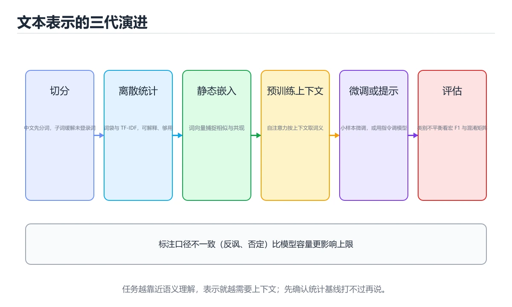

# 自然语言处理：文本分类与情感分析



> 内容更新时间：2026-10-06 · 学习阶段：基础 · 预计用时：55 分钟

## 本节知识框架

**课程定位**：分类「ml_practice」· 学习阶段 基础 · 建议用时 55 分钟。

本课主线：掌握词嵌入、RNN/LSTM、Transformer和BERT预训练模型。

### 复习清单

- [ ] 能不看正文复述本课核心术语，并指出一个边界或反例。
- [ ] 能运行或推演本课示例，记录输入、输出与失败现象。
- [ ] 能完成一次自测，并把错题对照考点精讲定位原因。

### 课程导言
自然语言处理（NLP）让机器能够理解、分析和生成人类语言，就像给计算机装上了"语言中枢"。文本分类是将文档归入预定义类别（如新闻分类为体育、政治、娱乐），情感分析是判断文本表达的情绪倾向（正面、负面或中性）。本章从词嵌入（Word Embedding）开始，带你理解如何将文字转换为机器可处理的向量，然后学习使用RNN、LSTM和Transformer架构处理序列数据，最后实现一个完整的情感分析系统。我们将用图书馆管理、翻译游戏等生活化比喻解释抽象概念，让你轻松掌握这个与人机交互密切相关的领域。

### 学习目标
完成本章后，你将能够：

1. 理解词嵌入（Word2Vec、GloVe）的原理及其相比one-hot编码的优势
2. 掌握循环神经网络（RNN）和长短期记忆网络（LSTM）处理序列数据的机制
3. 使用预训练语言模型（BERT、GPT）进行迁移学习解决NLP任务
4. 实现基于注意力机制（Attention）的文本分类和情感分析模型
5. 学会文本预处理流程：分词、去停用词、词干提取、向量化
6. 评估NLP模型的性能指标：准确率、F1分数、困惑度（Perplexity）

## 核心概念定义

| 术语 | 一句话说明 |
| --- | --- |
| NLP | 让机器理解、分析和生成人类语言，落地到文本分类与情感分析两类任务，流程从分词去停用词一路走到预训练模型微调。 |
| 词嵌入 | 把词映射成低维稠密向量，语义相近的词在空间里也靠近，示例中 king - man + woman 最接近 queen，小语料训出的向量质量有限。 |
| Transformer | 用自注意力取代逐词循环，整段并行算再靠位置编码补回顺序；复杂度随序列长度按 n 的平方增长，长文本因此成瓶颈。 |
| BERT | 先用掩码完形填空学双向上下文，接上分类头后拿少量标注微调，整句表示取 [CLS] 的输出，超过 512 个 token 得分段处理。 |
| 情感分析 | 判断文本是正面还是负面的分类任务，not、very 这类否定与程度词本身携带情感不能当停用词删掉，类别不平衡时评估要补看 F1。 |

## 原理与运行机制

《自然语言处理：文本分类与情感分析》正文各章按「输入是什么 → 中间如何转换 → 输出到哪 → 失败时怎样表现」四问展开；复习时给每个机制补一句自己的复述，再回到对应章节核对。

### 生活类比拆解
#### 1. 词嵌入：词语的身份证

想象每个单词都有一张多维度的"身份证"，上面记录了它的各种属性：性别倾向、正式程度、情感色彩、语义类别等。词嵌入就是将这些属性编码成一个数值向量。比如"国王"和"王后"的向量在"性别"维度上相反，但在"皇室"维度上相似；"猫"和"狗"在"宠物"维度上接近，但与"汽车"距离很远。这种向量表示让机器能够计算词语之间的语义相似度，而不仅仅是字符匹配。

#### 2. RNN与LSTM：有记忆的阅读器

RNN就像一个逐字阅读的人，每读到一个新词都会结合之前读过的内容来理解当前语境。但普通RNN有个问题：读到句子末尾时，可能已经忘记了开头的内容（长期依赖问题）。LSTM通过引入"记忆细胞"和三个门控机制（输入门、遗忘门、输出门）解决了这个问题。可以把它想象成一个带着笔记本的阅读者：遗忘门决定哪些旧信息可以丢弃，输入门决定哪些新信息值得记录，输出门决定当前应该输出什么内容。

#### 3. 注意力机制：重点标注器

注意力机制就像是在阅读时用荧光笔标记重点。当处理长句子时，模型不需要平等对待每个词，而是学会关注与当前任务最相关的部分。比如在翻译"I love playing basketball"时，生成"篮球"这个词时应该重点关注"basketball"，生成"喜欢"时关注"love"。自注意力（Self-Attention）更是让每个词都能同时看到句子中的所有其他词，建立全局依赖关系，这是Transformer架构的核心创新。

#### 4. Transformer：并行处理的革命

传统RNN必须按顺序逐词处理，就像一个人串行阅读。Transformer则像是一个团队同时阅读整篇文章，每个成员负责不同的词，但通过注意力机制相互沟通。位置编码（Positional Encoding）给每个词贴上"页码标签"，让模型知道词的顺序信息。这种并行化处理使得Transformer能够充分利用GPU的计算能力，训练速度比RNN快数倍，这也是为什么现代大语言模型都基于Transformer架构。

#### 5. 预训练语言模型：博览群书的学者

BERT和GPT这样的预训练模型就像是在图书馆里读了数百万本书的学者。BERT通过"完形填空"任务（Masked Language Modeling）学习上下文双向理解，GPT通过"续写故事"任务（Next Token Prediction）学习从左到右的语言生成。当我们把这些"学者"应用到具体任务（如情感分析）时，只需要少量标注数据进行微调，它们就能展现出惊人的性能。这就是为什么现在很少有人从零开始训练NLP模型。

#### 6. 文本预处理：整理杂乱的书房

原始文本就像一间杂乱的书房：有大写字母和小写字母混用（大小写不统一）、有标点符号散落各处、有无关的停用词（"的"、"是"、"在"）占据空间。文本预处理就是整理这个过程：统一转为小写、去除标点和数字、分词、去除停用词、词干提取（将"running"、"runs"、"ran"还原为"run"）。好的预处理能显著提升模型性能，但也要注意不要过度清理丢失重要信息（如情感分析中感叹号很重要）。

## 典型应用场景

- 结合「自然语言处理：文本分类与情感分析」的常见落地场景与选型边界，详见正文各章节的对比讨论。
- 迁移到新项目时，先明确输入规模、失败代价与可观测手段，再决定采用深度。

## 代码/协议/SQL 示例

正文首个完整示例如下，先运行确认环境，再按正文步骤改一个输入观察输出变化。

```python
import numpy as np
import tensorflow as tf
from tensorflow.keras.preprocessing import text_to_word_sequence, one_hot
import torch
from gensim.models import Word2Vec
import matplotlib.pyplot as plt
from sklearn.manifold import TSNE

# ==================== 简单词嵌入演示 ====================

# 示例语料库
sentences = [
    "king man woman queen".split(),
    "paris france london england".split(),
    "cat kitten dog puppy".split(),
    "apple fruit carrot vegetable".split(),
    "happy joyful sad sorrowful".split()
]

# 使用Gensim训练Word2Vec模型
w2v_model = Word2Vec(sentences, vector_size=50, window=3, min_count=1, workers=4)

# 查看词向量
print("国王的词向量前10维:", w2v_model.wv['king'][:10])
print("\n词汇表:", list(w2v_model.wv.key_to_index.keys()))

# 计算词语相似度
print("\n--- 词语相似度 ---")
print(f"king与queen的相似度: {w2v_model.wv.similarity('king', 'queen'):.4f}")
print(f"king与apple的相似度: {w2v_model.wv.similarity('king', 'apple'):.4f}")
print(f"cat与dog的相似度: {w2v_model.wv.similarity('cat', 'dog'):.4f}")

# 词向量类比：king - man + woman ≈ queen
try:
    result = w2v_model.wv.most_similar(
        positive=['king', 'woman'], 
        negative=['man'], 
        topn=1
    )
    print(f"\nking - man + woman ≈ {result[0][0]} (相似度: {result[0][1]:.4f})")
except KeyError as e:
    print(f"\n类比计算失败（词汇量太小）: {e}")

# 可视化词向量（降维到2D）
words = list(w2v_model.wv.key_to_index.keys())
vectors = np.array([w2v_model.wv[word] for word in words])

tsne = TSNE(n_components=2, random_state=42, perplexity=min(5, len(words)-1))
vectors_2d = tsne.fit_transform(vectors)

plt.figure(figsize=(10, 8))
for i, word in enumerate(words):
    plt.scatter(vectors_2d[i, 0], vectors_2d[i, 1])
    plt.annotate(word, xy=(vectors_2d[i, 0], vectors_2d[i, 1]))
plt.title('Word Embeddings Visualization (t-SNE)')
plt.savefig('word_embeddings.png', dpi=150, bbox_inches='tight')
plt.show()

# ==================== TensorFlow/Keras中的Embedding层 ====================

# 准备数据
texts = ["I love this movie", "Terrible film waste of time", "Great acting and story"]
labels = [1, 0, 1]  # 1=positive, 0=negative

# 构建词汇表
vocab_size = 1000
max_length = 20

# 文本向量化
vectorize_layer = tf.keras.layers.TextVectorization(
    max_tokens=vocab_size,
    output_mode='int',
    output_sequence_length=max_length
)
vectorize_layer.adapt(texts)

# 查看词汇映射
vocab = vectorize_layer.get_vocabulary()
print("\n词汇表前20个词:", vocab[:20])

# 将文本转换为索引序列
sequences = vectorize_layer(texts)
print("\n文本对应的索引序列:")
for i, seq in enumerate(sequences):
    print(f"  '{texts[i]}' -> {seq.numpy()}")

# 创建Embedding层
embedding_dim = 16
embedding_layer = tf.keras.layers.Embedding(
    input_dim=vocab_size,
    output_dim=embedding_dim,
    input_length=max_length
)

# 获取嵌入向量
embedded = embedding_layer(sequences)
print(f"\n嵌入向量形状: {embedded.shape}")  # (batch_size, max_length, embedding_dim)
```

### 渐进式代码示例
#### 最小化示例：词嵌入基础

让我们从最基本的词向量操作开始，直观感受词语之间的语义关系。

```python
import numpy as np
import tensorflow as tf
from tensorflow.keras.preprocessing import text_to_word_sequence, one_hot
import torch
from gensim.models import Word2Vec
import matplotlib.pyplot as plt
from sklearn.manifold import TSNE

# ==================== 简单词嵌入演示 ====================

# 示例语料库
sentences = [
    "king man woman queen".split(),
    "paris france london england".split(),
    "cat kitten dog puppy".split(),
    "apple fruit carrot vegetable".split(),
    "happy joyful sad sorrowful".split()
]

# 使用Gensim训练Word2Vec模型
w2v_model = Word2Vec(sentences, vector_size=50, window=3, min_count=1, workers=4)

# 查看词向量
print("国王的词向量前10维:", w2v_model.wv['king'][:10])
print("\n词汇表:", list(w2v_model.wv.key_to_index.keys()))

# 计算词语相似度
print("\n--- 词语相似度 ---")
print(f"king与queen的相似度: {w2v_model.wv.similarity('king', 'queen'):.4f}")
print(f"king与apple的相似度: {w2v_model.wv.similarity('king', 'apple'):.4f}")
print(f"cat与dog的相似度: {w2v_model.wv.similarity('cat', 'dog'):.4f}")

# 词向量类比：king - man + woman ≈ queen
try:
    result = w2v_model.wv.most_similar(
        positive=['king', 'woman'], 
        negative=['man'], 
        topn=1
    )
    print(f"\nking - man + woman ≈ {result[0][0]} (相似度: {result[0][1]:.4f})")
except KeyError as e:
    print(f"\n类比计算失败（词汇量太小）: {e}")

# 可视化词向量（降维到2D）
words = list(w2v_model.wv.key_to_index.keys())
vectors = np.array([w2v_model.wv[word] for word in words])

tsne = TSNE(n_components=2, random_state=42, perplexity=min(5, len(words)-1))
vectors_2d = tsne.fit_transform(vectors)

plt.figure(figsize=(10, 8))
for i, word in enumerate(words):
    plt.scatter(vectors_2d[i, 0], vectors_2d[i, 1])
    plt.annotate(word, xy=(vectors_2d[i, 0], vectors_2d[i, 1]))
plt.title('Word Embeddings Visualization (t-SNE)')
plt.savefig('word_embeddings.png', dpi=150, bbox_inches='tight')
plt.show()

# ==================== TensorFlow/Keras中的Embedding层 ====================

# 准备数据
texts = ["I love this movie", "Terrible film waste of time", "Great acting and story"]
labels = [1, 0, 1]  # 1=positive, 0=negative

# 构建词汇表
vocab_size = 1000
max_length = 20

# 文本向量化
vectorize_layer = tf.keras.layers.TextVectorization(
    max_tokens=vocab_size,
    output_mode='int',
    output_sequence_length=max_length
)
vectorize_layer.adapt(texts)

# 查看词汇映射
vocab = vectorize_layer.get_vocabulary()
print("\n词汇表前20个词:", vocab[:20])

# 将文本转换为索引序列
sequences = vectorize_layer(texts)
print("\n文本对应的索引序列:")
for i, seq in enumerate(sequences):
    print(f"  '{texts[i]}' -> {seq.numpy()}")

# 创建Embedding层
embedding_dim = 16
embedding_layer = tf.keras.layers.Embedding(
    input_dim=vocab_size,
    output_dim=embedding_dim,
    input_length=max_length
)

# 获取嵌入向量
embedded = embedding_layer(sequences)
print(f"\n嵌入向量形状: {embedded.shape}")  # (batch_size, max_length, embedding_dim)
```

这个例子展示了词嵌入的核心思想：将离散的词语映射到连续的向量空间，使得语义相似的词在空间中距离相近。Gensim的Word2Vec适合小规模自定义语料，而Keras的Embedding层则是深度学习模型中的标准组件。注意真实场景中需要使用大规模语料（如维基百科）训练才能得到高质量的词向量。

#### 完整示例：基于LSTM的情感分析

现在我们来构建一个完整的情感分析系统，判断电影评论是正面还是负面。

```python
import tensorflow as tf
from tensorflow.keras import layers, models
from tensorflow.keras.datasets import imdb
import torch
import torch.nn as nn
from torch.utils.data import Dataset, DataLoader
import numpy as np
from collections import Counter
import re

# ==================== TensorFlow LSTM情感分析 ====================

# 加载IMDB数据集
vocab_size = 10000
max_length = 200

(x_train_tf, y_train_tf), (x_test_tf, y_test_tf) = imdb.load_data(num_words=vocab_size)

# 填充序列到相同长度
x_train_tf = tf.keras.preprocessing.sequence.pad_sequences(
    x_train_tf, maxlen=max_length, padding='post', truncating='post'
)
x_test_tf = tf.keras.preprocessing.sequence.pad_sequences(
    x_test_tf, maxlen=max_length, padding='post', truncating='post'
)

print(f"训练集大小: {len(x_train_tf)}")
print(f"测试集大小: {len(x_test_tf)}")
print(f"样本序列示例: {x_train_tf[0][:20]}...")

# 构建LSTM模型
def build_lstm_model_tf(vocab_size, max_length, embedding_dim=128):
    model = models.Sequential([
        layers.Embedding(vocab_size, embedding_dim, input_length=max_length),
        layers.Bidirectional(layers.LSTM(64, return_sequences=True)),  # 双向LSTM
        layers.Bidirectional(layers.LSTM(32)),
        layers.Dense(64, activation='relu'),
        layers.Dropout(0.5),
        layers.Dense(1, activation='sigmoid')  # 二分类输出
    ])
    
    model.compile(
        optimizer='adam',
        loss='binary_crossentropy',
        metrics=['accuracy']
    )
    return model

tf_lstm_model = build_lstm_model_tf(vocab_size, max_length)
tf_lstm_model.summary()

# 训练模型
history_tf = tf_lstm_model.fit(
    x_train_tf, y_train_tf,
    epochs=10,
    batch_size=64,
    validation_split=0.1,
    callbacks=[
        tf.keras.callbacks.EarlyStopping(
            monitor='val_loss', patience=3, restore_best_weights=True
        )
    ]
)

# 评估模型
test_loss, test_acc = tf_lstm_model.evaluate(x_test_tf, y_test_tf)
print(f"\nTensorFlow LSTM测试准确率: {test_acc:.4f}")

# 预测新评论
def predict_sentiment_tf(model, text, vectorize_layer=None):
    """预测单条文本的情感"""
    if vectorize_layer:
        seq = vectorize_layer([text])
    else:
        # 简单分词和索引映射（实际应使用完整的词汇表）
        words = text.lower().split()
        word_to_idx = {word: idx+1 for idx, word in 
                      enumerate(tf.keras.datasets.imdb.get_word_index().keys())}
        seq = [[word_to_idx.get(w, 2) for w in words]]  # 2代表OOV
        seq = tf.keras.preprocessing.sequence.pad_sequences(
            seq, maxlen=max_length, padding='post', truncating='post'
        )
    
    prediction = model.predict(seq)[0][0]
    sentiment = "正面" if prediction > 0.5 else "负面"
    confidence = prediction if prediction > 0.5 else 1 - prediction
    return sentiment, confidence, prediction

sample_review = "This movie was absolutely wonderful! Great acting and amazing story."
sentiment, confidence, score = predict_sentiment_tf(tf_lstm_model, sample_review)
print(f"\n评论: '{sample_review}'")
print(f"情感: {sentiment}, 置信度: {confidence:.2%}, 得分: {score:.4f}")

# ==================== PyTorch LSTM情感分析 ====================

class IMDBDataset(Dataset):
    """PyTorch数据集类"""
    def __init__(self, texts, labels, vocab, max_length=200):
        self.texts = texts
        self.labels = labels
        self.vocab = vocab
        self.max_length = max_length
    
    def __len__(self):
        return len(self.texts)
    
    def __getitem__(self, idx):
        text = self.texts[idx]
        label = self.labels[idx]
        
        # 文本转索引
        tokens = text.lower().split()
        indices = [self.vocab.get(token, self.vocab['<UNK>']) for token in tokens]
        
        # 填充或截断
        if len(indices) < self.max_length:
            indices = indices + [0] * (self.max_length - len(indices))
        else:
            indices = indices[:self.max_length]
        
        return torch.tensor(indices, dtype=torch.long), torch.tensor(label, dtype=torch.float)

class LSTMSentimentModel(nn.Module):
    """PyTorch LSTM情感分析模型"""
    def __init__(self, vocab_size, embedding_dim=128, hidden_dim=64, num_layers=2):
        super(LSTMSentimentModel, self).__init__()
        
        self.embedding = nn.Embedding(vocab_size, embedding_dim, padding_idx=0)
        self.lstm = nn.LSTM(
            embedding_dim, 
            hidden_dim, 
            num_layers=num_layers,
            batch_first=True,
            bidirectional=True,
            dropout=0.3 if num_layers > 1 else 0
        )
        self.dropout = nn.Dropout(0.5)
        self.fc1 = nn.Linear(hidden_dim * 2, 64)  # *2因为双向
        self.relu = nn.ReLU()
        self.fc2 = nn.Linear(64, 1)
        self.sigmoid = nn.Sigmoid()
    
    def forward(self, x):
        embedded = self.embedding(x)
        lstm_out, (hidden, cell) = self.lstm(embedded)
        
        # 拼接最后一个时间步的前向和后向隐藏状态
        hidden_cat = torch.cat((hidden[-2], hidden[-1]), dim=1)
        
        out = self.dropout(hidden_cat)
        out = self.fc1(out)
        out = self.relu(out)
        out = self.dropout(out)
        out = self.fc2(out)
        out = self.sigmoid(out)
        
        return out.squeeze(1)

# 构建词汇表
def build_vocab(texts, max_vocab_size=10000):
    counter = Counter()
    for text in texts:
        tokens = text.lower().split()
        counter.update(tokens)
    
    vocab = {'<PAD>': 0, '<UNK>': 1}
    for word, _ in counter.most_common(max_vocab_size - 2):
        vocab[word] = len(vocab)
    
    return vocab

# 示例数据（实际应使用完整的IMDB数据集）
sample_texts = [
    "This movie was great and I loved it",
    "Terrible waste of time very bad",
    "Amazing performance by the actors",
    "Boring and predictable plot",
    "Excellent storytelling and direction"
]
sample_labels = [1, 0, 1, 0, 1]

vocab = build_vocab(sample_texts, max_vocab_size=1000)
print(f"\n词汇表大小: {len(vocab)}")

# 创建数据集和数据加载器
dataset = IMDBDataset(sample_texts, sample_labels, vocab)
dataloader = DataLoader(dataset, batch_size=2, shuffle=True)

# 初始化模型
torch_lstm_model = LSTMSentimentModel(
    vocab_size=len(vocab),
    embedding_dim=128,
    hidden_dim=64,
    num_layers=2
)

criterion = nn.BCELoss()
optimizer = torch.optim.Adam(torch_lstm_model.parameters(), lr=0.001)

# 训练循环
num_epochs = 10
for epoch in range(num_epochs):
    torch_lstm_model.train()
    epoch_loss = 0.0
    correct = 0
    total = 0
    
    for texts_batch, labels_batch in dataloader:
        optimizer.zero_grad()
        outputs = torch_lstm_model(texts_batch)
        loss = criterion(outputs, labels_batch)
        loss.backward()
        optimizer.step()
        
        epoch_loss += loss.item()
        predicted = (outputs >= 0.5).float()
        correct += (predicted == labels_batch).sum().item()
        total += labels_batch.size(0)
    
    train_acc = correct / total
    print(f'Epoch [{epoch+1}/{num_epochs}], Loss: {epoch_loss/len(dataloader):.4f}, Acc: {train_acc:.4f}')

# 预测函数
def predict_sentiment_torch(model, text, vocab, max_length=200):
    model.eval()
    tokens = text.lower().split()
    indices = [vocab.get(token, vocab['<UNK>']) for token in tokens]
    
    if len(indices) < max_length:
        indices = indices + [0] * (max_length - len(indices))
    else:
        indices = indices[:max_length]
    
    input_tensor = torch.tensor([indices], dtype=torch.long)
    
    with torch.no_grad():
        output = model(input_tensor)
        prediction = output.item()
    
    sentiment = "正面" if prediction > 0.5 else "负面"
    confidence = prediction if prediction > 0.5 else 1 - prediction
    return sentiment, confidence, prediction

sample_text = "This movie was absolutely wonderful"
sentiment, confidence, score = predict_sentiment_torch(
    torch_lstm_model, sample_text, vocab
)
print(f"\nPyTorch预测 - 评论: '{sample_text}'")
print(f"情感: {sentiment}, 置信度: {confidence:.2%}, 得分: {score:.4f}")
```

这个完整示例展示了如何使用LSTM进行情感分析。双向LSTM能够同时利用上下文信息，比单向LSTM表现更好。注意TensorFlow版本使用了内置的IMDB数据集，而PyTorch版本展示了如何从头构建数据处理流程。在实际项目中，建议使用Hugging Face的Transformers库加载预训练模型以获得更好的效果。

#### 实践示例：基于BERT的文本分类

预训练语言模型已经成为NLP任务的标准选择。这里我们展示如何使用BERT进行文本分类。

```python
import tensorflow as tf
from transformers import TFBertModel, BertTokenizer
import torch
from transformers import BertTokenizer as BertTokenizerPT, BertForSequenceClassification
import numpy as np

# ==================== TensorFlow BERT文本分类 ====================

def build_bert_classifier_tf(num_classes=2, max_length=128):
    """使用预训练BERT构建分类器"""
    # 加载预训练BERT模型
    bert_model = TFBertModel.from_pretrained('bert-base-uncased')
    
    # 输入层
    input_ids = tf.keras.layers.Input(shape=(max_length,), dtype=tf.int32, name='input_ids')
    attention_mask = tf.keras.layers.Input(shape=(max_length,), dtype=tf.int32, name='attention_mask')
    
    # BERT编码
    bert_output = bert_model([input_ids, attention_mask])
    pooled_output = bert_output.pooler_output  # [CLS] token的输出
    
    # 分类头
    x = tf.keras.layers.Dense(256, activation='relu')(pooled_output)
    x = tf.keras.layers.Dropout(0.3)(x)
    x = tf.keras.layers.Dense(128, activation='relu')(x)
    x = tf.keras.layers.Dropout(0.3)(x)
    output = tf.keras.layers.Dense(num_classes, activation='softmax')(x)
    
    model = tf.keras.Model(inputs=[input_ids, attention_mask], outputs=output)
    
    # 冻结BERT层（可选，根据数据量决定）
    bert_model.trainable = False
    
    model.compile(
        optimizer=tf.keras.optimizers.Adam(learning_rate=2e-5),
        loss='sparse_categorical_crossentropy',
        metrics=['accuracy']
    )
    
    return model, bert_model

# 初始化tokenizer
tokenizer_tf = BertTokenizer.from_pretrained('bert-base-uncased')

# 示例数据
texts = [
    "This product is amazing and works perfectly!",
    "Terrible quality would not recommend",
    "Great value for money very satisfied",
    "Worst purchase ever made complete waste"
]
labels = [1, 0, 1, 0]  # 1=positive, 0=negative

# 文本编码
encodings = tokenizer_tf(
    texts,
    max_length=128,
    padding='max_length',
    truncation=True,
    return_tensors='tf'
)

input_ids = encodings['input_ids']
attention_mask = encodings['attention_mask']

print(f"Input IDs形状: {input_ids.shape}")
print(f"Attention Mask形状: {attention_mask.shape}")
print(f"示例Input IDs前20个token: {input_ids[0][:20].numpy()}")

# 构建并编译模型
bert_tf_model, bert_base = build_bert_classifier_tf(num_classes=2)
bert_tf_model.summary()

# 训练（注意：实际训练需要更多数据和epochs）
# history = bert_tf_model.fit(
#     {'input_ids': input_ids, 'attention_mask': attention_mask},
#     labels,
#     epochs=3,
#     batch_size=4,
#     validation_split=0.2
# )

# ==================== PyTorch BERT文本分类 ====================

class BertClassifierPT(torch.nn.Module):
    """PyTorch BERT分类器"""
    def __init__(self, num_classes=2, dropout=0.3):
        super(BertClassifierPT, self).__init__()
        self.bert = BertForSequenceClassification.from_pretrained(
            'bert-base-uncased',
            num_labels=num_classes
        )
        self.dropout = torch.nn.Dropout(dropout)
    
    def forward(self, input_ids, attention_mask, labels=None):
        outputs = self.bert(
            input_ids=input_ids,
            attention_mask=attention_mask,
            labels=labels
        )
        return outputs

# 初始化
tokenizer_pt = BertTokenizerPT.from_pretrained('bert-base-uncased')
model_pt = BertClassifierPT(num_classes=2)

# 编码数据
encodings_pt = tokenizer_pt(
    texts,
    max_length=128,
    padding='max_length',
    truncation=True,
    return_tensors='pt'
)

input_ids_pt = encodings_pt['input_ids']
attention_mask_pt = encodings_pt['attention_mask']
labels_pt = torch.tensor(labels)

print(f"\nPyTorch Input IDs形状: {input_ids_pt.shape}")

# 训练设置
optimizer = torch.optim.AdamW(model_pt.parameters(), lr=2e-5)
criterion = torch.nn.CrossEntropyLoss()

# 训练循环（简化版）
model_pt.train()
for epoch in range(3):
    optimizer.zero_grad()
    outputs = model_pt(input_ids_pt, attention_mask_pt, labels_pt)
    loss = outputs.loss
    logits = outputs.logits
    
    loss.backward()
    optimizer.step()
    
    predictions = torch.argmax(logits, dim=1)
    accuracy = (predictions == labels_pt).float().mean()
    
    print(f'Epoch [{epoch+1}/3], Loss: {loss.item():.4f}, Acc: {accuracy:.4f}')

# 推理
model_pt.eval()
with torch.no_grad():
    test_encodings = tokenizer_pt(
        ["This is a fantastic product!"],
        max_length=128,
        padding='max_length',
        truncation=True,
        return_tensors='pt'
    )
    outputs = model_pt(
        test_encodings['input_ids'],
        test_encodings['attention_mask']
    )
    probabilities = torch.softmax(outputs.logits, dim=1)
    predicted_class = torch.argmax(probabilities, dim=1).item()
    
    print(f"\n预测结果: {'正面' if predicted_class == 1 else '负面'}")
    print(f"概率分布: 负面={probabilities[0][0]:.4f}, 正面={probabilities[0][1]:.4f}")

# ==================== 使用Hugging Face Pipeline简化流程 ====================

from transformers import pipeline

# 情感分析pipeline（零样本使用）
sentiment_pipeline = pipeline("sentiment-analysis")

results = sentiment_pipeline([
    "I love this product!",
    "This is terrible.",
    "It's okay, nothing special."
])

print("\n--- Hugging Face Pipeline情感分析 ---")
for text, result in zip([
    "I love this product!",
    "This is terrible.",
    "It's okay, nothing special."
], results):
    print(f"文本: '{text}'")
    print(f"  标签: {result['label']}, 置信度: {result['score']:.4f}\n")
```

这个实践示例展示了三种不同复杂度的BERT使用方式：从零构建分类器、使用Hugging Face的预训练分类头、以及直接使用Pipeline进行零样本推理。对于大多数实际应用，推荐使用Hugging Face Transformers库，它提供了丰富的预训练模型和简洁的API。注意BERT的最大序列长度通常为512，超长文本需要分段处理或使用Longformer等变体。

## 时间/空间复杂度或性能分析

- 在《自然语言处理：文本分类与情感分析》里处理规模 n 时，先估计主循环与嵌套层数，再决定优化方向；小样本上的耗时读数不能外推。
- 性能结论要绑定输入分布：换数据规模、并发度或缓存命中情况后须重新测量。

## 常见误区与易错点

| 错误做法 | 典型现象 | 修复方向 |
| --- | --- | --- |
| 只验证正常输入 | 边界数据触发时才暴露问题 | 为每个结论补一个空值/极值/重复值用例 |
| 背结论不跑实验 | 换个输入就失效 | 按「预测—实测—差异归因」三步复盘 |
| 忽略环境与版本差异 | 本机可用线上报错 | 把版本、配置与依赖写入复现步骤 |

### 常见陷阱对照表
| 陷阱类型 | 具体问题描述 | 影响后果 | 解决方案 |
|---------|------------|---------|---------|
| **词汇表溢出** | 遇到训练时未见过的词（OOV） | 模型无法处理新词，性能下降 | 使用子词分词（BPE、WordPiece），设置合理的OOV token |
| **序列长度不当** | max_length设置过长浪费计算，过短丢失信息 | 效率低下或关键信息被截断 | 分析数据分布，选择95%分位数作为max_length |
| **填充token参与计算** | PAD token被当作有效输入处理 | 引入噪声，影响模型判断 | 使用attention_mask屏蔽PAD token，Embedding设padding_idx |
| **情感数据偏见** | 训练数据中某类情感样本过多 | 模型偏向多数类，少数类识别差 | 平衡数据集，使用类别权重，数据增强 |
| **分词工具不一致** | 训练和推理使用不同的分词器 | 输入格式不匹配，预测错误 | 保存并复用训练时的tokenizer，避免手动分词 |
| **梯度爆炸** | RNN/LSTM处理长序列时梯度累积 | 训练不稳定，损失变为NaN | 梯度裁剪（clipnorm）、使用LSTM/GRU、批归一化 |
| **预训练模型域不匹配** | 用通用BERT处理专业领域文本 | 领域术语理解不佳，性能受限 | 使用领域特定的预训练模型（如BioBERT、LegalBERT） |
| **忽略上下文长度限制** | BERT最大512 token，输入超长未处理 | 尾部信息丢失或报错 | 滑动窗口分段、使用Longformer/BigBird等长文本模型 |
| **评估指标单一** | 仅看准确率忽略类别不平衡 | 在不平衡数据上误导判断 | 使用F1分数、Precision、Recall、AUC综合评估 |
| **内存不足** | BERT大模型+长序列导致OOM | 训练中断无法进行 | 减小batch_size、使用梯度累积、混合精度训练 |

## 与其他知识点的关系

本课与分类「ml_practice」内相邻课程互为补充，建议按清单顺序学完再做综合练习。

## 自测题与参考答案

以下题目与题库同源，作答后再看解析；错误项要能说出错在哪一步。

## 考点精讲

### 考点 1

关于词嵌入（Word Embedding），以下哪项描述是正确的？

A. Word2Vec只能捕捉词语的语法特征，无法捕捉语义特征  
B. 词嵌入向量中的每个维度都有明确的语言学含义（如第1维表示性别）  
C. 词嵌入的核心优势是将离散符号映射到连续空间，使语义相似的词向量距离更近 ✅  
D. One-hot编码比词嵌入更能有效表示词语之间的语义关系  

**正确答案：** C

**解析：** 词嵌入的核心思想是将高维稀疏的one-hot向量映射到低维稠密的连续向量空间，在这个空间中，语义相似的词（如"猫"和"狗"）的向量距离较近，可以通过余弦相似度或欧氏距离来衡量。这使得模型能够泛化到未见过的词语组合。选项A错误，Word2Vec既能捕捉语法也能捕捉语义；选项B错误，单个维度通常没有明确的可解释含义，语义分布在多个维度上；选项D错误，one-hot向量之间正交，无法体现语义相似性。

### 考点 2

LSTM中的"门控机制"不包括以下哪一项？

A. 输入门（Input Gate）  
B. 遗忘门（Forget Gate）  
C. 输出门（Output Gate）  
D. 更新门（Update Gate） ✅  

**正确答案：** D

**解析：** 标准LSTM包含三个门：遗忘门决定丢弃多少旧记忆，输入门决定保留多少新信息，输出门决定当前时刻输出什么内容。这三个门协同工作，使LSTM能够有效处理长期依赖问题。"更新门"是GRU（Gated Recurrent Unit）中的概念，GRU是LSTM的简化变体，它将遗忘门和输入门合并为一个更新门，减少了参数数量但保持了类似的性能。所以选项D不属于LSTM的门控机制。

### 考点 3

在使用BERT进行文本分类时，为什么通常使用[CLS] token的输出作为整个句子的表示？

A. 因为[CLS] token位于序列末尾，包含了所有后续信息  
B. 因为[CLS] token在预训练时被专门设计用于聚合整个序列的信息 ✅  
C. 因为[CLS] token的维度比其他token更高  
D. 这是一种随意选择，使用任何token的输出效果都一样  

**正确答案：** B

**解析：** 在BERT的预训练任务中，[CLS]（classification）token被放置在序列开头，其最终隐藏状态被用作整个序列的聚合表示，特别是在下一句预测（NSP）任务中。虽然理论上可以使用所有token输出的平均值或最大值，但实践证明[CLS] token经过预训练已经学会了如何整合全局信息，因此在微调分类任务时直接使用它是最常见的做法。选项A错误，[CLS]在开头而非末尾；选项C错误，所有token的向量维度相同；选项D错误，不同选择确实会影响性能。

### 考点 4

关于注意力机制（Attention），以下说法错误的是？

A. 自注意力（Self-Attention）允许序列中的每个位置同时关注所有其他位置  
B. 注意力权重之和必须等于1，因此通常使用softmax函数  
C. Transformer完全依赖注意力机制，不再使用任何循环或卷积结构  
D. 注意力机制的计算复杂度与序列长度成线性关系O(n) ✅  

**正确答案：** D

**解析：** 标准自注意力机制需要计算序列中每对token之间的关系，因此计算复杂度是O(n²)，其中n是序列长度。这是Transformer处理超长文本时的主要瓶颈，也是研究者们提出线性注意力、稀疏注意力等改进方法的原因。选项A正确，这正是自注意力的核心优势；选项B正确，softmax确保权重形成概率分布；选项C正确，Transformer的编码器堆栈只包含多头自注意力和前馈网络。

### 考点 5

在NLP任务的数据预处理中，以下哪种操作可能会损害情感分析的效果？

A. 将所有文本转换为小写  
B. 去除标点符号  
C. 去除停用词（如"not"、"very"、"really"） ✅  
D. 进行词干提取（stemming）  

**正确答案：** C

**解析：** 在情感分析中，某些停用词实际上携带重要的情感信息。例如，"not"是否定词，会反转后续形容词的情感极性（"not good" vs "good"）；"very"、"really"等程度副词会强化情感强度。如果去除这些词，会导致情感判断错误。相比之下，在主题分类或信息检索任务中，去除停用词通常是有益的，因为它们不包含太多区分性信息。选项A、B、D在某些情况下也可能有影响，但通常不如C严重。

## 术语速查

| 术语 | 一句话说明 |
| --- | --- |
| NLP | 让机器理解与生成人类语言的领域，文本分类和情感分析是两类典型落地任务。 |
| 词嵌入 | 把离散词语编码成低维稠密向量，向量距离反映语义相似度，如Word2Vec所学表示。 |
| Transformer | 用自注意力取代循环结构的架构，可并行处理整段序列，靠位置编码保留顺序。 |
| BERT | 基于Transformer编码器的预训练模型，用掩码任务双向理解上下文，微调后迁移。 |
| 情感分析 | 判断文本表达的正负面倾向，常用于评论与舆情挖掘，以准确率和F1分数评估。 |

## 参考资料与复核

- 官方/权威资料：[scikit-learn 用户手册](https://scikit-learn.org/stable/user_guide.html)
- 主题延伸：[NLTK Book（自然语言处理入门教材）](https://www.nltk.org/book/)
- 最后复核：2026-10-04
- 下次复核：2026-12-04

## 内容元数据

- 内容更新时间：2026-10-06

- 内容版本：v2.0
- 课程标识：ml_natural_language_processing
- 所属分类：ml_practice
- 学习阶段：基础
- 建议用时：55 分钟
