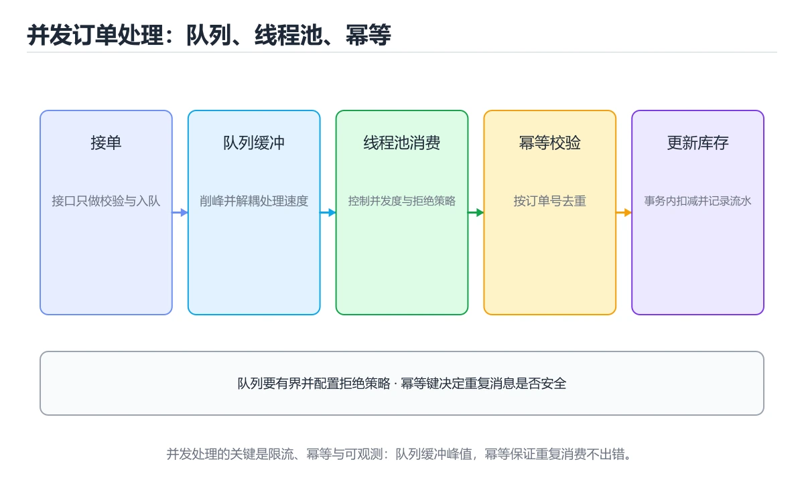

# TensorFlow与PyTorch框架对比入门



> 内容更新时间：2026-10-06 · 学习阶段：入门 · 预计用时：40 分钟

## 本章摘要

机器学习框架就像厨房里的不同厨具套装。TensorFlow像是功能齐全的专业烤箱，适合大规模生产；PyTorch则像灵活的炒锅，更适合快速尝试新菜谱。本章带你从零开始理解这两个主流框架的核心差异、设计理念和使用场景，帮助你选择最适合自己的工具。我们将通过实际代码示例展示如何搭建简单的神经网络，并深入探讨动态图与静态图的本质区别。

## 学习目标

完成本章后，你将能够：

1. 理解TensorFlow和PyTorch的设计哲学差异及其适用场景
2. 掌握张量（Tensor）的基本操作和数据类型转换方法
3. 使用两个框架构建并训练一个简单的全连接神经网络
4. 区分动态计算图（Dynamic Graph）与静态计算图（Static Graph）的工作原理
5. 学会使用自动微分（Autograd）机制进行梯度计算
6. 了解模型保存、加载以及跨平台部署的基本流程

## 核心概念与生活类比

### 1. 框架选择：工具箱的比喻

想象你要装修房子。TensorFlow就像是一套完整的工业级装修工具包，包含电钻、切割机、水平仪等所有专业设备，适合大型工程项目。而PyTorch更像是一个灵活的手工工具箱，里面有螺丝刀、锤子、卷尺等基础工具，方便你随时调整方案。如果你要做标准化批量生产，选TensorFlow；如果要快速原型设计和实验研究，选PyTorch。

### 2. 张量（Tensor）：多维数组的理解

张量可以理解为超市货架上的商品陈列。一维张量就像一排饮料瓶（向量），二维张量像一层货架的网格布局（矩阵），三维张量像整个货架的多层结构，四维张量则像整个仓库的立体存储系统。每个维度代表一个方向上的索引，你可以轻松定位到任何一个位置的商品。

### 3. 计算图：烹饪流程的可视化

计算图就像一份详细的菜谱流程图。输入食材是数据，每个处理步骤（切菜、腌制、翻炒）是运算节点，最终成品是输出结果。TensorFlow在开始前会先画好完整流程图（静态图），严格按照计划执行；PyTorch则是边做边记录（动态图），可以随时调整下一步做什么。前者效率高但灵活性低，后者灵活但需要更多运行时优化。

### 4. 自动微分：反向传播的魔法

自动微分就像是在做菜时有人帮你记录每一步的调味变化对最终口味的影响。当你尝了一口发现太咸了，系统能精确告诉你应该减少多少盐、增加多少水。在神经网络中，损失函数就是"口味评分"，梯度就是每种调料应该调整的幅度，反向传播就是从最后一道工序往前追溯责任的过程。

### 5. 优化器：学习速率的掌控

优化器好比是学车时的油门和刹车控制。学习率太大就像猛踩油门，容易冲过头甚至翻车（梯度爆炸）；学习率太小就像一直轻踩油门，到达目的地需要很长时间（收敛缓慢）。好的优化器（如Adam）会根据路况自动调整油门力度，既保证速度又确保安全。

### 6. 批处理（Batch）：批量生产的效率

批处理就像餐厅同时处理多份订单。一次只做一道菜（batch_size=1）效率极低，一次做一百道菜可能超出厨房容量（内存溢出）。选择合适的batch_size就是在效率和资源之间找到平衡点。通常32、64、128是比较常见的选择，具体取决于你的硬件配置和数据特征。

## 渐进式代码示例

### 最小化示例：创建张量

让我们从最基本的张量创建开始，这是所有深度学习操作的基石。

```python
import tensorflow as tf
import torch

# TensorFlow方式创建张量
tf_tensor = tf.constant([[1.0, 2.0], [3.0, 4.0]])
print("TensorFlow张量形状:", tf_tensor.shape)
print("TensorFlow张量值:\n", tf_tensor.numpy())

# PyTorch方式创建张量
torch_tensor = torch.tensor([[1.0, 2.0], [3.0, 4.0]])
print("\nPyTorch张量形状:", torch_tensor.shape)
print("PyTorch张量值:\n", torch_tensor)

# 常见张量操作对比
print("\n--- 张量运算对比 ---")
print("TF加法:", tf.add(tf_tensor, tf_tensor).numpy())
print("PT加法:", torch_tensor + torch_tensor)
print("TF乘法:", tf.multiply(tf_tensor, 2.0).numpy())
print("PT乘法:", torch_tensor * 2.0)
```

这个例子展示了两个框架在最基础操作上的相似性。注意TensorFlow默认使用`tf.constant`创建不可变张量，而PyTorch的`torch.tensor`更加灵活。两者都支持标准的数学运算符重载，使得代码非常直观。

### 完整示例：构建简单神经网络

现在我们来构建一个用于手写数字识别的简单神经网络。这个网络包含一个输入层、一个隐藏层和一个输出层。

```python
import tensorflow as tf
from tensorflow.keras import layers, models
import torch
import torch.nn as nn
import torch.optim as optim
from torch.utils.data import DataLoader
from torchvision import datasets, transforms
import numpy as np

# ==================== TensorFlow实现 ====================
def build_tf_model():
    """使用Keras API构建TensorFlow模型"""
    model = models.Sequential([
        layers.Flatten(input_shape=(28, 28)),          # 将28x28图像展平为784维向量
        layers.Dense(128, activation='relu'),           # 隐藏层：128个神经元，ReLU激活
        layers.Dropout(0.2),                            # Dropout防止过拟合
        layers.Dense(10, activation='softmax')          # 输出层：10个类别的概率分布
    ])
    
    model.compile(
        optimizer='adam',                               # Adam优化器
        loss='sparse_categorical_crossentropy',         # 稀疏分类交叉熵损失
        metrics=['accuracy']                            # 评估指标：准确率
    )
    return model

# 加载MNIST数据集
(x_train_tf, y_train_tf), (x_test_tf, y_test_tf) = tf.keras.datasets.mnist.load_data()
x_train_tf = x_train_tf.astype('float32') / 255.0      # 归一化到[0,1]
x_test_tf = x_test_tf.astype('float32') / 255.0

# 构建并训练模型
tf_model = build_tf_model()
tf_model.summary()                                      # 打印模型结构

history = tf_model.fit(
    x_train_tf, y_train_tf,
    epochs=5,
    batch_size=32,
    validation_split=0.1,                               # 使用10%数据作为验证集
    verbose=1
)

# 评估模型
test_loss, test_acc = tf_model.evaluate(x_test_tf, y_test_tf)
print(f"\nTensorFlow测试准确率: {test_acc:.4f}")

# ==================== PyTorch实现 ====================
class TorchMNISTModel(nn.Module):
    """PyTorch风格的MNIST分类模型"""
    def __init__(self):
        super(TorchMNISTModel, self).__init__()
        self.flatten = nn.Flatten()                     # 展平层
        self.fc1 = nn.Linear(28 * 28, 128)             # 全连接层1
        self.relu = nn.ReLU()                           # ReLU激活
        self.dropout = nn.Dropout(0.2)                  # Dropout
        self.fc2 = nn.Linear(128, 10)                   # 全连接层2（输出层）
    
    def forward(self, x):
        x = self.flatten(x)
        x = self.fc1(x)
        x = self.relu(x)
        x = self.dropout(x)
        x = self.fc2(x)
        return x                                        # 注意：不在此处应用softmax

# 数据预处理
transform = transforms.Compose([
    transforms.ToTensor(),                              # 转换为张量并归一化
    transforms.Normalize((0.1307,), (0.3081,))          # 使用MNIST均值和标准差标准化
])

train_dataset = datasets.MNIST('./data', train=True, download=True, transform=transform)
test_dataset = datasets.MNIST('./data', train=False, transform=transform)

train_loader = DataLoader(train_dataset, batch_size=32, shuffle=True)
test_loader = DataLoader(test_dataset, batch_size=1000, shuffle=False)

# 初始化模型、损失函数和优化器
torch_model = TorchMNISTModel()
criterion = nn.CrossEntropyLoss()                       # 交叉熵损失（内部包含softmax）
optimizer = optim.Adam(torch_model.parameters(), lr=0.001)

# 训练循环
num_epochs = 5
for epoch in range(num_epochs):
    torch_model.train()                                 # 设置为训练模式
    running_loss = 0.0
    correct = 0
    total = 0
    
    for batch_idx, (data, target) in enumerate(train_loader):
        optimizer.zero_grad()                           # 清零梯度
        output = torch_model(data)                      # 前向传播
        loss = criterion(output, target)                # 计算损失
        loss.backward()                                 # 反向传播
        optimizer.step()                                # 更新参数
        
        running_loss += loss.item()
        _, predicted = torch.max(output.data, 1)
        total += target.size(0)
        correct += (predicted == target).sum().item()
    
    train_acc = correct / total
    print(f'Epoch [{epoch+1}/{num_epochs}], Loss: {running_loss/len(train_loader):.4f}, Acc: {train_acc:.4f}')

# 测试模型
torch_model.eval()                                      # 设置为评估模式
correct = 0
total = 0
with torch.no_grad():                                   # 禁用梯度计算以节省内存
    for data, target in test_loader:
        output = torch_model(data)
        _, predicted = torch.max(output.data, 1)
        total += target.size(0)
        correct += (predicted == target).sum().item()

print(f'\nPyTorch测试准确率: {correct/total:.4f}')
```

这个完整示例展示了两个框架在构建相同任务时的不同风格。TensorFlow使用声明式的Keras API，代码更简洁；PyTorch使用命令式编程，需要手动编写训练循环，但提供了更大的灵活性。注意PyTorch的CrossEntropyLoss已经包含了softmax，所以模型输出不需要额外处理。

### 实践示例：自定义训练循环与回调

在实际项目中，我们往往需要更精细的控制，比如早停、学习率调度、模型检查点等。

```python
import tensorflow as tf
from tensorflow.keras.callbacks import EarlyStopping, ModelCheckpoint, ReduceLROnPlateau
import torch
import os

# ==================== TensorFlow高级训练技巧 ====================

# 创建回调函数
callbacks = [
    EarlyStopping(
        monitor='val_loss',                             # 监控验证集损失
        patience=3,                                     # 连续3个epoch无改善则停止
        restore_best_weights=True                       # 恢复最佳权重
    ),
    ModelCheckpoint(
        'best_tf_model.h5',                             # 保存路径
        monitor='val_accuracy',                         # 监控验证集准确率
        save_best_only=True,                            # 只保存最佳模型
        verbose=1
    ),
    ReduceLROnPlateau(
        monitor='val_loss',                             # 监控验证集损失
        factor=0.5,                                     # 学习率减半
        patience=2,                                     # 连续2个epoch无改善
        min_lr=1e-6                                     # 最小学习率
    )
]

# 使用回调训练
history_with_callbacks = tf_model.fit(
    x_train_tf, y_train_tf,
    epochs=20,                                          # 最大epoch数
    batch_size=32,
    validation_split=0.1,
    callbacks=callbacks,                                # 应用回调
    verbose=1
)

# 加载最佳模型
best_model = tf.keras.models.load_model('best_tf_model.h5')

# ==================== PyTorch手动实现类似功能 ====================

class TrainingManager:
    """PyTorch训练管理器，实现早停和学习率调度"""
    def __init__(self, model, optimizer, criterion, patience=3, factor=0.5):
        self.model = model
        self.optimizer = optimizer
        self.criterion = criterion
        self.patience = patience
        self.factor = factor
        self.best_val_loss = float('inf')
        self.counter = 0
        self.best_model_state = None
        self.lr_scheduler = optim.lr_scheduler.ReduceLROnPlateau(
            optimizer, mode='min', factor=factor, patience=2, min_lr=1e-6
        )
    
    def train_epoch(self, train_loader):
        """训练一个epoch"""
        self.model.train()
        running_loss = 0.0
        correct = 0
        total = 0
        
        for data, target in train_loader:
            self.optimizer.zero_grad()
            output = self.model(data)
            loss = self.criterion(output, target)
            loss.backward()
            self.optimizer.step()
            
            running_loss += loss.item()
            _, predicted = torch.max(output.data, 1)
            total += target.size(0)
            correct += (predicted == target).sum().item()
        
        return running_loss / len(train_loader), correct / total
    
    def evaluate(self, test_loader):
        """评估模型"""
        self.model.eval()
        running_loss = 0.0
        correct = 0
        total = 0
        
        with torch.no_grad():
            for data, target in test_loader:
                output = self.model(data)
                loss = self.criterion(output, target)
                running_loss += loss.item()
                _, predicted = torch.max(output.data, 1)
                total += target.size(0)
                correct += (predicted == target).sum().item()
        
        return running_loss / len(test_loader), correct / total
    
    def check_early_stopping(self, val_loss):
        """检查是否需要早停"""
        if val_loss < self.best_val_loss:
            self.best_val_loss = val_loss
            self.counter = 0
            self.best_model_state = {k: v.clone() for k, v in self.model.state_dict().items()}
            return False
        else:
            self.counter += 1
            if self.counter >= self.patience:
                print(f"早停触发！最佳验证损失: {self.best_val_loss:.4f}")
                return True
        return False
    
    def train(self, train_loader, test_loader, num_epochs=20):
        """完整训练流程"""
        for epoch in range(num_epochs):
            train_loss, train_acc = self.train_epoch(train_loader)
            val_loss, val_acc = self.evaluate(test_loader)
            
            # 学习率调度
            self.lr_scheduler.step(val_loss)
            
            print(f'Epoch [{epoch+1}/{num_epochs}]')
            print(f'  Train Loss: {train_loss:.4f}, Train Acc: {train_acc:.4f}')
            print(f'  Val Loss: {val_loss:.4f}, Val Acc: {val_acc:.4f}')
            print(f'  Current LR: {self.optimizer.param_groups[0]["lr"]:.6f}')
            
            # 检查早停
            if self.check_early_stopping(val_loss):
                break
        
        # 恢复最佳模型
        if self.best_model_state:
            self.model.load_state_dict(self.best_model_state)
            print("已恢复最佳模型权重")

# 使用训练管理器
manager = TrainingManager(torch_model, optimizer, criterion, patience=3)
manager.train(train_loader, test_loader, num_epochs=20)
```

这个实践示例展示了如何在两个框架中实现高级训练技巧。TensorFlow通过内置的回调函数轻松实现，而PyTorch需要手动编写逻辑，但也因此获得了完全的控制权。在实际项目中，你也可以使用PyTorch Lightning或Hugging Face Accelerate等库来简化这些操作。

## 常见陷阱对照表

| 陷阱类型 | TensorFlow常见问题 | PyTorch常见问题 | 解决方案 |
|---------|------------------|----------------|---------|
| **梯度问题** | 忘记在自定义训练中使用`GradientTape` | 忘记调用`optimizer.zero_grad()`导致梯度累积 | TF使用`with tf.GradientTape()`包裹；PT每轮训练前清零梯度 |
| **设备管理** | GPU内存泄漏，未释放会话资源 | 忘记将数据和模型移到同一设备（CPU/GPU） | TF使用`tf.config.set_visible_devices`；PT使用`.to(device)`统一设备 |
| **数据类型** | `float32`与`float64`混用导致精度错误 | 张量类型不匹配（如LongTensor vs FloatTensor） | 始终明确指定dtype，使用`.float()`或`.long()`转换 |
| **维度错误** | `reshape`与`resize`混淆，改变数据布局 | `view`与`reshape`使用不当， contiguous内存问题 | 理解两种操作的本质差异，必要时使用`.contiguous()` |
| **模型保存** | 保存整个模型vs仅保存权重的选择困惑 | `state_dict`顺序不一致导致加载失败 | TF优先使用SavedModel格式；PT保存时记录元数据 |
| **随机种子** | 未设置全局种子导致结果不可复现 | 仅设置torch种子，忽略numpy和random种子 | 同时设置`tf.random.set_seed`、`torch.manual_seed`、`np.random.seed` |
| **批处理维度** | `batch_size=1`时维度坍缩问题 | DataLoader返回的单样本批次维度异常 | 使用`drop_last=True`或手动处理边界情况 |
| **评估模式** | 忘记关闭Dropout和BatchNorm的训练行为 | 测试时未调用`model.eval()`导致结果不稳定 | 训练用`model.train()`，测试用`model.eval()` |
| **内存管理** | 大模型训练时OOM（内存溢出） | 梯度图未释放导致内存持续增长 | TF使用混合精度训练；PT使用`with torch.no_grad()`和定期清理 |
| **版本兼容** | TF1.x与TF2.x API不兼容 | PyTorch不同版本的API变更 | 锁定版本号，使用虚拟环境隔离项目依赖 |

## 自测题目

### 问题1

关于TensorFlow和PyTorch的计算图机制，以下哪项描述是正确的？

A. TensorFlow 2.x默认使用静态计算图，PyTorch默认使用动态计算图  
B. TensorFlow 2.x默认使用动态计算图（Eager Execution），PyTorch也使用动态计算图  
C. 两个框架都只支持静态计算图  
D. 两个框架都只支持动态计算图  

**正确答案：B**

**详细解释：** TensorFlow 2.x引入了Eager Execution作为默认模式，这意味着操作会立即执行并返回结果，类似于PyTorch的动态图机制。这使得调试更加直观，代码更易理解。不过TensorFlow仍然可以通过`@tf.function`装饰器将函数转换为静态图以获得性能优化。PyTorch从一开始就采用动态计算图设计，每次前向传播都会重新构建计算图，提供了极大的灵活性。选项A描述的是TensorFlow 1.x的情况，选项C和D都不准确，因为现代框架都支持两种模式。

### 问题2

在PyTorch中，为什么在每次训练迭代开始前需要调用`optimizer.zero_grad()`？

A. 为了重置优化器的学习率  
B. 因为PyTorch默认会累积梯度，不清零会导致梯度累加  
C. 为了释放GPU内存  
D. 这是一个可选操作，不影响训练结果  

**正确答案：B**

**详细解释：** PyTorch的自动微分机制默认会累积梯度，而不是覆盖之前的梯度值。这意味着如果你不在每次反向传播前清零梯度，新的梯度会与旧的梯度相加，导致梯度值越来越大，最终使模型无法正确收敛。这在一些特殊场景下是有用的（如小批量模拟大批量），但在标准训练中必须清零。TensorFlow的`GradientTape`每次使用时会自动创建新的tape，所以不存在这个问题。选项A错误，学习率由调度器控制；选项C不准确，清零梯度不会直接释放内存；选项D完全错误，这是必需操作。

### 问题3

以下关于张量操作的描述，哪一项是错误的？

A. TensorFlow的`tf.constant`创建的张量默认是不可变的  
B. PyTorch的`torch.tensor`创建的张量默认是可变的  
C. `tensor.reshape()`和`tensor.view()`在所有情况下都可以互换使用  
D. 两个框架都支持广播（broadcasting）机制  

**正确答案：C**

**详细解释：** `reshape()`和`view()`虽然功能相似，但并非总是可以互换。`view()`要求张量在内存中是连续的（contiguous），如果张量经过转置或其他改变内存布局的操作后，直接调用`view()`会报错，此时需要先调用`.contiguous()`。而`reshape()`更加灵活，它会在必要时自动复制数据以确保连续性。因此，当不确定张量的内存布局时，使用`reshape()`更安全。选项A和B正确描述了两个框架的默认行为；选项D正确，广播机制是现代深度学习框架的标准特性。

### 问题4

在使用TensorFlow Keras训练模型时，如果想实现"当验证集损失连续5个epoch没有改善时就停止训练"，应该使用哪个回调函数？

A. `ModelCheckpoint`  
B. `ReduceLROnPlateau`  
C. `EarlyStopping`  
D. `TensorBoard`  

**正确答案：C**

**详细解释：** `EarlyStopping`回调函数专门用于实现早停机制。通过设置`monitor='val_loss'`和`patience=5`，它可以监控验证集损失，并在连续5个epoch没有改善时自动停止训练，还可以设置`restore_best_weights=True`来恢复最佳模型的权重。`ModelCheckpoint`用于保存模型文件，`ReduceLROnPlateau`用于动态调整学习率，`TensorBoard`用于可视化训练过程。这三个回调经常与`EarlyStopping`配合使用，但它们本身不具备早停功能。

### 问题5

关于模型部署，以下哪种说法最为准确？

A. TensorFlow模型只能部署在Google Cloud上  
B. PyTorch模型无法转换为其他格式进行部署  
C. TensorFlow的SavedModel格式和PyTorch的TorchScript都支持跨语言部署  
D. 两个框架的模型都必须保持原始框架环境才能部署  

**正确答案：C**

**详细解释：** 现代深度学习框架都非常重视模型的部署能力。TensorFlow的SavedModel是一种语言无关的序列化格式，可以被Python、Java、C++等多种语言加载，并且可以转换为TensorFlow Lite用于移动端部署，或转换为TensorFlow.js用于浏览器部署。PyTorch的TorchScript可以将模型序列化为独立文件，无需Python环境即可在C++中加载运行，还可以通过ONNX格式与其他框架互操作。选项A和B明显错误，选项D也不准确，因为有多种方法可以将模型脱离原始框架部署。

---

**章节小结**

通过本章学习，你已经掌握了TensorFlow和PyTorch的核心差异和基本用法。记住，选择框架不是非此即彼的决定，而是根据项目需求、团队熟悉度和部署目标来综合考量。在实际工作中，很多工程师会同时使用两个框架：用PyTorch进行快速原型开发和实验，用TensorFlow进行大规模生产和部署。下一章我们将进入计算机视觉领域，学习如何使用这些框架构建图像分类和目标检测模型。

## 本节知识框架

**课程定位**：分类「ml_practice」· 学习阶段 入门 · 建议用时 50 分钟。

本课主线：对比两大主流框架，掌握张量操作、计算图和自动微分机制。

### 复习清单

- [ ] 能不看正文复述本课核心术语，并指出一个边界或反例。
- [ ] 能运行或推演本课示例，记录输入、输出与失败现象。
- [ ] 能完成一次自测，并把错题对照考点精讲定位原因。

## 核心概念定义

| 术语 | 一句话说明 |
| --- | --- |
| TensorFlow | 对比两大主流框架，掌握张量操作、计算图和自动微分机制。相关：正文给出可操作定义与适用边界。 |
| PyTorch | 对比两大主流框架，掌握张量操作、计算图和自动微分机制。相关：正文给出可操作定义与适用边界。 |
| 张量 | 对比两大主流框架，掌握张量操作、计算图和自动微分机制。相关：正文给出可操作定义与适用边界。 |
| 自动微分 | 对比两大主流框架，掌握张量操作、计算图和自动微分机制。相关：正文给出可操作定义与适用边界。 |
| 计算图 | 对比两大主流框架，掌握张量操作、计算图和自动微分机制。相关：正文给出可操作定义与适用边界。 |

## 原理与运行机制

正文各章按「输入是什么 → 中间如何转换 → 输出到哪 → 失败时怎样表现」四问展开；复习时给每个机制补一句自己的复述，再回到对应章节核对。

## 典型应用场景

- 结合「TensorFlow与PyTorch框架对比入门」的常见落地场景与选型边界，详见正文各章节的对比讨论。
- 迁移到新项目时，先明确输入规模、失败代价与可观测手段，再决定采用深度。

## 代码/协议/SQL 示例

正文首个完整示例如下，先运行确认环境，再按正文步骤改一个输入观察输出变化。

```python
import tensorflow as tf
import torch

# TensorFlow方式创建张量
tf_tensor = tf.constant([[1.0, 2.0], [3.0, 4.0]])
print("TensorFlow张量形状:", tf_tensor.shape)
print("TensorFlow张量值:\n", tf_tensor.numpy())

# PyTorch方式创建张量
torch_tensor = torch.tensor([[1.0, 2.0], [3.0, 4.0]])
print("\nPyTorch张量形状:", torch_tensor.shape)
print("PyTorch张量值:\n", torch_tensor)

# 常见张量操作对比
print("\n--- 张量运算对比 ---")
print("TF加法:", tf.add(tf_tensor, tf_tensor).numpy())
print("PT加法:", torch_tensor + torch_tensor)
print("TF乘法:", tf.multiply(tf_tensor, 2.0).numpy())
print("PT乘法:", torch_tensor * 2.0)
```

## 时间/空间复杂度或性能分析

- 用本课方案处理规模 n 时，先估计主循环与嵌套层数，再决定优化方向；小样本上的耗时读数不能外推。
- 性能结论要绑定输入分布：换数据规模、并发度或缓存命中情况后须重新测量。

## 常见误区与易错点

| 错误做法 | 典型现象 | 修复方向 |
| --- | --- | --- |
| 只验证正常输入 | 边界数据触发时才暴露问题 | 为每个结论补一个空值/极值/重复值用例 |
| 背结论不跑实验 | 换个输入就失效 | 按「预测—实测—差异归因」三步复盘 |
| 忽略环境与版本差异 | 本机可用线上报错 | 把版本、配置与依赖写入复现步骤 |

## 与其他知识点的关系

本课与分类「ml_practice」内相邻课程互为补充，建议按清单顺序学完再做综合练习。

## 自测题与参考答案

以下题目与题库同源，作答后再看解析；错误项要能说出错在哪一步。

## 考点精讲

### 考点 1

关于TensorFlow和PyTorch的计算图机制，以下哪项描述是正确的？

A. TensorFlow 2.x默认使用静态计算图，PyTorch默认使用动态计算图  
B. TensorFlow 2.x默认使用动态计算图（Eager Execution），PyTorch也使用动态计算图 ✅  
C. 两个框架都只支持静态计算图  
D. 两个框架都只支持动态计算图  

**正确答案：** B

**解析：** TensorFlow 2.x引入了Eager Execution作为默认模式，这意味着操作会立即执行并返回结果，类似于PyTorch的动态图机制。这使得调试更加直观，代码更易理解。不过TensorFlow仍然可以通过`@tf.function`装饰器将函数转换为静态图以获得性能优化。PyTorch从一开始就采用动态计算图设计，每次前向传播都会重新构建计算图，提供了极大的灵活性。选项A描述的是TensorFlow 1.x的情况，选项C和D都不准确，因为现代框架都支持两种模式。

### 考点 2

在PyTorch中，为什么在每次训练迭代开始前需要调用`optimizer.zero_grad()`？

A. 为了重置优化器的学习率  
B. 因为PyTorch默认会累积梯度，不清零会导致梯度累加 ✅  
C. 为了释放GPU内存  
D. 这是一个可选操作，不影响训练结果  

**正确答案：** B

**解析：** PyTorch的自动微分机制默认会累积梯度，而不是覆盖之前的梯度值。这意味着如果你不在每次反向传播前清零梯度，新的梯度会与旧的梯度相加，导致梯度值越来越大，最终使模型无法正确收敛。这在一些特殊场景下是有用的（如小批量模拟大批量），但在标准训练中必须清零。TensorFlow的`GradientTape`每次使用时会自动创建新的tape，所以不存在这个问题。选项A错误，学习率由调度器控制；选项C不准确，清零梯度不会直接释放内存；选项D完全错误，这是必需操作。

### 考点 3

以下关于张量操作的描述，哪一项是错误的？

A. TensorFlow的`tf.constant`创建的张量默认是不可变的  
B. PyTorch的`torch.tensor`创建的张量默认是可变的  
C. `tensor.reshape()`和`tensor.view()`在所有情况下都可以互换使用 ✅  
D. 两个框架都支持广播（broadcasting）机制  

**正确答案：** C

**解析：** `reshape()`和`view()`虽然功能相似，但并非总是可以互换。`view()`要求张量在内存中是连续的（contiguous），如果张量经过转置或其他改变内存布局的操作后，直接调用`view()`会报错，此时需要先调用`.contiguous()`。而`reshape()`更加灵活，它会在必要时自动复制数据以确保连续性。因此，当不确定张量的内存布局时，使用`reshape()`更安全。选项A和B正确描述了两个框架的默认行为；选项D正确，广播机制是现代深度学习框架的标准特性。

### 考点 4

在使用TensorFlow Keras训练模型时，如果想实现"当验证集损失连续5个epoch没有改善时就停止训练"，应该使用哪个回调函数？

A. `ModelCheckpoint`  
B. `ReduceLROnPlateau`  
C. `EarlyStopping` ✅  
D. `TensorBoard`  

**正确答案：** C

**解析：** `EarlyStopping`回调函数专门用于实现早停机制。通过设置`monitor='val_loss'`和`patience=5`，它可以监控验证集损失，并在连续5个epoch没有改善时自动停止训练，还可以设置`restore_best_weights=True`来恢复最佳模型的权重。`ModelCheckpoint`用于保存模型文件，`ReduceLROnPlateau`用于动态调整学习率，`TensorBoard`用于可视化训练过程。这三个回调经常与`EarlyStopping`配合使用，但它们本身不具备早停功能。

### 考点 5

关于模型部署，以下哪种说法最为准确？

A. TensorFlow模型只能部署在Google Cloud上  
B. PyTorch模型无法转换为其他格式进行部署  
C. TensorFlow的SavedModel格式和PyTorch的TorchScript都支持跨语言部署 ✅  
D. 两个框架的模型都必须保持原始框架环境才能部署  

**正确答案：** C

**解析：** 现代深度学习框架都非常重视模型的部署能力。TensorFlow的SavedModel是一种语言无关的序列化格式，可以被Python、Java、C++等多种语言加载，并且可以转换为TensorFlow Lite用于移动端部署，或转换为TensorFlow.js用于浏览器部署。PyTorch的TorchScript可以将模型序列化为独立文件，无需Python环境即可在C++中加载运行，还可以通过ONNX格式与其他框架互操作。选项A和B明显错误，选项D也不准确，因为有多种方法可以将模型脱离原始框架部署。

## 术语速查

| 术语 | 一句话说明 |
| --- | --- |
| TensorFlow | 定位线索见正文小节；速查表只保留名称，避免脱离上下文使用。 |
| PyTorch | 定位线索见正文小节；速查表只保留名称，避免脱离上下文使用。 |
| 张量 | 定位线索见正文小节；速查表只保留名称，避免脱离上下文使用。 |
| 自动微分 | 定位线索见正文小节；速查表只保留名称，避免脱离上下文使用。 |
| 计算图 | 定位线索见正文小节；速查表只保留名称，避免脱离上下文使用。 |

## 参考资料与复核

- [本课资料锚点 ml_tensorflow_pytorch_intro](https://zh.wikipedia.org/w/index.php?search=ml_tensorflow_pytorch_intro)

- 官方/权威资料：[scikit-learn 用户手册](https://scikit-learn.org/stable/user_guide.html)
- 主题延伸：[关于「PyTorch」的检索页](https://zh.wikipedia.org/w/index.php?search=PyTorch)
- 本课索引词：[锚点 ml_tensorflow_pytorch_intro](https://scikit-learn.org/stable/user_guide.html#TensorFlow)
- 最后复核：2026-10-04
- 下次复核：2026-11-19

## 内容元数据

- 内容更新时间：2026-10-06

- 内容版本：v2.0
- 课程标识：ml_tensorflow_pytorch_intro
- 所属分类：ml_practice
- 学习阶段：入门
- 建议用时：50 分钟
