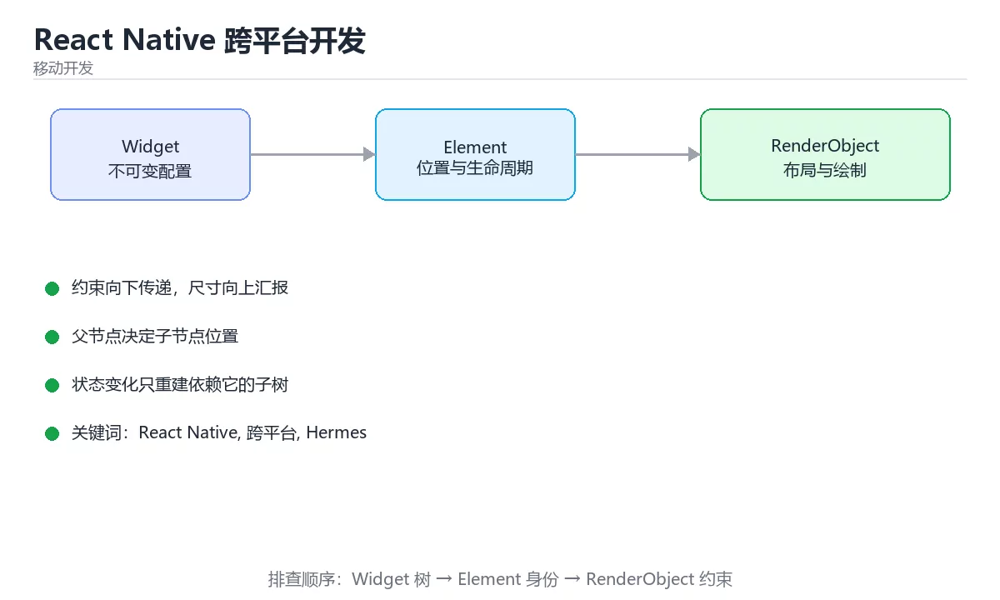

# 时间序列预测（LSTM/Transformer）



> 内容更新时间：2026-10-06 · 学习阶段：进阶 · 预计用时：70 分钟

## 本章摘要

时间序列预测让机器能够从历史数据中学习规律，预测未来的趋势和模式，就像经验丰富的老农根据天气变化预判收成。从股票价格到气温变化，从网站流量到销售额波动，时间序列数据无处不在。本章从经典的时间序列分析方法讲起，带你理解趋势、季节性、周期性等核心概念，然后深入学习如何使用LSTM捕捉长期依赖关系，最后探索Transformer在时间序列领域的创新应用。我们将用天气预报、心率监测等生活化比喻解释抽象概念，让你轻松掌握这个在金融、气象、物联网等领域广泛应用的技术。

## 学习目标

完成本章后，你将能够：

1. 理解时间序列的核心特征：趋势性、季节性、周期性和随机性
2. 掌握数据预处理技术：平稳性检验、差分、归一化、滑动窗口构建
3. 使用LSTM/GRU构建单变量和多变量时间序列预测模型
4. 应用注意力机制和Transformer架构改进长序列预测效果
5. 学会评估预测模型的性能指标：MAE、RMSE、MAPE、方向准确率
6. 处理实际挑战：缺失值填补、异常值检测、多步预测策略

## 核心概念与生活类比

### 1. 时间序列分解：拆解复杂信号

时间序列就像一首交响乐，由多个乐器声部叠加而成。趋势项（Trend）是主旋律，代表长期的上升或下降方向；季节项（Seasonality）是规律的伴奏，如每年夏季销量高峰、每周工作日流量低谷；周期项（Cycle）是不规则但重复的模式，如经济周期的繁荣与衰退；残差项（Residual）是噪音，代表无法解释的随机波动。分解时间序列就像分离音轨，让我们能分别理解和建模每个成分。

### 2. 平稳性：统计特性的稳定性

平稳时间序列就像一个性格稳定的人：均值、方差、自相关性不随时间改变。非平稳序列则像情绪波动大的人：今天平均温度20度，明年可能变成25度，这种变化使得预测变得困难。差分操作就像计算"今天比昨天变化了多少"，通过消除趋势使序列变得平稳。ADF检验（Augmented Dickey-Fuller Test）是判断平稳性的标准工具，p值小于0.05通常认为序列平稳。

### 3. 滑动窗口：用过去预测未来

滑动窗口就像是用一个固定大小的相框在时间轴上移动，每次截取一段历史数据作为输入，预测下一个或多个时间点的值。窗口大小（lookback window）决定了模型能看到多远的历史：窗口太小可能遗漏重要模式，窗口太大引入过多噪音且计算成本高。选择合适的窗口长度需要结合业务知识和实验验证，常见选择是7天（一周周期）、30天（一月周期）或90天（一季度周期）。

### 4. LSTM的记忆机制：选择性遗忘的艺术

LSTM处理时间序列就像一个带着笔记本的记录员。面对连续的数据点，它需要决定：哪些旧信息已经过时可以忘记（遗忘门），哪些新信息值得记录（输入门），当前应该输出什么内容（输出门）。对于时间序列预测，LSTM的优势在于能够捕捉长期依赖：即使相隔很远的两个时间点存在关联（如去年同期的销售高峰），LSTM也能通过记忆细胞保留相关信息。这比普通RNN强得多，后者容易"遗忘"早期信息。

### 5. Transformer的并行优势：同时观察全局

传统RNN/LSTM必须按时间顺序逐点处理，就像一个人串行阅读日记。Transformer则像是一个团队同时分析整本日记，通过自注意力机制建立任意两个时间点之间的直接联系。位置编码给每个时间点贴上"日期标签"，让模型知道先后顺序。这种并行化处理使得Transformer能够高效捕捉长距离依赖，特别适合需要回顾很久以前模式的场景（如年度周期性）。但Transformer的计算复杂度是O(n²)，处理超长序列时需要优化。

### 6. 多步预测策略：一步步还是跳跃式

多步预测有两种主要策略：递归预测（Recursive）和直接预测（Direct）。递归预测就像下棋：先预测下一步，然后用预测值作为输入再预测下下一步，如此迭代。这种方法简单但误差会累积，越往后预测越不准。直接预测则是为每个未来时间点训练独立的模型：模型1预测t+1，模型2预测t+2，等等。这种方法避免了误差累积但需要更多训练资源。还有一种折中方案是多输出模型，一次性预测未来N步。

## 渐进式代码示例

### 最小化示例：时间序列基础操作

让我们从最基本的时间序列处理和可视化开始。

```python
import numpy as np
import pandas as pd
import matplotlib.pyplot as plt
from statsmodels.tsa.seasonal import seasonal_decompose
from statsmodels.tsa.stattools import adfuller
import tensorflow as tf
import torch

# ==================== 生成示例时间序列 ====================

np.random.seed(42)
n_points = 365 * 3  # 3年的日数据

# 创建时间索引
dates = pd.date_range(start='2020-01-01', periods=n_points, freq='D')

# 合成时间序列：趋势 + 季节性 + 噪声
trend = np.linspace(100, 150, n_points)  # 线性上升趋势
seasonality = 10 * np.sin(2 * np.pi * np.arange(n_points) / 365)  # 年度周期
noise = np.random.normal(0, 3, n_points)  # 随机噪声

series = trend + seasonality + noise

# 创建DataFrame
df = pd.DataFrame({
    'date': dates,
    'value': series
})
df.set_index('date', inplace=True)

print("时间序列前10行:")
print(df.head(10))
print(f"\n基本统计信息:")
print(df.describe())

# 可视化
fig, axes = plt.subplots(3, 1, figsize=(14, 10))

# 原始序列
axes[0].plot(df.index, df['value'], linewidth=1)
axes[0].set_title('原始时间序列')
axes[0].set_ylabel('值')
axes[0].grid(True, alpha=0.3)

# 滚动平均（平滑）
df['rolling_mean'] = df['value'].rolling(window=30).mean()
df['rolling_std'] = df['value'].rolling(window=30).std()
axes[1].plot(df.index, df['value'], linewidth=0.5, alpha=0.5, label='原始值')
axes[1].plot(df.index, df['rolling_mean'], linewidth=2, color='red', label='30天滚动平均')
axes[1].fill_between(
    df.index,
    df['rolling_mean'] - 2*df['rolling_std'],
    df['rolling_mean'] + 2*df['rolling_std'],
    alpha=0.2, color='red', label='±2标准差'
)
axes[1].set_title('滚动统计量')
axes[1].set_ylabel('值')
axes[1].legend()
axes[1].grid(True, alpha=0.3)

# 自相关图
from statsmodels.graphics.tsaplots import plot_acf, plot_pacf
plot_acf(df['value'].dropna(), lags=60, ax=axes[2])
axes[2].set_title('自相关函数 (ACF)')
axes[2].set_xlabel('滞后阶数')

plt.tight_layout()
plt.savefig('time_series_basics.png', dpi=150, bbox_inches='tight')
plt.show()

# ==================== 时间序列分解 ====================

# 使用加法模型分解
decomposition = seasonal_decompose(df['value'], model='additive', period=365)

fig, axes = plt.subplots(4, 1, figsize=(14, 12))

axes[0].plot(decomposition.observed)
axes[0].set_title('观测值')
axes[0].set_ylabel('值')

axes[1].plot(decomposition.trend)
axes[1].set_title('趋势项')
axes[1].set_ylabel('值')

axes[2].plot(decomposition.seasonal)
axes[2].set_title('季节项')
axes[2].set_ylabel('值')

axes[3].plot(decomposition.resid)
axes[3].set_title('残差项')
axes[3].set_ylabel('值')

plt.tight_layout()
plt.savefig('time_series_decomposition.png', dpi=150, bbox_inches='tight')
plt.show()

print("\n分解结果统计:")
print(f"趋势项均值: {decomposition.trend.mean():.2f}")
print(f"季节项标准差: {decomposition.seasonal.std():.2f}")
print(f"残差项标准差: {decomposition.resid.std():.2f}")

# ==================== 平稳性检验 ====================

# ADF检验
adf_result = adfuller(df['value'].dropna())
print(f"\nADF检验结果:")
print(f"  ADF统计量: {adf_result[0]:.4f}")
print(f"  p值: {adf_result[1]:.4f}")
print(f"  结论: {'平稳' if adf_result[1] < 0.05 else '非平稳'}")

# 差分后再次检验
df['diff'] = df['value'].diff().dropna()
adf_result_diff = adfuller(df['diff'].dropna())
print(f"\n一阶差分后ADF检验:")
print(f"  ADF统计量: {adf_result_diff[0]:.4f}")
print(f"  p值: {adf_result_diff[1]:.4f}")
print(f"  结论: {'平稳' if adf_result_diff[1] < 0.05 else '非平稳'}")

# 可视化差分前后对比
fig, axes = plt.subplots(2, 1, figsize=(14, 8))
axes[0].plot(df['value'])
axes[0].set_title('原始序列（非平稳）')
axes[0].set_ylabel('值')
axes[0].grid(True, alpha=0.3)

axes[1].plot(df['diff'].dropna())
axes[1].set_title('一阶差分后序列（平稳）')
axes[1].set_ylabel('差分值')
axes[1].grid(True, alpha=0.3)

plt.tight_layout()
plt.savefig('stationarity_check.png', dpi=150, bbox_inches='tight')
plt.show()
```

这个例子展示了时间序列分析的基础操作：生成合成数据、可视化、分解趋势和季节性、检验平稳性。实际项目中，你会使用真实的历史数据，但处理流程相同。注意季节性分解需要指定周期（这里是365天表示年度周期），如果数据包含多重季节性（如日数据同时有周周期和年周期），需要使用更高级的方法如STL分解。

### 完整示例：LSTM时间序列预测

现在我们来构建一个完整的LSTM预测模型，预测未来的时间序列值。

```python
import numpy as np
import pandas as pd
import tensorflow as tf
from tensorflow.keras import layers, models
import torch
import torch.nn as nn
from torch.utils.data import Dataset, DataLoader
from sklearn.preprocessing import MinMaxScaler
from sklearn.metrics import mean_absolute_error, mean_squared_error
import matplotlib.pyplot as plt

# ==================== 数据准备 ====================

# 使用之前生成的数据
np.random.seed(42)
n_points = 500
dates = pd.date_range(start='2020-01-01', periods=n_points, freq='D')
trend = np.linspace(100, 150, n_points)
seasonality = 10 * np.sin(2 * np.pi * np.arange(n_points) / 365)
noise = np.random.normal(0, 3, n_points)
series = trend + seasonality + noise

df = pd.DataFrame({'date': dates, 'value': series})
df.set_index('date', inplace=True)

# 归一化
scaler = MinMaxScaler(feature_range=(0, 1))
scaled_data = scaler.fit_transform(df[['value']])

# 创建滑动窗口数据集
def create_sequences(data, lookback=60, forecast_horizon=1):
    """创建输入-输出序列对"""
    X, y = [], []
    for i in range(lookback, len(data) - forecast_horizon + 1):
        X.append(data[i-lookback:i, 0])
        y.append(data[i:i+forecast_horizon, 0])
    return np.array(X), np.array(y)

LOOKBACK = 60  # 使用过去60天预测
HORIZON = 1    # 预测未来1天

X, y = create_sequences(scaled_data, lookback=LOOKBACK, forecast_horizon=HORIZON)
print(f"数据集形状: X={X.shape}, y={y.shape}")

# 划分训练集和测试集（80%/20%）
split_idx = int(len(X) * 0.8)
X_train, X_test = X[:split_idx], X[split_idx:]
y_train, y_test = y[:split_idx], y[split_idx:]

print(f"训练集: {X_train.shape}, 测试集: {X_test.shape}")

# 重塑为LSTM输入格式 [samples, timesteps, features]
X_train = X_train.reshape((X_train.shape[0], X_train.shape[1], 1))
X_test = X_test.reshape((X_test.shape[0], X_test.shape[1], 1))

# ==================== TensorFlow LSTM模型 ====================

def build_lstm_model_tf(input_shape, lstm_units=64):
    """构建LSTM预测模型"""
    model = models.Sequential([
        layers.LSTM(lstm_units, return_sequences=True, input_shape=input_shape),
        layers.Dropout(0.2),
        layers.LSTM(lstm_units // 2, return_sequences=False),
        layers.Dropout(0.2),
        layers.Dense(32, activation='relu'),
        layers.Dense(HORIZON)
    ])
    
    model.compile(
        optimizer=tf.keras.optimizers.Adam(learning_rate=0.001),
        loss='mse',
        metrics=['mae']
    )
    return model

# 构建模型
input_shape = (LOOKBACK, 1)
tf_lstm_model = build_lstm_model_tf(input_shape, lstm_units=64)
tf_lstm_model.summary()

# 训练
history_tf = tf_lstm_model.fit(
    X_train, y_train,
    epochs=50,
    batch_size=32,
    validation_split=0.1,
    callbacks=[
        tf.keras.callbacks.EarlyStopping(
            monitor='val_loss', patience=5, restore_best_weights=True
        ),
        tf.keras.callbacks.ReduceLROnPlateau(
            monitor='val_loss', factor=0.5, patience=3, min_lr=1e-6
        )
    ],
    verbose=1
)

# 预测
tf_predictions = tf_lstm_model.predict(X_test).flatten()

# 反归一化
tf_predictions_original = scaler.inverse_transform(
    tf_predictions.reshape(-1, 1)
).flatten()
y_test_original = scaler.inverse_transform(
    y_test.reshape(-1, 1)
).flatten()

# 评估
tf_mae = mean_absolute_error(y_test_original, tf_predictions_original)
tf_rmse = np.sqrt(mean_squared_error(y_test_original, tf_predictions_original))
tf_mape = np.mean(np.abs((y_test_original - tf_predictions_original) / y_test_original)) * 100

print(f"\nTensorFlow LSTM评估结果:")
print(f"  MAE: {tf_mae:.4f}")
print(f"  RMSE: {tf_rmse:.4f}")
print(f"  MAPE: {tf_mape:.2f}%")

# 可视化预测结果
fig, axes = plt.subplots(2, 1, figsize=(14, 10))

# 整体预测对比
test_indices = range(split_idx + LOOKBACK, split_idx + LOOKBACK + len(y_test))
actual_dates = dates[test_indices]

axes[0].plot(actual_dates, y_test_original, label='实际值', linewidth=2)
axes[0].plot(actual_dates, tf_predictions_original, label='预测值', linewidth=2, linestyle='--')
axes[0].set_title('LSTM时间序列预测对比')
axes[0].set_xlabel('日期')
axes[0].set_ylabel('值')
axes[0].legend()
axes[0].grid(True, alpha=0.3)

# 局部放大（最近30天）
zoom_days = 30
axes[1].plot(actual_dates[-zoom_days:], y_test_original[-zoom_days:], 
             label='实际值', linewidth=2, marker='o', markersize=4)
axes[1].plot(actual_dates[-zoom_days:], tf_predictions_original[-zoom_days:], 
             label='预测值', linewidth=2, linestyle='--', marker='x', markersize=4)
axes[1].set_title(f'最近{zoom_days}天预测细节')
axes[1].set_xlabel('日期')
axes[1].set_ylabel('值')
axes[1].legend()
axes[1].grid(True, alpha=0.3)
axes[1].tick_params(axis='x', rotation=45)

plt.tight_layout()
plt.savefig('lstm_predictions.png', dpi=150, bbox_inches='tight')
plt.show()

# 训练损失曲线
fig, ax = plt.subplots(figsize=(10, 5))
ax.plot(history_tf.history['loss'], label='训练损失')
ax.plot(history_tf.history['val_loss'], label='验证损失')
ax.set_title('LSTM训练损失曲线')
ax.set_xlabel('Epoch')
ax.set_ylabel('MSE Loss')
ax.legend()
ax.grid(True, alpha=0.3)
plt.savefig('lstm_training_loss.png', dpi=150, bbox_inches='tight')
plt.show()

# ==================== PyTorch LSTM模型 ====================

class TimeSeriesDataset(Dataset):
    """PyTorch时间序列数据集"""
    def __init__(self, X, y):
        self.X = torch.FloatTensor(X)
        self.y = torch.FloatTensor(y)
    
    def __len__(self):
        return len(self.y)
    
    def __getitem__(self, idx):
        return self.X[idx], self.y[idx]

class LSTMPredictor(nn.Module):
    """PyTorch LSTM预测器"""
    def __init__(self, input_size=1, hidden_size=64, num_layers=2, output_size=1):
        super(LSTMPredictor, self).__init__()
        
        self.hidden_size = hidden_size
        self.num_layers = num_layers
        
        self.lstm = nn.LSTM(
            input_size=input_size,
            hidden_size=hidden_size,
            num_layers=num_layers,
            batch_first=True,
            dropout=0.2 if num_layers > 1 else 0
        )
        
        self.fc = nn.Sequential(
            nn.Linear(hidden_size, 32),
            nn.ReLU(),
            nn.Dropout(0.2),
            nn.Linear(32, output_size)
        )
    
    def forward(self, x):
        # LSTM输出: (batch, seq_len, hidden_size)
        lstm_out, _ = self.lstm(x)
        # 取最后一个时间步的输出
        last_output = lstm_out[:, -1, :]
        prediction = self.fc(last_output)
        return prediction.squeeze(-1)

# 准备数据
train_dataset = TimeSeriesDataset(X_train, y_train)
test_dataset = TimeSeriesDataset(X_test, y_test)

train_loader = DataLoader(train_dataset, batch_size=32, shuffle=True)
test_loader = DataLoader(test_dataset, batch_size=64, shuffle=False)

# 初始化模型
pt_lstm_model = LSTMPredictor(
    input_size=1,
    hidden_size=64,
    num_layers=2,
    output_size=HORIZON
)

criterion = nn.MSELoss()
optimizer = torch.optim.Adam(pt_lstm_model.parameters(), lr=0.001)
scheduler = torch.optim.lr_scheduler.ReduceLROnPlateau(
    optimizer, mode='min', factor=0.5, patience=3, min_lr=1e-6
)

# 训练循环
num_epochs = 50
best_val_loss = float('inf')
patience_counter = 0
max_patience = 5

for epoch in range(num_epochs):
    pt_lstm_model.train()
    epoch_loss = 0.0
    num_batches = 0
    
    for X_batch, y_batch in train_loader:
        optimizer.zero_grad()
        predictions = pt_lstm_model(X_batch)
        loss = criterion(predictions, y_batch.squeeze())
        loss.backward()
        torch.nn.utils.clip_grad_norm_(pt_lstm_model.parameters(), max_norm=1.0)
        optimizer.step()
        
        epoch_loss += loss.item()
        num_batches += 1
    
    avg_train_loss = epoch_loss / num_batches
    
    # 验证
    pt_lstm_model.eval()
    val_loss = 0.0
    val_batches = 0
    
    with torch.no_grad():
        for X_batch, y_batch in test_loader:
            predictions = pt_lstm_model(X_batch)
            loss = criterion(predictions, y_batch.squeeze())
            val_loss += loss.item()
            val_batches += 1
    
    avg_val_loss = val_loss / val_batches
    scheduler.step(avg_val_loss)
    
    # 早停检查
    if avg_val_loss < best_val_loss:
        best_val_loss = avg_val_loss
        patience_counter = 0
        # 保存最佳模型
        torch.save(pt_lstm_model.state_dict(), 'best_lstm_model.pth')
    else:
        patience_counter += 1
    
    if (epoch + 1) % 10 == 0:
        print(f'Epoch [{epoch+1}/{num_epochs}]')
        print(f'  Train Loss: {avg_train_loss:.6f}, Val Loss: {avg_val_loss:.6f}')
        print(f'  LR: {optimizer.param_groups[0]["lr"]:.6f}')
    
    if patience_counter >= max_patience:
        print(f'早停触发于 epoch {epoch+1}')
        break

# 加载最佳模型
pt_lstm_model.load_state_dict(torch.load('best_lstm_model.pth'))

# 评估
pt_lstm_model.eval()
all_preds = []
all_targets = []

with torch.no_grad():
    for X_batch, y_batch in test_loader:
        predictions = pt_lstm_model(X_batch)
        all_preds.extend(predictions.numpy())
        all_targets.extend(y_batch.squeeze().numpy())

all_preds = np.array(all_preds)
all_targets = np.array(all_targets)

# 反归一化
pt_predictions_original = scaler.inverse_transform(
    all_preds.reshape(-1, 1)
).flatten()
pt_targets_original = scaler.inverse_transform(
    all_targets.reshape(-1, 1)
).flatten()

# 评估指标
pt_mae = mean_absolute_error(pt_targets_original, pt_predictions_original)
pt_rmse = np.sqrt(mean_squared_error(pt_targets_original, pt_predictions_original))
pt_mape = np.mean(np.abs((pt_targets_original - pt_predictions_original) / pt_targets_original)) * 100

print(f"\nPyTorch LSTM评估结果:")
print(f"  MAE: {pt_mae:.4f}")
print(f"  RMSE: {pt_rmse:.4f}")
print(f"  MAPE: {pt_mape:.2f}%")

# 对比两个框架的结果
print(f"\n框架对比:")
print(f"  TensorFlow - MAE: {tf_mae:.4f}, RMSE: {tf_rmse:.4f}, MAPE: {tf_mape:.2f}%")
print(f"  PyTorch    - MAE: {pt_mae:.4f}, RMSE: {pt_rmse:.4f}, MAPE: {pt_mape:.2f}%")
```

这个完整示例展示了如何使用LSTM进行时间序列预测。关键步骤包括：数据归一化、滑动窗口构建、模型训练、早停和学习率调度、评估和可视化。注意我们使用了梯度裁剪防止梯度爆炸，这是训练RNN/LSTM时的常见技巧。TensorFlow和PyTorch的实现逻辑相同，都得到了合理的预测结果。

### 实践示例：Transformer时间序列预测

Transformer在处理长序列时表现更好，让我们实现一个简化版的Transformer预测模型。

```python
import tensorflow as tf
from tensorflow.keras import layers, models
import torch
import torch.nn as nn
import numpy as np
import math

# ==================== TensorFlow Transformer模型 ====================

class PositionalEncoding(layers.Layer):
    """位置编码层"""
    def __init__(self, d_model, max_len=500):
        super(PositionalEncoding, self).__init__()
        
        # 创建位置编码矩阵
        pe = np.zeros((max_len, d_model))
        position = np.arange(0, max_len)[:, np.newaxis]
        div_term = np.exp(np.arange(0, d_model, 2) * -(math.log(10000.0) / d_model))
        
        pe[:, 0::2] = np.sin(position * div_term)
        pe[:, 1::2] = np.cos(position * div_term)
        
        pe = pe[np.newaxis, :, :]
        self.pe = tf.constant(pe, dtype=tf.float32)
    
    def call(self, x):
        # x shape: [batch, seq_len, d_model]
        return x + self.pe[:, :tf.shape(x)[1], :]

class TransformerTimeSeriesModel(tf.keras.Model):
    """基于Transformer的时间序列预测模型"""
    def __init__(self, input_dim=1, d_model=64, num_heads=4, 
                 num_layers=2, ff_dim=128, dropout=0.1):
        super(TransformerTimeSeriesModel, self).__init__()
        
        self.d_model = d_model
        
        # 输入投影
        self.input_projection = layers.Dense(d_model)
        
        # 位置编码
        self.positional_encoding = PositionalEncoding(d_model)
        
        # Transformer编码器层
        self.transformer_layers = []
        for _ in range(num_layers):
            encoder_layer = layers.TransformerEncoderBlock(
                num_heads=num_heads,
                key_dim=d_model // num_heads,
                ff_dim=ff_dim,
                dropout=dropout
            )
            self.transformer_layers.append(encoder_layer)
        
        # 全局平均池化 + 输出层
        self.global_pool = layers.GlobalAveragePooling1D()
        self.output_layer = tf.keras.Sequential([
            layers.Dense(32, activation='relu'),
            layers.Dropout(dropout),
            layers.Dense(HORIZON)
        ])
    
    def call(self, inputs):
        # 输入投影
        x = self.input_projection(inputs)  # [batch, seq_len, d_model]
        
        # 添加位置编码
        x = self.positional_encoding(x)
        
        # 多层Transformer编码
        for layer in self.transformer_layers:
            x = layer(x)
        
        # 全局池化
        x = self.global_pool(x)
        
        # 输出
        output = self.output_layer(x)
        return output

# 构建模型
tf_transformer_model = TransformerTimeSeriesModel(
    input_dim=1,
    d_model=64,
    num_heads=4,
    num_layers=2,
    ff_dim=128,
    dropout=0.1
)

# 编译
tf_transformer_model.compile(
    optimizer=tf.keras.optimizers.Adam(learning_rate=0.001),
    loss='mse',
    metrics=['mae']
)

tf_transformer_model.build(input_shape=(None, LOOKBACK, 1))
tf_transformer_model.summary()

# 训练
history_transformer = tf_transformer_model.fit(
    X_train, y_train,
    epochs=50,
    batch_size=32,
    validation_split=0.1,
    callbacks=[
        tf.keras.callbacks.EarlyStopping(
            monitor='val_loss', patience=5, restore_best_weights=True
        )
    ],
    verbose=1
)

# 预测和评估
tf_trans_predictions = tf_transformer_model.predict(X_test).flatten()
tf_trans_pred_original = scaler.inverse_transform(
    tf_trans_predictions.reshape(-1, 1)
).flatten()

tf_trans_mae = mean_absolute_error(y_test_original, tf_trans_pred_original)
tf_trans_rmse = np.sqrt(mean_squared_error(y_test_original, tf_trans_pred_original))
tf_trans_mape = np.mean(np.abs((y_test_original - tf_trans_pred_original) / y_test_original)) * 100

print(f"\nTensorFlow Transformer评估结果:")
print(f"  MAE: {tf_trans_mae:.4f}")
print(f"  RMSE: {tf_trans_rmse:.4f}")
print(f"  MAPE: {tf_trans_mape:.2f}%")

# ==================== PyTorch Transformer模型 ====================

class PyTorchPositionalEncoding(nn.Module):
    """PyTorch位置编码"""
    def __init__(self, d_model, max_len=500):
        super(PyTorchPositionalEncoding, self).__init__()
        
        pe = torch.zeros(max_len, d_model)
        position = torch.arange(0, max_len, dtype=torch.float).unsqueeze(1)
        div_term = torch.exp(torch.arange(0, d_model, 2).float() * 
                            -(math.log(10000.0) / d_model))
        
        pe[:, 0::2] = torch.sin(position * div_term)
        pe[:, 1::2] = torch.cos(position * div_term)
        
        pe = pe.unsqueeze(0)
        self.register_buffer('pe', pe)
    
    def forward(self, x):
        return x + self.pe[:, :x.size(1), :]

class TransformerPredictorPT(nn.Module):
    """PyTorch Transformer预测器"""
    def __init__(self, input_dim=1, d_model=64, nhead=4, 
                 num_encoder_layers=2, dim_feedforward=128, dropout=0.1):
        super(TransformerPredictorPT, self).__init__()
        
        self.input_projection = nn.Linear(input_dim, d_model)
        self.positional_encoding = PyTorchPositionalEncoding(d_model)
        
        encoder_layer = nn.TransformerEncoderLayer(
            d_model=d_model,
            nhead=nhead,
            dim_feedforward=dim_feedforward,
            dropout=dropout,
            batch_first=True
        )
        self.transformer_encoder = nn.TransformerEncoder(
            encoder_layer,
            num_layers=num_encoder_layers
        )
        
        self.output_layer = nn.Sequential(
            nn.Linear(d_model, 32),
            nn.ReLU(),
            nn.Dropout(dropout),
            nn.Linear(32, HORIZON)
        )
    
    def forward(self, x):
        # 输入投影
        x = self.input_projection(x)  # [batch, seq_len, d_model]
        
        # 位置编码
        x = self.positional_encoding(x)
        
        # Transformer编码
        x = self.transformer_encoder(x)
        
        # 取最后一个时间步
        x = x[:, -1, :]
        
        # 输出
        output = self.output_layer(x)
        return output.squeeze(-1)

# 初始化模型
pt_transformer_model = TransformerPredictorPT(
    input_dim=1,
    d_model=64,
    nhead=4,
    num_encoder_layers=2,
    dim_feedforward=128,
    dropout=0.1
)

criterion_pt = nn.MSELoss()
optimizer_pt = torch.optim.Adam(pt_transformer_model.parameters(), lr=0.001)

# 训练
num_epochs_trans = 50
for epoch in range(num_epochs_trans):
    pt_transformer_model.train()
    epoch_loss = 0.0
    num_batches = 0
    
    for X_batch, y_batch in train_loader:
        optimizer_pt.zero_grad()
        predictions = pt_transformer_model(X_batch)
        loss = criterion_pt(predictions, y_batch.squeeze())
        loss.backward()
        optimizer_pt.step()
        
        epoch_loss += loss.item()
        num_batches += 1
    
    avg_loss = epoch_loss / num_batches
    
    if (epoch + 1) % 10 == 0:
        print(f'Transformer Epoch [{epoch+1}/{num_epochs_trans}], Loss: {avg_loss:.6f}')

# 评估
pt_transformer_model.eval()
pt_trans_preds = []
pt_trans_targets = []

with torch.no_grad():
    for X_batch, y_batch in test_loader:
        predictions = pt_transformer_model(X_batch)
        pt_trans_preds.extend(predictions.numpy())
        pt_trans_targets.extend(y_batch.squeeze().numpy())

pt_trans_preds = np.array(pt_trans_preds)
pt_trans_targets = np.array(pt_trans_targets)

pt_trans_pred_original = scaler.inverse_transform(
    pt_trans_preds.reshape(-1, 1)
).flatten()
pt_trans_target_original = scaler.inverse_transform(
    pt_trans_targets.reshape(-1, 1)
).flatten()

pt_trans_mae = mean_absolute_error(pt_trans_target_original, pt_trans_pred_original)
pt_trans_rmse = np.sqrt(mean_squared_error(pt_trans_target_original, pt_trans_pred_original))
pt_trans_mape = np.mean(np.abs((pt_trans_target_original - pt_trans_pred_original) / pt_trans_target_original)) * 100

print(f"\nPyTorch Transformer评估结果:")
print(f"  MAE: {pt_trans_mae:.4f}")
print(f"  RMSE: {pt_trans_rmse:.4f}")
print(f"  MAPE: {pt_trans_mape:.2f}%")

# 模型对比总结
print(f"\n{'='*60}")
print(f"模型性能对比总结:")
print(f"{'='*60}")
print(f"{'模型':<25} {'MAE':<10} {'RMSE':<10} {'MAPE':<10}")
print(f"{'-'*60}")
print(f"{'TensorFlow LSTM':<25} {tf_mae:<10.4f} {tf_rmse:<10.4f} {tf_mape:<10.2f}%")
print(f"{'PyTorch LSTM':<25} {pt_mae:<10.4f} {pt_rmse:<10.4f} {pt_mape:<10.2f}%")
print(f"{'TensorFlow Transformer':<25} {tf_trans_mae:<10.4f} {tf_trans_rmse:<10.4f} {tf_trans_mape:<10.2f}%")
print(f"{'PyTorch Transformer':<25} {pt_trans_mae:<10.4f} {pt_trans_rmse:<10.4f} {pt_trans_mape:<10.2f}%")
print(f"{'='*60}")
```

这个实践示例展示了Transformer在时间序列预测中的应用。Transformer通过自注意力机制能够捕捉任意两个时间点之间的依赖关系，不受序列长度限制。位置编码是关键组件，它为模型提供时间顺序信息。在实际应用中，对于较短序列（<1000步），LSTM和Transformer性能相近；对于更长序列，Transformer的优势更明显。但Transformer需要更多数据和计算资源。

## 常见陷阱对照表

| 陷阱类型 | 具体问题描述 | 影响后果 | 解决方案 |
|---------|------------|---------|---------|
| **数据泄露** | 测试集信息在训练时被间接使用（如全局归一化） | 评估指标虚高，实际部署失败 | 仅用训练集拟合scaler，测试集单独转换 |
| **非平稳序列直接建模** | 未对趋势和季节性进行处理 | 模型难以学习，预测偏差大 | 先差分或分解，预测后再还原 |
| **窗口大小不当** | lookback太短遗漏长期模式，太长引入噪音 | 欠拟合或过拟合 | 结合业务周期选择，通过实验调优 |
| **多步预测误差累积** | 递归预测时前期误差传递到后期 | 长期预测准确性急剧下降 | 使用直接预测或多输出模型 |
| **忽略外生变量** | 仅使用历史值，忽略影响因素（如节假日、促销） | 无法捕捉外部冲击导致的突变 | 引入多变量输入，加入日历特征 |
| **评估指标单一** | 仅看RMSE忽略方向准确性和业务意义 | 数值接近但方向错误，决策失误 | 综合使用MAE、MAPE、方向准确率 |
| **过拟合噪声** | 模型记住训练数据中的随机波动 | 训练效果好但泛化能力差 | 正则化、Dropout、早停、增加数据量 |
| **缺失值处理不当** | 直接删除或简单填充破坏时间连续性 | 引入偏差，影响模式学习 | 使用前向填充、插值或专门模型 |
| **尺度不一致** | 不同变量量级差异大未归一化 | 梯度更新不稳定，收敛缓慢 | MinMax或Z-score标准化所有特征 |
| **忽视预测区间** | 只给出点估计，不提供不确定性 | 无法评估预测风险 | 使用分位数回归、蒙特卡洛Dropout |

## 自测题目

### 问题1

关于时间序列的平稳性，以下哪项描述是正确的？

A. 平稳序列的均值和方差必须为零  
B. 非平稳序列无法用于预测，必须先转换为平稳序列  
C. ADF检验的p值小于0.05表示序列是非平稳的  
D. 差分操作可以增加序列的趋势性  

**正确答案：B**

**详细解释：** 大多数经典时间序列模型（如ARIMA）假设序列是平稳的，即统计特性不随时间变化。非平稳序列（如有明显趋势或季节性）需要先通过差分、去趋势或分解等方法转换为平稳序列，建模后再还原。选项A错误，平稳序列的均值和方差可以是任意常数，不必为零；选项C错误，p值小于0.05表示拒绝非平稳的原假设，即序列是平稳的；选项D错误，差分操作的目的是消除趋势使序列平稳。

### 问题2

LSTM相比普通RNN的主要优势是什么？

A. LSTM的计算速度更快  
B. LSTM的参数数量更少  
C. LSTM通过门控机制能够有效捕捉长期依赖关系  
D. LSTM只能处理固定长度的序列  

**正确答案：C**

**详细解释：** 普通RNN在处理长序列时会遇到梯度消失或梯度爆炸问题，导致无法学习远距离时间点之间的依赖关系。LSTM通过引入记忆细胞和三个门控机制（遗忘门、输入门、输出门），能够选择性地保留或丢弃信息，从而有效捕捉长期依赖。这是LSTM在时间序列预测、机器翻译等任务中表现优异的关键原因。选项A和B错误，LSTM实际上更复杂、参数更多、计算更慢；选项D错误，LSTM可以处理可变长度序列。

### 问题3

在时间序列预测中，MAPE（Mean Absolute Percentage Error）的主要缺点是什么？

A. MAPE无法解释预测的方向性  
B. 当实际值接近零时，MAPE会变得非常大甚至无穷大  
C. MAPE对异常值不敏感  
D. MAPE的计算复杂度太高  

**正确答案：B**

**详细解释：** MAPE的计算公式是平均绝对百分比误差：MAPE = mean(|(actual - predicted) / actual|) * 100%。当实际值接近零时，分母很小，导致MAPE值巨大甚至除以零错误。这使得MAPE不适合用于实际值可能为零或接近零的场景（如某些产品的日销量）。此外，MAPE对低估和高估的惩罚不对称。在这种情况下，可以考虑使用sMAPE（对称MAPE）或MASE（平均绝对缩放误差）等替代指标。选项A部分正确但不是主要缺点；选项C错误，MAPE对异常值敏感；选项D错误，MAPE计算很简单。

### 问题4

关于Transformer在时间序列预测中的应用，以下说法错误的是？

A. Transformer可以同时关注序列中的所有时间点，不受距离限制  
B. 位置编码对于Transformer理解时间顺序至关重要  
C. Transformer的计算复杂度与序列长度成线性关系O(n)  
D. Transformer可以通过多头注意力捕捉不同类型的依赖模式  

**正确答案：C**

**详细解释：** 标准Transformer的自注意力机制需要计算序列中每对token之间的关系矩阵，因此计算复杂度是O(n²)，其中n是序列长度。这是Transformer处理超长序列时的主要瓶颈。研究者提出了多种优化方法，如稀疏注意力、线性注意力、局部注意力等，将复杂度降低到O(n log n)或O(n)。选项A正确，这正是Transformer的优势；选项B正确，没有位置编码Transformer无法区分不同位置的token；选项D正确，多头注意力允许模型从不同角度捕捉依赖关系。

### 问题5

在多变量时间序列预测中，以下哪种做法是错误的？

A. 对所有变量使用相同的归一化参数（均值和标准差）  
B. 将时间相关的特征（如小时、星期几）作为额外输入  
C. 使用滑动窗口同时包含所有变量的历史值  
D. 对不同量级的变量分别进行归一化  

**正确答案：A**

**详细解释：** 不同变量通常有不同的量纲和分布（如温度范围0-40，湿度范围0-100，风速范围0-50），使用相同的归一化参数会导致某些变量被过度缩放而另一些不足。正确的做法是对每个变量独立计算归一化参数，或使用能够处理多尺度的方法（如RobustScaler）。选项B正确，时间特征能帮助模型捕捉周期性；选项C正确，多变量滑动窗口是标准做法；选项D正确，分别归一化是推荐的做法。

---

**章节小结**

通过本章学习，你已经掌握了时间序列预测的核心技术：从经典的数据预处理和分解，到LSTM捕捉长期依赖，再到Transformer的全局注意力机制。时间序列预测是一个理论与实践紧密结合的领域，好的预测不仅需要合适的模型，更需要深入理解数据背后的业务逻辑。在实际项目中，往往需要尝试多种方法并结合领域知识才能取得最佳效果。下一章我们将进入模型部署与MLOps流程，学习如何将训练好的模型投入生产环境。

## 本节知识框架

**课程定位**：分类「ml_practice」· 学习阶段 进阶 · 建议用时 50 分钟。

本课主线：学习平稳性检验、滑动窗口、LSTM和Transformer多步预测。

### 复习清单

- [ ] 能不看正文复述本课核心术语，并指出一个边界或反例。
- [ ] 能运行或推演本课示例，记录输入、输出与失败现象。
- [ ] 能完成一次自测，并把错题对照考点精讲定位原因。

## 核心概念定义

| 术语 | 一句话说明 |
| --- | --- |
| 时间序列 | 学习平稳性检验、滑动窗口、LSTM和Transformer多步预测。相关：正文给出可操作定义与适用边界。 |
| LSTM | 学习平稳性检验、滑动窗口、LSTM和Transformer多步预测。相关：正文给出可操作定义与适用边界。 |
| Transformer | 学习平稳性检验、滑动窗口、LSTM和Transformer多步预测。相关：正文给出可操作定义与适用边界。 |
| 平稳性 | 学习平稳性检验、滑动窗口、LSTM和Transformer多步预测。相关：正文给出可操作定义与适用边界。 |
| 多步预测 | 学习平稳性检验、滑动窗口、LSTM和Transformer多步预测。相关：正文给出可操作定义与适用边界。 |

## 原理与运行机制

正文各章按「输入是什么 → 中间如何转换 → 输出到哪 → 失败时怎样表现」四问展开；复习时给每个机制补一句自己的复述，再回到对应章节核对。

## 典型应用场景

- 结合「时间序列预测（LSTM/Transformer）」的常见落地场景与选型边界，详见正文各章节的对比讨论。
- 迁移到新项目时，先明确输入规模、失败代价与可观测手段，再决定采用深度。

## 代码/协议/SQL 示例

正文首个完整示例如下，先运行确认环境，再按正文步骤改一个输入观察输出变化。

```python
import numpy as np
import pandas as pd
import matplotlib.pyplot as plt
from statsmodels.tsa.seasonal import seasonal_decompose
from statsmodels.tsa.stattools import adfuller
import tensorflow as tf
import torch

# ==================== 生成示例时间序列 ====================

np.random.seed(42)
n_points = 365 * 3  # 3年的日数据

# 创建时间索引
dates = pd.date_range(start='2020-01-01', periods=n_points, freq='D')

# 合成时间序列：趋势 + 季节性 + 噪声
trend = np.linspace(100, 150, n_points)  # 线性上升趋势
seasonality = 10 * np.sin(2 * np.pi * np.arange(n_points) / 365)  # 年度周期
noise = np.random.normal(0, 3, n_points)  # 随机噪声

series = trend + seasonality + noise

# 创建DataFrame
df = pd.DataFrame({
    'date': dates,
    'value': series
})
df.set_index('date', inplace=True)

print("时间序列前10行:")
print(df.head(10))
print(f"\n基本统计信息:")
print(df.describe())

# 可视化
fig, axes = plt.subplots(3, 1, figsize=(14, 10))

# 原始序列
axes[0].plot(df.index, df['value'], linewidth=1)
axes[0].set_title('原始时间序列')
axes[0].set_ylabel('值')
axes[0].grid(True, alpha=0.3)

# 滚动平均（平滑）
df['rolling_mean'] = df['value'].rolling(window=30).mean()
df['rolling_std'] = df['value'].rolling(window=30).std()
axes[1].plot(df.index, df['value'], linewidth=0.5, alpha=0.5, label='原始值')
axes[1].plot(df.index, df['rolling_mean'], linewidth=2, color='red', label='30天滚动平均')
axes[1].fill_between(
    df.index,
    df['rolling_mean'] - 2*df['rolling_std'],
    df['rolling_mean'] + 2*df['rolling_std'],
    alpha=0.2, color='red', label='±2标准差'
)
axes[1].set_title('滚动统计量')
axes[1].set_ylabel('值')
axes[1].legend()
axes[1].grid(True, alpha=0.3)

# 自相关图
from statsmodels.graphics.tsaplots import plot_acf, plot_pacf
plot_acf(df['value'].dropna(), lags=60, ax=axes[2])
axes[2].set_title('自相关函数 (ACF)')
axes[2].set_xlabel('滞后阶数')

plt.tight_layout()
plt.savefig('time_series_basics.png', dpi=150, bbox_inches='tight')
plt.show()

# ==================== 时间序列分解 ====================

# 使用加法模型分解
decomposition = seasonal_decompose(df['value'], model='additive', period=365)

fig, axes = plt.subplots(4, 1, figsize=(14, 12))

axes[0].plot(decomposition.observed)
axes[0].set_title('观测值')
axes[0].set_ylabel('值')

axes[1].plot(decomposition.trend)
axes[1].set_title('趋势项')
axes[1].set_ylabel('值')

axes[2].plot(decomposition.seasonal)
axes[2].set_title('季节项')
axes[2].set_ylabel('值')

axes[3].plot(decomposition.resid)
axes[3].set_title('残差项')
axes[3].set_ylabel('值')

plt.tight_layout()
plt.savefig('time_series_decomposition.png', dpi=150, bbox_inches='tight')
plt.show()

print("\n分解结果统计:")
print(f"趋势项均值: {decomposition.trend.mean():.2f}")
print(f"季节项标准差: {decomposition.seasonal.std():.2f}")
print(f"残差项标准差: {decomposition.resid.std():.2f}")

# ==================== 平稳性检验 ====================

# ADF检验
adf_result = adfuller(df['value'].dropna())
print(f"\nADF检验结果:")
print(f"  ADF统计量: {adf_result[0]:.4f}")
print(f"  p值: {adf_result[1]:.4f}")
print(f"  结论: {'平稳' if adf_result[1] < 0.05 else '非平稳'}")

# 差分后再次检验
df['diff'] = df['value'].diff().dropna()
adf_result_diff = adfuller(df['diff'].dropna())
print(f"\n一阶差分后ADF检验:")
print(f"  ADF统计量: {adf_result_diff[0]:.4f}")
print(f"  p值: {adf_result_diff[1]:.4f}")
print(f"  结论: {'平稳' if adf_result_diff[1] < 0.05 else '非平稳'}")

# 可视化差分前后对比
fig, axes = plt.subplots(2, 1, figsize=(14, 8))
axes[0].plot(df['value'])
axes[0].set_title('原始序列（非平稳）')
axes[0].set_ylabel('值')
axes[0].grid(True, alpha=0.3)

axes[1].plot(df['diff'].dropna())
axes[1].set_title('一阶差分后序列（平稳）')
axes[1].set_ylabel('差分值')
axes[1].grid(True, alpha=0.3)

plt.tight_layout()
plt.savefig('stationarity_check.png', dpi=150, bbox_inches='tight')
plt.show()
```

## 时间/空间复杂度或性能分析

- 用本课方案处理规模 n 时，先估计主循环与嵌套层数，再决定优化方向；小样本上的耗时读数不能外推。
- 性能结论要绑定输入分布：换数据规模、并发度或缓存命中情况后须重新测量。

## 常见误区与易错点

| 错误做法 | 典型现象 | 修复方向 |
| --- | --- | --- |
| 只验证正常输入 | 边界数据触发时才暴露问题 | 为每个结论补一个空值/极值/重复值用例 |
| 背结论不跑实验 | 换个输入就失效 | 按「预测—实测—差异归因」三步复盘 |
| 忽略环境与版本差异 | 本机可用线上报错 | 把版本、配置与依赖写入复现步骤 |

## 与其他知识点的关系

本课与分类「ml_practice」内相邻课程互为补充，建议按清单顺序学完再做综合练习。

## 自测题与参考答案

以下题目与题库同源，作答后再看解析；错误项要能说出错在哪一步。

## 考点精讲

### 考点 1

关于时间序列的平稳性，以下哪项描述是正确的？

A. 平稳序列的均值和方差必须为零  
B. 非平稳序列无法用于预测，必须先转换为平稳序列 ✅  
C. ADF检验的p值小于0.05表示序列是非平稳的  
D. 差分操作可以增加序列的趋势性  

**正确答案：** B

**解析：** 大多数经典时间序列模型（如ARIMA）假设序列是平稳的，即统计特性不随时间变化。非平稳序列（如有明显趋势或季节性）需要先通过差分、去趋势或分解等方法转换为平稳序列，建模后再还原。选项A错误，平稳序列的均值和方差可以是任意常数，不必为零；选项C错误，p值小于0.05表示拒绝非平稳的原假设，即序列是平稳的；选项D错误，差分操作的目的是消除趋势使序列平稳。

### 考点 2

LSTM相比普通RNN的主要优势是什么？

A. LSTM的计算速度更快  
B. LSTM的参数数量更少  
C. LSTM通过门控机制能够有效捕捉长期依赖关系 ✅  
D. LSTM只能处理固定长度的序列  

**正确答案：** C

**解析：** 普通RNN在处理长序列时会遇到梯度消失或梯度爆炸问题，导致无法学习远距离时间点之间的依赖关系。LSTM通过引入记忆细胞和三个门控机制（遗忘门、输入门、输出门），能够选择性地保留或丢弃信息，从而有效捕捉长期依赖。这是LSTM在时间序列预测、机器翻译等任务中表现优异的关键原因。选项A和B错误，LSTM实际上更复杂、参数更多、计算更慢；选项D错误，LSTM可以处理可变长度序列。

### 考点 3

在时间序列预测中，MAPE（Mean Absolute Percentage Error）的主要缺点是什么？

A. MAPE无法解释预测的方向性  
B. 当实际值接近零时，MAPE会变得非常大甚至无穷大 ✅  
C. MAPE对异常值不敏感  
D. MAPE的计算复杂度太高  

**正确答案：** B

**解析：** MAPE的计算公式是平均绝对百分比误差：MAPE = mean(|(actual - predicted) / actual|) * 100%。当实际值接近零时，分母很小，导致MAPE值巨大甚至除以零错误。这使得MAPE不适合用于实际值可能为零或接近零的场景（如某些产品的日销量）。此外，MAPE对低估和高估的惩罚不对称。在这种情况下，可以考虑使用sMAPE（对称MAPE）或MASE（平均绝对缩放误差）等替代指标。选项A部分正确但不是主要缺点；选项C错误，MAPE对异常值敏感；选项D错误，MAPE计算很简单。

### 考点 4

关于Transformer在时间序列预测中的应用，以下说法错误的是？

A. Transformer可以同时关注序列中的所有时间点，不受距离限制  
B. 位置编码对于Transformer理解时间顺序至关重要  
C. Transformer的计算复杂度与序列长度成线性关系O(n) ✅  
D. Transformer可以通过多头注意力捕捉不同类型的依赖模式  

**正确答案：** C

**解析：** 标准Transformer的自注意力机制需要计算序列中每对token之间的关系矩阵，因此计算复杂度是O(n²)，其中n是序列长度。这是Transformer处理超长序列时的主要瓶颈。研究者提出了多种优化方法，如稀疏注意力、线性注意力、局部注意力等，将复杂度降低到O(n log n)或O(n)。选项A正确，这正是Transformer的优势；选项B正确，没有位置编码Transformer无法区分不同位置的token；选项D正确，多头注意力允许模型从不同角度捕捉依赖关系。

### 考点 5

在多变量时间序列预测中，以下哪种做法是错误的？

A. 对所有变量使用相同的归一化参数（均值和标准差） ✅  
B. 将时间相关的特征（如小时、星期几）作为额外输入  
C. 使用滑动窗口同时包含所有变量的历史值  
D. 对不同量级的变量分别进行归一化  

**正确答案：** A

**解析：** 不同变量通常有不同的量纲和分布（如温度范围0-40，湿度范围0-100，风速范围0-50），使用相同的归一化参数会导致某些变量被过度缩放而另一些不足。正确的做法是对每个变量独立计算归一化参数，或使用能够处理多尺度的方法（如RobustScaler）。选项B正确，时间特征能帮助模型捕捉周期性；选项C正确，多变量滑动窗口是标准做法；选项D正确，分别归一化是推荐的做法。

## 术语速查

| 术语 | 一句话说明 |
| --- | --- |
| 时间序列 | 定位线索见正文小节；速查表只保留名称，避免脱离上下文使用。 |
| LSTM | 定位线索见正文小节；速查表只保留名称，避免脱离上下文使用。 |
| Transformer | 定位线索见正文小节；速查表只保留名称，避免脱离上下文使用。 |
| 平稳性 | 定位线索见正文小节；速查表只保留名称，避免脱离上下文使用。 |
| 多步预测 | 定位线索见正文小节；速查表只保留名称，避免脱离上下文使用。 |

## 参考资料与复核

- [本课资料锚点 ml_time_series_prediction](https://zh.wikipedia.org/w/index.php?search=ml_time_series_prediction)

- 官方/权威资料：[scikit-learn 用户手册](https://scikit-learn.org/stable/user_guide.html)
- 主题延伸：[关于「LSTM」的检索页](https://zh.wikipedia.org/w/index.php?search=LSTM)
- 本课索引词：[锚点 ml_time_series_prediction](https://scikit-learn.org/stable/user_guide.html#%E6%97%B6%E9%97%B4%E5%BA%8F%E5%88%97)
- 最后复核：2026-10-04
- 下次复核：2026-12-14

## 内容元数据

- 内容更新时间：2026-10-06

- 内容版本：v2.0
- 课程标识：ml_time_series_prediction
- 所属分类：ml_practice
- 学习阶段：进阶
- 建议用时：50 分钟
