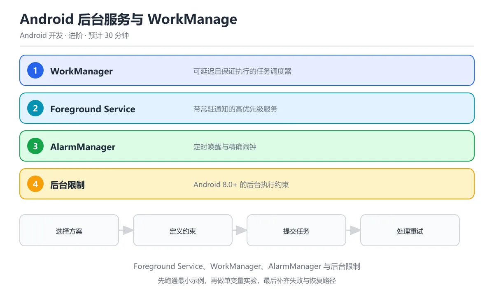

# Android 后台服务与 WorkManager

> 内容更新时间：2026-10-06 · 学习阶段：进阶 · 预计用时：50 分钟




## 本节知识框架

**课程定位**：所属分类为「Android 开发」，课程主题为「Android 后台服务与 WorkManager」，学习阶段为「进阶」，建议用时 30 分钟。

**本课要解决的主问题**：如何在 Android 中正确使用前台服务（Foreground Service）、后台任务和 WorkManager 执行延迟、周期性或约束性工作，同时满足系统省电策略与版本兼容性。

| 学习层次 | 要回答的问题 | 完成判据 |
| --- | --- | --- |
| 概念层 | Service、Foreground Service、WorkManager、Worker、Constraint 各是什么？ | 能用自己的话定义核心术语，并各举一个正例和一个反例。 |
| 机制层 | 一个后台任务从提交到执行完成，经过了哪些调度和约束环节？ | 能画出或写出任务生命周期步骤，并说明每一步的失败条件。 |
| 应用层 | 什么场景用 Service，什么场景用 WorkManager，什么场景用 AlarmManager？ | 能给出一个真实场景、一个最小示例和一个边界案例。 |
| 性能层 | 后台任务对电量、内存、CPU 唤醒的影响是什么？ | 能说出复杂度或性能瓶颈的证据来源；没有证据时明确写"材料未提供"。 |
| 复习层 | 怎样确认自己不是只记住了结论？ | 能独立完成本课自测，并把错误定位到概念、机制、示例或边界。 |

### 阅读路线

1. 先读「核心概念定义」，建立 Service、WorkManager、Worker、Constraint 等术语的精确定义。
2. 再读「原理与运行机制」，把定义串成可重复的任务调度流程。
3. 用「代码/协议/SQL 示例」验证过程，并只改一个条件观察结果变化。
4. 最后检查性能、易错点、知识关系与自测题，形成可复习的证据链。

**前置知识**：《Kotlin 与 Android 开发》、《Android 数据存储（Room/SharedPreferences）》

**学习位置**：本课位于《Android 数据存储》之后；后台任务通常需要读写数据库，前一课的 Room 知识是基础。

**后续衔接**：下一课《Android 测试》会测试 Worker 的逻辑正确性，学完后建议立即完成一次自测。

### 课程导言
**Title:** Android Background Services & WorkManager

**Summary:** Foreground service, WorkManager, Worker, constraints, scheduling and battery optimization.

**Category:** Android Development
**Level:** 进阶
**Key terms:** Service, Foreground Service, WorkManager, Worker, Constraint, Doze


**复习清单**

- [ ] 能区分 WorkManager、Foreground Service 与 AlarmManager 的适用边界
- [ ] 能定义一个带 Constraints 的 Worker 并提交任务
- [ ] 能解释 Android 8.0+ 后台执行限制带来的影响
- [ ] 能说明 PeriodicWorkRequest 的最小间隔与调度不确定性
- [ ] 能为后台任务设计幂等、重试与退避策略

## 核心概念定义

> 阅读约定：本课先给「Android 后台服务与 WorkManager」相关术语的操作性定义与适用边界；正文里的口语化说法与定义冲突时，以定义和可复现示例为准。

| 术语 | 操作性定义 | 本课中的边界 |
| --- | --- | --- |
| Service | Android 四大组件之一，没有 UI 的长期运行组件，适合播放音乐、文件下载等场景。 | Service 默认运行在主线程，耗时操作必须自己开线程；Android 8.0+ 对后台 Service 有严格限制。 |
| Foreground Service | 一种带持久通知的 Service，系统不会轻易杀死它，适合用户能感知到的长期任务（如音乐播放、导航）。 | 必须在启动后 5 秒内调用 `startForeground()` 显示通知；Android 14+ 需要在 Manifest 声明 `foregroundServiceType`。 |
| WorkManager | Jetpack 组件，用于执行可延迟、有保障的后台工作。内部自动选择最佳调度器（JobScheduler、AlarmManager 等）。 | WorkManager 不保证精确时间执行（最小延迟约 15 分钟）；不适合需要即时响应的任务（如实时消息推送，应使用 FCM）。 |
| Worker | WorkManager 中实际执行工作的类，继承 `Worker`、`CoroutineWorker` 或 `ListenableWorker`，在 `doWork()` 中写业务逻辑。 | `doWork()` 返回 `Result.success()`、`Result.retry()` 或 `Result.failure()`；CoroutineWorker 支持挂起函数。 |
| WorkRequest | 提交给 WorkManager 的任务请求，分 `OneTimeWorkRequest`（执行一次）和 `PeriodicWorkRequest`（周期执行）。 | 周期任务最小间隔 15 分钟；可以附加 Constraint（网络、充电、空闲等条件）。 |
| Constraint | 任务执行的前置条件，如需要网络连接、设备充电中、存储空间充足等。 | 条件不满足时任务排队等待；条件满足后 WorkManager 自动调度执行。 |
| WorkChain | 把多个 Worker 按顺序串联执行，前一个的输出作为后一个的输入。 | 用 `WorkManager.beginWith(...).then(...).enqueue()` 构建；任一环节失败则整条链终止。 |

### 定义如何使用

在「Android 后台服务与 WorkManager」中判断一个说法是否成立，先确认它使用的是哪个对象的定义，再检查系统版本、省电策略与任务约束。定义不是口号，而是后续推导、代码示例和自测题共享的约束。

## 原理与运行机制

### 机制总览

1. **选择方案**：根据任务特征选择 Service、Foreground Service 或 WorkManager。
2. **定义 Worker**：继承 `CoroutineWorker`，在 `doWork()` 中实现业务逻辑。
3. **配置约束**：设置网络、充电、存储等 Constraint。
4. **提交任务**：通过 `WorkManager.enqueue()` 提交 `WorkRequest`。
5. **监控状态**：通过 `WorkInfo` 观察任务状态（ENQUEUED、RUNNING、SUCCEEDED、FAILED）。

| 阶段 | 关注对象 | 失败时应检查 |
| --- | --- | --- |
| 选型 | 任务特征 | 是否真的需要后台执行？能否用协程替代？ |
| Worker | doWork() 逻辑 | 返回值是否正确？异常是否被捕获？ |
| 约束 | Constraint | 条件是否过于严格导致任务永远不执行？ |
| 调度 | WorkManager | 系统版本是否支持？Doze 模式是否影响？ |

### 调度机制详解

用一个比喻来理解：WorkManager 就像一个「智能快递调度中心」——你告诉它「这个包裹需要在有网的时候送到」（Constraint），它会自动等到条件满足再派送，即使 App 被关闭或手机重启也不会丢失任务。

```text
任务提交 → WorkManager 数据库持久化 → 调度器检查 Constraint
                                          ↓
                              条件满足 → 分配线程执行 Worker.doWork()
                                          ↓
                              返回 Result → 更新 WorkInfo → 触发后续任务
```

1. **任务提交**：App 调用 `WorkManager.enqueue(request)`，WorkManager 把任务写入内部数据库。
2. **持久化**：即使 App 进程被杀，任务仍然存在（数据库持久化）。
3. **约束检查**：调度器（JobScheduler/AlarmManager）定期检查 Constraint 是否满足。
4. **执行**：条件满足后，Worker 在后台线程执行 `doWork()`。
5. **结果处理**：根据返回值决定重试、成功或失败，并通知后续任务。

### Service 与 WorkManager 的对比

| 维度 | Service | WorkManager |
| --- | --- | --- |
| 执行时机 | 立即启动 | 可延迟，满足约束后执行 |
| 生命周期 | 需要自己管理 | 系统自动管理 |
| 精确性 | 即时 | 不保证精确时间（最小 15 分钟） |
| 可靠性 | 进程被杀就停止 | 持久化，重启后继续 |
| 适用场景 | 音乐播放、实时导航 | 数据同步、日志上传、定时清理 |

## 典型应用场景

### 场景一：数据同步（WorkManager）

用户打开 App 后，后台同步服务器数据。

- **输入**：触发条件（App 启动、网络可用）
- **过程**：`SyncWorker` 从服务器拉取新数据，写入 Room 数据库
- **输出**：UI 自动更新显示最新数据

### 场景二：日志上传（WorkManager + Constraint）

App 收集用户行为日志，在 Wi-Fi 环境下批量上传。

- **输入**：日志文件列表
- **过程**：设置 `Constraint.Builder().setRequiredNetworkType(NetworkType.UNMETERED)`，只在 Wi-Fi 下执行
- **输出**：日志上传成功后删除本地文件

### 场景三：音乐播放（Foreground Service）

用户切换到其他 App 后，音乐继续播放。

- **输入**：播放控制命令
- **过程**：`MusicService` 调用 `startForeground()` 显示播放通知，MediaPlayer 持续播放
- **输出**：用户可以在通知栏控制播放/暂停

### 边界案例：Doze 模式

Android 6.0+ 的 Doze 模式会在设备闲置时限制后台活动。WorkManager 的任务可能被延迟到 Doze 维护窗口（约每 9 分钟）才执行。Foreground Service 不受 Doze 影响。

## 代码/协议/SQL 示例

### 示例 1：定义 CoroutineWorker

```kotlin
class SyncWorker(
    context: Context,
    params: WorkerParameters
) : CoroutineWorker(context, params) {

    override suspend fun doWork(): Result {
        return try {
            // 1. 检查网络（Constraint 已保证，但防御性检查）
            if (!isNetworkAvailable()) {
                return Result.retry()
            }

            // 2. 从服务器拉取数据
            val api = RetrofitClient.create(ApiService::class.java)
            val response = api.getLatestData()

            if (response.isSuccessful) {
                // 3. 写入 Room 数据库
                val database = AppDatabase.getInstance(applicationContext)
                val newData = response.body()!!
                database.dataDao().insertAll(newData)

                // 4. 更新进度（可选）
                setProgress(workDataOf("progress" to 100))

                Result.success()
            } else {
                Result.retry()  // 服务器错误，稍后重试
            }
        } catch (e: Exception) {
            if (e is IOException) {
                Result.retry()  // 网络异常，重试
            } else {
                Result.failure(workDataOf("error" to e.message))
            }
        }
    }

    private suspend fun isNetworkAvailable(): Boolean {
        val connectivityManager = applicationContext
            .getSystemService(Context.CONNECTCONNECTIVITY_SERVICE) as ConnectivityManager
        val network = connectivityManager.activeNetwork
        return network != null
    }
}
```

### 示例 2：配置 Constraint 并提交任务

```kotlin
// 1. 构建约束
val constraints = Constraints.Builder()
    .setRequiredNetworkType(NetworkType.CONNECTED)      // 需要网络
    .setRequiresBatteryNotLow(true)                     // 电量不能太低
    .setRequiresStorageNotLow(true)                     // 存储不能太低
    // .setRequiresCharging(true)                       // 需要充电（可选）
    // .setRequiresDeviceIdle(true)                     // 设备空闲（可选，API 23+）
    .build()

// 2. 创建一次性任务
val syncRequest = OneTimeWorkRequestBuilder<SyncWorker>()
    .setConstraints(constraints)
    .setInitialDelay(5, TimeUnit.MINUTES)              // 延迟 5 分钟
    .setBackoffCriteria(
        BackoffPolicy.EXPONENTIAL,                     // 指数退避
        30, TimeUnit.SECONDS                           // 初始重试间隔
    )
    .addTag("sync_work")                               // 添加标签，方便取消
    .build()

// 3. 提交任务
WorkManager.getInstance(context)
    .enqueue(syncRequest)
```

### 示例 3：周期任务

```kotlin
// 每 1 小时执行一次数据清理
val cleanupRequest = PeriodicWorkRequestBuilder<CleanupWorker>(
    1, TimeUnit.HOURS
)
    .setConstraints(
        Constraints.Builder()
            .setRequiresCharging(true)                  // 只在充电时执行
            .setRequiresDeviceIdle(true)                // 设备空闲时执行
            .build()
    )
    .addTag("cleanup_work")
    .build()

WorkManager.getInstance(context)
    .enqueueUniquePeriodicWork(
        "daily_cleanup",                                // 唯一名称
        ExistingPeriodicWorkPolicy.KEEP,                // 已存在则保留
        cleanupRequest
    )
```

### 示例 4：任务链（WorkChain）

```kotlin
// 任务链：上传日志 → 清理本地 → 同步服务器
val uploadWork = OneTimeWorkRequestBuilder<UploadWorker>()
    .setConstraints(networkConstraint)
    .build()

val cleanupWork = OneTimeWorkRequestBuilder<CleanupWorker>()
    .build()

val syncWork = OneTimeWorkRequestBuilder<SyncWorker>()
    .build()

WorkManager.getInstance(context)
    .beginWith(uploadWork)          // 第一步：上传
    .then(cleanupWork)              // 第二步：清理
    .then(syncWork)                 // 第三步：同步
    .enqueue()
```

### 示例 5：监控任务状态

```kotlin
// 观察任务状态
WorkManager.getInstance(context)
    .getWorkInfoByIdLiveData(syncRequest.id)
    .observe(lifecycleOwner) { workInfo ->
        if (workInfo != null) {
            when (workInfo.state) {
                WorkInfo.State.ENQUEUED -> {
                    Log.d("WorkManager", "任务排队中")
                }
                WorkInfo.State.RUNNING -> {
                    val progress = workInfo.progress.getInt("progress", 0)
                    Log.d("WorkManager", "任务执行中：$progress%")
                }
                WorkInfo.State.SUCCEEDED -> {
                    Log.d("WorkManager", "任务成功")
                }
                WorkInfo.State.FAILED -> {
                    val error = workInfo.outputData.getString("error")
                    Log.e("WorkManager", "任务失败：$error")
                }
                WorkInfo.State.CANCELLED -> {
                    Log.d("WorkManager", "任务已取消")
                }
                WorkInfo.State.BLOCKED -> {
                    Log.d("WorkManager", "任务被阻塞（约束未满足）")
                }
            }
        }
    }

// 取消任务
WorkManager.getInstance(context).cancelWorkById(syncRequest.id)
// 或按标签取消
WorkManager.getInstance(context).cancelAllWorkByTag("sync_work")
```

### 示例 6：Foreground Service（音乐播放）

```kotlin
class MusicService : Service() {
    private var mediaPlayer: MediaPlayer? = null

    override fun onStartCommand(intent: Intent?, flags: Int, startId: Int): Int {
        val musicUrl = intent?.getStringExtra("music_url") ?: return START_NOT_STICKY

        // 1. 创建通知渠道（Android 8.0+）
        createNotificationChannel()

        // 2. 构建通知
        val notification = NotificationCompat.Builder(this, "music_channel")
            .setContentTitle("正在播放")
            .setContentText("歌曲名称")
            .setSmallIcon(R.drawable.ic_music)
            .addAction(R.drawable.ic_pause, "暂停", getPauseIntent())
            .addAction(R.drawable.ic_stop, "停止", getStopIntent())
            .build()

        // 3. 启动前台服务（必须在 5 秒内调用）
        startForeground(NOTIFICATION_ID, notification)

        // 4. 开始播放
        mediaPlayer = MediaPlayer().apply {
            setDataSource(musicUrl)
            setOnPreparedListener { it.start() }
            prepareAsync()
        }

        return START_STICKY  // 服务被杀后自动重启
    }

    override fun onDestroy() {
        mediaPlayer?.release()
        super.onDestroy()
    }

    override fun onBind(intent: Intent?): IBinder? = null

    private fun createNotificationChannel() {
        if (Build.VERSION.SDK_INT >= Build.VERSION_CODES.O) {
            val channel = NotificationChannel(
                "music_channel",
                "音乐播放",
                NotificationManager.IMPORTANCE_LOW
            ).apply {
                description = "音乐播放控制"
            }
            val manager = getSystemService(NotificationManager::class.java)
            manager.createNotificationChannel(channel)
        }
    }

    companion object {
        const val NOTIFICATION_ID = 1001
    }
}
```

### 示例 7：在 Manifest 中声明 Service

```xml
<!-- AndroidManifest.xml -->
<manifest xmlns:android="http://schemas.android.com/apk/res/android">

    <!-- 前台服务权限（Android 9.0+） -->
    <uses-permission android:name="android.permission.FOREGROUND_SERVICE" />

    <!-- Android 14+ 需要声明 foregroundServiceType -->
    <uses-permission android:name="android.permission.FOREGROUND_SERVICE_MEDIA_PLAYBACK" />

    <application>
        <!-- 声明 Service -->
        <service
            android:name=".MusicService"
            android:foregroundServiceType="mediaPlayback"
            android:exported="false" />
    </application>
</manifest>
```

## 时间/空间复杂度或性能分析

### 电量消耗

| 方案 | 电量影响 | 说明 |
| --- | --- | --- |
| WorkManager | 低 | 系统批量执行，配合 Doze 模式优化 |
| Foreground Service | 中 | 持续运行，但用户可见通知 |
| 后台 Service | 高 | Android 8.0+ 被限制，容易被系统杀死 |
| AlarmManager | 中 | 精确唤醒设备，破坏 Doze 省电 |

### 内存占用

- WorkManager 的 Worker 执行完毕后自动释放资源。
- Foreground Service 需要持续持有 MediaPlayer 等资源，内存占用较高。
- 周期任务每次执行都是新的 Worker 实例，不会累积内存。

### 调度延迟

| 任务类型 | 最小延迟 | 典型延迟 |
| --- | --- | --- |
| OneTimeWorkRequest | 0（立即） | 几秒到几分钟 |
| PeriodicWorkRequest | 15 分钟 | 15 分钟到数小时 |
| Foreground Service | 0（立即） | 即时启动 |

## 常见误区与易错点

### 误区 1：用 WorkManager 做实时任务

```kotlin
// 错误：期望任务立即执行
val request = OneTimeWorkRequestBuilder<InstantWorker>()
    .setInitialDelay(0, TimeUnit.SECONDS)
    .build()
// 实际可能延迟数分钟甚至更久

// 正确：实时任务用协程或 Service
viewModelScope.launch {
    instantOperation()  // 协程立即执行
}
```

**后果**：WorkManager 的设计目标是「可延迟的保障工作」，不是即时执行。
**改法**：需要即时响应的任务用协程、Service 或直接调用。

### 误区 2：在 Worker 中访问 UI

```kotlin
// 错误：Worker 运行在后台线程，不能访问 UI
class UiWorker(context: Context, params: WorkerParameters) : Worker(context, params) {
    override fun doWork(): Result {
        Toast.makeText(applicationContext, "完成", Toast.LENGTH_SHORT).show()  // 可能崩溃
        return Result.success()
    }
}

// 正确：通过 LocalBroadcast 或 LiveData 通知 UI
class NotifyWorker(context: Context, params: WorkerParameters) : CoroutineWorker(context, params) {
    override suspend fun doWork(): Result {
        // 发送本地广播
        val intent = Intent("WORK_COMPLETED").apply {
            putExtra("result", "success")
        }
        LocalBroadcastManager.getInstance(applicationContext).sendBroadcast(intent)
        return Result.success()
    }
}
```

### 误区 3：忘记在 Manifest 声明权限

```xml
<!-- 错误：只写了 Service，没声明权限 -->
<service android:name=".MusicService" />

<!-- 正确：Android 9.0+ 需要 FOREGROUND_SERVICE 权限 -->
<uses-permission android:name="android.permission.FOREGROUND_SERVICE" />
<service
    android:name=".MusicService"
    android:foregroundServiceType="mediaPlayback" />
```

### 误区 4：周期任务间隔设置过短

```kotlin
// 错误：周期小于 15 分钟
val request = PeriodicWorkRequestBuilder<FrequentWorker>(
    5, TimeUnit.MINUTES  // 会被忽略，实际最小 15 分钟
).build()

// 正确：使用 AlarmManager 做高频任务（但耗电）
val alarmManager = getSystemService(Context.ALARM_SERVICE) as AlarmManager
alarmManager.setRepeating(
    AlarmManager.RTC_WAKEUP,
    System.currentTimeMillis(),
    5 * 60 * 1000,  // 5 分钟
    pendingIntent
)
```

### 误区 5：Worker 返回值不正确

```kotlin
// 错误：异常时返回 success
override fun doWork(): Result {
    return try {
        riskyOperation()
        Result.success()
    } catch (e: Exception) {
        Result.success()  // 掩盖了错误！
    }
}

// 正确：根据情况返回不同结果
override fun doWork(): Result {
    return try {
        riskyOperation()
        Result.success()
    } catch (e: IOException) {
        Result.retry()  // 网络错误，稍后重试
    } catch (e: Exception) {
        Result.failure()  // 其他错误，标记失败
    }
}
```

## 与其他知识点的关系

| 关联课程 | 关系说明 |
| --- | --- |
| Kotlin 与 Android 开发 | CoroutineWorker 使用协程，直接复用前课的协程知识。 |
| Android 数据存储 | Worker 经常需要读写 Room 数据库，前课的 Repository 模式在这里继续使用。 |
| Android 网络编程 | 数据同步 Worker 通常调用 Retrofit API 拉取服务器数据。 |
| Android 测试 | Worker 的逻辑可以独立测试，不需要启动 WorkManager。 |

## 自测题与参考答案

### 题目 1

WorkManager 的周期任务最小间隔是多少？

<details>
<summary>答案</summary>

15 分钟。`PeriodicWorkRequest` 的最小重复间隔被系统强制为 15 分钟，设置更短的值会被忽略。

</details>

### 题目 2

Foreground Service 启动后必须在多长时间内调用 `startForeground()`？

<details>
<summary>答案</summary>

5 秒。Android 8.0+ 要求 Foreground Service 在启动后 5 秒内调用 `startForeground()` 显示通知，否则会抛出 `RemoteServiceException` 并被系统杀死。

</details>

### 题目 3

CoroutineWorker 和普通 Worker 的主要区别是什么？

<details>
<summary>答案</summary>

CoroutineWorker 的 `doWork()` 是 `suspend` 函数，可以直接调用挂起函数（如 Retrofit 的 suspend 方法、Room 的 suspend DAO）；普通 Worker 的 `doWork()` 是同步的，需要自己开线程或使用 `ListenableWorker`。

</details>

### 题目 4

如何保证 WorkManager 任务在 App 重启后仍然执行？

<details>
<summary>答案</summary>

WorkManager 默认就支持！它把任务持久化到内部数据库，系统重启后会自动恢复。不需要额外配置。但如果使用 `setRequiresDeviceIdle(true)`，任务可能在重启后被延迟到设备再次空闲时才执行。

</details>

### 题目 5

什么场景应该用 AlarmManager 而不是 WorkManager？

<details>
<summary>答案</summary>

需要精确时间触发的场景，如闹钟、日历提醒。WorkManager 不保证精确执行时间（可能延迟数分钟），而 AlarmManager 可以在指定时间精确唤醒设备。但 AlarmManager 耗电更高，应谨慎使用。

</details>

### 题目 6

如何取消所有带特定标签的 WorkManager 任务？

<details>
<summary>答案</summary>

使用 `WorkManager.getInstance(context).cancelAllWorkByTag("tag_name")`。这会取消所有添加了该标签的任务，包括排队中和正在执行的。

</details>

## 考点精讲

### 考点 1

WorkManager 最适合处理什么类型的任务？

A. 实时音视频通话

B. 可延迟的、需要保证执行的后台任务（如数据同步、日志上传）

C. UI 动画

D. 前台用户交互

**正确答案：B**

**详细解释**：WorkManager 是 Android 推荐的可延迟任务方案，即使 App 退出或设备重启，任务仍会执行。 WorkManager 支持链式任务和唯一工作队列，重复任务用 uniqueWork 去重，避免同一同步任务被排队多次。 任务要设置合理的约束和重试策略，并保证幂等，因为系统可能因重启或条件变化而重复执行同一个任务。 本题正确项是「可延迟的、需要保证执行的后台任务（如数据同步、日志上传）」。

---

### 考点 2

Foreground Service 的特点是什么？

A. 在后台静默运行

B. 显示持久通知，优先级高，不易被系统杀死

C. 不需要权限

D. 只能运行 10 秒

**正确答案：B**

**详细解释**：Foreground Service 通过持久通知让用户知道 App 在后台工作（如音乐播放、导航），系统不会轻易回收。 Android 14 起前台服务还必须声明具体类型，不同类型对应不同的权限和上架审核要求。 前台服务的通知不能被随意隐藏，Android 要求通知可见且能说明正在进行的操作，用户才能感知后台行为。 本题正确项是「显示持久通知，优先级高，不易被系统杀死」。

---

### 考点 3

Android 8.0+ 对后台服务的限制是什么？

A. 完全禁止后台服务

B. App 进入后台后几分钟内必须停止后台 Service，需改用 WorkManager 或 Foreground Service

C. 没有限制

D. 只限制网络访问

**正确答案：B**

**详细解释**：为节省电量和内存，Android 8.0+ 限制后台 Service，长时间任务需用 WorkManager 或 Foreground Service。 如果任务必须立即执行，可以使用前台服务并展示通知，但滥用前台服务会影响续航，也可能被应用商店审核关注。 本题正确项是「App 进入后台后几分钟内必须停止后台 Service，需改用 WorkManager 或 Foreground Service」。

---

### 考点 4

WorkManager 中 PeriodicWorkRequest 的最小间隔是多少？

A. 1 秒

B. 15 分钟

C. 1 小时

D. 1 天

**正确答案：B**

**详细解释**：PeriodicWorkRequest 最小间隔 15 分钟，这是系统为平衡任务频率和电池寿命设定的下限。 需要更频繁的执行只能借助 AlarmManager 或推送唤醒，但系统仍会做省电限制，不能把它当成精确定时器。 周期任务的实际执行时间由系统调度，可能被 Doze 延迟，需要精确定时的场景要用 AlarmManager 并申请精确闹钟权限。

---

### 考点 5

Constraints 在 WorkManager 中的作用是什么？

A. 限制任务执行时间

B. 定义任务执行条件（如需要网络、充电中、存储空间充足）

C. 限制任务数量

D. 加密任务数据

**正确答案：B**

**详细解释**：Constraints 让任务只在满足条件时执行，如 setRequiredNetworkType(NetworkType.CONNECTED) 确保有网络才同步。 任务重试策略也要配置，backoffPolicy 决定失败后如何退避，否则失败任务会立即重跑并快速耗尽电量。 本题正确项是「定义任务执行条件（如需要网络、充电中、存储空间充足）」。

## 术语速查

| 术语 | 一句话说明 |
| --- | --- |
| Service | Android 四大组件之一，无 UI 的长期运行组件 |
| Foreground Service | 带持久通知的 Service，系统不会轻易杀死 |
| WorkManager | Jetpack 后台任务调度器，保证执行 |
| Worker | WorkManager 中实际执行工作的类 |
| WorkRequest | 提交给 WorkManager 的任务请求 |
| Constraint | 任务执行的前置条件（网络、充电等） |
| WorkChain | 多个 Worker 按顺序串联执行 |
| Doze | Android 省电模式，限制后台活动 |

## 参考资料与复核

1. [WorkManager 官方文档](https://developer.android.com/topic/libraries/architecture/workmanager) — 任务调度、Constraint、Worker 定义。
2. [Service 官方文档](https://developer.android.com/guide/components/services) — Service 生命周期与 Foreground Service。
3. [后台执行限制](https://developer.android.com/about/versions/oreo/background) — Android 8.0+ 对后台 Service 的限制。
4. [Doze 模式](https://developer.android.com/training/monitoring-device-state/doze-standby) — 省电模式对后台任务的影响。
5. **复核要点**：本课代码示例基于 WorkManager 2.8+、Kotlin 1.8+、AndroidX。Foreground Service 的 `foregroundServiceType` 在 Android 14（API 34）开始强制要求。

- 最后复核：2026-10-04
- 下次复核：2027-10-24

## 内容元数据

- 内容版本：v2.0
- 最后更新：2026-10-06
- 学习阶段：进阶
- 适用环境：通用开发环境
- 内容来源：内置结构化课程与工程实践整理
- 相关主题：mobile android background
- 质量版本：P0 测验标准 + P1 覆盖扩展 + P2 体验补全