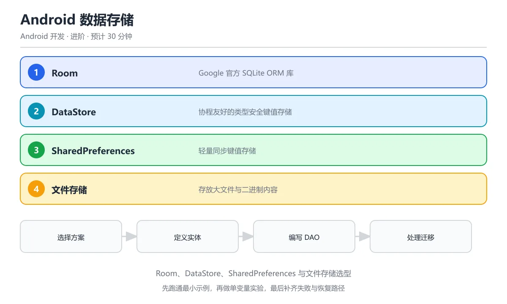

# Android 数据存储（Room/SharedPreferences）

> 内容更新时间：2026-10-06 · 学习阶段：进阶 · 预计用时：30 分钟




## 本节知识框架

**课程定位**：所属分类为「Android 开发」，课程主题为「Android 数据存储（Room/SharedPreferences）」，学习阶段为「进阶」，建议用时 30 分钟。

**本课要解决的主问题**：如何在 Android 中使用 Room 数据库和 SharedPreferences 进行结构化数据与简单配置的持久化存储，并正确处理版本迁移、线程安全与性能。

| 学习层次 | 要回答的问题 | 完成判据 |
| --- | --- | --- |
| 概念层 | Room 的 Entity、DAO、Database 以及 SharedPreferences 各是什么？ | 能用自己的话定义核心术语，并各举一个正例和一个反例。 |
| 机制层 | 数据从写入到读出的完整链路是什么？版本迁移如何工作？ | 能画出或写出数据流步骤，并说明每一步的失败条件。 |
| 应用层 | 什么场景用 Room，什么场景用 SharedPreferences，什么场景用 DataStore？ | 能给出一个真实场景、一个最小示例和一个边界案例。 |
| 性能层 | 查询复杂度、写入吞吐、内存占用受哪些量影响？ | 能说出复杂度或性能瓶颈的证据来源；没有证据时明确写"材料未提供"。 |
| 复习层 | 怎样确认自己不是只记住了结论？ | 能独立完成本课自测，并把错误定位到概念、机制、示例或边界。 |

### 阅读路线

1. 先读「核心概念定义」，建立 Room、Entity、DAO、SharedPreferences 等术语的精确定义。
2. 再读「原理与运行机制」，把定义串成可重复的数据流。
3. 用「代码/协议/SQL 示例」验证过程，并只改一个条件观察结果变化。
4. 最后检查性能、易错点、知识关系与自测题，形成可复习的证据链。

**前置知识**：《Kotlin 与 Android 开发》、《Android 网络编程与 Retrofit》

**学习位置**：本课位于《Android 网络编程与 Retrofit》之后；网络请求返回的数据通常需要本地缓存，本课就是这个缓存层的实现。

**后续衔接**：下一课《Android 后台服务与 WorkManager》会使用 Room 作为后台任务的数据存储。

### 课程导言
**Title:** Android Data Storage (Room/SharedPreferences)

**Summary:** Room database, DAO, migrations, SharedPreferences, DataStore and thread safety.

**Category:** Android Development
**Level:** 进阶
**Key terms:** Room, Entity, DAO, SharedPreferences, DataStore, Migration


**复习清单**

- [ ] 能说出 Room 的 Entity、DAO、Database 三个核心组件
- [ ] 能写出带 @Query 的 DAO 并返回 Flow
- [ ] 能比较 Room、DataStore、SharedPreferences 与文件存储的适用场景
- [ ] 能写出一次数据库迁移并说明如何验证数据不丢失
- [ ] 能说明主线程读写数据的风险与规避方式

## 核心概念定义

> 阅读约定：本课先给「Android 数据存储」相关术语的操作性定义与适用边界；正文里的口语化说法与定义冲突时，以定义和可复现示例为准。

| 术语 | 操作性定义 | 本课中的边界 |
| --- | --- | --- |
| Room | Google 官方 ORM（对象关系映射）库，把 SQLite 数据库表映射为 Kotlin 数据类，编译期检查 SQL 正确性。 | Room 是 SQLite 的封装层，不替代 ContentProvider 或文件系统；它只负责结构化数据的增删改查。 |
| Entity | 用 `@Entity` 注解标注的 data class，对应数据库中的一张表。 | 每个 Entity 必须有主键（`@PrimaryKey`）；字段名默认与列名相同，可用 `@ColumnInfo` 改名。 |
| DAO | Data Access Object，用 `@Dao` 注解标注的接口或抽象类，定义对 Entity 的查询方法。 | DAO 方法可以返回 `List<T>`、`Flow<List<T>>` 或 `LiveData<List<T>>`；用 `suspend` 修饰的写操作会自动在 IO 线程执行。 |
| Database | 用 `@Database` 注解标注的抽象类，继承 `RoomDatabase`，是 Room 的入口点。 | 每个 App 通常只有一个 Database 实例，通过 `Room.databaseBuilder` 创建；它是线程安全的单例。 |
| SharedPreferences | Android 内置的轻量级键值存储，适合保存用户设置、Token 等简单数据。 | 不适合存大量数据或结构化数据；读写不是原子的（在并发场景可能丢失更新）；Android 6.0+ 推荐用 DataStore 替代。 |
| DataStore | Jetpack 新推出的异步、类型安全的键值存储，有 Preferences DataStore 和 Proto DataStore 两种。 | Preferences DataStore 替代 SharedPreferences；Proto DataStore 用 Protocol Buffers 存储结构化数据，可替代小型 Room 场景。 |
| Migration | 数据库版本升级时的表结构变更逻辑，用 `Migration(startVersion, endVersion)` 定义。 | 必须提供完整的 ALTER TABLE 语句；缺少 Migration 会导致 Room 重建数据库（数据丢失）。 |

### 定义如何使用

在「Android 数据存储」中判断一个说法是否成立，先确认它使用的是哪个对象的定义，再检查数据量级、并发模型与版本兼容性。定义不是口号，而是后续推导、代码示例和自测题共享的约束。

## 原理与运行机制

### 机制总览

1. **定义数据模型**：用 `@Entity` 把 Kotlin data class 映射为数据库表。
2. **编写 DAO**：用 `@Insert`、`@Query`、`@Update`、`@Delete` 注解声明数据操作。
3. **构建 Database**：用 `@Database` 注解标注抽象类，注册所有 Entity 和 DAO。
4. **获取实例**：通过 `Room.databaseBuilder` 创建单例，配置 Migration 策略。
5. **在 Repository 中使用**：DAO 方法返回 `Flow` 或 `suspend` 结果，Repository 封装业务逻辑。

| 阶段 | 关注对象 | 失败时应检查 |
| --- | --- | --- |
| 建模 | Entity 注解 | 主键是否声明、字段类型是否被 Room 支持。 |
| 查询 | DAO 方法 | SQL 语法是否正确、返回类型是否匹配。 |
| 构建 | Database 实例 | 版本号是否递增、Migration 是否完整。 |
| 使用 | Repository | 是否在协程/IO 线程调用、Flow 是否正确收集。 |

### 数据流详解

用一个比喻来理解：Room 就像一个「带目录的笔记本」——Entity 是表格的格式定义，DAO 是目录（告诉你怎么查），Database 是笔记本本身，Migration 是换版时重新排版的工作。

```text
用户操作 → ViewModel → Repository → DAO (Room) → SQLite 数据库文件
                                              ↓
                                         Flow<List<T>>
                                              ↓
                              ViewModel.state → UI 自动更新
```

1. **写入路径**：UI 触发事件 → ViewModel 调用 Repository 的 `suspend` 方法 → DAO 执行 `@Insert` → Room 在 IO 线程写入 SQLite。
2. **读取路径**：DAO 返回 `Flow<List<T>>` → Room 监听表变化自动重新查询 → Flow 发射新数据 → ViewModel 更新 StateFlow → UI 重组显示。
3. **迁移路径**：App 更新 → Room 检测到 `version` 变化 → 按顺序执行 `Migration` 链 → 数据库结构升级完成。

### SharedPreferences 的工作方式

SharedPreferences 比 Room 简单得多，像一个「只有标签的便签本」：

```text
SharedPreferences → XML 文件 (/data/data/包名/shared_prefs/名称.xml)
```

1. **写入**：`edit()` 获取 Editor → `putString(key, value)` → `apply()`（异步）或 `commit()`（同步）。
2. **读取**：`getString(key, default)` 直接从内存缓存读取（首次会加载 XML）。
3. **问题**：`apply()` 是异步但不保证顺序，并发写入可能丢失；全量加载 XML 到内存，大数据量时卡顿。

## 典型应用场景

### 场景一：缓存用户信息（SharedPreferences）

- **输入**：用户登录后拿到 Token
- **过程**：`PreferenceManager.getDefaultSharedPreferences(context).edit().putString("token", token).apply()`
- **输出**：下次启动 App 时直接读取 Token，无需重新登录

### 场景二：离线文章列表（Room）

- **输入**：从网络 API 拉取的文章列表
- **过程**：Repository 把 `List<Article>` 通过 DAO 的 `@Insert(onConflict = REPLACE)` 写入 Room
- **输出**：无网络时 UI 仍然能从 Room 读取缓存的文章列表展示

### 场景三：搜索历史（Room + Flow）

- **输入**：用户每次搜索的关键词
- **过程**：DAO 返回 `Flow<List<SearchHistory>>`，Room 在数据变化时自动重新查询
- **输出**：搜索历史列表实时更新，无需手动刷新

### 边界案例：数据库版本升级

当 App 从 v1 升级到 v2，给 `users` 表加了一个 `avatar` 列。如果没有提供 `Migration(1, 2)`，Room 会删除所有数据重建表——用户数据全部丢失。

## 代码/协议/SQL 示例

### 示例 1：定义 Entity

```kotlin
@Entity(tableName = "articles")
data class Article(
    @PrimaryKey(autoGenerate = true)
    val id: Long = 0,

    @ColumnInfo(name = "title")
    val title: String,

    @ColumnInfo(name = "content")
    val content: String,

    @ColumnInfo(name = "author_id")
    val authorId: Long,

    @ColumnInfo(name = "created_at")
    val createdAt: Long = System.currentTimeMillis(),

    @ColumnInfo(name = "is_cached")
    val isCached: Boolean = true
)
```

### 示例 2：定义 DAO

```kotlin
@Dao
interface ArticleDao {
    // 查询所有文章，按创建时间倒序
    @Query("SELECT * FROM articles ORDER BY created_at DESC")
    fun getAllArticles(): Flow<List<Article>>

    // 按 ID 查询单篇
    @Query("SELECT * FROM articles WHERE id = :id")
    suspend fun getArticleById(id: Long): Article?

    // 按作者查询
    @Query("SELECT * FROM articles WHERE author_id = :authorId")
    fun getArticlesByAuthor(authorId: Long): Flow<List<Article>>

    // 插入（冲突时替换）
    @Insert(onConflict = OnConflictStrategy.REPLACE)
    suspend fun insert(article: Article): Long

    // 批量插入
    @Insert(onConflict = OnConflictStrategy.REPLACE)
    suspend fun insertAll(articles: List<Article>): List<Long>

    // 更新
    @Update
    suspend fun update(article: Article)

    // 删除
    @Delete
    suspend fun delete(article: Article)

    // 按条件删除
    @Query("DELETE FROM articles WHERE is_cached = 1 AND created_at < :before")
    suspend fun deleteOldCached(before: Long)
}
```

### 示例 3：定义 Database 与 Migration

```kotlin
@Database(
    entities = [Article::class],
    version = 2,
    exportSchema = true
)
abstract class AppDatabase : RoomDatabase() {
    abstract fun articleDao(): ArticleDao

    companion object {
        // Migration: v1 → v2，添加 avatar 列
        val MIGRATION_1_2 = object : Migration(1, 2) {
            override fun migrate(db: SupportSQLiteDatabase) {
                db.execSQL("ALTER TABLE articles ADD COLUMN avatar_url TEXT NOT NULL DEFAULT ''")
            }
        }

        @Volatile
        private var INSTANCE: AppDatabase? = null

        fun getInstance(context: Context): AppDatabase {
            return INSTANCE ?: synchronized(this) {
                Room.databaseBuilder(
                    context.applicationContext,
                    AppDatabase::class.java,
                    "app_database"
                )
                    .addMigrations(MIGRATION_1_2)
                    .fallbackToDestructiveMigration() // 生产环境慎用！
                    .build()
                    .also { INSTANCE = it }
            }
        }
    }
}
```

### 示例 4：Repository 层封装

```kotlin
class ArticleRepository(
    private val dao: ArticleDao,
    private val api: ArticleApi  // Retrofit 接口
) {
    // 本地数据源：Flow 自动监听表变化
    val cachedArticles: Flow<List<Article>> = dao.getAllArticles()

    // 从网络拉取并缓存到本地
    suspend fun refreshArticles() {
        val remoteArticles = api.getArticles()
        if (remoteArticles.isSuccessful) {
            remoteArticles.body()?.let { articles ->
                dao.insertAll(articles.map { it.toEntity() })
            }
        }
    }

    // 获取单篇：优先本地，本地没有则请求网络
    suspend fun getArticle(id: Long): Article {
        val local = dao.getArticleById(id)
        if (local != null) return local

        val response = api.getArticle(id)
        if (response.isSuccessful) {
            val article = response.body()!!.toEntity()
            dao.insert(article)
            return article
        }
        throw ApiException(response.code())
    }
}
```

### 示例 5：SharedPreferences 用法

```kotlin
// 写入
val prefs = context.getSharedPreferences("user_prefs", Context.MODE_PRIVATE)
prefs.edit {
    putString("auth_token", token)
    putLong("token_expires", expiresAt)
    putBoolean("dark_mode", true)
}  // 使用 KTX 扩展，自动 apply()

// 读取
val token = prefs.getString("auth_token", null)
val isDarkMode = prefs.getBoolean("dark_mode", false)

// 监听变化
prefs.registerOnSharedPreferenceChangeListener { _, key ->
    if (key == "dark_mode") {
        // 主题切换
    }
}
```

### 示例 6：DataStore 替代 SharedPreferences

```kotlin
// 创建 DataStore
val Context.settingsDataStore: DataStore<Preferences> by preferencesDataStore(name = "settings")

// 写入
suspend fun setToken(dataStore: DataStore<Preferences>, token: String) {
    dataStore.edit { preferences ->
        preferences[stringPreferencesKey("auth_token")] = token
    }
}

// 读取（返回 Flow）
val tokenFlow: Flow<String?> = dataStore.data.map { preferences ->
    preferences[stringPreferencesKey("auth_token")]
}
```

## 时间/空间复杂度或性能分析

### Room 查询性能

| 操作 | 时间复杂度 | 说明 |
| --- | --- | --- |
| 按主键查询 | O(log n) | SQLite 主键使用 B-tree 索引 |
| 无条件全表扫描 | O(n) | `SELECT * FROM articles` 遍历所有行 |
| 带索引列查询 | O(log n) | 需要手动为常用查询列添加 `@Index` |
| 插入单条 | O(log n) | 需要维护索引 |
| 批量插入 | O(n log n) | 1000 条数据约 5-20ms（取决于索引数量） |

### SharedPreferences vs DataStore vs Room

| 维度 | SharedPreferences | DataStore | Room |
| --- | --- | --- | --- |
| 数据量 | < 1KB | < 100KB | 不限 |
| 读写线程 | 主线程可读，写异步 | 全异步 | 全异步（suspend） |
| 类型安全 | 无（靠 key 字符串） | 有（类型化 key） | 有（编译期检查） |
| 并发安全 | 不安全 | 安全 | 安全（事务） |
| 适用场景 | 简单开关、Token | 用户设置、主题 | 结构化业务数据 |

### 内存占用

- Room 使用 SQLite 的页面缓存（默认 2MB），查询结果按需加载。
- `Flow<List<T>>` 在数据变化时才重新查询，不会持续占用内存。
- SharedPreferences 首次读取时把整个 XML 加载到内存，大数据量时可能 OOM。

## 常见误区与易错点

### 误区 1：在主线程访问 Room

```kotlin
// 错误：直接调用非 suspend 方法
val articles = database.articleDao().getAllArticlesSync()  // 主线程阻塞

// 正确：用协程
viewModelScope.launch {
    val articles = database.articleDao().getAllArticles()  // suspend 方法
}
```

**后果**：Android 主线程阻塞超过 5 秒会触发 ANR（Application Not Responding）。
**改法**：DAO 方法用 `suspend` 修饰，或返回 `Flow`。

### 误区 2：忘记提供 Migration

```kotlin
// 错误：只改了 version，没写 Migration
@Database(entities = [Article::class], version = 2)  // 从 1 升到 2

// 后果：运行时抛出 IllegalStateException
// 改法：提供 Migration 或使用 fallbackToDestructiveMigration()（仅限开发期）
```

### 误区 3：SharedPreferences 并发写入丢数据

```kotlin
// 错误：两个地方同时 apply()
prefs.edit().putString("a", "1").apply()  // 异步
prefs.edit().putString("b", "2").apply()  // 可能覆盖上面的写入

// 正确：使用 DataStore 或单次 edit 批量写入
prefs.edit {
    putString("a", "1")
    putString("b", "2")
}
```

### 误区 4：Room Entity 用 var 还是 val

```kotlin
// 不推荐：所有字段都是 var
@Entity data class Article(
    @PrimaryKey var id: Long,  // 主键不应可变
    var title: String           // 如果不需要修改，用 val
)

// 推荐：主键用 val，需要更新的字段用 var
@Entity data class Article(
    @PrimaryKey val id: Long,
    var title: String,          // 可能需要编辑
    val createdAt: Long         // 创建后不应改变
)
```

### 误区 5：Flow 在 ViewModel 中重复收集

```kotlin
// 错误：每次 UI 重组都重新 collect
@Composable
fun ArticleList(viewModel: ArticleViewModel) {
    LaunchedEffect(Unit) {
        viewModel.articles.collect { /* 更新 UI */ }  // 可能被多次启动
    }
}

// 正确：使用 collectAsStateWithLifecycle
@Composable
fun ArticleList(viewModel: ArticleViewModel) {
    val articles by viewModel.articles.collectAsStateWithLifecycle()
    // articles 自动随生命周期暂停/恢复
}
```

## 与其他知识点的关系

| 关联课程 | 关系说明 |
| --- | --- |
| Kotlin 与 Android 开发 | Room 的协程集成（`suspend` DAO）和 Flow 模式直接来自前课。 |
| Android 网络编程与 Retrofit | 网络数据通常通过 Repository 缓存到 Room，形成「网络 → Room → UI」的数据流。 |
| Android 后台服务 | WorkManager 后台任务经常需要读写 Room 数据库。 |
| Android 测试 | Room 支持内存数据库（`Room.inMemoryDatabaseBuilder`），方便做单元测试。 |

## 自测题与参考答案

### 题目 1

Room 的 `@Insert(onConflict = OnConflictStrategy.REPLACE)` 在遇到主键冲突时会怎样？

<details>
<summary>答案</summary>

删除旧行，插入新行。REPLACE 策略等同于 SQL 的 `INSERT OR REPLACE`，主键冲突时先 DELETE 再 INSERT。注意这会触发 DELETE 相关的 Flow 更新。

</details>

### 题目 2

SharedPreferences 的 `apply()` 和 `commit()` 有什么区别？

<details>
<summary>答案</summary>

`apply()` 是异步写入（先更新内存缓存，再异步刷盘），无返回值；`commit()` 是同步写入（阻塞当前线程直到刷盘完成），返回 boolean 表示是否成功。主线程应使用 `apply()` 避免 ANR。

</details>

### 题目 3

为什么 Room DAO 返回 `Flow<List<T>>` 而不是普通的 `List<T>`？

<details>
<summary>答案</summary>

Flow 是响应式数据流：当数据库表发生变化时，Room 会自动重新执行查询并通过 Flow 发射新数据。UI 层收集这个 Flow 就能自动更新，无需手动刷新。普通 `List<T>` 只是一次性快照。

</details>

### 题目 4

数据库从 version 1 升级到 version 3，需要提供哪些 Migration？

<details>
<summary>答案</summary>

需要提供 `Migration(1, 2)` 和 `Migration(2, 3)`，Room 会自动按顺序执行。也可以直接提供 `Migration(1, 3)` 跳过中间版本。但必须覆盖所有版本跳跃，否则缺少 Migration 会导致崩溃或数据丢失。

</details>

### 题目 5

DataStore 相比 SharedPreferences 的核心优势是什么？

<details>
<summary>答案</summary>

三个核心优势：(1) 全异步操作，不阻塞主线程；(2) 类型安全，用类型化的 key 而非字符串；(3) 并发安全，内部使用事务机制保证数据一致性。此外 DataStore 返回 Flow，天然支持响应式 UI。

</details>

### 题目 6

Room 的 `@ColumnInfo(name = "created_at")` 注解的作用是什么？

<details>
<summary>答案</summary>

指定 Kotlin 属性对应的数据库列名。当 Kotlin 字段名（驼峰 `createdAt`）与 SQL 列名（下划线 `created_at`）不一致时使用。这样 SQL 查询中需要用 `created_at` 而非 `createdAt`。

</details>

## 考点精讲

### 考点 1

Room 数据库的三大核心组件是什么？

A. Activity、Service、BroadcastReceiver

B. Entity、DAO、Database

C. View、ViewModel、LiveData

D. Retrofit、OkHttp、Gson

**正确答案：B**

**详细解释**：Room 由 @Entity（表结构）、@Dao（数据访问方法）和 @Database（数据库持有者）三部分组成。 @Database 类通常继承 RoomDatabase，用单例持有，避免每次创建连接导致资源浪费和锁竞争。 数据库实例建议用 @Volatile 加双重检查或依赖注入提供单例，避免多线程初始化出多个连接。

---

### 考点 2

DataStore 相比 SharedPreferences 的主要优势是什么？

A. 存储容量更大

B. 基于协程和 Flow，类型安全，异步操作不阻塞主线程

C. 支持图片存储

D. 不需要 Android 系统

**正确答案：B**

**详细解释**：DataStore 用 Kotlin 协程和 Flow 替代 SharedPreferences，避免 ANR，支持 RxJava/Flow 响应式读取。 DataStore 分 Preferences 和 Proto 两种，简单键值用前者，需要结构化对象和 schema 演进时用后者。

---

### 考点 3

@Dao 中 @Query 注解的作用是什么？

A. 删除表

B. 定义自定义 SQL 查询语句

C. 创建索引

D. 升级数据库版本

**正确答案：B**

**详细解释**：@Query 让开发者直接写 SQL 查询，Room 在编译时验证 SQL 语法，避免运行时错误。 @Query 返回 Flow 时，表数据变化会自动触发重新查询并推送新结果，UI 无需手动刷新。 复杂查询要避免在主线程执行，Room 的 suspend 或 Flow 接口会自动切到后台线程，阻塞式接口则要自己切换。

---

### 考点 4

什么时候应该用文件存储而非数据库？

A. 存储用户偏好

B. 存储大文件如图片、视频、下载的文件

C. 存储结构化数据

D. 存储配置信息

**正确答案：B**

**详细解释**：文件存储适合二进制大文件，数据库适合结构化查询。图片/视频等应存为文件，路径存入数据库。 文件要放在应用私有目录，卸载时系统会自动清理，敏感内容还应加密后再写入磁盘。 缓存目录和文件目录要分开，系统可能清理缓存目录，重要文件必须放在不会被自动删除的位置。

---

### 考点 5

Room 数据库迁移（Migration）的目的是什么？

A. 加密数据库

B. 在表结构变更时保留用户数据并更新 Schema

C. 压缩数据库

D. 同步到云端

**正确答案：B**

**详细解释**：Migration 定义旧版本到新版本的转换逻辑（如添加列、重命名表），确保升级 App 时用户数据不丢失。 忘记写 Migration 而直接改表结构，Room 会在启动时校验 schema 失败并崩溃，所以每次改表都要同步升版本号。 迁移要有测试覆盖，Room 支持导出 schema，用 MigrationTestHelper 可以在升级时验证数据没有丢失。


## 术语速查

| 术语 | 一句话说明 |
| --- | --- |
| Room | Google 官方 SQLite ORM 库 |
| Entity | 对应数据库表的 Kotlin data class |
| DAO | 定义增删改查方法的接口 |
| Migration | 数据库版本升级时的结构变更逻辑 |
| SharedPreferences | Android 轻量级键值存储 |
| DataStore | 异步、类型安全的新型键值存储 |
| Flow | Kotlin 协程的响应式数据流 |
| OnConflictStrategy | 插入冲突时的处理策略（REPLACE/IGNORE/ABORT） |

## 参考资料与复核

1. [Room 官方文档](https://developer.android.com/training/data-storage/room) — Entity、DAO、Database 定义与 Migration。
2. [DataStore 官方文档](https://developer.android.com/topic/libraries/architecture/datastore) — Preferences DataStore 与 Proto DataStore。
3. [SharedPreferences 文档](https://developer.android.com/training/data-storage/shared-preferences) — 传统键值存储。
4. [SQLite 官方文档](https://www.sqlite.org/lang.html) — SQL 语法参考。
5. **复核要点**：本课代码示例基于 Room 2.5+、DataStore 1.0+，Kotlin 1.8+，AndroidX。Migration 在 Room 2.4+ 支持自动生成（配合 `autoMigration` 注解）。

- 最后复核：2026-10-04
- 下次复核：2027-10-24

## 内容元数据

- 内容版本：v2.0
- 最后更新：2026-10-06
- 学习阶段：进阶
- 适用环境：通用开发环境
- 内容来源：内置结构化课程与工程实践整理
- 相关主题：mobile android data
- 质量版本：P0 测验标准 + P1 覆盖扩展 + P2 体验补全