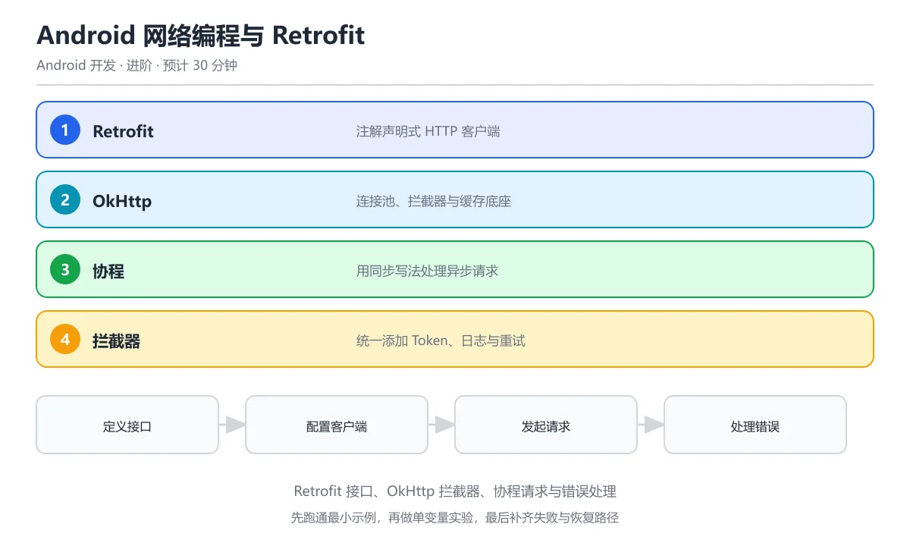

# Android 网络编程与 Retrofit

> 内容更新时间：2026-10-06 · 学习阶段：进阶 · 预计用时：40 分钟




## 本节知识框架

**课程定位**：所属分类为「Android 开发」，课程主题为「Android 网络编程与 Retrofit」，学习阶段为「进阶」，建议用时 30 分钟。

**本课要解决的主问题**：如何用 Retrofit + OkHttp 在 Android 中安全、高效地完成 REST API 调用，并正确处理异步、缓存、拦截器与错误。

| 学习层次 | 要回答的问题 | 完成判据 |
| --- | --- | --- |
| 概念层 | Retrofit、OkHttp、Interceptor、Coroutine Adapter 各是什么？ | 能用自己的话定义核心术语，并各举一个正例和一个反例。 |
| 机制层 | 一个 HTTP 请求从接口声明到回调拿到数据，经过了哪些环节？ | 能画出或写出请求链路步骤，并说明每一步的失败条件。 |
| 应用层 | 什么场景适合 Retrofit，什么场景需要手写 HttpURLConnection 或 Ktor Client？ | 能给出一个真实场景、一个最小示例和一个边界案例。 |
| 性能层 | 连接池、缓存、并发请求对延迟和吞吐的影响是什么？ | 能说出复杂度或性能瓶颈的证据来源；没有证据时明确写"材料未提供"。 |
| 复习层 | 怎样确认自己不是只记住了结论？ | 能独立完成本课自测，并把错误定位到概念、机制、示例或边界。 |

### 阅读路线

1. 先读「核心概念定义」，建立 Retrofit、OkHttp、Interceptor 等术语的精确定义。
2. 再读「原理与运行机制」，把定义串成可重复的请求链路。
3. 用「代码/协议/SQL 示例」验证过程，并只改一个条件观察结果变化。
4. 最后检查性能、易错点、知识关系与自测题，形成可复习的证据链。

**前置知识**：《Kotlin 与 Android 开发》

**学习位置**：本课位于《Kotlin 与 Android 开发》之后；如果前一课的协程与分层架构自测不能通过，应先回补再继续。

**后续衔接**：下一课《Android 数据存储》会继续使用本课的 Repository 模式，学完后建议立即完成一次自测。

### 课程导言
**Title:** Android Networking with Retrofit

**Summary:** Retrofit, OkHttp, interceptors, coroutines integration and error handling.

**Category:** Android Development
**Level:** 进阶
**Key terms:** Retrofit, OkHttp, Interceptor, Coroutine Adapter, Moshi


**复习清单**

- [ ] 能用 Retrofit 接口和注解声明一组 REST API
- [ ] 能解释 OkHttp 拦截器链的执行顺序并添加公共请求头
- [ ] 能用协程和 suspend 函数发起网络请求并处理异常
- [ ] 能区分 @Body、@Query、@Field 的使用场景
- [ ] 能说明网络失败时的重试、退避与错误提示策略

## 核心概念定义

> 阅读约定：本课先给「Android 网络编程与 Retrofit」相关术语的操作性定义与适用边界；正文里的口语化说法与定义冲突时，以定义和可复现示例为准。

| 术语 | 操作性定义 | 本课中的边界 |
| --- | --- | --- |
| Retrofit | 一个把 HTTP API 声明成 Kotlin 接口的类型安全客户端库，通过注解描述请求路径、方法和参数。 | Retrofit 只负责「接口 → HTTP 请求 → 反序列化」这条链路，不处理缓存、鉴权或重试；这些能力需要靠 OkHttp Interceptor 补齐。 |
| OkHttp | Square 出品的 HTTP 客户端，负责连接池、TLS、拦截器链与请求/响应体的实际传输。 | OkHttp 是 Retrofit 的底层引擎，也可以独立使用；但在 Android 项目中通常让 Retrofit 管理 OkHttp 实例。 |
| Interceptor | OkHttp 的拦截器，可以在请求发出前和响应返回后插入自定义逻辑，如日志、鉴权 Token、重试。 | Interceptor 分 Application Interceptor 和 Network Interceptor 两种，前者在整个请求链最外层执行一次，后者每次网络请求都会执行（含重定向和重试）。 |
| Coroutine Adapter | Retrofit 的 `await()` 扩展或 `CallAdapter`，让接口方法直接返回 `suspend` 函数。 | 使用 `suspend` 后不再需要回调，协程会自动管理线程切换；但要注意 `Dispatchers.Main` 上不能做网络 I/O。 |
| Moshi / Gson | JSON 序列化/反序列化库，Retrofit 通过 `ConverterFactory` 接入。 | Moshi 对 Kotlin 空安全支持更好（配合 codegen），Gson 在老项目中更常见；两者都不能自动处理服务端返回的非标准字段。 |

### 定义如何使用

在「Android 网络编程与 Retrofit」中判断一个说法是否成立，先确认它使用的是哪个对象的定义，再检查网络环境、线程模型与失败路径。定义不是口号，而是后续推导、代码示例和自测题共享的约束。

## 原理与运行机制

### 机制总览

1. **声明接口**：用 `@GET`、`@POST` 等注解把 API 端点映射为 Kotlin 接口方法。
2. **构建 Retrofit 实例**：指定 baseUrl、ConverterFactory（JSON 解析）和 CallAdapterFactory（协程适配）。
3. **配置 OkHttp**：添加 Interceptor 链（日志、Token、缓存策略），设置连接池与超时。
4. **发起请求**：在协程中调用 `suspend` 方法，Retrofit 自动切到 IO 线程并返回反序列化结果。
5. **处理响应**：通过 `Response<T>` 包装区分 HTTP 错误与业务错误。

| 阶段 | 关注对象 | 失败时应检查 |
| --- | --- | --- |
| 接口声明 | Retrofit 注解 | URL 路径、`@Path`/`@Query` 参数是否正确编码。 |
| 构建客户端 | OkHttp + Interceptor | 拦截器顺序是否正确，Token 是否注入到 Header。 |
| 执行请求 | 协程 + Dispatcher | 是否在 `Dispatchers.IO` 上执行，超时是否合理。 |
| 解析响应 | Converter (Moshi/Gson) | JSON 字段名是否匹配，空值是否用 `?` 声明。 |

本课的机制结论要用「Android 网络编程与 Retrofit」自己的示例验证。没有给出某个数量级、吞吐或延迟数据时，本课把该判断标为"材料未提供"，不从相邻主题外推。

### 请求链路详解

用一个比喻来理解：Retrofit 就像一家快递公司的「下单系统」——你只需要填好收件地址（URL）和包裹内容（参数），快递公司（OkHttp）负责选路线、过安检（Interceptor）、送到目的地。

```text
用户代码 → Retrofit 接口 → OkHttp 拦截器链 → 网络传输 → 响应拦截器 → JSON 解析 → 返回数据
```

1. **用户代码**：在 ViewModel 的协程中调用 `api.getUser(id)`。
2. **Retrofit 接口**：把 `@GET("users/{id}")` 翻译成完整的 HTTP 请求。
3. **OkHttp 拦截器链**：依次经过自定义 Interceptor（加 Token）、重试 Interceptor、缓存 Interceptor。
4. **网络传输**：通过连接池复用 TCP 连接，执行 TLS 握手（如果是 HTTPS）。
5. **响应拦截器**：反向经过拦截器链，可以记录日志或修改响应。
6. **JSON 解析**：Moshi/Gson 把 JSON body 转成 Kotlin 数据类。
7. **返回数据**：协程拿到结果，切回 Main 线程更新 UI。

## 典型应用场景

### 场景一：用户登录

最常见的场景——用户在登录页输入账号密码，App 调用后端 API 获取 Token。

- **输入**：用户名、密码
- **过程**：Retrofit 发送 POST 请求到 `/auth/login`，OkHttp 拦截器把返回的 Token 存起来
- **输出**：Token 保存到本地，后续请求通过 Interceptor 自动带上

### 场景二：列表数据加载

下拉刷新一个商品列表，需要分页加载。

- **输入**：页码、每页数量
- **过程**：Retrofit 用 `@Query` 传分页参数，协程在 IO 线程请求，Moshi 解析 JSON 数组
- **输出**：`List<Product>` 交给 ViewModel 的 StateFlow，UI 自动更新

### 场景三：文件上传

用户选择头像图片上传到服务器。

- **输入**：文件路径
- **过程**：Retrofit 用 `@Multipart` + `@Part MultipartBody.Part` 声明上传接口，OkHttp 处理分块传输
- **输出**：服务器返回文件 URL，保存到数据库

### 边界案例：弱网环境

当网络不稳定时（如地铁里），OkHttp 的超时设置和重试策略就变得关键。不设超时的请求可能永远挂起，重试太多次又会浪费电量。

## 代码/协议/SQL 示例

### 示例 1：最小 Retrofit 接口声明

```kotlin
// 1. 定义数据类（用 Moshi 注解）
@JsonClass(generateAdapter = true)
data class User(
    val id: Long,
    val name: String,
    val email: String?
)

// 2. 声明 API 接口
interface UserApi {
    @GET("users/{id}")
    suspend fun getUser(@Path("id") id: Long): Response<User>

    @GET("users")
    suspend fun listUsers(
        @Query("page") page: Int = 1,
        @Query("size") size: Int = 20
    ): Response<List<User>>

    @POST("users")
    suspend fun createUser(@Body user: User): Response<User>
}
```

### 示例 2：构建 Retrofit 与 OkHttp 客户端

```kotlin
// 3. 配置 OkHttp
val okHttpClient = OkHttpClient.Builder()
    .connectTimeout(15, TimeUnit.SECONDS)   // 连接超时
    .readTimeout(20, TimeUnit.SECONDS)      // 读取超时
    .writeTimeout(20, TimeUnit.SECONDS)     // 写入超时
    .connectionPool(ConnectionPool(
        maxIdleConnections = 5,
        keepAliveDuration = 5,
        unit = TimeUnit.MINUTES
    ))
    .addInterceptor(HttpLoggingInterceptor().apply {
        level = HttpLoggingInterceptor.Level.BODY  // 调试时打印完整请求/响应
    })
    .addInterceptor(AuthInterceptor())       // 自定义：注入 Token
    .build()

// 4. 构建 Retrofit
val retrofit = Retrofit.Builder()
    .baseUrl("https://api.example.com/v1/")
    .client(okHttpClient)
    .addConverterFactory(MoshiConverterFactory.create())
    .build()

// 5. 创建 API 实例
val userApi: UserApi = retrofit.create(UserApi::class.java)
```

### 示例 3：自定义 Interceptor 注入 Token

```kotlin
class AuthInterceptor(private val tokenProvider: () -> String?) : Interceptor {
    override fun intercept(chain: Interceptor.Chain): Response {
        val original = chain.request()
        val token = tokenProvider()

        val request = if (token != null) {
            original.newBuilder()
                .header("Authorization", "Bearer $token")
                .build()
        } else {
            original
        }

        return chain.proceed(request)
    }
}
```

### 示例 4：在 ViewModel 中调用

```kotlin
class UserViewModel(private val api: UserApi) : ViewModel() {
    private val _state = MutableStateFlow<UiState>(UiState.Idle)
    val state: StateFlow<UiState> = _state.asStateFlow()

    fun loadUser(id: Long) {
        viewModelScope.launch {
            _state.value = UiState.Loading
            val result = runCatching {
                withContext(Dispatchers.IO) {
                    api.getUser(id)
                }
            }
            result.onSuccess { response ->
                if (response.isSuccessful) {
                    _state.value = UiState.Success(response.body()!!)
                } else {
                    _state.value = UiState.Error("HTTP ${response.code()}")
                }
            }.onFailure { e ->
                _state.value = UiState.Error(e.message ?: "未知错误")
            }
        }
    }
}

sealed class UiState {
    object Idle : UiState()
    object Loading : UiState()
    data class Success(val user: User) : UiState()
    data class Error(val message: String) : UiState()
}
```

### 示例 5：处理 HTTP 错误与网络异常

```kotlin
// 通用封装：把 Retrofit Response 转成 Result
suspend fun <T> safeApiCall(call: suspend () -> Response<T>): Result<T> {
    return try {
        val response = call()
        if (response.isSuccessful) {
            val body = response.body()
            if (body != null) Result.success(body)
            else Result.failure(Exception("响应体为空"))
        } else {
            Result.failure(HttpException(response))
        }
    } catch (e: IOException) {
        Result.failure(e)  // 网络异常：超时、无网络等
    } catch (e: Exception) {
        Result.failure(e)
    }
}
```

## 时间/空间复杂度或性能分析

### 连接池与并发

| 指标 | 说明 |
| --- | --- |
| 连接复用 | OkHttp 默认连接池保持 5 个空闲连接、5 分钟存活。对同一域名的并发请求可以复用 TCP + TLS，省去握手开销（约 1-3 个 RTT）。 |
| 并发上限 | 默认 `Dispatcher` 最多 64 个并发请求、每域名最多 5 个。超过的请求会排队等待。 |
| 内存占用 | 每个请求的 Request/Response body 都会占用内存；大文件应使用流式读取（`response.body?.byteStream()`）而非一次性加载。 |

### 序列化性能

- **Moshi codegen**（编译期生成适配器）比 **Moshi reflection**（运行时反射）快约 3-5 倍，推荐在大型项目中使用 codegen。
- **Gson** 使用反射，启动时首次序列化较慢，但后续调用有内部缓存。
- **kotlinx.serialization** 是 JetBrains 官方方案，编译期生成，无反射开销，与协程集成最自然。

### 缓存策略

```kotlin
// OkHttp 磁盘缓存
val cache = Cache(
    directory = File(context.cacheDir, "http_cache"),
    maxSize = 50L * 1024L * 1024L  // 50 MB
)

val client = OkHttpClient.Builder()
    .cache(cache)
    .build()
```

缓存命中时响应时间为 0（本地读取），未命中时取决于网络延迟。对于频繁变化的数据（如用户信息），应在 Interceptor 中设置 `Cache-Control: no-cache`。

## 常见误区与易错点

### 误区 1：在主线程发网络请求

```kotlin
// 错误：直接调用非 suspend 方法
val response = userApi.getUser(1).execute()  // 编译能过但会崩溃

// 正确：用 suspend 函数 + 协程
viewModelScope.launch {
    val response = userApi.getUser(1)  // suspend 自动切线程
}
```

**后果**：Android 3.0+ 禁止主线程网络操作，会抛出 `NetworkOnMainThreadException`。
**改法**：接口方法声明为 `suspend`，或在 `withContext(Dispatchers.IO)` 中调用。

### 误区 2：baseUrl 末尾漏掉斜杠

```kotlin
// 错误
.baseUrl("https://api.example.com/v1")  // 没有末尾 /

// 接口
@GET("users")  // 最终 URL 变成 https://api.example.com/users（v1 被丢掉）
```

**后果**：Retrofit 的 URL 拼接规则是：如果 baseUrl 没有末尾 `/`，最后一段路径会被接口的相对路径替换。
**改法**：baseUrl 始终以 `/` 结尾。

### 误区 3：忘记处理 401 Token 过期

只检查 `response.isSuccessful` 不够，需要专门处理 401 状态码触发 Token 刷新。

```kotlin
// 在 Interceptor 中处理 401
class TokenRefreshInterceptor(...) : Interceptor {
    override fun intercept(chain: Interceptor.Chain): Response {
        val response = chain.proceed(chain.request())
        if (response.code == 401) {
            // 刷新 Token 并重试请求
            refreshToken()
            val newRequest = chain.request().newBuilder()
                .header("Authorization", "Bearer ${getToken()}")
                .build()
            return chain.proceed(newRequest)
        }
        return response
    }
}
```

### 误区 4：Response body 只能消费一次

```kotlin
// 错误：body 被读了两次
val body = response.body()
log(body.toString())        // 第一次消费
val user = response.body()  // 第二次调用返回 null 或抛异常
```

**改法**：把 `response.body()` 存到变量里，只调用一次。

## 与其他知识点的关系

| 关联课程 | 关系说明 |
| --- | --- |
| Kotlin 与 Android 开发 | 本课的 ViewModel + 协程模式直接来自前课；Repository 层是网络层与数据层的桥梁。 |
| Android 数据存储 | 网络请求返回的数据通常需要缓存到 Room 或 SharedPreferences，形成「网络 → 本地」的数据流。 |
| Android 后台服务 | 定时同步、后台上传等场景需要 WorkManager 配合 Retrofit 使用。 |
| Android 测试 | 用 MockWebServer 可以拦截 Retrofit 请求，做确定性的单元测试。 |

## 自测题与参考答案

### 题目 1

Retrofit 中 `@GET("users/{id}")` 的 `{id}` 用什么注解传值？

<details>
<summary>答案</summary>

`@Path("id")`。示例：`suspend fun getUser(@Path("id") id: Long)`。

</details>

### 题目 2

OkHttp 的 Application Interceptor 和 Network Interceptor 有什么区别？

<details>
<summary>答案</summary>

Application Interceptor 在整个请求链最外层只执行一次（含缓存命中时也会执行）；Network Interceptor 在每次实际网络请求时执行（重定向、重试都会触发）。日志记录通常用 Application Interceptor，修改请求头（如 Token）也用 Application Interceptor。

</details>

### 题目 3

为什么 Retrofit 的 `suspend` 函数不需要手动切线程？

<details>
<summary>答案</summary>

Retrofit 的 Coroutine CallAdapter 内部会自动把网络请求调度到 OkHttp 的 IO 线程池执行，响应回来后自动切回调用方的上下文。开发者只需在 `viewModelScope.launch` 中调用即可。

</details>

### 题目 4

baseUrl 为 `https://api.example.com/v1/`，接口注解为 `@GET("users")`，最终请求的 URL 是什么？

<details>
<summary>答案</summary>

`https://api.example.com/v1/users`。Retrofit 把 baseUrl 的路径与接口的相对路径拼接。

</details>

### 题目 5

如何处理 Retrofit 返回的 401 状态码？

<details>
<summary>答案</summary>

在 OkHttp Interceptor 中检查 `response.code == 401`，触发 Token 刷新逻辑，然后用新 Token 重建请求并 `chain.proceed(newRequest)` 重试。也可以在 Repository 层统一处理。

</details>

### 题目 6

Moshi 和 Gson 在 Kotlin 项目中的主要区别是什么？

<details>
<summary>答案</summary>

Moshi 配合 `moshi-kotlin` 或 codegen 能正确处理 Kotlin 的默认参数和空安全（`String?`）；Gson 基于 Java 反射，对 Kotlin data class 的默认参数支持不好（反序列化时可能忽略默认值），且不能区分 `null` 和缺失字段。

</details>

## 考点精讲

### 考点 1

Retrofit 的核心设计思想是什么？

A. 手动解析 JSON

B. 直接操作 Socket

C. 通过接口注解声明式定义 HTTP API

D. 只支持 GET 请求

**正确答案：C**

**详细解释**：Retrofit 用 Java/Kotlin 接口 + 注解（@GET、@POST、@Path 等）声明 API，自动生成实现。 接口方法的返回值用 suspend 函数配合协程，Retrofit 会自动把响应切到后台线程执行，主线程只拿到结果。 本题正确项是「通过接口注解声明式定义 HTTP API」。

---

### 考点 2

OkHttp 拦截器（Interceptor）的主要用途是什么？

A. 加密数据

B. 在请求发送前或响应返回后统一处理（如添加 Token、日志记录）

C. 压缩图片

D. 管理数据库

**正确答案：B**

**详细解释**：Interceptor 可以在请求链中插入逻辑，如自动添加 Authorization header、记录请求日志、处理重试。 多个拦截器按添加顺序组成链，应用拦截器适合加公共头和日志，网络拦截器则能看到重定向和缓存细节。 拦截器里要避免做耗时操作，日志拦截器最好只在 debug 构建启用，否则每个请求都会被拖慢。 本题正确项是「在请求发送前或响应返回后统一处理（如添加 Token、日志记录）」。

---

### 考点 3

在 Android 中为什么推荐用协程处理网络请求？

A. 协程速度更快

B. 协程以同步写法处理异步操作，避免回调地狱

C. 协程不需要网络权限

D. 协程自动缓存数据

**正确答案：B**

**详细解释**：协程的 suspend 函数让网络请求代码看起来像同步，但实际在后台线程执行，不阻塞主线程。 协程的结构化并发还带来取消传播，页面销毁时作用域取消，未完成的请求会自动中止，避免资源泄漏。 注意 withContext(Dispatchers.IO) 只切换线程，真正的取消和异常传播仍由协程作用域负责，要选对作用域。 本题正确项是「协程以同步写法处理异步操作，避免回调地狱」。

---

### 考点 4

Retrofit 中 @Body 注解的作用是什么？

A. 指定 URL 路径

B. 将对象序列化为请求体（如 JSON）

C. 添加请求头

D. 设置超时时间

**正确答案：B**

**详细解释**：@Body 把 Kotlin/Java 对象通过 Converter（如 GsonConverter）序列化为 HTTP 请求体。 GET 请求通常用 @Query 拼查询参数，POST 表单则用 @FormUrlEncoded 配合 @Field，不要把两者混用。 本题正确项是「将对象序列化为请求体（如 JSON）」。

---

### 考点 5

网络请求失败时，最佳实践是什么？

A. 直接崩溃

B. 捕获异常，显示友好错误提示，提供重试机制

C. 忽略错误

D. 强制退出 App

**正确答案：B**

**详细解释**：网络不可靠是常态，应捕获 IOException/HttpException，给用户可操作的错误提示和重试按钮。 重试要设置上限并配合退避策略，否则网络持续不可用时会不断放大请求量，反而加重服务端压力。 错误提示要区分网络断开、超时和服务端错误，给出不同的处理建议，而不是统一弹一句加载失败。 本题正确项是「捕获异常，显示友好错误提示，提供重试机制」。

## 术语速查

| 术语 | 一句话说明 |
| --- | --- |
| Retrofit | 类型安全的 HTTP 客户端库，用接口注解声明 API |
| OkHttp | HTTP 传输层，负责连接池、拦截器、TLS |
| Interceptor | 请求/响应的中间处理环节，可插入日志、Token 等逻辑 |
| CallAdapter | 把 Retrofit 的 `Call<T>` 转成其他返回类型（如协程的 `suspend`） |
| Converter | 把 HTTP body 转成 Kotlin 对象（JSON → data class） |
| Moshi | Square 出品的 JSON 库，Kotlin 友好 |
| Dispatcher | OkHttp 的并发控制器，管理最大请求数 |
| ConnectionPool | 复用 TCP 连接，减少握手开销 |

## 参考资料与复核

1. [Retrofit 官方文档](https://square.github.io/retrofit/) — 接口声明、Converter 配置、CallAdapter 扩展。
2. [OkHttp 官方文档](https://square.github.io/okhttp/) — Interceptor 链、连接池、缓存策略。
3. [Moshi 文档](https://github.com/square/moshi) — Kotlin codegen 用法与空安全处理。
4. [Kotlin 协程与 Retrofit](https://kotlinlang.org/docs/coroutines-guide.html) — `suspend` 函数与协程上下文。
5. **复核要点**：本课代码示例基于 Retrofit 2.9+、OkHttp 4.10+、Moshi 1.14+，Kotlin 1.8+。Interceptor 链的执行顺序在 OkHttp 3.x 和 4.x 中一致。

- 最后复核：2026-10-04
- 下次复核：2027-10-24

## 内容元数据

- 内容版本：v2.0
- 最后更新：2026-10-06
- 学习阶段：进阶
- 适用环境：通用开发环境
- 内容来源：内置结构化课程与工程实践整理
- 相关主题：mobile android networking
- 质量版本：P0 测验标准 + P1 覆盖扩展 + P2 体验补全