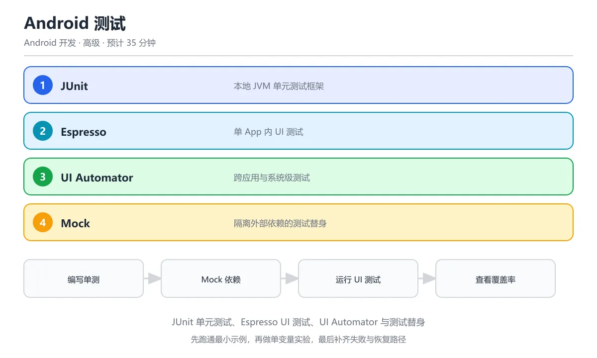

# Android 测试（Espresso/UI Automator）

> 内容更新时间：2026-10-06 · 学习阶段：高级 · 预计用时：55 分钟




## 本节知识框架

**课程定位**：所属分类为「Android 开发」，课程主题为「Android 测试（Espresso/UI Automator）」，学习阶段为「进阶」，建议用时 30 分钟。

**本课要解决的主问题**：如何使用 Espresso 进行 UI 组件级别的测试，如何使用 UI Automator 进行跨应用和系统级测试，以及如何编写单元测试验证 Worker、Repository 等逻辑层。

| 学习层次 | 要回答的问题 | 完成判据 |
| --- | --- | --- |
| 概念层 | Espresso、UI Automator、ViewMatcher、ViewAction、ViewAssertion 各是什么？ | 能用自己的话定义核心术语，并各举一个正例和一个反例。 |
| 机制层 | 一个 UI 测试从启动到断言通过，经过了哪些环节？ | 能画出或写出测试执行步骤，并说明每一步的失败条件。 |
| 应用层 | 什么场景用 Espresso，什么场景用 UI Automator，什么场景用 JUnit？ | 能给出一个真实场景、一个最小示例和一个边界案例。 |
| 性能层 | 测试执行时间、稳定性、覆盖率受哪些因素影响？ | 能说出复杂度或性能瓶颈的证据来源；没有证据时明确写"材料未提供"。 |
| 复习层 | 怎样确认自己不是只记住了结论？ | 能独立完成本课自测，并把错误定位到概念、机制、示例或边界。 |

### 阅读路线

1. 先读「核心概念定义」，建立 Espresso、UI Automator、ViewMatcher 等术语的精确定义。
2. 再读「原理与运行机制」，把定义串成可重复的测试流程。
3. 用「代码/协议/SQL 示例」验证过程，并只改一个条件观察结果变化。
4. 最后检查性能、易错点、知识关系与自测题，形成可复习的证据链。

**前置知识**：《Kotlin 与 Android 开发》、《Android 后台服务与 WorkManager》

**学习位置**：本课位于《Android 后台服务与 WorkManager》之后；测试 Worker 的逻辑需要前一课的知识。

**后续衔接**：本课是 Android 开发系列的最后一课，学完后建议回顾整个课程链，形成完整的知识体系。

### 课程导言
**Title:** Android Testing (Espresso/UI Automator)

**Summary:** Espresso UI testing, UI Automator, ViewMatcher, ViewAction, unit testing Worker and Repository.

**Category:** Android Development
**Level:** 进阶
**Key terms:** Espresso, UI Automator, ViewMatcher, ViewAction, JUnit, MockWebServer


**复习清单**

- [ ] 能区分 JUnit 本地测试、Espresso 单 App UI 测试与 UI Automator 跨 App 测试
- [ ] 能用 Mock 隔离网络和数据库依赖编写单元测试
- [ ] 能写出 onView/perform/check 三段式的 Espresso 用例
- [ ] 能说明 @RunWith(AndroidJUnit4::class) 的作用
- [ ] 能读懂 JaCoCo 覆盖率报告并定位测试盲区

## 核心概念定义

> 阅读约定：本课先给「Android 测试」相关术语的操作性定义与适用边界；正文里的口语化说法与定义冲突时，以定义和可复现示例为准。

| 术语 | 操作性定义 | 本课中的边界 |
| --- | --- | --- |
| Espresso | Google 官方 UI 测试框架，用于在单个 App 内做白盒测试（可以访问 App 内部对象）。 | Espresso 运行在 Instrumentation 线程，与 UI 线程同步；不能测试跨 App 交互或系统对话框。 |
| UI Automator | Google 官方黑盒测试框架，可以测试跨 App 交互、系统对话框、通知栏等。 | UI Automator 通过 Accessibility 服务获取 UI 树，速度比 Espresso 慢；适合系统级测试。 |
| ViewMatcher | Espresso 中用于定位 UI 组件的选择器，如 `withId(R.id.button)`、`withText("提交")`。 | 如果匹配到多个组件，测试会失败；需要用 `allOf()` 组合多个 Matcher 精确定位。 |
| ViewAction | Espresso 中对组件执行的操作，如 `click()`、`typeText("hello")`、`scrollTo()`。 | 操作前会自动等待 UI 线程空闲（Idling Resource）；如果组件不可见，操作会失败。 |
| ViewAssertion | Espresso 中对组件状态的断言，如 `isDisplayed()`、`matches(withText("结果"))`。 | 断言失败会抛出 `AssertionError`，测试标记为失败。 |
| IdlingResource | Espresso 的同步机制，告诉测试框架「后台任务是否完成」。 | 不设置 IdlingResource 时，Espresso 只等待主线程空闲；网络请求、数据库操作等异步任务需要手动注册。 |
| Instrumented Test | 运行在真机或模拟器上的测试，可以访问 Android API。 | 比本地单元测试慢（需要启动 App）；用 `@RunWith(AndroidJUnit4::class)` 运行。 |
| Unit Test | 运行在 JVM 上的本地测试，不能访问 Android API（除非用 Mock）。 | 速度快（毫秒级）；适合测试纯逻辑（Worker、Repository、ViewModel）。 |

### 定义如何使用

在「Android 测试」中判断一个说法是否成立，先确认它使用的是哪个对象的定义，再检查测试环境、同步机制与断言条件。定义不是口号，而是后续推导、代码示例和自测题共享的约束。

## 原理与运行机制

### 机制总览

1. **选择测试类型**：根据测试目标选择 Espresso（UI）、UI Automator（系统级）或 JUnit（逻辑）。
2. **编写测试用例**：用 `@Test` 注解标记测试方法，使用 Matcher/Action/Assertion 组合。
3. **配置测试环境**：添加依赖、设置 TestRunner、配置 IdlingResource。
4. **执行测试**：运行 Instrumented Test（真机/模拟器）或 Unit Test（JVM）。
5. **分析结果**：查看测试报告，定位失败原因（断言失败、超时、异常）。

| 阶段 | 关注对象 | 失败时应检查 |
| --- | --- | --- |
| 选型 | 测试目标 | 是否真的需要 UI 测试？能否用单元测试替代？ |
| 编写 | Matcher/Action | 组件是否可访问？操作是否可行？ |
| 环境 | IdlingResource | 异步任务是否完成？同步机制是否配置？ |
| 执行 | TestRunner | 设备是否连接？App 是否安装？ |

### 测试金字塔

用一个比喻来理解：测试金字塔就像「盖房子」——底层是大量快速的单元测试（地基），中层是适量的集成测试（墙壁），顶层是少量缓慢的 UI 测试（屋顶）。

```text
        /\
       /  \      UI 测试（Espresso/UI Automator）
      /----\     少量、慢速、易碎
     /      \
    /--------\   集成测试（Repository + API）
   /          \   适量、中速
  /------------\
 /              \ 单元测试（ViewModel/Worker 逻辑）
/________________\ 大量、快速、稳定
```

1. **单元测试（底层）**：测试 ViewModel、Worker、Repository 的纯逻辑，不依赖 Android 框架。
2. **集成测试（中层）**：测试 Repository + API 的交互，用 MockWebServer 模拟网络。
3. **UI 测试（顶层）**：测试用户可见的界面交互，用 Espresso 或 UI Automator。

### Espresso 的执行流程

```text
测试启动 → 安装 App → 启动 Activity → 等待 UI 空闲 → 执行 ViewAction → 等待 UI 空闲 → 检查 ViewAssertion
```

1. **测试启动**：`@RunWith(AndroidJUnit4::class)` 指定 Instrumented Test Runner。
2. **安装 App**：Gradle 自动构建并安装到设备。
3. **启动 Activity**：`ActivityScenario.launch(MainActivity::class.java)`。
4. **等待空闲**：Espresso 自动等待主线程消息队列清空。
5. **执行操作**：`onView(withId(R.id.button)).perform(click())`。
6. **再次等待**：操作可能触发异步任务，等待完成。
7. **检查断言**：`onView(withId(R.id.text)).check(matches(withText("结果")))`。

## 典型应用场景

### 场景一：登录功能测试（Espresso）

测试用户输入账号密码后点击登录按钮的流程。

- **输入**：用户名、密码
- **过程**：Espresso 定位输入框，输入文本，点击按钮，等待响应
- **输出**：断言界面跳转到主页，或显示错误提示

### 场景二：通知栏交互测试（UI Automator）

测试 App 发送通知后，用户点击通知的行为。

- **输入**：触发通知的操作
- **过程**：UI Automator 打开通知栏，找到通知，点击
- **输出**：断言 App 打开指定页面

### 场景三：Worker 逻辑测试（JUnit + Mock）

测试 SyncWorker 的数据同步逻辑，不依赖真实网络。

- **输入**：模拟的 API 响应（用 MockWebServer）
- **过程**：直接调用 Worker 的 `doWork()` 方法
- **输出**：断言 Room 数据库中有新数据

### 边界案例：动画导致测试失败

如果界面有持续动画（如 Loading 转圈），Espresso 会一直等待 UI 空闲，导致测试超时。解决方法是用 `IdlingResource` 告诉 Espresso 忽略动画，或在测试中禁用动画。

## 代码/协议/SQL 示例

### 示例 1：Espresso 基础测试

```kotlin
@RunWith(AndroidJUnit4::class)
class LoginActivityTest {

    @Test
    fun testLoginSuccess() {
        // 1. 启动 Activity
        val scenario = ActivityScenario.launch(LoginActivity::class.java)

        // 2. 输入用户名
        onView(withId(R.id.et_username))
            .perform(typeText("testuser"), closeSoftKeyboard())

        // 3. 输入密码
        onView(withId(R.id.et_password))
            .perform(typeText("password123"), closeSoftKeyboard())

        // 4. 点击登录按钮
        onView(withId(R.id.btn_login))
            .perform(click())

        // 5. 验证跳转到主页
        onView(withId(R.id.main_container))
            .check(matches(isDisplayed()))

        // 6. 验证显示欢迎信息
        onView(withId(R.id.tv_welcome))
            .check(matches(withText("欢迎, testuser")))
    }

    @Test
    fun testLoginFailure() {
        val scenario = ActivityScenario.launch(LoginActivity::class.java)

        // 输入错误密码
        onView(withId(R.id.et_username))
            .perform(typeText("testuser"), closeSoftKeyboard())
        onView(withId(R.id.et_password))
            .perform(typeText("wrong"), closeSoftKeyboard())
        onView(withId(R.id.btn_login))
            .perform(click())

        // 验证显示错误提示
        onView(withId(R.id.tv_error))
            .check(matches(withText("用户名或密码错误")))
            .check(matches(isDisplayed()))
    }
}
```

### 示例 2：使用 IdlingResource 处理异步

```kotlin
// 1. 定义 IdlingResource
class NetworkIdlingResource : IdlingResource {
    @Volatile
    private var callback: ResourceCallback? = null
    private var isIdleNow = true

    fun setIdle(isIdle: Boolean) {
        isIdleNow = isIdle
        if (isIdle && callback != null) {
            callback!!.onTransitionToIdle()
        }
    }

    override fun getName(): String = "NetworkIdlingResource"

    override fun isIdleNow(): Boolean = isIdleNow

    override fun registerIdleTransitionCallback(callback: ResourceCallback?) {
        this.callback = callback
    }
}

// 2. 在测试中使用
@RunWith(AndroidJUnit4::class)
class DataLoadTest {

    private lateinit var idlingResource: NetworkIdlingResource

    @Before
    fun setUp() {
        idlingResource = NetworkIdlingResource()
        IdlingRegistry.getInstance().register(idlingResource)
    }

    @After
    fun tearDown() {
        IdlingRegistry.getInstance().unregister(idlingResource)
    }

    @Test
    fun testDataLoaded() {
        ActivityScenario.launch(MainActivity::class.java)

        // Espresso 会自动等待 idlingResource.isIdleNow() 返回 true
        onView(withId(R.id.tv_data))
            .check(matches(withText("加载完成")))
    }
}
```

### 示例 3：UI Automator 跨应用测试

```kotlin
@RunWith(AndroidJUnit4::class)
class NotificationTest {

    @Test
    fun testNotificationClick() {
        // 1. 初始化 UI Device
        val device = UiDevice.getInstance(InstrumentationRegistry.getInstrumentation())

        // 2. 打开通知栏
        device.openNotification()

        // 3. 等待通知出现
        val notification = device.findObject(UiSelector().text("新消息"))
        notification.waitForExists(5000)  // 等待 5 秒

        // 4. 点击通知
        notification.click()

        // 5. 验证 App 打开
        val appContainer = device.findObject(UiSelector().resourceId("com.example.app:id/container"))
        assertTrue(appContainer.exists())
    }

    @Test
    fun testSystemSettings() {
        val device = UiDevice.getInstance(InstrumentationRegistry.getInstrumentation())

        // 打开系统设置
        val context = InstrumentationRegistry.getInstrumentation().targetContext
        context.startActivity(
            Intent(Settings.ACTION_SETTINGS).addFlags(Intent.FLAG_ACTIVITY_NEW_TASK)
        )

        // 找到「关于手机」选项
        val aboutPhone = device.findObject(UiSelector().text("关于手机"))
        aboutPhone.click()

        // 验证进入关于页面
        val versionInfo = device.findObject(UiSelector().textContains("Android 版本"))
        assertTrue(versionInfo.exists())
    }
}
```

### 示例 4：单元测试 ViewModel

```kotlin
class LoginViewModelTest {

    private lateinit var viewModel: LoginViewModel
    private lateinit var repository: FakeLoginRepository

    @Before
    fun setUp() {
        repository = FakeLoginRepository()
        viewModel = LoginViewModel(repository)
    }

    @Test
    fun `login with valid credentials succeeds`() = runTest {
        // Given
        repository.setLoginResult(Result.success("token123"))

        // When
        viewModel.login("user", "pass")

        // Then
        val state = viewModel.state.value
        assertTrue(state is UiState.Success)
        assertEquals("token123", (state as UiState.Success).token)
    }

    @Test
    fun `login with empty username fails`() = runTest {
        // When
        viewModel.login("", "pass")

        // Then
        val state = viewModel.state.value
        assertTrue(state is UiState.Error)
        assertEquals("用户名不能为空", (state as UiState.Error).message)
    }

    @Test
    fun `login with network error shows error`() = runTest {
        // Given
        repository.setLoginResult(Result.failure(IOException("网络错误")))

        // When
        viewModel.login("user", "pass")

        // Then
        val state = viewModel.state.value
        assertTrue(state is UiState.Error)
    }
}

// Fake 实现：模拟 Repository
class FakeLoginRepository : LoginRepository {
    private var result: Result<String>? = null

    fun setLoginResult(result: Result<String>) {
        this.result = result
    }

    override suspend fun login(username: String, password: String): Result<String> {
        return result ?: Result.failure(Exception("未设置结果"))
    }
}
```

### 示例 5：单元测试 Worker

```kotlin
@RunWith(AndroidJUnit4::class)
class SyncWorkerTest {

    private lateinit var context: Context
    private lateinit var database: AppDatabase

    @Before
    fun setUp() {
        context = ApplicationProvider.getApplicationContext()
        // 使用内存数据库，测试完自动销毁
        database = Room.inMemoryDatabaseBuilder(context, AppDatabase::class.java)
            .allowMainThreadQueries()
            .build()
    }

    @After
    fun tearDown() {
        database.close()
    }

    @Test
    fun testSyncWorkerSuccess() {
        // Given
        val worker = SyncWorker(context, workerParams {})
        // 注入测试用的 database
        worker.database = database

        // When
        val result = worker.doWork()

        // Then
        assertEquals(Result.success(), result)
        val articles = database.articleDao().getAllArticlesSync()
        assertTrue(articles.isNotEmpty())
    }

    @Test
    fun testSyncWorkerNetworkError() {
        // Given：模拟网络错误
        val worker = SyncWorker(context, workerParams {})
        worker.setNetworkAvailable(false)

        // When
        val result = worker.doWork()

        // Then
        assertEquals(Result.retry(), result)
    }
}
```

### 示例 6：使用 MockWebServer 测试网络层

```kotlin
class ApiTest {

    private lateinit var mockWebServer: MockWebServer
    private lateinit var api: ApiService

    @Before
    fun setUp() {
        mockWebServer = MockWebServer()
        mockWebServer.start()

        api = Retrofit.Builder()
            .baseUrl(mockWebServer.url("/"))
            .addConverterFactory(MoshiConverterFactory.create())
            .build()
            .create(ApiService::class.java)
    }

    @After
    fun tearDown() {
        mockWebServer.shutdown()
    }

    @Test
    fun `getUser returns user data`() = runTest {
        // Given：模拟服务器响应
        mockWebServer.enqueue(
            MockResponse()
                .setResponseCode(200)
                .setBody("""{"id": 1, "name": "Test User"}""")
        )

        // When
        val user = api.getUser(1)

        // Then
        assertEquals(1L, user.id)
        assertEquals("Test User", user.name)

        // 验证请求路径
        val request = mockWebServer.takeRequest()
        assertEquals("/users/1", request.path)
        assertEquals("GET", request.method)
    }

    @Test
    fun `getUser handles 404`() = runTest {
        // Given：模拟 404 响应
        mockWebServer.enqueue(
            MockResponse().setResponseCode(404)
        )

        // When & Then
        val exception = assertThrows<HttpException> {
            runBlocking { api.getUser(999) }
        }
        assertEquals(404, exception.code())
    }
}
```

### 示例 7：测试依赖配置（build.gradle）

```kotlin
// app/build.gradle.kts
dependencies {
    // 本地单元测试
    testImplementation("junit:junit:4.13.2")
    testImplementation("org.mockito:mockito-core:5.3.1")
    testImplementation("org.mockito.kotlin:mockito-kotlin:5.0.0")
    testImplementation("org.jetbrains.kotlinx:kotlinx-coroutines-test:1.7.3")
    testImplementation("app.cash.turbine:turbine:0.12.3")  // Flow 测试

    // Instrumented 测试
    androidTestImplementation("androidx.test:core:1.5.0")
    androidTestImplementation("androidx.test:runner:1.5.2")
    androidTestImplementation("androidx.test:rules:1.5.0")
    androidTestImplementation("androidx.test.ext:junit:1.1.5")
    androidTestImplementation("androidx.test.espresso:espresso-core:3.5.1")
    androidTestImplementation("androidx.test.espresso:espresso-intents:3.5.1")
    androidTestImplementation("androidx.test.espresso:espresso-idling-resource:3.5.1")
    androidTestImplementation("androidx.test.uiautomator:uiautomator:2.2.0")

    // Room 测试
    androidTestImplementation("androidx.room:room-testing:2.5.2")

    // MockWebServer
    androidTestImplementation("com.squareup.okhttp3:mockwebserver:4.11.0")
}

android {
    defaultConfig {
        testInstrumentationRunner = "androidx.test.runner.AndroidJUnitRunner"
    }
}
```

## 时间/空间复杂度或性能分析

### 测试执行时间

| 测试类型 | 典型耗时 | 说明 |
| --- | --- | --- |
| 单元测试（JUnit） | 1-10 ms | 运行在 JVM，无 App 启动开销 |
| Instrumented 测试（Espresso） | 1-5 s | 需要安装 App、启动 Activity |
| UI Automator 测试 | 5-30 s | 需要操作设备、等待系统响应 |
| 集成测试（MockWebServer） | 100-500 ms | 本地启动模拟服务器 |

### 测试稳定性

| 因素 | 影响 | 解决方案 |
| --- | --- | --- |
| 动画 | Espresso 等待超时 | 禁用动画或使用 IdlingResource |
| 网络延迟 | 断言失败 | 使用 MockWebServer 模拟固定响应 |
| 设备状态 | 测试结果不一致 | 每次测试前重置状态（`@Before`） |
| 异步任务 | 断言过早执行 | 使用 `InstantTaskExecutorRule` 或 IdlingResource |

### 覆盖率指标

- **行覆盖率**：被测试执行到的代码行占比（建议 > 70%）
- **分支覆盖率**：被测试覆盖到的 if/else 分支占比（建议 > 60%）
- **UI 覆盖率**：被测试交互过的 UI 组件占比（难以精确测量）

## 常见误区与易错点

### 误区 1：在 UI 测试中等待固定时间

```kotlin
// 错误：硬编码等待
Thread.sleep(3000)  // 等待 3 秒
onView(withId(R.id.result)).check(matches(isDisplayed()))

// 正确：使用 IdlingResource 或 Espresso 自动同步
onView(withId(R.id.result))
    .check(matches(isDisplayed()))  // Espresso 自动等待 UI 空闲
```

**后果**：硬编码等待不可靠——网络慢时 3 秒不够，网络快时浪费 3 秒。
**改法**：依赖 Espresso 的自动同步机制，或用 IdlingResource 精确控制。

### 误区 2：测试依赖真实网络

```kotlin
// 错误：调用真实 API
@Test
fun testGetData() {
    val api = RetrofitClient.create(Api::class.java)  // 真实服务器
    val data = api.getData()  // 网络不稳定时测试失败
    assertNotNull(data)
}

// 正确：使用 MockWebServer
@Test
fun testGetData() {
    mockWebServer.enqueue(MockResponse().setBody("""{"data": "test"}"""))
    val api = Retrofit.Builder().baseUrl(mockWebServer.url("/")).build().create(Api::class.java)
    val data = api.getData()
    assertEquals("test", data.data)
}
```

### 误区 3：忘记重置测试状态

```kotlin
// 错误：多个测试共享状态
@Test
fun testLogin() {
    viewModel.login("user", "pass")  // 修改了内部状态
    // ...
}

@Test
fun testLogout() {
    viewModel.logout()  // 依赖上一个测试的状态
    // ...
}

// 正确：每个测试独立
@Before
fun setUp() {
    viewModel = LoginViewModel(FakeRepository())  // 每次测试重新初始化
}
```

### 误区 4：测试私有方法

```kotlin
// 错误：用反射测试私有方法
@Test
fun testPrivateMethod() {
    val method = viewModel::class.java.getDeclaredMethod("validateInput", String::class.java)
    method.isAccessible = true
    val result = method.invoke(viewModel, "test")
    // ...
}

// 正确：通过公开 API 间接测试
@Test
fun testLoginWithInvalidInput() {
    viewModel.login("", "pass")  // 调用公开方法
    val state = viewModel.state.value
    assertTrue(state is UiState.Error)  // 验证结果
}
```

### 误区 5：UI 测试中直接操作数据库

```kotlin
// 错误：UI 测试直接插入数据
@Test
fun testDisplayArticles() {
    database.articleDao().insert(Article(...))  // 直接操作数据库
    onView(withId(R.id.article_list)).check(matches(hasChildCount(1)))
}

// 正确：通过 App 的正常流程创建数据
@Test
fun testDisplayArticles() {
    // 模拟网络响应
    mockWebServer.enqueue(MockResponse().setBody("[{...}]"))
    // 触发刷新
    onView(withId(R.id.btn_refresh)).perform(click())
    // 验证显示
    onView(withId(R.id.article_list)).check(matches(hasChildCount(1)))
}
```

## 与其他知识点的关系

| 关联课程 | 关系说明 |
| --- | --- |
| Kotlin 与 Android 开发 | ViewModel 的测试直接复用前课的状态管理模式。 |
| Android 网络编程 | 用 MockWebServer 测试 Retrofit API 调用。 |
| Android 数据存储 | 用 Room 内存数据库测试 DAO 操作。 |
| Android 后台服务 | 直接调用 Worker 的 `doWork()` 测试业务逻辑。 |

## 自测题与参考答案

### 题目 1

Espresso 的 `onView(withId(R.id.button)).perform(click())` 中，`withId` 是什么？

<details>
<summary>答案</summary>

`withId` 是 ViewMatcher，用于通过资源 ID 定位 UI 组件。它返回一个 Matcher<View>，Espresso 用它找到匹配的 View。

</details>

### 题目 2

为什么 UI 测试中不应该用 `Thread.sleep()` 等待异步任务？

<details>
<summary>答案</summary>

因为 `Thread.sleep()` 是固定时间等待，不可靠：网络慢时可能不够，网络快时浪费时间。正确做法是使用 Espresso 的自动同步机制或 IdlingResource，它们能精确判断异步任务是否完成。

</details>

### 题目 3

Espresso 和 UI Automator 的主要区别是什么？

<details>
<summary>答案</summary>

Espresso 是白盒测试框架，只能测试单个 App 内的 UI，速度快但无法访问系统组件；UI Automator 是黑盒测试框架，可以测试跨 App 交互、系统对话框、通知栏，但速度较慢。

</details>

### 题目 4

如何在单元测试中模拟 Room 数据库？

<details>
<summary>答案</summary>

使用 `Room.inMemoryDatabaseBuilder(context, AppDatabase::class.java).allowMainThreadQueries().build()` 创建内存数据库。测试完成后调用 `database.close()` 销毁。内存数据库不写磁盘，速度快，适合单元测试。

</details>

### 题目 5

MockWebServer 的作用是什么？

<details>
<summary>答案</summary>

MockWebServer 是 OkHttp 提供的本地模拟服务器，可以在测试中预设 HTTP 响应（状态码、body），验证 App 的网络请求（路径、方法、参数）。它替代真实服务器，让测试稳定、快速、可重复。

</details>

### 题目 6

测试 ViewModel 时，为什么要用 Fake Repository 而不是真实 Repository？

<details>
<summary>答案</summary>

因为单元测试应该隔离测试目标（ViewModel 的逻辑），不依赖外部系统（网络、数据库）。Fake Repository 返回预设数据，让测试快速、稳定、可重复。真实 Repository 的测试应该放在集成测试中。

</details>

## 考点精讲

### 考点 1

Espresso 测试框架的核心特点是什么？

A. 跨 App 测试，能直接操作系统通知栏和别的应用界面  

B. 性能测试

C. 单 App 内 UI 测试，自动等待 UI 空闲后执行操作

D. 网络测试

**正确答案：C**

**详细解释**：Espresso 专为单 App UI 测试设计，自动同步主线程，测试代码在 UI 空闲时才执行操作，减少 flaky test。 Espresso 的 onView 加 withId 定位控件，perform 执行点击输入，check 断言结果，三段式结构让测试读起来很直观。 本题正确项是「单 App 内 UI 测试，自动等待 UI 空闲后执行操作」。

---

### 考点 2

UI Automator 和 Espresso 的主要区别是什么？

A. Espresso 更快

B. UI Automator 可跨 App 测试和系统级交互，Espresso 限于单 App 内

C. UI Automator 只能测平板，无法在手机上操作系统弹窗，也不能跨 App 切换  

D. 没有区别

**正确答案：B**

**详细解释**：UI Automator 通过系统级 API 操作任何 App 和系统 UI（如通知栏），Espresso 专注于被测 App 内的 View 交互。 UI Automator 常用在跨应用流程，比如从通知栏进入 App，因为它能操作系统 UI 和别的应用界面。 本题正确项是「UI Automator 可跨 App 测试和系统级交互，Espresso 限于单 App 内」。

---

### 考点 3

在单元测试中使用 Mock 的目的是什么？

A. 加快测试速度，避免启动完整的 Android 运行时  

B. 隔离被测代码，用假对象替代真实依赖（如网络、数据库）

C. 增加代码量

D. 测试 UI

**正确答案：B**

**详细解释**：Mock 对象模拟依赖的行为，让单元测试只关注被测逻辑，不受外部系统（网络延迟、数据库状态）影响。 Mock 和 Fake 不同，Fake 往往带一个简单可用的真实实现，适合测试状态变化，Mock 更关注调用是否发生。 Mockito 的 verify 可以断言某个依赖方法被调用了多少次，配合参数匹配器能精确验证交互行为。 本题正确项是「隔离被测代码，用假对象替代真实依赖（如网络、数据库）」。

---

### 考点 4

@RunWith(AndroidJUnit4::class) 注解的作用是什么？

A. 标记测试方法，让 JUnit 按注解筛选需要执行的方法  

B. 指定测试运行器，让 JUnit 在 Android 环境中执行测试

C. 设置测试数据

D. 生成测试报告

**正确答案：B**

**详细解释**：这个注解告诉 JUnit 使用 Android 测试运行器，才能访问 Android API 和 Context。 本地 JVM 测试不需要设备，速度快，只有需要 Context 或真实 UI 时才放到 instrumented 测试里跑。 本题正确项是「指定测试运行器，让 JUnit 在 Android 环境中执行测试」。

---

### 考点 5

测试覆盖率工具（如 JaCoCo）的作用是什么？

A. 自动编写测试，靠字节码插桩记录执行路径并生成用例  

B. 统计有多少代码行/分支被测试执行到，帮助发现测试盲区

C. 修复 bug

D. 优化性能

**正确答案：B**

**详细解释**：JaCoCo 在测试运行时记录代码执行情况，生成覆盖率报告，低覆盖率区域提示需要补充测试。 覆盖率只是发现盲区的手段，核心业务分支应当优先补齐测试，单纯追求数字容易写出不验证行为的空测试。 报告要关注新增代码的覆盖率，老代码覆盖低不一定要补，但本次改动涉及的分支必须测到。 本题正确项是「统计有多少代码行/分支被测试执行到，帮助发现测试盲区」。

---

### 考点 6

题目：在「Android 测试（Espresso/UI Automator）」的术语表里，下列术语与解释的配对哪些是正确的？（多选）
A. 「Espresso」：Google 官方 UI 测试框架  
B. 「ViewAction」：Espresso 的异步同步机制  
C. 「IdlingResource」：对组件执行的操作  
D. 「MockWebServer」：本地模拟 HTTP 服务器  
正确答案：AD

**解析**：本题正确项是「Espresso」：Google 官方 UI 测试框架，以及「MockWebServer」：本地模拟 HTTP 服务器，这两组配对与术语表一致。另外两组把术语和解释张冠李戴：「ViewAction」被安上了Espresso 的异步同步机制的解释，「IdlingResource」反而拿到了对组件执行的操作的定义，所以两组都不能选。复习时回到「Android 测试（Espresso/UI Automator）」的术语速查表逐条核对，配对题考的是定义里描述的对象和边界，而不是术语的字面长相。

---

## 术语速查

| 术语 | 一句话说明 |
| --- | --- |
| Espresso | Google 官方 UI 测试框架 |
| UI Automator | Google 官方跨应用测试框架 |
| ViewMatcher | 定位 UI 组件的选择器 |
| ViewAction | 对组件执行的操作 |
| ViewAssertion | 对组件状态的断言 |
| IdlingResource | Espresso 的异步同步机制 |
| MockWebServer | 本地模拟 HTTP 服务器 |
| Instrumented Test | 运行在设备上的测试 |

## 参考资料与复核

1. [Espresso 官方文档](https://developer.android.com/training/testing/espresso) — ViewMatcher、ViewAction、ViewAssertion。
2. [UI Automator 官方文档](https://developer.android.com/training/testing/ui-automator) — 跨应用测试、系统组件测试。
3. [测试基础](https://developer.android.com/training/testing) — 测试金字塔、本地测试 vs Instrumented 测试。
4. [MockWebServer 文档](https://github.com/square/okhttp/tree/master/mockwebserver) — 模拟 HTTP 响应。
5. **复核要点**：本课代码示例基于 Espresso 3.5+、UI Automator 2.2+、JUnit 4.13+、MockWebServer 4.11+，Kotlin 1.8+。

- 最后复核：2026-10-04
- 下次复核：2027-10-24

## 内容元数据

- 内容版本：v2.0
- 最后更新：2026-10-06
- 学习阶段：高级
- 适用环境：通用开发环境；本课聚焦 Espresso。
- 内容来源：内置结构化课程与工程实践整理
- 相关主题：mobile android testing
- 质量版本：P0 测验标准 + P1 覆盖扩展 + P2 体验补全