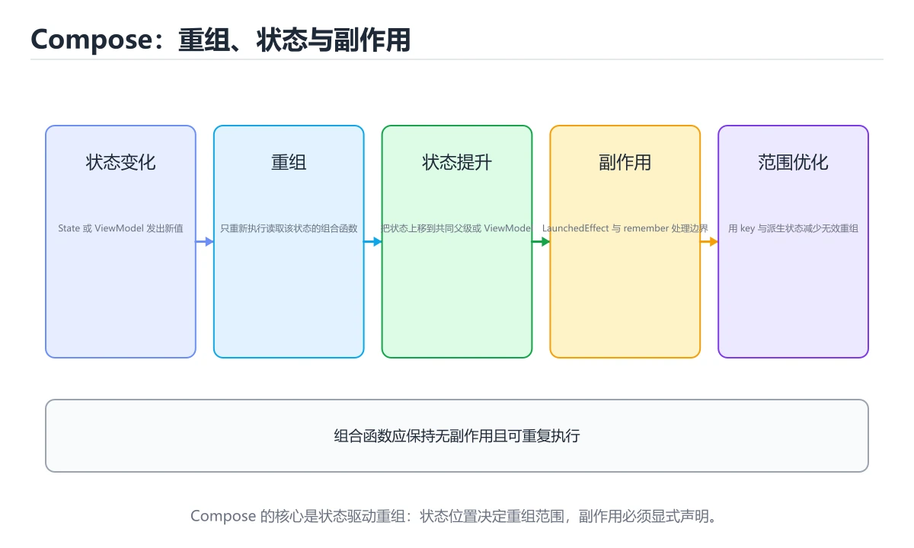

# Jetpack Compose 声明式 UI

> 内容更新时间：2026-10-06 · 学习阶段：intermediate · 预计用时：45 分钟



## 本节知识框架

这节课我们来聊 Jetpack Compose 的核心玩法。简单来说，Compose 是 Android 上用来画界面的新方式——你不再写 XML 布局文件，而是用 Kotlin 函数直接描述界面长什么样。

主线就三个关键词：重组机制、状态提升、副作用管理。搞懂这三件事，Compose 就算入门了。

**学完这节课你应该能做到：**
- 用自己的话说清楚什么是 Composable、什么是状态提升，各举一个例子
- 跑通课里的示例代码，改一个变量看看界面怎么变
- 遇到"界面重复请求数据"这类问题，知道该去哪里修

**先修要求：** 建议先学过《React Native 跨平台开发》，里面提到的 Hooks 和原生模块概念会在这节课里用到。后续可以衔接《鸿蒙 ArkTS 应用开发》。

### 复习清单

- [ ] 能不看正文说出 Composable、状态提升、重组、单向数据流、修饰符这五个术语的意思，并各举一个反例
- [ ] 能运行或推演课里的 Kotlin 示例，记录输入、输出和出错时的现象
- [ ] 能完成下面的自测题，把错题对照常见误区表定位原因
- [ ] 能说出 LaunchedEffect 和 DisposableEffect 分别用在什么场景

## 核心概念定义

先过一遍关键术语，后面讲原理和写代码时会反复出现。

| 术语 | 一句话说明 |
| --- | --- |
| Composable（可组合函数） | 用 @Composable 标注的函数，职责就是描述"给定状态，界面长什么样" |
| 重组（Recomposition） | 状态变了之后，Compose 只重新执行受影响的那几个 Composable，而不是把整棵界面树重画一遍 |
| 状态提升（State Hoisting） | 把状态从子组件挪到共同父级，让数据单向流动，子组件只负责展示，这样更好复用和测试 |
| 单向数据流 | 状态往下传、事件往上抛，界面不直接修改数据源，方便推理和调试 |
| 修饰符（Modifier） | 给组件加样式、尺寸、点击事件等，顺序不同效果完全不同 |
| 副作用（Side Effect） | 在组合过程之外要做的事情，比如发网络请求、注册监听器，要用 LaunchedEffect 等 API 来管理 |

## 原理与运行机制

### 一句话理解 Compose

Compose 的核心思想就是：**UI = f(状态)**。状态变了，界面自动更新，你不需要手动去找控件改内容。

打个比方：你画一幅画，画的内容取决于你手里的颜料（状态）。颜料换了，画自动跟着变，你不用把整幅画撕了重画——只需要改用了这种颜料的那几笔就行了。这就是重组。

### 重组是怎么工作的

1. 你用 `mutableStateOf` 创建了一个可观察的状态
2. 某个 Composable 函数读到了这个状态
3. 状态发生变化
4. Compose 找到所有读到了这个状态的 Composable，只重新执行它们
5. 界面局部更新，其他部分不动

关键点：重组是按"作用域"来的。如果一个 Composable 没读到变化的状态，它就不会被重新执行。这就是为什么我们说"缩小重组范围"是性能优化的核心。

### 状态提升的流程

假设你有一个输入框和一个按钮在同一个界面里：

1. 输入框需要记住用户输入的文字 → 这是状态
2. 按钮需要读到这段文字才能提交 → 状态不能只放在输入框内部
3. 把状态提到它们共同的父组件里 → 这就是状态提升
4. 输入框变成"无状态组件"：接收文字、接收回调、只管展示
5. 父组件持有状态，决定怎么处理事件

好处很明显：输入框可以在别的地方复用，测试的时候也不需要关心状态从哪来。

### 副作用管理

Compose 的 Composable 函数理论上应该只做"描述界面"的事。如果你要发网络请求、注册监听器、写数据库，这些"动手"的事情要放在副作用 API 里：

- `LaunchedEffect(key)`：进入组合或 key 变化时执行一次挂起逻辑
- `DisposableEffect(key)`：需要成对注册和注销的逻辑，比如监听器
- `remember`：在重组之间记住一个值，避免每次都重新计算

## 典型应用场景

**场景一：页面加载数据**
典型现象：把网络请求直接写在 Composable 函数体里，结果每次重组都重新请求。
正确做法：用 `LaunchedEffect` 包一层，保证只执行一次。

**场景二：输入框状态**
典型现象：用普通 `var` 存输入内容，界面不更新。
正确做法：用 `mutableStateOf` 创建可观察状态。

**场景三：列表渲染**
典型现象：列表没给 key，增删元素后输入框内容错位。
正确做法：用 `items(list, key = { it.id })` 给每个元素一个稳定标识。

**场景四：样式不符合预期**
典型现象：Modifier 的顺序随便写，padding 和 background 的效果跟想象不一样。
正确做法：记住 Modifier 的顺序就是执行顺序，先写的先生效。

## 代码/协议/SQL 示例

### 最小可运行示例

先看一个最简单的 Composable，感受一下"用函数描述界面"：

```kotlin
@Composable
fun Greeting(name: String, modifier: Modifier = Modifier) {
    Text(
        text = "你好，$name！",
        modifier = modifier.padding(16.dp),
        style = MaterialTheme.typography.titleMedium,
    )
}

@Preview(showBackground = true)
@Composable
private fun GreetingPreview() {
    MyAppTheme { Greeting("小明") }
}
```

`@Preview` 可以在 Android Studio 里直接看效果，不用启动模拟器，开发效率很高。

### 状态提升示例

```kotlin
@Composable
fun Counter() {
    var count by rememberSaveable { mutableIntStateOf(0) }

    Column(Modifier.padding(16.dp)) {
        Text("计数：$count")
        Button(onClick = { count++ }) { Text("加一") }
    }
}

// 状态提升后：组件变成纯展示，状态由调用方管理
@Composable
fun CounterRow(count: Int, onIncrement: () -> Unit) {
    Row(verticalAlignment = Alignment.CenterVertically) {
        Text("计数：$count", Modifier.weight(1f))
        Button(onClick = onIncrement) { Text("加一") }
    }
}
```

### 完整的页面示例

下面这个例子展示了一个典型的列表页面，涵盖了状态订阅、副作用、列表渲染等核心用法：

```kotlin
@Composable
fun LessonScreen(viewModel: LessonViewModel, modifier: Modifier = Modifier) {
    val state by viewModel.state.collectAsStateWithLifecycle()

    LaunchedEffect(Unit) {
        viewModel.load()
    }

    Column(modifier = modifier.fillMaxSize().padding(16.dp)) {
        when {
            state.loading -> CircularProgressIndicator(
                Modifier.align(Alignment.CenterHorizontally)
            )
            state.error != null -> ErrorBanner(
                state.error!!,
                onRetry = viewModel::load
            )
            else -> LazyColumn(
                verticalArrangement = Arrangement.spacedBy(8.dp),
                contentPadding = PaddingValues(bottom = 24.dp),
            ) {
                items(state.items, key = { it.id }) { lesson ->
                    LessonCard(
                        title = lesson.title,
                        onClick = { viewModel.open(lesson.id) },
                    )
                }
            }
        }
    }
}

@Composable
private fun LessonCard(title: String, onClick: () -> Unit) {
    Card(onClick = onClick, modifier = Modifier.fillMaxWidth()) {
        Text(
            text = title,
            style = MaterialTheme.typography.titleMedium,
            maxLines = 1,
            overflow = TextOverflow.Ellipsis,
            modifier = Modifier.padding(16.dp),
        )
    }
}
```

注意看 `LaunchedEffect(Unit)` 这行——网络请求放在这里，而不是直接写在组合体中。这样重组的时候不会重复发请求。

### 副作用三个最常用 API

```kotlin
@Composable
fun UserScreen(userId: Long, viewModel: UserViewModel = viewModel()) {
    val state by viewModel.state.collectAsStateWithLifecycle()

    // 1. LaunchedEffect：进入组合或 key 变化时执行一次
    LaunchedEffect(userId) { viewModel.load(userId) }

    // 2. DisposableEffect：需要成对注册与注销
    DisposableEffect(Unit) {
        val listener = registerListener()
        onDispose { listener.unregister() }
    }

    // 3. remember：缓存计算结果，避免每次重组都重算
    val label = remember(state) { buildLabel(state) }

    Text(label)
}
```

### 布局与修饰符

```kotlin
Column(
    modifier = Modifier
        .fillMaxWidth()
        .padding(16.dp),
    verticalArrangement = Arrangement.spacedBy(8.dp),
) {
    Text("标题", style = MaterialTheme.typography.titleLarge)

    Row(
        modifier = Modifier.fillMaxWidth(),
        horizontalArrangement = Arrangement.SpaceBetween,
    ) {
        Text("说明", Modifier.weight(1f), maxLines = 2, overflow = TextOverflow.Ellipsis)
        Icon(Icons.Default.ChevronRight, contentDescription = null)
    }
}
```

### 常用 API 速查表

| 需求 | 写法 |
| --- | --- |
| 创建可观察状态 | `var x by remember { mutableStateOf(0) }` |
| 可观察列表 | `mutableStateListOf()` |
| 一次性副作用 | `LaunchedEffect(key) { }` |
| 成对注册注销 | `DisposableEffect(key) { onDispose { } }` |
| 懒加载列表 | `LazyColumn` / `LazyRow` / `LazyVerticalGrid` |
| 基础布局 | `Column`、`Row`、`Box`、`ConstraintLayout` |
| 修饰符链 | `Modifier.padding().fillMaxWidth().clip()` |
| 主题 | `MaterialTheme`、`ColorScheme`、`Typography` |
| 派生状态 | `derivedStateOf { }` |
| 跨旋转保留状态 | `rememberSaveable { }` |

## 时间/空间复杂度或性能分析

### Compose 的性能关注点

Compose 的性能核心在于"重组范围控制"。主要开销来自两个方面：重组次数过多、首屏渲染太慢。

### 怎么测量

1. 固定一个场景（比如列表页），记录基线帧时间
2. 把数据量提高一个数量级（比如从 50 条变成 5000 条），再测一次
3. 两次差值才是你真正需要关心的性能问题

### 常见性能陷阱

| 陷阱 | 为什么会慢 | 怎么修 |
| --- | --- | --- |
| 列表项里做重计算 | 每次重组都重新算一遍 | 用 `remember` 缓存结果 |
| 传可变集合给子组件 | Compose 无法判断参数没变，只能每次都重组 | 用不可变集合或 `@Stable` 标注 |
| 读取 LazyListState 滚动值 | 滚动时触发全量重组 | 用 `derivedStateOf` 包一层 |
| 参数不稳定 | Compose 无法跳过不必要的重组 | 数据类用 `@Immutable` 或 `@Stable` |
| 过度使用 derivedStateOf | 本身也有开销，不是免费的 | 只在真正频繁变化且计算量大时用 |

### 记住一条原则

先让代码跑起来、跑对，再去优化性能。过早优化是万恶之源——在 Compose 里尤其如此，因为重组机制本身已经帮你做了很多优化。

## 常见误区与易错点

| 错误 | 现象 | 修法 |
| --- | --- | --- |
| 在 Composable 函数体里直接发请求 | 每次重组都触发一次网络请求 | 放到 `LaunchedEffect` 里 |
| 用普通 var 存状态 | 值变了但界面不更新 | 用 `mutableStateOf` 或 `StateFlow` |
| 列表不写 key | 增删元素后输入框、选中状态错位 | `items(list, key = { it.id })` |
| Modifier 顺序随便写 | padding 和 background 效果跟预期不符 | 记住 Modifier 顺序就是执行顺序 |
| 在组合体里直接修改状态 | 无限重组，甚至崩溃 | 把状态修改移到 `LaunchedEffect` 或事件回调里 |
| 忘记写 onDispose | 监听器、定时器泄漏 | 用 `DisposableEffect` 配对注销 |
| 状态放太深 | 子组件之间无法共享，测试困难 | 状态提升到 ViewModel 或共同父组件 |
| 把 remember 当全局缓存 | 组件被移除后状态丢失，或意外保留 | 明确生命周期，必要时用 `rememberSaveable` 或提升状态 |
| 列表滚动卡顿 | 每次重组都创建新对象 | 用 `key`、`remember`、稳定数据类 |
| 在 Composable 里读布局信息 | 频繁触发重组 | 用 `Modifier.layout` 或 `derivedStateOf` |

## 与其他知识点的关系

### 和传统 View 体系的对比

| 维度 | View / XML | Compose |
| --- | --- | --- |
| 描述方式 | 命令式，手动找控件改内容 | 声明式，状态驱动自动更新 |
| 更新机制 | 手动调用 setText、setVisibility | 状态变化自动重组受影响的部分 |
| 测试方式 | 依赖 Espresso 查找 View ID | 直接用规则断言节点，不需要 ID |
| 动画 | 属性动画 ObjectAnimator | `animate*AsState`、`Transition` |
| 复用 | `<include>`、自定义 View | 可组合函数天然复用 |

### 先修与后续

- **先修**：《React Native 跨平台开发》。里面讲的 Hooks 思维和原生模块交互是这节课的基础。
- **后续**：《鸿蒙 ArkTS 应用开发》。ArkUI 的声明式写法和 Compose 思路非常像，学会一个另一个上手很快。

### 容易混淆的概念

**状态提升 vs Composable**：状态提升是一种"把状态往上挪"的设计模式；Composable 是用 @Composable 标注的函数，是构建界面的基本单元。前者是设计思路，后者是代码单元。

**重组 vs 重建**：重组只是重新执行受影响的 Composable 函数，不会销毁和重建整个界面树。如果你发现整个页面都在闪烁重绘，那多半是代码写错了，不是重组本身的锅。

**remember vs rememberSaveable**：`remember` 只在重组之间保留值，进程被杀就没了；`rememberSaveable` 连进程重建都能恢复（比如旋转屏幕、系统回收后恢复）。

## 自测题与参考答案

### 自测 1：概念复述

不看正文，用自己的话说出"状态提升"是什么意思，它和 Composable 有什么区别。

**参考答案**：状态提升是把状态从子组件挪到共同父级，让数据单向流动，子组件只负责展示。好处是组件更容易复用和测试。Composable 是用 @Composable 标注的函数，它是构建界面的基本单元。状态提升是一种设计模式，Composable 是代码结构。

### 自测 2：排错

你的 Composable 里直接写了一个网络请求，发现每次界面刷新都会重新请求。请问这是为什么？怎么修？

**参考答案**：因为 Composable 函数会在每次重组时被重新执行，直接写在里面的请求也会跟着重复执行。修复方法是用 `LaunchedEffect` 把请求包起来，这样只会在进入组合或 key 变化时执行一次。

### 自测 3：代码阅读

看课上的 LessonScreen 示例，说说它哪里体现了状态提升。如果把 `viewModel.load()` 从 `LaunchedEffect` 里移出来直接写在组合体中，会发生什么？

**参考答案**：状态体现在 `state` 由 ViewModel 持有，通过 `collectAsStateWithLifecycle()` 传给界面，界面只负责展示。如果把 `viewModel.load()` 移到组合体中，每次重组都会调用 load，导致重复请求。

### 自测 4：动手验证

把示例代码里的 `padding(16.dp)` 改成 `padding(0.dp)`，再改成 `padding(64.dp)`，分别观察界面变化。然后把 Modifier 链的顺序换一下（比如 `padding` 和 `fillMaxSize` 对调），看看效果有什么不同。

**参考答案**：padding 值越大，内容和边缘的距离越大。Modifier 顺序不同效果完全不同——`fillMaxSize().padding(16.dp)` 是先撑满再内缩，`padding(16.dp).fillMaxSize()` 是先留白再撑满，最终布局不一样。

### 自测 5：迁移应用

在你自己的项目里找一个有输入框和提交按钮的页面，用状态提升的思路重构一下。把输入框的状态提到父组件，让输入框变成无状态组件。

**参考答案**：重构后，父组件持有 `var text by remember { mutableStateOf("") }`，输入框接收 `value` 和 `onValueChange` 两个参数，按钮的 `onClick` 也在父组件里处理。输入框本身不持有任何状态，可以在别的页面直接复用。

## 考点精讲

### 考点 1

按“Jetpack Compose 声明式 UI”中 Compose、声明式UI、重组 的实践顺序，把四个步骤排成从准备到复盘的合理顺序。
A. 只改一个变量，记录边界与失败路径的变化
B. 固定版本与证据，把\"Jetpack Compose 声明式 UI\"的结论写成可复现记录
C. 先明确 Compose 的输入、输出与约束
D. 写出最小示例并核对 声明式UI 的基线结果

**答案：CABD**（正确顺序：C \→ D \→ A \→ B）

先搞清楚输入输出和约束条件，然后写一个最小示例跑通基线，接着只改一个变量观察变化，最后把结论固定下来写成可复现的记录。这就是从准备到复盘的完整流程。

### 考点 2

围绕“Jetpack Compose 声明式 UI”中的 Compose、声明式UI、重组，下列哪两项是本课强调的实践判断？
A. 把 声明式UI 的单次运行结果当成所有版本和规模都成立
B. 学习 Compose 时要同时说明输入、输出和失败路径，不能只看正常流程
C. 只要 Compose 的常规示例通过，就可以跳过边界与异常路径
D. 验证 声明式UI 时要固定版本并覆盖边界输入，结论才可复现

**答案：BD**

A 和 C 都是偷懒的做法——只看正常流程、只跑一次就下结论，这在工程实践中是不可靠的。B 和 D 才是正确的态度：要同时关注正常路径和失败路径，要固定版本、覆盖边界输入，结论才能复现。

### 考点 3

关于派生状态 derivedStateOf，说法正确的是？
A. 它会把状态写入持久存储
B. 它替代了所有 remember 用法
C. 它能减少因状态频繁变化导致的重组
D. 它只能用于列表滚动

**答案：C**

`derivedStateOf` 的作用是从其他状态推导出一个新值，并且只有当推导结果真正变化时才触发重组。比如你有一个列表和一个过滤关键词，用 `derivedStateOf` 可以只在过滤结果变化时才更新列表 UI，避免每次输入一个字母都全量重组。它不会写入持久存储，也不能替代 `remember`。

### 考点 4

状态提升（state hoisting）的主要目的是？
A. 让组件无状态、易于复用与测试
B. 替代 ViewModel
C. 提升渲染帧率
D. 减少内存占用

**答案：A**

状态提升的核心目的是让组件变成"纯展示"——不自己持有状态，所有数据都从外部传入。这样同一个组件可以在不同地方复用，测试的时候也不需要关心状态从哪来。它不是用来替代 ViewModel 的，ViewModel 仍然负责业务逻辑。

### 考点 5

下面哪种写法最容易造成无限重组？
A. 在 LaunchedEffect 中加载数据
B. 在 composable 函数体里直接修改状态
C. 用 remember 保存输入框内容
D. 用 key 渲染列表项

**答案：B**

如果在 Composable 函数体里直接修改状态（比如 `count++`），状态变化会触发重组，重组又会再次执行函数体，函数体又修改状态……形成死循环。正确做法是把状态修改放在事件回调（比如 `onClick`）或 `LaunchedEffect` 里。

### 考点 6

结合 `Jetpack Compose 声明式 UI` 中围绕 `状态提升` 的代码，哪一项说法与“重组机制、状态提升、副作用与重组范围优化。”一致？
A. 直接写在函数体里
B. 放在 Modifier 里
C. 放在 LaunchedEffect 中
D. 放在 remember 的初始化块里

**答案：C**

在 LessonScreen 的代码里，网络请求 `viewModel.load()` 被放在 `LaunchedEffect(Unit)` 中。这是因为副作用（比如发请求、注册监听器）不应该直接写在组合体里，否则每次重组都会重复执行。LaunchedEffect 保证只在进入组合或 key 变化时执行一次。


## 延伸阅读

想更直观地理解本课概念？推荐参阅以下图解专题：

- [图解内存布局：栈、堆与引用](visual_memory_layout.md)

## 术语速查

| 术语 | 一句话说明 |
| --- | --- |
| Composable | 用 @Composable 标注的函数，描述"给定状态，界面长什么样" |
| 重组 | 状态变化后 Compose 只重新执行受影响的可组合函数，而不是整棵界面树 |
| 状态提升 | 把状态从子组件提到共同父级，让数据单向流动，组件只负责展示 |
| 单向数据流 | 状态向下传、事件向上抛，界面不直接修改数据源 |
| 修饰符 | 给组件加样式和行为的链式调用，顺序不同效果完全不同 |
| 副作用 | 在组合过程之外执行的操作，用 LaunchedEffect、DisposableEffect 管理 |
| remember | 在重组之间记住一个值，避免每次重新计算 |
| derivedStateOf | 从其他状态推导新值，只在推导结果真正变化时触发重组 |

## 内容元数据

- 内容版本：v2.0
- 最后更新：2026-10-06
- 学习阶段：intermediate
- 适用环境：Android / Kotlin 1.9+ / Jetpack Compose 1.6+
- 内容来源：内置结构化课程与工程实践整理
- 相关主题：Compose、声明式UI、重组、状态提升、LazyColumn

## 参考资料与复核

- 最后复核：2026-10-04
- 下次复核：2027-08-10
- 复核范围：Compose 版本兼容、API 行为变更、性能最佳实践

| 参考资料 | 用途 |
| --- | --- |
| [Android 官方 Compose 教程](https://developer.android.com/courses/pathways/compose) | Composable、状态管理、副作用的系统学习 |
| [Jetpack Compose API 参考](https://developer.android.com/reference/kotlin/androidx/compose/runtime/package-summary) | 查阅 remember、LaunchedEffect 等 API 签名 |
| [Compose 性能优化指南](https://developer.android.com/jetpack/compose/performance) | 重组范围控制、稳定性标注、列表优化 |
