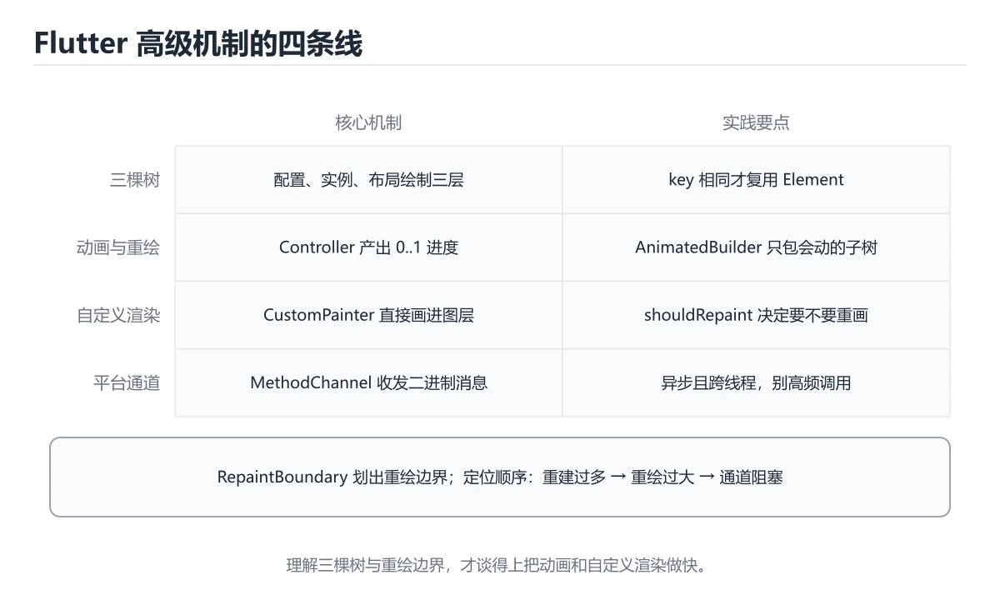

# Flutter高级主题（动画、自定义渲染、平台通道）



> 内容更新时间：2026-10-06 · 学习阶段：进阶 · 预计用时：40 分钟

## 本节知识框架

**课程定位**：分类「flutter」· 学习阶段 进阶 · 建议用时 50 分钟。

本课主线：掌握Implicit/Explicit动画、CustomPainter和Platform Channel通信。

### 复习清单

- [ ] 能不看正文复述本课核心术语，并指出一个边界或反例。
- [ ] 能运行或推演本课示例，记录输入、输出与失败现象。
- [ ] 能完成一次自测，并把错题对照考点精讲定位原因。

### 课程导言
本章带你深入Flutter的核心高级特性。就像学习驾驶普通汽车后，现在要掌握赛车技巧一样，我们将探索如何让应用动起来（动画）、如何画出独一无二的界面（自定义渲染），以及如何与原生系统对话（平台通道）。这些技能将把你从"能用Flutter"提升到"精通Flutter"的层次。

### 学习目标
学完本章后，你将能够：

1. 创建流畅复杂的隐式和显式动画效果
2. 使用CustomPainter绘制自定义图形和图表
3. 通过MethodChannel实现Dart与原生代码的双向通信
4. 理解Flutter渲染管线的工作原理和优化策略
5. 构建高性能的自定义Widget并处理手势交互
6. 集成原生平台特性如相机、传感器和本地存储

## 核心概念定义

| 术语 | 一句话说明 |
| --- | --- |
| Flutter | 用Dart一套代码构建双端界面的框架，本课高级主题聚焦其动画体系、Canvas自定义绘制以及与iOS/Android原生互调的通道。 |
| 动画 | 靠AnimationController逐帧驱动值变化：Tween给起止值，vsync接TickerProvider对齐刷新信号防撕裂，控制器必须在dispose释放。 |
| CustomPainter | 绕开Widget组合、直接在Canvas上逐笔画图的接口，`shouldRepaint`要精确比较变化属性，总返回true会引发多余重绘卡顿。 |
| Platform Channel | Dart与原生的通信桥：MethodChannel调方法、EventChannel收事件流，`invokeMethod`返回Future，iOS回调切主线程才能更新UI。 |
| 渲染 | Widget转成画面的一环一环：CustomPaint要给明确size否则图形变形，大列表逐帧重建要用RepaintBoundary隔离重绘区域。 |

## 原理与运行机制

《Flutter高级主题（动画、自定义渲染、平台通道）》正文各章按「输入是什么 → 中间如何转换 → 输出到哪 → 失败时怎样表现」四问展开；复习时给每个机制补一句自己的复述，再回到对应章节核对。

### 生活类比拆解
#### 动画：像翻书动画一样逐帧变化

想象小时候玩的翻书动画——每一页画一个小人，快速翻页时小人就动起来了。Flutter的动画也是这个原理：在极短时间内连续改变某个值（比如位置、颜色、大小），人眼就会感知为平滑的运动。AnimationController就是那只翻页的手，Tween定义了起始值和结束值，而AnimatedBuilder则是把每一帧画出来的画笔。

#### 自定义渲染：像画家在白布上作画

普通的Widget就像预制好的贴纸，直接拿来用就行。但当你需要画一个独特的图标、特殊的图表或者非标准的UI元素时，就需要CustomPainter这块"画布"了。Canvas是你的调色板和画笔，Paint是颜料的颜色和质感，Path是你勾勒的轮廓线。你可以精确控制每一个像素的呈现方式。

#### 平台通道：像翻译官连接两个说不同语言的人

Flutter的Dart代码运行在自己的引擎里，就像住在一个独立的小岛上。但有时候你需要访问手机的相机、GPS或者文件系统，这些能力都在"大陆"的原生系统里。Platform Channel就是你的渡船和翻译官：MethodChannel用来调用方法（"请帮我拍张照片"），EventChannel用来接收持续的事件流（"不断告诉我当前位置"），BasicMessageChannel用来传递简单消息。

## 典型应用场景

- 结合「Flutter高级主题（动画、自定义渲染、平台通道）」的常见落地场景与选型边界，详见正文各章节的对比讨论。
- 迁移到新项目时，先明确输入规模、失败代价与可观测手段，再决定采用深度。

## 代码/协议/SQL 示例

正文首个完整示例如下，先运行确认环境，再按正文步骤改一个输入观察输出变化。

```dart
import 'package:flutter/material.dart';

class FadeDemo extends StatefulWidget {
  @override
  _FadeDemoState createState() => _FadeDemoState();
}

class _FadeDemoState extends State<FadeDemo> with SingleTickerProviderStateMixin {
  late AnimationController _controller;
  late Animation<double> _fadeAnimation;

  @override
  void initState() {
    super.initState();
    _controller = AnimationController(
      duration: Duration(seconds: 2),
      vsync: this,
    );
    _fadeAnimation = Tween<double>(begin: 0.0, end: 1.0).animate(_controller);
    _controller.forward();
  }

  @override
  void dispose() {
    _controller.dispose();
    super.dispose();
  }

  @override
  Widget build(BuildContext context) {
    return Scaffold(
      appBar: AppBar(title: Text('淡入淡出演示')),
      body: Center(
        child: FadeTransition(
          opacity: _fadeAnimation,
          child: Container(
            width: 200,
            height: 200,
            color: Colors.blue,
          ),
        ),
      ),
    );
  }
}
```

### 渐进式代码示例
#### 最小示例：基础淡入淡出动画

```dart
import 'package:flutter/material.dart';

class FadeDemo extends StatefulWidget {
  @override
  _FadeDemoState createState() => _FadeDemoState();
}

class _FadeDemoState extends State<FadeDemo> with SingleTickerProviderStateMixin {
  late AnimationController _controller;
  late Animation<double> _fadeAnimation;

  @override
  void initState() {
    super.initState();
    _controller = AnimationController(
      duration: Duration(seconds: 2),
      vsync: this,
    );
    _fadeAnimation = Tween<double>(begin: 0.0, end: 1.0).animate(_controller);
    _controller.forward();
  }

  @override
  void dispose() {
    _controller.dispose();
    super.dispose();
  }

  @override
  Widget build(BuildContext context) {
    return Scaffold(
      appBar: AppBar(title: Text('淡入淡出演示')),
      body: Center(
        child: FadeTransition(
          opacity: _fadeAnimation,
          child: Container(
            width: 200,
            height: 200,
            color: Colors.blue,
          ),
        ),
      ),
    );
  }
}
```

#### 完整示例：自定义圆形进度条

```dart
import 'dart:math' as math;
import 'package:flutter/material.dart';

class CircularProgressPainter extends CustomPainter {
  final double progress;
  final Color backgroundColor;
  final Color progressColor;
  final double strokeWidth;

  CircularProgressPainter({
    required this.progress,
    this.backgroundColor = Colors.grey,
    this.progressColor = Colors.blue,
    this.strokeWidth = 10.0,
  });

  @override
  void paint(Canvas canvas, Size size) {
    final center = Offset(size.width / 2, size.height / 2);
    final radius = math.min(size.width, size.height) / 2 - strokeWidth / 2;

    // 绘制背景圆环
    final bgPaint = Paint()
      ..color = backgroundColor
      ..style = PaintingStyle.stroke
      ..strokeWidth = strokeWidth
      ..strokeCap = StrokeCap.round;
    canvas.drawCircle(center, radius, bgPaint);

    // 绘制进度圆弧
    final progressPaint = Paint()
      ..color = progressColor
      ..style = PaintingStyle.stroke
      ..strokeWidth = strokeWidth
      ..strokeCap = StrokeCap.round;

    final sweepAngle = 2 * math.pi * progress;
    canvas.drawArc(
      Rect.fromCircle(center: center, radius: radius),
      -math.pi / 2, // 从顶部开始
      sweepAngle,
      false,
      progressPaint,
    );

    // 绘制中心百分比文字
    final textPainter = TextPainter(
      text: TextSpan(
        text: '${(progress * 100).toInt()}%',
        style: TextStyle(
          fontSize: 24,
          fontWeight: FontWeight.bold,
          color: progressColor,
        ),
      ),
      textDirection: TextDirection.ltr,
    );
    textPainter.layout();
    final textOffset = Offset(
      center.dx - textPainter.width / 2,
      center.dy - textPainter.height / 2,
    );
    textPainter.paint(canvas, textOffset);
  }

  @override
  bool shouldRepaint(covariant CircularProgressPainter oldDelegate) {
    return oldDelegate.progress != progress ||
        oldDelegate.backgroundColor != backgroundColor ||
        oldDelegate.progressColor != progressColor;
  }
}

class CircularProgressDemo extends StatefulWidget {
  @override
  _CircularProgressDemoState createState() => _CircularProgressDemoState();
}

class _CircularProgressDemoState extends State<CircularProgressDemo>
    with SingleTickerProviderStateMixin {
  late AnimationController _controller;
  late Animation<double> _progressAnimation;

  @override
  void initState() {
    super.initState();
    _controller = AnimationController(
      duration: Duration(seconds: 3),
      vsync: this,
    );
    _progressAnimation = Tween<double>(begin: 0.0, end: 1.0).animate(
      CurvedAnimation(parent: _controller, curve: Curves.easeInOut),
    );
    _controller.repeat(reverse: true);
  }

  @override
  void dispose() {
    _controller.dispose();
    super.dispose();
  }

  @override
  Widget build(BuildContext context) {
    return Scaffold(
      appBar: AppBar(title: Text('自定义圆形进度条')),
      body: Center(
        child: AnimatedBuilder(
          animation: _progressAnimation,
          builder: (context, child) {
            return CustomPaint(
              size: Size(200, 200),
              painter: CircularProgressPainter(
                progress: _progressAnimation.value,
                progressColor: Colors.deepPurple,
              ),
            );
          },
        ),
      ),
    );
  }
}
```

#### 实践示例：平台通道获取电池电量

**Dart端代码：**

```dart
import 'package:flutter/material.dart';
import 'package:flutter/services.dart';

class BatteryInfoPage extends StatefulWidget {
  @override
  _BatteryInfoPageState createState() => _BatteryInfoPageState();
}

class _BatteryInfoPageState extends State<BatteryInfoPage> {
  static const MethodChannel _channel = MethodChannel('com.example/battery');
  
  double? _batteryLevel;
  String? _batteryStatus;
  bool _isLoading = false;

  Future<void> _getBatteryInfo() async {
    setState(() {
      _isLoading = true;
    });

    try {
      final Map<dynamic, dynamic> result = await _channel.invokeMethod('getBatteryInfo');
      setState(() {
        _batteryLevel = result['level'] as double?;
        _batteryStatus = result['status'] as String?;
        _isLoading = false;
      });
    } on PlatformException catch (e) {
      setState(() {
        _isLoading = false;
      });
      ScaffoldMessenger.of(context).showSnackBar(
        SnackBar(content: Text('获取电池信息失败: ${e.message}')),
      );
    }
  }

  @override
  Widget build(BuildContext context) {
    return Scaffold(
      appBar: AppBar(title: Text('电池信息')),
      body: Center(
        child: Column(
          mainAxisAlignment: MainAxisAlignment.center,
          children: [
            if (_isLoading)
              CircularProgressIndicator()
            else if (_batteryLevel != null)
              Column(
                children: [
                  Icon(
                    Icons.battery_full,
                    size: 64,
                    color: _batteryLevel! > 50 ? Colors.green : Colors.red,
                  ),
                  SizedBox(height: 16),
                  Text(
                    '电量: ${_batteryLevel!.toStringAsFixed(1)}%',
                    style: TextStyle(fontSize: 24, fontWeight: FontWeight.bold),
                  ),
                  SizedBox(height: 8),
                  Text(
                    '状态: $_batteryStatus',
                    style: TextStyle(fontSize: 18),
                  ),
                ],
              )
            else
              Text('点击按钮获取电池信息'),
            SizedBox(height: 24),
            ElevatedButton(
              onPressed: _getBatteryInfo,
              child: Text('获取电池信息'),
            ),
          ],
        ),
      ),
    );
  }
}
```

**Android端代码（Kotlin）：**

```kotlin
package com.example.myapp

import android.content.Context
import android.content.Intent
import android.content.IntentFilter
import android.os.BatteryManager
import io.flutter.embedding.android.FlutterActivity
import io.flutter.embedding.engine.FlutterEngine
import io.flutter.plugin.common.MethodChannel

class MainActivity: FlutterActivity() {
    private val CHANNEL = "com.example/battery"

    override fun configureFlutterEngine(flutterEngine: FlutterEngine) {
        super.configureFlutterEngine(flutterEngine)
        
        MethodChannel(flutterEngine.dartExecutor.binaryMessenger, CHANNEL).setMethodCallHandler { call, result ->
            when (call.method) {
                "getBatteryInfo" -> {
                    val batteryInfo = getBatteryInfo()
                    result.success(batteryInfo)
                }
                else -> {
                    result.notImplemented()
                }
            }
        }
    }

    private fun getBatteryInfo(): Map<String, Any> {
        val batteryManager = getSystemService(Context.BATTERY_SERVICE) as BatteryManager
        val level = batteryManager.getIntProperty(BatteryManager.BATTERY_PROPERTY_CAPACITY)
        
        val intent = registerReceiver(null, IntentFilter(Intent.ACTION_BATTERY_CHANGED))
        val status = when (intent?.getIntExtra(BatteryManager.EXTRA_STATUS, -1)) {
            BatteryManager.BATTERY_STATUS_CHARGING -> "充电中"
            BatteryManager.BATTERY_STATUS_DISCHARGING -> "放电中"
            BatteryManager.BATTERY_STATUS_FULL -> "已充满"
            else -> "未知"
        }
        
        return mapOf(
            "level" to level.toDouble(),
            "status" to status
        )
    }
}
```

**iOS端代码（Swift）：**

```swift
import UIKit
import Flutter

@UIApplicationMain
@objc class AppDelegate: FlutterAppDelegate {
    override func application(
        _ application: UIApplication,
        didFinishLaunchingWithOptions launchOptions: [UIApplication.LaunchOptionsKey: Any]?
    ) -> Bool {
        let controller : FlutterViewController = window?.rootViewController as! FlutterViewController
        let batteryChannel = FlutterMethodChannel(name: "com.example/battery",
                                                  binaryMessenger: controller.binaryMessenger)
        
        batteryChannel.setMethodCallHandler { [weak self] (call: FlutterMethodCall, result: @escaping FlutterResult) in
            guard call.method == "getBatteryInfo" else {
                result(FlutterMethodNotImplemented)
                return
            }
            
            self?.getBatteryInfo(result: result)
        }
        
        GeneratedPluginRegistrant.register(with: self)
        return super.application(application, didFinishLaunchingWithOptions: launchOptions)
    }
    
    private func getBatteryInfo(result: @escaping FlutterResult) {
        UIDevice.current.isBatteryMonitoringEnabled = true
        
        let level = Double(UIDevice.current.batteryLevel) * 100
        let status: String
        
        switch UIDevice.current.batteryState {
        case .charging:
            status = "充电中"
        case .unplugged:
            status = "放电中"
        case .full:
            status = "已充满"
        default:
            status = "未知"
        }
        
        result(["level": level, "status": status])
    }
}
```

## 时间/空间复杂度或性能分析

- 在《Flutter高级主题（动画、自定义渲染、平台通道）》里处理规模 n 时，先估计主循环与嵌套层数，再决定优化方向；小样本上的耗时读数不能外推。
- 性能结论要绑定输入分布：换数据规模、并发度或缓存命中情况后须重新测量。

## 常见误区与易错点

| 错误做法 | 典型现象 | 修复方向 |
| --- | --- | --- |
| 只验证正常输入 | 边界数据触发时才暴露问题 | 为每个结论补一个空值/极值/重复值用例 |
| 背结论不跑实验 | 换个输入就失效 | 按「预测—实测—差异归因」三步复盘 |
| 忽略环境与版本差异 | 本机可用线上报错 | 把版本、配置与依赖写入复现步骤 |

### 常见陷阱与解决方案
| 陷阱 | 表现 | 原因 | 解决方案 |
|------|------|------|----------|
| AnimationController未dispose | 内存泄漏警告 | 控制器持有Ticker资源 | 务必在dispose()中调用_controller.dispose() |
| vsync参数传错对象 | 动画不流畅或崩溃 | TickerProvider不匹配 | State类必须mix in SingleTickerProviderStateMixin或TickerProviderStateMixin |
| CustomPainter重绘过多 | 性能下降卡顿 | shouldRepaint总是返回true | 精确比较变化的属性，无变化时返回false |
| Canvas坐标系混淆 | 图形位置错误 | 忘记Canvas原点在左上角 | 记住(0,0)是左上角，x向右增加，y向下增加 |
| PlatformChannel线程问题 | iOS端崩溃 | 在主线程外更新UI | iOS的FlutterMethodCallHandler可能在后台线程，需用DispatchQueue.main.async |
| 方法名拼写不一致 | Dart调用失败 | Dart和原生端方法名不匹配 | 使用常量定义CHANNEL和方法名，避免硬编码字符串 |
| 动画曲线选择不当 | 动画感觉生硬 | 使用线性曲线Curves.linear | 根据场景选择Curves.easeInOut等自然曲线 |
| 大列表中使用复杂动画 | 滚动卡顿 | 每帧都重建大量Widget | 使用RepaintBoundary隔离重绘区域，或使用ListView.builder |
| CustomPainter尺寸不确定 | 图形变形 | 未指定CustomPaint的size | 给CustomPaint设置明确的size参数或使用LayoutBuilder获取可用空间 |
| 平台权限未处理 | 功能静默失败 | Android/iOS需要运行时权限 | 在调用原生功能前检查并请求相应权限 |

## 与其他知识点的关系

本课与分类「flutter」内相邻课程互为补充，建议按清单顺序学完再做综合练习。

## 自测题与参考答案

以下题目与题库同源，作答后再看解析；错误项要能说出错在哪一步。

## 考点精讲

### 考点 1

在Flutter中，AnimationController的vsync参数的作用是什么？

A. 控制动画播放速度  
B. 决定动画是否循环播放  
C. 设置动画的持续时间  
D. 防止屏幕撕裂，确保动画帧与屏幕刷新同步 ✅  

**正确答案：** D

**解析：** vsync参数接收一个TickerProvider，它的作用是确保动画的每一帧都与屏幕的垂直同步信号对齐。这样可以防止屏幕撕裂（tearing）现象，即画面的一部分显示旧帧而另一部分显示新帧。同时，当Widget不可见时（比如被导航到其他页面），vsync会自动暂停动画以节省资源。SingleTickerProviderStateMixin和TickerProviderStateMixin都实现了TickerProvider接口，可以传给vsync参数。

### 考点 2

关于CustomPainter的shouldRepaint方法，以下说法正确的是？

A. 返回true时会重新执行paint方法，返回false则跳过重绘 ✅  
B. 该方法可选，不实现也不会影响功能  
C. 应该总是返回true以确保画面最新  
D. 只在首次绘制时调用一次  

**正确答案：** A

**解析：** shouldRepaint方法是CustomPainter性能优化的关键。当Flutter决定是否需要重绘CustomPainter时，会调用此方法并传入旧的delegate实例。如果返回true，则会调用paint方法进行重绘；如果返回false，则复用上一帧的画面。因此，我们应该精确比较那些影响绘制的属性（如颜色、进度值等），只有在真正变化时才返回true。如果总是返回true，会导致不必要的重绘，降低性能；如果不实现此方法，默认行为可能不够优化。

### 考点 3

在Platform Channel通信中，MethodChannel.invokeMethod()返回的是什么类型？

A. String  
B. Map<String, dynamic>  
C. Future<dynamic> ✅  
D. void  

**正确答案：** C

**解析：** invokeMethod()是一个异步方法，返回Future<dynamic>。这是因为Dart调用原生代码需要跨越隔离边界，这是一个异步操作。实际返回值的类型取决于原生端的返回内容：可能是null、bool、int、double、String、List或Map。我们需要根据预期的返回类型进行适当的类型转换，例如`result['level'] as double?`。使用async/await语法可以更方便地处理这个Future。

### 考点 4

以下哪种情况最适合使用CustomPainter而不是组合现有Widget？

A. 显示一张网络图片  
B. 绘制一个带有渐变色的复杂统计图表 ✅  
C. 创建一个带圆角的按钮  
D. 显示一段富文本  

**正确答案：** B

**解析：** CustomPainter适用于需要精确控制每个像素绘制的场景，如自定义图表、特殊形状的图标、数据可视化等。选项A可以用Image.network解决；选项C可以用Container的decoration实现；选项D可以用RichText或flutter_html包。只有选项B涉及复杂的自定义绘制逻辑，用CustomPainter可以直接操作Canvas绘制坐标轴、柱状图、折线、标签等元素，比组合多个Widget更高效且灵活。

### 考点 5

在iOS平台上使用Platform Channel时，为什么需要注意线程问题？

A. FlutterMethodCallHandler可能在后台线程执行，但UI更新必须在主线程 ✅  
B. iOS不允许后台线程访问网络  
C. iOS的内存管理需要在特定线程进行  
D. Swift语言本身不支持多线程  

**正确答案：** A

**解析：** Flutter的Platform Channel机制中，Dart端的调用可能会在iOS的后台线程中被处理。然而，iOS的UIKit框架要求所有UI相关的操作必须在主线程执行。如果在后台线程尝试更新UI（比如修改UILabel的text），会导致未定义行为甚至崩溃。正确的做法是使用`DispatchQueue.main.async {}`将UI更新代码调度到主线程执行。Android方面，MethodChannel的回调通常也在主线程，但仍建议遵循最佳实践。

## 术语速查

| 术语 | 一句话说明 |
| --- | --- |
| Flutter | 谷歌开源的跨端UI框架，用Dart一套代码同时构建Android与iOS界面 |
| 动画 | 隐式动画改属性自动过渡，显式动画用控制器精确掌握每帧进度 |
| CustomPainter | 自定义绘制接口，重写paint方法后用Canvas逐笔绘出图表与异形轮廓 |
| Platform Channel | Dart与原生侧的通信桥，分方法调用、事件流和消息三类通道 |
| 渲染 | 把Widget树依次转换为Layer再交GPU合成的过程，决定帧率与卡顿 |

## 参考资料与复核

- 官方/权威资料：[Flutter 官方文档](https://docs.flutter.dev/)
- 主题延伸：[Flutter 动画概览](https://flutter.cn/docs/ui/animations)
- 最后复核：2026-10-04
- 下次复核：2026-10-10

## 内容元数据

- 内容更新时间：2026-10-06

- 内容版本：v2.0
- 课程标识：mobile_flutter_advanced
- 所属分类：flutter
- 学习阶段：进阶
- 建议用时：50 分钟
