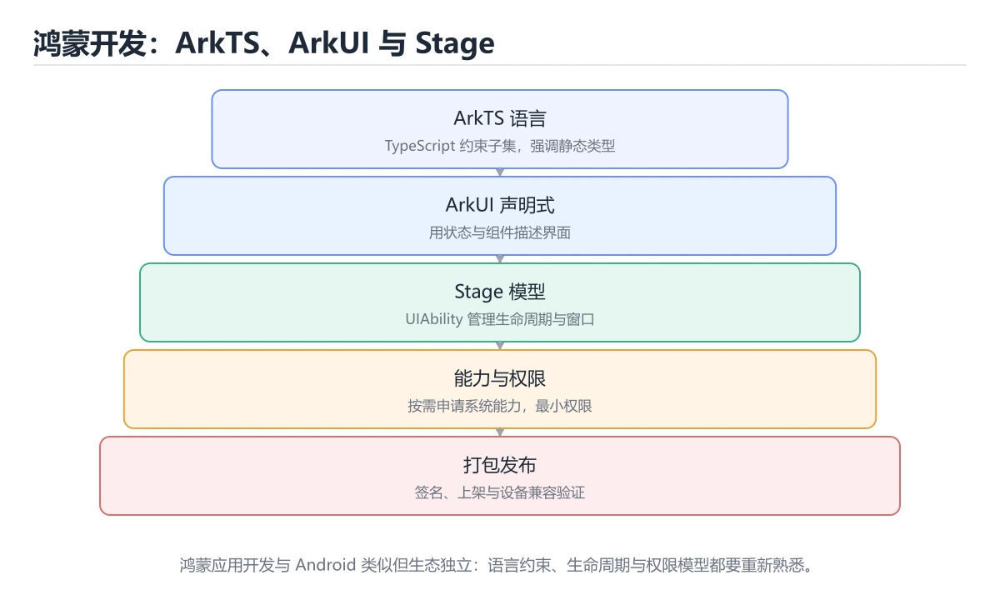
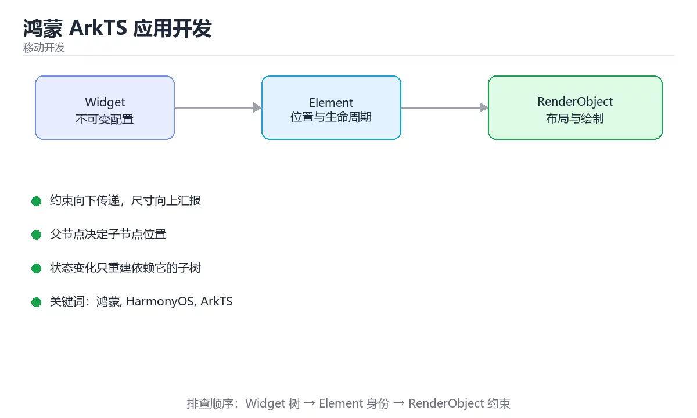

# 鸿蒙 ArkTS 应用开发

> 内容更新时间：2026-10-06 · 学习阶段：进阶 · 预计用时：30 分钟





## 本节知识框架

你有没有想过，鸿蒙（HarmonyOS）上的 App 是怎么写出来的？本课就来聊聊这件事。我们会围绕三件事展开：ArkTS 这门语言怎么用、ArkUI 怎么画界面、Stage 模型怎么组织应用。

**学完本课你能收获什么？**

- 用自己的话说清楚 Stage 模型、状态装饰器、ArkTS 分别是什么，还能各举一个用对的例子和一个踩坑的例子。
- 跑通本课的 TypeScript 示例，记录输入、输出和出错时的表现。
- 碰到「界面不刷新」这种经典问题时，能说出原因和修复步骤。

**先修内容**：建议先看过《Jetpack Compose 声明式 UI》，里面的「状态提升」和「可组合函数」概念会帮你更快上手。后续可以接着看《小程序开发要点》。

### 复习清单

- [ ] 能不看正文复述本课核心术语，并指出一个边界或反例。
- [ ] 能运行或推演本课示例，记录输入、输出与失败现象。
- [ ] 能完成一次自测，并把错题对照错误表定位原因。

## 核心概念定义

先来混个脸熟，这四个术语贯穿全课：

| 术语 | 一句话说明 |
| --- | --- |
| Stage 模型 | HarmonyOS 当前的应用模型，每个 UIAbility 是一个可以独立启动的入口，页面在它的窗口里组织。 |
| 状态装饰器 | 用 @State、@Prop、@Link 等标注数据的流向，状态一变界面就自动刷新。 |
| ArkTS | 鸿蒙的开发语言，基于 TypeScript 扩展，加了声明式 UI 和更严格的静态约束。 |
| UIAbility | 应用的能力单元，负责一个可启动的界面以及它的生命周期回调。 |

打个比方：Stage 模型就像一栋大楼的门禁系统，每个 UIAbility 是一个可以独立进出的大门；状态装饰器像是贴在变量上的便利贴，告诉系统「这个值变了，界面要跟着更新」；ArkTS 是你跟系统沟通用的语言；UIAbility 就是每扇大门的值班经理。

## 原理与运行机制

### 整体架构一览

鸿蒙应用的技术栈可以这样理解：

| 组成 | 说明 |
| --- | --- |
| ArkTS | 基于 TypeScript 扩展的语言，禁用部分动态特性以提升性能 |
| ArkUI | 声明式 UI 框架，写法与 Compose/SwiftUI 类似 |
| Stage 模型 | 当前主推的应用模型，UIAbility 承载界面 |
| UIAbility | 应用组件，对应一个可启动的界面能力 |
| HAP / HSP | 模块包，HAP 为部署单元，HSP 为共享包 |
| AppGallery Connect | 上架、分发与测试服务 |

如果你之前学过 Android，可以对照这张表来理解：

| 对比维度 | Android | HarmonyOS |
| --- | --- | --- |
| 开发语言 | Kotlin / Java | ArkTS |
| UI 框架 | Compose / XML | ArkUI 声明式 |
| 入口组件 | Activity | UIAbility |
| 部署包 | APK / AAB | HAP / App Pack |
| 权限声明 | AndroidManifest | module.json5 |

### 用生活比喻理解核心概念

| 概念 | 比喻 | 说明 |
| --- | --- | --- |
| ArkTS | 带类型检查的安全版 TS | 语法近似 TypeScript，但更严格 |
| ArkUI | 声明式画布 | 用代码描述你想要的界面样子 |
| 装饰器 | 贴标签 | @State、@Prop 标明数据角色 |
| Ability | 应用的一个能力入口 | UIAbility 对应一个界面容器 |
| 页面路由 | 导航员 | 页面之间跳转与传参 |

### 声明式 UI 是怎么回事？

鸿蒙应用用 ArkTS（TypeScript 的超集）编写，界面用 ArkUI 声明式语法描述。核心思想和 Compose、SwiftUI 一样：**状态驱动界面**，改了状态就自动刷新，不用手动去操作 UI。

这就好比你有一份购物清单（状态），每次清单变了，机器人自动帮你把购物车里的东西更新好，你不需要自己去一件件添加或删除。

## 典型应用场景

来看看实际开发中常见的场景和对应的做法：

- **用普通变量存状态**：典型现象是界面不刷新。正确做法是用 `@State` 装饰器标注这个变量。
- **修改对象内部属性**：典型现象是界面不更新。正确做法是用 `@Observed` 与 `@ObjectLink`。
- **文案写死在代码里**：典型现象是无法做多语言适配。正确做法是把文案放到 `resources` 目录。
- **忽略 `onBackground`**：典型现象是应用退到后台仍在轮询耗电。正确做法是在 onBackground 回调里暂停任务。
- **列表项缺 key**：典型现象是刷新后列表状态错位。正确做法是给 ForEach 提供稳定的唯一 key。
- **把业务逻辑写在 `build()` 里**：典型现象是每次界面刷新都重复执行。正确做法是放到生命周期回调或 ViewModel 里。

## 代码/协议/SQL 示例

### 第一步：最小的计数器页面

先看一个最简单的例子，感受一下 ArkUI 的写法：

```typescript
@Entry
@Component
struct CounterPage {
  @State count: number = 0;

  build() {
    Column({ space: 12 }) {
      Text(`计数：${this.count}`)
        .fontSize(20)
        .fontWeight(FontWeight.Medium)

      Button('加一')
        .onClick(() => { this.count += 1; })
        .width('60%')
    }
    .padding(16)
    .width('100%')
    .height('100%')
    .justifyContent(FlexAlign.Center)
  }
}
```

| 关键点 | 说明 |
| --- | --- |
| `@Entry` | 标记为页面入口 |
| `@Component` | 标记为可复用组件 |
| `build()` | 描述界面结构的方法 |
| `@State` | 组件内部状态，变化时自动触发界面刷新 |

### 第二步：五个常用状态装饰器

| 装饰器 | 作用 | 数据流向 |
| --- | --- | --- |
| `@State` | 组件自己的状态 | 组件内部 |
| `@Prop` | 父传子的单向数据 | 父 -> 子 |
| `@Link` | 与父组件双向同步 | 双向 |
| `@Provide` / `@Consume` | 跨层共享 | 祖先 -> 后代 |
| `@Observed` / `@ObjectLink` | 观察对象内部变化 | 对象属性级 |

看看 @Prop 和 @Link 怎么用：

```typescript
@Component
struct Child {
  @Prop title: string;
  @Link count: number;

  build() {
    Row({ space: 8 }) {
      Text(this.title)
      Button('+1').onClick(() => { this.count += 1; })
    }
  }
}
```

记住一个要点：`@State` 只能观察第一层变化。如果对象内部的属性变了，要用 `@Observed` 与 `@ObjectLink` 才能触发刷新。

### 第三步：完整的列表页面示例

这是一个更接近真实项目的例子，展示了生命周期、异步加载和列表渲染：

```typescript
@Component
struct LessonList {
  @State lessons: Lesson[] = [];
  @State loading: boolean = false;

  aboutToAppear(): void {
    this.load();
  }

  async load(): Promise<void> {
    this.loading = true;
    try {
      this.lessons = await LessonRepository.fetch();
    } finally {
      this.loading = false;
    }
  }

  build() {
    Column({ space: 8 }) {
      if (this.loading) {
        LoadingProgress().width(48).height(48);
      } else {
        List({ space: 8 }) {
          ForEach(this.lessons, (lesson: Lesson) => {
            ListItem() {
              Text(lesson.title)
                .fontSize(16)
                .maxLines(1)
                .textOverflow({ overflow: TextOverflow.Ellipsis })
                .width('100%')
                .padding(16)
            }
          }, (lesson: Lesson) => lesson.id)
        }
        .layoutWeight(1)
      }
    }
    .width('100%')
    .height('100%')
    .padding(16)
  }
}
```

注意看 ForEach 的第二个参数 `(lesson: Lesson) => lesson.id`，这就是给每个列表项提供稳定唯一的 key，避免增删时界面错乱。

### 页面跳转与传参

```typescript
import { router } from '@kit.ArkUI';

router.pushUrl({
  url: 'pages/DetailPage',
  params: { id: 42, title: '订单详情' },
});

const params = router.getParams() as Record<string, Object>;
const id = params?.id as number;

router.back();
```

更推荐用 Navigation 组件管理多级页面与返回栈，功能比 router 更完整。

### 应用模型：Stage 模型的目录结构

```text
entry/
  src/main/ets/
    entryability/
    pages/
    components/
    model/
    viewmodel/
  resources/
```

| 目录 | 职责 |
| --- | --- |
| `entryability` | 应用启动、前台后台切换 |
| `pages` | 页面级组件 |
| `components` | 通用组件 |
| `viewmodel` | 状态与数据编排 |

### 生命周期要处理的四件事

```typescript
export default class EntryAbility extends UIAbility {
  onCreate() { /* 初始化资源 */ }
  onWindowStageCreate(windowStage: window.WindowStage) {
    windowStage.loadContent('pages/Index');
  }
  onForeground() { /* 恢复刷新 */ }
  onBackground() { /* 暂停轮询、保存草稿 */ }
}
```

| 时机 | 该做什么 |
| --- | --- |
| `onCreate` | 初始化全局资源 |
| `onWindowStageCreate` | 加载首页 |
| `onForeground` | 恢复定时器与刷新 |
| `onBackground` | 暂停任务、保存状态 |
| `onDestroy` | 释放资源 |

资源统一放 `resources` 目录：多语言与深色模式都靠它切换，不要在代码里写死文案。

## 时间/空间复杂度或性能分析

鸿蒙应用的性能关注点主要集中在三个方面：渲染帧时间、组件重建次数和首屏加载耗时。

**渲染性能**：ArkUI 的声明式写法会在状态变化时重建受影响的组件树。如果 build() 方法里逻辑太重，或者状态变化太频繁，帧时间就会飙高，用户会感到卡顿。

**列表性能**：ForEach 渲染长列表时，如果没有提供稳定的 key，框架可能无法精确复用节点，导致不必要的重建。数据量大时要考虑使用 LazyForEach 实现懒加载。

**并发与耗时任务**：把所有计算都放在 UI 线程会导致界面卡顿。鸿蒙提供了 TaskPool 和 Worker 来处理耗时任务，让 UI 线程保持流畅。

**实际测量建议**：先固定设备和输入跑一遍记录基线，再把数据规模提高一个量级复测。两次结果的差值才是你优化的依据。热重载模式和 release 构建的性能差距很大，要分开记录。

## 常见误区与易错点

新手最容易踩的坑都整理在这里了：

| 错误 | 现象 | 修法 |
| --- | --- | --- |
| 用普通变量存状态 | 界面不刷新 | 用 `@State` |
| 修改对象内部属性 | 界面不更新 | 用 `@Observed` 与 `@ObjectLink` |
| 文案写死在代码里 | 无法多语言 | 放 `resources` |
| 忽略 `onBackground` | 后台仍在轮询耗电 | 暂停任务 |
| 列表项缺 key | 刷新后状态错位 | 提供稳定 key |
| 把业务写在 `build()` 里 | 重复执行 | 放生命周期或 ViewModel |
| 不处理权限申请 | 功能静默失败 | 运行时申请并处理拒绝 |
| 忘记适配深色模式 | 界面刺眼 | 用资源颜色变量 |
| 在 `build()` 里发起请求 | 每次刷新都重复请求 | 放到 `aboutToAppear` 或事件回调 |
| UI 线程做耗时计算 | 界面卡顿 | 用 TaskPool / Worker |
| 直接用动态类型写法 | 编译报错 | 显式类型，遵循 ArkTS 约束 |
| 忽略多设备适配 | 大屏或折叠屏布局异常 | 用响应式断点与栅格布局 |

### 重点排错：用普通变量存状态

**症状**：你点了一个按钮，变量确实变了，但界面上显示的数字纹丝不动。

**原因**：ArkUI 不知道这个普通变量的变化需要触发界面刷新。只有被 @State 等装饰器标注的变量，系统才会监控它的变化。

**修复**：把 `count: number = 0` 改成 `@State count: number = 0`，问题就解决了。

### 重点排错：列表 ForEach 不给 key

**症状**：列表增删几项之后，点进去发现内容和显示对不上。

**原因**：ForEach 没有稳定的 key 来追踪每个节点，框架只能靠位置来匹配，增删后位置变了就错位了。

**修复**：给 ForEach 的第二个参数传入一个返回唯一业务 ID 的函数，比如 `(item: Item) => item.id`。

## 与其他知识点的关系

- **先修**：《Jetpack Compose 声明式 UI》。如果你学过 Compose 的状态提升和可组合函数，上手 ArkUI 会很快，思路非常相似。
- **相关或后续**：《小程序开发要点》。本课术语会在后续课程里继续使用。
- **术语归属**：Stage 模型、状态装饰器、ArkTS 的定义以本课为准，换到其他课程时先确认定义是否被改写。

## 自测题与参考答案

> 先独立作答，再对照参考答案。

### 自测 1（概念复述）

不看正文，写出 Stage 模型的定义，并说明它和状态装饰器的区别。

**参考答案**：Stage 模型是 HarmonyOS 的应用模型，每个 UIAbility 是一个可以独立启动的入口，页面在它的窗口里组织。状态装饰器则是用 @State、@Prop、@Link 标注数据的流向，决定状态变化如何触发界面刷新。一个管应用结构，一个管界面刷新。

### 自测 2（排错）

用普通变量存状态会出现什么现象？怎么修？

**参考答案**：现象是界面不刷新。正确做法是用 `@State` 装饰器标注这个变量。修复时先复现现象，再只改这一处，确认界面能正常刷新。

### 自测 3（代码阅读）

阅读本课的列表示例，说明 ForEach 的第二个参数起什么作用，去掉它会怎样。

**参考答案**：第二个参数是 key 生成函数，为每个列表项提供稳定唯一的标识。去掉后增删列表项时界面可能错位，因为框架无法准确追踪哪个节点对应哪条数据。

### 自测 4（动手验证）

把计数器示例里的 `@State` 去掉，观察现象，再加回来确认修复。

**参考答案**：去掉 @State 后，点击按钮计数值在内存中确实变了，但界面不刷新。加回 @State 后界面恢复正常。这说明 ArkUI 只监控被装饰器标注的变量。

### 自测 5（迁移）

如果要把本课的列表页面迁移到一个支持深色模式的项目里，需要注意哪些地方？

**参考答案**：文案要放到 resources 目录、颜色要用资源变量而不是硬编码、列表 ForEach 要提供稳定 key、耗时操作要放到 aboutToAppear 或 TaskPool 里。

## 考点精讲

本课题库共 6 道题，下面逐题给出题干、选项和答案。先自己作答，再核对。

### 考点 1

**题目**：围绕“鸿蒙 ArkTS 应用开发”中的 鸿蒙、HarmonyOS、ArkTS，下列哪两项是本课强调的实践判断？

A. 把 HarmonyOS 的单次运行结果当成所有版本和规模都成立
B. 学习 鸿蒙 时要同时说明输入、输出和失败路径，不能只看正常流程
C. 只要 鸿蒙 的常规示例通过，就可以跳过边界与异常路径
D. 验证 HarmonyOS 时要固定版本并覆盖边界输入，结论才可复现

**答案**：BD

**解析**：学习鸿蒙开发不能只看正常流程，还要关注失败路径和边界情况。验证结论时要固定版本和输入范围，这样别人才能复现你的结果。A 和 C 都是偷懒的做法，会把特定条件下的结论错误地推广到所有场景。

### 考点 2

**题目**：代码语言为 `typescript`，选自 `鸿蒙 ArkTS 应用开发` 的 `Stage 模型` 部分。课程问题为ArkTS 语言约束、ArkUI 声明式写法与 Stage 模型。哪一项描述与代码一致？

A. 调用了 `log()`
B. 调用了 `super()`
C. 调用了 `build()`
D. 调用了 `time()`

**答案**：C

**解析**：在 ArkUI 的组件结构体中，`build()` 方法是声明界面结构的核心方法。每个 @Component 标注的结构体都必须有 build() 方法来描述界面长什么样。log()、super()、time() 都不是 ArkUI 组件的必需调用。

### 考点 3

**题目**：在 ArkUI 中让界面随数据变化刷新，应该怎么做？

A. 用 @State 等状态装饰器声明数据
B. 手动调用重绘 API
C. 把数据放在全局常量里
D. 用普通成员变量保存数据

**答案**：A

**解析**：ArkUI 采用声明式 UI 范式，状态变化自动触发界面刷新，前提是你用 @State、@Prop、@Link 等装饰器正确标注了数据。不需要手动调重绘 API，普通变量和常量都不会触发刷新。

### 考点 4

**题目**：ForEach 渲染列表时必须注意什么？

A. 必须每次重建全部节点
B. 必须按索引作为 key
C. 必须禁用虚拟化
D. 必须提供稳定唯一的 key

**答案**：D

**解析**：ForEach 的第二个参数应该返回每个数据项的稳定唯一标识（比如业务 ID）。用索引作为 key 在增删操作时会导致错位，因为索引会变。每次重建全部节点则会影响性能。

### 考点 5

**题目**：耗时计算放在 UI 线程会怎样？如何解决？

A. 会自动并行执行
B. 无影响
C. 导致界面卡顿
D. 只影响启动速度

**答案**：C

**解析**：UI 线程负责界面渲染和用户交互响应。如果在这个线程上做耗时计算，界面就没空处理用户的触摸和动画，表现为卡顿甚至无响应。解决方案是使用 TaskPool 或 Worker 把耗时任务移到后台线程。

### 考点 6

**题目**：填空：补齐下面这段术语说明中的空缺。课程 `ArkTS 语言约束、ArkUI 声明式写法与 Stage 模型。`，这段说明是：`____`：HarmonyOS 的 TypeScript 系开发语言，在 TS 基础上加了声明式界面与静态约束。空缺处应填哪个术语？

**答案**：ArkTS

**解析**：这段描述说的就是 ArkTS 本身。ArkTS 是鸿蒙的开发语言，基于 TypeScript 扩展而来，增加了声明式 UI 能力和更严格的静态类型约束，禁用了一些 TypeScript 的动态特性来提升运行时性能。

## 术语速查

| 术语 | 一句话说明 |
| --- | --- |
| Stage 模型 | HarmonyOS 的应用模型，每个 UIAbility 是可独立启动的入口，页面在它的窗口里组织。 |
| 状态装饰器 | 用 @State、@Prop、@Link 标注数据的流向，决定状态变化如何触发界面刷新。 |
| ArkTS | HarmonyOS 的 TypeScript 系开发语言，在 TS 基础上加了声明式界面与静态约束。 |
| UIAbility | 应用的能力单元，负责一个可启动的界面以及它的生命周期回调。 |
| ArkUI | 鸿蒙的声明式 UI 框架，用代码描述界面，状态驱动刷新。 |
| ForEach | ArkUI 中用于渲染列表的组件，需要为每项提供稳定唯一的 key。 |

## 内容元数据

- 内容版本：v2.0
- 最后更新：2026-10-06
- 学习阶段：进阶
- 适用环境：HarmonyOS / DevEco Studio
- 内容来源：内置结构化课程与工程实践整理
- 相关主题：鸿蒙、HarmonyOS、ArkTS、ArkUI、UIAbility

## 参考资料与复核

- 最后复核：2026-10-04
- 下次复核：2027-08-10
- 复核范围：版本兼容、API 行为、安全建议与工程实践

| 参考资料 | 本课用途 |
| --- | --- |
| [HarmonyOS 开发者官网](https://developer.huawei.com/consumer/cn/harmonyos/) | 官方文档、API 参考与开发指南 |
| [ArkTS 语言基础](https://developer.huawei.com/consumer/cn/doc/harmonyos-guides/arkts-basic-syntax-overview) | ArkTS 语法、类型约束与声明式写法 |
| [ArkUI 框架概述](https://developer.huawei.com/consumer/cn/doc/harmonyos-guides/arkui-overview) | ArkUI 组件、状态管理与布局系统 |
| [Stage 模型概述](https://developer.huawei.com/consumer/cn/doc/harmonyos-guides/application-model-stage-overview) | UIAbility 生命周期与应用模型 |
