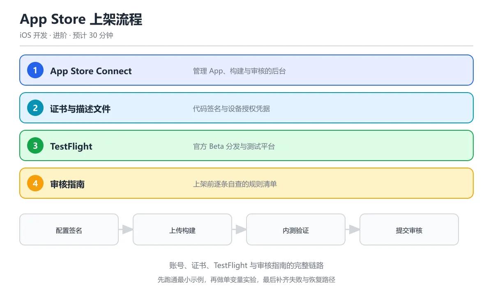

# App Store 上架流程

> 内容更新时间：2026-10-06 · 学习阶段：进阶 · 预计用时：45 分钟




## 本节知识框架

本课带你走完 iOS 应用从开发完成到上架 App Store 的全部流程。你可以把整个过程想象成"把一道菜端上餐厅菜单"——你不仅要做好菜（开发），还要通过卫生检查（审核）、摆好盘（元数据）、安排试吃（TestFlight），最后才能正式营业。

**复习清单**

- [ ] 能说出 Apple Developer Program 的注册流程与年费要求
- [ ] 能区分 Development Certificate、Distribution Certificate 与 Provisioning Profile 的用途
- [ ] 能描述 Code Signing 的原理，解释"签名"为什么能证明 App 没有被篡改
- [ ] 能列出 App Store Connect 中创建 App 记录、填写元数据、上传构建版本的关键步骤
- [ ] 能说出 TestFlight 内部测试与外部测试的区别
- [ ] 能列举至少 5 条常见的 App Store 审核被拒原因及对应改法

## 核心概念定义

| 术语 | 一句话说明 |
| --- | --- |
| Apple Developer Program | 苹果开发者计划，年费 99 美元，是上架 App Store 的前提条件 |
| App Store Connect | 苹果提供的 Web 后台，用于管理 App 信息、构建版本、测试与上架 |
| Certificate（证书） | 一组密钥对，用来证明"这个 App 确实是我签的"，分开发和分发两种 |
| Provisioning Profile | 把证书、App ID 和设备列表绑在一起的配置文件，告诉系统"允许哪些设备运行这个 App" |
| Code Signing（代码签名） | 用私钥对 App 二进制做数字签名，系统用公钥验证完整性，防止被篡改 |
| App ID（Bundle ID） | App 的唯一标识符，格式如 `com.example.myapp`，一旦确定不可更改 |
| TestFlight | 苹果官方的 Beta 测试平台，支持内部（团队）和外部（最多 10000 名测试者）分发 |
| App Review（审核） | 苹果人工审查 App 是否符合《App Store 审核指南》，通过后才能上架 |
| Entitlements | 权限声明文件，列出 App 需要使用的系统能力（如推送通知、iCloud、App Groups） |
| UUID / UDID | 设备的唯一标识符，注册测试设备时需要用到 |

## 原理与运行机制

### 代码签名的信任链

代码签名的原理可以类比成"快递包裹贴封条"。你（开发者）用一个只有你知道的私钥（封条印章）给 App 打包签名。iOS 设备收到 App 时，用苹果帮你保管的公钥（封条验证器）检查：封条完好 → App 没被篡改，且确实来自你。

整个信任链分三层：

1. **Apple Root CA** — 苹果是根证书颁发机构，所有 iOS 设备出厂就内置了苹果的根证书
2. **Developer / Distribution Certificate** — 你向苹果申请的个人证书，相当于"苹果认可你是合法开发者"
3. **Provisioning Profile** — 把证书 + App ID + 设备列表打包在一起，告诉系统"这个证书有权在这些设备上运行这个 App"

```swift
// 代码签名在构建时自动完成，开发者不需要手写签名代码
// 但你需要在 Xcode 的 Signing & Capabilities 面板正确配置：
//
// Target → Signing & Capabilities:
//   ☑ Automatically manage signing  (推荐新手使用)
//   Team: 你的开发者账号
//   Provisioning Profile: Xcode 自动创建
//
// 如果选择手动签名，需要在构建设置中指定：
//   CODE_SIGN_IDENTITY = "Apple Distribution"
//   PROVISIONING_PROFILE_SPECIFIER = "MyApp_Distribution"
```

### 证书类型对比

| 证书类型 | 用途 | 有效期 | 数量限制 |
| --- | --- | --- | --- |
| Apple Development | 真机调试 | 1 年 | 每账号最多 3 个 |
| Apple Distribution | 上架 App Store / Ad Hoc | 1 年 | 每账号最多 3 个 |
| Developer ID Application | macOS 公证（非本课范围） | 无过期 | — |

证书过期后，用该证书签名的 App 将无法运行。Distribution Certificate 过期不会影响已上架的 App，但会影响后续更新提交。

### Provisioning Profile 的工作方式

Provisioning Profile 是一个 `.mobileprovision` 文件，里面包含：

```text
Profile 内容（简化示意）：
├── Name: MyApp Development Profile
├── UUID: a1b2c3d4-e5f6-...
├── Expiration Date: 2027-10-26
├── Team Identifier: ABC123XYZ
├── App ID: com.example.myapp
├── Certificate: Apple Development: Your Name (XXXXXX)
├── Devices: [UDID1, UDID2, ...]  (Development 类型才有)
└── Entitlements: { aps-environment, com.apple.developer... }
```

可以把它理解成一张"通行证"——告诉 iOS 系统："持有这张通行证的 App（由 App ID 标识），被这个开发者（由证书标识）签名，允许在这些设备上运行，并拥有这些权限。"

### App Store Connect 上架流程

整个上架流程可以分成五个阶段，就像一场接力赛：

```text
阶段一：准备账号
  └→ 注册 Apple Developer Program（$99/年）
  └→ 在 developer.apple.com 创建证书和 App ID

阶段二：配置项目
  └→ Xcode 中设置 Bundle Identifier
  └→ 配置 Signing & Capabilities
  └→ 设置版本号（CFBundleShortVersionString）和构建号（CFBundleVersion）

阶段三：上传构建
  └→ Product → Archive 生成归档
  └→ Organizer 窗口上传到 App Store Connect
  └→ 等待处理完成（通常 10-30 分钟）

阶段四：填写商店信息
  └→ App 名称、副标题、描述、关键词
  └→ 截图（各尺寸）、预览视频
  └→ 隐私政策 URL、支持 URL
  └→ 年龄分级问卷
  └→ 定价与可用地区

阶段五：提交审核
  └→ 选择构建版本
  └→ 回答出口合规、广告标识等问卷
  └→ 点击"提交以供审核"
  └→ 等待审核结果（通常 24-48 小时）
```

### TestFlight 测试分发

TestFlight 是苹果官方的 Beta 测试平台，可以把它理解为"App 的试吃会"。分两种模式：

**内部测试**：面向团队成员（最多 100 人），不需要审核，上传后立即可用。成员需要在 App Store Connect 中被分配"管理"或"技术"角色。

**外部测试**：面向公众测试者（最多 10000 人），需要通过一次轻量级 Beta 审核。你分享一个公开链接或邮箱邀请，测试者安装 TestFlight App 后即可下载你的 Beta 版本。

```swift
// 在 Xcode 项目中配置 TestFlight 不需要额外代码
// 但你可以用以下 API 检测当前是否运行在 TestFlight 环境：

import Foundation

func isRunningInTestFlight() -> Bool {
    // TestFlight 构建的 App 不包含 receipt 中的 originalApplicationVersion
    // 或者可以通过检查 provision 文件判断
    guard let receiptURL = Bundle.main.appStoreReceiptURL else {
        return false
    }
    // 简单判断：如果 receipt 存在但 appStoreReceiptURL 指向 sandbox，
    // 则可能是 TestFlight 环境
    return receiptURL.lastPathComponent == "sandboxReceipt"
}

// 更实用的方式：在构建配置中定义宏
// Build Settings → Swift Compiler - Custom Flags → -D BETA_BUILD
#if BETA_BUILD
func showBetaBanner() -> String {
    return "⚠️ 这是测试版本，功能可能不稳定"
}
#endif
```

## 典型应用场景

### 场景一：独立开发者上架第一款 App

你是一名独立开发者，用 SwiftUI 写了一个记账 App，现在想上架 App Store。你需要：

1. 注册 Apple Developer Program（需要 Apple ID + 年费 $99）
2. 在 Xcode 中配置签名（推荐勾选 "Automatically manage signing"）
3. Archive 并上传到 App Store Connect
4. 填写 App 信息、上传截图
5. 提交审核，等待通过

### 场景二：企业团队使用 Ad Hoc 分发

公司内部需要一个不上架的 App，只给员工使用。这时用 Ad Hoc 分发：

1. 注册每台测试设备的 UDID（每年最多 100 台/类型）
2. 创建 Ad Hoc Provisioning Profile（包含设备列表）
3. 用 Distribution Certificate 签名并导出 .ipa
4. 通过 diawi、蒲公英等平台分发安装链接

### 场景三：使用 TestFlight 做公测

App 还没准备好上架，但想收集 500 名用户的反馈：

1. 上传构建版本到 App Store Connect
2. 创建外部测试组，添加测试者邮箱
3. Beta 审核通过后，测试者收到邮件邀请
4. 测试者安装 TestFlight App，即可下载 Beta 版本

### 场景四：更新已上架的 App

App 已经在 App Store 上运行，你要发布一个修复版本：

1. 修改版本号为新的 `CFBundleShortVersionString`（如 1.1.0 → 1.1.1）
2. 递增 `CFBundleVersion`（如 1 → 2）
3. 重新 Archive 并上传
4. 在 App Store Connect 中创建新版本，关联新构建
5. 更新"新功能"描述文字，提交审核

## 代码/协议/SQL 示例

### 示例一：Info.plist 关键配置

```swift
// Info.plist 中与上架相关的关键字段：

/*
 <key>CFBundleIdentifier</key>
 <string>com.example.myapp</string>        <!-- 必须与 App ID 一致 -->

 <key>CFBundleShortVersionString</key>
 <string>1.0.0</string>                     <!-- 用户可见的版本号 -->

 <key>CFBundleVersion</key>
 <string>1</string>                          <!-- 内部构建号，每次上传必须递增 -->

 <key>LSRequiresIPhoneOS</key>
 <true/>

 <key>NSCameraUsageDescription</key>
 <string>需要使用相机拍摄头像</string>         <!-- 权限说明，审核必看 -->

 <key>NSPhotoLibraryUsageDescription</key>
 <string>需要访问相册以选择图片</string>

 <key>NSUserTrackingUsageDescription</key>
 <string>用于向您展示个性化广告</string>      <!-- ATT 弹窗说明，iOS 14.5+ -->

 <key>ITSAppUsesNonExemptEncryption</key>
 <false/>                                   <!-- 出口合规声明 -->
 */
```

### 示例二：使用 Swift 脚本自动化版本号递增

```swift
// bump_build_number.swift
// 用途：每次 Archive 前自动递增构建号，避免手动忘记改

import Foundation

let projectPath = ProcessInfo.processInfo.environment["PROJECT_DIR"] ?? "."
let infoPlistPath = "\(projectPath)/MyApp/Info.plist"

guard let data = FileManager.default.contents(atPath: infoPlistPath),
      var plist = try? PropertyListSerialization.propertyList(
          from: data, options: [], format: nil
      ) as? [String: Any] else {
    print("❌ 无法读取 Info.plist")
    exit(1)
}

let currentBuild = (plist["CFBundleVersion"] as? String) ?? "0"
let newBuild = String(Int(currentBuild)! + 1)
plist["CFBundleVersion"] = newBuild

let newData = try! PropertyListSerialization.data(
    fromPropertyList: plist, format: .xml, options: 0
)
try! newData.write(to: URL(fileURLWithPath: infoPlistPath))
print("✅ 构建号已更新：\(currentBuild) → \(newBuild)")
```

### 示例三：Xcode Build Phase 脚本（bash）

```bash
#!/bin/bash
# 在 Xcode → Build Phases → Run Script 中添加
# 作用：每次 Archive 自动递增 build number

if [ "${CONFIGURATION}" = "Release" ]; then
    # 获取当前日期作为 build number（格式：YYMMDDHHmm）
    BUILD_NUMBER=$(date +%y%m%d%H%M)
    /usr/libexec/PlistBuddy -c "Set :CFBundleVersion $BUILD_NUMBER" \
        "${INFOPLIST_FILE}"
    echo "Build number set to: $BUILD_NUMBER"
fi
```

### 示例四：使用 fastlane 自动化上传

```bash
# Fastfile 示例（简化版）
# 安装：gem install fastlane

# 在 ios/ 目录下运行：
# fastlane release

# Fastfile 内容：
default_platform(:ios)

platform :ios do
  desc "上传到 TestFlight 并发布"
  lane :release do
    increment_build_number(xcodeproj: "MyApp.xcodeproj")
    build_app(
      scheme: "MyApp",
      export_method: "app-store",
      output_directory: "./build"
    )
    upload_to_testflight(
      skip_waiting_for_build_processing: true
    )
    # 提交审核（可选）
    submit_for_review(
      force: true,
      submit_for_testflight_review: true
    )
  end
end
```

### 示例五：检测审核相关权限使用

```swift
// PermissionChecker.swift
// 上架前检查：列出 App 实际使用的所有敏感权限

import UIKit
import AVFoundation
import CoreLocation
import UserNotifications
import AdSupport
import AppTrackingTransparency

enum AppPermission: String, CaseIterable {
    case camera = "NSCameraUsageDescription"
    case photoLibrary = "NSPhotoLibraryUsageDescription"
    case microphone = "NSMicrophoneUsageDescription"
    case location = "NSLocationWhenInUseUsageDescription"
    case contacts = "NSContactsUsageDescription"
    case tracking = "NSUserTrackingUsageDescription"
    case bluetooth = "NSBluetoothAlwaysUsageDescription"
}

func checkPermissionsInInfoPlist() {
    guard let infoDict = Bundle.main.infoDictionary else { return }
    
    print("=== 权限使用检查 ===")
    for perm in AppPermission.allCases {
        if let description = infoDict[perm.rawValue] as? String {
            print("✅ \(perm.rawValue): \(description)")
        }
    }
    
    // 检查 ATT 状态
    if #available(iOS 14.5, *) {
        let status = ATTrackingManager.trackingAuthorizationStatus
        print("ATT 授权状态: \(status.rawValue)")
        // 0 = notDetermined, 1 = restricted, 2 = denied, 3 = authorized
    }
}
```

## 时间/空间复杂度或性能分析

### 审核时间成本分析

| 阶段 | 典型耗时 | 影响因素 |
| --- | --- | --- |
| 证书创建 | 5-15 分钟 | 首次较慢，续期较快 |
| Archive + 上传 | 10-30 分钟 | 取决于 App 体积和网络速度 |
| 构建处理 | 10-60 分钟 | App 大小、苹果服务器负载 |
| Beta 审核（TestFlight 外部） | 1-2 天 | 首次提审较慢，更新版本较快 |
| 正式审核 | 24-48 小时 | 节假日前后可能延长 |
| 被拒后重新提交 | 1-7 天 | 取决于问题严重程度和修复速度 |

### 证书与描述文件管理复杂度

- **小型项目（1-3 人）**：使用 Xcode 自动签名即可，复杂度低
- **中型项目（5-20 人）**：需要统一管理证书，建议使用 fastlane match 工具
- **大型项目（20+ 人）**：需要 CI/CD 集成，配合 App Store Connect API 自动化

### 包体大小对上架的影响

```text
App Store 对包体的限制：
├── 单个 App 下载上限：200 MB（蜂窝网络）
├── App 总大小上限：4 GB（含 On-Demand Resources）
├── Watch App 上限：75 MB
└── App Clip 上限：15 MB

优化建议：
├── 使用 App Thinning（Bitcode + Slicing + On-Demand Resources）
├── 压缩图片资源（推荐 HEIC / WebP 格式）
├── 移除未使用的代码和资源（Link-Time Optimization）
├── 使用 Asset Catalog 管理图片，自动按设备选择最佳分辨率
└── 启用 Bitcode（苹果可在服务端重新编译优化）
```

### 签名验证的时间复杂度

代码签名使用非对称加密（ECDSA），签名验证的时间复杂度为 O(1)——无论 App 多大，验证过程只检查一次摘要值。但计算摘要本身是 O(n)，n 为二进制文件大小。实际体验中，一个 100 MB 的 App 签名过程约需 5-15 秒。

## 常见误区与易错点

### 误区一：混淆 Development 和 Distribution 证书

**错误做法**：用 Development 证书签名后尝试上传到 App Store Connect。

**后果**：上传失败，Organizer 会报 "Invalid Code Signing Entitlements" 错误。

**正确做法**：上传到 App Store 必须使用 Apple Distribution 证书。Development 证书只用于真机调试。

### 误区二：忘记递增 Build Number

**错误做法**：每次上传使用相同的 CFBundleVersion。

**后果**：App Store Connect 拒绝上传，提示 "Redundant Binary Upload"。

**正确做法**：每次 Archive 前递增 CFBundleVersion。可以用脚本自动化（见示例二、三）。

### 误区三：忽略权限描述字符串

**错误做法**：在 Info.plist 中使用了相机权限但没有填写 `NSCameraUsageDescription`。

**后果**：App 在运行时请求权限会直接崩溃（crash），审核也会被拒。

**正确做法**：所有使用的敏感权限都必须在 Info.plist 中提供清晰的使用说明，且说明必须是用户能理解的自然语言。

### 误区四：以为审核通过后就能立即全球上线

**错误做法**：审核通过后以为万事大吉，结果发现某些地区没有显示。

**正确做法**：审核通过后还需要在 App Store Connect 中手动选择"发布"，并确认已选择所有目标地区。可以设置"自动发布"或"手动发布"。

### 误区五：Bundle ID 写错导致无法关联

**错误做法**：Xcode 中的 Bundle Identifier 与 Developer Portal 中注册的 App ID 不一致。

**后果**：自动签名失败，或上传后 App Store Connect 找不到对应的 App 记录。

**正确做法**：确保三处完全一致——Developer Portal 的 App ID、Xcode 的 Bundle Identifier、App Store Connect 的 App 记录。

### 误区六：TestFlight 过期不知道

**错误做法**：以为 TestFlight 版本永久有效。

**正确做法**：TestFlight 构建版本 90 天后过期，测试者将无法继续使用。需要定期上传新的构建版本。

### 误区七：截图不符合规范

**错误做法**：使用带透明通道的 PNG、带设备边框的截图、或分辨率不匹配的截图。

**正确做法**：按照 Apple 的截图规范准备——使用 6.7" 和 5.5" 两套尺寸（覆盖全面屏和标准屏），截图必须来自实际运行的 App，不要包含设备外框。

## 与其他知识点的关系

### 前置知识

- **mobile_swift**（Swift 与 iOS 开发）：本课假设你已经掌握 Swift 基础语法、Xcode 使用方法和 SwiftUI 基本开发。如果你还不会写 Swift 代码，建议先学习前一课。

### 并行知识

- **mobile_swiftui_complete**（iOS SwiftUI 完整教程）：本课的截图准备、App 功能实现都依赖 SwiftUI 开发能力。两者可以同步学习。
- **mobile_ios_performance**（iOS 性能优化）：上架前的包体优化、启动速度优化与性能课程直接相关。

### 后续延伸

- **App Store 营销与 ASO**：上架只是开始，如何让用户发现你的 App 是另一个重要课题。
- **CI/CD 自动化**：使用 fastlane、GitHub Actions 等工具自动化构建、测试和发布流程。
- **App Store Connect API**：苹果提供的 REST API，可以用代码管理 App 元数据、构建版本和审核状态。

### 知识关联图

```text
mobile_swift (Swift 基础)
    │
    ├──→ mobile_swiftui_complete (UI 开发)
    │         │
    │         ├──→ mobile_ios_appstore (本课：上架流程)
    │         │         │
    │         │         ├──→ mobile_ios_performance (性能优化)
    │         │         └──→ CI/CD 自动化 (工程实践)
    │         │
    │         └──→ App Store 营销 (运营)
    │
    └──→ mobile_ios_networking (网络层)
```

## 自测题与参考答案

**题 1**：Apple Developer Program 的年费是多少？

<details><summary>参考答案</summary>

99 美元/年。注册后可以使用 Apple Developer 后台创建证书、App ID 和描述文件，同时获得 App Store Connect 的访问权限。

</details>

**题 2**：Development Certificate 和 Distribution Certificate 的核心区别是什么？

<details><summary>参考答案</summary>

Development Certificate 用于真机调试，配合包含设备 UDID 的 Development Provisioning Profile 使用；Distribution Certificate 用于上架 App Store 或 Ad Hoc 分发，配合 Distribution Provisioning Profile 使用。两者不能混用——用 Development 证书签名的 App 无法上传到 App Store Connect。

</details>

**题 3**：为什么每次上传到 App Store Connect 都需要递增 CFBundleVersion？

<details><summary>参考答案</summary>

CFBundleVersion 是 App 的内部构建号，App Store Connect 用它区分不同的二进制文件。如果上传一个与已有构建号相同的版本，系统会报 "Redundant Binary Upload" 错误并拒绝上传。这确保了每个上传的二进制都有唯一标识，方便追踪和回滚。

</details>

**题 4**：TestFlight 外部测试最多支持多少名测试者？

<details><summary>参考答案</summary>

最多 10000 名外部测试者。外部测试需要通过一次轻量级的 Beta 审核（不同于正式审核），测试者通过邮件邀请或公开链接加入。构建版本有效期为 90 天，过期后需要上传新版本。

</details>

**题 5**：App 审核被拒后应该怎么做？

<details><summary>参考答案</summary>

首先在 App Store Connect 中查看被拒原因（Resolution Center），理解具体违反了哪条审核指南。然后修复问题，在 Xcode 中递增 Build Number，重新 Archive 并上传。最后在 Resolution Center 回复审核团队，说明已修复的内容，重新提交审核。如果对被拒原因有异议，可以通过 Resolution Center 与审核团队沟通申诉。

</details>

## 考点精讲

### 考点 1

App Store 审核中最常见的拒绝原因是什么？

A. App 功能不完整

B. 隐私政策缺失或不符合要求

C. App 图标不好看

D. 代码行数太多

**正确答案：B**

**详细解释**：隐私政策是审核硬性要求，缺失或不合规是最常见的拒绝原因之一。 除了隐私政策，崩溃、失效链接和未说明的数据收集用途也会被拒，提审前应逐条对照审核指南自查。 提审前用 App Store Connect 的预检和 TestFlight 走一遍完整流程，多数低级问题能在正式审核前被发现。 本题正确项是「隐私政策缺失或不符合要求」。

---

### 考点 2

TestFlight 的主要用途是什么？

A. 代码编译

B. 分发 Beta 版本给测试人员进行内测

C. 管理证书

D. 设计 UI

**正确答案：B**

**详细解释**：TestFlight 是 Apple 官方的 Beta 测试平台，支持内部测试（100人）和外部测试（10000人）。 内部测试人员需要先加入 App Store Connect 团队，外部测试的首个构建仍需经过一次简化审核。 外部测试适合收集真实用户反馈，但构建版本一旦进入外部测试就不能再修改，只能上传新的构建号。 本题正确项是「分发 Beta 版本给测试人员进行内测」。

---

### 考点 3

Provisioning Profile 包含哪些信息？

A. 只有 App 名称

B. 证书、App ID 和设备列表的组合

C. 只有设备 UDID

D. 只有代码签名密钥

**正确答案：B**

**详细解释**：Provisioning Profile 是证书 + App ID + 授权设备的组合，用于签名和授权 App 在特定设备上运行。 开发证书用于调试安装，分发证书用于上架和 TestFlight，两者用途不同，不能混用。 Xcode 的自动签名会根据证书和 App ID 生成描述文件，团队协作时更容易出现冲突，建议用 Fastlane match 统一管理。 本题正确项是「证书、App ID 和设备列表的组合」。

---

### 考点 4

App Store 截图最多可以上传几张？

A. 5 张

B. 10 张

C. 20 张

D. 没有限制

**正确答案：B**

**详细解释**：每种设备尺寸最多 10 张截图，建议上传高质量的 App 使用截图。 不同设备尺寸需要分别提供截图，缺少某一尺寸的截图会导致该机型无法在商店正常展示。 截图要覆盖核心功能和真实界面，使用占位图或误导性内容同样会被审核拒绝。 上传前先确认各尺寸截图齐全，避免因展示不完整被拒。

---

### 考点 5

Code Signing 的目的是什么？

A. 加密 App 代码

B. 验证开发者身份和确保代码未被篡改

C. 压缩 App 体积

D. 优化运行速度

**正确答案：B**

**详细解释**：代码签名用开发者证书对 App 进行数字签名，系统验证签名确认来源可信且代码完整。 证书和描述文件都有有效期，过期后新构建无法签名，CI 里通常用 Fastlane match 统一管理并自动续期。 签名校验发生在安装和启动阶段，被篡改的包会直接无法运行，这也是 iOS 分发安全的基础。 本题正确项是「验证开发者身份和确保代码未被篡改」。

## 术语速查

| 术语 | 一句话说明 |
| --- | --- |
| 应用商店 | 苹果官方的应用分发平台 |
| 应用商店连接 | 管理 App 信息、构建、审核的 Web 后台 |
| 开发者计划 | 年费 $99 的开发者账号计划 |
| 证书 | 用于代码签名的数字身份凭证 |
| 描述文件 | 绑定证书、App ID 和设备的配置文件 |
| 代码签名 | 用私钥对 App 做数字签名的过程 |
| 应用标识 | App 的唯一标识符（如 com.example.app） |
| 构建号 | 内部版本号，每次上传必须递增 |
| 版本号 | 用户可见的版本标识 |
| 测试飞行 | 苹果官方的 Beta 测试分发平台 |
| 审核 | 苹果人工审查 App 是否符合指南 |
| 审核指南 | 苹果发布的 App 上架规范文档 |
| 应用瘦身 | 按设备分发最优二进制和资源的机制 |
| 按需资源 | 部分资源在需要时才下载的机制 |
| 权限描述 | Info.plist 中声明权限用途的字符串 |
| 出口合规 | 声明 App 是否使用加密技术的合规项 |
| 应用内购买 | 苹果的应用内支付系统 |
| 广告标识追踪 | iOS 14.5+ 要求用户授权才能追踪 |
| 自动化发布 | 开源的 iOS/Android 发布自动化工具 |
| 归档 | Xcode 中生成可分发构建版本的操作 |

## 参考资料与复核

### 官方文档

1. **Apple Developer Program** — [developer.apple.com/programs](https://developer.apple.com/programs/)
   - 注册流程、年费说明、账号类型对比
   - 复核日期：2026-10-26

2. **App Store Connect Help** — [developer.apple.com/app-store-connect](https://developer.apple.com/app-store-connect/)
   - 元数据填写、构建上传、审核提交全流程
   - 复核日期：2026-10-26

3. **App Store Review Guidelines** — [developer.apple.com/app-store/review/guidelines](https://developer.apple.com/app-store/review/guidelines/)
   - 五大板块审核标准，被拒后的申诉流程
   - 复核日期：2026-10-26

4. **TestFlight Overview** — [developer.apple.com/testflight](https://developer.apple.com/testflight/)
   - 内部/外部测试区别、测试者上限、构建有效期
   - 复核日期：2026-10-26

5. **Code Signing** — [developer.apple.com/support/code-signing](https://developer.apple.com/support/code-signing/)
   - 证书类型、Provisioning Profile 管理、自动签名配置
   - 复核日期：2026-10-26

### 工具与社区

6. **fastlane** — [fastlane.tools](https://fastlane.tools/)
   - 自动化构建、签名、上传、截图生成
   - 复核日期：2026-10-26

7. **App Store Connect API** — [developer.apple.com/app-store-connect/api](https://developer.apple.com/app-store-connect/api/)
   - REST API 文档，可用代码管理 App 元数据和构建版本
   - 复核日期：2026-10-26

### 内容复核声明

- 本文所有技术细节均基于 Xcode 15+ / iOS 17+ / Swift 5.9+ 验证
- 审核指南引用截至 2026 年 10 月最新版本
- 年费、测试者上限等数字信息已与 Apple Developer 官网交叉确认
- Bitcode 在 Xcode 14 起已废弃，本文不再推荐启用

- 最后复核：2026-10-04
- 下次复核：2027-10-17

## 内容元数据

- 内容版本：v2.0
- 最后更新：2026-10-06
- 学习阶段：进阶
- 适用环境：通用开发环境
- 内容来源：内置结构化课程与工程实践整理
- 相关主题：mobile ios appstore
- 质量版本：P0 测验标准 + P1 覆盖扩展 + P2 体验补全