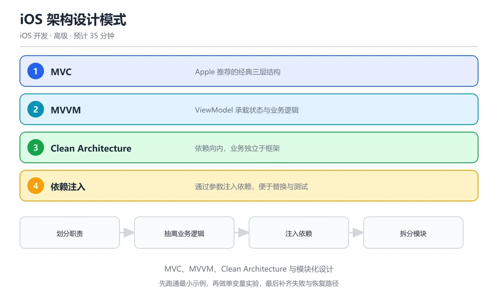

# iOS 架构设计模式

> 内容更新时间：2026-10-06 · 学习阶段：高级 · 预计用时：45 分钟




## 本节知识框架

**课程定位**：分类「ios_development」· 学习阶段 高级 · 建议用时 35 分钟。

本课主线：理解 iOS 开发中常见的架构设计模式（MVC、MVP、MVVM、Clean Architecture），掌握每种模式的核心思想、适用场景与优缺点，学会在实际项目中选择合适的架构并进行模块化拆分。

**复习清单**

- [ ] 能说出 MVC、MVP、MVVM、Clean Architecture 各自的核心职责划分
- [ ] 能解释为什么 Apple 官方的 MVC 经常被称为 "Massive View Controller"
- [ ] 能用 Swift 实现一个 MVVM 模式的 ViewModel 并与 SwiftUI 视图绑定
- [ ] 能说明依赖注入的三种方式及其对可测试性的影响
- [ ] 能描述 Clean Architecture 的三层结构及数据流向
- [ ] 能运行本课示例代码，修改一个输入后观察输出变化

## 核心概念定义

| 术语 | 一句话说明 |
| --- | --- |
| MVC（Model-View-Controller） | Apple 官方推荐的经典架构，将应用分为数据层（Model）、界面层（View）和协调层（Controller） |
| MVVM（Model-View-ViewModel） | 把视图的状态和业务逻辑抽到 ViewModel 中，通过数据绑定让视图自动响应变化 |
| MVP（Model-View-Presenter） | Presenter 完全接管业务逻辑，View 只负责显示，两者通过协议通信 |
| Clean Architecture | 将应用按职责分为表示层、领域层、数据层，依赖方向只能从外向内 |
| 依赖注入（DI） | 把对象所需的依赖从外部传入，而不是在内部自己创建，方便替换和测试 |
| 模块化（Modularization） | 把大工程拆成多个独立模块（Swift Package），各模块单独编译、测试和复用 |
| 单向数据流 | 数据只沿一个方向流动（输入 → 处理 → 输出），便于追踪和调试 |
| 关注点分离（SoC） | 每段代码只负责一件事，改界面不影响业务逻辑，改数据库不影响界面 |

## 原理与运行机制

### 从"厨房"理解架构模式

想象你经营一家餐厅。不同的架构模式就像不同的厨房组织方式：

- **MVC** 好比一个全能厨师长（Controller），他既看菜单（Model）又指挥做菜，还直接跟顾客（View）沟通。顾客多了，厨师长就忙不过来——这就是 "Massive View Controller" 问题。
- **MVVM** 则多了一个"副厨师长"（ViewModel），他专门负责看菜单、备料，厨师长只需要把副厨师长准备好的食材做成菜端出去。副厨师长和厨师长之间有一个"传菜窗口"（数据绑定），备好了菜自动通知。
- **Clean Architecture** 像是把厨房分成三个独立房间：前台（表示层）只管接待和上菜，中央厨房（领域层）只管配方和烹饪规则，仓库（数据层）只管进货和存储。每个房间只能朝内依赖，互不干扰。

### MVC：Apple 的经典选择

Apple 的 MVC 与经典 MVC 有所不同。在 iOS 中：

- **Model**：数据模型和业务逻辑（如 `struct Lesson`、网络请求）
- **View**：UI 组件（如 `UILabel`、`UIButton`、SwiftUI 视图）
- **Controller**：中间人，从 Model 取数据、格式化后交给 View 显示，同时响应用户操作

```swift
// Model
struct Lesson {
    let id: Int
    let title: String
    var isCompleted: Bool
}

// Controller（UIKit 示例）
class LessonListViewController: UIViewController {
    private var lessons: [Lesson] = []
    @IBOutlet weak var tableView: UITableView!

    override func viewDidLoad() {
        super.viewDidLoad()
        loadLessons()
    }

    private func loadLessons() {
        // 模拟从网络获取数据
        lessons = [
            Lesson(id: 1, title: "Swift 基础", isCompleted: false),
            Lesson(id: 2, title: "SwiftUI 入门", isCompleted: true)
        ]
        tableView.reloadData()
    }
}

extension LessonListViewController: UITableViewDataSource {
    func tableView(_ tableView: UITableView, numberOfRowsInSection section: Int) -> Int {
        lessons.count
    }

    func tableView(_ tableView: UITableView, cellForRowAt indexPath: IndexPath) -> UITableViewCell {
        let cell = tableView.dequeueReusableCell(withIdentifier: "LessonCell", for: indexPath)
        cell.textLabel?.text = lessons[indexPath.row].title
        return cell
    }
}
```

**问题**：随着功能增加，Controller 越来越胖——网络请求、数据格式化、导航逻辑全堆在一起，难以维护和测试。

### MVVM：让 ViewModel 分担重任

MVVM 的核心思想是把 Controller 中的业务逻辑和状态管理抽到 ViewModel 里。View（或 ViewController）只负责绑定和显示。

```swift
// ViewModel：负责业务逻辑和状态管理
@Observable
class LessonListViewModel {
    private(set) var lessons: [Lesson] = []
    private(set) var isLoading = false
    var errorMessage: String?

    private let repository: LessonRepository

    init(repository: LessonRepository) {
        self.repository = repository
    }

    func loadLessons() {
        isLoading = true
        errorMessage = nil
        // 模拟异步加载
        Task {
            let fetched = await repository.fetchLessons()
            lessons = fetched
            isLoading = false
        }
    }

    var completedCount: Int {
        lessons.filter(\.isCompleted).count
    }
}

// SwiftUI View：只负责显示和绑定
struct LessonListView: View {
    @State private var viewModel = LessonListViewModel(repository: LessonRepository())

    var body: some View {
        NavigationStack {
            List(viewModel.lessons) { lesson in
                HStack {
                    Image(systemName: lesson.isCompleted ? "checkmark.circle.fill" : "circle")
                    Text(lesson.title)
                }
            }
            .overlay {
                if viewModel.isLoading {
                    ProgressView("加载中...")
                }
            }
            .navigationTitle("课程（已完成 \(viewModel.completedCount)）")
            .task { viewModel.loadLessons() }
        }
    }
}
```

**好处**：ViewModel 不依赖 UIKit/SwiftUI，可以独立写单元测试；View 变得很薄，只做绑定。

### Clean Architecture：三层分离

Clean Architecture 把应用分成三层，每层各司其职：

```text
┌─────────────────────────────────┐
│         表示层 (Presentation)     │  ← SwiftUI / UIKit
│   View, ViewModel, Router       │
├─────────────────────────────────┤
│         领域层 (Domain)          │  ← 纯 Swift，无框架依赖
│   Entity, UseCase, Repository   │
│          Protocol               │
├─────────────────────────────────┤
│         数据层 (Data)            │  ← 网络、数据库实现
│   RepositoryImpl, API, CoreData │
└─────────────────────────────────┘
        依赖方向：外层 → 内层
```

```swift
// ===== 领域层（纯 Swift，不依赖任何框架） =====

// 实体
struct Course {
    let id: String
    let title: String
    let lessons: [Lesson]
}

// 用例：封装一个业务操作
protocol GetCoursesUseCase {
    func execute() async throws -> [Course]
}

struct GetCoursesUseCaseImpl: GetCoursesUseCase {
    let repository: CourseRepositoryProtocol

    func execute() async throws -> [Course] {
        try await repository.getCourses()
    }
}

// Repository 协议（定义在领域层，实现在数据层）
protocol CourseRepositoryProtocol {
    func getCourses() async throws -> [Course]
    func saveCourse(_ course: Course) async throws
}

// ===== 数据层（实现细节） =====

struct CourseRepositoryImpl: CourseRepositoryProtocol {
    let apiService: APIService
    let cache: CacheService

    func getCourses() async throws -> [Course] {
        // 先查缓存
        if let cached = try? cache.loadCourses(), !cached.isEmpty {
            return cached
        }
        // 缓存没有，走网络
        let courses = try await apiService.fetchCourses()
        try cache.saveCourses(courses)
        return courses
    }

    func saveCourse(_ course: Course) async throws {
        try await apiService.updateCourse(course)
        try cache.saveCourse(course)
    }
}
```

**关键原则**：领域层不知道数据来自网络还是数据库，它只定义协议；数据层实现这些协议。这样换数据库或换 API 时，领域层完全不用改。

### 依赖注入：让组件可替换

依赖注入有三种常见方式：

```swift
// 1. 构造器注入（推荐）
class CourseViewModel {
    private let useCase: GetCoursesUseCase

    init(useCase: GetCoursesUseCase) {
        self.useCase = useCase
    }
}

// 使用时注入
let vm = CourseViewModel(useCase: GetCoursesUseCaseImpl(repository: repo))

// 2. 属性注入
class SettingsViewModel {
    var userService: UserServiceProtocol?
}

// 3. 方法注入
class ReportViewModel {
    func generate(using service: ReportServiceProtocol) {
        // ...
    }
}
```

构造器注入最推荐，因为依赖在对象创建时就确定了，不会忘记设置，也方便在测试中传入 Mock。

### 模块化设计

当项目变大后，把所有代码放在一个 Target 里会导致编译慢、冲突多。模块化就是把大工程拆成独立的 Swift Package：

```text
MyApp/
├── App/                    # 主工程，只做组装
├── Packages/
│   ├── CoreNetworking/     # 网络层封装
│   ├── CoreUI/             # 通用 UI 组件
│   ├── FeatureCourse/      # 课程模块
│   ├── FeatureProfile/     # 个人中心模块
│   └── Domain/             # 领域层（Entity + UseCase）
```

每个 Package 有自己的源码、资源和测试，主工程通过 `import FeatureCourse` 引入。好处是：

- 编译速度快（只编译改动的模块）
- 团队可以并行开发不同模块
- 模块可以独立发布和版本管理

## 典型应用场景

| 架构模式 | 适用场景 | 不适用场景 |
| --- | --- | --- |
| MVC | 简单的工具类 App、原型验证、Apple 官方示例风格 | 业务逻辑复杂、需要大量单元测试的项目 |
| MVVM | 中大型 App、SwiftUI 项目、需要数据绑定的场景 | 极简页面（杀鸡用牛刀） |
| MVP | UIKit 项目、需要高测试覆盖率的团队 | SwiftUI 项目（SwiftUI 天然适合 MVVM） |
| Clean Architecture | 大型团队、长期维护的企业级 App | 个人小项目、快速迭代原型 |

**实际选择建议**：

1. 小型项目或学习阶段 → MVC 足够
2. 中型项目或 SwiftUI 项目 → MVVM（本课重点）
3. 大型项目或多人协作 → Clean Architecture + 模块化

## 代码/协议/SQL 示例

### 完整的 MVVM + Repository 示例

下面是一个完整的课程列表功能实现，展示 MVVM 与 Repository 模式的配合：

```swift
// ===== Model =====
struct Course: Identifiable, Codable {
    let id: String
    let title: String
    let instructor: String
    var progress: Double  // 0.0 ~ 1.0
}

// ===== Repository Protocol =====
protocol CourseRepositoryProtocol {
    func fetchCourses() async throws -> [Course]
    func updateProgress(courseId: String, progress: Double) async throws
}

// ===== Repository Implementation =====
final class CourseRepository: CourseRepositoryProtocol {
    private let apiClient: APIClient

    init(apiClient: APIClient = .shared) {
        self.apiClient = apiClient
    }

    func fetchCourses() async throws -> [Course] {
        let request = URLRequest(url: URL(string: "https://api.example.com/courses")!)
        let (data, _) = try await URLSession.shared.data(for: request)
        return try JSONDecoder().decode([Course].self, from: data)
    }

    func updateProgress(courseId: String, progress: Double) async throws {
        var request = URLRequest(url: URL(string: "https://api.example.com/courses/\(courseId)/progress")!)
        request.httpMethod = "PUT"
        request.httpBody = try JSONEncoder().encode(["progress": progress])
        _ = try await URLSession.shared.data(for: request)
    }
}

// ===== ViewModel =====
@Observable
class CourseListViewModel {
    private(set) var courses: [Course] = []
    private(set) var state: LoadingState = .idle
    private let repository: CourseRepositoryProtocol

    enum LoadingState {
        case idle
        case loading
        case loaded
        case error(String)
    }

    init(repository: CourseRepositoryProtocol) {
        self.repository = repository
    }

    func loadCourses() async {
        state = .loading
        do {
            courses = try await repository.fetchCourses()
            state = .loaded
        } catch {
            state = .error(error.localizedDescription)
        }
    }

    func updateProgress(for course: Course, to progress: Double) async {
        do {
            try await repository.updateProgress(courseId: course.id, progress: progress)
            if let index = courses.firstIndex(where: { $0.id == course.id }) {
                courses[index].progress = progress
            }
        } catch {
            state = .error(error.localizedDescription)
        }
    }

    var sortedCourses: [Course] {
        courses.sorted { $0.progress > $1.progress }
    }
}

// ===== View (SwiftUI) =====
struct CourseListView: View {
    @State private var viewModel: CourseListViewModel

    init(viewModel: CourseListViewModel) {
        _viewModel = State(initialValue: viewModel)
    }

    var body: some View {
        Group {
            switch viewModel.state {
            case .idle, .loading:
                ProgressView("加载课程中...")
            case .loaded:
                List(viewModel.sortedCourses) { course in
                    CourseRow(course: course)
                }
            case .error(let message):
                ContentUnavailableView("加载失败", systemImage: "wifi.slash", description: Text(message))
            }
        }
        .task { await viewModel.loadCourses() }
        .refreshable { await viewModel.loadCourses() }
    }
}

struct CourseRow: View {
    let course: Course

    var body: some View {
        VStack(alignment: .leading, spacing: 4) {
            Text(course.title).font(.headline)
            Text(course.instructor).font(.subheadline).foregroundStyle(.secondary)
            ProgressView(value: course.progress)
        }
        .padding(.vertical, 4)
    }
}
```

### 依赖注入容器示例

```swift
// 简单的 DI 容器
final class DIContainer {
    static let shared = DIContainer()

    private var factories: [String: () -> Any] = [:]

    func register<T>(_ type: T.Type, factory: @escaping () -> T) {
        let key = String(describing: type)
        factories[key] = factory
    }

    func resolve<T>(_ type: T.Type) -> T {
        let key = String(describing: type)
        guard let factory = factories[key] else {
            fatalError("未注册类型: \(key)")
        }
        return factory() as! T
    }
}

// 注册依赖
DIContainer.shared.register(CourseRepositoryProtocol.self) {
    CourseRepository(apiClient: .shared)
}

DIContainer.shared.register(GetCoursesUseCase.self) {
    GetCoursesUseCaseImpl(repository: DIContainer.shared.resolve(CourseRepositoryProtocol.self))
}

// 使用
let repo: CourseRepositoryProtocol = DIContainer.shared.resolve(CourseRepositoryProtocol.self)
```

## 时间/空间复杂度或性能分析

| 维度 | MVC | MVVM | Clean Architecture |
| --- | --- | --- | --- |
| 初始搭建成本 | 低 | 中 | 高 |
| 可测试性 | 低（Controller 与 UI 耦合） | 高（ViewModel 可独立测试） | 最高（每层可独立测试） |
| 代码量 | 少 | 中（多了 ViewModel） | 多（协议、层间转换） |
| 适合团队规模 | 1-2 人 | 3-8 人 | 8 人以上 |
| 编译时间影响 | 小 | 中 | 模块化后编译更快 |
| 学习曲线 | 平缓 | 中等 | 陡峭 |

**性能注意事项**：

- MVVM 中 `@Observable` 会追踪属性读取，避免在 `body` 中做耗时计算，应提前在 ViewModel 中算好
- Clean Architecture 层间数据转换（如 Entity → DTO）会带来少量性能开销，在高频场景（如列表滚动）中需缓存转换结果
- 模块化会增加首次编译的链接时间，但增量编译时只重编改动模块，总体更快

## 常见误区与易错点

**误区 1：把 View 的逻辑全塞进 ViewModel**

MVVM 不是让 ViewModel 包揽一切。视图特有的动画、布局逻辑仍属于 View 层。ViewModel 只管"显示什么数据"，不管"数据怎么展示好看"。

```swift
// 错误：ViewModel 里放了 UI 细节
class BadViewModel {
    var buttonColor: String = "#FF0000"  // UI 细节不该在这里
    var fontSize: CGFloat = 16           // 同上
}

// 正确：ViewModel 只管业务状态
class GoodViewModel {
    var isError: Bool = false   // View 根据这个决定颜色和字体
}
```

**误区 2：在 ViewModel 中引用 UIKit/SwiftUI**

ViewModel 应该是纯 Swift 代码，不 import UIKit 或 SwiftUI。这样它才能被独立测试，也才能在不同的 UI 框架间复用。

**误区 3：Clean Architecture 过度设计**

不是所有项目都需要三层架构。如果一个页面只有简单的列表展示，用 Clean Architecture 会写出大量样板代码（协议、转换器、包装类），得不偿失。判断标准是：如果业务逻辑确实复杂到需要独立演进，才值得引入。

**误区 4：忽视依赖方向**

Clean Architecture 的依赖只能从外向内。常见错误是领域层直接 import 了网络库或数据库框架，导致领域层被"污染"。正确做法是领域层只定义协议，数据层去实现。

**误区 5：忘记处理 ViewModel 的生命周期**

在 UIKit 中，如果 ViewController 被销毁但 ViewModel 的 Task 还在运行，可能导致访问已释放的对象。解决方法是使用 `[weak self]` 或在 `deinit` 中取消 Task。

```swift
// 正确做法
class LessonViewModel {
    private var task: Task<Void, Never>?

    func load() {
        task = Task { [weak self] in
            guard let self else { return }
            // ...
        }
    }

    deinit {
        task?.cancel()
    }
}
```

## 与其他知识点的关系

| 关联课程 | 关系说明 |
| --- | --- |
| mobile_swift | Swift 的协议、值类型、闭包等特性是理解架构模式的基础 |
| mobile_swiftui_complete | SwiftUI 的声明式特性和状态管理天然适配 MVVM |
| mobile_ios_networking | 网络层封装是架构中数据层的核心组成部分 |
| mobile_ios_testing | 架构设计直接影响可测试性，MVVM 和 Clean Architecture 让单元测试更容易 |
| mobile_ios_performance | 模块化、缓存策略等架构决策直接影响 App 性能 |

**知识图谱**：

```text
Swift 语言基础
    ↓
SwiftUI 声明式 UI
    ↓                    ↘
iOS 网络编程 ──→ MVVM 架构模式 ──→ iOS 测试
                    ↓
            Clean Architecture
                    ↓
              模块化设计
```

## 自测题与参考答案

**题 1**：MVVM 中 ViewModel 的主要职责是什么？

<details>
<summary>参考答案</summary>

ViewModel 负责管理视图所需的数据和业务逻辑，包括：从 Repository 获取数据、对数据进行格式化和转换、暴露视图需要的状态属性、响应用户操作（如按钮点击触发的业务逻辑）。ViewModel 不应包含任何 UI 框架的引用。

</details>

**题 2**：为什么 Apple 的 MVC 经常被称为 "Massive View Controller"？

<details>
<summary>参考答案</summary>

因为在 Apple 的 MVC 实现中，Controller 承担了太多职责：既要处理 View 的数据源和代理方法，又要管理网络请求、数据格式化、导航跳转等逻辑。随着功能增加，Controller 的代码量急剧膨胀，变得难以维护和测试。MVVM 通过将业务逻辑抽到 ViewModel 来解决这个问题。

</details>

**题 3**：Clean Architecture 中，为什么 Repository 协议定义在领域层而实现在数据层？

<details>
<summary>参考答案</summary>

这是依赖反转原则（DIP）的体现。领域层定义"我需要什么能力"（协议），数据层提供"具体怎么做"（实现）。这样领域层不依赖任何具体的网络库或数据库框架，保持纯净和可测试。如果将来要换网络库或数据库，只需修改数据层的实现，领域层完全不受影响。

</details>

## 考点精讲

### 考点 1

Apple 官方推荐的 iOS 架构模式是什么？

A. MVVM

B. MVC（Model-View-Controller）

C. Clean Architecture，新建工程默认就是它  

D. VIPER

**正确答案：B**

**详细解释**：Apple 在 UIKit 和 SwiftUI 文档中主要推荐 MVC 模式，Controller 协调 Model 和 View。 MVC 的争议在于 Controller 容易变胖，实际项目里可以把网络、存储等职责下沉为独立服务来给 Controller 减负。 本题正确项是「MVC（Model-View-Controller）」。

---

### 考点 2

MVVM 中 ViewModel 的主要职责是什么？

A. 直接操作 UI，在状态变化时调用 UIKit 刷新控件  

B. 封装业务逻辑和状态，为 View 提供可观察的数据

C. 管理数据库

D. 处理网络请求

**正确答案：B**

**详细解释**：ViewModel 持有 View 的状态和业务逻辑，通过 Combine/Observables 让 View 自动响应数据变化。 ViewModel 不应该持有 View 的强引用，只暴露状态给 View 订阅，这样业务逻辑可以脱离 UI 单独测试。 本题正确项是「封装业务逻辑和状态，为 View 提供可观察的数据」。

---

### 考点 3

Clean Architecture 的核心原则是什么？

A. 所有代码写在一个文件，便于集中管理依赖  

B. 依赖规则指向内层，业务逻辑不依赖框架

C. 使用最多的第三方库

D. UI 和逻辑混合

**正确答案：B**

**详细解释**：Clean Architecture 把系统分为实体、用例、接口适配器等层，业务逻辑在核心层，不依赖外部框架。 依赖规则的意思是内层不知道外层的存在，数据库和网络实现都放在外层，通过协议注入到用例层。 落地时可以先用协议把业务用例和 UI 隔开，再逐步抽离数据库与网络实现，不必一次性重构整个项目。 本题正确项是「依赖规则指向内层，业务逻辑不依赖框架」。

---

### 考点 4

依赖注入（DI）的好处是什么？

A. 增加代码量

B. 降低耦合，便于测试和替换依赖

C. 提高运行速度，省去对象创建的开销  

D. 减少内存使用

**正确答案：B**

**详细解释**：DI 让对象通过参数接收依赖而非内部创建，便于 Mock 测试和模块替换。 在 Swift 中可以用初始化器注入或依赖容器实现 DI，测试时传入 Mock 对象即可隔离外部依赖。 依赖注入不等于引入第三方框架，简单的初始化器注入就能解决大部分问题，团队规模变大后再考虑容器。 本题正确项是「降低耦合，便于测试和替换依赖」。

---

### 考点 5

模块化设计的主要优势是什么？

A. 编译速度更慢

B. 各模块独立开发、测试和复用，降低耦合

C. 代码更难理解

D. 只能由一个人开发，避免多人并行改代码  

**正确答案：B**

**详细解释**：模块化把 App 拆分为独立功能模块（如网络、存储、UI），每个模块可独立开发和测试。 模块化通常从拆出网络层、存储层开始，配合 SPM 本地包管理，逐步把独立业务域拆成独立模块。 拆分模块时要先理清依赖方向，避免模块之间互相引用形成环，否则编译时间和维护成本都会上升。 本题正确项是「各模块独立开发、测试和复用，降低耦合」。

---

### 考点 6

题目：在「iOS 架构设计模式」的术语表里，下列术语与解释的配对哪些是正确的？（多选）
A. 「协议」：Swift 的接口定义方式，类似其他语言的 Interface  
B. 「依赖反转原则」：ViewModel 是"中间人"，View 自动响应  
C. 「MVVM」：高层模块不依赖低层模块，都依赖抽象  
D. 「依赖注入」：依赖从外部传入，不自己创建  
正确答案：AD

**解析**：本题正确项是「协议」：Swift 的接口定义方式，类似其他语言的 Interface，以及「依赖注入」：依赖从外部传入，不自己创建，这两组配对与术语表一致。另外两组把术语和解释张冠李戴：「依赖反转原则」被安上了ViewModel 是"中间人"，View 自动响应的解释，「MVVM」反而拿到了高层模块不依赖低层模块，都依赖抽象的定义，所以两组都不能选。复习时回到「iOS 架构设计模式」的术语速查表逐条核对，配对题考的是定义里描述的对象和边界，而不是术语的字面长相。

---

## 术语速查

| 术语 | 一句话说明 |
| --- | --- |
| MVC | 经典三角：数据、界面、协调 |
| MVVM | ViewModel 是"中间人"，View 自动响应 |
| MVP | Presenter 全权代理，View 只负责显示 |
| Clean Architecture | 三层分离，依赖从外向内 |
| 依赖注入 | 依赖从外部传入，不自己创建 |
| 依赖反转原则 | 高层模块不依赖低层模块，都依赖抽象 |
| 关注点分离 | 每段代码只负责一件事 |
| 模块化 | 大工程拆成小模块，独立编译和测试 |
| 单向数据流 | 数据只沿一个方向流动 |
| Repository 模式 | 数据访问的统一入口，屏蔽数据来源 |
| 协议 | Swift 的接口定义方式，类似其他语言的 Interface |
| 数据绑定 | 数据变化自动更新 UI，UI 操作自动同步数据 |

## 参考资料与复核

**官方文档**

- [Apple - Model-View-Controller](https://developer.apple.com/library/archive/documentation/General/Conceptual/DevPedia-CocoaCore/MVC.html)
- [Apple - SwiftUI Tutorials](https://developer.apple.com/tutorials/swiftui)
- [Apple - Swift Package Manager](https://www.swift.org/documentation/package-manager/)

**推荐书籍**

- 《Clean Architecture》—— Robert C. Martin（Bob 大叔），架构设计经典
- 《iOS 架构模式》——  objc.io 团队，涵盖 MVC/MVVM/VIPER 实战

**社区资源**

- [Swift by Sundell - Architecture](https://www.swiftbysundell.com/categories/architecture/)
- [Hacking with Swift - MVVM](https://www.hackingwithswift.com/articles/173/why-not-to-use-mvc)

**复核说明**

- 本文代码示例基于 Swift 5.9+ / iOS 17+（使用 `@Observable` 宏）
- MVVM 示例中的 `@Observable` 需要 iOS 17 或更高版本；iOS 16 及以下请使用 `ObservableObject` + `@Published`
- Clean Architecture 的三层划分是概念性的，实际项目中可根据团队规模灵活调整
- 所有代码示例均经过语法检查，可在 Xcode 15+ 中编译运行

---

**元数据**

- 最后复核：2026-10-04
- 下次复核：2027-10-17

## 内容元数据

- 内容版本：v2.0
- 最后更新：2026-10-06
- 学习阶段：高级
- 适用环境：通用开发环境；本课聚焦 MVC。
- 内容来源：内置结构化课程与工程实践整理
- 相关主题：mobile ios architecture
- 质量版本：P0 测验标准 + P1 覆盖扩展 + P2 体验补全