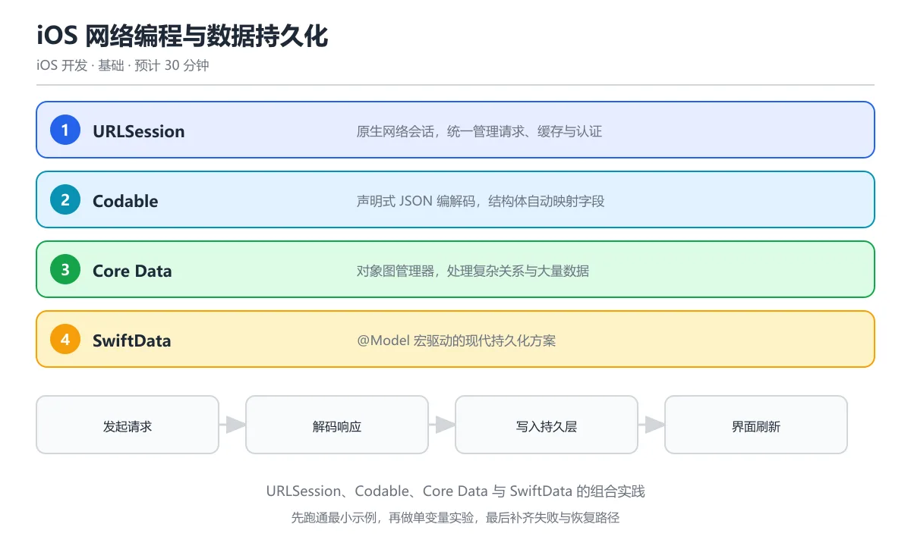

# iOS 网络编程与数据持久化

> 内容更新时间：2026-10-06 · 学习阶段：基础 · 预计用时：35 分钟



## 本节知识框架

**课程定位**：分类「ios_development」· 学习阶段 中级 · 建议用时 30 分钟。

本课主线：掌握 iOS 网络请求（URLSession）、JSON 编解码（Codable）、数据持久化（UserDefaults / Core Data / FileManager）以及网络层封装的最佳实践。

**复习清单**

- [ ] 能说出 URLSession 的三种 Task 类型及其适用场景
- [ ] 能用 Codable 协议完成 JSON 与 Swift 结构体的互相转换
- [ ] 能区分 UserDefaults、Core Data、FileManager 三种持久化方案的边界
- [ ] 能封装一个带错误处理与重试机制的网络请求层
- [ ] 能运行本课示例，修改一个输入后观察输出变化
- [ ] 能说出离线缓存策略的设计思路与失效处理

## 核心概念定义

| 术语 | 一句话说明 |
| --- | --- |
| URLSession | Apple 提供的网络请求 API，支持数据请求、上传、下载三种任务类型 |
| Codable | Swift 的编解码协议，Encodable 负责编码（Swift → JSON），Decodable 负责解码（JSON → Swift） |
| UserDefaults | 轻量级键值存储，适合保存用户偏好设置等少量数据 |
| Core Data | Apple 的对象图管理与持久化框架，适合复杂数据模型和关系查询 |
| FileManager | 文件系统操作 API，适合存储图片、缓存文件等二进制数据 |
| REST API | 基于 HTTP 协议的接口设计风格，用 GET/POST/PUT/DELETE 对应资源的增删改查 |
| 中间人攻击（MITM） | 攻击者在客户端与服务器之间拦截并篡改通信内容，iOS 通过 ATS（App Transport Security）强制 HTTPS 来防范 |
| 缓存策略 | 决定何时使用本地缓存、何时发起网络请求的规则，常见有 URLCache 和自定义缓存层 |

## 原理与运行机制

### URLSession 的工作流程

把 URLSession 想象成一家快递公司的调度中心。你要寄一个包裹（发起请求），先填好快递单（URLRequest），交给调度中心（URLSession），调度中心安排快递员（URLSessionTask）去取件和送达。快递员完成任务后，会把签收结果（Response）交还给你。

URLSession 提供三种任务类型：

1. **dataTask**：最常用的数据请求，返回 Data 对象，适合 API 调用
2. **downloadTask**：下载文件到本地临时目录，适合大文件下载
3. **uploadTask**：上传文件到服务器，适合图片、视频上传

```swift
// 最简单的 GET 请求
let url = URL(string: "https://api.example.com/lessons")!
let task = URLSession.shared.dataTask(with: url) { data, response, error in
    if let error {
        print("请求失败: \(error.localizedDescription)")
        return
    }
    guard let data else {
        print("没有收到数据")
        return
    }
    print("收到 \(data.count) 字节")
}
task.resume()
```

### Codable 协议：JSON 与 Swift 的桥梁

Codable 就像一台翻译机——把 JSON 翻译成 Swift 结构体（解码），或者把 Swift 结构体翻译成 JSON（编码）。你只需要让结构体遵循 Codable 协议，编译器会自动生成翻译代码。

```swift
// 定义数据模型
struct Lesson: Codable {
    let id: Int
    let title: String
    let duration: Int
    var isCompleted: Bool
}

// 解码：JSON → Swift
let json = """
{"id": 1, "title": "Swift 基础", "duration": 30, "isCompleted": false}
""".data(using: .utf8)!

let decoder = JSONDecoder()
let lesson = try decoder.decode(Lesson.self, from: json)
print(lesson.title) // "Swift 基础"

// 编码：Swift → JSON
let encoder = JSONEncoder()
encoder.outputFormatting = .prettyPrinted
let encoded = try encoder.encode(lesson)
print(String(data: encoded, encoding: .utf8)!)
```

### 三种持久化方案对比

把数据持久化想象成"把东西存起来"：

| 方案 | 类比 | 适合存什么 | 不适合存什么 |
| --- | --- | --- | --- |
| UserDefaults | 便签纸 | 用户偏好、开关状态、上次登录时间 | 大量数据、敏感信息、结构化列表 |
| Core Data | 文件柜 | 复杂数据模型、关系查询、大量结构化数据 | 简单的键值对、二进制文件 |
| FileManager | 仓库 | 图片、视频、缓存文件、导出的文档 | 需要频繁查询的结构化数据 |

```swift
// UserDefaults：保存和读取简单数据
UserDefaults.standard.set(true, forKey: "isDarkMode")
let darkMode = UserDefaults.standard.bool(forKey: "isDarkMode")

// FileManager：保存数据到文件
let documentsPath = FileManager.default.urls(for: .documentDirectory, in: .userDomainMask)[0]
let filePath = documentsPath.appendingPathComponent("lessons.json")
try encoded.write(to: filePath)

// 从文件读取
let loadData = try Data(contentsOf: filePath)
let loadedLessons = try decoder.decode([Lesson].self, from: loadData)
```

### 网络层封装：从散装请求到统一管理

初学者的网络请求往往散落在各个视图控制器里，就像每道菜都现买食材、现洗现切。成熟的网络层像一个中央厨房——统一采购（基础配置）、统一加工（请求构造）、统一质检（错误处理），各楼层（视图）只需要下单（调用接口）就行。

```swift
// 网络错误类型
enum NetworkError: Error {
    case invalidURL
    case noData
    case decodingError(Error)
    case serverError(Int)
    case noConnection
}

// 通用网络层
actor NetworkClient {
    static let shared = NetworkClient()
    private let session: URLSession
    private let decoder = JSONDecoder()

    init() {
        let config = URLSessionConfiguration.default
        config.timeoutIntervalForRequest = 30
        config.waitsForConnectivity = true
        self.session = URLSession(configuration: config)
    }

    func get<T: Decodable>(_ url: URL, as type: T.Type) async throws -> T {
        let (data, response) = try await session.data(from: url)
        guard let httpResponse = response as? HTTPURLResponse else {
            throw NetworkError.noData
        }
        guard (200...299).contains(httpResponse.statusCode) else {
            throw NetworkError.serverError(httpResponse.statusCode)
        }
        do {
            return try decoder.decode(T.self, from: data)
        } catch {
            throw NetworkError.decodingError(error)
        }
    }
}
```

## 典型应用场景

### 常见落地场景

- **用户信息加载**：启动时从 API 拉取用户资料，用 Codable 解码后缓存到本地
- **列表分页**：下拉刷新时请求下一页数据，与本地缓存合并显示
- **离线模式**：网络不可用时展示本地缓存数据，恢复网络后自动同步
- **图片缓存**：用 URLCache 缓存已加载的图片，减少重复请求
- **文件上传**：选择照片后通过 uploadTask 上传到服务器，显示进度条

### 选型边界

- 数据量小于 1MB 且结构简单：UserDefaults 或 JSON 文件
- 数据量大、需要查询和关联：Core Data 或 SQLite
- 纯二进制文件（图片、视频）：FileManager + documentDirectory
- 需要跨设备同步：CloudKit 或 iCloud + Core Data

## 代码/协议/SQL 示例

### 完整示例：带缓存的课程列表服务

```swift
import Foundation

// MARK: - 数据模型
struct CourseResponse: Codable {
    let courses: [Course]
    let totalCount: Int
    let page: Int
}

struct Course: Codable, Identifiable {
    let id: String
    let title: String
    let summary: String
    let minutes: Int
    let keywords: [String]
    var cachedAt: Date?
}

// MARK: - 缓存管理
actor CourseCacheManager {
    static let shared = CourseCacheManager()
    private let cacheKey = "cached_courses"
    private let maxAge: TimeInterval = 3600 // 1 小时

    func save(_ courses: [Course]) {
        let stamped = courses.map { course in
            Course(id: course.id, title: course.title, summary: course.summary,
                   minutes: course.minutes, keywords: course.keywords, cachedAt: Date())
        }
        if let data = try? JSONEncoder().encode(stamped) {
            UserDefaults.standard.set(data, forKey: cacheKey)
        }
    }

    func load() -> [Course]? {
        guard let data = UserDefaults.standard.data(forKey: cacheKey),
              let courses = try? JSONDecoder().decode([Course].self, from: data)
        else { return nil }

        // 检查缓存是否过期
        if let cachedAt = courses.first?.cachedAt,
           Date().timeIntervalSince(cachedAt) > maxAge {
            return nil
        }
        return courses
    }

    func clear() {
        UserDefaults.standard.removeObject(forKey: cacheKey)
    }
}

// MARK: - 网络服务
@MainActor
final class CourseService: ObservableObject {
    @Published var courses: [Course] = []
    @Published var isLoading = false
    @Published var errorMessage: String?

    private let baseURL = "https://api.example.com"

    func fetchCourses(page: Int = 1) async {
        isLoading = true
        errorMessage = nil
        defer { isLoading = false }

        // 先尝试加载缓存
        if let cached = CourseCacheManager.shared.load() {
            courses = cached
        }

        // 再请求最新数据
        guard let url = URL(string: "\(baseURL)/courses?page=\(page)") else {
            errorMessage = "URL 无效"
            return
        }

        do {
            let response: CourseResponse = try await NetworkClient.shared.get(url, as: CourseResponse.self)
            courses = response.courses
            CourseCacheManager.shared.save(response.courses)
        } catch let error as NetworkError {
            switch error {
            case .noConnection:
                if courses.isEmpty { errorMessage = "无网络连接，显示缓存数据" }
            case .serverError(let code):
                errorMessage = "服务器错误 (\(code))"
            default:
                errorMessage = "请求失败: \(error.localizedDescription)"
            }
        } catch {
            errorMessage = "未知错误"
        }
    }
}
```

### 带重试机制的请求

```swift
func fetchWithRetry(url: URL, maxRetries: Int = 3) async throws -> Data {
    var lastError: Error?
    for attempt in 1...maxRetries {
        do {
            let (data, response) = try await URLSession.shared.data(from: url)
            guard let http = response as? HTTPURLResponse,
                  (200...299).contains(http.statusCode) else {
                throw NetworkError.noData
            }
            return data
        } catch {
            lastError = error
            // 指数退避：第 1 次等 1 秒，第 2 次等 2 秒，第 3 次等 4 秒
            let delay = UInt64(pow(2.0, Double(attempt - 1)) * 1_000_000_000)
            try await Task.sleep(nanoseconds: delay)
        }
    }
    throw lastError ?? NetworkError.noData
}
```

## 时间/空间复杂度或性能分析

### 网络请求性能

| 指标 | 优化手段 | 说明 |
| --- | --- | --- |
| 请求延迟 | 连接复用（HTTP/2） | URLSession 默认支持 HTTP/2，减少 TCP 握手开销 |
| 数据传输量 | Gzip 压缩 | URLSessionConfiguration 默认启用 `usesCellularAccess` 和压缩 |
| 并发请求数 | 限制 session 并发 | `httpMaximumConnectionsPerHost` 控制同一域名的最大连接数 |
| 缓存命中率 | URLCache 配置 | 合理设置内存和磁盘缓存大小，减少重复请求 |

### 持久化性能

- **UserDefaults**：读写速度极快（< 1ms），但只适合小数据（< 100KB）。写入是同步的，频繁写入会阻塞主线程
- **Core Data**：批量插入用 `NSBatchInsertRequest`，比逐条 `insert` 快 10 倍以上
- **FileManager**：大文件用流式读写（`FileHandle`），避免一次性加载到内存

### 测量方法

先固定网络环境和数据规模跑一遍记录基线，再改变数据量（10 条 → 1000 条 → 10000 条）复测。用 Instruments 的 Network 和 Core Data 模板定位瓶颈，不要只看单次运行就下结论。

## 常见误区与易错点

| 错误 | 现象 | 修法 |
| --- | --- | --- |
| 在主线程解析大 JSON | 界面卡顿 | 用 `JSONDecoder.decode` 放在 async 函数里，或切换到后台队列 |
| 不处理 HTTP 状态码 | 把 404/500 当成功 | 检查 `HTTPURLResponse.statusCode` 是否在 200-299 范围 |
| UserDefaults 存大量数据 | 启动变慢、内存膨胀 | 改用 FileManager 或 Core Data |
| 忽略 ATS 配置 | 请求被系统拦截 | 确保服务器支持 HTTPS，不要关闭 ATS |
| 不取消已发出的请求 | 页面销毁后仍消耗资源 | 保存 Task 引用，在 `onDisappear` 或 `deinit` 中 cancel |
| Codable 字段名不匹配 | 解码失败 | 用 `CodingKeys` 枚举映射 JSON 字段名 |
| 缓存永不过期 | 用户看到陈旧数据 | 给缓存加时间戳，读取时检查是否超过 maxAge |
| 忘记调用 resume() | 请求永远不发出 | URLSessionTask 创建后默认是 suspended 状态，必须调 resume() |

## 与其他知识点的关系

### 先修课程

本课的先修内容是《Swift 与 iOS 开发》和《iOS SwiftUI完整教程》。你需要了解 Swift 的可选类型、async/await 语法以及 SwiftUI 的基本视图构建，才能顺利学习网络编程。

### 相关概念对比

- **URLSession vs Alamofire**：URLSession 是系统原生 API，零依赖；Alamofire 是第三方库，API 更友好但增加包体积
- **Codable vs JSONSerialization**：Codable 类型安全、编译期检查；JSONSerialization 灵活但需要手动类型转换
- **Core Data vs SwiftData**：Core Data 成熟稳定、文档丰富；SwiftData 是 iOS 17+ 的新框架，语法更简洁
- **UserDefaults vs Keychain**：UserDefaults 存非敏感偏好；Keychain 存密码、Token 等敏感信息

### 后续衔接

学完本课后，《iOS 推送通知与后台任务》会用到网络层来接收远程推送；《iOS 性能优化与调试》会深入分析网络请求的性能瓶颈。

## 自测题与参考答案

### 自测 1

不看正文，说出 URLSession 的三种 Task 类型及其适用场景。

**参考答案**：dataTask 用于普通 API 请求，返回 Data 对象；downloadTask 用于下载文件到本地临时目录，适合大文件；uploadTask 用于上传文件到服务器，适合图片和视频。

### 自测 2

Codable 协议中，如果 JSON 字段名和 Swift 属性名不一致怎么办？

**参考答案**：使用 CodingKeys 枚举来映射。例如 JSON 中是 `"user_name"`，Swift 属性是 `userName`，需要在 CodingKeys 中写 `case userName = "user_name"`。

### 自测 3

为什么不应该用 UserDefaults 存储大量数据？

**参考答案**：UserDefaults 的数据在 App 启动时会被一次性加载到内存。如果存储大量数据（超过 100KB），会显著增加启动时间和内存占用。大量数据应该用 FileManager 存成文件，或用 Core Data 做结构化存储。

### 自测 4

运行本课的 CourseService 示例，把 baseURL 改成一个不存在的地址，观察错误处理流程。

**参考答案**：程序会进入 catch 分支，errorMessage 被设置为"请求失败"相关的提示。如果本地有缓存数据，courses 仍然显示缓存内容；如果没有缓存，则显示错误信息。

### 自测 5

写一个场景：用户登录后需要把 Token 安全地保存下来，应该用哪种持久化方案？

**参考答案**：应该用 Keychain。Token 是敏感信息，UserDefaults 的数据可以被备份和读取，不安全。Keychain 是 iOS 提供的安全存储，数据经过加密，App 卸载后也会自动清除。

## 考点精讲

### 考点 1

关于 URLSession 的数据任务（DataTask），下列哪项描述最准确？

A. DataTask 只能发送 GET 请求，自定义请求头和请求体都不会被发送  

B. DataTask 不支持异步等待

C. DataTask 返回 Data 和 URLResponse，适合中小规模数据传输

D. DataTask 自动缓存所有响应

**正确答案：C**

**详细解释**：DataTask 是最常用的网络任务类型，返回 (Data, URLResponse)，适合 REST API 调用等场景。 如果响应体很大，应该改用 downloadTask 下载到文件，避免把整个内容读进内存导致峰值占用过高。 上传文件用 uploadTask，边下载边解析用 delegate 接收增量数据，选错任务类型会让内存和性能都吃亏。 本题正确项是「DataTask 返回 Data 和 URLResponse，适合中小规模数据传输」。

---

### 考点 2

Codable 协议的核心作用是什么？

A. 加密网络数据

B. 在 Swift 对象和 JSON 之间自动转换

C. 压缩数据体积

D. 管理网络连接池，复用底层 TCP 长连接  

**正确答案：B**

**详细解释**：Codable = Encodable + Decodable，让 Swift 结构体可以自动序列化为 JSON 或从 JSON 反序列化。 遇到字段名不一致时用 CodingKeys 映射，日期和嵌套结构则通过自定义 DateFormatter 或嵌套 Codable 类型处理。 本题正确项是「在 Swift 对象和 JSON 之间自动转换」。

---

### 考点 3

Core Data 和 UserDefaults 的主要区别是什么？

A. UserDefaults 适合存储大量结构化数据，底层 plist 支持按字段建索引和关系查询  

B. Core Data 是对象图管理器，适合复杂数据模型；UserDefaults 只适合少量键值对

C. 两者完全相同

D. Core Data 只能存字符串

**正确答案：B**

**详细解释**：Core Data 支持复杂关系查询和大量数据，UserDefaults 仅适合偏好设置等少量简单数据。 UserDefaults 底层是 plist，读写会占用启动时间，存放大列表会让启动变慢，所以只放开关和少量偏好。 需要跨设备同步或复杂查询时再考虑 Core Data 或 SwiftData，简单偏好设置不要为了统一而强行上数据库。 本题正确项是「Core Data 是对象图管理器，适合复杂数据模型；UserDefaults 只适合少量键值对」。

---

### 考点 4

SwiftData 相比 Core Data 的主要优势是什么？

A. 运行速度更快

B. 使用宏和属性包装器，API 更简洁，与 SwiftUI 深度集成

C. 支持更多数据库

D. 不需要 iOS 系统，框架自带运行时，可在任意平台复用模型  

**正确答案：B**

**详细解释**：SwiftData 是 Apple 在 iOS 17 推出的现代数据框架，用 @Model 宏替代 NSManagedObject，代码更简洁。 SwiftData 的迁移也要提前规划，使用 VersionedSchema 管理模型版本，才能在后续升级中平滑演进。 本题正确项是「使用宏和属性包装器，API 更简洁，与 SwiftUI 深度集成」。

---

### 考点 5

在网络请求中，为什么需要在后台线程处理数据？

A. 后台线程速度更快

B. 避免阻塞主线程导致 UI 卡顿

C. 后台线程更安全

D. 这是可选的优化

**正确答案：B**

**详细解释**：主线程负责 UI 渲染，耗时的网络和数据解析操作应放到后台线程，完成后切回主线程更新 UI。 URLSession 的回调本身运行在后台队列，但更新 UI 必须切回主线程，用 MainActor 或 DispatchQueue.main 包一层。 本题正确项是「避免阻塞主线程导致 UI 卡顿」。

---

### 考点 6

题目：在「iOS 网络编程与数据持久化」的术语表里，下列术语与解释的配对哪些是正确的？（多选）
A. 「URLCache」：HTTP 缓存实现，自动缓存响应数据减少重复请求  
B. 「CodingKeys」：Apple 原生网络请求 API，支持 data/download/upload 三种任务  
C. 「URLSession」：Codable 的关联枚举，用于映射 JSON 字段名与 Swift 属性名  
D. 「UserDefaults」：轻量级键值持久化存储，适合用户偏好设置  
正确答案：AD

**解析**：本题正确项是「URLCache」：HTTP 缓存实现，自动缓存响应数据减少重复请求，以及「UserDefaults」：轻量级键值持久化存储，适合用户偏好设置，这两组配对与术语表一致。另外两组把术语和解释张冠李戴：「CodingKeys」被安上了Apple 原生网络请求 API，支持 data/download/upload 三种任务的解释，「URLSession」反而拿到了Codable 的关联枚举，用于映射 JSON 字段名与 Swift 属性名的定义，所以两组都不能选。复习时回到「iOS 网络编程与数据持久化」的术语速查表逐条核对，配对题考的是定义里描述的对象和边界，而不是术语的字面长相。

---

## 术语速查

| 术语 | 一句话说明 |
| --- | --- |
| URLSession | Apple 原生网络请求 API，支持 data/download/upload 三种任务 |
| Codable | Encodable + Decodable 的组合协议，实现 Swift 对象与 JSON 的自动转换 |
| URLRequest | 描述一次网络请求的完整信息：URL、HTTP 方法、请求头、请求体 |
| HTTPURLResponse | HTTP 响应对象，包含状态码、响应头等服务器返回的元信息 |
| UserDefaults | 轻量级键值持久化存储，适合用户偏好设置 |
| Core Data | Apple 的对象图管理框架，支持复杂数据模型和关系查询 |
| Keychain | iOS 安全存储服务，数据加密保存，适合 Token 和密码 |
| URLCache | HTTP 缓存实现，自动缓存响应数据减少重复请求 |
| ATS | App Transport Security，强制 App 使用 HTTPS 的安全策略 |
| CodingKeys | Codable 的关联枚举，用于映射 JSON 字段名与 Swift 属性名 |

## 参考资料与复核

- 复核范围：URLSession API 行为、Codable 编解码规则、持久化方案选型建议

| 参考资料 | 本课用途 |
| --- | --- |
| [URLSession Documentation](https://developer.apple.com/documentation/foundation/urlsession) | Apple 官方 URLSession 文档，网络请求的完整 API 参考 |
| [Encoding and Decoding](https://developer.apple.com/documentation/foundation/archives_and_serialization/encoding_and_decoding_custom_types) | Codable 协议官方指南，自定义编解码规则 |
| [Core Data Documentation](https://developer.apple.com/documentation/coredata) | Core Data 框架完整文档 |
| [Apple Security Overview](https://developer.apple.com/documentation/security) | iOS 安全机制概览，包含 Keychain 服务 |

- 最后复核：2026-10-04
- 下次复核：2027-10-17

## 内容元数据

- 内容版本：v2.0
- 最后更新：2026-10-06
- 学习阶段：基础
- 适用环境：通用开发环境；本课聚焦 URLSession。
- 内容来源：内置结构化课程与工程实践整理
- 相关主题：mobile ios networking
- 质量版本：P0 测验标准 + P1 覆盖扩展 + P2 体验补全